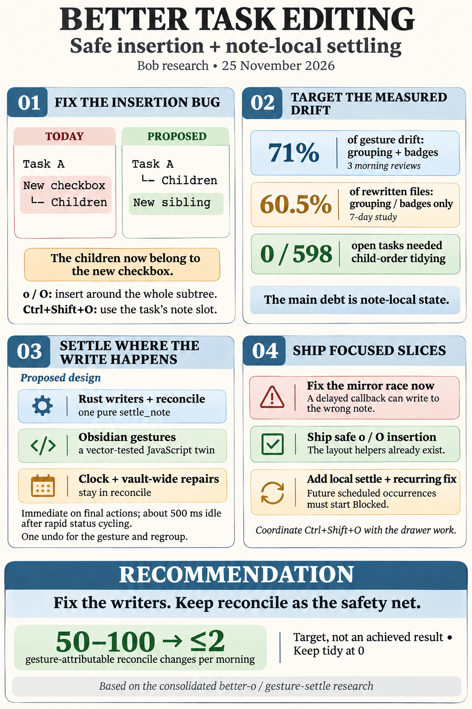
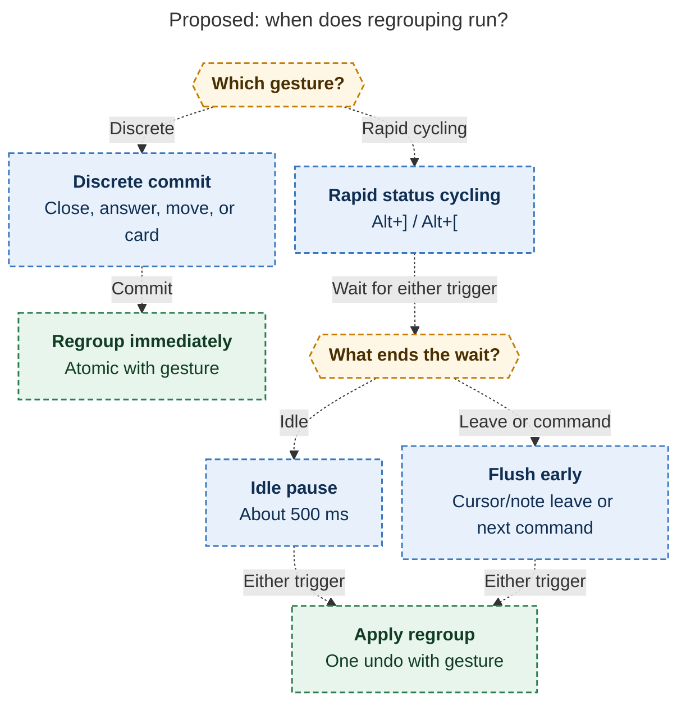
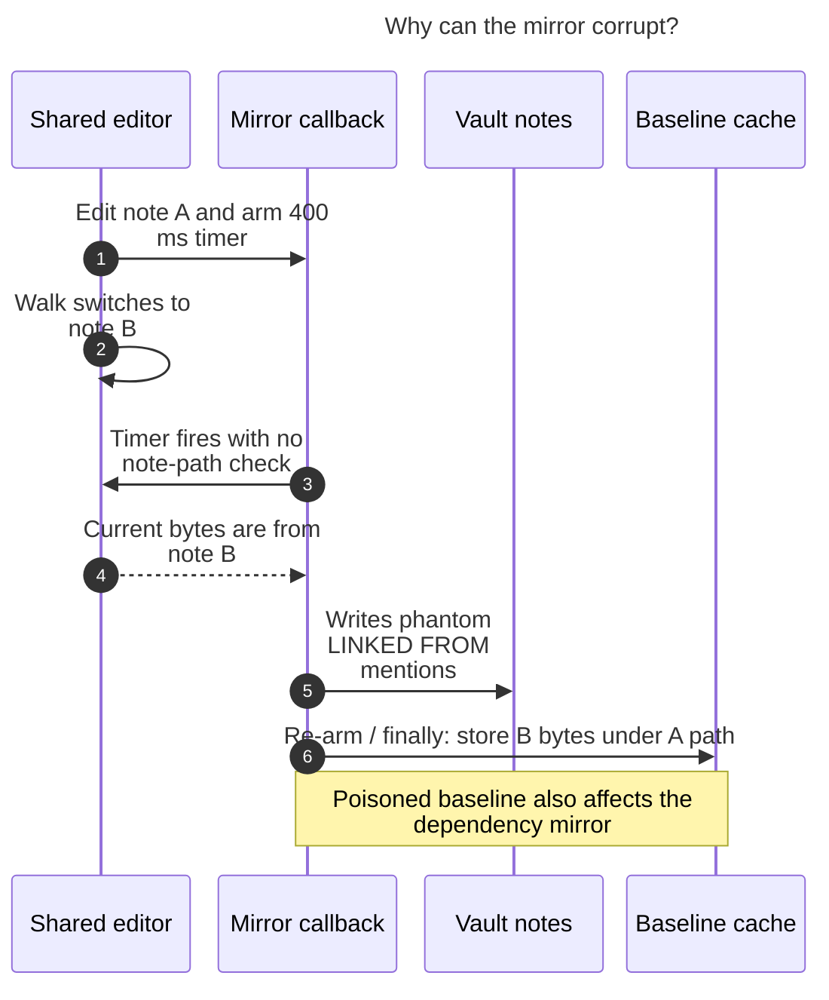
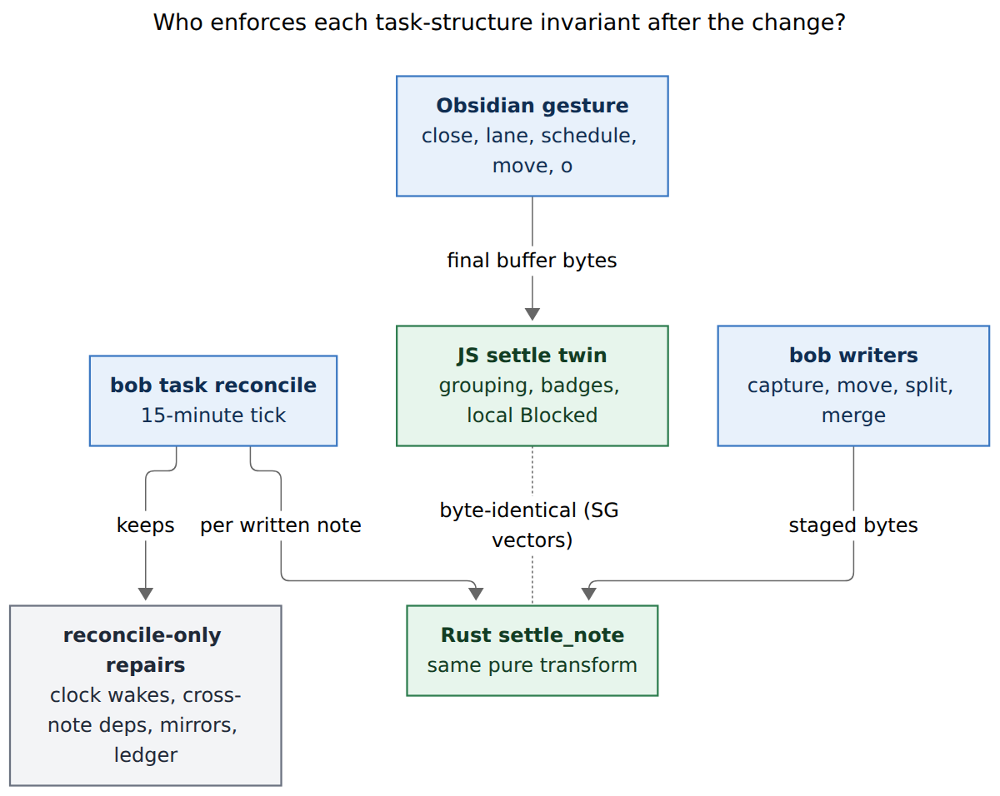

# Better `o` / `Ctrl+Shift+O` and gesture-settled task structure — consolidated report

> **Research query:** How should I implement the `^better-o` task and the
> `^all-ops-reconcile-tasks` task in `~/bob/bob.md`? Critique the plan — is it a good
> idea, and would you take a different approach? Call out any justified requirement
> adjustments, and end with a recommended solution.

## Bottom line

**`^better-o` is a clear yes — it is a bug fix, not polish.** Today, `o` on a task
headline inserts `- [ ] ` on the very next line at the same indent
(`task-status-cycler/src/010-core.js` `getOpenLineBelowPrefix`,
`140-plugin-vim.js` `handleVimOpenLineBelow`), which **re-parents the task's entire
subtree** (Depends-On, reqs, drawers, logs) under a new line that is not even a Bob task
(no `#task`, no `[created::]`). cdx reproduced this through the plugin's own Node
harness; all five reports agree. `Ctrl+Shift+O` always inserts a plain `- ` as the
*first* child — the Cancel-Log / managed-link zone — out of zone on any task with
managed lines. The fix is small because the machinery already exists
([the critique](#is-the-plan-a-good-idea), item 1).

**The all-ops requirement has the right goal and the wrong framing.** "Respect
`bob task reconcile` structure" conflates three layers with different owners:

1. **Intra-task child order** (`task_block_layout`, repaired only by explicit
   `bob task tidy`). Reconcile is *forbidden* from touching this
   (`docs/task-requirements.md` §3.4: "Nothing else ever reorders a block: no writer,
   no `bob task reconcile`, and no background pass"), and the vault is already clean:
   `bob task tidy` dry-run reports **0 tidied of 598 open tasks**. `^better-o` plus the
   `bob-cli-pn` split bug close the remaining writer gaps.
2. **Note-local derived state** — status grouping under `## Tasks`, the badge row, and
   the local future-`[scheduled::]` → `[?]` rule. This is where nearly all
   gesture-caused reconcile churn lives
   ([where churn comes from](#where-reconcile-churn-actually-comes-from)), and no plugin
   or capture path writes it today.
3. **Vault-global and clock-driven work** — midnight wakes, cross-note dependency
   recovery, mention/BLOCKS mirrors, Pomodoro ledger cleanup. This **should stay in
   reconcile**; re-implementing it per keystroke buys <15% of churn at enormous cost.

**Recommended solution in one line:** fix
[the mention-mirror bug](#two-live-bugs-the-research-surfaced) now; ship `o`/`O` as
better-o slice 1 on the existing layout twin; extract reconcile's note-local subset as
one pure Rust `settle_note` composed by capture/move/split/merge and by reconcile
itself; give plugins a vector-pinned JS settle twin wired into status-changing gestures
with a two-tier regroup policy; land `Ctrl+Shift+O` with/after the drawer epic's
Obsidian phase; measure with a replay harness. Details in
[Recommended solution](#recommended-solution).

## The tasks moved while the swarm ran

As of this read of `~/bob/bob.md`, **`^all-ops-reconcile-tasks` is cancelled
(`[-]`, 2026-11-25) and merged into `^better-o`**, which is now In Progress (`[/]`) and
carries the all-ops ask as a child requirement ("Make all Obsidian keymaps and capture
panel operations respect `bob task reconcile` structure … so reconcile needs to update
files much less often"). The old "starts after" sequencing debate in the reports is
moot: this is now one task, and the right reading is **one program with independently
shippable slices** ([Recommended solution](#recommended-solution)). A new dependent also
appeared: `^single-logs-task-bullet` ("merge all logs into a single sub-bullet") depends
on `^better-o`, so the layout work below should not bake in "three separate log drawers"
any deeper than the existing `ChildKind::Log` zone already does.

## Is the plan a good idea

**Yes, with re-scoping.** The shared idea — *the gesture that creates the dirt writes
the canonical form for the note it already holds* (grk's phrasing) — is right, matches
the accepted writer-rule contract, and has two existing in-repo precedents (archive,
reroll). The failure modes to avoid, on which all five reports agree:

- **"All keymaps and capture operations" is unbuildable as written.** It invites an
  ~40-gesture audit with untestable "done". Most gestures already produce canonical
  bytes (capture files reqs/notes via `note_home`/`insert_reqs`; Ctrl+] scoops;
  Depends-On/relation stages write their mirrors).
  [The evidence](#where-reconcile-churn-actually-comes-from) narrows the real work to
  three causes plus a finite wiring inventory.
- **Never call `bob task reconcile` or `bob task tidy -a` from a keymap.** Reconcile
  takes the vault-maintenance lock, needs a 2-second quiet period, scans ~5,800 files,
  and races unsaved buffers. The gesture already has the buffer; it should write one
  slot in one undo step.
- **Never teach reconcile to tidy** — that reopens §3.4 and the "hand edits are never
  reshuffled" promise. Insertion uses slots; existing out-of-zone children stay until
  explicit tidy (the first-req scoop stays the one exception).
- **The real recurring cost is twin sprawl.** Plugins cannot call Rust, so each
  in-gesture invariant needs a JS twin; ~8 twins exist already and they have at least
  one known divergence (JS puts a new BLOCKS line above an existing Depends-On; Rust
  and contract §14.5 put it after). A grouping/settle twin is the largest yet and is
  only safe with Rust-generated shared vectors, as RL/RW do today. A WASM `bob-core`
  that retires the twin pattern is worth a separate research spike, not a blocker.
- **In-gesture regrouping is a UX change that needs an explicit policy.** A closed task
  jumping ~100 lines immediately (instead of ≤15 min later under an external rewrite)
  is better but needs cursor rules and walk-queue re-resolution by identity, not line
  number. gem's two-tier policy is the best proposal: **immediate atomic regroup** on
  discrete commits (walk answers, Ctrl+Enter close, Alt+N/Alt+X, Task/Decay cards,
  moves, `Ctrl+Shift+Enter` links, promote) where the write is a final disposition, and
  **settle-on-idle (~500 ms, flushed on cursor-leave/note-leave/next command)** for
  rapid `Alt+]`/`Alt+[` cycling so a double-tap never mutates the wrong line or yanks
  the viewport mid-cycle. One `u` undoes gesture + regroup together.
- **"Much less often" is not checkable.** cld's replay harness (archive each vault
  commit, run `reconcile --dry-run -f json` with `BOB_NOW` pinned, attribute per
  gesture via the review stats journal) turns it into a number and should be kept as
  `scripts/dev/reconcile-drift`.

[The regroup-timing diagram](#figure-settle-timing) shows the proposed two-tier branch:
discrete commits regroup at once, while rapid `Alt+]`/`Alt+[` cycling waits for idle or
a flush on cursor-leave, note-leave, or the next command.

_Proposed regrouping runs immediately for discrete commits; rapid cycling waits for idle or an early flush, with one undo for gesture and regroup._

## Where reconcile churn actually comes from

*Measured twice, convergent.*

The vault is clean **at rest** (tidy 0/598; `bob task reconcile --dry-run` is a no-op —
grk, mus, gem all confirmed), so the problem is *transient gesture-created drift healed
every 15-minute tick*, exactly as the task says. Two researchers measured history with
different windows and methods and converged:

| Source of drift | cld (3 morning reviews, 214 commits, replay through `reconcile --dry-run` with `BOB_NOW`) | gem (7 days, 208 reconcile commits, 529 file rewrites, diff autopsy) |
| --- | --- | --- |
| Status-group moves + badge rows (note-local grouping) | **71%** of gesture drift | **86.8%** of rewritten files touch badges; 60.5% are grouping/badges only |
| Recurring spawns left `[ ]` with future `[scheduled::]` | 15% | 5.7% of files; **100% of all `[ ]`→`[?]` flips** |
| Phantom `LINKED FROM` mentions (bug `bob-cli-py`) | 8% | 9.3% |
| Legitimate clock/vault-global work (midnight wakes, ledger, dep healing) | excluded/remainder | ~22% (13.8% midnight wakes + ledger + dep healing) |

Three fixes therefore cover **~75–94% of gesture-attributable churn**. Notable detail:
`gtd_daily.md` alone produced ~41% of cld's group moves (each PRE/POST recurring
completion creates two moves), and even *creating the `^all-ops-reconcile-tasks` task
itself* triggered a badge-only rewrite commit (gem). cdx independently demonstrated the
badge-debt mechanism from a clean fixture: one `bob capture` leaves a stale `⚪ open`
badge that the next reconcile rewrites — `moved_block_count: 0`, so "moved tasks" alone
is the wrong metric.

**Resolved disagreement:** mus argued managed-link placement was "the only part that
reduces reconcile writes" and that grouping work belongs elsewhere. The two independent
measurements contradict this — status grouping *is* reconcile's own write, and it
dominates. mus's underlying contract point stands, though: child *order* is tidy's
domain, and making keymaps zone-correct reduces **tidy** debt, not reconcile writes.
Both metrics belong in acceptance ([Recommended solution](#recommended-solution),
Phase 5).

## Two live bugs the research surfaced

**Two live bugs fell out of the research and are independently valuable:**

- **Mention-mirror cross-note corruption** (cld and gem found it independently; lead
  verified in code): `fireDependencyHandEditMirror`
  (`bob-navigation-hotkeys/src/600-plugin-dependency-mirror.js`) fires 400 ms after an
  edit but never checks that the editor still shows `snapshot.parentPath`. During the
  `]s` walk the same editor has often moved to another note, so the mirror writes
  phantom `LINKED FROM (💬 mentions)` entries cross-note, and both the re-arm path and
  the `finally` block cache the *new* note's bytes under the *old* path, poisoning the
  baseline for the dependency (BLOCKS) mirror too. ~9.3% of a week's reconcile rewrites
  are reconcile stripping these. Filed as **`bob-cli-py`** (by the cld researcher;
  corroborated `+1` by the lead with the code-level root cause).
- **Recurring completions are born `[ ]`**: cross-plugin `Ctrl+Enter` close goes
  through the Obsidian Tasks plugin so recurrence fires; the spawned occurrence carries
  a future `[scheduled::]` but status `[ ]`, which reconcile later flips to `[?]` and
  regroups. gem measured **98 of 98** `[ ]`→`[?]` reconcile flips over 7 days as exactly
  this; cld's independent 3-morning replay agrees (~15% of morning drift). The rule is
  purely note-local and trivially fixable in a post-Tasks settle step.

[The mirror-race diagram](#figure-mirror-race) orders the race: the delayed callback
reads an editor now showing another note, writes phantom `LINKED FROM` mentions, and
caches that note's bytes under the old path.

_Without a note-path check, a delayed mirror can write phantom mentions and cache the new note’s bytes under the old path._

## Lead verification of disputed claims

| Claim | Status after lead check |
| --- | --- |
| A JS twin for insertion slots exists (cdx/grk/gem) vs. "no twin found" (mus) | **Twin exists.** `plugins/task-status-cycler/src/196-task-block-layout-twin.js` exports `taskBlockInsertionSlot`, `taskBlockNoteHome`, `taskBlockEnsureNotesDrawer`; `197-task-block-tidy-twin.js` has the tidy planner. mus's Phase-1 "port the library" is already done; **no production keymap calls it** (grk), which is the actual gap. |
| Mention-mirror bug is real | **Confirmed by code read.** The fire path checks only the cursor line; no `view.file.path === snapshot.parentPath` guard anywhere; `finally` block caches `snapshot.editor.getValue()` under `snapshot.parentPath` unconditionally. |
| New tasks get `[created::]` + `[fresh::]` (grk, mus) vs. `[created::]` only (cld) | **Created only.** Capture tests assert created lines contain no `[fresh::]` (`src/native/capture/note_pull.rs:2640`); vault evidence agrees (today's new task has `[created::]` only). Freshness is stamped by review, not birth. |
| Grouping transform is pure and portable | **Confirmed.** `src/native/task_status_groups/mod.rs` module doc: pure Markdown transform, no filesystem, classification supplied by caller. Precedent for composing it into writes exists in `bob task archive` and `bob task reroll`, gated by `grouping_eligible_note` (`task_status_hooks/compose.rs:228`). |
| Capture has a single choke point for a grouping post-pass | **Confirmed.** `src/native/capture/plan.rs` ~1155–1168: after `apply_type_agreement`, before `task_tracker.finish` — both dry-run and commit pass through it, so previews stay byte-identical. |
| Drawer-epic state | `bob-cli-ph`: ph.1–ph.3 (dual-read) **closed**; ph.4 (bob-cli bold writers), ph.6, ph.7 (Obsidian drawer rendering/typing/writers), ph.8 (Mac) **in progress**. Beads `bob-cli-pn` (split LINKED FROM placement bug) and `bob-cli-po` (capture preview order) are **ready**. |

## Requirement adjustments

These are explicit; accept or reject each individually.

### Adjustments for better-o

**For `^better-o`:**

- **B1 — "below the current one" means after the entire task block** at the same
  indent, never the next physical line (all reports; the literal reading is the bug).
  Same subtree-skip rule for `o` on *any* list item with children: reqs get a sibling
  req after their subtree (cdx showed the same child-stealing on reqs; current 15-test
  suite only covers leaf reqs), notes get a sibling note, Pomodoro entries are never
  split.
- **B2 — the new line is a real, fresh Ready task**: `- [ ] #task ` plus
  `[created::YYYY-MM-DD]` (capture's byte format, **no `[fresh::]`**,
  [lead verification](#lead-verification-of-disputed-claims)); it inherits no ID, lane,
  dates, deps, or history. Empty-abandon (Esc without typing) prunes the scaffold and
  reverts any badge increment.
- **B3 — inside a generated status group** (`### Next & In Progress` / `### Blocked` /
  `### Done & Canceled`), the new Ready task goes to the **end of the intake** with a
  `<C-o>` jump recorded (cld B2, gem A4) — a new task must not be born inside
  Done & Canceled. grk's simpler v1 (insert after the block, let settle move it) is
  acceptable only once Phase 3 settle exists. **Decision for Bryan**
  ([open decision 1](#open-decisions-for-bryan)).
- **B4 — `O` mirrors `o`** (sibling task above, same bytes, same intake rule), and `o`
  on a managed link/log line redirects to the owning task's note slot instead of
  inserting into a forbidden zone. Add gem's guard: `Ctrl+Shift+]` promote must refuse
  managed lines (two vault commits show a `BLOCKS:` line promoted into a `#task`).
- **B5 — `Ctrl+Shift+O` opens a note where `note_home` says**: tail slot on a zero-req
  task; end of the Notes drawer on a req-owning task, creating the drawer through
  `taskBlockEnsureNotesDrawer` only when a note actually lands (so it inherits ph.4/7's
  bold `**Notes**` spelling automatically); `## Notes` section on a `^prj` owner. It is
  a *note* key — it does not create reqs (`- [` typing and Ctrl+] already own that;
  grk adjustment 2 over the older reqs-plan wording).
- **B6 — close the req-typing zone gap** (gem A5): expanding `- [` on a direct child of
  a task that sits after drawers/notes should re-slot the new req into the reqs zone
  and run the first-req scoop in the same transaction — otherwise `Ctrl+Shift+O`-then-
  `- [` on a drawered zero-req task silently violates `reqs < drawers`.
- **B7 — sequencing**: `o`/`O` (B1–B4) ship now; `Ctrl+Shift+O` (B5–B6) lands with or
  immediately after **ph.7**, and in all cases only through the shared drawer
  helpers — never hard-coded `NOTES`/`**Notes**` bytes. Leave the coordination note on
  `bob-cli-ph` the task itself asks for (gem §6.3 has ready-to-use text: keep
  `taskBlockEnsureNotesDrawer`/insert planners callable as pure functions; keep `o`
  = sibling-after-subtree, Smart Enter/`Ctrl+Shift+O` = child, orthogonal).

### Adjustments for the merged all-ops requirement

- **S1 — redefine scope as four deliverables** (gem A1, cld R1): (a) note-local settle
  (grouping + badges + local `[?]` rule) in every status/residence-changing writer,
  Rust and JS; (b) layout parity for the remaining writer gaps (`^better-o`,
  `bob-cli-pn`); (c) the recurring-spawn `[ ]`→`[?]` fixup; (d) the `bob-cli-py`
  mirror fix. Child *order* is explicitly out of scope for reconcile-reduction (it is
  tidy's, and already clean).
- **S2 — one function, not forty patches** (cld's `settle_note`): extract reconcile's
  note-local subset as a pure Rust
  `settle_note(rel_path, contents, today, &TaskClassification)` (local
  future-`[scheduled::]` Blocked rule + `task_status_groups::transform` + badge, gated
  by `grouping_eligible_note`); reconcile composes it per note so "writer that settled"
  ≡ "what reconcile would write" **by construction**; capture/move/split/merge/gmail/
  ref/gkeep compose the same function; plugins get the vector-pinned JS twin.
- **S3 — carve-outs stay reconcile's** (cld R3): midnight rollover/wakes,
  previous-daily grace, off-clock settling, cross-note dependency recovery, ledger
  hygiene. They need a vault scan or a clock and cannot be gesture-local.
- **S4 — acceptance is measured, two metrics** (cld R2 + mus): gesture-attributable
  reconcile changes in a morning-review replay ≤ 2 (today: 50–100), *and*
  `bob task tidy --dry-run` stays at 0 — on a fixed clock, clean baseline, excluding
  clock-driven categories. Byte-level "subsequent repair plans no change" is the
  fixture-level assertion (cdx), not `applied_files`/`moved_block_count`.
- **S5 — Mac Capture stays a thin client** (decision `mac-capture-is-a-thin-client`):
  zero Swift write-path changes; capture's settle happens in bob; verify `⌃↩ Open`
  jump-line remapping through the existing `TaskBlockTracker` re-anchoring, and keep
  preview/commit byte-identical (the choke point in
  [lead verification](#lead-verification-of-disputed-claims) guarantees this).

## Recommended solution

The solution ships in phases; Phases 1–3 are parallelizable.

**Caption:** Every writer produces note-local canonical form through one pure
transform — Obsidian gestures through the vector-pinned JS settle twin, bob writers and
reconcile through the Rust `settle_note` — while clock-driven and vault-global repairs
stay reconcile-only. Rendered size: 799.4 × 638 px; fit scale: 81.7% (Mermaid CLI
12.0.0, PDF-mirroring config).

- **Phase 0 — mention-mirror fix (`bob-cli-py`, ready; small, bob-plugins).** Guard
  fire-time on `view.file?.path === snapshot.parentPath` (read the real file from the
  vault or drop the pass — reconcile heals), flush/cancel the pending timer on
  `active-leaf-change`/`file-open`, and stop the `finally`-block cache poisoning. Guard
  `mirrorDependencyHandEdit` identically. Regression test: switch files inside the
  debounce window. Kills ~9% of weekly churn and stops active data corruption.
- **Phase 1 — better-o slice 1: `o`/`O` (medium, task-status-cycler).**
  [B1–B4 + B6](#adjustments-for-better-o) on the existing `196`/`197` twins (subtree
  end, insertion slots, scoop). One CM6 transaction, one undo; empty-scaffold prune on
  InsertLeave/blur; non-task lines keep today's behavior byte-identical. Tests:
  headline-with-children, req-with-subtree, grouped vs intake, `^prj`, Pomodoro rows,
  folded blocks, undo/redo; replace the leaf-req pins; a real-Obsidian e2e for the vim
  keys (the harness patterns exist). Update `docs/task-status-cycler.md` §"o and O".
  Deploy via `bob plugins sync -p task-status-cycler`, no `-F`.
- **Phase 2 — Rust `settle_note` + CLI wiring (medium, bob-cli).** Extract per
  [S2](#adjustments-for-the-merged-all-ops-requirement); byte-identity with today's
  reconcile output is the regression gate. Compose into the capture choke point
  (`capture/plan.rs` ~1155, forwarding `task_tracker` and `items[].result.line` through
  the line mapping so Mac `⌃↩ Open` lands right), and into `task move`/`split` (fixing
  **`bob-cli-pn`** in the same stroke)/`merge`, plus
  `gmail sync`/`ref create`/`gkeep pull` via one `group_if_eligible` helper. Generate **SG vectors** from Rust
  (`tests/fixtures/task_status_groups/vectors.json`) for the twin. Also land cld's
  replay harness as `scripts/dev/reconcile-drift` (S4's meter).
- **Phase 3 — JS settle twin + gesture wiring (large, bob-plugins).** Port
  `settle_note` to a versioned ledger-tools API pinned by byte-identical SG vector
  copies (`test-task-reqs-twin-copies.cjs` pattern). Wire per gem's inventory tables:
  Tier-1 immediate on Ctrl+Enter close (plus the **recurring-spawn `[ ]`→`[?]` fixup**
  right after the Tasks command returns), Alt+N, Alt+X, Task/Decay/schedule cards,
  `Ctrl+Shift+M` (both notes), split, promote, `Ctrl+Shift+Enter` target writes;
  Tier-2 settle-on-idle for `Alt+]`/`Alt+[`. Cursor stays put with a `<C-o>` jump to
  the moved block; the `]s` queue re-resolves rows by note + block id/line text; old
  ledger-tools or mobile degrades gracefully to reconcile-heals.
- **Phase 4 — better-o slice 2: `Ctrl+Shift+O` (medium, with/after ph.7).** B5 on
  `note_home`/`ensure_notes_drawer` + ph.7's `*` assist and Smart Enter; leave the
  coordination note on `bob-cli-ph` now (B7).
- **Phase 5 — re-measure.** Run the drift harness over a week of reviews; check S4.
  Any residual category is either a gesture missing its settle call (fix) or
  clock/vault-global (reconcile's, by design). Decide the WASM spike and the
  `gtd_daily.md` question with numbers in hand.

## Open decisions for Bryan

1. **`o` inside a status group** — end-of-intake with a recorded jump (recommended), or
   literal "below" and let settle move it on the next regroup?
2. **`gtd_daily.md` grouping** — a per-note opt-out (`task_groups: false`-style switch
   in `grouping_eligible_note`, ~20 lines) removes ~40% of group-move churn by itself
   but changes how the checklist note reads; with Phases 2–3 shipped it becomes
   unnecessary. Keep grouping and rely on settle, or opt out as a cheap interim?
3. **Cursor policy when settle moves the block under you** — stay put with a `<C-o>`
   jump recorded (recommended), or follow the block?
4. **WASM `bob-core` research spike** — with ~9 twins and a known JS/Rust divergence
   (BLOCKS insert position), is retiring the twin pattern worth its own bead?

## Inputs and provenance

**Lead consolidation, 2026-11-25.** Inputs: five independent swarm reports
(`__cdx`, `__cld`, `__grk`, `__mus`, `__gem`, siblings of this file) plus the lead's own
verification passes over `bob-cli` (`5ab392a1`), `bob-plugins` (current master), the live
vault, and the bead tracker. Research request: how to implement `bob.md#^better-o` and
`bob.md#^all-ops-reconcile-tasks`, a critique of the plan, justified requirement
adjustments, and a recommended solution.

- **cdx** — harness reproductions of all three insertion defects (incl. the req
  child-stealing variant), the capture badge-debt fixture proof, the editing-session /
  draft-boundary design, acceptance-criteria rigor (byte-clean repair plans, offset
  encodings, undo).
- **cld** — the 3-morning replay method and drift table, the `settle_note`
  architecture, B/R requirement sets, the drift-harness proposal, the `gtd_daily`
  analysis, co-discovery of both live bugs; filed `bob-cli-py`.
- **grk** — the ownership framing (slot writes vs courtesy writes vs safety net; see
  its two rendered figures beside this file), the stale-vault-note corrections
  (on/pq closed; better-o was pre-scoped as slot lookups in
  `plan:202611/task_requirements.md` §10), beads `bob-cli-pn`/`bob-cli-po`, the
  "don't gate on ph — call the helper" argument.
- **mus** — the sharpest contract reading (reconcile never tidies; metric names the
  wrong command; hand-edit freedom is load-bearing), the Rust-side writer/zone
  inventory. Its "no twin exists" and "managed links are the lever" claims did not
  survive verification ([lead verification](#lead-verification-of-disputed-claims)),
  and its hard ph gate is relaxed to slice-2-only (B7).
- **gem** — the 7-day autopsy, both live bugs with fixes (incl. the cache poisoning and
  the 98/98 recurring measurement), the 13-row cursor-context matrix, the two-tier
  regroup policy, the capture choke-point analysis with Mac line-remapping, the ph
  coordination-note text, the `Ctrl+Shift+]` managed-line guard.
- **lead** — current task-state correction
  ([the tasks moved](#the-tasks-moved-while-the-swarm-ran)), twin-export and
  mention-mirror code verification, `[created::]`-only evidence,
  grouping-purity/choke-point/bead-state checks, `bob-cli-py` corroboration, this
  consolidation and figure.
