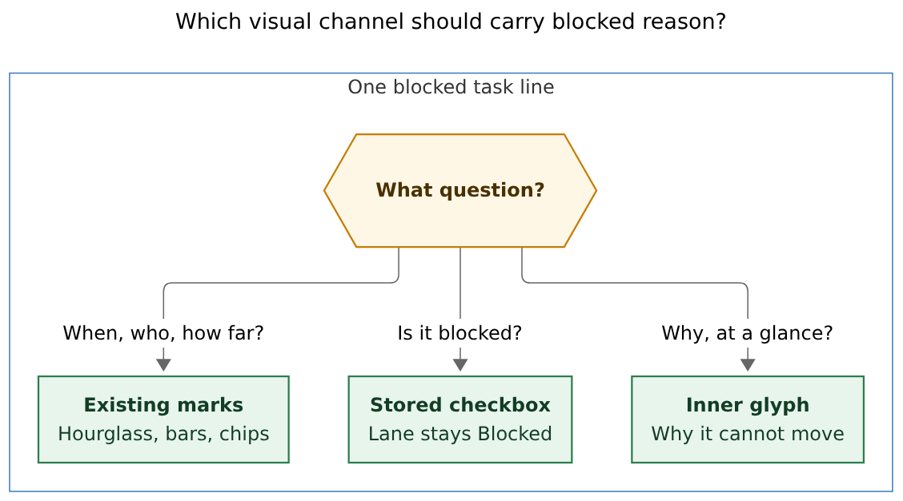
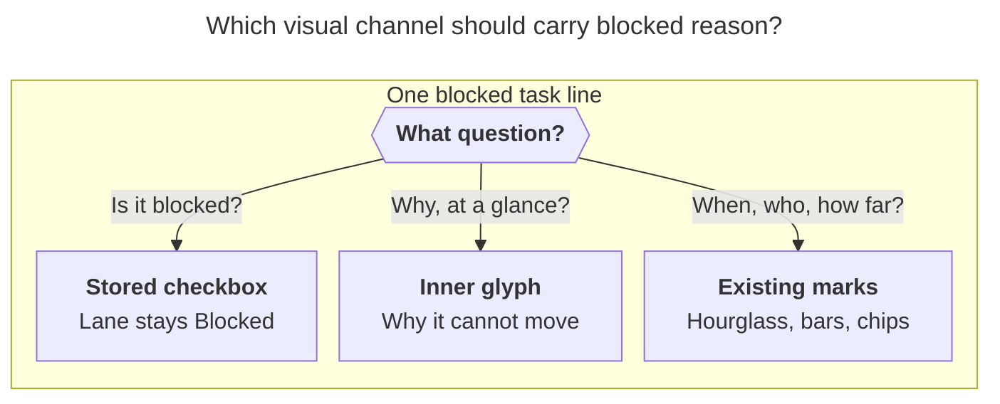
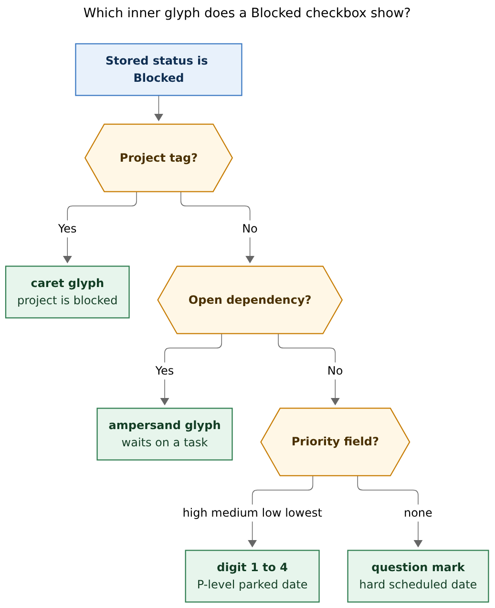
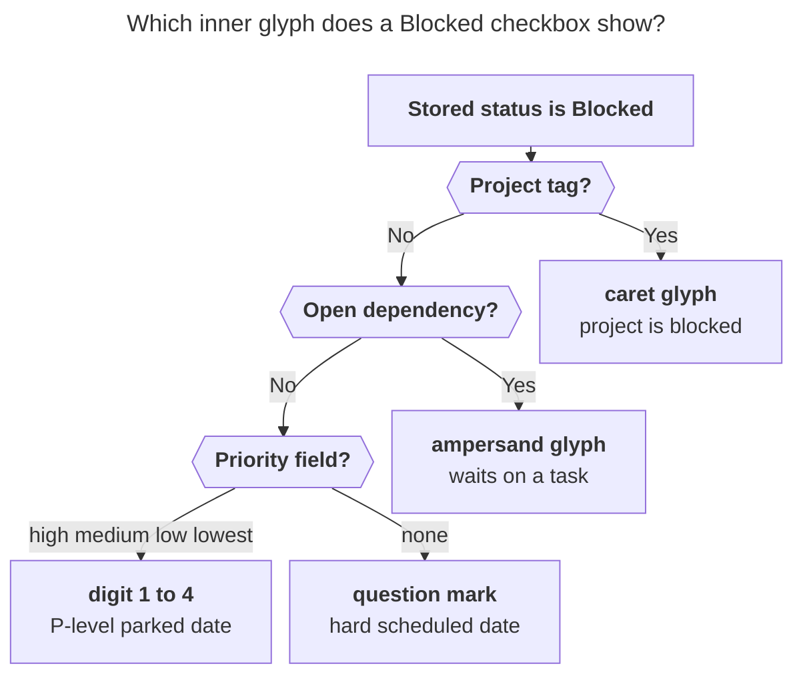

# Blocked-reason glyphs on the Obsidian checkbox

- **Researcher:** grk
- **Date:** 2026-11-01
- **Question:** How should Obsidian make it visually obvious *why* a Bob task is Blocked, and should the checkbox start showing `[1]`–`[4]`, `[&]`, and `[?]` for priority, open dependencies, and scheduled dates?
- **Verdict:** The goal is right and high-value. Encode the *reason* as a **render-only inner glyph** on the existing red Blocked checkbox. Keep the stored Markdown symbol as `?`. Add a project glyph the sketch omitted. Treat `[1]`–`[4]` as the P-deferred parked-date case, which is most of the vault. Leave the priority signal-bar in place except on rows whose checkbox already shows that digit.

---

## 1. In one breath

A Blocked task in Obsidian currently has one visual sentence: a red filled box with a white `?`, a red left rail, and a tinted row. That sentence answers "this cannot move." It does not answer "waiting on a person," "waiting on a project," or "parked until a P2 window." Those three facts already exist — on `blocked.md`, in reconcile `reason_kinds`, in `#prj_is_blocked`, in Depends-On chips, and in the hourglass date mark — and they are invisible at the first eye-stop, the checkbox.

The sketch (`[1]`–`[4]`, `[&]`, leftover `[?]`) is aimed at the right slot. Putting those characters *into the Markdown status* would break the single compatible Blocked status (`symbol: "?"`, type `ON_HOLD`), the `blocked.md` STRANDED query, reconcile, the cycler, freshness, and every `data-task="?"` rule. Putting them *inside the already-styled checkbox* via CSS `content`, while the file still says `[?]`, gives the scan benefit and keeps every writer honest.

Priority is a related confusion, not a blocked reason. Choosing P1–P4 writes a future `[scheduled::]` inside a configured window, and that date is what derives `[?]`. That is why a wall of Blocked rows *feels* like a wall of P-levels. The digit belongs on parked P-deferred rows. A Ready or Next task with a priority field keeps its lane checkbox and the existing signal-bar.

---

## 2. Is this a good idea?

**Yes.** Three properties make it the right layer.

1. **The checkbox is the only shared first column.** Area and project notes group by lane (`### Blocked`), so 31 of 47 notes that hold any Blocked task mix reasons in one heading. `bob.md` has 57 Blocked rows of five kinds; `sase.md` has 64 of four. `blocked.md` already partitions the same set globally (PROJECT / DEPENDENT / SOON / LATER / HORIZON / RECURRING). The gap is the *source note*, where the eye hits a uniform red `?`.

2. **The fact is already computed.** Reconcile emits `local_dependency`, `local_schedule`, `project_dependency`, and `project_schedule`. Reading-task JSON already returns `blocked_by` in `effective_block_reasons` order. Ledger-tools already indexes open Depends-On targets for chips, already parses canonical `[priority::]`, already compares `scheduled` to today for date marks, and already sees `#prj_is_blocked`. A new inner glyph is a new view of those inputs.

3. **The analog is proven.** Priority, date, freshness, tag, today, and task-link marks are display-only: stored Markdown stays the source, a CSS mask or `content` glyph is the view, the cursor reveals the field, a session toggle restores the raw look, and a missing plugin leaves the vault as it is today. The vault snippet `task-statuses.css` already paints `/`, `*`, `?`, `-` *inside* the checkbox with `content: var(--task-status-symbol)`. The new work is to let that variable vary by *reason* on Blocked rows.

What would make it a bad idea:

- writing `[1]`, `[2]`, `[&]` as Tasks status symbols (a second Blocked vocabulary);
- painting P-level digits onto Ready / Next / Pending checkboxes (the checkbox would stop meaning lane);
- giving P1–P4 Next-green / Pending-amber / Ready-blue fills (Blocked rows would stop scanning as Blocked);
- hiding the priority signal-bar on every prioritized task (Ready P2 still needs it);
- inventing a reason CSS cannot know (open vs stale `dependsOn`, future vs past `scheduled`).

---

## 3. Critique of the plan as stated

The plan, as written:

- Render `[1]`, `[2]`, `[3]`, `[4]` for tasks that have a `priority` property, in distinct colors.
- Stop rendering the priority icon.
- Render `[&]` for tasks blocked by open task dependencies.
- Leave `[?]` for tasks blocked by an explicit `scheduled` property.

### What is right

- **The checkbox inner letter is the right slot.** The vault already speaks that language: Next is a green `*`, Pending an amber `/`, Blocked a red `?`, Cancelled a muted `-`. Adding `&`, `^`, and `1`–`4` to that alphabet is how a Bob user already reads a line.
- **`[&]` for open dependencies is the right extra letter.** Capture's path-aware `&` already means "prerequisite." Tasks' own `is blocked` flag is exactly that set. On 2026-11-01 the vault had 49 Blocked tasks whose primary reason was an open dependency (53 if project-tagged dependents are counted in).
- **Leftover `[?]` for a hard date is the right default.** Clearing priority with Task Card `0` keeps the scheduled date and drops the P-field. Those rows *are* "explicitly scheduled." A generic question mark remains the honest glyph when no more specific letter applies, and when the reason index is not ready.
- **The P-digit intuition matches how Blocked actually arises.** P1–P4 write `[priority:: high|medium|low|lowest]` and roll a date in 2–7 / 8–30 / 31–90 / 91–365 day windows. Reconcile then marks the task `[?]` because the date is in the future. Most Blocked rows are that machine. See §6.

### What is mixed together

The sketch treats **priority** and **blocked reason** as one encoding. They are two axes that happen to coincide for parked P-rolls:

| Axis | Stored as | Who writes it | What it means |
| --- | --- | --- | --- |
| Lane / Blocked | checkbox `?` `*` `/` ` ` | reconcile, cycler, capture | Can this move in a lane? |
| Why Blocked | Depends-On line, `[scheduled::]`, `#prj_is_blocked` | those writers; reconcile derives `[?]` from them | What is in the way? |
| Priority | `[priority:: high]` etc. | Task Card `1`–`4`, capture `$<N>` | Which P-window did I commit to? |

A task can hold all three. The UPS-battery row in `cash.md` is `[?]` with `[priority:: high]`, a *past* `scheduled` date, and an open `dependsOn`. Showing `[1]` on that row would hide the live blocker. Showing `[&]` keeps the P-level on the signal-bar, where it already lives.

The phrase "tasks that have a `priority` property" also covers Ready and Next rows whose date has arrived, or that never had a date. Those checkboxes currently mean lane. Replacing them with `[2]` would make a Next P2 look like a parked P2.

### What the sketch omitted

**Project blocking.** While a `^prj` line has its own reason, every open resident is `[?]` with `#prj_is_blocked`, and descendant projects inherit. `blocked.md` leads with `## PROJECT Tasks` and says project beats dependency, which beats cadence, which beats distance. On 2026-11-01, 60 Blocked tasks had that tag as their primary glyph under that precedence — more than open dependencies. A design with only digits, `&`, and `?` would paint those rows as P-digits or leftover `?` and disagree with the dashboard.

**Combinations.** Ten rows were future-schedule plus project; four were open-dependency plus project. One glyph has to win. `blocked.md` already chose the winner.

**The Tasks `is blocked` vs Bob `[?]` split.** Tasks' `is blocked` means "has an incomplete `dependsOn` target." Bob `[?]` also covers future dates and project tags. `blocked.md` depends on that split (`is blocked` for DEPENDENT, `is not blocked` plus a future date for SOON/LATER/HORIZON, `tags include #prj_is_blocked` for PROJECT, `status.name includes Blocked` for STRANDED). New stored symbols would have to be threaded through every one of those queries.

### What I would not ship

- **Five new custom statuses.** Obsidian Tasks treats the character between `[` and `]` as the status. Behaviour (next symbol, type, `status.name` filters, checkbox click) follows the registry. The live contract is *exactly one* compatible Blocked status: `symbol: "?"`, `name: "Blocked"`, `type: "ON_HOLD"`, `nextStatusSymbol: " "` (`docs/task-status-hooks.md`, `docs/reference/cli/task.md`). Next is *also* `ON_HOLD` (`*`). Extra ON_HOLD symbols would share Next's type; extra TODO symbols would share Ready's. STRANDED (`status.name includes Blocked`) would go blind.
- **A rainbow of P-level fills.** `--task-status-next` is green, `--task-status-in-progress` is amber, `--task-status-blocked` is red. Those three hues already mean lane. A P1 green box would read as Next.
- **Retiring the priority signal-bar globally.** It is the display contract in `docs/projects.md` § Priority marks: four rising bars, monochrome, truthful to the stored Tasks value, CSS-only on Tasks query rows so `hide priority` keeps working. It is the right mark on every *non-Blocked* prioritized line, and on Blocked lines whose inner glyph is `&` or `^`.

---

## 4. Requirement adjustments

These change the request. Each is justified.

1. **The stored checkbox stays `[?]` for every Blocked task.** The inner letter is a render-only overlay (`--task-status-symbol` plus a `data-bob-block` attribute). Source mode, git diffs, reconcile, the cycler, and Tasks queries keep seeing `?`.
   - *Why.* One compatible Blocked status is a hard CLI contract. `blocked.md` STRANDED, freshness open-symbol sets, task-link state-from-symbol, and `task-statuses.css` all key on `?`.
2. **Add a project inner glyph, `[^]`.** Primary when the line carries token-bounded `#prj_is_blocked`.
   - *Why.* Project blocking is a first-class reason in `decisions:projects-block-from-prj-line`, `decisions:subprojects-inherit-project-blocking`, and `blocked.md` § PROJECT. The original sketch had no letter for it. `^` is the `^prj` sigil the rest of Bob already uses.
3. **Precedence matches `blocked.md`:** project, then open dependency, then P-digit if a canonical priority field is present, else `?` for a future date with no P-field.
   - *Why.* The dashboard already taught this order. A note's `### Blocked` group and `blocked.md` must agree on what a row "is."
4. **`[1]`–`[4]` mean stored P-level on a Blocked row whose remaining reason is a future date.** Mapping: `high`→`1`, `medium`→`2`, `low`→`3`, `lowest`→`4`. Implicit P0 (no field) with a future date keeps `?`.
   - *Why.* That is the user's "priority property" case, tightened to Blocked rows so lane checkboxes stay lane checkboxes. Distance (tomorrow / 2–7 / 8–30 / 31+) stays on the hourglass and on `blocked.md` sections. A P2 whose date was later hand-moved still shows `2` (commitment class) while `⧗ tomorrow` tells the calendar.
5. **Keep Blocked chrome. Vary the inner letter.** All Blocked rows keep the red left rail, the red filled box, and `--task-status-blocked`. Optional: a *value ramp inside that red* so P1 (nearest) is a hair hotter and P4 (farthest) a hair cooler. Distinctness is the character first.
   - *Why.* The request asked for distinct colors per priority. A categorical four-hue scheme would collide with Next / Pending. A blocked-family ramp keeps the row in the Blocked tribe.
6. **Hide the priority signal-bar only when the checkbox already shows that digit.** Keep it on `&` / `^` / `?` rows that still have a priority field, and on every non-Blocked prioritized task.
   - *Why.* The request to drop the icon is right where it would duplicate a `[2]`. It is wrong where the inner glyph is answering a different question.
7. **One primary glyph per row.** Secondary reasons stay on the marks that already exist: Depends-On chips, the hourglass, `#prj_is_blocked`, the ⟲ recurrence mark.
   - *Why.* A checkbox holds one letter. Combo rows (schedule+project, dep+project) already have a documented winner.
8. **Fail closed to `?`.** If the Tasks memo is not ready, if `dependsOn` targets cannot be classified as open, or if `scheduled` is unparseable, keep the current question mark. Never guess a digit.
   - *Why.* Same sentence as Today marks and the reading board: a missing index yields no decoration, never a lie.
9. **Recurring Blocked rows follow the same glyph rule.** The ⟲ recurrence mark already names cadence. Fifteen Blocked recurring rows on 2026-11-01 all had future dates; they do not need a fifth checkbox family.

---

## 5. How Blocked looks today

### Checkbox chrome

`~/bob/.obsidian/snippets/task-statuses.css` is the live look:

- `--task-status-blocked` is `--color-red` (`#c65367`).
- A Blocked `li.task-list-item[data-task="?"]` / `.HyperMD-task-line[data-task="?"]` gets a 2px red left rail and a 13% red wash.
- The checkbox is filled with that red, and `::after` draws `content: var(--task-status-symbol)` in `--task-status-marker` (white), 0.75em, weight 800.
- `--task-status-symbol` is hardcoded to `"?"` for every Blocked row.

Next (`*`) and Pending (`/`) use the same inner-letter trick in green and amber. The new glyphs should join that alphabet, in the Blocked colour.

### Marks already on the line

| Mark | What it shows | Why it is not enough alone |
| --- | --- | --- |
| Priority signal-bar | P1–P4 as 4/3/2/1 filled bars; off-ladder `highest` as `!` | Monochrome by contract ("color whispers"); sits after the text; present on Ready/Next too |
| Date mark | Hourglass plus `Fri` / `Nov 7` / `tomorrow` | Sits after the text; does not say *project* vs *dependency* vs *P-roll* |
| Depends-On chips | Child line, miniature checkboxes, `waiting on N` | Invisible in Tasks `short mode` (which `blocked.md` uses) and easy to miss in a 60-row `### Blocked` group |
| `#prj_is_blocked` | Machine tag | Easy to hide; Tasks `tags include` is a substring trap the contract already warns about |
| Task-link ring | Generic blocked ⊖ on links *to* the task | Lives on the daily-note link, not on the residence checkbox |

### The dashboard already named the reasons

From `~/bob/blocked.md`:

> Every blocked task appears in exactly one section below. Project blocking beats task dependency, which beats cadence, and cadence beats distance.

| Section | Query | Checkbox glyph this design would show |
| --- | --- | --- |
| PROJECT | `tags include #prj_is_blocked` | `^` |
| DEPENDENT | `is blocked` and not project | `&` |
| TOMORROW / SOON / LATER / HORIZON | `is not blocked`, not recurring, by scheduled distance | `1`–`4` or `?` |
| RECURRING | `is not blocked`, `is recurring`, scheduled after today | same as parked-date |
| STRANDED | `status.name includes Blocked`, no live reason | `?` (should be empty; it was empty on 2026-11-01) |

SOON is 2–7 days, LATER 8–30, HORIZON 31+. Those *are* the default P1 / P2 / P3–P4 windows in `docs/projects.md`. The digit on the checkbox is the source-note echo of a taxonomy Bryan already uses on the dashboard.

### Tasks plugin styling rules

Custom statuses need CSS or a theme to look like anything other than a checked box ([Style custom statuses](https://publish.obsidian.md/tasks/How+To/Style+custom+statuses); [Styling](https://publish.obsidian.md/tasks/Advanced/Styling)). Tasks puts `data-task`, `data-task-status-type`, and `data-task-status-name` on the `li`. The vault snippet already consumes those. The recommended overlay adds one more attribute, `data-bob-block`, and wins on specificity (`[data-task="?"][data-bob-block="p2"]` over `[data-task="?"]`) so snippet load order cannot clobber it.

---

## 6. What the vault actually holds

Native `bob query --tasks 'status.type is ON_HOLD'` against `~/bob` on 2026-11-01 (local date used as "today"): 487 ON_HOLD tasks, of which **478 are Blocked (`?`)** and 9 are Next (`*`). Blocked and Next sharing `ON_HOLD` is why new stored symbols cannot hide in that type.

Primary glyph under the recommended precedence, 478 Blocked tasks:

| Primary glyph | Count | Share |
| --- | --- | --- |
| `[2]` P2 / `medium` | 197 | 41% |
| `[3]` P3 / `low` | 91 | 19% |
| `[^]` project | 60 | 13% |
| `[1]` P1 / `high` | 55 | 12% |
| `[&]` open dependency | 49 | 10% |
| Recurring (then P-digit or `?`) | 15 | 3% |
| `[?]` hard date (future schedule, no P-field) | 8 | 2% |
| `[4]` P4 / `lowest` | 3 | <1% |
| STRANDED (no live reason) | 0 | 0% |

Parked P-digits together: **346 rows, 72%.** That is the wall of identical `?` the sketch is reacting to.

31 of 47 notes that hold any Blocked task mix two or more primary kinds in the same note. The noisiest:

| Note | Blocked rows | Kinds |
| --- | --- | --- |
| `sase.md` | 64 | P1, P2, P3, dep |
| `bob.md` | 57 | P1, P2, P3, P4, dep |
| `love.md` | 25 | P1, P2, P3, P4, hard date |
| `cash.md` | 24 | P1, P2, P3, dep, recurring |
| `dev.md` | 17 | P1, P2, P3, dep, recurring |

A scan of `### Blocked` on those notes is exactly the failure mode: one red letter, five meanings.

Canonical `[priority::]` on Blocked rows: 212 `medium`, 97 `low`, 70 `high`, 3 `lowest`, 96 with no field (Tasks reports those as "Normal"). Open `dependsOn` that Tasks still considers blocking: 53. `#prj_is_blocked`: 60. Future `scheduled`: 380. The overlap is real; precedence is the design.

---

## 7. Recommended solution

### Three channels, one line

**Reader question:** Which visual channel should carry blocked reason?

**Caption:** Keep the stored checkbox as the Blocked *lane*, put *why* in the inner glyph, and leave when / who / how far on the marks that already exist.



Rendered size: 751 × 419 px; fit scale: 86.9%. Mermaid CLI 12.0.0.



### Inner-glyph precedence

**Reader question:** Which inner glyph does a Blocked checkbox show?

**Caption:** Project blocking wins, then an open dependency, then a P1–P4 digit when a priority field is present, else a question mark for a hard scheduled date.



Rendered size: 690 × 848 px; fit scale: 94.6%. Mermaid CLI 12.0.0.



### The alphabet

| `data-bob-block` | Inner letter | When | Tooltip seed |
| --- | --- | --- | --- |
| `project` | `^` | `#prj_is_blocked` | `Blocked by project [[note]]` |
| `dep` | `&` | Tasks `isBlocked` / open projected Depends-On target | `Blocked by N open tasks` · first title |
| `p1` | `1` | canonical `[priority:: high]` | `P1 · High · scheduled Fri, Nov 7` |
| `p2` | `2` | `medium` | `P2 · Medium · …` |
| `p3` | `3` | `low` | `P3 · Low · …` |
| `p4` | `4` | `lowest` | `P4 · Lowest · …` |
| `schedule` (or absent) | `?` | future date, no P-field; or index not ready | `Scheduled Fri, Nov 7 · in 6 days` |

Off-ladder `[priority:: highest]` is rare in this vault (zero Blocked rows on 2026-11-01). If it appears on a Blocked parked-date row, reuse the existing urgent `!` silhouette *inside* the box, or keep `?` and let the signal-bar speak. Do not invent a `[0]` or `[!] ` status letter in v1.

### Beauty rules

These are the house rules the other ledger marks already follow, applied to this slot.

- **Shape first, colour second.** The letter is the signal. Colour never carries the distinction alone (same sentence as the 🔑 last-blocker badge on BLOCKS chips).
- **Stay in the Blocked tribe.** Red rail, red fill, white letter, 0.75em, weight 800, `font-variant-numeric: tabular-nums` on digits. Optional fill ramp: P1 uses the current `--task-status-blocked` at full strength; P4 mixes ~25% toward `--text-muted`. `&` can sit at full strength (actionable). `^` can sit a step duller (inherited).
- **One box, one letter.** No emoji inside the 16px checkbox. `⛓` and `⏳` already live on the child line and the date mark; they overflow a 0.75em box.
- **Quiet neighbours.** When the inner letter is `1`–`4`, fold the priority signal-bar (it would repeat the digit). Leave the hourglass — it is the calendar, not the class. Leave Depends-On chips on `&` rows; they name *which* task.
- **Reversible.** Cursor on the checkbox still cycles with Alt+] / click through the existing `?` → Ready contract. Source mode shows `[?]`. Session command **Toggle blocked-reason marks** (default on) restores a uniform `?`.
- **Reduced motion.** No extra animation. The existing snippet already draws a static letter.

### Before / after, as a scan

A mixed `### Blocked` group today:

```text
- [?] Create weekly file templates!          ⧗ Nov 3   ▂▃▄▅
- [?] Install new UPS battery!               ⧗ Oct 18  ▂▃▄▅
    ⛓ depends on  ( ○ CP1500 battery swap )
- [?] Artifact annotations auto-read!        ⧗ Oct 27  ▂▃▄▅  #prj_is_blocked
- [?] Plan badge should count pomodoros      ⧗ Nov 6   ▂▃▄▅
```

The same group with inner glyphs (stored bytes unchanged):

```text
- [1] Create weekly file templates!          ⧗ Nov 3
- [&] Install new UPS battery!               ⧗ Oct 18  ▂▃▄▅
    ⛓ depends on  ( ○ CP1500 battery swap )
- [^] Artifact annotations auto-read!        ⧗ Oct 27  ▂▃▄▅
- [2] Plan badge should count pomodoros      ⧗ Nov 6
```

The rail stays red. The first column becomes a legend Bryan can read at speed: soon-parked, waiting on a task, waiting on a project, later-parked.

---

## 8. How to implement it

This is a **bob-ledger-tools display mark**, same family as priority / date / freshness / today. No reconcile writer. No Tasks registry edit. No status-group heading rewrite.

### Model

A pure helper, listener-free, never throws:

```text
blockReasonModel(line, ctx) →
  null | { key, glyph, tooltip, hidePriorityMark }
```

Inputs, all already in plugin scope:

- checkbox symbol is `?` (else `null` — Ready/Next/Pending/Done/Cancelled stay as they are);
- token-bounded `#prj_is_blocked` (same matcher as project-blocking JS);
- open-dependency boolean from the Depends-On / Tasks memo reverse index already used by chips (`isBlocked` plus projected open ids; stale `dependsOn` pointing at `done/` does *not* qualify);
- `priorityMarkCanonicalField(line)` (reuse; unknown / duplicate / uppercase → no digit);
- future `scheduled` vs local today (reuse date-mark parsing);
- `ctx.ready`: Tasks memo and today are available.

`hidePriorityMark` is true only for `p1`–`p4`.

Keep the helper in lockstep with Rust `reason_kinds` *classification*, even though it never writes. Vectors should include the PDB/PDT project cases, a past-dated High task with an open dep (glyph `&`, bar stays), a P2 with a hand-moved tomorrow date (glyph `2`, hourglass `tomorrow`), and an unready memo (glyph `?`).

### Render hosts

1. **Live Preview.** A CodeMirror line decoration sets `data-bob-block` on `.HyperMD-task-line[data-task="?"]`. The snippet's `::after` already reads `--task-status-symbol` from that line.
2. **Reading view.** Post-processor sets the same attribute on `li.task-list-item[data-task="?"]`.
3. **Tasks query results.** Post-processor on `li.plugin-tasks-list-item[data-task="?"]` (or `[data-task-status-name="Blocked"]`). CSS-only cannot compare `scheduled` to today or know whether a `dependsOn` target is still open, so this host needs JS, unlike the priority-mark Tasks host. Date marks already proved a Tasks DOM pass is viable.

Plugin CSS, higher specificity than the snippet:

```css
li.task-list-item[data-task="?"][data-bob-block="p2"],
.HyperMD-task-line[data-task="?"][data-bob-block="p2"],
.plugin-tasks-list-item[data-task="?"][data-bob-block="p2"] {
  --task-status-symbol: "2";
}
```

and the siblings for `1` `3` `4` `&` `^`. Default remains `"?"`.

When `hidePriorityMark` is true, the existing priority-mark widget / CSS host is skipped for that line (LP/Reading) and the Tasks `.task-priority` glyph is hidden with the same clip pattern the mark already uses for the emoji.

### API and docs

- `api.blockReasonMarks` namespace v1, top-level api v3, mirroring `api.priorityMarks` / `api.dateMarks`.
- Display contract page in the date-marks style, suggested path `docs/block-reason-marks.md`, with a pointer from `docs/task-status-hooks.md` § Derived Blocked status and from `docs/projects.md` § Priority marks.
- Session command **Toggle blocked-reason marks**, default on, independent of **Toggle task priority marks**.
- Tooltip on hover/focus of the checkbox host: the seed phrases above, plus `Ctrl+Shift+P` / `Ctrl+Shift+B` as the matching gesture. Colour is never the only signal; `aria-label` repeats the tooltip verb.

### What stays out of v1

- Mac Capture inspector reasons (docs/ref.md already notes the inspector does not yet show `blocked_by`).
- Reading Board (it already has `blocked` / `blocked_by` on `bob ref` rows).
- Task-link rings: they still draw a generic blocked ⊖. A later pass can reuse `blockReasonModel` for the *target* of a daily-note link.
- Splitting `### Blocked` in area notes into PROJECT / DEPENDENT / P-window subheadings. That is a reconcile grouping writer, and `blocked.md` already does the partition globally.
- CSS-only v1. It cannot tell a stale `dependsOn` from an open one, or a past date from a future one.

### Risk notes

- **Click / cycle.** The overlay must not swallow pointer events on the checkbox. The snippet already draws `::after` on the checked input; we only change `content`.
- **Short mode.** `blocked.md` uses `short mode`. The inner glyph still sits on the checkbox, so the dashboard sections gain a redundant-but-harmless letter. That is acceptable; the high-value surface is the source note.
- **`&` and HTML.** CSS `content: "&"` is a string and is fine. Capture `&` alignment is a plus.
- **`^` vs capture `^route:id`.** Capture `^` is a broader existing-task sigil. The tooltip always says *project*. If `^` feels too close to "task link," `▣` is the fallback; try `^` first because it matches `^prj` and fits the ASCII inner-letter family (`? * / - & 1 2 3 4`).
- **Mixed-version plugins.** Without ledger-tools, the snippet keeps painting `?`. That is the correct fallback.
- **Theme / Style Settings checkbox packs.** If a future theme overrides `::after` with a mask-image, the letter loses. The current vault snippet *is* the checkbox pack; ship the symbol map next to it (plugin CSS) and document that a third-party checkbox snippet must keep `content: var(--task-status-symbol)`.

---

## 9. Alternatives, briefly

| Approach | Why it loses |
| --- | --- |
| New stored statuses `[1]` `[2]` `[&]` | Breaks the one-Blocked-status contract, STRANDED, type queries, click-next, and combo rows |
| Reason chip after the description | The line is already crowded with freshness, date, priority, type, root, today; the checkbox is the empty slot |
| Restyle only the left rail (solid / dashed / double) | Too quiet for a 60-row group; colour/weight of a 2px bar is not a letter |
| Subheadings under every note's `### Blocked` | Writer churn; reconcile grouping is by lane; combo rows still need a winner |
| CSS `:has(#prj_is_blocked)` / `:has(.task-priority)` only | Cannot know open vs stale deps or future vs past dates; would also restyle Ready P2 rows |
| Put P-digits on every prioritized checkbox | Destroys lane meaning on Ready / Next / Pending |

The inner-glyph overlay is the one that is intuitive (same alphabet as `*` `/` `?`), reliable (stored status unchanged, fail closed), and beautiful (one red family, tabular digits, no new widget).

---

## 10. Recommended next step

Write a display contract (`docs/block-reason-marks.md`) and a bob-ledger-tools phase that:

1. ships `blockReasonModel` with shared vectors against Rust `reason_kinds` plus the 2026-11-01 combo cases;
2. sets `data-bob-block` on Live Preview, Reading, and Tasks hosts;
3. maps those keys onto `--task-status-symbol` in plugin CSS;
4. folds the priority bar only for `p1`–`p4`;
5. adds the session toggle and checkbox tooltip.

No Markdown migration. No Tasks settings change. No reconcile change. After that lands, a follow-up can reuse the same model on task-link rings and on the Mac inspector.

---

## Sources

- Vault snippet `~/bob/.obsidian/snippets/task-statuses.css` (Blocked inner `?`, red chrome).
- Vault note `~/bob/blocked.md` (PROJECT / DEPENDENT / distance / RECURRING / STRANDED precedence).
- Native Tasks query, 2026-11-01: `bob query --tasks 'status.type is ON_HOLD'` (478 Blocked, reason breakdown in §6).
- `docs/task-status-hooks.md` (derived Blocked, exactly one `?` ON_HOLD status, `reason_kinds`).
- `docs/task-dependencies.md` §7 chips, §13 project blocking, §14 BLOCKS 🔑 badge.
- `docs/projects.md` § Priority property and scheduled rolls, § Priority marks.
- `docs/ref.md` `blocked_by` / `effective_block_reasons`.
- `docs/date-marks.md`, `docs/task-link-marks.md`.
- `docs/reference/vault-format.md` checkbox table.
- Decisions: `task-status-is-derived`, `task-lanes-are-sticky`, `task-deps-are-depends-on-links`, `projects-block-from-prj-line`, `subprojects-inherit-project-blocking`.
- Obsidian Tasks: [Custom Statuses](https://publish.obsidian.md/tasks/Getting+Started/Statuses/Custom+Statuses), [Style custom statuses](https://publish.obsidian.md/tasks/How+To/Style+custom+statuses), [Styling](https://publish.obsidian.md/tasks/Advanced/Styling).
- bob-ledger-tools `src/135-priority-marks.js` and `styles.css` priority / dep-chip hosts.

Figures rendered with `@mermaid-js/mermaid-cli` 12.0.0, securityLevel `strict`, theme `neutral`, DejaVu Sans.
