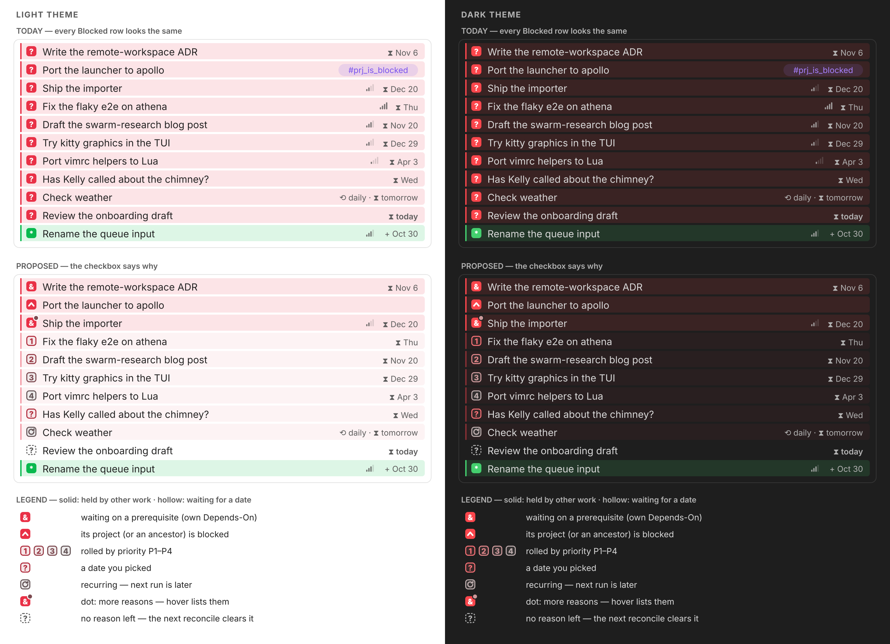

# Blocked-reason checkboxes: make `[?]` say *why*

Researched **2026-11-01** by `cld` against bob-cli master `8347a46d`, bob-plugins
(`origin/master`), and the live `~/bob` vault (read-only). Mockups are rendered SVG
approximations of Obsidian's default theme, not Obsidian screenshots.

**The question.** Bryan wants Obsidian to show clearly, and attractively, *why* a
task is Blocked. His low-confidence sketch was:

- render `[1]`–`[4]` for tasks with a `priority`, one color per priority;
- stop rendering the priority icon;
- render `[&]` for tasks blocked by open dependencies;
- keep `[?]` only for tasks explicitly scheduled with `scheduled`.

He asked me to critique the plan, adjust it where justified, and end with a
recommended solution.

---

## TL;DR

**The instinct is right. The checkbox is the right place to say why. I would ship
it as a display-only "block mark", never as new status characters.** The
adjustments below are flagged **A1–A8** and argued in §2.

1. **Blocked is overloaded, and mostly by priority rolls.** Of the vault's 552 open
   `#task` lines, **478 (87%) are `[?]`**. With the precedence proposed here, they
   split as follows:

   | Reason | Rows |
   | --- | --- |
   | Priority roll | **346 (72%)** |
   | Blocked project | 56 (12%) |
   | Own open prerequisites | 53 (11%) |
   | Recurring rule waiting for its next run | 15 (3%) |
   | Date Bryan picked by hand | **8 (2%)** |

   Today all 478 look identical: a solid red box with a white `?` on a red-tinted
   line.
2. **Glyphs** (A5 adds the last three):

   | Mark | Meaning |
   | --- | --- |
   | `&` | waiting on its own prerequisites (matches the capture sigil `&note:id`) |
   | `1` `2` `3` `4` | deferred by a P1–P4 priority roll (matches the `2` key and `$2`) |
   | `?` | a date picked by hand |
   | `^` | its project, or an ancestor project, is blocked (the reason lives on `^prj`) |
   | `⟲` | a recurring task waiting for its next run |
   | dashed `?` | no reason is left; the next reconcile clears it |

3. **Two families (A4).**
   - **Solid** means *held by other work*: `&` and `^`.
   - **Hollow** means *waiting for a date*: the digits, `?`, and `⟲`. Hollow rows
     also get a lighter line tint.
   - Effect: strongly red rows drop from 478 to 109, so real blockers stand out.
4. **Use one ordered color ramp, not four hues (A3).** Every hue in the vault
   already means something. Red is Blocked, yellow is In Progress, green is Next,
   blue is Ready, and orange is attention. Priority is ordinal, so P1–P4 run from
   deep red to grey. Each tone is distinct, and every glyph clears 4.5:1 contrast
   in both themes.
5. **The priority icon (your question): hide it only where it's redundant (A7).**
   On the 346 digit rows the checkbox already says the priority, so the inline
   signal bars fold away. Keep them everywhere else: Ready, Next, and Pending rows,
   closed rows, and `&`/`^` rows that also carry a priority.
6. **Keep storage unchanged (A1).**
   - Markdown keeps `[?]`, the hooks keep deriving it, and the Rust and Tasks
     semantics are unchanged.
   - The reason is already derivable from data the line and the Tasks index
     already hold. Storing it would create a second source of truth.
   - Storing it would also touch 179 `'?'` references in 86 Rust files, 336
     references in plugin JS, and the Tasks status registry.



---

## 1. What `[?]` means and looks like today

### 1.1 Four derived reasons, one stored character

`[?]` is derived, not authored (`decisions:task-status-is-derived`). Rust already
names the four reasons in `BlockReason` (`src/native/project_dependencies/blocking.rs:214`):

| `BlockReason` | Source of truth | What a renderer can see without walking the vault |
| --- | --- | --- |
| `LocalDependency` | the task's `⛓️ **DEPENDS ON:**` line, projected to `[dependsOn::]` | ids in `[dependsOn::]` plus the Tasks index for open/closed |
| `LocalSchedule` | `[scheduled::]` after today | the field on the line |
| `ProjectDependency` | the project's (or ancestor's) `^prj` Depends-On line | the machine-owned `#prj_is_blocked` tag (§13.7 calls it "the stored proxy read by engines that do not walk the tree") |
| `ProjectSchedule` | the `^prj` inline `[scheduled::]` | the same tag. The date is also copied onto residents, raise-only (§13.8). |

The reconcile JSON already reports these kinds (`local_dependency`,
`local_schedule`, `project_dependency`, `project_schedule`; `docs/task-dependencies.md`
§13.9). The vocabulary exists. Only the Obsidian display ignores it.

**Priority never blocks by itself.** A P1–P4 pick writes `[priority:: …]` and also
rolls a random `[scheduled::]` inside the level's window. The default windows are
2–7, 8–30, 31–90, and 91–365 days (`docs/projects.md` → *Priority property and
scheduled rolls*). Reconcile then marks the future date Blocked. So a digit really
means "deferred by a priority roll". It says *why* the date exists. The inline `⧗`
date mark still says *when* the task returns.

### 1.2 How it renders

- **Checkbox.** The vault snippet `.obsidian/snippets/task-statuses.css` draws every
  `[?]` the same way: a solid `--color-red` box with a white `?`
  (`content: var(--task-status-symbol)` on `:checked::after`), a 2 px red left rule,
  and a 13% red line tint. `[*]` uses green and `[/]` uses yellow in the same
  pattern.
- **Other line marks** (bob-ledger-tools display contracts):
  - priority: grey signal-bar marks (`docs/projects.md` → *Priority marks*);
  - dates: `⧗ Nov 20` (`docs/date-marks.md`);
  - Today: 🍅 (`docs/today-marks.md`);
  - task identity: teal `⌗` (`docs/task-tag-marks.md`);
  - prerequisites: chips on the child `DEPENDS ON` row (`docs/task-dependencies.md`
    §7).
- **`#prj_is_blocked`** is a plain violet tag pill on the line.
- **The hue budget is spent.** `docs/task-tag-marks.md` → *Ink* reserves every hue:

  | Hue | Means |
  | --- | --- |
  | red | Blocked |
  | orange | attention |
  | yellow | In Progress |
  | green | Next |
  | blue | Ready |
  | violet | tags and links |
  | cyan | code and the task glyph |
  | grey | priority, dates, cancelled |

### 1.3 Vault census (2026-11-01)

The scan skipped dot-directories and `_conflicts/`. It classified each `[?]` line
with the precedence in §3.2, and it checked whether `[dependsOn::]` targets are open
by looking each id up in the vault.

| Primary reason | Mark | Rows | Share |
| --- | --- | ---: | ---: |
| P2 roll (`medium`) | `2` | 197 | 41% |
| P3 roll (`low`) | `3` | 91 | 19% |
| blocked project (`#prj_is_blocked`) | `^` | 56 | 12% |
| P1 roll (`high`) | `1` | 55 | 12% |
| own open prerequisites | `&` | 53 | 11% |
| recurring, next run later | `⟲` | 15 | 3% |
| a date picked by hand | `?` | 8 | 2% |
| P4 roll (`lowest`) | `4` | 3 | <1% |
| no live reason (stale) | dashed `?` | 0 | 0% |

Facts that shape the design:

- **Only 109 of 478 Blocked rows (23%) are held by other work.** The other 369 are
  waiting for a date. Today the red tint and red box say "stuck" on every one of
  them.
- **16 rows carry `[dependsOn::]` whose targets are all closed or missing.** Closed
  prerequisites stay on the line as history (§5). These rows are blocked for some
  other reason. A rule based only on field presence would mislabel them `&`.
- **15 rows (3%) have more than one live reason.** 11 are project-blocked rows
  that also carry their own future date; 4 have open prerequisites plus another
  reason.
- **A digit is not a countdown.** 73 P2 rows return within 7 days. The digit records
  the triage decision, and the `⧗` mark beside it shows the return date.
- **`blocked.md` already sorts by these reasons.** Its sections are PROJECT,
  DEPENDENT, TOMORROW/SOON/LATER/HORIZON (dates), RECURRING, and STRANDED. The glyph
  set below is that taxonomy, moved into the checkbox.

---

## 2. Critique of the proposal

### What's right

1. **The diagnosis.** `[?]` is overloaded, and mostly by priority deferrals. Making
   the 8 hand-picked dates the only plain `?` rows is a sharp, testable goal.
2. **The checkbox is the right slot.**
   - It is the status's home and the first thing the eye scans down a list.
   - It costs zero width. A reason chip after the title would lengthen the most
     crowded lines in the vault: dates, priority, tags, ids.
   - It leaves the existing date and chip marks free to do their own jobs.
3. **Digits fit the existing vocabulary.** P2 is labeled `P2`, picked with Task
   Card key `2`, and captured as `$2`. No new mapping to learn.
4. **`&` is a better choice than you rated it.** In capture grammar, `&note:id`
   already means "this task depends on that prerequisite"
   (`docs/reference/capture-syntax.md`). `[&]` reads back what you typed.
5. **Keeping `?` for a hand-picked date** keeps the base case honest. It is also
   exactly what source mode shows.

### What I'd change (clearly flagged)

**A1. Render, don't store.** `[1]`…`[4]` and `[&]` should never reach Markdown.

- **Duplicate truth.** The reason is fully derivable from inputs the hooks already
  own: the Depends-On line, `scheduled`, `priority`, `repeat`, and
  `#prj_is_blocked`. A stored reason character would become a second source of
  truth, the exact pattern `decisions:task-status-is-derived` rejects.
- **Churn.** Every reason change would rewrite a line: a prerequisite added to a
  deferred task, a project unblocking, a priority decay.
- **Blast radius.**
  - 179 `'?'` references across 86 Rust files.
  - 336 `?` references in plugin JS.
  - The Tasks custom-status registry: `?` is `ON_HOLD` "Blocked".
  - Every `status.name includes Blocked` / `is blocked` query, the cycler, chips,
    and capture.
- **Precedent.** Every recent Bob display feature is a display-only mark with a
  contract doc and conformance vectors: priority, date, Today, task-tag, and
  freshness marks. This one should be too.

**A2. Digits only where the priority roll is the binding reason, not on "tasks that
have a priority".** A Ready P2 task must still look Ready, and a Next P1 task must
still look Next. The checkbox shows the status, and the digit appears only inside
a Blocked box. It also yields when a structural reason applies (§3.2).

**A3. Use one ordered ramp, not four distinct hues.**

- **The palette is spent.** A per-level palette would have to reuse status hues: a
  yellow `2` reads as In Progress, a blue `3` as Ready, a red `1` as "worse
  Blocked". The CLI's P1 red / P2 yellow / P3 blue heat (`docs/randomize.md`) can't
  carry over.
- **It was already rejected.** The priority-marks contract turned down a per-level
  hue ramp because it "clashes with the status colors".
- **Priority is ordinal.** Ordinal data reads best on a sequential lightness ramp,
  not categorical hues.
- **The ramp:** P1 deep red → P2 rose → P3 mauve → P4 grey. You still get four
  distinct colors, in an order you can read without a legend.
- A per-level theme hook (`--bob-block-ink-1..4`) lets a snippet override it.

**A4. Split Blocked into two visual families (not in your sketch).**

- **Solid box, today's 13% tint:** `&` and `^`, *held by other work*. Someone has to
  finish something first.
- **Hollow box, lighter tint (≈5.5%, rule at 45%):** digits, `?`, and `⟲`,
  *waiting for a date*. Nothing to do until the day comes.
- **Why it matters:** fill versus no fill is far more noticeable than a 10 px glyph.
  This is what lets the 109 stuck rows stand out among 369 dated ones. It also stops
  the line tint from crying wolf on 77% of Blocked rows.
- **Not a new status.** The hue stays Blocked red, so it doesn't conflict with
  `decisions:task-lanes-are-sticky` ("Lanes don't survive Blocked") or with any
  Blocked overlay.

**A5. Cover the reasons the sketch misses.** Under the sketch, each of these would
fall back to `?` and look "explicitly scheduled", which is the confusion you want
to remove.

- **`^` blocked project: 56 rows.** The remedy is to go to the `^prj` line (or an
  ancestor's), not to anything on this task. `^` is the project line's block id, and
  the blocking line sits "above" in the project tree.
- **`⟲` recurring: 15 of the 23 date-only rows.** These are rituals such as
  the `#gtd #pre` "Brush teeth" and the monthly "Pay Kelly salary". They are waiting for their next
  run, not for a decision. The glyph reuses the date marks' loop. This leaves `?`
  for the 8 dates actually picked by hand.
- **Dashed `?` stale: 0 rows now.** A `[?]` with no live reason (a date just
  arrived, a prerequisite just closed) shows this until the next reconcile, which
  runs every 15 minutes on the MacBook. It matches `blocked.md`'s STRANDED section
  and the house dashed repair flag.

**A6. Precedence plus a "more reasons" dot.**

- One glyph must win when several reasons are live: own prerequisites, then
  project, then date (§3.2).
- A small dot on the box corner says "more reasons; hover lists them". Without it, a
  single glyph would claim to be the only reason.
- It affects 15 rows today.

**A7. Hide the priority icon only where it's redundant.**

- **Hide it on the 346 digit rows.** The field folds to zero width, not back to the
  raw Dataview pill, and the cursor still reveals the raw field.
- **Keep it on all other rows.** Off Blocked, it is the only signal of which window
  the next roll will use. On `&`/`^` rows it tells you what happens after unblocking.
- **Phase 2:** by the same redundancy argument, hide the violet `#prj_is_blocked`
  pill on `^` rows.

**A8. `&` must test open prerequisites, not field presence.**

- Classify through the in-memory Tasks memo, which the DEPENDS ON chips already
  read.
- While the memo is not ready, render neutral: today's look, no claim.
- This prevents the 16 misreads from §1.3.

**A deliberate deviation from your wording: priority beats provenance.**

- A task with a ladder priority shows its digit even when its current date was typed
  by hand (for example `$2 s:5`, or a reschedule with a typed reason).
- **Why:** the priority field means the task lives in the roll-and-decay ladder, and
  `Ctrl+Enter` will re-roll it. That is the triage fact worth showing.
- **The rule stays on one line:** it uses only the task line, so it works in Tasks
  results, which can't see a task's child Schedule Log.
- **Only exception:** `[priority:: highest]` is off-ladder, so it shows `?` and keeps
  its urgent inline mark. No blocked rows use it today.

### Would I take a different approach?

**Not fundamentally.** Display-only reason glyphs in the checkbox are the
highest-value, lowest-risk version of this.

**The stronger alternative I considered:** stop calling date deferrals "Blocked" at
all, with a real stored `Deferred` status such as `[>]`.

- **For it:** GTD separates *Waiting For* from *Tickler*, and 77% of `[?]` rows are
  tickler deferrals.
- **Against it:** the July decision to make future dates Blocked (`9bb625a`) is
  load-bearing. It feeds the review walk's TICKLER tier, `blocked.md`, link
  consumption, and every Rust and JS reader.
- **Verdict:** the A4 hollow family gets roughly 90% of that clarity at a few
  percent of the cost, with no change to the data. If it ever proves insufficient,
  that is the time to reopen `decisions:task-status-is-derived`.

---

## 3. The design

### 3.1 Marks

| Mark | Family | Shown when (on an open `#task` line with `[?]`) | Rows | Remedy it points to |
| --- | --- | --- | ---: | --- |
| `&` | solid | at least one `[dependsOn::]` id resolves to an **open** task | 53 | finish the prerequisite (chips on the DEPENDS ON row) |
| `^` | solid | the line carries an exact `#prj_is_blocked` token | 56 | the project's `^prj`, or an ancestor's |
| `1` `2` `3` `4` | hollow | `scheduled` > today, a ladder priority, no `repeat` | 346 | wait, or `Ctrl+Shift+P` to re-roll or re-prioritize |
| `?` | hollow | `scheduled` > today, no ladder priority, no `repeat` | 8 | wait, or reschedule |
| `⟲` | hollow | `scheduled` > today and a readable `[repeat::]` | 15 | nothing; next run |
| dashed `?` | stale | `[?]` but none of the above is live (memo ready) | 0 | reconcile will clear it |
| today's look | neutral | memo not ready, marks off, or not a canonical `#task` line | — | — |

- **Digit choice:** if the priority ladder config is known and the value is on it,
  use the digit in its label (`P2` → `2`). Otherwise use the default map: `high` →
  1, `medium` → 2, `low` → 3, `lowest` → 4. This matches how priority marks choose
  their glyph by stored value.
- **Recurring wins over a digit:** the 2 recurring rows with a priority show `⟲`.
- **Glyph rendering:**
  - `&`, the digits, and `?` are text, drawn by the snippet's existing
    `content: var(--task-status-symbol)`.
  - `^` and `⟲` are CSS masks. A text caret sits too high, and `⟲` font coverage
    varies, especially on iOS.

### 3.2 Classification and precedence

```text
blockMark(line, memo, today):
  if marks off, or status != "?", or not a canonical #task line: return neutral
  reasons = []
  if line has [dependsOn::]:
      if memo not ready: return neutral                  # truthful or neutral
      if any id resolves to an open task: reasons += "&"
  if line has exact token #prj_is_blocked: reasons += "^"
  if scheduled > today:
      reasons += "⟲" if repeat else digit(priority) if on ladder else "?"
  if reasons empty: return stale
  return { glyph: reasons[0], more: reasons[1:] }        # more → corner dot + tooltip
```

**Order: own prerequisite > project > own date.**

- **Structural before temporal.** A date resolves itself. A prerequisite or a
  blocked project needs work somewhere.
- **Own before inherited.** In a project note every resident shows `^`, so a resident
  with its *own* blockers should stand out, and its evidence (the DEPENDS ON chips)
  sits right under it. This also matches the Rust order: `effective_block_reasons`
  lists local reasons first.
- **Copied project dates fold into `^`.** A project's date is copied onto its
  residents. Those rows carry both the tag and the copied date, so they correctly
  show `^` with the date folded into the dot.
- **`^prj` lines fall out naturally.**
  - A `^prj` line blocked by its own prerequisites shows `&`.
  - One blocked by its own date shows a digit or `?`.
  - One blocked only by an inherited ancestor reason carries the tag and shows `^`.

### 3.3 Tones

**Solid family:** unchanged. These use the snippet's existing `--task-status-blocked`
fill, white glyph, 13% tint, and 2 px rule.

**Hollow family:**

- **Box:** a 1.5 px border in the level's ink, with a 12% ink wash for the fill.
- **Glyph:** the same ink.
- **Line:** a 5.5% red tint and a 2 px rule at 45%.
- **Ink ramp:** anchored on a *deepened* red, so P1 is legible in the light theme.

```css
body {
  --bob-block-ink-anchor: color-mix(in srgb, var(--color-red) 72%, var(--text-normal));
  --bob-block-ink-1: var(--bob-block-ink-anchor);                                   /* P1, ? */
  --bob-block-ink-2: color-mix(in srgb, var(--bob-block-ink-anchor) 68%, var(--text-muted));
  --bob-block-ink-3: color-mix(in srgb, var(--bob-block-ink-anchor) 38%, var(--text-muted));
  --bob-block-ink-4: color-mix(in srgb, var(--bob-block-ink-anchor) 12%, var(--text-muted)); /* P4, ⟲ */
  --bob-block-defer-tint: 5.5%;   /* set to 13% to keep today's all-red look */
}
```

**Measured contrast** (WCAG 2.x, glyph on its own box wash over the line tint;
Obsidian default theme tokens):

| Level | Light, plain `--color-red` anchor | Light, deepened anchor (recommended) | Dark, deepened anchor |
| --- | ---: | ---: | ---: |
| P1 / `?` | 3.31 ✗ | **4.89** | **4.61** |
| P2 | 4.16 ✗ | **5.37** | **4.84** |
| P3 | 4.88 | **5.55** | **5.20** |
| P4 / `⟲` | 5.22 | **5.41** | **5.70** |

Plain theme red fails 4.5:1 for P1, the most important level, in light mode. That
is why the anchor is mixed 72% toward `--text-normal`. For comparison, today's white
`?` on solid red measures 4.20 (light) and 3.45 (dark), so the hollow family is
*more* legible than today's box. As with the task-tag ink, a node test should hold
every ink to ≥ 4.5:1 across {plain, Blocked, deferred} × {light, dark}.

**More-reasons dot:**

- A 6 px circle at the box's top-right corner with a 1.5 px ring in
  `--background-primary`.
- Its fill is the ink of the second reason, so a muted dot on `&` says "and a P3
  date".
- It never changes line height.

**Closed tasks:** the mark never applies.

### 3.4 The priority mark and the tag pill

| Row | Inline priority bars |
| --- | --- |
| `[?]` showing a digit | **folded away** (empty replace decoration; the cursor reveals the raw field) |
| `[?]` showing `&`, `^`, `?`, `⟲` | shown |
| `[ ]`, `[*]`, `[/]`, closed | shown (unchanged) |

- **Contract change:** `docs/projects.md` → *Priority marks* gains one eligibility
  rule ("suppressed while the line's block mark is a digit"), and vector PM2
  changes.
- **Teaching the mapping:** the Task Card's P1–P4 strip could show the hollow digit
  box beside the bars, so you learn it where you pick a priority. Priority marks
  were taught the same way.
- **Phase 2:** while block marks are on, a `^` row also folds its `#prj_is_blocked`
  pill.

### 3.5 Tooltip copy

The tooltip follows house rules: an `aria-label`, `data-tooltip-position="top"`,
lines joined with `\n`, never `::`, and no tab stop.

| Mark | Line 1 | Line 2 | Line 3 |
| --- | --- | --- | --- |
| `&` | `Blocked · waiting on 2 prerequisites` | `Write the ADR · Fix the parser +0 more` | `Ctrl+Shift+P → Depends on` |
| `^` | `Blocked · project sase_remote is blocked` | `Waiting on 1 prerequisite` or `Starts Mon, Dec 1 · in 30 days` (when the project is known) | — |
| `2` | `Blocked · P2 roll` | `Returns Thu, Nov 20 · in 19 days` | `Ctrl+Shift+P to change` |
| `?` | `Blocked · scheduled` | `Returns Wed, Nov 4 · in 3 days` | `Ctrl+Shift+P to reschedule` |
| `⟲` | `Recurring · every day when done` | `Next run tomorrow` | — |
| dashed `?` | `Blocked, but no reason is left` | `Returns to Ready on the next reconcile` | — |
| + dot | append `Also: P3 roll until Sat, Dec 20` | | |

### 3.6 Surfaces

| Surface | Mechanism | Fidelity |
| --- | --- | --- |
| Live Preview | ViewPlugin emits `Decoration.line({attributes: {"data-bob-block": "p2", "data-bob-block-family": "date", "data-bob-block-more": "1"}})` on `[?]` task lines. CSS on the existing `.HyperMD-task-line[data-task="?"]` chain swaps the symbol and box style. bob-ledger-tools already uses line decorations (`291-plugin-gcal-events.js`). | full |
| Reading view, embeds, hover previews, Dataview `TASK` | a post-processor sets the same attributes on `li.task-list-item[data-task="?"]` | full |
| Tasks query results | **CSS only** (no DOM mutation, as priority marks require). Tasks 8.4.0 puts `data-task-priority` and `data-task-scheduled` (`today` / `future-Nd` / `future-far`) on the item, and `data-tag-name` on tags. Project → `:has(.tag[data-tag-name="#prj_is_blocked"])`. Digit/`?` → `[data-task-scheduled^="future"]` × priority. `&` → by elimination (`[?]`, not project, not future-dated). | partial: no `⟲` (no recurrence attribute), prerequisite+date rows show the date glyph, no tooltip or dot. Low impact, because `blocked.md` already groups these rows by reason. |
| DEPENDS ON / BLOCKS chips, Task Card notices | reuse `api.blockMarks.render(host, model)` for the chips' miniature checkbox | full. A chip then shows whether the *prerequisite* is itself deferred (`⛓ depends on ( [3] Write ADR )`), which exposes the real critical path. |
| `bob plan`, Bob Mac Capture | out of scope. Optional Phase 3: emit the same mark key from Rust `BlockReason` | — |

### 3.7 Principles (inherited from the marks family)

- **Display-only.** Nothing writes a block mark. The Markdown, hooks, Tasks, and
  Dataview are unchanged.
- **Truthful or neutral.**
  - An unready memo, an ambiguous line, or a non-canonical task line gets today's
    look, never a guess.
  - The stale mark appears only once the memo can *prove* no reason is live.
- **Shape carries meaning; color whispers.**
  - Glyph, fill, and dashing each carry the reason on their own, so the marks work
    in grayscale and for color-blind readers.
  - Hue never leaves the Blocked red family.
- **Reversible.**
  - A session command, "Toggle blocked reason marks", flips `body.bob-block-marks`.
  - Off, or without bob-ledger-tools, the vault looks exactly as it does today.
  - Source mode stays raw.
- **Inert.** Clicking the box still does exactly what clicking `[?]` does today
  (cycler/Tasks). Display surfaces never act.
- **Fast.**
  - Classification is O(1) per visible line: field regexes plus one memo lookup per
    `dependsOn` id.
  - Rebuilds happen on doc, viewport, memo, or midnight change, never on selection.
- **Stable.**
  - Marks never change line height.
  - Widget equality uses a model key, so unchanged marks never flicker.
  - Animations are disabled under `prefers-reduced-motion`.

---

## 4. Alternatives considered

| Alternative | Verdict | Why |
| --- | --- | --- |
| Store `[1]`–`[4]` / `[&]` in Markdown (your sketch, read literally) | rejected (A1) | second source of truth; reason churn; 179 + 336 code references; Tasks registry and queries |
| A stored `[>]` "Deferred" status for date waits | not now | conceptually clean (Tickler vs Waiting For), but it reopens a load-bearing decision. Hollow marks get most of the benefit. |
| Four distinct hues per priority | rejected (A3) | collides with status hues; already rejected by the priority-marks contract; priority is ordinal |
| Reason chip after the title (`⛓ 2`, `🎲 P2`) | rejected | adds width to crowded lines; duplicates the date and DEPENDS ON chips; the box is where the eye already looks |
| Emoji in the box (⛓ 📅 🎲) | rejected | muddy at 15 px; color emoji fight the status fill; inconsistent with the typographic `/ * ? -` |
| Signal bars inside the box | rejected | illegible at 10 px; digits map to `2` / `$2` directly |
| Show the digit on every task with a priority | rejected (A2) | the box would stop showing Ready/Next/Pending |
| `&` for project-blocked too | rejected | different remedy; residents have no DEPENDS ON row to explain it |
| Lucide `folder-lock` for project | viable fallback | more literal for strangers, muddier at 10 px; one mask swap if `^` doesn't land |
| Hourglass `⧗` instead of `?` for picked dates | rejected | you asked to keep `?`; `⧗` already sits on the same line as the date mark |
| Classify `&` by `[dependsOn::]` presence | rejected (A8) | 16 rows today would be wrong |
| Digit only when the newest Schedule Log entry is `🎲` | rejected | needs child lines, which Tasks results can't see; priority membership is the triage fact that matters |

---

## 5. Draft conformance vectors

Today is 2026-11-01, with the default ladder. "Open" and "done" refer to `x`'s status
in the Tasks memo.

| # | Line | Expected |
| --- | --- | --- |
| BM1 | `- [?] #task A [priority:: medium] [scheduled:: 2026-11-20] ^a` | hollow `2`, ink-2; priority bars folded |
| BM2 | `- [?] #task B [scheduled:: 2026-11-04] ^b` | hollow `?`, ink-1 |
| BM3 | `- [?] #task C [repeat:: every day when done] [scheduled:: 2026-11-02]` | hollow `⟲`, ink-4 |
| BM4 | `- [?] #task D [dependsOn:: x] ^d`, x open | solid `&` |
| BM5 | BM4 with x done | dashed `?` (stale) |
| BM6 | BM4 with the memo not ready | neutral (today's look) |
| BM7 | `- [?] #task E #prj_is_blocked ^e` | solid `^` |
| BM8 | `- [?] #task F [dependsOn:: x] [priority:: low] [scheduled:: 2026-12-20]`, x open | solid `&` + dot (ink-3); bars shown; tooltip `Also: P3 roll…` |
| BM9 | `- [?] #task G #prj_is_blocked [priority:: medium] [scheduled:: 2026-11-20]` | solid `^` + dot; bars shown |
| BM10 | `- [?] #task H [priority:: highest] [scheduled:: 2026-11-20]` | hollow `?`; urgent inline mark kept |
| BM11 | `- [?] #task I [priority:: medium] [scheduled:: 2026-11-01]` | dashed `?` (a date of today does not block) |
| BM12 | `- [ ] #task J [priority:: medium] [scheduled:: 2026-11-20]` | none (not `[?]`); bars shown |
| BM13 | `- [x] #task K [priority:: high]` | none |
| BM14 | `- [?] plain bullet [scheduled:: 2026-11-20]` | none (snippet's `?` unchanged) |
| BM15 | `- [?] #task L #prj_is_blocked_old ^l` | not a token match → falls through to the next rule |
| BM16 | `- [?] #task M [priority:: lowest] [repeat:: every month] [scheduled:: 2027-01-01]` | hollow `⟲` (recurring wins); bars shown |
| BM17 | ladder `{P1, highest, 1–3}`, `[priority:: highest]`, future date | hollow `1` |
| BM18 | `> - [?] #task N [priority:: low] [scheduled:: 2026-12-01]` | hollow `3` (quote-aware) |
| BM19 | `- [?] #task O [priority:: High] [scheduled:: 2026-12-01]` | hollow `?` (non-canonical value; the repair pill shows) |
| BM20 | Tasks result: `data-task="?"`, `data-task-priority="medium"`, `data-task-scheduled="future-far"`, no prj tag | CSS `2` |

---

## 6. Implementation sketch

1. **Contract (bob-cli).**
   - Write `docs/blocked-marks.md` in the style of `docs/today-marks.md`:
     principles, the §3.1 table, precedence, tones, tooltip copy, surfaces, and
     vectors BM1–BM20.
   - Add a shared fixture `tests/fixtures/block_marks/vectors.json`.
   - Amend the *Priority marks* eligibility.
   - Add a decision record through `/sase_memory_write`, for example "Blocked
     checkboxes show their reason; storage stays `[?]`".
2. **Plugin (bob-ledger-tools, Phase 1).**
   - Pure model fragment, for example `139b-block-marks.js`. It reuses the Tasks memo
     and dependency-model helpers.
   - Live Preview line-decoration ViewPlugin, plus a reading-view post-processor.
   - Ink tokens and CSS in `styles.css`, gated by `body.bob-block-marks`. The CSS
     overrides the vault snippet's `--task-status-symbol` and box styles under higher
     specificity.
   - Toggle command, hover tooltip, and priority-mark suppression.
   - Node tests: the vectors verbatim, plus the contrast matrix.
   - `npm run build`, then `bob plugins sync`.
3. **Phase 2.**
   - Tasks-results CSS.
   - `#prj_is_blocked` pill folding.
   - Block marks in the DEPENDS ON and BLOCKS chips and in Task Card notices.
   - Teach the digit box in the Task Card's P1–P4 strip.
4. **Phase 3 (optional).** Expose the same mark key from Rust `BlockReason` in
   `bob plan` / reconcile JSON, so the terminal and Mac Capture can show `[&]` /
   `[2]` from shared vectors.

Longer term, consider moving `task-statuses.css` from a vault snippet into the
plugin, so status and reason styling share one owner and stop fighting over
specificity.

**Live verification checklist (Bryan, in Obsidian):**

- light and dark themes
- iOS
- Live Preview, reading view, embeds, hover previews, and `blocked.md` Tasks results
- toggle off restores today's look
- the cursor reveals the raw priority field on digit rows
- no line-height shift
- a 100-task project note scrolls smoothly
- a dashed `?` appears and clears within one reconcile after a date arrives

---

## 7. Risks and open questions

- **Is `^` intuitive enough?** It ties to `^prj` and to "the reason is above you",
  but it is the most invented glyph in the set. If it doesn't land within a week,
  swap the mask for `folder-lock`. Nothing else changes.
- **Is the lighter tint for dated rows too quiet?** This is a judgment call (A4). One
  variable (`--bob-block-defer-tint: 13%`) restores today's all-red rows and keeps
  the glyphs.
- **Precedence: own prerequisites vs project first.** I chose own first so project
  notes stay informative. The other order is a one-line change in the model and its
  vectors.
- **`⟲` vs `?` for rituals.** This is optional. Without it, the 15 rituals share `?`
  with the 8 hand-picked dates, and the goal "only hand-scheduled tasks look like
  `?`" is no longer met.
- **Short windows of inconsistency.**
  - Between a gesture and the next reconcile, a mark can lag the truth, just as
    `[?]` itself can. The stale mark makes that visible instead of hiding it.
  - Tasks results degrade as described in §3.6.

---

## 8. Recommended solution

Build **blocked-reason marks** as a display-only bob-ledger-tools contract. Markdown
keeps `[?]`, and the hooks keep deriving it.

**The marks:**

- **Solid red box, today's tint**, for work held by other work:
  - `&`: the task's own open prerequisites;
  - `^`: its project, or an ancestor project, is blocked.
- **Hollow box, lighter tint**, for work waiting on a date:
  - `1`–`4`: a priority roll, in one deep-red-to-grey ramp;
  - `?`: a date picked by hand;
  - `⟲`: a recurring task's next run.
- **Dashed `?`**, for a Blocked row with no live reason, until the next reconcile.

**The rules:**

- **One winner, plus a dot.** Own prerequisite > project > own date. A corner dot
  and the tooltip list the other reasons.
- **Priority icon.** Fold the inline signal bars only on digit rows, and keep them
  everywhere else.
- **Prerequisites.** Decide `&` from the Tasks memo's open/closed state, never from
  the field alone. When unsure, show today's look.

**Delivery:** ship it behind a session toggle, with a contract doc and BM vectors.
Phase 1 covers Live Preview, reading view, and embeds. Phase 2 covers Tasks results,
the dependency chips, and the Task Card.

**Result on today's vault:**

- The 8 rows you actually scheduled by hand are the only plain `?`.
- 346 rows show their priority.
- 109 truly stuck rows stand out in solid red.
- Nothing about how tasks are stored changes.
