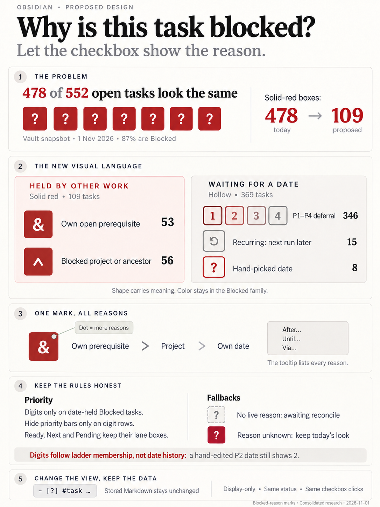
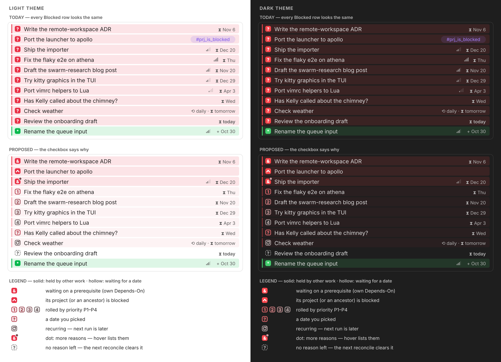
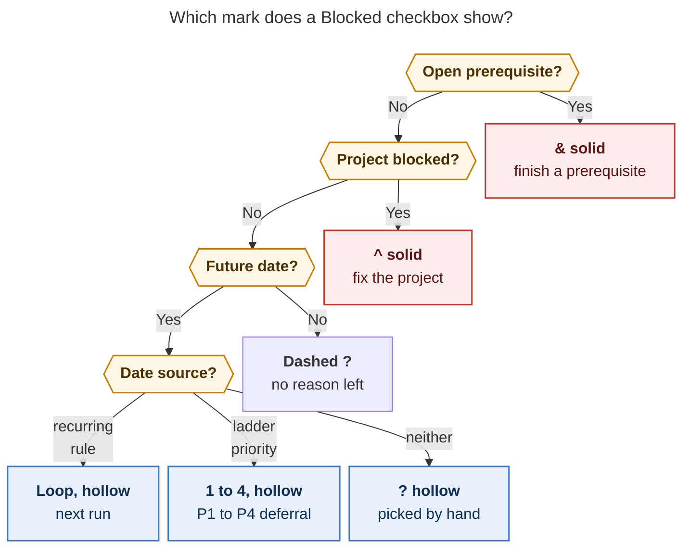

# Blocked-reason marks: make every `[?]` say *why*

> **Research query:** How can Obsidian make it much clearer, in a visually appealing
> way, why a task is blocked — for example by rendering `[1]`–`[4]` in distinct colors
> for tasks with a `priority` (and no longer rendering the priority icon) and `[&]` for
> tasks blocked by open task dependencies, so that only tasks explicitly given a
> `scheduled` date still look like `[?]`? Critique this low-confidence sketch, call out
> any justified requirement changes, and end with a recommended solution that is
> intuitive, reliable, and beautiful.



## Bottom line

**The goal is right, and the checkbox is the right place to answer it.** Of the vault's
552 open `#task` lines, 478 (87%) are `[?]`, and today every one of them looks the same:
a solid red box with a white `?` on a red-tinted row. Behind that one look are five
different situations needing five different responses.

**Build it as display-only *block marks*, never as new stored status characters.** All
five researchers agree on this, and so do I. Markdown keeps `[?]`, reconcile keeps
deriving it, and Tasks keeps its single `?` = Blocked (`ON_HOLD`) status. Only the
rendered checkbox changes.

**[My recommendation](#recommended-solution)** keeps most of the sketch and fixes four
things:

- **`&`:** *Family:* solid · *Meaning:* waiting on its own open prerequisite · *Rows
  today:* 53
- **`^`:** *Family:* solid · *Meaning:* its project (or an ancestor project) is blocked ·
  *Rows today:* 56
- **`1` `2` `3` `4`:** *Family:* hollow · *Meaning:* deferred by a P1–P4 priority roll ·
  *Rows today:* 346
- **`⟲`:** *Family:* hollow · *Meaning:* recurring; the next run is later · *Rows
  today:* 15
- **`?`:** *Family:* hollow · *Meaning:* a date picked by hand · *Rows today:* 8
- **dashed `?`:** *Family:* stale · *Meaning:* no live reason is left; the next
  reconcile clears it · *Rows today:* 0
- **plain `?` (today's look):** *Family:* neutral · *Meaning:* the reasons can't be read
  yet · *Rows today:* —

1. **Two families instead of one undifferentiated red.**
   - **Solid** red boxes mean *held by other work*.
   - **Hollow** boxes on a lighter tint mean *waiting for a date*.
   - The strongly red rows drop from 478 to 109, so real blockers stand out.
2. **Digits only inside Blocked boxes, and only when the remaining reason is the task's
   own future date.** A Ready, Next, or Pending task with a priority keeps its lane
   checkbox.
3. **One ordered red-to-grey ramp for P1–P4, not four new hues.** Every hue in Bob's
   palette already has a meaning, and the priority-marks contract already rejected a
   per-level hue ramp (see [families and tones](#families-and-tones)).
4. **Answering your question: hide the priority icon only where the digit replaces it.**
   On every other row the signal bars stay; they are the only priority cue on the lanes
   where you choose work (see
   [priority bars and the project tag](#priority-bars-and-the-project-tag)).



*Figure 1. Approximate SVG mockup of Obsidian's default theme by researcher cld; not an
Obsidian screenshot. Its rows match the design recommended here.*

## Request and inputs

Consolidated research report · **2026-11-01**

This report merges five independent researcher reports with my own checks against the
code, docs, and vault. The reports are
[`__cdx`](blocked_reason_marks__cdx.md), [`__cld`](blocked_reason_marks__cld.md),
[`__grk`](blocked_reason_marks__grk.md), [`__mus`](blocked_reason_marks__mus.md), and
[`__gem`](blocked_reason_marks__gem.md).

**Snapshots checked:**

- bob-cli `3e21e990`;
- bob-plugins `885c560f` (bob-ledger-tools 1.82.0);
- installed Obsidian Tasks 8.4.0;
- a read-only census of the live `~/bob` vault, using 2026-11-01 as today.

**The request.** Make it much clearer, and attractive, *why* a task is Blocked in
Obsidian. Bryan's low-confidence sketch:

- render `[1]`–`[4]` in distinct colors for tasks with a `priority`;
- stop rendering the priority icon;
- render `[&]` for tasks blocked by open dependencies;
- leave `[?]` only on tasks explicitly scheduled with `scheduled`.

## What `[?]` actually means today

### Four derived reasons, one stored character

Blocked is derived, never authored (`decisions:task-status-is-derived`). Rust names four
reasons in `BlockReason` (`src/native/project_dependencies/blocking.rs:214`), and reconcile
JSON reports them as `reason_kinds`:

- **`local_dependency`**
  - *Source of truth:* the task's `⛓️ DEPENDS ON:` line, projected to `[dependsOn::]`
  - *What a renderer can read cheaply:* ids in `[dependsOn::]`, plus open/closed state
    from the Tasks cache
- **`local_schedule`**
  - *Source of truth:* `[scheduled::]` strictly after today
  - *What a renderer can read cheaply:* the field on the line
- **`project_dependency`**
  - *Source of truth:* the project's (or an ancestor's) `^prj` Depends-On line
  - *What a renderer can read cheaply:* the machine-owned `#prj_is_blocked` tag
- **`project_schedule`**
  - *Source of truth:* the `^prj` line's inline `[scheduled::]`
  - *What a renderer can read cheaply:* the same tag; the date is also copied onto
    residents, raise-only

Facts that constrain any design:

- **Priority never blocks by itself.**
  - Picking P1–P4 writes `[priority:: high|medium|low|lowest]` *and* rolls a random
    `[scheduled::]` inside that level's window (2–7, 8–30, 31–90, or 91–365 days by
    default, configurable).
  - Reconcile then marks the future date Blocked.
  - Clearing the priority keeps the date. Off-ladder `highest` and the implicit P0 (no
    field) roll nothing. Source: `docs/projects.md`, *Priority property and scheduled
    rolls*.
- **Today's date does not block.** Only a date strictly in the future does.
- **The project tag is a sanctioned proxy.** `decisions:subprojects-inherit-project-blocking`
  makes reconcile the authority and "the ^prj tag the proxy for other engines". A renderer
  may key `^` off an exact `#prj_is_blocked` token, but the tag alone doesn't say *which*
  ancestor blocks or why.
- **The stored status contract is strict.** `src/native/task_status_hooks/settings.rs`
  requires exactly one compatible Tasks status: symbol `?`, name Blocked, type `ON_HOLD`.
  Next (`*`) is also `ON_HOLD`, and Tasks classifies an unknown symbol as `TODO`. New stored
  symbols would reach reconcile, the cycler, freshness, chips, capture, `blocked.md`'s
  `status.name includes Blocked` query, and the Tasks registry.

### How it renders today

- **Checkbox.** The vault snippet `.obsidian/snippets/task-statuses.css` sets
  `--task-status-symbol: "?"` on every `[data-task="?"]` row. It draws the symbol with
  `content: var(--task-status-symbol)` on `.task-list-item-checkbox:checked::after`: a
  white glyph in a solid `--color-red` box, a 2 px red rail, and a 13% red line tint.
  Next (`*`, green) and Pending (`/`, amber) use the same pattern.
  - **Implementation lever:** the variable can be overridden per row, which is all the
    new marks need.
- **Other marks on the line** (bob-ledger-tools display contracts):
  - priority: monochrome signal bars;
  - dates: `⧗ Nov 20`;
  - Today: 🍅;
  - task identity: teal `⌗`;
  - prerequisites: chips on the `DEPENDS ON` child row.
- **The hue budget is spent.** `docs/task-tag-marks.md` → *Ink* reserves:

  - **red:** Blocked
  - **orange:** attention
  - **yellow:** In Progress
  - **green:** Next
  - **blue:** Ready
  - **violet:** tags and links
  - **teal:** the task glyph
  - **grey:** priority, dates, cancelled

### Vault census re-run and extended

I re-ran the census independently. It skipped dot-directories and `_conflicts/`, decided
"open prerequisite" by looking up each `[dependsOn::]` id's status, and used the
precedence in [the design](#the-design). The counts match cld exactly. grk's counts
differ only because it puts project before dependency.

- **P2 roll (`medium`):** *Mark:* `2` · *Rows:* 197 · *Share:* 41%
- **P3 roll (`low`):** *Mark:* `3` · *Rows:* 91 · *Share:* 19%
- **blocked project:** *Mark:* `^` · *Rows:* 56 · *Share:* 12%
- **P1 roll (`high`):** *Mark:* `1` · *Rows:* 55 · *Share:* 12%
- **own open prerequisite:** *Mark:* `&` · *Rows:* 53 · *Share:* 11%
- **recurring, next run later:** *Mark:* `⟲` · *Rows:* 15 · *Share:* 3%
- **date picked by hand:** *Mark:* `?` · *Rows:* 8 · *Share:* 2%
- **P4 roll (`lowest`):** *Mark:* `4` · *Rows:* 3 · *Share:* <1%
- **no live reason (stale):** *Mark:* dashed `?` · *Rows:* 0 · *Share:* 0%

**New findings that settle two disagreements:**

- **Every digit row's date really came from a priority roll.**
  - **All 346 rows** whose mark would be a digit have a 🎲 roll, decay, or pick as their
    newest Schedule Log entry.
  - **Zero** have a newest entry with a hand-typed reason. The 8 hand-dated `?` rows have
    no Schedule Log at all.
  - So the line-local rule "a Blocked, date-only row with a ladder priority shows its
    digit" matches the true provenance on 100% of rows today. That answers cdx's
    objection that priority presence is not proof of a roll (D1 under
    [where the researchers disagreed](#where-the-researchers-disagreed-and-how-i-resolved-it)).
- **No Blocked row today has both an open prerequisite and a future date.**
  - The 53 dependency rows split into 41 with no date and 12 with a past or today date.
  - mus's premise that "dependency plus schedule is the common combination" does not hold
    for this vault.
  - The real overlaps are 11 project + date rows (mostly the project's date copied onto
    residents) and 4 dependency + project rows: **15 rows (3%)** in all.

Also: **16 Blocked rows carry `[dependsOn::]` whose targets are all closed or missing**
(closed prerequisites stay on the line as history). A rule based on field presence would
mislabel them `&`. The open state has to come from the Tasks cache, as the Depends-On
chips already do.

## Critique of the sketch

**Is this a good idea? Yes.**

- The pain is real and measurable: one red symbol, five meanings, in 31 of the 47 notes
  that hold Blocked tasks.
- The three causes call for different actions:
  - finish or chase a prerequisite;
  - fix the project;
  - wait, or reschedule.
- Tasks query results make it worse (gem's point). They render each task flat, without
  its `DEPENDS ON` child line, so a dependency-blocked row there has no visible evidence
  at all. A mark in the checkbox is the one cue that survives every surface.

### Item by item

- **`[1]`–`[4]` for tasks that have a `priority`**
  - *Verdict:* **Adjust:** only inside a Blocked box whose only remaining reason is the
    task's own future date
  - *Why:* Unanimous concern: a digit on a Ready, Next, or Pending box erases the lane,
    the single most important fact on the row. A Next P1 must still look Next. Inside a
    date-held Blocked box the digit loses nothing: 346/346 such rows were rolled
    ([vault census](#vault-census-re-run-and-extended)).
- **distinct colors per priority**
  - *Verdict:* **Adjust:** one ordinal red-to-grey ramp
  - *Why:* There is no free hue ([how it renders today](#how-it-renders-today)). The
    priority-marks contract already rejected "a per-level hue ramp" because it "clashes
    with the status colors" (`docs/projects.md`, *Rejected alternatives*). Priority is
    ordinal, so a lightness ramp reads in order without a legend.
- **stop rendering the priority icon**
  - *Verdict:* **Partly:** fold the bars only on digit rows
  - *Why:* There the digit says the same thing. Everywhere else the bars stay: on
    Ready/Next/Pending rows, where priority guides choice, and on `&`/`^` rows, where
    they tell you which window applies after unblocking.
- **`[&]` for open dependencies**
  - *Verdict:* **Accept, display-only**
  - *Why:* For Bryan, `&` is already learned: capture's `&note:block-id` *means* "this
    task depends on that prerequisite" (`docs/reference/capture-syntax.md`). Decide it
    from the open state of the targets, never from the field alone.
- **`[?]` only for explicit schedules**
  - *Verdict:* **Accept, and make it true**
  - *Why:* Without a project mark and a recurring mark, 56 project-blocked and 15
    recurring rows would still fall back to `?`. The goal would fail by 71 rows.
- **(unstated) storage**
  - *Verdict:* **Display-only**
  - *Why:* A stored reason is a second source of truth: it would churn on every reason
    change and touch 179 `'?'` references in 86 Rust files plus ~336 in plugin JS (cld's
    count).
- **(unstated) combined reasons**
  - *Verdict:* **One winner plus a corner pip**
  - *Why:* The checkbox holds one glyph. The pip says "there's more", and the tooltip
    lists everything.

### Alternative approaches

**Would I take a different approach?** Not fundamentally. Four alternatives were
seriously argued, and each loses on balance:

- **A real stored "Deferred" status (`[>]`) for date waits.**
  - **For it:** GTD's separation of *Waiting For* from *Tickler*; 77% of `[?]` rows are
    tickler deferrals.
  - **Against it:** it reopens the load-bearing decision that future dates are Blocked,
    which feeds the review walk's TICKLER tier, `blocked.md`, link consumption, and every
    reader.
  - **Verdict:** the hollow family delivers most of that clarity at a few percent of the
    cost. Revisit only if hollow marks prove insufficient.
- **Icons instead of letters** (cdx: hourglass, chain, tree, pause; gem: clock, chain,
  folder-lock).
  - **For it:** more universal to a stranger.
  - **Against it:**
    - Bob's checkbox alphabet is already typographic (`* / ? -`), drawn through the same
      CSS variable.
    - `&` and the digits map directly to what Bryan types (`&note:id`, `$2`, Task Card
      `2`).
    - At 0.75em in a 16 px box, glyphs read more crisply than detailed icons.
  - **Verdict:** keep icons as the swap-in fallback for `^` only
    ([risks and open questions](#risks-and-open-questions-for-bryan)).
- **Always-visible reason text beside the title** (cdx: "After budget approval",
  "Until Nov 12", "Via Website").
  - **For it:** it explains without hovering, which also works on touch.
  - **Against it:** Blocked rows are the most crowded lines in the vault, and the evidence
    is already visible: the `⧗` date mark, the `DEPENDS ON` chips, and the
    `#prj_is_blocked` tag.
  - **Verdict:** adopt cdx's *After / Until / Via* wording for the tooltip and the Task
    Card instead.
- **Leave priority out of the box entirely** (mus, gem).
  - **For it:** this is defensible.
  - **Against it:** it leaves 346 rows (72%) wearing a generic date glyph, which is
    precisely the "wall of identical `?`" that prompted the request.
  - **Verdict:** the scoped digit keeps the lane intact and adds the triage fact Bryan
    asked for.

## Where the researchers disagreed and how I resolved it

- **D1. Digits in the box?**
  - *Positions:* **yes**, scoped to Blocked date-only rows (cld, grk) · **no** (cdx,
    mus, gem)
  - *Resolution:* **Yes, scoped.** The no-votes argue against digits on *all*
    prioritized boxes, which the scoping avoids. cdx's provenance objection is valid in
    principle (capture `$2 s:5` keeps the priority but writes no roll) but matches **0 of
    346** rows today. A Schedule Log rule can't be evaluated in Tasks results, which
    don't render child lines. Pin the edge case with a vector.
- **D2. Letters or icons?**
  - *Positions:* letters (cld, grk, mus) · icons (cdx, gem)
  - *Resolution:* **Letters**, with masks only where text renders badly (`^` sits too
    high; `⟲` font coverage varies on iOS). See
    [the alternative approaches](#alternative-approaches).
- **D3. Color**
  - *Positions:* four hues (sketch, cdx) · Blocked-family ramp (cld, grk) · none (mus,
    gem)
  - *Resolution:* **Ramp.** cdx's rust, ochre, blue, and plum collide with attention, In
    Progress, Ready, and violet tags. gem's amber, slate-blue, and brick collide too.
- **D4. Precedence**
  - *Positions:* own dep > project > date (cld, mus) · project > dep > date (grk,
    matching `blocked.md`) · no precedence, mixed glyph (cdx)
  - *Resolution:* **Own prerequisite > project > own date**
    ([detailed below](#d4-precedence-in-detail)).
- **D5. Mixed reasons**
  - *Positions:* corner pip (cld, gem) · "pause" mixed glyph (cdx) · tooltip only (mus,
    grk)
  - *Resolution:* **Pip plus tooltip.** A pause glyph throws away the primary reason;
    only 15 rows are mixed.
- **D6. Recurring mark**
  - *Positions:* add `⟲` (cld) · not needed (grk)
  - *Resolution:* **Add it.** Otherwise "only hand-scheduled tasks show `?`" fails on 15
    rows.
- **D7. Tasks query results**
  - *Positions:* CSS-only by elimination (cld) · JS pass (grk, cdx) · plus an inline
    dependency chip (gem)
  - *Resolution:* **CSS first, in phase 2**, following the priority-marks precedent
    ([requirement adjustments](#explicit-requirement-adjustments)).

### D4 precedence in detail

- **Own before inherited.** In a project note every resident would otherwise show `^`. A
  resident with its *own* blocker should stand out, and its evidence (the `DEPENDS ON`
  chips) sits directly beneath it.
- **Structural before temporal.** A date resolves itself; a prerequisite or a project
  needs work.
- **Project before own date, deliberately unlike Rust's order.** Rust's
  `effective_block_reasons` lists local dependency, then local schedule, then project.
  But a project-blocked resident's own date is usually the project date copied onto it,
  raise-only (`docs/task-dependencies.md`, "Sync and nav still copy the date onto
  residents"). Showing a digit there would point at the wrong remedy.
- **Cost:** for 4 rows, a source note shows `&` while `blocked.md` files the row under
  PROJECT. That disagreement is acceptable.

### Corrections to individual reports

- mus's "dependency plus schedule is the common case": 0 rows today
  ([vault census](#vault-census-re-run-and-extended)).
- gem's "hundreds of `WHERE status = "?"` Dataview queries": not verified. The real
  coupling is the Tasks registry, `blocked.md`'s Tasks queries, and the Rust/JS status
  switches.
- gem's "zero changes to bob-cli": the display contract and shared vectors belong in
  bob-cli `docs/`, like every other mark family.
- gem's "`&` has zero association with prerequisites": true for strangers, false for this
  vault's own capture grammar.

## The design

### Principles (inherited from Bob's mark family)

- **Display-only.** No writer ever stores a block mark. Source mode shows `[?]`, and with
  the plugin disabled or the toggle off the vault looks exactly as it does today.
- **Truthful or neutral.**
  - If the Tasks cache isn't ready, a target can't be resolved, or the line is
    non-canonical, the row keeps today's plain `?`.
  - The stale mark appears only once the model can *prove* no reason is live.
- **Shape carries meaning; color whispers.** Glyph, fill (solid vs. hollow), and dashing
  each carry the reason on their own, so the marks work in grayscale and for color-blind
  readers. No hue leaves the Blocked red family.
- **Inert.** Clicking the box does exactly what clicking `[?]` does today. The overlay
  never intercepts pointer events. Display surfaces never act.
- **One model, many hosts.** One pure classifier feeds Live Preview, reading view,
  embeds, hover previews, Dataview `TASK` views, Tasks results, chips, and the Task Card.

### Classification



*Figure 2. Own prerequisites win, then a blocked project, then the task's own future
date. Among date holds, a recurring rule wins over a ladder priority. A row whose reasons
can't be read yet keeps today's plain `?`, and any losing reason adds a corner pip.
Rendered 790 × 1002 px, fit 82.6%, Mermaid CLI 12.0.0.*

Model inputs, all already in bob-ledger-tools scope:

- the checkbox symbol (`?`, else no mark);
- a canonical `#task` line outside code and fences, quote-aware;
- open-target lookup through the Tasks-cache index the `DEPENDS ON` chips already use,
  with the open-buffer override for unsaved edits;
- an exact `#prj_is_blocked` token;
- `scheduled` compared with local today, reusing the date-mark parser and its midnight
  rollover;
- a readable `[repeat::]`;
- `priorityMarkCanonicalField(line)`.

The digit comes from the configured ladder label when known (`P2` → `2`); otherwise it
uses the default map (`high` → 1, `medium` → 2, `low` → 3, `lowest` → 4). Non-canonical
values (`High`, `P2`, duplicates) show hollow `?`, and the existing repair pill still
flags them. Off-ladder `highest` shows hollow `?` and keeps its urgent `!` mark.

### Families and tones

- **Solid: held by other work**
  - *Box:* today's filled `--task-status-blocked` box with a white glyph
  - *Line:* today's 13% red tint and 2 px rail
  - *Marks:* `&`, `^`
- **Hollow: waiting for a date**
  - *Box:* 1.5 px border in the level's ink, a 12% ink wash, glyph in the same ink
  - *Line:* ~5.5% red tint; rail at 45%
  - *Marks:* `1`–`4`, `?`, `⟲`
- **Stale**
  - *Box:* dashed border, `?`, muted ink
  - *Line:* no tint
  - *Marks:* dashed `?`

The ink ramp is anchored on a red deepened toward `--text-normal`. The plain theme red
fails 4.5:1 for P1 in light mode.

```css
body {
  --bob-block-ink-anchor: color-mix(in srgb, var(--color-red) 72%, var(--text-normal));
  --bob-block-ink-1: var(--bob-block-ink-anchor);                                    /* P1, ? */
  --bob-block-ink-2: color-mix(in srgb, var(--bob-block-ink-anchor) 68%, var(--text-muted));
  --bob-block-ink-3: color-mix(in srgb, var(--bob-block-ink-anchor) 38%, var(--text-muted));
  --bob-block-ink-4: color-mix(in srgb, var(--bob-block-ink-anchor) 12%, var(--text-muted)); /* P4, ⟲ */
  --bob-block-defer-tint: 5.5%;   /* 13% restores today's all-red rows and keeps the glyphs */
}
```

cld measured the glyph against its own wash over the line tint, using Obsidian
default-theme tokens. I have not re-measured these values; a node test should enforce the
4.5:1 floor.

- **P1 / `?`:** *Light:* 4.89 · *Dark:* 4.61
- **P2:** *Light:* 5.37 · *Dark:* 4.84
- **P3:** *Light:* 5.55 · *Dark:* 5.20
- **P4 / `⟲`:** *Light:* 5.41 · *Dark:* 5.70

For comparison, today's white `?` on solid red measures 4.20 (light) and 3.45 (dark). The
hollow family is *more* legible than what ships now.

**Pip.** A 6 px dot at the box's top-right corner, ringed in `--background-primary` and
filled with the second reason's ink. It never changes line height.

**Typography.** Use `font-variant-numeric: tabular-nums` on the digits. `^` and `⟲` are
CSS masks; `&`, the digits, and `?` are text through `--task-status-symbol`.

### Priority bars and the project tag

- **Digit rows:** fold the signal bars to zero width with an empty replace decoration.
  The cursor still reveals the raw field.
  - This is one new eligibility rule in the priority-marks contract, and vector PM2
    changes.
  - Tasks results hide `.task-priority` on those rows with the clip pattern already used.
- **All other rows** keep their bars unchanged: `&`, `^`, `?`, `⟲`, Ready, Next, Pending,
  and closed.
- **Phase 2:** on `^` rows, fold the violet `#prj_is_blocked` pill too, by the same
  redundancy argument.

### Tooltip and Task Card copy

The checkbox host carries `role="img"` and a words-first `aria-label` (escape `&` as
`&amp;`). It also gets `data-tooltip-position="top"`, lines joined with `\n`, and never
`::`, because Dataview re-scans `innerHTML`.

The wording borrows cdx's grammar:

- **After** for prerequisites;
- **Until** for dates;
- **Via** for inheritance.

The tooltip lines for each mark:

- **`&`**
  - *Line 1:* `Blocked · after Write the ADR +1`
  - *Line 2:* `Ctrl+Shift+P → Depends on`
- **`^`**
  - *Line 1:* `Blocked · via project sase_remote`
  - *Line 2:* `after Fix the parser` or `until Mon, Dec 1` (when resolvable)
- **`2`**
  - *Line 1:* `Blocked · P2 deferral · until Thu, Nov 20 (in 19 days)`
  - *Line 2:* `Ctrl+Enter to re-roll · Ctrl+Shift+P to change`
- **`?`**
  - *Line 1:* `Blocked · until Wed, Nov 4 (in 3 days)`
  - *Line 2:* `Ctrl+Shift+P to reschedule`
- **`⟲`**
  - *Line 1:* `Recurring · next run tomorrow`
  - *Line 2:* —
- **dashed `?`**
  - *Line 1:* `Blocked, but no reason is left`
  - *Line 2:* `Returns to Ready on the next reconcile`
- **+ pip**
  - *Line 1:* append `Also: until Sat, Dec 20` (or `Also: via …`)

A date plus a prerequisite is an *earliest* return, not a promise; never word it as an
unblock date.

**Task Card (phase 2).**

- It shows the full reason list with navigation: every open target, exact dates, and the
  inheritance chain.
- It is the touch and mobile path, where hover tooltips don't exist.
- Teach the mapping there: show the hollow digit box beside the bars in the P1–P4 strip.

### Surfaces

- **Live Preview**
  - *Mechanism:* a ViewPlugin emits `Decoration.line` attributes
    (`data-bob-block="p2"`, `data-bob-block-family="date"`, `data-bob-block-more="1"`)
    on `.HyperMD-task-line[data-task="?"]`. Plugin CSS overrides `--task-status-symbol`
    and the box style at higher specificity than the vault snippet.
  - *Phase:* 1
- **Reading view, embeds, hover previews, Dataview `TASK`**
  - *Mechanism:* a post-processor sets the same attributes on
    `li.task-list-item[data-task="?"]`
  - *Phase:* 1
- **Tasks query results**
  - *Mechanism:* details below
  - *Phase:* 2
- **`DEPENDS ON` / `BLOCKS` chips, Task Card notices**
  - *Mechanism:* reuse `api.blockMarks.render(host, model)` for each chip's miniature
    checkbox. A chip then shows whether the *prerequisite* is itself deferred, which
    exposes the real critical path.
  - *Phase:* 2
- **`bob plan`, Bob Mac Capture agenda**
  - *Mechanism:* Rust emits the same mark key from `BlockReason` using shared vectors
  - *Phase:* 3 (optional)

**Tasks query results:**

- **Use CSS on Tasks' own row attributes** (`data-task`, `data-task-priority`,
  `data-task-scheduled` with values `today`/`future-…`/`past-…`, and
  `.tag[data-tag-name]`):
  - the project tag → `^`;
  - a future date with a priority → a digit;
  - a future date with no priority → `?`;
  - otherwise → `&` by elimination.
- **Known limits** (low impact, since `blocked.md` already groups by reason):
  - no `⟲` unless `.task-recurring` proves usable;
  - prerequisite + project rows show `^`;
  - no pip and no tooltip.
- **Do not resolve rows by `data-line`.** Upstream Tasks writes the *result index* there,
  not a source line (cdx). Don't infer status from `input.checked` either. The existing
  `taskThemeOriginFromContext` reads `data-line`, so an implementer should confirm what it
  does on Tasks rows before reusing it.

**Out of scope:**

- splitting `### Blocked` sections by reason (a reconcile grouping writer, which
  `blocked.md` already covers globally);
- task-link rings (a later reuse of the model);
- any change to reconcile, lanes, review walks, or capture.

### Reliability rules

- **Invalidation.** Rebuild on doc, viewport, Tasks-cache, config, and midnight changes,
  and on app resume; never on selection alone. Use generation checks so a slow refresh
  can't overwrite a newer document.
- **Cost.** Classification is O(1) per visible line: field regexes plus one cache lookup
  per `dependsOn` id. No CLI subprocess, disk read, or vault walk happens during
  rendering.
- **Stability.** Widget equality uses a model key, so unchanged marks never flicker.
  Marks never change line height. Animations respect `prefers-reduced-motion`.
- **Lag is honest.** Between a gesture and the next reconcile (every 15 minutes on the
  MacBook), the stale mark shows "no reason left" instead of hiding the gap. A known
  Ready, Next, or Pending row never gets a block mark, even if a new blocker is pending
  reconcile.
- **Reversible.** The session command **Toggle blocked-reason marks** (on by default)
  flips `body.bob-block-marks`, refreshes editors, and triggers the Tasks re-render
  event.

## Explicit requirement adjustments

These change the request as written. Each one is deliberate.

1. **Render; never store.** Markdown keeps `[?]` for every Blocked task, and no new Tasks
   status symbols are added.
2. **Digits only inside Blocked boxes whose remaining reason is the task's own future
   date.** "Tasks that have a priority" becomes "Blocked, date-held tasks on the
   ladder". A Ready, Next, or Pending P2 keeps its lane box.
3. **Priority-ladder membership, not Schedule Log provenance, picks the digit.**
   - This is a deliberate deviation from "explicitly scheduled": a P2 task whose date
     was later typed by hand still shows `2`, because it is still on the
     roll-and-decay ladder and `Ctrl+Enter` will re-roll it.
   - Today this changes 0 rows.
4. **"Distinct colors" becomes distinct tones on one red-to-grey ramp**, not four new
   hues.
5. **"Stop rendering the priority icon" becomes "fold the bars only on digit rows."**
6. **Add three marks the sketch omitted:**
   - `^` for project blocking (56 rows);
   - `⟲` for recurring rules (15 rows);
   - dashed `?` for stale rows.

   Without them, "only hand-scheduled tasks look like `?`" isn't achieved.
7. **Add the solid/hollow split.** Held-by-work rows stay loud; date-waits get quieter.
8. **Combinations:** one mark wins (own prerequisite > project > own date), a corner pip
   signals "more", and the tooltip lists every reason.
9. **`&` means *open* prerequisites,** decided from the Tasks cache, never from field
   presence. Until the cache is ready, the row shows plain `?`.

## Implementation plan

1. **Contract (bob-cli).**
   - Write `docs/blocked-marks.md` in the style of `docs/date-marks.md`, covering:
     - the principles;
     - the mark table and the precedence;
     - the tones and the tooltip copy;
     - the surfaces and the vectors below.
   - Add a shared fixture, for example `tests/fixtures/block_marks/vectors.json`.
   - Amend *Priority marks* eligibility in `docs/projects.md`.
   - Record an accepted decision ("Blocked checkboxes show their reason; storage stays
     `[?]`") through `/sase_memory_write`.
2. **Phase 1 (bob-plugins, bob-ledger-tools).**
   - Add a pure model fragment (`blockMarkModel(line, ctx)`) that reuses the Tasks-cache
     dependency index, `priorityMarkCanonicalField`, and the date-mark parser.
   - Add the Live Preview line decoration and the reading-view post-processor.
   - Add the ink tokens and CSS gated by `body.bob-block-marks`.
   - Add the toggle, the tooltip, and priority-bar suppression on digit rows.
   - Add node tests that run the vectors verbatim, plus the contrast matrix.
   - Build with `npm run build`, then deploy with `bob plugins sync`.
3. **Phase 2.**
   - Tasks-results CSS.
   - `^` pill folding.
   - Block marks in the chips and the Task Card, including the full reason list.
   - The teaching digit in the P1–P4 strip.
4. **Phase 3 (optional).** Emit the mark key from Rust `BlockReason` for `bob plan` and
   Mac Capture, from the same vectors.
5. **Longer term.** Move `task-statuses.css` from a vault snippet into the plugin, so
   status and reason styling share one owner and stop competing on specificity.

**Key conformance vectors** (today 2026-11-01, default ladder; "x" is an open task unless
noted):

- **BM1.** `- [?] #task A [priority:: medium] [scheduled:: 2026-11-20]`
  - *Expected:* hollow `2`, ink-2; bars folded
- **BM2.** `- [?] #task B [scheduled:: 2026-11-04]`
  - *Expected:* hollow `?`
- **BM3.** `- [?] #task C [repeat:: every day when done] [scheduled:: 2026-11-02]`
  - *Expected:* hollow `⟲`
- **BM4.** `- [?] #task D [dependsOn:: x]`
  - *Expected:* solid `&`
- **BM5.** BM4 with x done
  - *Expected:* dashed `?`
- **BM6.** BM4 with the cache not ready
  - *Expected:* plain `?` (today's look)
- **BM7.** `- [?] #task E #prj_is_blocked`
  - *Expected:* solid `^`
- **BM8.** `- [?] #task F [dependsOn:: x] [priority:: low] [scheduled:: 2026-12-20]`
  - *Expected:* solid `&` + pip (ink-3); bars shown
- **BM9.** `- [?] #task G #prj_is_blocked [priority:: medium] [scheduled:: 2026-11-20]`
  - *Expected:* solid `^` + pip; bars shown
- **BM10.** `- [?] #task H [priority:: highest] [scheduled:: 2026-11-20]`
  - *Expected:* hollow `?`; urgent `!` kept
- **BM11.** `- [?] #task I [priority:: medium] [scheduled:: 2026-11-01]`
  - *Expected:* dashed `?` (today doesn't block)
- **BM12.** `- [*] #task J [priority:: high]`
  - *Expected:* `*` unchanged; 4 bars
- **BM13.** `- [?] #task K [priority:: high] [scheduled:: 2026-11-05]`, newest Schedule
  Log entry is a typed reason
  - *Expected:* hollow `1` (ladder membership wins;
    [adjustment 3](#explicit-requirement-adjustments))
- **BM14.** `- [?] #task L #prj_is_blocked_old`
  - *Expected:* not a token match; falls through
- **BM15.** `- [?] #task M [priority:: High] [scheduled:: 2026-12-01]`
  - *Expected:* hollow `?`; repair pill shows
- **BM16.** `- [?] plain bullet [scheduled:: 2026-11-20]`
  - *Expected:* no mark (snippet `?` unchanged)
- **BM17.** Tasks row: `data-task="?"`, `data-task-priority="medium"`,
  `data-task-scheduled="future-far"`, no project tag
  - *Expected:* CSS `2`

## Risks and open questions for Bryan

- **Is `^` intuitive enough?**
  - It ties to `^prj` and to "the reason is above you".
  - But in capture, `^route:id` means "an existing task", so the sigil is overloaded.
  - It is the most invented glyph in the set. If it doesn't land within a week, swap its
    mask for Lucide `folder-lock`; nothing else changes.
- **Is the hollow tint too quiet?** One variable (`--bob-block-defer-tint: 13%`) restores
  today's all-red rows and keeps the glyphs.
- **Could a hollow box be mistaken for Ready `[ ]`?** The hollow box always carries a
  glyph and a red-family border, and the row keeps a red tint and rail. Confirm by eye in
  both themes.
- **Precedence of own prerequisite vs. project.** I chose own-first so project notes stay
  informative. The opposite order is a one-line change in the model and its vectors, and
  would match `blocked.md` exactly.
- **Prototype checks before phase 2:**
  - that Tasks 8.4.0 sets `data-task-scheduled` and the `.tag` attributes even in
    `short mode` and with fields hidden;
  - where the Live Preview tooltip can attach without stealing checkbox clicks;
  - how Style Settings checkbox packs interact. A third-party snippet must keep
    `content: var(--task-status-symbol)`.
- **Live checklist (in Obsidian):**
  - light and dark themes, grayscale, and iOS;
  - Live Preview, reading view, embeds, hover previews, and `blocked.md`;
  - the toggle restores today's look;
  - the cursor reveals the raw priority field on digit rows;
  - no line-height shift;
  - a 100-task project note scrolls smoothly;
  - a dashed `?` appears and clears within one reconcile after a date arrives.

## Recommended solution

**Ship *blocked-reason marks* as a display-only bob-ledger-tools contract.** Markdown,
reconcile, and the Tasks registry stay exactly as they are.

**The marks:**

- **Solid red box**, for work held by other work:
  - **`&`**: the task's own open prerequisites;
  - **`^`**: its project, or an ancestor project, is blocked.
- **Hollow box on a lighter tint**, for waiting on a date:
  - **`1`–`4`**: a P1–P4 priority deferral, inked on one deep-red-to-grey ramp;
  - **`⟲`**: a recurring rule's next run;
  - **`?`**: a date you picked by hand.
- **Dashed `?`**: Blocked with no reason left, until the next reconcile.
- **Plain `?`**: whenever the reasons can't be proven.

**The rules:**

- **Precedence:** own prerequisite > project > own date. A corner pip and the tooltip
  carry every losing reason (see [D4 precedence in detail](#d4-precedence-in-detail)).
- **Priority icon:** fold the signal bars only where a digit now carries the priority;
  keep them everywhere else.
- **Lanes:** a digit never touches Ready, Next, or Pending boxes.

**Delivery:** phase 1 covers Live Preview, reading view, embeds, the toggle, the
tooltips, and the vectors. Phase 2 covers Tasks results, the chips, the Task Card, and
`^` pill folding. Rust and Mac Capture can adopt the same mark key later (see the
[implementation plan](#implementation-plan)).

**Result on today's vault:**

- The 8 rows you actually scheduled by hand are the only `?`.
- 346 rows show the priority level that deferred them.
- 15 rituals show a loop.
- The 109 rows truly stuck behind other work are the only solid-red boxes left.
- Not a byte of stored Markdown changes.

## Sources

- **Researcher reports** (this directory): [`__cdx`](blocked_reason_marks__cdx.md) (with
  an [interactive preview](blocked_task_visual_grammar__cdx.html)),
  [`__cld`](blocked_reason_marks__cld.md), [`__grk`](blocked_reason_marks__grk.md),
  [`__mus`](blocked_reason_marks__mus.md), and [`__gem`](blocked_reason_marks__gem.md).
- **bob-cli `3e21e990`:**
  - `src/native/project_dependencies/blocking.rs` (`BlockReason`,
    `effective_block_reasons` order);
  - `src/native/task_status_hooks/settings.rs` (the single `?` contract);
  - `docs/projects.md` (priority rolls, priority marks and their rejected alternatives,
    decay ladder, Schedule Log markers);
  - `docs/task-dependencies.md` (Depends-On semantics, project blocking, residence-only
    date copy);
  - `docs/task-tag-marks.md` (the Ink hue table);
  - `docs/reference/capture-syntax.md` (`&note:id` prerequisite, `^route:id` existing
    task).
- **bob-plugins `885c560f`:**
  - `plugins/bob-ledger-tools/src/135-priority-marks.js`;
  - `267-plugin-date-marks-tasks.js` (the bounded Tasks frame pass);
  - `279-plugin-task-theme-tasks.js` and `279-plugin-task-theme-reading-dom.js` (Tasks-row
    origin resolution);
  - `139-unblocked-glyph.js`.
- **Vault** (read-only):
  - `.obsidian/snippets/task-statuses.css`;
  - `blocked.md` (sections and precedence);
  - a census of 478 `[?] #task` rows with newest Schedule Log entries
    ([vault census](#vault-census-re-run-and-extended)).
- **Decisions:** `task-status-is-derived`, `task-lanes-are-sticky`,
  `projects-block-from-prj-line`, `subprojects-inherit-project-blocking`,
  `task-deps-are-depends-on-links`.
- **External:** WCAG 2.2 *Use of Color*, *Contrast (Minimum)*, and *Non-text Contrast*;
  Obsidian editor decorations docs; Obsidian Tasks *Custom Statuses* and *Styling*
  (cited by cdx and grk).
