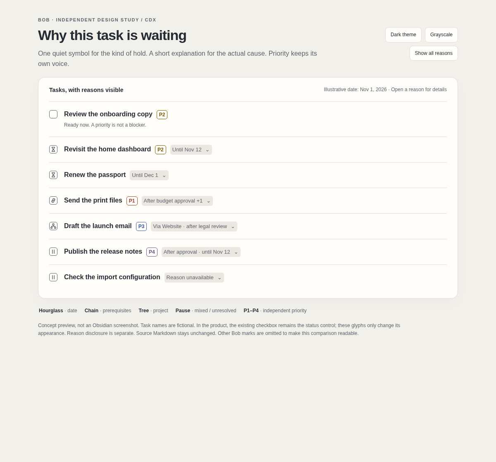

# Make blocked tasks explain themselves

Independent research and design recommendation by **cdx** · 2026-11-01

**Recommendation:** keep Bob’s stored statuses and blocking rules; show a small, reason-specific glyph in the existing Blocked checkbox, a short explanation beside the task, and a separate colored **P1–P4** badge replacing the current priority bars. Do not turn priority values into task statuses. Do not infer “manually scheduled” versus “priority rolled” from the presence of a priority field.

[Interactive design preview](blocked_task_visual_grammar__cdx.html) — light/dark, grayscale, and expandable explanations. [Durable preview snapshot](file:explicit:c353ab741625d1d3cfb83365).

*Figure 1. Proposed visual grammar, rendered in a standalone browser mockup. Fictional tasks; not an Obsidian screenshot. Other Bob marks are omitted for clarity. The small squares illustrate the existing status control, not an additional button.*

## What the research established

I independently inspected bob-cli, bob-plugins, and upstream Obsidian Tasks, and consulted primary documentation for Obsidian, accessibility, and comparable task products. I did not consult other researchers’ reports, chats, or findings. This is a design study, not an implementation or a live-vault audit.

### Priority is a deferral policy, but is not itself a current blocker

Bob’s default mapping is:

| Label | Stored property | Date window when selected |
|---|---|---|
| P1 | `[priority:: high]` | 2–7 days ahead |
| P2 | `[priority:: medium]` | 8–30 days ahead |
| P3 | `[priority:: low]` | 31–90 days ahead |
| P4 | `[priority:: lowest]` | 91–365 days ahead |
| Implicit P0 | No priority field | No roll caused by assigning a level |

Choosing a level writes both priority and a rolled scheduled date. The blocker evaluator, however, examines open prerequisites and future scheduled dates; it does **not** use priority as an independent blocking condition. A task can keep P2 after its date arrives, be Ready with P2, or become Next/Pending with P2. These are intended states. [Bob priority contract][B1]; [effective blocker implementation][B2].

Two particularly consequential details:

- Clearing priority keeps the scheduled date. The current contract treats a rolled date as an explicit commitment after it is written.
- Capture can receive both priority and an explicit schedule. The explicit schedule wins, while priority remains; in that case capture does not create a priority-roll Schedule Log entry.

Therefore “priority present = blocked because of priority” and “priority absent = manually scheduled” are both false. [B1]

This is the main critique of the original proposal. It would make an attractive shorthand appear more certain than the underlying data permits.

### There are four reason kinds, and they can coexist

The Rust model already provides `local_dependency`, `local_schedule`, `project_dependency`, and `project_schedule`. Inherited reasons retain the originating project path; ancestors can contribute more than one reason. A task’s own future date is a blocker only when it is **strictly later than today**. Today’s scheduled task is not blocked by that date. [B2]

Project blocking originates on the project’s `^prj` task, extends to residents and eligible subprojects, and is reflected by `#prj_is_blocked`. That tag is useful evidence that project blocking applies, but it cannot identify the actual ancestor, dependency, or date by itself. A manually typed `[?]` on a project task is not sufficient to block its residents. [B3]

A reason display must preserve these distinctions. “Project blocked” without a project name leaves the user with much the same mystery.

### The current rendering system supplies a good foundation

Bob already renders priority fields as signal bars and dates as quiet icon-plus-label marks across several Obsidian surfaces. Priority rendering recognizes five canonical values, including off-ladder `highest`; absent priority gets no mark. When configuration is unavailable, existing code deliberately avoids guessing a P-label. [B1], [P1]

The priority implementation includes Live Preview decorations, rendered Markdown processing, raw-field reveal, a session toggle, and shared `api.priorityMarks`. Tasks query priorities use Tasks’ own DOM attributes. Date query rendering adds a narrowly scoped adapter because full date labels require more than CSS. Dependency chips already reuse a cached task index; task-link resolution already accounts for live editor content and ambiguous identities. These are precedents to extend, not reasons to create another independent vault scanner. [P1], [P2], [P3], [P4]

The blocked status is deliberately configured as symbol `?`, name Blocked, type `ON_HOLD`. Bob validates this contract. New stored symbols would affect much more than styling. [B4]

Upstream Tasks currently classifies an unrecognized status symbol as `Unknown` of type `TODO`, not automatically as Blocked. Its status transitions also govern completion dates and recurrence. Writing `[1]` or `[&]` is consequently a workflow migration unless every relevant consumer is updated. Rendering those shapes without changing the source is a different, much safer proposition. [T1]

## Critique of the proposed symbols

| Proposal | Useful part | Problem | Recommended adjustment |
|---|---|---|---|
| Colored `[1]`–`[4]` | Fast recognition of the familiar level | Replaces the lane/status cue; cannot explain dependency and schedule combinations | A small colored **P1–P4** badge in the existing priority-mark position |
| Remove the current priority icon | Removes duplicate visual information | Removing it before every relevant surface has a replacement loses information | Replace the bars wherever the new badge renders; keep native fallback elsewhere |
| `[&]` for dependency blocking | Distinguishes task-based waiting from time-based waiting | Ampersand means “and,” not “waiting on”; it names neither target nor direction | A chain glyph plus **After budget approval**, with an open-target count when needed |
| `[?]` only for explicit schedules | Makes the generic blocked bucket more informative | Explicit/rolled provenance is not implied by current properties; a question mark is weak date vocabulary | Use the existing hourglass vocabulary for all verified future-date blocking |
| One symbol per blocked task | Compact and scannable | Mixed and inherited reasons need more than one mutually exclusive label | One category glyph plus a short, composable reason summary |

The goal is good: reading a task should tell Bryan what has to change before it becomes available. The proposed numeric-checkbox scheme is too compressed for that goal.

There is a useful distinction between **state**, **priority**, and **cause**. Linear’s documentation presents status, priority, and blocking relations as separate issue properties. That supports the separation here, although it is not evidence that this particular visual design has been user-tested. [Linear issue properties](https://linear.app/docs/issue-properties-home)

Todoist demonstrates a recognizable colored four-level priority system. Bob should borrow the scanning benefit cautiously: Bob’s implicit P0 and rolled dates mean its levels have different semantics, so importing Todoist’s urgency language would mislead. [Todoist’s priority overview](https://www.todoist.com/help/todoist/get-started/get-started-with-todoist-OgNNJR)

## Proposed experience

### A three-part task row

Each row has three independent jobs:

1. **The existing checkbox remains the status control.** Only the visual skin of a verified Blocked checkbox changes.
2. **A P-label replaces the priority bars.** It answers which priority policy the task carries.
3. **A short reason explains the hold.** It identifies the prerequisite, date, or originating project.

The row remains readable in grayscale. Color helps locate priority, while the written P-label carries its meaning.

Approximate renderings, not source Markdown:

~~~text
[empty] Review onboarding copy      P2
[time]  Revisit the dashboard       P2   Until Nov 12
[time]  Renew the passport               Until Dec 1
[chain] Send the print files        P1   After budget approval +1
[tree]  Draft the launch email      P3   Via Website · after legal review
[pause] Publish release notes       P4   After approval · until Nov 12
[pause] Check import configuration       Reason unavailable
~~~

Do not make every task a stack of filled pills. Keep normal task text dominant, P-labels compact, and the reason treatment low contrast in its background but legible in its text. Retain the existing checkbox footprint and baseline.

### A total classification rule

Apply this to recognized, open tasks whose stored status is Blocked, using a complete and current reason snapshot:

| Current reasons | Checkbox appearance | Inline explanation |
|---|---|---|
| Local future schedule only | Hourglass | Until Nov 12 |
| Local open prerequisites only | Chain | After approval; or After approval +2 |
| Project/ancestor reasons only | Small hierarchy/tree | Via Website · after legal review; or Via Website · until Nov 12 |
| More than one of the above families | Pause/hold | After approval · until Nov 12; include Via Website when inherited reasons also apply |
| Snapshot incomplete | Neutral pause/hold | Available facts plus “Some reasons unavailable,” or “Reason unavailable” |
| Complete snapshot, stored Blocked, no reasons remain | Neutral pause/hold | Awaiting status refresh |

“Families” means local prerequisites, local time, and inherited/project constraints. Several project reasons still use the tree glyph; the explanation and disclosure preserve each origin. Different local and inherited families produce the mixed glyph. Priority never participates in this classification.

A known Ready/Next/Pending task keeps its current status glyph even when a newly observed blocker awaits reconciliation; explain the constraint with “Status update pending.” Do not let display code invent a status transition. Closed and cancelled tasks keep their terminal appearance and receive no active blocker claim.

Do not use a precedence rule such as “priority wins over dependency” or “dependency wins over date.” It conceals a remaining constraint. For a date plus prerequisite, the date is an earliest allowance, not a guaranteed unblock date.

### Reason wording and details

Prefer **After** for prerequisites, **Until** for the task’s own future date, and **Via** for inherited constraints. These explain direction more clearly than “linked” or a bare count.

- One prerequisite: **After budget approval**.
- Multiple prerequisites: **After budget approval +2**. Here +2 means two additional distinct open targets in that group, not two additional types of blocker.
- An inherited reason: **Via Website · after legal review**.
- Multiple categories: show one short clause per category. Shorten names and wrap before silently dropping a category.
- At narrow widths: **2 prerequisites · Nov 12 · Via Website** is acceptable; full names remain in the disclosure.

Use a stable dependency order and nearest-ancestor-first project order. Deduplicate target identities for counts, while retaining distinct origins in details. If the same target blocks both locally and through a project, do not claim there are two different prerequisite tasks.

A separate, keyboard-accessible reason disclosure shows all open targets, exact dates, and the inheritance chain. It should allow navigation to the relevant task or project. It must not complete the task, edit dependencies, or reschedule as a side effect. Existing Task Card controls remain the editing surface.

The checkbox keeps its existing click, context-menu, keyboard, and recurrence behavior. A “why” interaction must not intercept the checkbox’s completion gesture. Keep current raw-field reveal behavior on priority/date marks; a new reason disclosure is a separate affordance.

### Priority, including unusual cases

For the default ladder, display **P1**, **P2**, **P3**, and **P4**, with muted rust, ochre, blue, and plum respectively. Use one label, not a numeral plus the old bars. A P-prefix differentiates priority from a count of dependencies.

These are initial palette candidates, not a universal theme guarantee:

| Level | Light-theme ink | Dark-theme ink |
|---|---|---|
| P1 | `#994229` | `#f2a48a` |
| P2 | `#785900` | `#e3c169` |
| P3 | `#315c9a` | `#97b9ef` |
| P4 | `#705486` | `#c5a8de` |

Use the existing per-value CSS hooks and separate light/dark tokens. Do not recolor the entire task, the checkbox border, and the reason to the priority hue. Those regions already carry status, task-type, or theme information.

Absent priority stays unmarked. When the configured ladder differs, show its actual label rather than assuming its order from a numeral. With missing/unknown configuration, show the canonical word, such as **Medium**, in neutral ink. For off-ladder `highest`, show **Highest**; never silently call it P1 or P0. Invalid or duplicate priority fields retain the visible repair treatment.

Preserve priority on Ready, Next, Pending, and historical closed rows. Closed rows can use quieter ink, but their recorded level should remain inspectable. Update Task Card/notices to use the same replacement vocabulary where they currently reuse priority marks; avoid two competing legends.

### Dates should not be repeated

Bob already displays a scheduled mark with an hourglass and relative/calendar label. Integrate the local-date reason with that existing mark: it should appear once, with a blocking explanation when future, rather than as “Until Nov 12” plus another identical date.

Once today reaches the date, remove its blocking emphasis. Existing date history can remain. Do not call a past scheduled date “overdue”; it is not a deadline. Follow Bob’s current date-label grammar and exact-date disclosure. [B5]

## Explicit requirement adjustments

1. **Render new visuals; do not write new checkbox symbols.** Stored `[?]`, `[*]`, `[/]`, and terminal states remain unchanged.
2. **Keep priority independent of checkbox appearance.** P-labels replace priority bars, not status.
3. **Replace the rendered question mark with meaningful known-cause glyphs.** I recommend an hourglass for date holds rather than keeping “?” for schedules. Source mode and disabled-plugin fallback still show the canonical `[?]`.
4. **Do not promise manually chosen versus rolled schedule classification.** Both use the current scheduled commitment.
5. **Include inherited and simultaneous reasons.** They are first-class requirements, not optional polish.
6. **Show at least a short explanation without hovering.** Tooltip-only detail does not meet the goal on touch devices or when scanning several tasks.
7. **Preserve existing behavior and editing gestures.** This work does not change reconciliation, lane recovery, review ordering, capture gestures, project tags, or prerequisite completion semantics.

Adjustment 3 departs deliberately from the requested “only explicit schedules look like [?]”: the proposed design makes every verified cause clearer and avoids giving “?” a second meaning.

If Bryan specifically wants the **origin of the current schedule** as another feature, it needs a separate data contract. Track the last effective schedule mutation, its task identity and date, and whether it was manual, a priority roll, or another writer. Specify overwrite, clear, move, recurrence, external-edit, and unknown-origin behavior. Legacy tasks must default to unknown. Schedule Log prose can inform a human, but should not become an undocumented parser that claims authoritative provenance. Even with provenance, a rolled date remains a schedule blocker after its creation.

## Implementation approach

### Build one reason projection before changing glyphs

Use a single typed read model with:

- Task identity and source revision.
- Stored status and semantic status type.
- Canonical priority plus resolved display label.
- Local dependency targets and local future date.
- Project reasons with originating project identity and ancestry.
- Readiness/completeness and diagnostics.
- Date anchor and snapshot generation.

This is a proposed presentation contract, not an existing public endpoint. Rust’s `effective_block_reasons` is internal; do not assume a ready-made whole-vault API exists just because reconcile reports reason kinds.

Bob’s existing Rust policy remains the authority for writes. In Obsidian, implement one shared read-only projection over the existing task memo, dependency information, project relationships, and live editor overlays. Reuse or extract existing policy helpers and verify the JS projection against Rust conformance vectors. Expose the result through one plugin API if other renderers need it.

Do not spawn a CLI subprocess per row or keypress, and do not make rendering traverse/read the whole vault. Rebuild indexed facts on relevant changes, then render visible rows from memory. Extend the existing index lifecycle rather than copying the dependency parser into every surface.

The project tag remains stored and authoritative for current proxy-based writer behavior. This presentation feature must not replace or remove it. For richer explanations, resolve its origin from the project model; if unavailable, say so.

### Surface integration

| Surface | Approach and boundary |
|---|---|
| Source-note Live Preview | CodeMirror line/widget decorations; scope to real task lines outside fences; preserve source reveal and editor selection |
| Reading view, embeds, hover previews | Context-aware postprocessing with stable source identity; remove only Bob-owned decorations |
| Tasks query results | Keep Tasks’ checkbox and listeners intact; use native attributes for simple priority presentation; resolve task identity before adding source-dependent reasons |
| Dataview task lists | Supported identity-aware adapter; show neutral/native fallback when the source cannot be established |
| Task Links and dependency chips | Reuse the model when displaying the target; avoid proliferating full reason sentences in every tiny chip |
| Task Card | Full reason explanation and existing editing/navigation actions |
| Source mode / plugin disabled | Raw original Markdown and normal host rendering |

Obsidian explicitly supports editor decorations for changing presentation without rewriting text; viewport-based ViewPlugins are appropriate for inline effects. [Obsidian decorations documentation](https://docs.obsidian.md/Plugins/Editor/Decorations)

There is a specific Tasks integration trap: upstream `TaskLineRenderer` writes `data-line` from the **result’s task index**. It is not a source line number. Never resolve a query task using that attribute alone, a guessed file name, or title text. Use a verified source identity; degrade neutrally when short/hidden results do not expose enough information. [T2]

Native Tasks rows may mark their DOM input “checked” for a non-space status even when the semantic status is open. Do not infer terminal status from `input.checked` or `.is-checked`; use task status semantics. Avoid replacing native inputs or rebinding their click handler. [T2]

Honor query presentation controls. A query with hidden priority must not gain an extra P-badge; a shortened/hidden-date query should use the corresponding compact explanation or disclosure, not silently override the author’s layout. Full parity across opaque query rows is an explicit integration milestone, not something to claim from a source-note prototype.

### Invalidation and uncertainty

Refresh on relevant task edits, dependency close/reopen/cancel, file move/rename/delete, project-parent edits, project terminal changes, config changes, local-day rollover, app resume, and source revision changes. Date comparisons must follow Bob’s applicable local-day semantics. Multiple windows need consistent generation updates.

Respect unsaved editor content. Use generation checks so a slow refresh cannot overwrite a newer document. When a snapshot is stale or incomplete, show “Reason unavailable” or a qualified partial explanation. Never show “Ready,” “only,” or “all clear” based on missing data.

Broken links and duplicate identities are diagnostics, not invented open prerequisites. Follow reconciliation’s actual treatment, including its cycle handling; do not let a decorative graph walker define a new policy. Rendering itself must make no vault writes.

## Verification and rollout

Start with a vertical slice: one date-only row, one dependency-only row, one inherited row, one mixed row, and one prioritized-but-ready row in both source-note views. This is sufficient to judge the language and density before wiring every surface.

Then validate the following matrix:

| Case | Required observation |
|---|---|
| P2 without a future date or open dependency | Normal current lane glyph; P2 remains visible; no blocker |
| P2 with a manually selected future date | Date reason; no claim of a priority roll |
| Priority cleared after a roll | Date reason remains |
| Scheduled yesterday / today / tomorrow | Only tomorrow blocks on date |
| Future date plus two open targets | All three constraints accessible; no promised unblock date |
| One of several prerequisites closes | Count decreases; other reasons remain |
| Last prerequisite closes but future date remains | Dependency reason disappears; time reason remains |
| Own project and multiple ancestor reasons | Each originating project is available; no copied edges |
| Dependency target is missing, duplicated, cancelled, or cyclic | Matches existing policy and diagnostic behavior |
| Stale `[?]`, or live blocker before status reconciliation | Honest pending/unavailable state, no display-side status write |
| Unknown/invalid priority config and explicit `highest` | Truthful labels or visible repair; no guessed P-number |
| Mixed checklist statuses, nested lists, quotes, fences | Only eligible task rows receive styling |
| Tasks full/short/hidden fields, Dataview, embeds, popouts | Correct identity, no double marks, native gestures preserved |
| Overnight open app, resume, unsaved edits, rename, undo/redo | Reason and date refresh; stale snapshots cannot win |
| Toggle off and plugin unload | Normal host appearance; no residual hidden fields or handlers |

Use shared semantic fixtures, focused renderer tests, and manual interaction/visual checks. Measure a representative large note and query before/after; verify no disk/CLI work occurs inside rendering and no task-wide scan occurs per row. This is more valuable than a screenshot test that only proves a chosen CSS selector exists.

Check light and dark themes, grayscale, keyboard focus, zoom, wrapping, and touch disclosure. Use at least 4.5:1 contrast for small informative text and 3:1 for meaningful non-text cues, measured on the actual backgrounds and states. Color must be supplemental to text or shape. [W3C use of color](https://www.w3.org/WAI/WCAG22/Understanding/use-of-color.html), [text contrast](https://www.w3.org/WAI/WCAG22/Understanding/contrast-minimum.html), [non-text contrast](https://www.w3.org/WAI/WCAG22/Understanding/non-text-contrast.html)

Ask Bryan to identify, on a small unlabeled sample, which rows are actionable, what blocks each waiting row, and what clearing one blocker would change. Include folded Depends-On children and narrow panes. Success is accurate explanation without opening source text, not merely recognizing the four colors.

Keep a reversible session toggle during rollout. Production plugin changes belong in bob-plugins source fragments and generated builds; use the repo’s required build checks and `bob plugins sync` when implementing. No plugin or vault change was made in this research.

## Evidence, limits, and source map

Inspected snapshots:

- bob-cli: `8347a46d949c31078dbea284c0ed1d869e3bb952`.
- bob-plugins: `4b62bc45abe7de616cced3ffbf425d0d4e80523b`.
- Upstream obsidian-tasks: `83f54fbba0c6b9a89952b8bd64172b51b3567c09`.

Repository files were read from authorized local checkouts. Permalinks below identify the inspected bytes; upstream current behavior is not proof of the exact version installed in Bryan’s vault. Default priority configuration was established from Bob’s contract, not an audit of the live host configuration. Accepted SASE decisions concerning sticky lanes, project blocking, inheritance, and Depends-On authority were read through the audited memory interface.

[B1]: https://github.com/bobs-org/bob-cli/blob/8347a46d949c31078dbea284c0ed1d869e3bb952/docs/projects.md#priority-property-and-scheduled-rolls
[B2]: https://github.com/bobs-org/bob-cli/blob/8347a46d949c31078dbea284c0ed1d869e3bb952/src/native/project_dependencies/blocking.rs#L212
[B3]: https://github.com/bobs-org/bob-cli/blob/8347a46d949c31078dbea284c0ed1d869e3bb952/docs/task-dependencies.md
[B4]: https://github.com/bobs-org/bob-cli/blob/8347a46d949c31078dbea284c0ed1d869e3bb952/src/native/task_status_hooks/settings.rs#L99
[B5]: https://github.com/bobs-org/bob-cli/blob/8347a46d949c31078dbea284c0ed1d869e3bb952/docs/date-marks.md
[P1]: https://github.com/bobs-org/bob-plugins/blob/4b62bc45abe7de616cced3ffbf425d0d4e80523b/plugins/bob-ledger-tools/src/135-priority-marks.js
[P2]: https://github.com/bobs-org/bob-plugins/blob/4b62bc45abe7de616cced3ffbf425d0d4e80523b/plugins/bob-ledger-tools/src/265-plugin-priority-marks.js
[P3]: https://github.com/bobs-org/bob-plugins/blob/4b62bc45abe7de616cced3ffbf425d0d4e80523b/plugins/bob-ledger-tools/src/267-plugin-date-marks-tasks.js
[P4]: https://github.com/bobs-org/bob-plugins/blob/4b62bc45abe7de616cced3ffbf425d0d4e80523b/plugins/bob-ledger-tools/src/270-plugin-dependency-model.js
[T1]: https://github.com/obsidian-tasks-group/obsidian-tasks/blob/83f54fbba0c6b9a89952b8bd64172b51b3567c09/docs/Getting%20Started/Statuses.md#unknown-statuses
[T2]: https://github.com/obsidian-tasks-group/obsidian-tasks/blob/83f54fbba0c6b9a89952b8bd64172b51b3567c09/src/Renderer/TaskLineRenderer.ts#L150

The interactive preview is deliberately a design artifact. Its light-theme screenshot was rendered and visually inspected; it does not establish Obsidian integration, accessibility conformance, or performance. Symbol discoverability, actual theme collisions, query-row identity support, and density alongside all existing Bob marks remain implementation/prototype validation questions.

## Recommended solution

**Implement cause-specific Blocked rendering plus a compact explanation, and replace the priority bars with separate colored P-labels.** Use an hourglass for local date holds, a chain for local prerequisites, a hierarchy glyph for project inheritance, and a neutral hold glyph for mixed or unresolved cases. Explain the actual constraint with “After,” “Until,” and “Via”; retain all simultaneous causes in the disclosure.

Keep canonical Markdown and task behavior unchanged. Do not write numeric or ampersand statuses, do not guess schedule provenance, and do not hide a current blocker behind priority. This gives Bryan the quick visual distinction he wants while making the answer to “why is this blocked?” accurate and readable.
