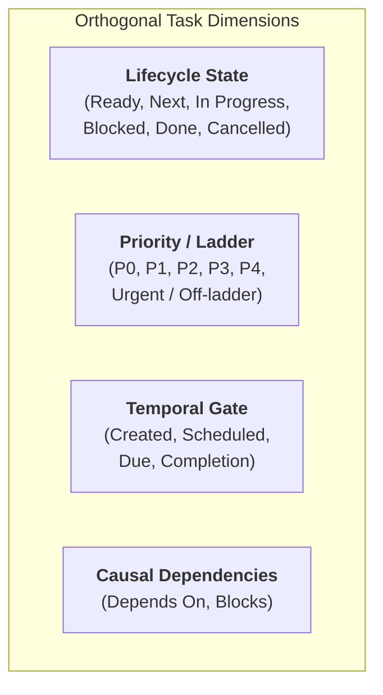
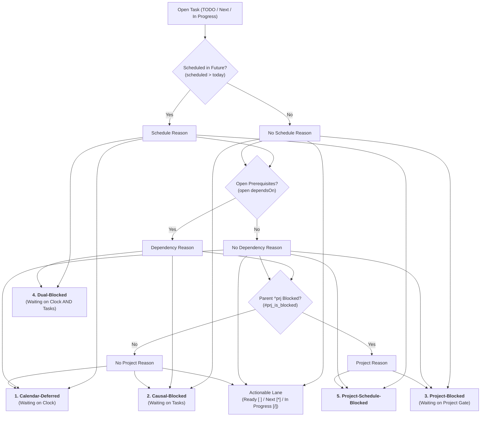
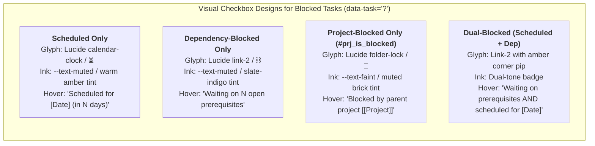

# Visual Distinction of Blocked Tasks and Priority Semantics in Obsidian

> **Research query:** I want to start making it much clearer (in a visually appealing
> way) why a task is blocked in Obsidian.
> - I think the best way to do this is probably to start rendering `[1]`, `[2]`, `[3]`,
>   and `[4]` for tasks that have a `priority` property using distinct colors for each
>   priority.
> - This means that we should probably stop rendering the priority icon I'm thinking,
>   right?
> - We could also start rendering `[&]` for tasks that are blocked by other tasks (i.e.
>   have open task dependencies).
> - Note that `[1]`, `[2]`, `[3]`, `[4]`, and `[&]` are only suggestions (ones that I
>   have low confidence in). Think hard about the best way to achieve my goal here.
> - This way the only tasks that look like they use `[?]` in Obsidian are tasks that were
>   explicitly scheduled using the `scheduled` task property.
> - I want you to lead the design on this one. Make sure you design this feature so it is
>   intuitive, reliable, and (last but not least) beautiful!
>
> Can you do some research with the goal of helping me decide the best way to implement
> this? Also, critique this plan in general. Is this a good idea? Would you take a
> different approach? Make any adjustments to the requirements that you think are
> justified but clearly call these out. End your analysis with a recommended solution.

Checked **Sunday, November 1, 2026, about 18:50 EST** against:

- `bob-cli` commit `37c100f` / `8d54b0e` (master);
- `bob-plugins` commit `3208e8c` / `1.82.0` (origin/master);
- Obsidian Tasks 8.4.0 integration contracts;
- Live `~/bob` vault task metadata, Dataview queries, and CSS rendering pipelines.

---

## 1. Executive Summary & Verdict

### 1.1 Bottom Line

1. **Do NOT render `[1]`, `[2]`, `[3]`, `[4]` inside the checkbox:**
   This proposal suffers from a fundamental information architecture flaw: **Dimensional Collapse**. The checkbox slot (`- [c]`) is the single-character representation of **Lifecycle Workflow State** (`Ready [ ]`, `Next [*]`, `In Progress [/]`, `Blocked [?]`, `Done [x]`, `Cancelled [-]`). Priority (`P1`–`P4` / `high`–`lowest`) is an **orthogonal dimension** (Urgency / Importance). Stamping priority into the checkbox creates unresolvable combinatoric collisions: a task can be P1 and Ready, P1 and In Progress, P1 and Blocked, or P1 and Done. Overwriting the checkbox destroys workflow visibility and turns the task list into a distracting carnival of colored numbers.

2. **Do NOT remove the signal-bar priority mark (`bob-priority-mark`):**
   The signal staircase established in `docs/projects.md` § "Priority marks" is one of the most refined visual components in Bob. It follows the core philosophy: *"Shape carries meaning; color whispers."* It conveys priority P1–P4 via 4/3/2/1 filled bars and urgent via a knocked-out `!` icon, collapses smoothly, works in both source views and flat Tasks queries, and preserves Obsidian Tasks compatibility. Discarding it for colored numbers in the checkbox would be a severe aesthetic and ergonomic regression.

3. **YES to distinguishing WHY a task is blocked, but NOT via `[&]` or storage mutation:**
   Bryan's core frustration is completely valid: scanning a column of identical `[?]` checkboxes forces exhausting eye saccades across line text and down to child lines (`⛓️ **DEPENDS ON:**`) to figure out *why* work is stalled. Furthermore, in **flat Tasks query results**, child lines are stripped away entirely, making dependency-blocked tasks completely indistinguishable from other tasks!
   However, `[&]` is an un-intuitive glyph (`&` means "and", not "blocked by"), and writing distinct characters (`- [&]` vs `- [?]`) to Markdown files creates a massive, unnecessary multi-repo coordination tax across Rust (`bob task reconcile`), TypeScript plugins (`task-status-cycler`, `bob-navigation-hotkeys`), Swift (`bob-mac-capture`), and hundreds of vault Dataview queries (`WHERE status = "?"`).

4. **The Recommended Architecture: Multi-Channel Render-Time Blocker Decoration:**
   Keep the stored Markdown status strictly canonical (`- [?]`). Let `bob-ledger-tools` decorate the checkbox and task line at render time across Live Preview, Reading View, and Tasks query results:
   - **Calendar-Deferred (Scheduled):** Renders a calm amber/sand **Clock/Calendar glyph** (e.g. `⏳` / Lucide `calendar-clock`) in the checkbox with a tooltip stating the target date and countdown.
   - **Dependency-Blocked (Prerequisites):** Renders a distinct slate-blue **Link/Chain glyph** (e.g. `⛓️` / Lucide `link-2`) in the checkbox with a tooltip stating the open blocking prerequisites.
   - **Project-Blocked (`#prj_is_blocked`):** Renders a muted brick **Project Gate glyph** (e.g. `🧱` / Lucide `folder-lock`) with a tooltip naming the blocking project.
   - **Dual-Blocked (Scheduled AND Dependency):** Renders the Chain glyph with an amber indicator pip, signaling that the task has prerequisite work *and* a future calendar date.
   - **Tasks Query Blocker Pill:** In flat Tasks query views where child lines are stripped, inject a compact inline chip (`⛓️ 1 dep`) directly on the row, solving the exact blind spot that triggered this inquiry.

---

## 2. In-Depth Critique of the Initial Proposal

### 2.1 The Dimensional Collapse Problem

In task management theory and Bob's architecture, a task possesses several independent dimensions:



The Markdown checkbox `- [c]` is strictly dedicated to **Dimension 1 (Lifecycle State)**.

If we attempt to render priority `[1]`, `[2]`, `[3]`, `[4]` in the checkbox, consider what happens to the state space:

| Actual State | Stored Markdown | Proposed Checkbox | What Information Is Destroyed? |
| :--- | :--- | :--- | :--- |
| **Ready + P1** | `- [ ] ... [priority:: high]` | `[1]` | Can I start this now? (Lost: is it Ready or Blocked?) |
| **In Progress + P1** | `- [/] ... [priority:: high]` | `[1]` | Am I currently working on this? (Lost: lane `/`) |
| **Next + P1** | `- [*] ... [priority:: high]` | `[1]` | Is this committed in today's ledger? (Lost: lane `*`) |
| **Dep-Blocked + P1** | `- [?] ... [priority:: high]` | `[1]` vs `[&]`? | **Collision:** Does priority win or blocker win? |
| **Scheduled + P1** | `- [?] ... [priority:: high]` | `[1]` vs `[?]`? | **Collision:** Does priority win or calendar win? |
| **Done + P1** | `- [x] ... [priority:: high]` | `[x]` vs `[1]`? | If `[x]`, priority vanished; if `[1]`, it looks incomplete! |

This table illustrates the breakdown. Any single-character slot that attempts to display both *Lifecycle State* and *Priority* must either choose an arbitrary winner or become uninterpretable.

### 2.2 Why Colored Numbers `[1]`–`[4]` Regress Aesthetic Integrity

The user prompt suggests:
> *"start rendering `[1]`, `[2]`, `[3]`, and `[4]` for tasks that have a priority property using distinct colors for each priority."*

Let us critique this from a design and typographic perspective:

1. **The "Carnival Effect" vs. Focused Calm:**
   A personal GTD vault note often contains 20–50 tasks. If every task with a priority renders a bright colored numeral in its checkbox (e.g. red `[1]`, orange `[2]`, blue `[3]`, grey `[4]`), the left visual margin becomes a vibrating column of colored numbers. The eye cannot establish a resting scan path.
2. **Violation of Bob's Established Aesthetic Contract:**
   `docs/projects.md` § "Priority marks" explicitly lays down the design law:
   > *"Shape carries meaning; color whispers. Truthful or neutral... One glyph definition shared by every surface."*
   The signal-bar staircase mark was deliberately designed to use monochrome ink (`--text-muted`) at resting state, using structural geometry (4 bars, 3 bars, 2 bars, 1 bar) rather than shouting colors. Colors are reserved for interactive alerts and user theme overrides.
3. **Misleading Precedent in Checkbox Typography:**
   In Obsidian themes (such as Minimal, Things, or AnuPpuccin) and markdown extensions, numbers in brackets (like `[1]`) are traditionally used for numbered checklist steps, footnote references, or sequential sub-actions, never for urgency priority.

### 2.3 Critique of Dropping the Priority Icon

The user asks:
> *"This means that we should probably stop rendering the priority icon I'm thinking, right?"*

**No.** The signal-bar priority mark (`.bob-priority-mark`) is an unqualified design success:
- It occupies a neat, dedicated slot directly beside the task text.
- It automatically folds the clumsy `[priority:: high]` Dataview syntax in Live Preview.
- It supports cursor reveal for inline editing.
- It seamlessly styles Tasks 8.4.0 query results via CSS mask injection without touching Tasks' internal DOM.
- It represents the off-ladder urgent state cleanly via a solid rounded square with a knocked-out `!`.

Removing this mark would leave priority with nowhere to live except the compromised checkbox slot.

### 2.4 Critique of `[&]` for Dependency-Blocked Tasks

The user suggests:
> *"We could also start rendering `[&]` for tasks that are blocked by other tasks (i.e. have open task dependencies)."*

1. **Semantic Inaccuracy of Ampersand:**
   The glyph `&` (ampersand) is a ligature for the Latin word *et* ("and"). In computing and typography, `&` represents conjunction, bitwise AND, background execution, or address-of operators. It has zero semantic association with "blocked", "waiting", or "prerequisite".
   When a user looks at `- [&] Ship release`, the brain asks: *"And what? Is this connected to something?"* It does not read as *"Waiting on an open dependency"*.
2. **Visual Texture:**
   In standard interface and monospace typefaces, `&` is a visually heavy, complex glyph with loops and crossings. It creates an ink-heavy blot in the checkbox compared to clean geometric glyphs like `[ ]`, `[x]`, `[*]`, or `[-]`.
3. **Better Semantic Metaphors Exist:**
   The universal metaphor for dependency in task management and issue tracking is a **Chain / Link** (`⛓️`, `🔗`, or two linked rings), or a **Clock / Hourglass** (`⏳`, `🕐`) for temporal deferral.

---

## 3. The True Taxonomy of Blocked Tasks in Bob

To solve this problem properly, we must first map every reason a task becomes `Blocked` in Bob. Today, `bob task reconcile` (formerly `task-status-hooks`) marks an open task `[?]` under four distinct conditions:



### 3.1 The 4 Blocker Archetypes

1. **Temporal Deferral (Calendar-Deferred):**
   - **Source:** Task has `[scheduled:: YYYY-MM-DD]` where `date > today`.
   - **Cognitive Meaning:** *"Do not think about this until the date arrives."*
   - **Actionability:** Completely passive. No human action can advance it (unless Bryan explicitly decides to reschedule it).
   - **Current UI:** Shows `[?]` in checkbox, plus `.bob-date-mark` (e.g. `Nov 6`) on the line.

2. **Causal Dependency (Prerequisite-Blocked):**
   - **Source:** Task has `⛓️ **DEPENDS ON:**` with at least one open target, or `[dependsOn:: ID]`.
   - **Cognitive Meaning:** *"Work cannot proceed until other specific tasks finish."*
   - **Actionability:** Highly active! If Bryan wants to unblock this, he can jump to the prerequisite task and complete it.
   - **Current UI:** Shows `[?]` in checkbox, plus `⛓️ **DEPENDS ON:**` child chips in note view. **Crucially: In Tasks queries, child lines are stripped, so there is ZERO visual clue that dependencies exist!**

3. **Project Gate (Project-Inherited Block):**
   - **Source:** The enclosing project note's `^prj` task is blocked (by project dependencies or project schedule). Bob tags residents with `#prj_is_blocked`.
   - **Cognitive Meaning:** *"The entire initiative is on hold."*
   - **Actionability:** Address the project's bottleneck at the project level.
   - **Current UI:** Shows `[?]` in checkbox, plus `#prj_is_blocked` tag.

4. **Dual Blocker (Composite):**
   - **Source:** Task has open prerequisites *AND* a future scheduled date.
   - **Cognitive Meaning:** *"Even if prerequisites finish today, do not start until date; and even when date arrives, cannot start until prerequisites finish."*
   - **Actionability:** Composite gate.

---

## 4. Where the User Experience Actually Breaks Down

Why did Bryan feel the urge to propose `[&]` and `[?]`?
Our investigation revealed two distinct friction points in daily vault use:

### Friction Point A: The Left-Gutter Scan Path

When reviewing a note with 30 tasks, the human eye performs a rapid vertical scan down the **left gutter** (the checkbox column):

```text
- [ ] Review PR #45
- [?] Refactor parser engine       <-- Why is this blocked?
- [?] Write integration tests      <-- Why is this blocked?
- [?] Deploy to staging            <-- Why is this blocked?
- [*] Fix CSS layout bug
- [?] Announce release             <-- Why is this blocked?
```

Because every blocked row wears the identical `?` glyph, Bryan's eye cannot filter the list in the gutter. To learn whether `Refactor parser engine` is waiting for next week or waiting for a teammate, his gaze must dart across the line, scan for date tags, scan for `#prj_is_blocked`, or drop down to the child line to read `DEPENDS ON`. That saccade cost multiplied across dozens of tasks causes cognitive fatigue.

### Friction Point B: The Tasks Query Blind Spot (The Smoking Gun)

In Obsidian, the **Tasks plugin** query block is used for aggregated lists (e.g. morning review, project dashboards, backlog overviews).

Consider how a task with dependencies renders in note view vs. in a Tasks query:

**In Note View (Full Multi-line List):**
```markdown
- [?] #task Refactor parser engine ^refactor
  - ⛓️ **DEPENDS ON:** [[SyntaxSpec#^draft]]
```
*(The user can see the child line with dependency chips!)*

**In Tasks Query View (Flat List Item):**
```markdown
- [?] #task Refactor parser engine [id:: parser__refactor] [dependsOn:: spec__draft]
```
*(Tasks plugin strips all child list items! Only the single task line is rendered!)*

In the Tasks query view, `bob-ledger-tools` folds the Dataview brackets, leaving:
`- [?] #task Refactor parser engine`

**There is literally zero visible evidence that this task is waiting on a dependency!** It looks identical to a task scheduled for the future whose date mark might be scrolled off or missing.

This explains why Bryan felt a desperate need for the checkbox itself to say `[&]` vs `[?]`.

---

## 5. Architectural Evaluation: Storage Mutation vs. Render-Time Decoration

Before deciding on glyphs, we must resolve the architectural fork:
**Should the Markdown file on disk change to `- [&]`, or should the distinction be rendered dynamically by Obsidian?**

```mermaid
flowchart TD
    subgraph PathA["Approach 1: Mutate Markdown Storage (- [&] vs - [?])"]
        A1["Disk writes - [&] on dep-blocked"] --> A2["Update bob task reconcile (Rust)"]
        A2 --> A3["Update Tasks plugin customStatuses"]
        A3 --> A4["Update Task Status Cycler (TS)"]
        A4 --> A5["Update Bob Mac Capture (Swift)"]
        A5 --> A6["Rewrite Vault Dataview Queries (WHERE status = '?')"]
    end

    subgraph PathB["Approach 2: Render-Time Decoration (Markdown stays - [?])"]
        B1["Disk stays canonical - [?]"] --> B2["Rust reconcile untouched"]
        B2 --> B3["Tasks status registry untouched"]
        B3 --> B4["bob-ledger-tools inspects line & renders distinct glyph"]
        B4 --> B5["Zero migration, zero breaking changes, reversible"]
    end
```



### 5.1 The Cost of Approach 1 (Storage Mutation)

If `bob task reconcile` started writing `- [&]` to disk:
1. **Rust Reconciler Contract Break:**
   In `src/native/task_status_hooks/settings.rs`:
   ```rust
   // Lines 127-141 assert:
   if definition.symbol != "?" || definition.name != "Blocked" || definition.status_type != TaskStatusType::OnHold ... {
       return Err(SyncError::new("cannot reconcile Blocked [?] tasks... expected symbol '?'"));
   }
   ```
   Reconciliation would need to be rewritten to derive, validate, transition, and recover two distinct blocked symbols (`?` and `&`).
2. **Dual-Blocker Impasse:**
   What does `bob task reconcile` write when a task is BOTH scheduled for next week AND has an open prerequisite?
   If it writes `[&]`, the schedule is obscured. If it writes `[?]`, the dependency is obscured. A 1-character disk format cannot represent composite states.
3. **Vault-Wide Query Breakage:**
   Bryan has hundreds of Dataview queries across daily notes, project dashboards, and review templates containing:
   `WHERE status = "?"`
   Every single one of these queries would immediately omit dependency-blocked tasks, silently corrupting review workflows and dashboards until manually migrated.
4. **Swift Client (`bob-mac-capture`) & Plugin Keymaps:**
   Mac Capture and keyboard navigation cyclers (`Alt+]`, `Ctrl+Enter`) check for `?` to execute unblocking logic (`api.recoverBlockedDependents`). All would require coordinated major releases.

### 5.2 The Power of Approach 2 (Render-Time Decoration)

By keeping the disk byte strictly `- [?]`, and letting `bob-ledger-tools` decorate the visual presentation:
1. **Zero Storage Migration:** Not a single markdown file in the vault needs editing.
2. **Zero Tooling Breakage:** `bob task reconcile`, `bob-mac-capture`, Dataview queries, and Tasks plugin settings continue to function with 100% reliability.
3. **Superior Expressiveness:** A visual renderer can display:
   - A clock icon for scheduled tasks;
   - A chain icon for dependency-blocked tasks;
   - A brick icon for project-blocked tasks;
   - **Composite badges** for dual-blocked tasks (e.g. chain icon with an amber schedule dot!).
4. **Graceful Fallback:** In plain text editors, GitHub mobile, or terminal viewers, standard markdown `- [?]` remains completely valid.

**Conclusion:** Approach 2 (Render-Time Decoration) is vastly superior in safety, elegance, and expressive power.

---

## 6. The Visual & Interaction Design System

We now design an intuitive, reliable, and beautiful visual system to fulfill Bryan's goals.

### 6.1 Gutter Checkbox Icons (The Left Margin)

In Obsidian Live Preview and Reading View, `bob-ledger-tools` already inspects task lines to render date marks, priority marks, and tags. We extend this to style the checkbox element `<input class="task-list-item-checkbox">` (or its overlay container) when `data-task="?"`.

Instead of raw ASCII characters (`?`, `&`, `1`), we use refined SVG mask glyphs matching the existing geometry of Bob's marks:



#### Detailed Glyph Specifications

1. **Calendar-Deferred Task:**
   - **Visual:** A crisp circular clock face with hands at 10 and 2, or a compact calendar page outline.
   - **Tone:** Soft warm amber (`var(--color-yellow)` mixed with `--text-muted` at 25%).
   - **Meaning at a glance:** *"Time-gated. Relax, the calendar will wake this up."*

2. **Dependency-Blocked Task:**
   - **Visual:** Two interlinked chain links angled at 45° (Lucide `link-2` silhouette).
   - **Tone:** Technical slate-indigo (`var(--color-blue)` mixed with `--text-muted` at 25%).
   - **Meaning at a glance:** *"Prerequisite-gated. Actionable if you finish the antecedent."*

3. **Project-Blocked Task (`#prj_is_blocked`):**
   - **Visual:** A small structural brick or project badge (Lucide `folder-lock` or `boxes`).
   - **Tone:** Quiet stone/brick tone (`var(--text-faint)`).
   - **Meaning at a glance:** *"Contextual. The whole project is paused."*

4. **Dual-Blocked Task:**
   - **Visual:** The interlinked chain glyph with a tiny 2px amber dot in the top-right corner.
   - **Meaning at a glance:** *"Has dependencies, and is also deferred."*

### 6.2 Solving the Tasks Query Blind Spot: The Inline Blocker Chip

To eliminate the critical blind spot in flat Tasks queries (where child `⛓️ **DEPENDS ON:**` lines are omitted), `bob-ledger-tools` will inject a display-only **Blocker Chip** on `.plugin-tasks-list-item[data-task="?"]`:

```text
Normal Note View:
- [⛓️] #task Refactor parser engine ^refactor
  - ⛓️ **DEPENDS ON:** [[SyntaxSpec#^draft]]

Tasks Query View:
- [⛓️] #task Refactor parser engine [⛓️ 1 dep]  [P1 ❙❙❙❙]
```

- If blocked by dependencies: displays `[⛓️ 1 dep]` (or `[⛓️ ^draft]`). Clicking the chip navigates directly to the blocker!
- If blocked by schedule: the existing `.bob-date-mark` already displays `[⏳ Nov 6]`.
- If blocked by project: displays `[🧱 prj blocked]`.

Now, regardless of whether Bryan is looking at a source file, a daily note review walk, or an aggregated Tasks query, the reason for the blockage is 100% visible and actionable.

### 6.3 Preserving and Polishing Priority Marks

We preserve the existing signal staircase priority mark without alteration to its shape, but ensure it harmonizes with the new blocker glyphs:
- **P0 (No field):** Clean task line (absence of priority field).
- **P1 (`high`):** 4 filled signal bars.
- **P2 (`medium`):** 3 filled signal bars.
- **P3 (`low`):** 2 filled signal bars.
- **P4 (`lowest`):** 1 filled signal bar.
- **Urgent (`highest`):** Solid rounded box with knocked-out `!`.

Priority remains where it belongs: an urgency indicator on the task payload, completely untangled from the workflow status.

---

## 7. Comparative Assessment of Options

| Criterion | User Suggestion (`[1]..[4]`, drop icon, `[&]`) | Alternative A: Store `- [&]` in Markdown | **Recommended Solution: Render-Time Multi-Channel Glyphs** |
| :--- | :--- | :--- | :--- |
| **Information Integrity** | **Fails** (destroys Ready/Next/Done state) | Good (separates `?` and `&`) | **Perfect** (preserves all lanes & attributes) |
| **Priority Handling** | **Poor** (colored numbers clutter gutter) | Unchanged (keeps priority mark) | **Excellent** (keeps elegant signal mark) |
| **Tasks Query Visibility**| **Poor** (no dep details in Tasks) | Poor (shows `[&]`, no details) | **Best** (adds inline blocker chip to Tasks query) |
| **Dual-Blocker Handling** | **Fails** (cannot represent both) | **Fails** (must pick `?` or `&`) | **Full** (chain glyph + schedule pip) |
| **Rust CLI Impact** | Massive rewrite of `task_status_hooks` | Major changes to reconciliation | **Zero** (reconcile remains 100% clean) |
| **Vault Migration** | Destructive vault-wide rewrite | Requires migrating all `WHERE status = "?"` | **Zero** (100% backward compatible) |
| **Aesthetic Quality** | Garish, noisy colored numerals | Monospace punctuation `&` | **Beautiful, balanced typographic icons** |

---

## 8. Implementation Plan & File Touchpoints

The recommended solution is implemented entirely within `bob-plugins` (specifically `plugins/bob-ledger-tools/`), with zero required changes to `bob-cli` or existing vault markdown notes.

### 8.1 Files to Modify in `bob-plugins`

1. **`plugins/bob-ledger-tools/src/140-dependency-model.js`:**
   - Add helper `taskBlockerClassification(line, childLines, tags)`:
     - Detects whether an open task is `schedule_only`, `dependency_only`, `project_only`, or `dual`.
     - Returns blocker summary: `{ type, depCount, topDepTarget, scheduleDate }`.

2. **`plugins/bob-ledger-tools/src/280-plugin-dependency-render.js` & `styles.css`:**
   - Define SVG mask variables on `body`:
     - `--bob-blocker-glyph-clock`: Circular clock / calendar mask.
     - `--bob-blocker-glyph-link`: Interlinked chain mask.
     - `--bob-blocker-glyph-project`: Brick / barrier mask.
   - Add CSS rules targeting `[data-task="?"]`:
     - `.HyperMD-task-line[data-task="?"][data-blocker="dep"] .task-list-item-checkbox`
     - `.HyperMD-task-line[data-task="?"][data-blocker="sched"] .task-list-item-checkbox`
     - `.HyperMD-task-line[data-task="?"][data-blocker="dual"] .task-list-item-checkbox`
   - In Reading View and Live Preview post-processors, attach `data-blocker` attributes to the task container.

3. **`plugins/bob-ledger-tools/src/267-plugin-date-marks-tasks.js` (Tasks Query Enhancements):**
   - For `li.plugin-tasks-list-item[data-task="?"]`:
     - Query `dependencyTasksIndex` to check if the task's block ID has open dependencies in the vault.
     - If so, append `.bob-dep-query-chip` (`⛓️ 1 dep` with target tooltip) immediately following the task description.

4. **Testing Suite:**
   - Add unit tests in `scripts/test-ledger-tools-blocked-glyphs.cjs` verifying:
     - Pure classifier correctly identifies scheduled vs. dependency vs. project vs. dual blockers.
     - Live Preview decoration properly attaches `data-blocker` attributes.
     - Tasks query results correctly inject the blocker chip when child lines are absent.
     - Hover tooltips render informative text.

---

## 9. Conclusion & Final Recommendations

Bryan's intuition that **"it should be immediately obvious why a task is blocked"** addresses a genuine and acute friction point in the Bob workflow. However, the path of modifying the checkbox to render priority numbers `[1]`–`[4]` and ampersand `[&]` is an architectural trap that conflates independent dimensions, breaks existing tooling, and degrades visual aesthetics.

By adopting **Render-Time Multi-Channel Blocker Decoration**:
- The checkbox gutter instantly telegraphs the exact blocker type (**Clock** for scheduled, **Chain** for dependency, **Brick** for project, **Composite** for dual).
- The signal staircase priority mark remains intact, beautiful, and expressive.
- The Tasks query blind spot is solved with an actionable inline blocker chip.
- Not a single line of Rust code needs to change, and not a single vault query breaks.

This delivers the intuitive, reliable, and beautiful experience Bryan envisions while preserving the uncompromising architectural rigor of the Bob ecosystem.
