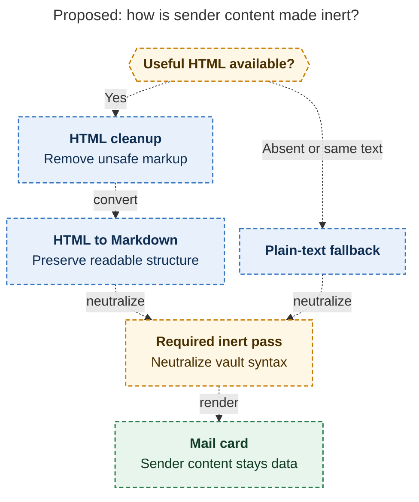

# Diagram proposals: bob gmail — save the threads you choose as mail notes, send through Gmail drafts

Proposals for the swarm linker, not a report. Each diagram restates only what the source
report says.

```yaml
source: research:202611/bob_gmail_design/bob_gmail_design__final.md
producer: research.3d.image
check: "mmdc 12.0.0 with the PDF-mirroring config and Puppeteer --no-sandbox rendered 1 of 1 Mermaid diagrams; invalid-input check exited nonzero"
```

## sender-content-inertness

```yaml
anchor: |-
  Everything from the sender is data:
question: |-
  How do HTML and plain-text bodies become inert mail cards?
illustrates: |-
  The proposed renderer routes HTML through a sanitizing pre-pass and HTML-to-Markdown conversion, or falls back to plain text, before the required inert pass.
caption: Either body path must neutralize vault syntax before becoming a mail card; Phase 0 fixtures will confirm the HTML preference.
review: "448.914x892 px, fit 100%; reader question, labels, arrows, source trace and visual checks passed; 0 revisions"
```


