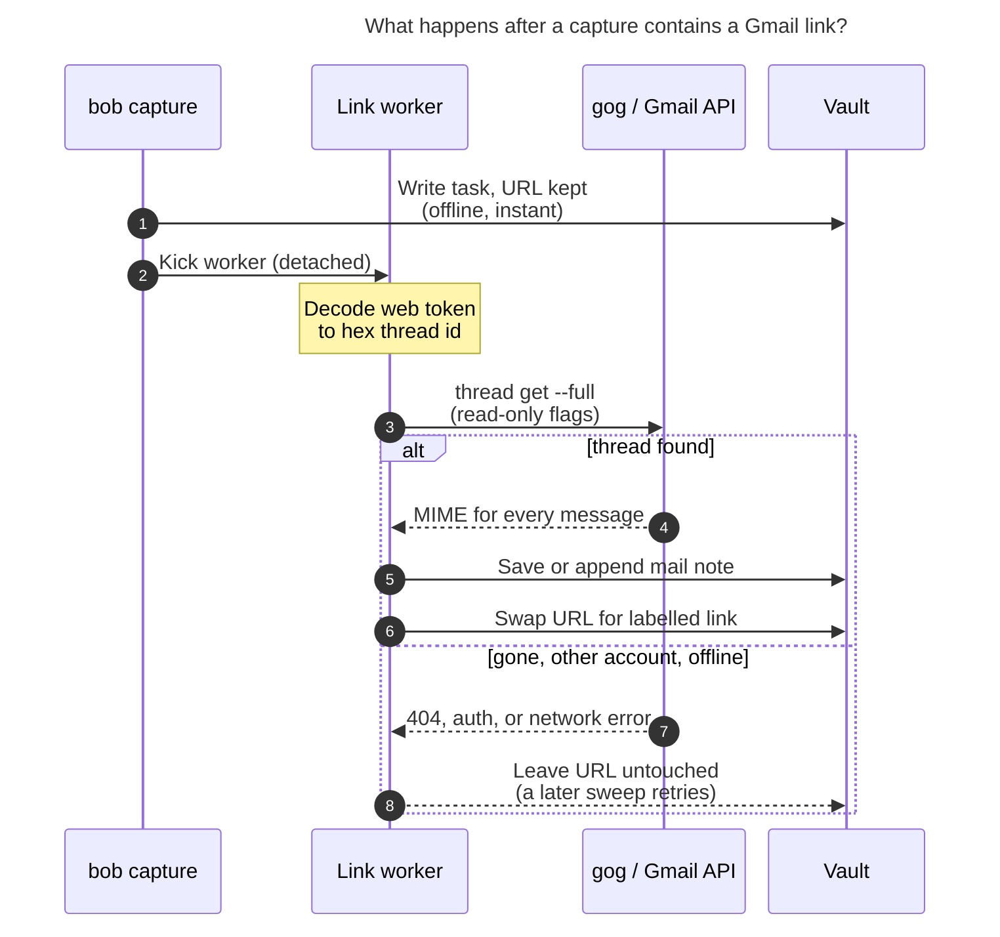

# `bob gmail` — Gmail in the Bob vault: research, critique, and a recommended design

*Researcher: cld · 2026-11-05 · Scope: bob-cli (primary), bob-plugins, Bob Mac Capture, Bob vault*

## Executive summary

**Verdict: build it, but scope it on purpose.** Gmail stays the system of record.
The vault keeps **snapshots of the threads you deliberately attach to your work**.
It never mirrors the mailbox. Within that frame the feature is worth doing, and
most of it already exists in parts: `gog` v0.44 (already Bob's Google transport for
`bob gcal`) covers every Gmail operation needed. Capture already has the right
pattern, an offline submit followed by a detached worker. The vault already has
the right shapes: type notes, managed blocks, per-host journals, and the
attachment origin journal.

Seven findings shape the design:

1. **The example URL can be resolved offline.** The `FMfcgz…` token in
   `#inbox/FMfcgzQhWTsNRgxMhQNwhZDfgqwXpPsx` is a base-40 re-encoding of a
   base64 string. It decodes to `f:1876768160496397206`, which is the Gmail API
   thread id `1a0b9eb2cc26ab96`. I checked this against the live API (read-only).
   All 6 distinct `FM…` tokens already in the vault decode the same way. The
   4 that still exist resolve, and 2 return 404. The format is **undocumented**,
   and a public issue claims it cannot be decoded, so treat it as best-effort
   with fallbacks.
2. **Gmail links rot.** 2 of the 6 thread links Bryan pasted (both from 2024) no
   longer resolve. That is the strongest argument for *snapshotting* the email
   into a note rather than just relabelling the link.
3. **Gmail ids carry their own timestamp** (`id >> 20` = epoch ms). It matched the
   API's `internalDate` exactly. Capture can therefore show "Gmail thread ·
   Sep 19, 2026" in its live preview **without any network call**.
4. **Capture must stay offline.** The design leaves the URL in the task as its
   own placeholder. A detached worker files the mail note, then swaps the URL
   for `[[mail/…|✉️ Subject · Sender]]`. On any failure the URL simply stays,
   and no information is lost.
5. **Mail notes are append-only thread snapshots.** Gmail messages are
   immutable, so a refresh only ever *appends* new message cards. Your
   highlights and notes are never clobbered. Messages render as foldable
   Obsidian callouts styled like Gmail's conversation view. Without the CSS
   they fall back to a plain `note` callout.
6. **Sending should be draft-first.** Composing in Obsidian creates a Gmail draft.
   Sending is a separate step that shows a preview and needs a yes, and it
   sends *that draft id*. A crash or retry therefore cannot send twice.
7. **The most useful follow-on is a label drain** (`bob gmail pull`): label or
   star a mail on your phone and it becomes a task with the email attached. The
   Gmail mobile app exposes no URLs, so the link-capture flow is desktop-only.

**Requirement adjustments:** §3.2 lists seven (R1–R7). The largest are: save the
*thread* rather than one message (R1); rewrite the link asynchronously (R2);
make send draft-first (R4); and treat "review emails in Obsidian" as reading
*saved* threads, not triaging the inbox (R6).

The recommended solution is in [§8](#8-recommended-solution).

---

## 1. What I examined

| Area | Evidence |
| --- | --- |
| Originating task | `bob.md ^gmail-integration` (created 2026-11-04, Next): *"auto-convert links like [this](…#inbox/FM…) into links with good subjects"*, *"review emails directly in Obsidian"*, *"MAY allow me to reply to emails in Obsidian?!"* |
| `bob gcal` | `src/native/gcal/gog.rs`, `docs/gcal.md`, `docs/guides/connect-google-calendar.md`. Bob talks to Google **only through gog**, with the common flags `--no-input --json --color never --readonly --client bob-gcal --account <email>`. It uses an isolated `bob-gcal` token bucket ("never touches other gog tokens (Gmail included)"), remote two-step sign-in, a doctor checklist, and the fake `BOB_GCAL_GOG` for tests. The Mac is the single writer of daily notes. |
| `bob gkeep` | `docs/gkeep.md`. Snapshot → classify → render → prepared record → atomic write → verify → receipt → commit → archive upstream *only after verified*. This is the model for a future Gmail label drain. |
| Capture URL handling | `docs/capture.md` §"Saving links to your reading queue", `docs/ref-jobs.md`, `src/native/ref_jobs/` (spool, detached `kick`, worker). *"Submit never touches the network and returns at once."* `url_routing/policy.rs` excludes `google.com` (so `mail.google.com`) from reading-queue routing, so today a Gmail URL stays raw task text. |
| Vault conventions | `obsidian.md` memory: every new note needs `parent:`. Ref notes use `type: "[[ref]]"` plus `<!-- highlights:begin -->` managed blocks. Durable per-host journals live under `.bob/<feature>/<host>.jsonl`. `docs/attachments.md` defines an origin journal for copied files. Vault Git remote: GitHub `bobs-org/bob.git`. |
| Plugins | `docs/reference/plugins/bob-ledger-tools.md`: a plugin runs `bob gcal sync -q -f json` and "Bob remains the only writer". Bob Command Mode runs bob commands from Obsidian with safe-write guards. |
| Decisions | `mac-capture-is-a-thin-client` (bob owns grammar, preview, and writes; JSON grows additively). `references-are-ingested-at-birth`. `capture-sigils-say-where-what-how` (adding a sigil is a decision-level change). |
| gog on apollo | v0.44.0. `gmail` read: `search`, `get`, `raw`, `thread get --full`, `url`, `history`, `attachment`. Write: `send`, `reply`, `drafts create/update/send/delete`, `labels`, `archive`. Guards: `--readonly`, `--gmail-no-send`, `--enable-commands`. Auth: `--gmail-scope full\|readonly\|send\|read-send`, `--extra-scopes`. Existing grant: the `default` client with `gmail.readonly` only (SASE agents' `sase_gmail` skill). |
| Live checks (read-only, metadata only) | Decoded every vault token and fetched thread structure, MIME tree shape, and latency. No message content is quoted in this report. |

## 2. Key findings

### 2.1 Gmail web tokens decode offline, at least for now

The new-UI token uses a 40-character consonant alphabet
(`BCDFGHJKLMNPQRSTVWXZbcdfghjklmnpqrstvwxz`). Read it as a base-40 integer,
re-express it in the base64 alphabet, and base64-decode it. The result is an
ASCII string such as `f:<decimal>`. Converting the decimal to hex gives the API
id. The whole decoder is about 15 lines.

| Token source | Decoded | API result |
| --- | --- | --- |
| The example URL in the request | `f:1876768160496397206` → `1a0b9eb2cc26ab96` | ✅ thread, 3 messages; labels no longer include `INBOX` (archived since) |
| 5 other distinct vault tokens | all `f:<decimal>` | 3 ✅ threads, 2 ❌ 404 (thread get **and** message get) |

The two 404s decoded cleanly and have plausible embedded dates (Jun and Dec 2024).
That pattern points to deleted mail, or to mail in a different account when the
link was copied (`/u/0` is login-order dependent), rather than to a decode bug.

**Caveats that shape the design.** The format is undocumented. Older write-ups
mention other decoded forms (`thread-f:`, `msg-f:`, `thread-a:r…`), and a
Stack Overflow answer notes that some ids "map through a backend persistence
layer". googleworkspace/cli issue #790 (May 2026, open) goes further and argues
the tokens are opaque ciphertext. It inspects the token as raw base64url, which
is not how the token is encoded, and that explains its conclusion. So:

- Decode the `f:`, `thread-f:`, and `msg-f:` forms. For `msg-` forms, map the
  message to its thread via `messages.get`.
- **Verify by fetching.** Never trust a decode that the API does not confirm.
- Fall back to search for every other form, and say so clearly.
- Make `bob gmail doctor` report a **decoder health** line: how many Gmail URLs
  in recently changed notes resolve. If Google changes the format, Bob notices
  instead of silently failing.

The URL parser should also accept these forms, all of which appear in the vault
or Gmail:

- `#<view>/<token>` for any view (`inbox`, `all`, `sent`, `starred`,
  `label/X`, `search/q`, `category/x`).
- Legacy 16-hex ids.
- `#search/rfc822msgid:<Message-ID>`. The zorg-era vault has **25** of these,
  and they resolve with Gmail search.
- `permthid=thread-f:N` from print views.

Reject `?compose=` drafts and `mail.google.com/chat/…` links, which also appear
in the vault, with a clear message.

### 2.2 The id is a clock

`int(id, 16) >> 20` is the first message's epoch milliseconds. It gave
2026-09-19 13:46:32 UTC for the example thread, an exact match for
`internalDate`. Three uses follow:

- capture-parse can show an offline hint, "✉️ Gmail thread · Sep 19, 2026",
  in the Mac panel before submit;
- the mail note path can carry its date even before the subject is fetched;
- a dead link can still be reported meaningfully: "gone from Gmail (thread
  from Jun 2024)".

### 2.3 Links rot, so snapshots earn their keep

The census of `mail.google.com` URLs in the vault (36 files, mostly zorg-era
2024 logs):

| Shape | Count |
| --- | --- |
| `#search/rfc822msgid:…` | 25 |
| `#inbox/<token>` | 9 |
| `#label/…` (2 with a thread token) | 5 |
| `chat/…` | 4 |

Across the `#inbox` and `#label` links there are 6 unique thread tokens.

Usage is modest: 11 token links since the new Gmail UI, plus 25 zorg-era
Message-ID links. Part of the reason
is that unlabelled Gmail URLs are ugly and opaque, so the low count is partly a
chicken-and-egg effect. Still, **one third of the thread links are already dead**.
A labelled link to a dead thread is worthless. A note that holds the content
stays useful.

### 2.4 gog already does the transport

| Need | gog command | Scope |
| --- | --- | --- |
| Fetch a whole thread (lossless MIME for every message, about 0.9 s) | `gmail thread get <id> --full --json` | `gmail.readonly` |
| Message → thread | `gmail get <id> --format metadata` | `gmail.readonly` |
| Canonical web link | `gmail url <id>` → `https://mail.google.com/mail/?authuser=<email>#all/<hex>` | none (offline) |
| Search / picker | `gmail search <q> --max N` | `gmail.readonly` |
| New replies since X | `gmail history --since <historyId>` | `gmail.readonly` |
| Attachments | `gmail attachment <msg> <att> --out …` | `gmail.readonly` |
| Draft create/update/send | `gmail drafts create\|update\|send`, with `--thread-id`, `--reply-to-message-id`, `--body-file`, `--body-html-file`, `--attach` | `gmail.compose` |
| Label drain (later) | `gmail labels …`, `thread modify` | `gmail.modify` |

`--raw-file` (exact RFC822 input) cannot be combined with the threading flags.
So Bob builds the body (plain text plus HTML) and lets gog handle the threading
headers. Idempotency then comes from the **draft id** rather than a
self-assigned Message-ID (§4.7).

### 2.5 OAuth realities

- **Scope tiers.** `gmail.readonly`, `gmail.compose`, and `gmail.modify` are
  *restricted*. `gmail.send` is *sensitive*. Google exempts personal-use apps
  (fewer than 100 users) from verification, and "users will be allowed to click
  through 'unverified app' warning screens". Bryan's existing gog Gmail grant
  shows this already works.
- **Token lifetimes.** Consent screens left in **Testing** issue 7-day refresh
  tokens. The gcal guide already says to publish the screen "In production".
- **Gmail-specific revocation.** Changing the Google password **revokes refresh
  tokens that carry Gmail scopes**. A token unused for 6 months also expires.
  `bob gmail doctor` must map `invalid_grant` to "sign in again", not to a
  generic failure.
- **Isolation.** Bob must use its own `--client bob-gmail` bucket, as `bob-gcal`
  does. Bob's grant can then be upgraded to `compose` without widening the
  `default` read-only grant that SASE agents use.

### 2.6 Obsidian rendering constraints

- Obsidian **sanitizes** inline HTML and **does not render Markdown inside HTML
  blocks**. Pasting an email's HTML into a note therefore produces a fragile,
  half-rendered mess. Converting to Markdown is the right path.
- **Callouts** support folding (`[!type]-` collapsed, `[!type]+` expanded) and
  nesting (`> >`). Custom types are pure CSS
  (`.callout[data-callout="mail"]{--callout-color;--callout-icon: lucide-mail}`),
  and **unknown types fall back to `note`**. That fallback is the degradation
  property we want.
- **Remote images are tracking pixels.** Converting `` into
  Markdown image embeds would make Obsidian load them every time the note is
  viewed, firing senders' open-tracking on every look. Remote images must become
  plain links or be dropped.

### 2.7 Privacy is a real design input

The vault is a Git repo pushed to GitHub and synced to three hosts. SASE agents
and the `qmd` vault search read it. A saved email therefore:

- lives in Git history permanently (it can't practically be purged);
- includes *other people's* words;
- becomes agent-readable context, which is useful but also a **prompt-injection
  surface**, because email bodies are attacker-controlled text.

This argues for four things: saving only by explicit action, a headers-only mode
for sensitive mail, no automatic attachment download, and an `untrusted`
marker on mail notes.

---

## 3. Critique of the plan

### 3.1 Is this a good idea?

**Yes, with three cautions.**

- **The value is real but specific.** The win is that *tasks about email carry
  their email*. You get a readable label, a durable copy, and context that you,
  agents, and search can see offline. That is a strong fit for Bob, where tasks,
  references, and calendar events already live as linked notes. It is **not** a
  better email client, and it should not try to be one.
- **The link flow has inherent friction.** It only fires when Bryan copies a URL
  from a desktop browser's address bar. Gmail has no "copy link" command, and
  the mobile app exposes no URLs at all. The everyday payoff therefore depends
  on the **Obsidian paste handler**, the **"Link email…" picker** (§4.6), and,
  for mobile, the **label drain** (§5). Without those, the feature risks being
  admired and rarely used.
- **Sending is the least valuable and most dangerous part.** Gmail's own compose
  is excellent: contacts autocomplete, signatures, undo send, mobile. Composing
  in Obsidian really pays off in three cases: replying with vault context open,
  keeping a record of what you sent next to the task, and letting agents draft
  for you. All three survive a **draft-first** design at a fraction of the risk.
  An irreversible action triggered from a text file needs guard rails.

### 3.2 Requirement adjustments, called out explicitly

| # | Original | Adjusted | Why |
| --- | --- | --- | --- |
| **R1** | "fetch the email's contents" | Save the **thread** (all messages), then refresh it append-only | The URL names a conversation, and the reply you care about usually comes later. Messages are immutable, so appending is safe. |
| **R2** | "link … that replaces the URL" | Replace it **asynchronously**. Capture writes the URL as-is and a detached worker swaps it within seconds. On any failure the URL stays. | Keeps `bob capture` offline and instant, as the ref-jobs and thin-client decisions require. The raw URL is a better failure state than a dangling wikilink. |
| **R3** | "good label (subject and/or sender?)" | `✉️ <subject> · <counterpart>`: Re/Fwd stripped, truncated, escaped. A user-written `[label](url)` keeps its label. Configurable. | The subject says *what*, the counterpart says *who*, and ✉️ matches the vault's emoji markers (🍅, 🥀, 🪢). |
| **R4** | "write and send new emails directly from Obsidian" | **Compose in Obsidian → Gmail draft.** Sending is an explicit, previewed, confirmed second step, and replies are written inside the thread note. | Reversible by default, idempotent, agent-safe, and you can finish on your phone. |
| **R5** | (none) | Add a **mobile path**: label or star in Gmail → task plus mail note (`bob gmail pull`), in a later phase | Without it, phone triage cannot feed Bob at all. |
| **R6** | "review emails directly in Obsidian" (originating task) | Read **saved** threads in Obsidian. **Non-goal:** mirroring or triaging the inbox there. | Mirroring brings thousands of notes, Git bloat, privacy exposure, and a two-way sync engine, all for a worse version of Gmail's UI. |
| **R7** | (none) | Privacy defaults: no remote images, no automatic attachments, a headers-only mode, a `never_save` list, and an `untrusted` marker | §2.6 and §2.7 |

### 3.3 Alternatives considered

| Approach | Verdict |
| --- | --- |
| **A. `bob gmail` over gog** (Rust, isolated `bob-gmail` client, bob is the only writer) | ✅ **Recommended.** Same transport, login UX, doctor, and test fake as gcal. gog's `--readonly` / `--gmail-no-send` / `--enable-commands` give defense in depth. |
| B. Label-only links: fetch the subject and write `[✉️ Subject · Kelly](gmail-url)`, with no note | ❌ as the main design. It is about 20% of the cost but does nothing about link rot (one third of links already dead), gives no offline reading, nothing for agents, and no reply flow. It survives as the `body: headers` mode, which still creates a note so link targets stay uniform. |
| C. An Obsidian community Gmail plugin | ❌ OAuth tokens would sit in plugin `data.json` inside a Git-synced vault, a second writer would bypass Bob's locks and commits, and there is no capture integration. |
| D. IMAP/SMTP with an app password | ❌ An all-powerful password, weaker threading identity, and a second auth stack beside gog. |
| E. Forward-to-address (`bryanbugyi34+bob@gmail.com` plus a filter that applies a label) | ➕ A useful *input* for mail from other accounts, feeding the label drain. Forwarding breaks thread identity, so it can't be the primary path. |
| F. Full mailbox mirror | ❌ Non-goal (R6). |

---

## 4. Design

### 4.1 Principles

1. **Gmail is the source of truth. The vault holds snapshots you chose.**
2. **Capture never touches the network.** The Gmail URL is its own durable
   placeholder, and "the vault is the queue".
3. **bob is the only writer.** Plugins and the Mac app render what bob returns
   (`mac-capture-is-a-thin-client`).
4. **Never destroy information.** Unresolvable links stay raw, edited text stays
   yours, and sends are drafts first.
5. **Beautiful by default, readable without CSS.**

### 4.2 Identity

- **Key:** `(account, thread_id_hex)`. The vault scan of `mail/**` frontmatter
  (`gmail_thread`) is the dedupe authority. The index is derived, never stored
  separately.
- **Portable identity:** also record every message's RFC822 `Message-ID`. It
  survives account moves and works in any client
  (`rfc822msgid:` search).
- **Canonical link:** store the URL from `gog gmail url`
  (`…/mail/?authuser=<email>#all/<hex>`). It stays valid when labels change
  and pins the account, unlike `/u/0/`, which depends on login order.

### 4.3 The mail note

**Path:** `mail/<YYYY>/<YYMMDD>_<subject_slug>.md`. The date is the thread's
first message. The `YYMMDD_` prefix follows the vault's existing
`241213_apollo_graphql_interview.md` style. Add `_2` on a collision. The path is
fixed at birth and never renamed, so links never break.

**Hub:** a new `mail.md` type note (`parent: "[[type]]"`, like `ref.md`) with an
optional Dataview table of saved threads.

**`parent`:** `"[[mail]]"`. Ref notes project `parent` from the residence of
their single reading task. Mail threads may be linked from several tasks, and
most captures land in `mac_inbox` first and move later. A projected parent would
therefore be stale or arbitrary. Backlinks carry the real context. Revisit
projection only if exactly one open linking task becomes the common case.

**Example** (fictional content):

```markdown
---
parent: "[[mail]]"
type: "[[mail]]"
title: "Lease renewal for 14 Elm St"
from: "Dana Whitfield <dana@harborpm.example>"
participants: ["Dana Whitfield", "Bryan Bugyi"]
started: 2026-09-19T09:46:32-04:00
updated: 2026-11-03T10:16:05-05:00
messages: 3
attachments: ["renewal_offer.pdf · 248 KB"]
gmail_account: bryanbugyi34@gmail.com
gmail_thread: 199c3f1e8b2d4a10
gmail_url: "https://mail.google.com/mail/?authuser=bryanbugyi34%40gmail.com#all/199c3f1e8b2d4a10"
message_ids: ["<CAH8xQ…@mail.gmail.com>", "<…>", "<…>"]
saved: 2026-11-05T10:12:44-05:00
content: untrusted-email
---

# Lease renewal for 14 Elm St

[Open in Gmail ↗](https://mail.google.com/mail/?authuser=bryanbugyi34%40gmail.com#all/199c3f1e8b2d4a10) · 3 messages · Dana Whitfield ↔ you · Sep 19 → Nov 3

<!-- gmail:begin -->
<!-- gmail:msg 199c3f1e8b2d4a10 -->
> [!mail]- **Dana Whitfield** · Fri, Sep 19, 2026 · 9:46 AM
> to you
>
> Hi Bryan — attached is the renewal offer for 14 Elm St. …
>
> 📎 renewal_offer.pdf · 248 KB

<!-- gmail:msg 19a4b0c2d3e4f501 -->
> [!mail-sent]- **You** · Mon, Nov 3, 2026 · 9:02 AM
> to Dana Whitfield
>
> Thanks Dana — two questions before I sign: …
>
> > [!quote]- Quoted text
> > On Fri, Sep 19, 2026, Dana Whitfield wrote: …

<!-- gmail:msg 19a4b2f7aa01c3d2 -->
> [!mail]+ **Dana Whitfield** · Mon, Nov 3, 2026 · 10:16 AM
> to you
>
> 1. Yes, the parking spot carries over.
> 2. The rate is locked for 12 months.
<!-- gmail:end -->

## Notes
```

The **CSS** belongs in an existing plugin's `styles.css`, so nothing needs to be
enabled by hand. Bob Articles ("formats reading notes and presents article
metadata") is the natural home:

```css
.callout[data-callout="mail"]      { --callout-color: 66, 133, 244; --callout-icon: lucide-mail; }
.callout[data-callout="mail-sent"] { --callout-color: 52, 168, 83;  --callout-icon: lucide-send; margin-left: 2.5em; }
.callout[data-callout^="mail"] .callout-title-inner { font-weight: 500; }
```

Messages from others render as blue cards with a mail icon. Your own messages
render as green cards indented to the right, which reads like a conversation.
Older messages are folded and the latest is open, as in Gmail. Without the CSS,
both fall back to Obsidian's `note` callout and stay perfectly readable.

**Rendering pipeline** (Rust, no Python on this path):

1. `gog gmail thread get <id> --full --json` gives the payload tree per message
   (base64url parts). Decode each part with `encoding_rs` using its declared
   charset.
2. Pick the body part. Prefer `text/html`. Use `text/plain` when there is no
   HTML, or when the HTML is just a wrapper around the same text.
3. **Pre-pass on the DOM** (`lol_html` or a `html5ever` DOM):
   - drop `<head>`, `<style>`, `<script>`, and hidden preheaders (`display:none`);
   - split quoted history (`.gmail_quote`, `blockquote[type=cite]`, Outlook
     `#divRplyFwdMsg` / `#appendonsend`) into a folded `[!quote]-` callout;
   - mark `.gmail_signature` and the `-- ` delimiter as a dimmed signature;
   - unwrap layout tables (`role=presentation`, single-column tables);
   - **turn remote `` into `🖼 alt` links and drop 1×1 or tracking images**;
   - map `cid:` inline images to vault copies (step 5).
4. HTML → Markdown with **`htmd`** (a turndown.js port with per-tag handlers and
   table conversion). Then normalize: collapse blank runs, escape stray `[[`,
   `]]`, `^id`, and `key::` patterns, and prefix `> ` for the callout.
5. **Inline (`cid:`) images** are saved under `img/mail/<thread>/` up to a size
   cap (default 2 MB each, 10 MB per thread). Each copy is recorded in the
   attachment origin journal with `via: "gmail"`. **Regular attachments are
   listed, not downloaded** (§5, feature 6).
6. **Bulk mail** (`List-Unsubscribe`, `List-Id`, `Precedence: bulk`, or
   `CATEGORY_PROMOTIONS`/`UPDATES`/`FORUMS`) renders in **bulletin mode**:
   text and links only, no layout tables, plus a footer with *View online ↗*
   (when found) and `bob gmail ref` to file it in the reading queue (§5).

**Refresh is append-only.** Bob re-fetches, finds message ids not yet in the
block, and appends their cards before `<!-- gmail:end -->`. It rewrites only the
H1 summary line and the managed frontmatter keys (`updated`, `messages`,
`attachments`, `message_ids`). It never edits an existing card, so highlights
and annotations inside earlier messages are safe. Messages deleted in Gmail stay
in the snapshot. If the end marker is missing, Bob refuses to append and reports
why.

**Body modes:** `gmail.body: full | headers`. Headers mode writes the same note
with the cards' header lines and the Gmail snippet, but no body. Use it for
banking, medical, or 2FA mail. `gmail.never_save` (senders and labels) refuses
outright with a clear message.

### 4.4 The link label

```text
[[mail/2026/260919_lease_renewal_for_14_elm_st|✉️ Lease renewal for 14 Elm St · Dana Whitfield]]
```

- **subject:** the first message's subject, with repeated `Re:`/`RE:`/`Fwd:`/
  `FW:`/`Aw:`/`Sv:` prefixes stripped and whitespace collapsed. Truncate at a
  word boundary near 60 characters and add "…". An empty subject becomes
  `(no subject)`.
- **counterpart:** the thread starter's display name if it isn't you, otherwise
  `to <first recipient>`. Fall back to the address when there is no display name.
  Cap at about 24 characters.
- **Escaping** goes through `task_text_escape`. Map `|`, `[`, `]`, and a leading
  `#` to safe look-alikes so a subject like "Q3 #budget [draft]" can't create
  tags, fields, or broken links inside a task line.
- **User labels win.** `[the lease email](https://mail.google.com/…)` becomes
  `[[mail/…|the lease email]]`.
- Configurable via `gmail.link_label: "✉️ {subject} · {who}"`.
- Rewriting the link is automation, so it **never stamps `[fresh::]`** (per the
  freshness rules).

### 4.5 Capture integration



*Capture stays instant and offline. The URL in the task is both the placeholder
and the durable work item, so any failure degrades to exactly today's behavior.*

- **Detection:** Gmail thread URLs anywhere in task text or child bullets. A
  capture item that is **only** a Gmail URL becomes a task whose text is the link,
  so its label serves as the task title. It does not become a ref job, because
  `google.com` stays excluded from reading-queue routing.
- **capture-parse (additive):** a `gmail_link` span carrying
  `{thread_id, decoded: bool, date_hint}`. The Mac panel can then underline the
  URL and show "✉️ Gmail thread · Sep 19, 2026 · will link". Undecodable URLs
  get `decoded: false` and the hint "will try search".
- **After commit:** capture spawns `bob gmail link --note <path> -q` fully
  detached, the same way `ref_jobs::kick` does: a new session, `/dev/null`
  stdin, a log file, and single-flight under a lock.
- **The vault is the queue.** There is no separate spool. Any Gmail URL still in
  a note is pending work. Failures (404, other account, undecodable) are recorded
  in `.bob/gmail/<host>.jsonl` so sweeps don't retry dead links forever and so
  `bob gmail list` can report them.
- **Write safety:**
  - take the vault lock, re-read the note, and replace only the exact URL text
    (or the `[label](url)` / `<url>` wrapper);
  - if the URL is no longer in that note (the task moved), search the vault for
    it;
  - write atomically and commit with the new mail note, as `ref create` does;
  - never touch today's daily note from a host other than the configured writer.
- **Optional enhancement (Phase 2):** the Mac panel calls a read-only
  `bob gmail peek <url> -f json` once typing settles, like the Similar Tasks
  band. It shows the real subject and sender before submit, so you can confirm
  you pasted the right email, and it warms a local cache. With the cache
  warm, `bob capture` can write the final link and the mail note **in its own
  atomic batch**, still with no network at submit, and the async rewrite is
  skipped.

### 4.6 Obsidian integration (bob-plugins)

- **Paste-to-link.** Pasting a Gmail URL in the editor inserts it immediately.
  The plugin then runs `bob gmail save <url> -f json` and swaps the pasted
  range for the returned wikilink, in the **editor buffer**, so the user's open
  file has no external-write race. Bob writes only the new mail note.
- **"Bob: Link email…" picker.** A fuzzy modal over
  `bob gmail search "<q>" -f json` (recent threads by default) inserts the link
  and saves the note. This removes the need to copy URLs on desktop.
- **Open in Gmail.** On a `[[mail/…]]` link or in a mail note, a hotkey opens
  `gmail_url`. Bob Navigation Hotkeys is the natural home.
- **Refresh.** "Bob: Refresh this email" runs `bob gmail save <note>` through
  Bob Command Mode.

### 4.7 Composing and sending

**Replies happen inside the thread note.** "Bob: Reply to this email" adds a
`## Reply` section (or `## Reply all`; the heading text *is* the mode) below
`<!-- gmail:end -->`. You write the reply in context, with the conversation right
above it.

**New mail.** `bob gmail new -t dana@… -s "Subject"`, or a Templater template,
creates `mail/<YYYY>/<YYMMDD>_<slug>.md` with frontmatter `to`, `cc`, `bcc`,
`subject`, `attachments` (vault paths), and `status: draft`. The note **lives at
its final path from birth**. After sending, it simply *becomes* the thread note:
it gains `gmail_thread` and the sent card. Nothing moves and no links break.

```mermaid
---
title: "How does sending stay safe and idempotent?"
accTitle: "Compose note send lifecycle"
accDescr: "A compose note becomes a Gmail draft first; sending shows a preview, needs a yes, and sends the recorded draft id, so a retry after a crash checks the draft id instead of sending twice."
---
stateDiagram-v2
  state "Compose note" as COMPOSE
  state "Gmail draft (id recorded)" as DRAFTED
  state "Preview, awaiting yes" as PREVIEW
  state "drafts send by id" as SENDING
  state "Sent, thread note appended" as SENT
  state "Recovery: look up draft id" as CHECK
  COMPOSE --> DRAFTED: bob gmail draft
  DRAFTED --> DRAFTED: edit, draft again
  DRAFTED --> PREVIEW: bob gmail send
  PREVIEW --> DRAFTED: declined
  PREVIEW --> SENDING: yes
  SENDING --> SENT: message id returned
  SENDING --> CHECK: crash or error
  CHECK --> SENT: draft gone, Sent copy found
  CHECK --> DRAFTED: draft still there
```



*Every send passes through a Gmail draft whose id is recorded first. Sending a
draft consumes it, so a retry can never produce a second copy.*

**Body rendering.** The Markdown source is converted with `pulldown-cmark` into
conservative, inline-styled HTML, plus a `text/plain` alternative taken from the
Markdown itself. `[[wikilinks]]` flatten to their alias text, and `![[file]]`
embeds become attachments. Bob refuses constructs it can't render faithfully,
such as Dataview blocks and task checkboxes, rather than mangling them.
`gmail.signature: gmail` passes `--signature`.

**Safety:**

- `send` always shows a preview: recipients, subject, the first lines,
  attachments, and the thread it replies to.
- On a TTY it asks `Send to Dana Whitfield <dana@…>? [y/N]`. From Obsidian, Bob
  Command Mode shows a confirm modal.
- Non-interactive runs without `-y` **only draft**, exit 2, and print the
  explicit command. That is the agent-safe default: SASE agents can *draft* for
  you, and only you send.
- Optional `gmail.send_delay_secs` (for example 10) gives an undo window. The
  draft exists in Gmail throughout, so a crash leaves a draft and never a lost or
  doubled message.
- A journal event (`gmail.draft` / `gmail.send`: ids, recipients, subject hash,
  no bodies) goes to `.bob/gmail/<host>.jsonl` for audit.
- After a successful send, Bob appends the sent card to the thread note and
  removes the `## Reply` section, whose text now lives in the sent card and in
  Gmail.

**Scopes:** `bob gmail login` requests `gmail.readonly` by default.
`bob gmail login -s compose` adds `gmail.compose` on first use of
`draft`/`send`, so read-only users never grant send power. Read paths always run
gog with `--readonly --gmail-no-send --enable-commands gmail.thread.get,gmail.get,gmail.search,gmail.url`.
Write paths enable only the `gmail.drafts.*` commands.

### 4.8 CLI surface

The CLI follows the rules in `cli_rules.md`: alphabetical options, a short alias
for every long option, and a bare group that defaults to a flag-only, read-only
member. `bob gmail` sits in the Integrations section beside `gcal` and `gkeep`.

```text
bob gmail [list] [-a|--all] [-b|--bob-dir DIR] [-f|--format table|json] [-r|--remote]
bob gmail doctor [-b|--bob-dir DIR] [-f|--format human|json]
bob gmail link [NOTE]... [-a|--all] [-b|--bob-dir DIR] [-d|--dry-run] [-f|--format human|json] [-q|--quiet]
bob gmail login [-a|--account EMAIL] [-c|--credentials FILE] [-f|--format human|json] [-m|--manual] [-s|--scope readonly|compose]
bob gmail logout [-a|--account EMAIL] [-f|--format human|json] [-y|--force]
bob gmail save <URL|THREAD_ID|NOTE>... [-b|--bob-dir DIR] [-d|--dry-run] [-f|--format human|json] [-q|--quiet]
# Phase 2
bob gmail peek <URL> [-f|--format human|json]          # read-only metadata for previews (cached)
bob gmail search <QUERY> [-f|--format table|json] [-l|--limit N]
# Phase 3
bob gmail draft <NOTE> [-b|--bob-dir DIR] [-d|--dry-run] [-f|--format human|json]
bob gmail new [-c|--cc ADDR]... [-r|--reply NOTE] [-s|--subject TEXT] [-t|--to ADDR]...
bob gmail send <NOTE> [-b|--bob-dir DIR] [-d|--dry-run] [-f|--format human|json] [-y|--yes]
# Phase 4
bob gmail pull [-b|--bob-dir DIR] [-d|--dry-run] [-f|--format human|json] [-l|--limit N] [-n|--no-unlabel] [-q|--quiet]
```

- `list` is offline by default. It shows saved threads (date, subject,
  counterpart, message count, open tasks linking to each) and a footer such as
  `2 Gmail links waiting · 1 gone · bob gmail link -a -d`. With `-r` it checks
  `history` for new replies.
- `link -a -d` previews every conversion with its file and line before anything
  is written. It also serves as the **one-shot backfill** for the vault's
  existing links (§5).

Human output should be colored and quiet. For example:

```text
✉️  saved  Lease renewal for 14 Elm St
    Dana Whitfield ↔ you · 3 messages · Sep 19 → Nov 3
    → mail/2026/260919_lease_renewal_for_14_elm_st.md
    linked in mac_inbox.md:42
```

### 4.9 Configuration

```yaml
gmail:
  account: bryanbugyi34@gmail.com   # optional when the bob-gmail bucket holds one account
  folder: mail                      # notes under mail/<YYYY>/
  link_label: "✉️ {subject} · {who}"
  body: full                        # full | headers
  remote_images: link               # link | drop   (never embedded)
  inline_images_max_kb: 2048        # 0 disables cid image copies
  never_save: { from: [], labels: [] }
  signature: gmail                  # gmail | none
  send_delay_secs: 0                # >0 gives an undo window
  timeout_secs: 60
```

The validation rules match gcal's: a missing block means defaults, and a
wrong-typed key is a setup error that names the key.

### 4.10 Reliability checklist

| Risk | Mitigation |
| --- | --- |
| Google changes the token format | Fetch-verified decode, a search fallback, the doctor "decoder health" line, and a fixture corpus of real (anonymized) token↔id pairs |
| Dead or other-account links | 404 → URL untouched; the failure ledger stops endless retries; the report shows the embedded date |
| Token expiry or revocation (Testing 7-day, password change, 6-month idle) | Doctor checks consent status and maps `invalid_grant` to a re-login hint, using the same table as the gcal guide |
| Concurrent edits | Vault lock, exact-text replace on a fresh read, atomic write, and paste-to-link done in the editor buffer |
| Duplicate notes | Thread-id dedupe over `mail/**` frontmatter; `save` is an upsert |
| Clobbering annotations | Append-only cards; only a few summary keys and the H1 line are managed |
| Double send | Draft-first with the draft id as the idempotency key; recovery looks up the draft before any resend |
| Weird MIME (charsets, TNEF, S/MIME, calendar invites, 100+ message threads) | `encoding_rs`, part-type allowlist, "unsupported part" placeholders, and a message cap with a "+N earlier messages · Open in Gmail" card |
| Agents | Isolated client bucket, read paths blocked from mutating via gog flags, non-interactive send drafts only, `content: untrusted-email` frontmatter, and an `AGENTS.md` note that `mail/` is external untrusted content |
| Tests never touch Google | `BOB_GMAIL_GOG` fake (like `BOB_GCAL_GOG`), golden Markdown snapshots per fixture, and decoder property tests |

---

## 5. Other useful features (ranked by value ÷ cost)

1. **Label drain: `bob gmail pull` (Phase 4, high value).**
   - Gmail label `bob` (or ⭐) → a task in a new `gmail_inbox.md` inbox file
     linking the saved mail note.
   - The label is removed *only after a verified write*, mirroring gkeep's
     "archive after verify". This needs `gmail.modify`.
   - It is the **mobile path** and the true GTD email-to-task bridge.
   - Plus-address forwarding (`+bob`) feeds the same label from other accounts.
2. **Reply detection for linked open tasks (Phase 4, high value, needs a
   decision).**
   - `history` since the last check finds new messages on threads linked from
     open tasks, refreshes the notes, and resurfaces the task.
   - Resurfacing could work like `[unblocked::]` ticklers, giving GTD "Waiting
     For" for free.
   - This touches the task-state model, so record it in a decision before
     building.
3. **"Link email…" picker and paste-to-link (Phase 2, high value).** These make
   the core feature something you actually use (§4.6).
4. **Backfill (Phase 1, nearly free).** `bob gmail link -a -d` over the vault
   converts the 6 unique `#inbox/FM…` links. The 25 `rfc822msgid:` links resolve
   via search. Exclude `_generated/` and zorg-era bujo logs unless asked.
5. **Newsletter → reading queue: `bob gmail ref` (Phase 4, medium).** Feed a
   bulletin-mode thread's HTML or its "view online" URL into `bob ref create`,
   which already has a web-article engine and an `--html` path. You then get the
   PDF, highlights, and reading task for Substack-style mail.
6. **Attachments on demand: `bob gmail attach <note> <n>` (medium).** Import one
   attachment through the attachment origin journal. PDFs can go to the ref
   library. Never import automatically, because of Git bloat.
7. **Agents draft, you send (free once Phase 3 exists).** A SASE agent writes a
   compose note or `## Reply` section, Bryan reviews it in Obsidian, and sends.

**Not recommended:** inbox mirroring, a daily "mail digest" in daily notes,
AI auto-triage or auto-labelling, unsubscribe automation, and two-way label sync.
Each is high-churn, high-risk, or a worse copy of Gmail.

## 6. Phasing and effort

| Phase | Scope | Size |
| --- | --- | --- |
| **0** | Extract the gcal-agnostic Google plumbing (`gog.rs` transport, login/sign-in UI, doctor primitives, failure classification) into `native/google/`, so gmail reuses it instead of copying about 3k lines | M |
| **1 (MVP, readonly)** | `login`/`logout`/`doctor`, URL parser plus decoder, renderer (MIME, charset, DOM pre-pass, `htmd`, quote/signature folding, bulletin mode), `save`, `link` (plus backfill), `list`, capture span plus detached kick, CSS in bob-plugins, `docs/gmail.md`, and a connect guide | L (the renderer is the long pole) |
| **2 (delight)** | `search`, `peek` with a cache, paste-to-link, "Link email…" picker, open-in-Gmail hotkey, Mac panel preview of the `gmail_link` span | M (spans bob-cli, bob-plugins, and Mac) |
| **3 (compose)** | `new`/`draft`/`send`, in-note `## Reply`, Markdown → email HTML, preview and confirm, journal, undo delay | L |
| **4 (optional)** | `pull` label drain, reply detection, `gmail ref`, `attach` | M–L each |

Decision records to write once accepted:

- *Mail notes are append-only thread snapshots*
- *Capture never fetches mail; the URL is its own placeholder*
- *Gmail sends are draft-first and confirmed*
- later, *Replies on linked threads resurface tasks*

## 7. Open questions for Bryan

1. Is it acceptable for saved email bodies to live in the GitHub-hosted vault
   history? If only sometimes, should `headers` be the **default** body mode,
   with `full` per save?
2. Which hosts should resolve links: Mac only, or also apollo/athena? Each needs
   its own `bob gmail login`, and only the daily-note writer may rewrite today's
   note.
3. Label format: is `✉️ Subject · Sender` right, or should it be subject-only
   with the sender in the note?
4. Should Phase 3 ship `send` at all, or stop at `draft` (finish in Gmail) until
   drafting proves useful?
5. Should the Phase 4 label drain use a dedicated label (`bob`) or ⭐ stars?

## 8. Recommended solution

Build **`bob gmail` as a Rust bob-cli integration over gog**, with its own
`bob-gmail` OAuth client bucket and least-privilege scopes (readonly first,
compose on demand). Center it on one artifact: the **mail note**, an
append-only snapshot of a Gmail *thread*:

- it lives at a fixed `mail/<YYYY>/<YYMMDD>_<slug>.md` path;
- it is keyed by the thread id, with each message's `Message-ID` recorded;
- its messages render as foldable `[!mail]` / `[!mail-sent]` callouts that look
  like Gmail's conversation view (with CSS) and stay readable without it;
- remote images are never embedded, and attachments are never pulled
  automatically.

Ship it in this order:

1. **Phase 0–1:** shared Google plumbing, then `save`, `link`, `list`, `doctor`,
   and `login`. **Capture stays offline.** A Gmail URL is written as-is, a
   detached worker decodes the token (verified by fetch, with a search
   fallback), saves the note, and swaps the URL for
   `[[mail/…|✉️ Subject · Sender]]`. Any failure leaves the URL in place, so
   nothing is ever lost. Use `link -a -d` to backfill existing links.
2. **Phase 2:** remove the friction with paste-to-link and a "Link email…"
   picker in Obsidian, plus an offline date hint (and an optional live peek)
   in Bob Mac Capture.
3. **Phase 3:** **draft-first composing.** Reply in a `## Reply` section of the
   thread note, or write new mail in a compose note that becomes the thread
   note. `send` previews, confirms, and sends the recorded draft id. Agents may
   draft but never send.
4. **Phase 4 (likely the biggest everyday win after Phase 2):** the
   **label-drain inbox** for phone triage, then **reply detection** for tasks
   that are waiting on an email.

This keeps Bob's invariants intact: bob is the single writer, capture is offline
and instant, upstream changes happen only after a verified vault write, and
nothing is destroyed. It also delivers what the originating task asked for:
good labels, emails readable in Obsidian, and replies from Obsidian, without
turning the vault into a mail client.

---

## Sources

- Google — Gmail API scopes (sensitive/restricted tiers): <https://developers.google.com/workspace/gmail/api/auth/scopes>
- Google — OAuth 2.0 refresh-token expiration (Testing 7-day; Gmail scopes revoked on password change; 6-month idle; 100 tokens per client): <https://developers.google.com/identity/protocols/oauth2#expiration>
- Google Cloud Help — when verification is not needed (personal use, fewer than 100 users): <https://support.google.com/cloud/answer/13464323>; verification requirements: <https://support.google.com/cloud/answer/13464321>
- Google — Managing threads (threadId, References/In-Reply-To, Subject must match): <https://developers.google.com/workspace/gmail/api/guides/threads>
- Obsidian Help — HTML content (sanitized; no Markdown inside HTML): <https://obsidian.md/help/Editing+and+formatting/HTML+content>
- Obsidian Help — Callouts (folding, nesting, custom types via CSS): <https://obsidian.md/help/Editing+and+formatting/Callouts>
- ArsenalRecon — GmailURLDecoder: <https://github.com/ArsenalRecon/GmailURLDecoder>
- googleworkspace/cli issue #790 (claims FMfcgz IDs are opaque): <https://github.com/googleworkspace/cli/issues/790>
- Stack Overflow — "Gmail API does not support new thread ids" (thread-f decode, backend-mapped exceptions): <https://stackoverflow.com/questions/50800330/gmail-api-does-not-support-new-thread-ids>
- htmd (Rust HTML→Markdown, turndown-inspired): <https://docs.rs/crate/htmd/latest>
- Nylas — email threading explained: <https://developer.nylas.com/docs/cookbook/email/email-threading-explained/>
- Unipile — Gmail API scopes guide (secondary): <https://www.unipile.com/gmail-api-scopes-guide/>
- Local evidence: `docs/gcal.md`, `docs/gkeep.md`, `docs/capture.md`, `docs/ref-jobs.md`, `docs/attachments.md`, `src/native/gcal/gog.rs`, `src/native/ref_jobs/kick.rs`, `src/native/url_routing/policy.rs`, `docs/reference/plugins/bob-ledger-tools.md`, gog v0.44.0 `--help`, plus live read-only checks with gog (token decode, thread structure, `gog gmail url`) on 2026-11-05.
