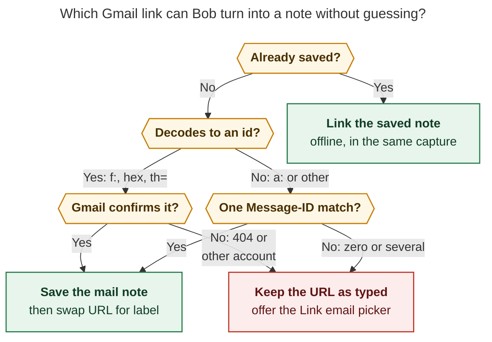
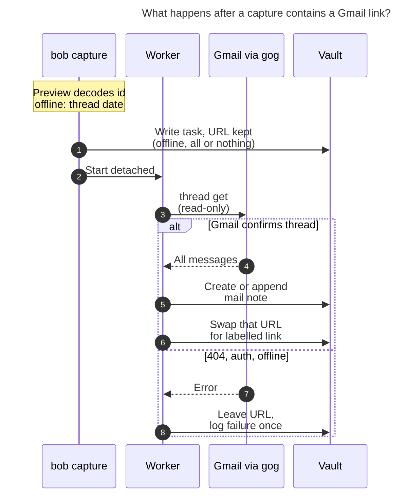

# `bob gmail`: save the threads you choose as mail notes, send through Gmail drafts

*Consolidated report · 2026-11-05 · account `bryanbugyi34@gmail.com` · scope: bob-cli,
bob-plugins, Bob Mac Capture, the Bob vault*

This report merges five independent reports — `__cdx`, `__cld`, `__grk`, `__mus`,
`__gem`, all in this directory — with my own checks. I settled the reports'
disagreements against code, documentation, and read-only Gmail metadata. No message
bodies were read or quoted. All commands and note formats below are proposals, not
existing features.

## Bottom line

**Build it, but scope it on purpose.** Gmail stays the mailbox and the system of
record. The vault keeps **one mail note per thread you deliberately attach to your
work**. Tasks link to that note. Sending goes through a Gmail draft.

Two of my findings change the plan's risk profile:

1. **The pasted URL can be resolved, without network, and I verified it.** Three
   reports (cdx, grk, gem) called the `FMfcgz…` address-bar token opaque or encrypted;
   cld said it decodes. I re-ran the decode independently. It is Gmail's old base-40
   obfuscation, and it yields `f:1876768160496397206`, which is API thread
   `1a0b9eb2cc26ab96`. Gmail confirms that thread (3 messages). All 6 distinct tokens
   in the vault decode the same way. The "ciphertext" claim, a user report on Google's Workspace CLI tracker,
   came from reading the token as plain base64url, which is the wrong alphabet. The format is
   still undocumented, so the design verifies every decode with a fetch and falls back
   to a picker. But the request's headline example is no longer a "day-one failure".
2. **Email bodies are executable in this vault unless the renderer prevents it.**
   DataviewJS *and* inline DataviewJS (`$=`) are enabled in `~/bob`. A sender who puts
   `` `$= …` `` or a ```` ```dataviewjs ```` fence in an email would get JavaScript run
   inside Obsidian when the saved note is viewed. None of the five reports named this.
   Making sender content inert is therefore a hard requirement, not polish.

The recommended path:

1. **Read-only first.** `bob gmail` over `gog` with an isolated `bob-gmail` client, plus
   a renderer that produces readable, inert Markdown callouts.
2. **Capture stays offline.** The URL is its own placeholder until a detached worker
   saves the note and swaps it for `[[mail/…|✉️ Subject · Who]]`.
3. **An Obsidian "Link email…" picker and paste-to-link.**
4. **Draft-first composing.** Send means `drafts.send` by draft id, after an exact
   preview.
5. **A Gmail-label pull** as the phone path.

---

## 1. What I verified myself

| Question | Check | Result |
| --- | --- | --- |
| Does the example token decode? | Base-40 alphabet `BCDFGHJKLMNPQRSTVWXZbcdfghjklmnpqrstvwxz` → base64 → ASCII (Arsenal Recon's scheme, 15 lines of Python, offline) | `FMfcgzQhWTsNRgxMhQNwhZDfgqwXpPsx` → `f:1876768160496397206` → hex `1a0b9eb2cc26ab96` |
| Does Gmail accept the decoded id? | `gog … gmail thread get 1a0b9eb2cc26ab96`, metadata only | ✅ 3-message thread. Its first message id equals the thread id. Passing the raw token gives `400 Invalid id value`, which is what gem and grk saw. |
| Does the id carry a date? | `id >> 20` as epoch ms, compared with `internalDate` | 2026-09-19 13:46:32 UTC both ways, to the second. Capture can show a thread date offline. |
| Is it general? | Decoded all 6 distinct `FM…` tokens in the vault, then fetched each | 6/6 are `f:<decimal>`. 4 resolve; 2 (Jun and Dec 2024) return 404. The originating task's own link (`bob.md ^gmail-integration`) resolves. |
| Which forms do *not* decode? | Arsenal Recon article and decoder source (`GmailURLDecoder.py`, `2c20a43`) | `thread-f:` / `msg-f:` map to hex ids. `thread-a:r…` forms (mail sent to yourself) have no stated conversion. Treat `a:` forms as unresolvable offline. |
| What do real threads look like? | MIME tree shape only (part types and sizes) for 3 threads | Every message is `multipart/alternative` with plain and HTML parts. **The example thread is automated mail** (`List-Unsubscribe` on all 3 messages). In a 6-message conversational thread (no list headers), the plain part grows 3.3 KB → 24.7 KB as each reply re-quotes the history, and the same two ~3 KB signature images repeat in every message. |
| Does gog retry writes? | gog upstream `efa67af` (2026-11-04), `internal/googleapi/transport.go`, `gmail_send.go`, `gmail_drafts*.go` | The retry transport retries 429/5xx. `Messages.Send` and `Drafts.Create` do **not** use `WithoutRetries`, so a direct send can go out twice. `Drafts.Send` takes only a draft id, and the draft is consumed on send, so a retry cannot deliver twice. |
| Can sender text execute? | `~/bob/.obsidian/plugins/dataview/data.json` | `enableDataviewJs: true`, `enableInlineDataviewJs: true`, prefix `$=`. **Yes, unless the renderer neutralizes it.** The shared `task_text_escape` (used by gkeep and gcal) escapes backticks, so today's importers are safe. A body renderer that preserves code is not. |
| Do note filenames show? | `.obsidian/app.json` / `appearance.json` | No `showInlineTitle` override, so Obsidian's default applies: **the filename is shown as each note's title.** Readable stems matter for beauty. |
| How common are Gmail links? | Census of `mail.google.com` URLs in 34 vault files | 9 `#inbox/<token>`, 5 `#label/…`, 31 `#search/…` (27 of them `rfc822msgid:`, 19 unique, mostly zorg-era), 4 `chat/…`. Usage is modest, partly because the raw links are ugly. One third of the token links are already dead. |
| Existing grant | `research:202611/gmail_read_access` (prior report) | gog's `default` client holds `gmail.readonly` for SASE agents on apollo. The Mac and athena have separate gog setups. |

---

## 2. How the five reports compare

All five agree on the frame. Gmail stays the system of record; the vault holds only
threads Bryan selects, never a mailbox mirror. Transport is `gog`, like `bob gcal`, with
its own client bucket and a `BOB_GMAIL_GOG` fake for tests. Mail never enters the
public-URL `ref` clipping pipeline. Remote images are never embedded, and attachments
are opt-in. Sending is draft-first or explicitly confirmed, never automatic. The Mac
app stays a thin client.

Where they disagreed, this is the resolution:

| Question | Positions | Resolution and why |
| --- | --- | --- |
| Is the `FMfcgz` token resolvable? | cld: decodes offline (verified). cdx: no supported mapping, use a picker or a Gmail add-on. grk: opaque, fail with a hint. gem: encrypted per account, use DOM extraction plus a heuristic search. mus: treated it as an API id. | **Decode offline, verify by fetch, fall back to the picker** (§4.2). I reproduced cld's result. The "encrypted" and "magic bytes" claims come from decoding with the wrong alphabet. The format is undocumented, so a decoder health check and a fixture corpus guard against Google changing it. A DOM probe, bookmarklet, or Gmail add-on becomes unnecessary unless `a:` tokens prove common. |
| Save a thread or a message? | mus: the linked message, `--thread` optional. Others: the thread. | **Thread.** The token *is* a thread id, and the reply you care about usually arrives later. Each message gets its own anchor, so a task can link one message. |
| Fetch inline at capture, or later? | mus: synchronous fetch at capture. Others: asynchronous. | **Asynchronous.** Inline fetch breaks `docs/capture.md` ("Submit never touches the network"), the Mac app's 20 s timeout, and all-or-nothing rollback. An already-saved thread links in the same submit, offline. |
| What does a capture do with an unresolvable URL? | grk: fail the item and roll back the batch. Others: keep the URL. | **Keep the URL as typed** and say so in the preview. Refusing a capture over a link breaks capture flow, and today's behavior (URL as prose) loses nothing. |
| Where do notes live? | gem: `ref/email/` with `type: "[[ref]]"`. Others: a new `mail/` folder. | **`mail/`.** Ref notes carry a reading task, PDF, and Highlights lifecycle that is wrong for correspondence. The glossary does list "captured conversation" as reference material, so revisit only if Bryan wants mail in the reading queue. |
| What is `parent:`? | cld: `[[mail]]`. cdx: the capture's route on first save. grk: `mail`, overridable. | **`[[mail]]` by default; `-P` only when given explicitly; never reparented automatically.** Most captures land in `mac_inbox` and move later, so a projected parent would go stale. Backlinks carry the real context. |
| How does refresh work? | cld: append-only cards. grk: Google owns the body until you edit it. cdx/gem: dated snapshot plus explicit refresh. | **Append-only cards plus explicit refresh** (§4.3). Gmail messages are immutable, so new messages append and existing cards are never rewritten. Highlights inside old messages are safe without hash bookkeeping. |
| Plain text or HTML body? | grk/mus: text-first (mus via `--sanitize-content`). cld: HTML with a DOM pre-pass. cdx: semantic rendering. | **HTML through a sanitizing pre-pass, with a plain-text fallback, decided per message by a fixture spike.** Never `--sanitize-content`: it strips URLs. |
| How do you send? | gem: no headless send (Gmail web handoff, attended CLI only). grk: two commands. cld: confirmed `drafts.send`. cdx: drafts first, direct send later with an unknown-outcome state. mus: `--send` flag. | **Every send goes through a Gmail draft**, sent by draft id after an exact preview. That is the idempotent path (§1, gog retry finding). An Obsidian confirm modal is the gate, and agents can draft but cannot send. |
| Downloading attachments | gem: automatic under 5 MB. Others: on demand. | **On demand.** The vault is Git history on three hosts. Inline signature images are deduplicated and the tiny repeated ones skipped. |
| Pull from a Gmail label | gem: starred → inbox, and completing the task un-stars or archives the mail. cld: `bob` label, unlabel after a verified write. grk: read-only, the label stays. | **A read-only pull of a `bob` label first**, idempotent by thread id. Unlabelling (needs `gmail.modify`) is a later opt-in after a verified write. **Never** mutate Gmail when a task completes. |
| Person and meeting cross-links | gem: auto-link person notes and calendar events. | **Not now.** The vault has no person-note type (0 notes typed as person or who). Linking meetings from mail is low value next to its matching risk. |

---

## 3. Is this a good idea?

**Yes, for correspondence that supports a task, decision, or project.** Today an
actionable email lives as an unlabelled, rotting URL: one third of the vault's token
links already 404. A saved thread gives the task a readable label and a durable copy. It
also gives context that Bryan, search, and agents can use offline, and a place to
annotate and draft a reply alongside his notes.

There are three cautions:

- **It is not a better email client, so do not build one.** Gmail's inbox, search,
  contacts, spam handling, Undo Send, and mobile app are excellent. A mirror means
  thousands of notes, Git bloat, privacy exposure, and a two-way sync engine — all for a
  worse version of Gmail.
- **The everyday payoff depends on the entry points, not the renderer.** A URL can only
  be copied from a desktop browser's address bar; Gmail has no "copy link" command and
  the mobile app shows no URLs. Without the Obsidian picker, paste-to-link, and a label
  pull for the phone, the feature risks being admired and rarely used.
- **Sending is the least valuable and most dangerous part.** Composing in Obsidian
  really pays off in three cases: replying with the vault open, keeping what you sent
  next to the task, and letting agents draft for you. A draft-first design keeps all
  three at a fraction of the risk.

### Requirement adjustments (explicit)

| # | As requested | Adjusted to | Why |
| --- | --- | --- | --- |
| **R1** | "fetch the email's contents" | Save the **thread**; refresh it by appending new messages | The URL names a conversation, and the reply usually comes later |
| **R2** | "a link that replaces the URL" | Replace it **asynchronously**, and only once the note exists. Already-saved threads link in the same submit. On any failure the URL stays. | Capture's offline, all-or-nothing contract. A raw URL is a better failure state than a dangling wikilink. |
| **R3** | "good label (subject and/or sender?)" | `✉️ Subject · Who`: Re/Fwd prefixes stripped, the counterpart (not Bryan) named, truncated and escaped, configurable. A user-written `[label](url)` keeps its label. | Subject says *what*, the counterpart says *who*, and ✉️ matches the vault's emoji markers (🍅 🥀 🪢 🗓️) |
| **R4** | "write and send new emails directly from Obsidian" | **Compose in Obsidian → Gmail draft → previewed, confirmed send of that draft id.** Replies are written inside the thread note. | Reversible by default, cannot double-send, safe for agents, and you can still finish on your phone |
| **R5** | (none) | Mail notes are **inert**: no sender text can execute (DataviewJS), create tasks, add fields, or load remote content | Code-execution and tracking-pixel risks found in this vault |
| **R6** | "review emails in Obsidian" (originating task) | Read **saved** threads in Obsidian. **Non-goal:** mirroring or triaging the inbox there. | §3 cautions |
| **R7** | (none) | Add **entry points** that need no URL: a picker, paste-to-link, and a `bob` label pull for the phone | The URL flow is desktop-only |
| **R8** | (none) | Privacy controls: saving only by explicit action, a headers-only mode, a `never_save` list, an `untrusted-email` marker, and on-demand attachments | Bodies enter Git history on GitHub and three hosts, and become agent context |

---

## 4. Design

### 4.1 Principles

1. **Gmail owns the mailbox; the vault holds snapshots you chose.**
2. **Capture never touches the network.** The URL in the vault *is* the pending work.
3. **bob is the only writer** (`mac-capture-is-a-thin-client`). Plugins and the Mac app
   render what bob returns.
4. **Never destroy information.** Unresolvable links stay raw. Old messages stay after
   Gmail deletes them. Your edits stay yours. Every send is a draft first.
5. **Sender content is data.** It never executes, never becomes Bob syntax, and never
   loads anything.
6. **Beautiful with the CSS, readable without it.**

### 4.2 Identity and link resolution

- **Key:** `(account, API thread id hex)`, stored in the note's frontmatter. The dedupe
  index is a derived scan of `mail/**`; no separate database is authoritative. Each
  message records its API id and RFC `Message-ID` in an invisible per-card marker. The
  RFC id survives account moves and works with `rfc822msgid:` search.
- **Parse** these forms before generic URL cleaning, which strips fragments:
  - `#<view>/<token>` for any view (`inbox`, `all`, `sent`, `label/X`,
    `search/q`, `category/x`);
  - legacy 16-hex ids, `?th=`, and `permmsgid` / `permthid`;
  - `#search/rfc822msgid:<id>`.
  - Refuse `?compose=` and `mail.google.com/chat/…` with a clear message.
  - Ignore `/u/N/`: it is the login order, not identity. The account comes from config.
- **Decode** the `f:`, `thread-f:`, and `msg-f:` forms offline. A `msg-` form is mapped
  to its thread with `messages.get`. **Never trust a decode Gmail has not confirmed.**
- **Canonical link back to Gmail:**
  `https://mail.google.com/mail/?authuser=<email>#all/<hex>`, printed by `gog gmail url`.
  It survives label changes and pins the account, unlike `/u/0/`.
- **Watch the decoder.** `bob gmail doctor` reports how many Gmail URLs in recently
  changed notes still decode and resolve, so a Google format change is noticed rather
  than silently degrading. Tests carry an anonymized corpus of token↔id pairs.



*Bob decodes what it can offline. Only a Gmail confirmation or a unique Message-ID match
ever turns a URL into a note; everything else keeps the URL and offers the picker. It
never substitutes the newest inbox item or a similar subject.*

### 4.3 The mail note

**Path:** `mail/<YYYY>/<YYMMDD>_<subject_slug>.md`.

- The date is the thread's first message (known offline from the id); the slug is the
  subject with `Re:`/`Fwd:` stripped. This follows the vault's
  `241213_apollo_graphql_interview.md` style.
- A collision adds `_2`.
- The path is fixed at birth and never renamed, so links never break.
- Because Obsidian shows the filename as the note's title here, a readable stem is part
  of the look.

**Type hub:** a new `mail.md` with `parent: "[[type]]"`, like `article.md`, and a
`mail.base` table of saved threads (date, subject, who, messages, open tasks linking
here) modelled on the existing `articles.base`.

**Example** (fictional content):

```markdown
---
parent: "[[mail]]"
type: "[[mail]]"
cssclasses: [bob-mail]
title: "Lease renewal for 14 Elm St"
who: Dana Whitfield
started: 2026-09-19T09:46:32-04:00
updated: 2026-11-03T10:16:05-05:00
messages: 3
gmail_account: bryanbugyi34@gmail.com
gmail_thread_id: "199c3f1e8b2d4a10"
gmail_url: "https://mail.google.com/mail/?authuser=bryanbugyi34%40gmail.com#all/199c3f1e8b2d4a10"
saved: 2026-11-05T10:12:44-05:00
content: untrusted-email
---

# Lease renewal for 14 Elm St

[Open in Gmail ↗](https://mail.google.com/mail/?authuser=bryanbugyi34%40gmail.com#all/199c3f1e8b2d4a10) · Dana Whitfield ↔ you · 3 messages · Sep 19 → Nov 3

## Notes

Compare the parking clause with last year's lease before replying.

## Conversation

<!-- gmail:begin -->
<!-- gmail:msg 199c3f1e8b2d4a10 <CAH8xQ…@mail.gmail.com> -->
> [!mail]- **Dana Whitfield** · Fri, Sep 19 · 9:46 AM
> to you
>
> Hi Bryan — attached is the renewal offer for 14 Elm St. …
>
> 📎 renewal_offer.pdf · 248 KB · in Gmail

^m-199c3f1e8b2d4a10

<!-- gmail:msg 19a4b0c2d3e4f501 <…> -->
> [!mail-sent]- **You** · Mon, Nov 3 · 9:02 AM
> to Dana Whitfield
>
> Thanks Dana — two questions before I sign: …
>
> > [!quote]- Earlier in the thread
> > On Fri, Sep 19, Dana Whitfield wrote: …

^m-19a4b0c2d3e4f501

<!-- gmail:msg 19a4b2f7aa01c3d2 <…> -->
> [!mail]+ **Dana Whitfield** · Mon, Nov 3 · 10:16 AM
> to you
>
> 1. Yes, the parking spot carries over.
> 2. The rate is locked for 12 months.

^m-19a4b2f7aa01c3d2
<!-- gmail:end -->
```

How it reads:

- **Bryan's notes come first.** In a long thread they stay visible instead of sinking
  below 30 messages.
- **The conversation reads like Gmail.** Older messages are folded and the newest is
  open. Mail from others shows as blue `[!mail]` cards. Bryan's own messages show as
  green `[!mail-sent]` cards, indented. Quoted history folds into `[!quote]-`, and
  signatures are dimmed.
- **Each message has an anchor.** A block id (`^m-<id>`) lets a task link to one
  message.
- **Frontmatter stays short** so the Properties panel stays clean. Per-message ids live
  in invisible comments.
- **It degrades gracefully.** Without CSS, unknown callout types fall back to Obsidian's
  `note` callout and remain readable.

**CSS** ships in a bob-plugins stylesheet, a sketch to be refined in the spike. A plugin
stylesheet loads automatically, whereas a vault snippet such as `ref-highlights.css`
must be enabled by hand. Theme color variables keep it right in light and dark mode:

```css
.callout[data-callout="mail"]      { --callout-color: var(--color-blue-rgb);  --callout-icon: lucide-mail; }
.callout[data-callout="mail-sent"] { --callout-color: var(--color-green-rgb); --callout-icon: lucide-send; margin-left: 2.5em; }
.bob-mail .callout[data-callout^="mail"] .callout-content { max-width: 44em; line-height: 1.55; }
.bob-mail .callout[data-callout="quote"] { opacity: 0.75; }
```

**Rendering pipeline** (Rust in bob-cli; the Mac app and plugins only display results):

1. **Fetch.** `gog gmail thread get <hex> --full --json` returns the MIME tree per
   message. It took about 0.9 s per thread in cld's measurement. Decode each part with
   its declared charset (`encoding_rs`). Fetch parts held behind `attachmentId` when
   they are bodies. An empty `body.data` is not an empty email.
2. **Pick the body.** Prefer HTML through a sanitizing DOM pre-pass (`html5ever` or
   `lol_html`), then HTML→Markdown (`htmd`). Fall back to `text/plain` when there is no
   HTML or the HTML only wraps the same text. Record which was used per message. The
   Phase 0 fixtures confirm or flip this default.
3. **Pre-pass.**
   - Drop `<head>`, `<style>`, `<script>`, forms, frames, and hidden preheaders.
   - Split quoted history (`.gmail_quote`, `blockquote[type=cite]`, Outlook reply
     dividers, `On … wrote:`) into a folded callout. **This matters:** quotes made the
     sample thread's text grow 7×. Fold them; never delete the only copy.
   - Dim signatures and unwrap layout tables.
   - **Remote `` becomes a plain link.** Tracking pixels are dropped and never
     embedded, because embedding would fire the sender's open-tracking on every view.
   - Copy inline `cid:` images to `img/mail/<thread>/` (capped at 2 MB each), recorded in
     the attachment origin journal. Deduplicate them by content hash and skip small
     images repeated across messages, such as the signature logos in the sample.
4. **Bulletin mode.** Mail with `List-Unsubscribe`, `List-Id`, `Precedence: bulk`, or a
   `CATEGORY_PROMOTIONS`/`UPDATES`/`FORUMS` label renders as text and links only, with
   a *View online* footer. **The request's own example thread is in this class.**
5. **Inert pass (required, R5).** Everything from the sender is data:
   - Code fences get a neutral info string (`text`). A ```` ```dataviewjs ````,
     `dataview`, `tasks`, `base`, or `query` fence must never survive.
   - Inline code whose trimmed text starts with `=` or `$=` is broken, for example by
     inserting U+200C after the opening backtick, so inline Dataview and DataviewJS
     never run.
   - Escape `[[`, `]]`, `![[`, line-final `^id`, `key:: value` inline fields, `#task`
     and `#tags`, checkbox list items (`- [ ]` inside callouts is indexed by the Tasks
     plugin), `%%`, `$…$`, `<!--` (so a body cannot forge or close the `gmail:` markers),
     and Templater `<% %>`.
   - Allow only `http`, `https`, and `mailto` link schemes. `javascript:`, `data:`,
     `file:`, `obsidian:`, and relative links become text.
   - Never pass email text through the capture grammar.

**Refresh is append-only.**

- `bob gmail save <note|url>` re-fetches and appends cards for new message ids before
  `<!-- gmail:end -->`.
- It rewrites only the summary line and the managed frontmatter keys (`updated`,
  `messages`), and only if something changed. A no-op refresh writes nothing, so it
  creates no Git noise.
- Existing cards are never edited, so highlights and annotations inside messages are
  safe. Messages deleted in Gmail stay, and a deleted thread is reported, not mirrored.
- Drafts in Gmail are excluded from imports.
- If the markers are missing or damaged, Bob refuses with a reason instead of guessing.
- A renderer upgrade re-renders only through an explicit `--rerender` with a preview.

**Ownership.**

- **Bob owns:** the frontmatter identity keys, the summary line, and the managed
  conversation block, which is append-only.
- **Bryan owns:** `## Notes`, any text outside the markers, and the `## Reply` section
  while it is a draft.

**Privacy modes.**

- `gmail.body: full | headers`. Headers mode writes the same card layout with Gmail's
  snippet in place of the body; use it for banking, medical, or 2FA mail.
- `gmail.never_save` lists senders and labels that are refused outright.
- `content: untrusted-email` plus a line in the vault `AGENTS.md` tells agents and
  `qmd` search that `mail/` is external, possibly adversarial text.

### 4.4 The link label

```text
- [ ] #task Ask Dana about parking [[mail/2026/260919_lease_renewal_for_14_elm_st|✉️ Lease renewal for 14 Elm St · Dana Whitfield]]
```

- **Subject:** taken from the first message, with repeated
  `Re:`/`RE:`/`Fwd:`/`FW:`/`Aw:`/`Sv:` prefixes stripped. It is truncated at a word
  boundary near 60 characters. An empty subject becomes `(no subject)`.
- **Who:** the thread starter's display name if that isn't Bryan, otherwise
  `to <first recipient>`. It falls back to the address and is capped near 24 characters.
- **Escaping:** both parts go through the existing `task_text_escape`. A subject like
  `Q3 #budget [draft] | v2` then cannot create tags, fields, or broken aliases.
- **User labels win:** `[the lease email](https://mail.google.com/…)` becomes
  `[[mail/…|the lease email]]`.
- **Configurable:** `gmail.link_label: "✉️ {subject} · {who}"`.
- **No freshness stamp:** the rewrite is automation, so it never stamps `[fresh::]`.

### 4.5 Capture integration



*Capture stays instant and offline. The URL in the task is both the placeholder and the
durable work item, so any failure degrades to exactly today's behavior.*

- **Detection.** Recognize Gmail URLs anywhere in parent text or authored child bullets,
  but not inside code spans or fences, and before the public-URL classifier strips
  fragments. `google.com` stays on the URL-routing exclusion list, so a Gmail URL never
  becomes a `ref` job.
  - A capture item that is only a Gmail URL becomes a task whose text is the link, so
    the label becomes the task title.
  - Optional `@route` and `-P` work as usual.
- **`capture-parse` (additive JSON).** A `gmail` span carries
  `{thread_id?, decoded, date_hint, verdict}`. The Mac panel underlines the URL and
  shows one quiet state:

  | Verdict | Preview line |
  | --- | --- |
  | `known` | `✉️ Lease renewal… · Dana Whitfield · already saved` (the final link is written in this submit) |
  | `decoded` | `✉️ Gmail thread · Sep 19, 2026 · will save after capture` |
  | `search` | `✉️ Gmail link · will look up by Message-ID` |
  | `unresolved` | `Gmail link · can't identify offline · stays a link (use Link email…)` |
  | `refused` | `Gmail compose/chat link · kept as text` |

- **Submit.** Writes the task bytes exactly as previewed. After commit it starts
  `bob gmail link --note <path> -q` fully detached, the same way `ref_jobs::kick` does:
  new session, `/dev/null` stdin, a log file, and single-flight under a lock.
  `--dry-run` stays fully offline and contacts no Gmail endpoint.
- **"The vault is the queue."** No separate spool is needed, because a Gmail URL still
  in the vault *is* the pending request. That also solves cross-host capture without a
  synced spool (cdx's concern):
  - Any logged-in host's `bob gmail link --all` sweep (preview first) picks up URLs that
    other hosts captured.
  - Failures are written to `.bob/gmail/<host>.jsonl` (404, other account, unresolvable,
    awaiting sign-in). Sweeps don't retry dead links forever, and `bob gmail list` can
    report them.
- **Write safety.**
  - Take the vault lock, re-read the note, and replace **only** the exact URL token, or
    its `[label](url)` / `<url>` wrapper, on the captured line.
  - If the line moved or was edited, leave it for the sweep and report "saved; link
    needs review". **Never** do an unscoped vault-wide replace.
  - Commit the new note and the rewrite together.
  - Rewrite today's daily note only on the configured daily-note writer, mirroring
    gcal's single-writer rule.
- **Phase 2 enhancement (cld).** Once typing settles, the Mac panel calls a read-only
  `bob gmail peek <url> -f json` and shows the real subject and sender before submit, so
  you know you pasted the right email. The call warms a local cache. With a warm cache,
  `bob capture` writes the note and final link in its own atomic batch, still with no
  network at submit, and the async rewrite is skipped.

### 4.6 Obsidian surface (bob-plugins; bob stays the writer)

- **"Bob: Link email…"** is a fuzzy modal over `bob gmail search "<q>" -f json`, showing
  recent threads by default. Each row shows subject, who, relative date, and message
  count. Selecting one saves the note and inserts the link at the cursor. It is the main
  desktop entry point: no URL copying.
- **Paste-to-link.** Pasting a Gmail URL inserts it at once. The plugin then runs
  `bob gmail save <url> -f json` and swaps the pasted range **in the editor buffer**, so
  the open file never races an external write. Bob writes only the new mail note. No
  paste handler exists in bob-plugins yet, so this is new code.
- **Open in Gmail** is a hotkey on a `[[mail/…]]` link or inside a mail note; Bob
  Navigation Hotkeys is the natural home.
- **Refresh this email**, **Reply**, **Reply all**, and **New email** run through the
  Bob Command Mode catalog, reusing its runner, write serialization, and result display.
- **Mobile** can read and annotate saved notes and edit drafts. Saving and sending
  happen on a desktop host, and the UI says so instead of silently queuing.

### 4.7 Writing and sending

- **Replies happen in the thread note.** "Reply" or "Reply all" adds a `## Reply`
  section at the bottom, below the conversation; the heading text *is* the mode. You
  write with the whole conversation above you.
- **New mail** comes from `bob gmail new -t … -s …` (or a Templater template). It
  creates `mail/<YYYY>/<YYMMDD>_<slug>.md` with `to`, `cc`, `bcc`, `subject`, and
  `attachments` (vault paths), plus `status: draft`. The note lives at its final path
  from birth; after sending it simply *becomes* the thread note.

```mermaid
---
title: "How does sending from Obsidian avoid double or accidental sends?"
accTitle: "Draft-first send lifecycle"
accDescr: "A reply or compose note becomes a Gmail draft whose id is recorded; send shows an exact preview, needs a confirmation bound to that preview, and sends the draft by id, so a retry cannot deliver twice and an unclear outcome is never resent automatically."
---
stateDiagram-v2
  state "Reply or compose note" as WRITE
  state "Gmail draft, id recorded" as DRAFT
  state "Exact preview shown" as PREVIEW
  state "Send draft by id" as SENDING
  state "Sent card appended" as SENT
  state "Recovery: is draft still there?" as CHECK
  state "Outcome unknown, Bryan decides" as UNKNOWN
  WRITE --> DRAFT: bob gmail draft
  DRAFT --> DRAFT: edit, update draft
  DRAFT --> PREVIEW: bob gmail send
  PREVIEW --> DRAFT: declined or edited
  PREVIEW --> SENDING: confirmed this preview
  SENDING --> SENT: message id returned
  SENDING --> CHECK: crash or timeout
  CHECK --> DRAFT: draft still present
  CHECK --> SENT: draft gone, Sent copy found
  CHECK --> UNKNOWN: draft gone, no Sent copy
  classDef focus fill:#E8F1FB,stroke:#3B78C2,stroke-width:1.5px,color:#0F2E52
  classDef outcome fill:#E7F5EC,stroke:#2E7D4F,stroke-width:1.5px,color:#123D24
  classDef risk fill:#FDECEC,stroke:#C0392B,stroke-width:1.5px,color:#5F1414
  class WRITE,DRAFT,PREVIEW,SENDING focus
  class SENT outcome
  class CHECK,UNKNOWN risk
```



*Every send passes through a Gmail draft whose id is recorded first. Sending a draft
consumes it, so a retry cannot deliver twice. A vanished draft with no Sent copy is
reported, never resent.*

- **Why drafts, not `messages.send`.** gog retries 429/5xx responses and does not mark
  `Messages.Send` as single-attempt. A direct send can therefore go out twice, and
  Gmail's send API has no idempotency key. `drafts.send` by id is safe to retry: once
  the draft is consumed, a repeat fails instead of sending again. `drafts.create` can
  still duplicate a *draft* on retry; that is harmless clutter, and `doctor` lists
  orphan Bob drafts.
- **Markdown → email.**
  - `pulldown-cmark` produces conservative inline-styled HTML plus a `text/plain`
    alternative.
  - `[[wikilinks]]` flatten to their alias text and are listed in the preview as
    "internal links flattened". `![[file]]` becomes an attachment only when confirmed.
  - Task checkboxes, block ids, inline fields, Dataview blocks, and transclusions are
    **refused** with a helpful message rather than mangled or leaked.
  - Only the `## Reply` section, or the compose note's body, is sent — never `## Notes`.
  - Threading uses gog's `--thread-id` / `--reply-to-message-id`, which set
    `In-Reply-To`, `References`, and the subject. Gmail's signature is appended with
    `--signature` when configured.
- **The gate.**
  - `bob gmail send` always shows the exact account, From, To, Cc, Bcc, subject, body,
    attachments (with digests), and the reply target.
  - On a TTY it asks `[y/N]`. From Obsidian, a confirm modal passes
    `--confirm <digest>` for *that* preview, so any edit invalidates the approval.
  - Non-interactive runs without a valid confirmation only draft, and exit 2 with the
    exact command to run.
  - An optional `gmail.send_delay_secs` gives a local undo countdown. The draft exists
    throughout, so a crash leaves a draft — never a lost or doubled message.
  - Honest limit: this is not Gmail's Undo Send for mail already accepted.
- **After sending.** Bob appends the sent card to the thread and removes the `## Reply`
  section. A journal event (ids, recipients, subject hash, no body) goes to
  `.bob/gmail/<host>.jsonl`.
- **Agents draft, Bryan sends.**
  - `gmail.compose` is restricted and, unlike its name suggests, also grants sending; no
    OAuth scope allows drafting without sending. The safety therefore comes from where
    the grant lives and from the gate, not from the scope.
  - Grant `compose` **only on the Mac**, where Bryan clicks; keep agent hosts
    (apollo, athena) `readonly`.
  - Read paths run gog with
    `--readonly --gmail-no-send --enable-commands gmail.thread.get,gmail.get,gmail.search,gmail.url`.
    Write paths enable only `gmail.drafts.*`.

### 4.8 Auth, scopes, and hosts

- **Bucket.** Use an isolated `--client bob-gmail` bucket, so logout never strips the
  agents' `default` read-only grant or `bob-gcal`.
- **Login.** `bob gmail login` clones `bob gcal login`: it discovers a Desktop client,
  supports browser or paste-over-SSH sign-in, and re-login is idempotent. It requests
  `gmail.readonly`; `login -s compose` adds drafting on the Mac.
- **Verification.** `gmail.readonly` and `gmail.compose` are *restricted* scopes;
  `gmail.send` is *sensitive*. Personal use is exempt from verification, at the cost of
  an "unverified app" click-through.
- **Token pitfalls `doctor` must explain.**
  - Consent screens left in **Testing** issue 7-day refresh tokens; publish them, as the
    gcal guide already says.
  - **Changing the Google password revokes Gmail-scoped refresh tokens.** Six months
    unused also expires a token.
  - Map `invalid_grant` to "sign in again", not to a generic failure.
- **Unverified report.** grk cites a Google issue saying Advanced Protection can block
  self-owned Desktop clients from restricted scopes; I did not verify it. If Bryan
  enables Advanced Protection, IMAP with an app password is the documented escape
  hatch, not the design.
- **Hosts.**
  - The Mac does capture, so it needs a login; it is also the daily-note writer and the
    sender.
  - apollo and athena are optional read-only savers: mail notes are ordinary files under
    `bob_sync.lock`.
- **Secrets.** Tokens never appear in argv, logs, or JSON. Bodies, raw MIME, and
  attachment bytes stay out of diagnostics.

### 4.9 CLI and config

`gmail` is a noun group in the Integrations section beside `gcal` and `gkeep`. Every
member operates on Gmail connections, saved threads, or Bob-managed drafts. Bare
`bob gmail` = `list`, which is offline and read-only. Options are alphabetical, every
long option has a short alias, JSON output is versioned, and errors are typed — all per
`cli_rules.md`.

```text
bob gmail [list] [-a|--all] [-f|--format table|json] [-r|--remote]   # saved threads; footer "2 Gmail links waiting · 1 gone"
bob gmail doctor  [-f|--format human|json]                           # gog, account, scopes, token mode, decoder health, writer
bob gmail link    [NOTE]... [-a|--all] [-d|--dry-run] [-q|--quiet]   # swap Gmail URLs for labelled links; -a -d = backfill preview
bob gmail login   [-a|--account EMAIL] [-c|--credentials FILE] [-m|--manual] [-s|--scope readonly|compose]
bob gmail logout  [-a|--account EMAIL] [-y|--force]
bob gmail save    <URL|ID|NOTE>... [-d|--dry-run] [-P|--parent ROUTE] [-R|--rerender]
bob gmail search  <QUERY> [-l|--limit N] [-f|--format table|json]    # bounded picker source, never a dump
# Phase 2:  bob gmail peek <URL>
# Phase 3:  bob gmail draft <NOTE> · bob gmail new … · bob gmail reply <NOTE> [-a|--all] · bob gmail send <NOTE> [-y|--yes]
# Phase 4:  bob gmail pull [-l|--limit N] · bob gmail attach <NOTE> <N>
```

```yaml
gmail:
  account: bryanbugyi34@gmail.com
  folder: mail
  link_label: "✉️ {subject} · {who}"
  body: full                 # full | headers
  remote_images: link        # link | drop (never embedded)
  inline_images_max_kb: 2048
  never_save: { from: [], labels: [] }
  label: bob                 # pull label; unset disables pull
  signature: gmail           # gmail | none
  send_delay_secs: 0
  timeout_secs: 60
```

A missing block means defaults. A wrong-typed key is a setup error that names the key,
as in gcal. Command Mode catalog rows cover `list`, `save`, `link`, `search`, and
`doctor`. `save` and `link` are preview-first. `login`, `logout`, and `send` are
excluded from the catalog, as gcal does for credentials; send uses its own confirm
modal.

---

## 5. Other features worth building (ranked by value ÷ cost)

| # | Feature | When | Notes |
| --- | --- | --- | --- |
| 1 | **"Link email…" picker + paste-to-link** | Phase 2 | Turns the core feature into a habit (§4.6) |
| 2 | **Backfill** with `bob gmail link -a -d` | Phase 1, nearly free | Covers 4 live token links and 19 unique `rfc822msgid:` links. Reports 2 dead links with their dates ("gone from Gmail · thread from Jun 2024"). Excludes `_generated/` and zorg-era logs unless asked. |
| 3 | **Label pull** (`bob gmail pull`) | Phase 4, high value | Apply a `bob` label on the phone, and the pull creates a task in a new `gmail_inbox.md` inbox file linking the saved note. It is read-only and idempotent; the label stays as a filing marker. Unlabelling after a verified write (`gmail.modify`, gkeep-style) is a later opt-in. A `+bob` plus-address filter feeds it from other accounts. **The phone path.** |
| 4 | **Follow-up task from a message** | Phase 3 | Creates an explicit task in a chosen parent, linking `[[note#^m-<id>]]`. Mail never becomes a task automatically. |
| 5 | **Attachments on demand** (`attach`) | Phase 4 | Imported through the attachment origin journal with size caps and path sanitizing. PDFs can go on to `bob ref`. |
| 6 | **Reply detection for linked open tasks** ("Waiting for") | Later, **needs a decision record** | Gmail `history` finds new messages on threads linked from open tasks and resurfaces them like `[unblocked::]` ticklers. It touches the task-state model, so decide before building. |
| 7 | **Newsletter → reading queue** (`gmail ref`) | Later | Sends a bulletin-mode thread's "view online" URL or HTML through `bob ref create`. |
| 8 | **Agents draft, Bryan sends** | Free once Phase 3 exists | A SASE agent writes a `## Reply` section; Bryan reviews and sends. |

**Not recommended:**

- Inbox mirroring or unread counts.
- A mail digest in daily notes.
- Archive, read, or star sync.
- Gmail mutations triggered by task completion.
- AI auto-triage.
- Unsubscribe automation.
- Scheduled or nightly pulls.
- Person-note CRM linking (the vault has no person type).
- Creating Event Tasks from mail.
- Read tracking.

## 6. Rejected alternatives

| Alternative | Why it loses |
| --- | --- |
| Labelled link only (subject fetched, no note) | About 20% of the cost, but it does nothing about link rot (a third of links are dead), gives no offline reading and no reply flow. It survives as headers mode. |
| Mail notes as `type: "[[ref]]"` in `ref/email/` (gem) | Pulls mail into the reading-task, PDF, and Highlights lifecycle. Emails are not papers. |
| Inline fetch inside `bob capture` (mus) | Breaks offline submit, the 20 s Mac timeout, and all-or-nothing rollback |
| Refusing captures with unresolvable URLs (grk) | Turns a link problem into lost capture flow; today's behavior is a safe fallback |
| DOM probe in Bob Mac Capture, bookmarklet, or Gmail add-on (gem, grk, cdx) | Unneeded now that `f:` tokens decode. The probe needs browser automation permissions and pulls logic into the thin client. Reconsider only if `a:` (self-sent) tokens prove common. |
| Heuristic "recent inbox / similar subject" matching (gem) | It can silently link the wrong email; only exact identity or an explicit pick is allowed |
| Direct `messages.send` / "Send" button | Not idempotent under gog's retries and irreversible. The draft path gives the same convenience safely. |
| Obsidian Gmail community plugins, hosted forwarders, IMAP/SMTP | They split credentials and the writer, put tokens in a Git-synced `data.json` or a third-party server, and bypass capture. IMAP stays only as the Advanced-Protection escape hatch. |
| Talking to Gmail REST from Rust directly | A second token stack. Use it only if gog cannot meet a concrete need. |
| Reusing the `bob-gcal` or agent `default` grant | Different consents; logout would break the other user |
| Full mailbox sync, two-way state | Non-goal (R6) |

## 7. Delivery plan and proof

**Phase 0 — spikes, about a day.**

- **Live resolver check** on non-sensitive mail: an `f:` token, a legacy hex link,
  `?th=`, `rfc822msgid:`, and a self-sent (`a:`) token, plus account-order changes.
- **Renderer fixtures**, *viewed in Obsidian* in Reading view, Live Preview, light and
  dark themes, and mobile:
  - a plain reply chain and an HTML-only message;
  - a receipt with tables and a newsletter;
  - CID images and a long attachment-backed body;
  - a non-UTF-8 message;
  - a hostile fixture carrying `$=`, `dataviewjs`, `#task`, `- [ ]`, `[[x]]`, `<!--`, a
    tracking pixel, and `javascript:` links.
- **Scope combinations** on the installed gog: readonly, and readonly + compose.
- **Extract the gcal-agnostic Google plumbing** (gog transport, login UI, doctor
  primitives, failure classification) into `native/google/`, so Gmail reuses it rather
  than copying it.

**Phase 1 — read-only core (L; the renderer is the long pole).**

- `login`, `logout`, `doctor`, `save`, `link` (with backfill), and `list`.
- The URL parser and decoder, the renderer with its inert pass, and the `mail.md` /
  `mail.base` hub.
- The capture `gmail` span plus the detached kick.
- CSS in bob-plugins.
- Docs: `docs/gmail.md` and `docs/guides/connect-google-mail.md`.

**Phase 2 — delight (M across three repos).**

- `search`, `peek` with its cache, and the Obsidian picker and paste-to-link.
- Open-in-Gmail and refresh commands.
- The Mac panel preview of the span. The macOS CI must run green.

**Phase 3 — compose (L).** `new`, `reply`, `draft`, `send`, the Markdown→email
renderer, the preview and digest-bound confirm, the journal, and the undo delay.
Verification sends only to a test address Bryan approves.

**Phase 4 — optional (M each).** `pull`, `attach`, reply detection (after a decision
record), and `gmail ref`.

**Acceptance tests that matter:**

- **Identity.** An undecodable URL never becomes an arbitrary email. A wrong account
  fails clearly.
- **Capture.** Dry-run and submit make no Gmail calls. A crash between saving the note
  and rewriting the link is safe to resume. Moved or edited tasks are never corrupted.
  Two identical URL occurrences stay distinct.
- **Idempotence.** Re-save and refresh are no-ops when nothing changed. A second host
  reuses the same note.
- **Inertness.** The hostile fixture renders with no script execution, no tasks, no
  fields, no network loads, and intact markers.
- **Ownership.** `## Notes`, highlights in cards, and custom link labels survive
  refresh.
- **Sending.** An edit after preview invalidates approval. "Server accepted, connection
  lost" becomes unknown, never an automatic resend. Repeated clicks cannot send twice.
- **Presentation.** Long, empty, and Unicode subjects all render well. Notes look good
  with and without the CSS.

**Decision records to write once accepted:**

- *Mail notes are append-only thread snapshots.*
- *Capture never fetches mail; the URL is its own placeholder.*
- *Gmail sends go through confirmed drafts.*
- *Sender content in the vault is inert.*
- Later, *Replies on linked threads resurface tasks*.

## 8. Open questions for Bryan

1. **Privacy.** Is it acceptable for saved email bodies to live in the GitHub-hosted
   vault's Git history (deleting a note does not erase history)? If only sometimes,
   should `headers` be the default, with `full` chosen per save?
2. **Hosts.** Should apollo and athena also save mail, or only the Mac? Each needs its
   own `bob gmail login`. The recommendation is compose on the Mac only.
3. **Sending.** Ship `send` in Phase 3, or stop at `draft` (finish in Gmail) until
   drafting proves useful?
4. **Label.** `✉️ Subject · Who`, or subject only with the sender inside the note?
5. **Pull.** A dedicated `bob` label (recommended), or stars?

## 9. Recommended solution

Build **`bob gmail` as a Rust bob-cli integration over `gog`**. It gets its own
`bob-gmail` OAuth bucket with least privilege: read-only everywhere, and compose only on
the Mac. Center it on one artifact, the **mail note**:

- an append-only snapshot of a Gmail *thread*;
- living at a fixed, readable `mail/<YYYY>/<YYMMDD>_<subject>.md`;
- keyed by the API thread id, with each message's `Message-ID` recorded;
- rendered as foldable `[!mail]` / `[!mail-sent]` callouts that look like Gmail's
  conversation view with the CSS and stay readable without it;
- with quoted history folded, bulk mail in bulletin mode, remote images never loaded,
  attachments listed rather than pulled;
- and **every byte of sender content made inert** before it reaches a vault where
  DataviewJS runs.

Ship it in this order:

1. **Phase 0–1 (read-only).** Capture stays offline.
   - A Gmail URL is written as typed, and the preview already shows the thread's date.
     An `FMfcgz…` token is decoded offline and confirmed by Gmail; anything Bob cannot
     identify exactly keeps its URL.
   - A detached worker saves the note and swaps that one URL for
     `[[mail/…|✉️ Subject · Who]]`. Failures leave the URL, so nothing is ever lost.
   - Backfill the vault's existing links with `bob gmail link -a -d`.
2. **Phase 2.** Remove the friction: the **"Link email…" picker** and **paste-to-link**
   in Obsidian, plus the live `peek` preview in Bob Mac Capture.
3. **Phase 3 (drafts first).** Reply in a `## Reply` section of the thread note, or
   write new mail in a compose note that becomes the thread note.
   - `bob gmail draft` creates or updates a Gmail draft.
   - `bob gmail send` shows the exact message and needs a confirmation bound to that
     preview. It then sends *the draft id*, so a retry can never deliver twice.
   - Agents may draft; only Bryan sends.
4. **Phase 4.** The **`bob` label pull** for phone triage, then attachments on demand
   and — after a decision record — reply detection for tasks waiting on email.

This keeps Bob's invariants:

- bob is the single writer;
- capture is offline and instant;
- the Mac app stays thin;
- Google is changed only by explicit, previewed actions;
- nothing is destroyed.

It delivers what the originating task asked for (good labels, emails readable in
Obsidian, replies from Obsidian) without turning the vault into a mail client or an
attack surface.

---

## Sources

**Local evidence.**

- bob-cli: `docs/capture.md` (§ Directives, § Saving links to your reading queue),
  `docs/ref-jobs.md`, `docs/gcal.md`, `docs/gkeep.md`, `docs/attachments.md`,
  `src/native/gcal/gog.rs`, `src/native/url_routing/policy.rs` (`google.com` excluded),
  `src/native/task_text_escape.rs`, `src/native/ref_jobs/`.
- bob-plugins at `811f650`: no paste handlers yet; `bob-articles/styles.css` exists.
- Vault: `bob.md ^gmail-integration`, `.obsidian/plugins/dataview/data.json`,
  `.obsidian/appearance.json`, `article.md`, `articles.base`.
- Memory: `obsidian.md`, `cli_rules.md`; decisions `mac-capture-is-a-thin-client`,
  `bob-gcal-is-read-only-and-proposes-once`, `references-are-ingested-at-birth`;
  glossary `capture`, `reference-note`, `inbox-file`.
- `research:202611/gmail_read_access` (existing `gmail.readonly` agent grant).

**Live, read-only checks (2026-11-05):**

- `gog` v0.44.0 `gmail thread get`: metadata and MIME shape only.
- `gog gmail url`.
- `gog auth add --help` and `gog gmail drafts create --help`.

**gog upstream** `openclaw/gogcli` at `efa67af`:

- `internal/googleapi/transport.go` (retry transport, `WithoutRetries`);
- `internal/cmd/gmail_send.go`, `gmail_drafts.go`, `gmail_drafts_compose.go`;
- `internal/cmd/webid.go` (hex-only normalizer).

**Token format.**

- ArsenalRecon/GmailURLDecoder at `2c20a43` (`GmailURLDecoder.py`: 40-character
  alphabet, `thread-f:`/`msg-f:` prefixes).
- Arsenal Recon, *Digging deeper into Gmail URLs* (2019),
  <https://arsenalrecon.com/insights/digging-deeper-into-gmail-urls-and-introducing-gmail-url-decoder>.
- googleworkspace/cli issue #790 (open; base64url analysis that claims the token is
  opaque), <https://github.com/googleworkspace/cli/issues/790>.

**Google documentation.**

- Gmail API scopes (restricted vs sensitive):
  <https://developers.google.com/workspace/gmail/api/auth/scopes>
- OAuth refresh-token expiration (Testing 7-day; Gmail scopes revoked on password
  change; 6-month idle): <https://developers.google.com/identity/protocols/oauth2#expiration>
- Restricted-scope verification and the personal-use exception:
  <https://developers.google.com/identity/protocols/oauth2/production-readiness/restricted-scope-verification>
- Threads (`In-Reply-To`, `References`, subject):
  <https://developers.google.com/workspace/gmail/api/guides/threads>
- Drafts lifecycle: <https://developers.google.com/workspace/gmail/api/guides/drafts>
- Sending (no idempotency key):
  <https://developers.google.com/workspace/gmail/api/guides/sending>
- Sync and history (cursor expiry): <https://developers.google.com/workspace/gmail/api/guides/sync>
- Push (polling recommended for user-owned devices):
  <https://developers.google.com/workspace/gmail/api/guides/push>

**Obsidian.**

- Callouts (folding, custom types, fallback to `note`): <https://obsidian.md/help/callouts>
- HTML content (sanitized; no Markdown inside HTML): <https://obsidian.md/help/html>

**Researcher reports in this directory:** `bob_gmail_design__cdx.md`,
`bob_gmail_design__cld.md`, `bob_gmail_design__grk.md`, `bob_gmail_design__mus.md`,
`bob_gmail_design__gem.md`.
