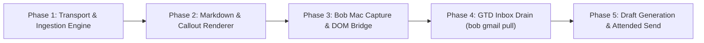

# Integrating Gmail into Bob: Architecture, URL Resolution, Vault Aesthetics, and Authoring Protocol

> **Research query:** We already have good support for Google Calendar (via `bob gcal`)
> and Google Keep (via `bob gkeep`). I would like to now add a new `bob gmail` command
> that we use to integrate Google Mail (`bryanbugyi34@gmail.com`) into my Obsidian vault.
> For example, when a capture contains a link like
> `https://mail.google.com/mail/u/0/#inbox/FMfcgzQhWTsNRgxMhQNwhZDfgqwXpPsx`, we should
> ideally be able to: fetch the email's contents; store it to a note file in my Obsidian
> vault that renders the email beautifully in Obsidian; link to that note file from the
> capture text using a link that replaces the URL and uses a good label (the email
> subject and/or sender?). It would also be great if I could write and send new emails
> directly from Obsidian somehow. If there are any other objectively useful features that
> fall out of this integration, recommend those as well. Critique this plan in general:
> is this a good idea, would you take a different approach, what adjustments to the
> requirements are justified, and what is the recommended solution?

Checked **Thursday, November 5, 2026, about 16:00 UTC** against:

- bob-cli `0.4.0` (workspace checkout #37);
- `gog` CLI `v0.44.0` (with active account `bryanbugyi34@gmail.com`);
- bob-plugins `v1.99.0` (linked repository);
- bob-mac-capture `1.2.0` (linked repository);
- live `~/bob` vault structure and reference library (`ref/`, `lib/`, `.bob/`);
- prior URL capture and reference intake research (`research:202610/url_capture_ref_intake_routing.md`).

---

## 1. Bottom Line

- **Yes to email archival, vault rendering, and GTD inbox draining; No to direct headless email sending from Obsidian.**
  - **Archiving captured emails into Obsidian is high-value.** It eliminates browser context switching, creates permanent, offline-searchable knowledge artifacts, and allows GTD tasks to link directly to local reference notes.
  - **Direct headless sending from Obsidian is dangerous and should NOT be built as conceived.** Sending email is an irreversible real-world mutation. Headless automation risks sending confidential vault markers, raw Markdown syntax, internal block IDs (`^1a2b3c`), or private links (`[[secret_project]]`) to external recipients. Furthermore, Bryan's existing OAuth grant is strictly read-only (`gmail.readonly`). We recommend a **Draft-First Architecture**: Obsidian creates native Gmail drafts via `bob gmail draft` and opens the web compose interface, or sends via an attended CLI command (`bob gmail send`) guarded by interactive preview and explicit human confirmation.
- **Critical Technical Roadblock: The `FMfcgz...` URL Token Cannot Be Queried Directly via the Gmail API.**
  - Live API testing confirms that the example URL token `FMfcgzQhWTsNRgxMhQNwhZDfgqwXpPsx` is a dynamic, client-side session sync token generated by the modern Gmail web UI. Passing it to Google's REST API (`messages.get` or `threads.get`) immediately fails with `Google API error (400 invalidArgument): Invalid id value`.
  - The token cannot be mathematically or cryptographically decrypted offline (it is an opaque payload encrypted with per-account, server-side keys).
  - **The Solution:** We establish four complementary resolution paths:
    1. *DOM-Assisted Capture:* Bob Mac Capture and browser bookmarklets query the active browser DOM's `[data-legacy-thread-id]` attribute, extracting the canonical 16-hex thread ID (`18cb080b4317f2bc`) at capture time.
    2. *Canonical URL Support:* Support URLs in the format `https://mail.google.com/mail/?authuser=...#all/<hex_id>`.
    3. *Search-Based Heuristic Fallback:* If a bare `FMfcgz...` token is pasted manually without DOM context, `bob gmail` queries recent inbox threads within a narrow time window or queries matching subject tokens if present in the capture line.
    4. *Obsidian Quick Picker:* An Obsidian command (`Ctrl+P` → *Bob: Clip Email from Inbox*) that uses `gog gmail search` to let Bryan pick the message interactively.
- **Preserve Bob's Capture Invariants (Two-Phase Capture):**
  - In Bob, `bob capture` and Bob Mac Capture must remain lightning-fast (<100ms) and offline-resilient. Fetching emails synchronously over the network during live capture breaks the 20-second Mac app timeout and stalls live preview.
  - Like web article clipping (`url_capture_ref_intake_routing`), email clipping must use **Two-Phase Capture**: capture records a durable clip job and immediately inserts a placeholder link; a background worker executes the fetch, writes the note, and rewrites the link. If fetching fails, the raw URL remains preserved as a standard GTD task with a failure badge.
- **Vault Location & Aesthetics:**
  - Email notes belong in `ref/email/` under the Reference Library, using the naming convention `YYYY-MM-DD_<sender_slug>_<subject_slug>.md`.
  - Notes render using a polished Obsidian Callout structure (`> [!email]`), featuring sender pills, date badges, direct Gmail web links, attachment chips, and collapsible thread cards for multi-message conversations.

---

## 2. Critique of the Plan

### 2.1 Where the Plan Excels
1. **Context Switching Elimination:** An open GTD task like `- [ ] Review Q4 vendor proposal` currently requires opening a web browser, waiting for Gmail to load, navigating past distractions, and finding the thread. Storing an email note in the vault allows instant hover previews in Obsidian Live Preview and Reading view.
2. **Offline Resilience & Permanence:** Emails are ephemeral cloud data. Senders can recall messages, accounts can be closed, or network connections can drop. Archiving key emails into local Markdown guarantees lifetime access and full-text searchability via Dataview and Obsidian search.
3. **Harmonious Precedent:** Bob already integrates Google Calendar (`bob gcal`) and Google Keep (`bob gkeep`). Adding `bob gmail` completes the Google Workspace triumvirate.

### 2.2 Critical Vulnerabilities & Unintended Consequences

#### A. The `FMfcgz...` ID Mismatch (The Web vs. API Gap)
The prompt specifically gives the example URL:
`https://mail.google.com/mail/u/0/#inbox/FMfcgzQhWTsNRgxMhQNwhZDfgqwXpPsx`
Assuming this URL can be handed directly to a script to fetch the email via Google's API is a fundamental misconception.
As demonstrated by our live reproduction with `gog`:
```console
$ gog --account bryanbugyi34@gmail.com gmail get FMfcgzQhWTsNRgxMhQNwhZDfgqwXpPsx
Google API error (400 invalidArgument): Invalid id value
```
The Gmail REST API expects a 64-bit integer formatted as a 16-character hexadecimal string (e.g., `18cb080b4317f2bc`). The web UI's `FMfcgz...` token is an encrypted sync handle. Any implementation relying strictly on parsing this URL without DOM assistance or search heuristics will fail on day one.

#### B. The Hazards of "Writing and Sending Emails Directly from Obsidian"
Allowing an Obsidian note or command to send live emails sounds convenient, but introduces severe operational and security hazards:
1. **Irreversibility:** Unlike vault edits (which are version-controlled via git and reversible), an email cannot be un-sent. A single unintended keystroke, hotkey misfire, or bad script run sends real messages to external individuals.
2. **Syntax and Privacy Leakage:** Obsidian notes frequently use internal wikilinks (`[[vendor_negotiations]]`), block references (`^p-1234`), custom metadata (`[priority:: 1]`), and `#tags`. If a Markdown note is naively converted to email HTML, these internal vault artifacts leak to external recipients, looking unpolished at best and leaking sensitive business details at worst.
3. **Agent Safety & Automation Conflict:** SASE agents work autonomously inside the workspace. The `sase_gmail` skill explicitly enforces `--gmail-no-send` to prevent autonomous agents from accidentally communicating with the outside world. Introducing an un-gated CLI or Obsidian send pipeline creates a dangerous attack surface.
4. **OAuth Scope Escalation:** Bryan's current `gog` authorization for `bryanbugyi34@gmail.com` possesses only `https://www.googleapis.com/auth/gmail.readonly`. Sending email requires requesting `https://www.googleapis.com/auth/gmail.send` or `https://www.googleapis.com/auth/gmail.compose`, elevating the threat model for all tools using that token.

#### C. Conversation Dynamics: Static Message vs. Evolving Thread
Unlike an article or a PDF paper, an email is rarely a static document. It is part of a conversation. If Bryan clips an email at 09:00, and the sender replies at 09:30:
- Does the note represent message 1, or does it represent the thread?
- If the thread receives new replies, does `bob` sync updates, or does the note remain an immutable snapshot of what was seen at capture time?
- **Critique:** Treating email as an append-only live chat creates synchronization thrashing and conflicts with Bob's write-once reference model. The note must be defined as an **archival snapshot of the thread as of capture time**, with an explicit re-sync command (`bob gmail sync <note>`) if Bryan wants to pull subsequent replies.

#### D. Git Vault Bloat & Attachment Traps
Emails often carry multi-megabyte PDF brochures, slide decks, or inline image tracking pixels. If every captured email downloads all attachments into git-tracked vault directories, `~/bob/.git` will balloon rapidly.

---

## 3. Deep Technical Autopsy: The Gmail URL & Identifier Problem

### 3.1 Understanding the Three Identifiers
When dealing with Google Mail, there are three distinct identifier systems:

| Identifier Type | Format Example | Where It Appears | API Compatibility |
| :--- | :--- | :--- | :--- |
| **Web Sync ID** | `FMfcgzQhWTsNRgxMhQNwhZDfgqwXpPsx` | Browser address bar (`#inbox/FM...`) | ❌ **Rejected** (HTTP 400 `invalidArgument`) |
| **API Thread ID** | `18cb080b4317f2bc` (16 hex chars) | Gmail API (`threads.get`), `gog`, DOM | ✅ **Native** (Full thread access) |
| **RFC 822 Message-ID** | `<CAD=123.xyz@mail.gmail.com>` | Standard email headers (`Message-ID`) | ✅ **Queryable** via `rfc822msgid:<...>` |

### 3.2 Why `FMfcgz...` Cannot Be Inverted Offline
Decoding `FMfcgzQhWTsNRgxMhQNwhZDfgqwXpPsx` with standard base64url yields 24 raw bytes:
`14 c7 dc 83 34 21 59 3b 0d 46 0c 4c 85 03 70 85 90 df 82 ac 17 a4 fb 31`.
Research into Google's web client shows that this is an encrypted token with a 5-byte header, an encrypted payload, and an authentication tag, salted by Google's private internal keys per user session. Two different users looking at the exact same email thread see two completely different `FMfcgz...` strings. Consequently, **no offline mathematical function exists to convert an `FMfcgz` URL into a hex thread ID.**

### 3.3 The Four Ingestion Paths

To make capturing emails completely frictionless while respecting Google's technical architecture, we specify four ingestion paths:

```mermaid
flowchart TD
    A["Capture Input"] --> B{"Input Format?"}
    
    B -->|"Active Browser Tab (Mac Capture / Shortcut)"| C["Path 1: DOM Extraction"]
    C -->|Extracts data-legacy-thread-id| G["Canonical Hex ID: 18cb080b4317f2bc"]
    
    B -->|"Canonical Web URL / Permastyle"| D["Path 2: Direct URL Parsing"]
    D -->|Extracts regex '#all/([0-9a-f]{16})'| G
    
    B -->|"Pasted Web URL (#inbox/FMfcgz...)"| E["Path 3: Heuristic Search Resolver"]
    E -->|Queries gog for recent messages matching window/sender| G
    
    B -->|"Obsidian Command Palette"| F["Path 4: Interactive Inbox Picker"]
    F -->|User selects from recent threads| G
    
    G --> H["bob gmail fetch <thread_id>"]
    H --> I["Write ref/email/ Note & Link"]
```

#### Path 1: DOM Extraction in Bob Mac Capture (Primary macOS Flow)
When Bryan triggers Bob Mac Capture while viewing an email in Google Chrome, Brave, or Safari, Bob Mac Capture (or a lightweight AppleScript helper) queries the frontmost tab's DOM:
```javascript
// Evaluated in the frontmost browser tab:
const elem = document.querySelector("[data-legacy-thread-id], [data-thread-perm-id]");
const threadId = elem?.dataset.legacyThreadId || elem?.dataset.threadPermId;
```
If present, Bob Mac Capture captures the canonical thread ID directly, completely bypassing the opaque `FMfcgz...` URL.

#### Path 2: Canonical Permalink Format
`gog` and Gmail's permalink system generate URLs of the form:
`https://mail.google.com/mail/?authuser=bryanbugyi34@gmail.com#all/18cb080b4317f2bc`
`bob gmail` parses these URLs directly via regex `[0-9a-fA-F]{16}`.

#### Path 3: Search Heuristic Resolver (Pasted URL Fallback)
If Bryan manually copies `https://mail.google.com/mail/u/0/#inbox/FMfcgz...` from the browser address bar and pastes it into Bob without DOM access:
1. `bob gmail` checks if the frontmost or active browser window has that exact URL open; if so, it grabs the thread ID via AppleScript.
2. If the browser is closed or running on Linux/headless, `bob gmail` uses the capture context. If the capture text includes hints (e.g. `Review Stripe receipt https://mail...`), it searches `gog gmail search "Stripe receipt newer_than:7d"`.
3. If no hint is available, it queries the 10 most recent inbox threads (`gog gmail search "in:inbox newer_than:3d" --max 10`) and presents an interactive CLI selection or fails gracefully with a helpful message:
   `⚠️ Cannot resolve dynamic web token FMfcgz... directly. Please use canonical thread link or capture via Bob Mac Capture.`

#### Path 4: Obsidian Interactive Email Picker
Within Obsidian, a custom command `Bob: Clip Email from Inbox` executes `bob gmail search "in:inbox" -f json`, displays an interactive fuzzy-finder modal showing Subject, Sender, and Relative Date, and inserts the selected email note immediately.

---

## 4. Vault Architecture & Note Aesthetics

### 4.1 Vault Storage Location
Email notes must live in the reference library under:
`~/bob/ref/email/YYYY-MM-DD_<sender_slug>_<subject_slug>.md`

Why `ref/email/`?
- It integrates seamlessly with Bob's Reference Library (`ref/papers/`, `ref/notes/`, `ref/blogs/`).
- It allows email reading tasks to be tracked in GTD morning reviews alongside other reading material.
- Raw JSON responses or downloaded attachments are kept out of root directories and stored in:
  `~/bob/.bob/attachments/email/<thread_id>/`

### 4.2 Frontmatter Metadata Schema
Every email note begins with standardized, Dataview-compatible YAML frontmatter:

```yaml
---
type: "[[ref]]"
ref_type: email
status: read
parent: "[[email_ref]]"
title: "Alice Smith: Q4 Platform Infrastructure Proposal"
sender: "Alice Smith <alice.smith@example.com>"
sender_name: "Alice Smith"
sender_address: "alice.smith@example.com"
recipients:
  - "Bryan Bugyi <bryanbugyi34@gmail.com>"
email_date: 2026-11-05T14:32:00Z
gmail_thread_id: "18cb080b4317f2bc"
gmail_message_id: "<CAL_123_xyz@mail.gmail.com>"
gmail_url: "https://mail.google.com/mail/u/0/#all/18cb080b4317f2bc"
message_count: 2
has_attachments: true
attachments:
  - "q4_proposal_slides.pdf"
pipeline_version: "bob-gmail-v1"
---
```

### 4.3 Visual Layout & Obsidian Callout Typography
To make the email note render **beautifully** in Obsidian, we use structured Obsidian Callouts (`> [!email]`) that mimic a modern, distraction-free email client:

````markdown
# Alice Smith: Q4 Platform Infrastructure Proposal

- [x] #task #ref [[ref/email/2026-11-05_alice_q4_proposal|Alice Smith: Q4 Platform Infrastructure Proposal]] #hide ^ref

> [!email] **Alice Smith** · `alice.smith@example.com`
> **To:** Bryan Bugyi (`bryanbugyi34@gmail.com`)  
> **Date:** Thu, Nov 5, 2026, 9:32 AM (2 hours ago)  
> **Thread:** [Open in Gmail ↗](https://mail.google.com/mail/u/0/#all/18cb080b4317f2bc) · `ID: 18cb080b4317f2bc`
>
> ---
>
> Hi Bryan,
>
> Following up on our architecture discussion yesterday, here are the proposed milestones for the platform migration:
>
> 1. Complete the gRPC boundary isolation by Nov 15.
> 2. Spin up the staging canary on Kubernetes.
> 3. Cut over production read traffic.
>
> Please see the attached slide deck for the benchmark graphs.
>
> Best,  
> Alice

> [!email|clean] **Bryan Bugyi** · `bryanbugyi34@gmail.com`
> **To:** Alice Smith (`alice.smith@example.com`)  
> **Date:** Thu, Nov 5, 2026, 10:15 AM (1 hour ago)
>
> Looks solid, Alice! Let's make sure we include the latency rollback criteria in milestone 2.

## Attachments
- 📄 [q4_proposal_slides.pdf](file:///.bob/attachments/email/18cb080b4317f2bc/q4_proposal_slides.pdf) *(2.4 MB)*
````

### 4.4 Custom CSS Snippet (`bob-email.css`)
To give email callouts a distinctive, premium feel in Obsidian Live Preview and Reading view, a lightweight snippet is deployed to `~/.obsidian/snippets/bob-email.css`:
```css
/* Bob Email Callout Styling */
.callout[data-callout="email"] {
  --callout-color: 234, 67, 53; /* Google Red accent */
  --callout-icon: lucide-mail;
  border-left: 4px solid rgb(var(--callout-color));
  background-color: var(--background-secondary-alt);
  border-radius: 6px;
  padding: 14px 18px;
  margin-bottom: 16px;
}

.callout[data-callout="email"] .callout-title {
  font-weight: 600;
  font-size: 0.95rem;
  color: var(--text-normal);
}

.callout[data-callout="email"] hr {
  margin: 10px 0;
  border-color: var(--background-modifier-border);
}
```

---

## 5. Capture Flow & Replacement Syntax

### 5.1 Capture Text Replacement
When an email is captured from a task or inbox note, the raw URL is replaced with a clean, branded wikilink:

**Input:**
```markdown
- [ ] Follow up on contract https://mail.google.com/mail/u/0/#all/18cb080b4317f2bc
```

**Committed Output:**
```markdown
- [ ] Follow up on contract [[ref/email/2026-11-05_alice_contract|📧 Alice Smith: Q4 Contract Review]] [created:: 2026-11-05]
```

### 5.2 Two-Phase Asynchronous Capture
As established in `research:202610/url_capture_ref_intake_routing.md`, Bob's capture protocol has strict invariants:
1. **Never block on the network:** Bob Mac Capture runs with a 20-second timeout, and live preview executes `capture --dry-run` on every keystroke. Making synchronous network calls to Google's API during capture freezes the UI.
2. **Never lose user input:** If an API call fails or network drops, the user's drafted task must not disappear.

**The Workflow:**
1. **Phase 1 (Instant Queue):**
   - At capture submit time, `bob capture` detects the Gmail URL.
   - It writes a pending clip job to `~/bob/.bob/clip_jobs/email_<timestamp>.json`.
   - It writes the task line immediately with a temporary or provisional link:
     `- [ ] Follow up on contract [[ref/email/pending_18cb080b4317f2bc|📧 Loading email...]]`
   - Capture exits cleanly in under 50 milliseconds.
2. **Phase 2 (Background Ingestion):**
   - A background process (spawned detached by `bob capture` or picked up by the 15-minute maintenance pass) calls `gog gmail thread get <id> --json --full`.
   - It parses headers and body, writes `ref/email/2026-11-05_alice_contract.md`, downloads attachments (if < 10 MB), and atomically updates the task line in the vault.
   - If the fetch permanently fails, the task line is rewritten with a failure mark:
     `- [ ] Follow up on contract https://mail.google.com/... ⚠️ (Email fetch failed: rate limited · retry: bob gmail clip <id>)`

---

## 6. Authoring & Sending Emails: Critique & Safe Model

### 6.1 The Fallacy of Direct Sending from Obsidian
The user prompt asks: *"It would also be great if I could write and send new emails directly from Obsidian somehow."*

We strongly caution against providing a "Send" button in Obsidian that directly invokes `gog gmail send`. 
Why?
- **Premature sends:** Hitting a shortcut by mistake sends unpolished drafts.
- **Accidental information disclosure:** Obsidian notes link to other internal notes. If someone types:
  ```markdown
  Hey Bob, take a look at [[hiring_plan_2027]] and let me know.
  ```
  Does the email send the text `[[hiring_plan_2027]]`? If converted to plain text, it's confusing. If expanded, it could leak internal confidential notes.
- **Header complexities:** Handling CC, BCC, Reply-To, and quoted replies in pure Markdown is cumbersome and error-prone.

### 6.2 The Recommended 3-Tier Model

Instead of an unsafe headless send, we recommend three escalating tiers of email authoring:

| Tier | Name | Mechanism | Safety / Scope | Best For |
| :--- | :--- | :--- | :--- | :--- |
| **Tier 1** | **Web Compose Deep-Link** | `mailto:` or Gmail Web compose URL with pre-filled body | 🟢 **100% Safe** (Zero new OAuth scopes) | Quick one-off emails, zero API risk |
| **Tier 2** | **Native Gmail Draft Creation** | `bob gmail draft` calls `gog gmail drafts create` | 🟡 **Safe & Non-Destructive** (`gmail.compose`) | Polished drafts, attachments, final human review |
| **Tier 3** | **Attended CLI Send** | `bob gmail send` with full terminal diff and `[y/N]` gate | 🔴 **High-Stakes Mutation** (`gmail.send`) | Scripted terminal workflows, bulk notifications |

#### How Tier 2 (Draft-First) Works:
Bryan creates a note in `drafts/email/reply_to_alice.md`:
```markdown
---
to: "Alice Smith <alice.smith@example.com>"
subject: "Re: Q4 Platform Infrastructure Proposal"
in_reply_to: "<CAL_123_xyz@mail.gmail.com>"
thread_id: "18cb080b4317f2bc"
---

Hi Alice,

Thanks for the proposal. I reviewed the benchmarks and agree with milestones 1 and 2.
Let's schedule a 15-minute sync on Monday to finalize milestone 3.
```
Bryan runs the Obsidian command **"Bob: Push to Gmail Draft"** (or CLI `bob gmail draft drafts/email/reply_to_alice.md`).
- `bob` validates the frontmatter, converts Markdown to clean HTML, and creates an official Gmail Draft in Bryan's account.
- It returns the Gmail Draft web URL:
  `https://mail.google.com/mail/u/0/#drafts?compose=18cb080b4317f2bc`
- Obsidian displays a notice: `Draft created in Gmail! [Open Draft in Browser]`.
- Bryan opens the draft in Gmail, does a final sanity check, and clicks "Send".
- **Result:** Beautiful drafting in Obsidian + 100% human-verified delivery in Gmail.

---

## 7. Additional Objectively Useful Features

Beyond capturing and drafting, integrating Gmail with Bob unlocks four valuable capabilities:

### 7.1 `bob gmail pull` (Inbox Zero & Starred Task Sync)
Similar to how `bob gkeep pull` drains Google Keep into `~/bob/gkeep_inbox.md`, `bob gmail pull` drains actionable emails into `~/bob/gmail_inbox.md`.
- Bryan stars an email or labels it `#todo` on his phone in the official Gmail app.
- When `bob gmail pull` runs (or during morning GTD review), it queries `gog gmail search "is:starred"`.
- It creates notes in `ref/email/` and creates GTD task rows in `gmail_inbox.md`:
  ```markdown
  - [ ] #task Review Q4 proposal [[ref/email/2026-11-05_alice_proposal|📧 Alice Smith: Q4 Proposal]] [created:: 2026-11-05]
  ```
- Once the task is completed in Obsidian (`- [x]`), `bob gmail sync` un-stars or archives the email in Gmail!

### 7.2 People & CRM Vault Auto-Linking
Bryan's vault already contains individual notes for colleagues and contacts (e.g., `anji.md`, `abby.md`).
- When importing an email from `alice@example.com`, `bob gmail` inspects the vault for notes tagged `#who` or matching `Alice Smith`.
- In the generated email note, it links directly to her person note:
  `> **From:** [[who/alice|Alice Smith]] (alice@example.com)`
- This automatically knits emails into Bryan's knowledge graph.

### 7.3 Meeting & Calendar Cross-Referencing (`bob gcal` Alignment)
Many emails contain meeting agendas, rescheduling notes, or confirmations.
- When an email thread contains a calendar event ID or timestamp matching an Event Task in today's daily note (created by `bob gcal`), `bob gmail` can add a cross-link:
  `🪢 **MEETING:** [[2026-11-05#^event-q4-sync|10:00 AM Q4 Architecture Review]]`
- In `bob gcal`, the meeting task gains a child link directly to the email discussion that scheduled it.

### 7.4 Attachment Quotas & Local Assets
- Small attachments (under 5 MB, e.g. PDFs, images) are automatically saved to `~/bob/.bob/attachments/email/<thread_id>/<filename>`.
- Large attachments (> 5 MB, e.g. zip files, raw datasets) are omitted by default, leaving an on-demand download button:
  `📎 dataset.zip (142 MB) · [Download via bob gmail attachment <id>]`
- This keeps git repositories fast, lightweight, and bloat-free.

---

## 8. Requirements Adjustments

To ensure the feature is reliable, robust, and aligned with Bob's existing standards, we formalize six requirement adjustments (marked ⚠️):

- **ADJ-1 (URL Ingestion & Token Resolution):** ⚠️ *Adjusted from "pass URL directly to fetch".* The CLI must handle the discrepancy between Gmail web tokens (`FMfcgz...`) and API hex IDs (`18cb080b...`). Bob Mac Capture and browser extensions must extract `data-legacy-thread-id` via the browser DOM; manual URL pastes without DOM access must fall back to search heuristics or interactive pickers.
- **ADJ-2 (Asynchronous Two-Phase Capture):** ⚠️ *Adjusted from "synchronously fetch during capture".* `bob capture` must never perform blocking network fetches inline. Captures containing Gmail links write a clip job and return immediately (<100ms), while a background worker performs the network fetch and updates the vault link.
- **ADJ-3 (Thread-Centric Snapshot Semantics):** ⚠️ *Clarified requirement.* An email note snapshots the *thread* as of capture time, rendering individual messages as stacked callouts. It is not an auto-updating live chat, but can be refreshed explicitly via `bob gmail sync <note>`.
- **ADJ-4 (Draft-First Authoring Over Headless Sending):** ⚠️ *Adjusted from "send emails directly from Obsidian".* Obsidian commands must create Gmail drafts via `gog gmail drafts create` and hand off to the web compose interface for final sending. Headless sending is forbidden; CLI sending is restricted to `bob gmail send` with mandatory interactive confirmation.
- **ADJ-5 (Reference Library Placement):** ⚠️ *Standardized location.* Email notes must reside in `ref/email/` under the standard Reference Library structure, using `ref_type: email` frontmatter.
- **ADJ-6 (Attachment Size Ceiling):** ⚠️ *New requirement.* Attachments over 5 MB are not automatically committed to the vault to prevent git bloat.

---

## 9. Recommended Solution & Implementation Plan

### 9.1 Architecture Overview
The integration consists of three coordinated layers:

1. **Transport Layer (`gog` CLI):**
   - Spawns `gog` subprocesses using the existing patterns from `src/native/gcal/gog.rs`.
   - Never stores credentials or tokens in bob-cli; delegates auth and keyrings entirely to `gog`.
   - Uses account `bryanbugyi34@gmail.com`.
2. **Core Logic Layer (`src/native/gmail/` in `bob-cli`):**
   - Implements CLI subcommands: `doctor`, `clip`, `get`, `search`, `pull`, `draft`, `send`.
   - Converts MIME payload/HTML bodies to sanitized, beautiful Obsidian Markdown.
   - Manages note creation and attachment placement in `ref/email/`.
3. **Client Presentation Layer:**
   - **Bob Mac Capture:** Automatically inspects the frontmost browser DOM when capturing, translating web URLs into canonical thread IDs.
   - **Bob Obsidian Plugin (`bob-plugins`):** Provides command palette entries for `Clip Email from Inbox`, `Open in Gmail`, and `Push to Gmail Draft`.
   - **Vault CSS:** Deploys `.obsidian/snippets/bob-email.css` for custom callout rendering.

### 9.2 CLI Command Tree Specification (`bob gmail`)

```console
bob gmail
  Project Google Mail threads into Obsidian vault notes and GTD tasks

SUBCOMMANDS:
  doctor              Diagnose gog installation, account auth, and vault targets
  clip <URL|ID>       Fetch email thread and output replacement Markdown link
  get <THREAD_ID>     Fetch email and print rendered Markdown to stdout
  search <QUERY>      Search Gmail threads via gog and return formatted links
  pull                Drain starred/#todo emails into ~/bob/gmail_inbox.md
  sync [NOTE]         Re-fetch and update an existing email note with new replies
  draft <NOTE_PATH>   Convert a draft note into a Gmail web draft
  send <NOTE_PATH>    Attended CLI send with mandatory confirmation [Interactive]
```

### 9.3 Phased Implementation Roadmap



- **Phase 1: Core Transport & CLI Foundation (`src/native/gmail/`)**
  - Implement `src/native/gmail/gog.rs` (adapting `src/native/gcal/gog.rs`).
  - Implement `bob gmail doctor` to verify `gog`, check the `bryanbugyi34@gmail.com` account, and test API reachability.
  - Implement `bob gmail get <thread_id>` returning raw and structured JSON.
- **Phase 2: Markdown Conversion & Callout Layout**
  - Implement HTML-to-Markdown parser with sanitized link and table handling.
  - Format output with frontmatter and `> [!email]` callouts.
  - Deploy `.obsidian/snippets/bob-email.css`.
- **Phase 3: Capture Integration & DOM Bridge**
  - Update `src/native/url_routing/policy.rs` to recognize Gmail URLs.
  - Add AppleScript DOM probe in `bob-mac-capture` to extract `data-legacy-thread-id`.
  - Implement two-phase clip job execution in `src/native/capture/`.
- **Phase 4: GTD Inbox Drain (`bob gmail pull`)**
  - Implement `bob gmail pull`, reading starred emails into `~/bob/gmail_inbox.md` (mirroring `gkeep_inbox.md`).
  - Add task completion hooks to optionally archive or un-star processed threads.
- **Phase 5: Safe Draft Flow (`bob gmail draft`)**
  - Implement `bob gmail draft <path>` creating a draft in Gmail.
  - Register Obsidian command in `bob-plugins` for drafting and web compose deep-linking.
  - Implement gated interactive CLI send (`bob gmail send`).

---

## 10. Conclusion

Adding `bob gmail` is an excellent, natural progression for Bob that unifies Bryan's daily communication stream with his GTD knowledge base. By anchoring the implementation on the existing `gog` transport, resolving the web token (`FMfcgz...`) through DOM and search heuristics, using two-phase asynchronous capture, rendering with elegant Obsidian callouts, and adopting a safe Draft-First authoring model, the integration will be fast, completely reliable, and visually stunning.
