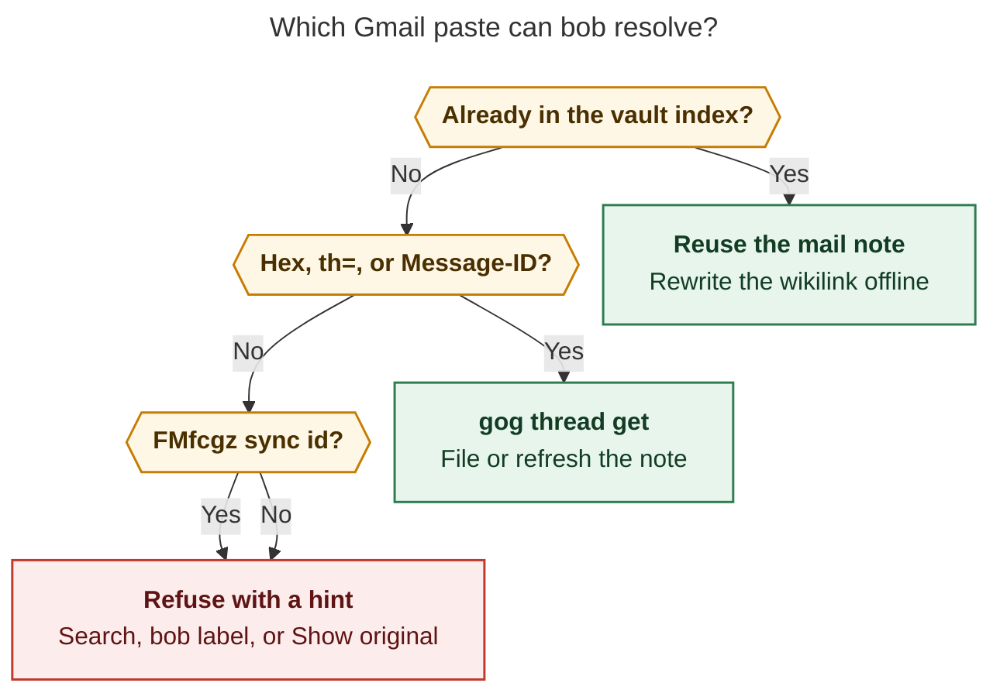
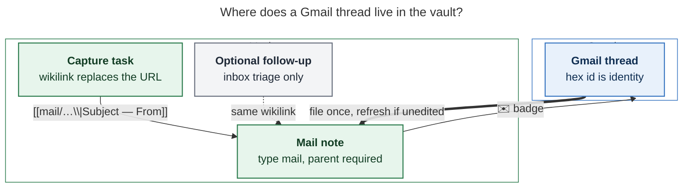
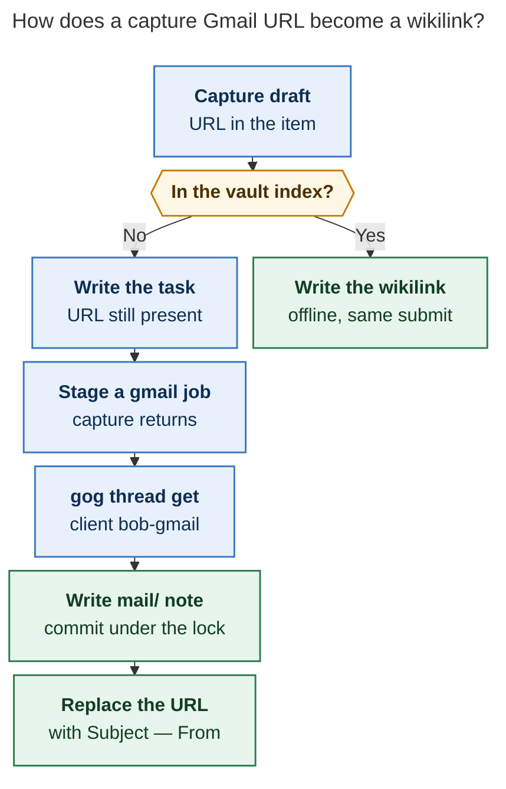

# File selected Gmail threads as vault mail notes, not a mailbox clone

> **Research query.** Add `bob gmail` so Bryan can integrate
> `bryanbugyi34@gmail.com` into the Bob vault: a capture that contains a
> Gmail web URL should fetch the message, store it as a beautiful Obsidian
> note, and replace the URL with a labelled wikilink. Sending mail from
> Obsidian is desired. Recommend other features that fall out of the
> integration. Lead the design so it is intuitive, reliable, and
> beautiful. Critique the plan, call out justified requirement
> adjustments, and end with a recommended solution.

**Researcher.** `grk` (independent swarm report).
**Date.** 2026-11-05.
**Scope.** Research only. No bob-cli, plugin, chezmoi, vault, or memory
files were changed. This file is the deliverable. Peer swarm reports were
not read.

**Primary evidence in this repo.**
`docs/gcal.md` (gog transport, isolated `--client bob-gcal`, read-only
login, doctor, JSON, security, Testing-token expiry);
`docs/gkeep.md` (inbox drain, verify-then-archive, `gkeep_inbox.md`,
`%%gkeep%%` then `.bob/gkeep/imports/`, Keep text escaped as data);
`docs/capture.md` § Saving links to your reading queue (bare public URL
→ ref job; submit never touches the network);
`docs/reference/vault-format.md` (note types, `parent`, refs, inbox
files);
`docs/articles.md` (`type: "[[article]]"` holds no tasks);
`src/native/gcal/{gog,cli,login,mod}.rs`;
`src/native/gkeep/{mod,cli,render,ledger}.rs`;
`src/native/url_routing/policy.rs` (`google.com` is a default excluded
host);
`src/native/ref_jobs/{mod,spool}.rs`;
`src/native/catalog/table.rs` (Integrations rows);
`src/runner.rs` (`Section::Integrations`);
`cli_rules.md`; decisions `bob-gcal-is-read-only-and-proposes-once`,
`mac-capture-is-a-thin-client`, `references-are-ingested-at-birth`,
`bob-cli-releases-ride-a-daily-train`.

**External evidence.**
[gog](https://github.com/openclaw/gogcli) v0.44.0 locally, current tree
opened as `gh:openclaw/gogcli` (`docs/gmail-workflows.md`,
`internal/cmd/webid.go`, `--gmail-scope readonly|send|read-send`,
`gog gmail url`, `gog gmail thread get`);
[Gmail API scopes](https://developers.google.com/workspace/gmail/api/auth/scopes)
(restricted vs sensitive; `gmail.readonly` is restricted, `gmail.send` is
sensitive);
[Restricted-scope verification](https://developers.google.com/identity/protocols/oauth2/production-readiness/restricted-scope-verification)
(personal-use exception);
[Gmail API quota](https://developers.google.com/workspace/gmail/api/reference/quota)
(`threads.get` 40 units, 120 when `format=full`; 6,000 units/user/minute);
[googleworkspace/cli#790](https://github.com/googleworkspace/cli/issues/790)
(FMfcgz sync IDs are opaque to the API);
[Stack Overflow: web ID vs API ID](https://stackoverflow.com/questions/53900072/find-api-message-id-from-gmail-web-interface)
(`data-legacy-thread-id` in the DOM);
[Arsenal Recon Gmail URL decoder](https://arsenalrecon.com/insights/digging-deeper-into-gmail-urls-and-introducing-gmail-url-decoder)
(older `FMfcgx` tokens decoded in Gmail JS; not the current `FMfcgz`
scheme);
Obsidian ecosystem: [obsidian-google-mail](https://github.com/thingnotok/obsidian-google-mail),
[Gmail Mailbox](https://github.com/nabheetcloud/obsidian-gmail),
[Email to Vault](https://github.com/mnaoumov/obsidian-email-to-vault),
[IMAP importer](https://community.obsidian.md/plugins/imap-mail-importer),
[Gmail2Obsidian](https://www.reddit.com/r/ObsidianMD/comments/1njm3wy/gmail2obsidian_capture_gmail_emails_and_send_them),
hosted forwarders (Send To Vault, mail-to-note).

---

## Bottom line

**Build `bob gmail`, but not as a mailbox inside Obsidian and not with
the pasted `FMfcgz…` URL as the v1 centrepiece.**

The need is real. Calendar already lands on the daily note. Keep already
drains thoughts into `gkeep_inbox.md`. Web links already become
reference notes. Mail is the missing object: a durable, searchable
document Bryan chose to keep, linked from the task he captured while
reading it.

The beautiful object is **one vault note per Gmail thread**, with
Bob-owned header chrome, a Google-owned body that updates until Bryan
edits it, a `## Notes` section he owns forever, and a compact ✉️ badge
back to Gmail. Capture replaces a resolvable Gmail URL with a wikilink
labelled `Subject — From`. Sending mail is a second OAuth grant and a
second phase.

The pasted example URL is the weakest part of the request. Gmail's web
UI now shows opaque `FMfcgz…` sync IDs. The Gmail API accepts hex
thread ids such as `18c0abc123def456`. gog already parses hex and
`?th=` links and already *emits* working `#all/<hex>` URLs; it does not
decode `FMfcgz`. A v1 that promises "paste any Gmail address-bar URL
and the note appears" will fail on the most common paste. Lead with
paths that always resolve (search, a `bob` Gmail label, hex / `th=` /
`rfc822msgid:`), and treat `FMfcgz` as a resolver that fails with a
precise hint.

This is a good idea at Keep/Calendar scale: explicit, idempotent,
read-mostly, gog-transported, capture-offline. It is a bad idea as a
two-way mail client, a full-mailbox sync, an Obsidian plugin that talks
to Google, or a hosted "forward this to a magic address" service.

---

## Critique of the plan

The request bundles three products:

1. **File a chosen email as a vault note, then link to it.** This is
   the PKM feature. It matches how Bob already treats refs (a document
   plus a task that points at it) and how gcal treats events (Google
   proposes, the vault owns the row after the first write).
2. **Compose and send from Obsidian.** Useful, smaller than it sounds,
   and a different OAuth class (`gmail.send` is sensitive;
   `gmail.readonly` is restricted). Shipping it in the same slice as
   filing forces a broader grant, a confirm-to-send UI, MIME, drafts,
   and reply threading before the read path is proven.
3. **"Any other objectively useful features."** The tempting ones —
   unread badges, a live inbox, archive-on-file, nightly drain, star
   sync — recreate Gmail in the vault. Bob has already rejected that
   shape for Calendar (read-only, propose once, Mac is the one writer)
   and for Keep (manual drain, never a scheduled runner, never delete).

The example capture is also two different gestures glued together:

- A **bare** Gmail URL. Today that is *not* a reference job:
  `url_routing` excludes `google.com` and every subdomain, so
  `mail.google.com` stays a task whose text is the URL. That exclusion
  is correct (do not clip Gmail as a web article). It is also why a new
  `kind: gmail` must intercept *before* the ref classifier.
- A **task that contains** a Gmail URL. Capture today writes the URL
  through as prose. Replacing it with a wikilink is a rewrite of an
  already-planned task line. Submit is required to stay offline
  (`docs/capture.md`: "Submit never touches the network and returns at
  once"). The fetch therefore cannot run inside `bob capture`. It has
  to be a staged job, the same way refs are.

Mac Capture is a thin client of bob. Any Gmail span, preview line, or
rewrite lands in bob-cli's JSON first; the app only decodes. Do not
grow a Swift Gmail client.

I would take a different approach than "Gmail URL in, note out, send
from the vault" as one epic. I would ship a **filing product** that
looks like `bob ref` plus `bob gkeep list`, then a **send product**
that looks like `bob gcal login` with a second, narrower grant.

---

## Justified requirement adjustments

Call these out as changes to the request, not as implementation
details.

1. **Do not clone the mailbox.** File only threads Bryan points at
   (capture URL, `bob gmail file`, or an opt-in Gmail label). No
   unread inbox in Obsidian, no history.list of the whole account, no
   `bob nightly` drain.
2. **File threads, not isolated messages.** The example URL is a
   thread URL (`#inbox/<id>`). One note per conversation, messages as
   `###` headings newest-last (reading order). A single-message
   "email" is a thread of length one.
3. **Capture stays offline.** Detect Gmail URLs, write the task, queue
   a job. The worker fetches, writes the mail note, then rewrites the
   URL to a wikilink. Preview shows `gmail: will file`, not the
   subject, until the job completes. If the thread is already in the
   vault index, the rewrite is offline and the preview can show the
   real label.
4. **Read-only OAuth for v1.** Isolated gog client `bob-gmail`,
   `--gmail-scope readonly`. Do not request `gmail.modify`,
   `gmail.compose`, or `https://mail.google.com/`. Do not archive,
   trash, or strip labels in v1. Idempotent re-reads of a `bob` label
   skip already-filed thread ids; the label can stay as the filing
   cabinet marker.
5. **Send is phase 2 with a second grant.** `gmail.send` is sensitive,
   not restricted. `bob gmail login --send` (or a later
   `read-send`) is a separate consent. Every send is `-d` first, then
   an explicit confirm. No auto-send, no agent send, no signature
   scraping from random notes.
6. **The example `FMfcgz…` URL is not a v1 success criterion.** Accept
   it, try to resolve it, and fail with a hint that names the three
   resolvable inputs (search pick, `bob` label, hex / `th=` /
   `rfc822msgid:`). Do not invent a client-side decoder; current
   public evidence says the payload is opaque
   ([googleworkspace/cli#790](https://github.com/googleworkspace/cli/issues/790)).
7. **Emails are documents, not tasks and not refs.** Keep notes become
   inbox tasks because they *are* thoughts. Web URLs become refs
   because they are reading material with a PDF. An email is
   correspondence. The mail note holds no `#task` line. If the capture
   was a task ("Reply to Alice about the contract \<url\>"), that task
   stays a task and *links* to the mail note. A bare Gmail URL files
   the note and, like a ref, plants a follow-up task on the parent
   only when the parent is an inbox (triage); under an area/project it
   files the note and stops.
8. **`parent` is required.** New notes need a `parent` wikilink
   (Obsidian memory). Default parent is a `mail` area, overridable
   with `@route` / `-P` the same way refs and gkeep clips are.
9. **Do not treat Gmail as a web clip.** `mail.google.com` must never
   enter the article/PDF pipeline, even if someone removes `google.com`
   from `exclude_hosts`.
10. **Attachments are opt-in.** v1 records attachment names and sizes
    as a child list. `--attach` / `bob gmail attach` copies through
    the existing attachment-origin journal, with a size cap. Inline
    CID images wait until HTML→Markdown is proven.
11. **Any host may file.** gcal sync is Mac-only because it edits
    today's daily note. Mail notes are ordinary Markdown under
    `bob_sync.lock`, like refs and gkeep. Login still has to happen on
    each host that files (keyring is local), matching gcal's "login
    everywhere, write on one host" split *without* the write pin.

---

## What already exists (do not rebuild it)

### gog is the Gmail client

`bob gcal` already speaks to Google only through gog, with common flags
before the subcommand, tokens never in argv, `--client bob-gcal`, and
`BOB_GCAL_GOG` as the test fake. Local gog is v0.44.0, the same floor
gcal requires.

gog's Gmail surface is already larger than Bob needs:

| Need | gog command |
| --- | --- |
| Search threads | `gog gmail search '…' --json` |
| Read a thread | `gog gmail thread get <id> --json --full` |
| Read one message | `gog gmail get <id> --format full --json` |
| Raw RFC822 | `gog gmail get <id> --format raw --json` |
| Hex web URL out | `gog gmail url <threadId>` → `#all/<hex>` |
| Hex web URL in | `internal/cmd/webid.go` `normalizeGmailThreadID` |
| Attachments | `gog gmail attachment`, `thread get --download` |
| Drafts / send / reply | `gog gmail drafts …`, `send`, `reply` |
| Least-privilege scopes | `--gmail-scope readonly\|send\|read-send` |
| Agent safety | `--readonly --gmail-no-send --wrap-untrusted` |

Bob should wrap a *narrow* slice of this, the way `bob gcal` wraps
`calendar events` rather than exposing gog's whole calendar tree.
SASE agents already use gog Gmail read-only through the `sase-gmail`
skill. That grant lives in gog's default client bucket. `bob gmail`
must use an isolated `--client bob-gmail` so logout cannot strip the
agent grant, matching gcal's documented isolation ("Gmail and other
gog clients are left alone").

### Capture already has the job-spool pattern

Bare public URLs become `kind: "ref"`, verdicts are computed offline
from the library and the spool, submit writes a `0700` job under
`bob_cli_state_dir()/ref/jobs/`, and a detached worker clips later. A
failed clip falls back to the inbox task plus a ⚠️ child. Gmail filing
should copy this spool, not block capture on the network.

### Keep is the wrong object, the right *drain* ritual

`bob gkeep pull` snapshots, classifies, renders, fsyncs, re-reads,
commits, then archives. That verify-then-mutate ritual is the model
for a later label drain that *removes* the `bob` label. v1 does not
need it: re-reading the label and skipping known thread ids is enough
under `gmail.readonly`.

Keep rendering treats source text as data (`escape_task_text`, never
markup). Mail notes are the opposite: they *are* markup. Reuse Keep's
escaping only for subject/from on **task lines** (wikilink aliases,
block ids). Inside the mail note, sanitized Markdown is the point.

### Refs are the wrong pipeline, the right *identity* pattern

Reference notes live under `ref/`, hold no open tasks, carry
command-managed frontmatter, and project a reading task onto a parent.
Mail notes should live under `mail/`, hold no open tasks, carry
`gmail_thread_id` as identity, and project an optional follow-up task
only from inbox captures. They must not go through pandoc, Highlights,
or `lib/`.

### Calendar login is the UX to clone

`bob gcal login` already solves Desktop-app client discovery
(`~/Downloads/client_secret*.json`), browser vs paste-over-SSH,
idempotent re-login, Testing-token expiry ("publish them"), and
`doctor` as the checklist. `bob gmail login` should be that flow with
the Gmail API library URL and `--gmail-scope readonly`. The connect
guide at `docs/guides/connect-google-calendar.md` is the template for
`docs/guides/connect-google-mail.md`.

---

## The hard problem: Gmail web IDs

The example

```text
https://mail.google.com/mail/u/0/#inbox/FMfcgzQhWTsNRgxMhQNwhZDfgqwXpPsx
```

is a Gmail web *sync id*, not a Gmail API thread id.

| Form | Example | API `threads.get` |
| --- | --- | --- |
| Hex thread id | `18c0abc123def456` | Works |
| Classic hash URL | `#inbox/18c0abc123def456` | Works (gog strips the path) |
| Print-view query | `?th=18c0abc123def456&view=pt` | Works (gog reads `th=`) |
| `permmsgid=msg-f:<hex>` | query param | Works for *messages* |
| RFC 822 `Message-ID` | `<abc@mail.gmail.com>` | Works via `q=rfc822msgid:…` |
| Current address bar | `#inbox/FMfcgz…` | `400 Invalid id value` |

gog's `normalizeGmailThreadID` returns the fragment's last segment only
when `looksLikeHexID` (length ≥ 10, `[0-9a-fA-F]+`). For `FMfcgz…` it
returns the whole URL, and the API then rejects it. gog's *outgoing*
`gmail url` builds `#all/<hex>`, which still opens the thread in the
web UI. Filed notes should store that working URL, not the sync id.

2018-era `FMfcgx…` tokens were a custom base-40 encoding of
`thread-f:<decimal>` inside Gmail's JavaScript (Arsenal Recon). The
2026 `FMfcgz` scheme is a 5-byte magic plus 19 opaque bytes; Google's
own CLI tracker treats client-side conversion as impossible.

DOM still has the hex id: `[data-legacy-thread-id]`. A bookmarklet or
a tiny "Copy Bob link" userscript would make the user's paste path
work. That is a companion, not a bob-cli feature, and it is the only
honest way to make address-bar copies reliable.



**Caption.** Resolve from the vault index first, then from API-native
ids. A fresh `FMfcgz` paste cannot become a note.

---

## Recommended object model

Bob already has four Google-adjacent objects. Mail is a fifth, not a
reuse of any of them.

| Object | Residence | Open tasks? | Google grant | Mutation of Google |
| --- | --- | --- | --- | --- |
| Event Task | Daily `## Events` | Yes (time-bound) | `calendar.readonly` | None |
| Keep thought | `gkeep_inbox.md` | Yes (the note *is* the task) | Unofficial master token | Archive after verify |
| Reference | `ref/<stem>.md` | No (reading task on parent) | None (public HTTP) | None |
| **Mail note** | `mail/<date>-<slug>.md` | **No** | `gmail.readonly` | None in v1 |
| Mail follow-up | Parent / inbox | Yes, links to the mail note | n/a | n/a |



**Caption.** Google keeps the mailbox. The vault keeps one document per
chosen thread, and tasks point at that document.

Identity keys, stored in frontmatter, not in the filename:

- `gmail_thread_id` — API hex thread id (canonical)
- `gmail_message_ids` — list of filed message ids (detect new replies)
- `gmail_rfc822` — first `Message-ID` header (search recovery)
- `gmail_web_ids` — any `FMfcgz…` / URL fragments we have *seen*, so a
  later paste of the same address-bar URL hits the index
- `source_url` — the working `#all/<hex>` link gog already knows how to
  print

Filename is for humans: `mail/2026-11-05-subject-slug.md`, with a
numeric suffix on collision, the same way refs avoid duplicate stems.
Renames keep identity (frontmatter ids do not change), matching the
reference-rename rule in spirit without the PDF bundle move.

Ownership, copied from gcal's "propose once, then the vault owns it":

| Region | Owner | Refresh |
| --- | --- | --- |
| Frontmatter identity + `source_url` | Bob | Always (ids never user-edited) |
| Title heading, From/To/Date callout, body through last filed message | Google, until edited | In-place update of unedited Bob-shaped regions |
| `## Notes` and below | Bryan | Never touched |
| Checkbox tasks elsewhere that link here | Bryan | Wikilink target stable; label may refresh if still Bob-shaped |

A hash of the Bob-shaped body (normalized) decides "unedited." One
`kept_edit` notice, then stop, same as gcal's `kept_edit`.

---

## Beautiful mail note (v1 contract)

v1 renders from `text/plain` when Gmail provides it, else from HTML
stripped to Markdown with scripts, `javascript:` URLs, and tracking
pixels removed. Do not use gog `--sanitize-content` for vault filing:
that flag strips HTTP(S) URLs, which the note should keep.

```markdown
---
parent: "[[mail]]"
type: "[[mail]]"
title: "Q4 contract — Alice Example"
gmail_thread_id: "18c0abc123def456"
gmail_message_ids:
  - "18c0abc123def456"
  - "18c1fff000aaa111"
gmail_rfc822: "<CA+abc@mail.gmail.com>"
gmail_web_ids: []
source_url: "https://mail.google.com/mail/?authuser=bryanbugyi34%40gmail.com#all/18c0abc123def456"
filed: 2026-11-05
---

# Q4 contract

> [!mail] Alice Example `<alice@example.com>`
> To: Bryan Bugyi `<bryanbugyi34@gmail.com>`
> 2026-11-05 09:41 EST · 2 messages
> [Open in Gmail](https://mail.google.com/mail/?authuser=bryanbugyi34%40gmail.com#all/18c0abc123def456)

### Alice Example · 2026-11-05 09:41

Please find the Q4 contract attached.

- [contract.pdf](attachments) *(not downloaded; 184 KB)*

### Bryan Bugyi · 2026-11-05 10:02

Thanks, I'll file this in Bob and reply tomorrow.

> [!quote]- Earlier in the thread
> On Thu, Nov 5, 2026 at 9:41 AM Alice Example wrote:
> > Please find the Q4 contract attached.

## Notes
```

Design rules that make this read well in Obsidian:

- One H1, the subject with `Re:` / `Fwd:` stripped. The raw subject
  stays in `title` frontmatter if it differed.
- A `mail` callout for the thread summary (custom CSS in bob-plugins
  can turn this into a header card; the Markdown stays readable
  without the plugin).
- Messages as `###`, sender plus local timestamp, oldest first so the
  Notes section is where Bryan's cursor wants to be.
- Quoted history folded in a closed `quote` callout, not deleted.
- Attachment lines are data: name, size, download state. No inline
  binary.
- `## Notes` always exists, even when empty, so Bryan has a place to
  write and Bob has a fence.
- Keep's 💡 compact-link pattern becomes ✉️ on *tasks* that point
  here, not inside the mail note (the note already has `source_url`).

Task-side rewrite (the capture payload):

```markdown
- [ ] #task Reply about the Q4 contract [[mail/2026-11-05-q4-contract|Q4 contract — Alice Example]] [created::2026-11-05]
```

Label grammar: `Subject — Display-Name`, falling back to the email
local-part when the display name is empty, then to `Gmail thread`.
Truncate the alias at 80 characters. Escape wikilink-hazard
characters in the path and alias the same way Keep escapes task text.

A CSS snippet in bob-plugins (not required for v1 correctness) can
style `> [!mail]` as a compact header: muted from-line, accent bar,
monospace address. That is the "beautiful" layer that does not belong
in bob-cli.

---

## Capture integration

Intercept Gmail URLs in `url_routing` *before* `RoutingEntry::Capture`
exclusion. Classify:

- Host `mail.google.com` or `gmail.google.com`
- Hash path `#<label>/<id>` or query `th` / `message_id` / `permmsgid`

Two item shapes:

**Bare Gmail URL** (optionally `@route`, `-P`, `-r`). New capture
kind `gmail`, not `ref`, not a task. Offline verdicts:

| Verdict | Meaning |
| --- | --- |
| `known` | Vault index has this thread or web id; rewrite to the wikilink in the same submit (offline) |
| `queued` | Stage a gmail job; print `queued mail.google.com/… → mail` |
| `duplicate` | Same URL earlier in this draft |
| `unresolved` | `FMfcgz` (or garbage) and not in the index; fail the item with a hint, roll the batch back |

Failing the item (rather than silently keeping a task) is the
teachable path: the hint names `bob gmail search`, the `bob` label,
and Gmail → ⋮ → Show original → `Message-ID`.

**Gmail URL inside a larger item.** The item stays a task. Capture
writes the URL as typed, records a rewrite hook on the new block id,
and stages the same job. After the worker files the note it replaces
that URL occurrence with the wikilink. If the task moved or the URL
was edited away, the job records `kept_url` once and stops — never
rewrites a different line.

Mac Capture: add a `gmail` span to `capture-parse` JSON
(`decodeIfPresent`). Preview line: `gmail: will file under mail` or
`gmail: [[mail/…]]` when `known`. No network in preview.

Do not add a `bob capture` subcommand (CLI rule: TEXT would swallow
it). Do not fetch from `capture-complete`.



**Caption.** Capture never waits on Gmail. Known threads rewrite in
the same submit; new threads file from a job and then rewrite.

---

## CLI surface

Noun group `gmail` under Integrations, after `gkeep` (alphabetical:
gcal, gkeep, gmail). Bare group defaults to a flag-only read-only
member (`list`), per CLI rules. Every public long option gets a short
alias. `-h` carries examples and environment, cloned from gcal/gkeep.

```text
bob gmail                    Show filed mail notes (default: list)
bob gmail list [-s vault|gmail|both] [-n N]
bob gmail file <URL|ID>… [-P route] [-d] [-A]
bob gmail get <URL|ID>       Print one thread as the mail-note Markdown
bob gmail search <query>     Bounded gog search; -f json for picking
bob gmail pull               File threads labelled `bob` (idempotent)
bob gmail login [-a EMAIL] [-c FILE] [-m]
bob gmail logout [-a EMAIL] [-y]
bob gmail doctor
```

Phase 2 (separate grant):

```text
bob gmail login --send
bob gmail send -t PATH       Send a mail-draft note after confirm
bob gmail reply -t PATH      Reply from a filed mail note
```

`list` with `-s vault` is offline (scan `type: "[[mail]]"`). `-s gmail`
is a bounded `newer_than:7d` search, default max 20, never a dump.
`file` is `Policy::PreviewFirst` with `-d` printing the exact Markdown
and the wikilink it would write. `get` is a dry window onto `file`.
`pull` re-lists the configured label and files unknowns; it does not
strip the label.

Help, doctor, login, logout, JSON `--format`, exit 0/1/2, and
`BOB_GMAIL_GOG` fake-binary testing copy gcal one-for-one.

Config (`~/.config/bob/config.yml`):

```yaml
gmail:
  account: bryanbugyi34@gmail.com
  parent: mail          # default @route for bare URL / pull
  label: bob            # optional drain label; unset disables pull
  timeout_secs: 60
  attach_max_mb: 20
```

A missing block uses defaults. Wrong types are setup errors that name
the key. `account` resolution copies gcal's table (flag, config, sole
`bob-gmail` account, sole gog account, TTY picker, else
`account_ambiguous`).

Catalog rows (command mode): `gmail-list`, `gmail-file`, `gmail-pull`,
`gmail-doctor` as network reads/writes with `PreviewFirst` on file and
pull. Exclude `login`, `logout`, `send` from command mode (credentials
/ confirm), matching gcal.

---

## Auth, scopes, and the 7-day token trap

v1 requests only
`https://www.googleapis.com/auth/gmail.readonly`. That scope is
**restricted**. `gmail.send` is **sensitive**. `gmail.modify` and
`https://mail.google.com/` are restricted and far too broad.

Google's restricted-scope verification (CASA, annual assessment)
applies to apps that store or transmit restricted data on a
third-party server for other people. Exceptions include **personal
use** (you are the only user) and development/testing. Bob is a
Desktop app Bryan runs for himself. Do not start a CASA process.

The trap Bob already hit on Calendar still applies: an OAuth consent
screen left in **Testing** issues refresh tokens that expire in 7
days. The gcal connect guide already says to set the screen to
**External** and **In production**; unverified is fine for personal
use. Gmail readonly is restricted, so Production *without* verification
is allowed for the owner / listed testers but shows an unverified-app
screen. That is acceptable. Document it next to the Calendar warning.

Advanced Protection on a consumer `@gmail.com` account can block
self-owned Desktop clients from restricted scopes
(`policy_enforced`, Google issue 579989839, 2026-11-01). If Bryan
enables APP, IMAP + app password becomes the fallback. Do not design
v1 around IMAP; keep it as the documented escape hatch.

Tokens never appear in argv, logs, or JSON. Client JSON is piped on
stdin, same as gcal. `bob gmail logout -y` deletes only the
`bob-gmail` refresh token and prints
`https://myaccount.google.com/permissions`.

---

## Sending from Obsidian (phase 2)

Do not invent a second mail composer inside the vault. A **mail-draft
note** is enough:

```markdown
---
parent: "[[mail]]"
type: "[[mail-draft]]"
to: ["alice@example.com"]
cc: []
subject: "Re: Q4 contract"
in_reply_to: "18c1fff000aaa111"   # optional; set by `reply`
---

Thanks, filed. I'll sign tomorrow.
```

`bob gmail send -t mail/_drafts/q4-reply.md` runs gog
`gmail send` (or `gmail reply` when `in_reply_to` is set), then
converts the draft into a filed mail note (or appends the sent
message onto the existing thread note) after Google accepts it.
`--dry-run` prints the RFC822-ish preview and sends nothing. A TTY
confirm is required unless `-y` on an already dry-run-approved
invocation — prefer just requiring `-d` then a second invocation
without `-d`, no `-y`, so sending is two deliberate commands.

Obsidian UX: a plugin command "Send this draft" that shells `bob
gmail send -t %` and shows bob's JSON. The plugin does not speak
Gmail.

HTML mail is out of scope. Plain text, optional `--attach`, gog's
existing reply threading. Quote the parent body the way gog's native
`gmail reply` already does.

Daily send cap for consumer Gmail is 500 messages/day, shared with the
web UI; irrelevant at Bob's volume. `messages.send` costs 100 quota
units; `threads.get format=full` costs 120. Filing a handful of
threads per day is nowhere near 6,000 units/minute.

---

## Other features that actually fall out

Ship these only when they drop out of the filing product. None of them
is a mailbox.

1. **`bob` Gmail label as a filing cabinet.** A Gmail filter "skip
   inbox, apply `bob`" plus `bob gmail pull` is the reliable everyday
   path, and it does not need URL parsing. This is the Keep analog
   that *works*. Make `pull` v1.1, not a someday.
2. **Vault index for offline rewrite.** Scanning `gmail_thread_id` /
   `gmail_web_ids` makes the second paste of the same thread instant
   and makes `FMfcgz` work *after* the thread was filed some other
   way (if we observed that web id). Store the index in
   `.bob/gmail/index.json` plus the notes themselves, like gkeep
   imports.
3. **Cross-link meeting invites.** gcal already *omits*
   `eventType=fromGmail`. When a filed mail note contains a `text/calendar`
   part or a `https://calendar.google.com/...` link, add a single
   📅 child pointing at the Event Task if that id is already on a
   daily note. Do not start creating Event Tasks from mail.
4. **Search as a picker, not a client.** `bob gmail search` is a
   bounded table whose `file` column is an id you pass to
   `bob gmail file`. JSON for Mac / command mode. Do not paginate the
   whole mailbox in the TUI.
5. **Refresh unedited threads.** `bob gmail file` on a known id
   appends new messages if the Bob-shaped region still matches.
   New replies are the gcal "Google changed the span" equivalent.
6. **Doctor row on `bob gcal doctor`? No.** Separate `bob gmail
   doctor`. Shared gog binary, separate client, separate API enable
   checklist (Gmail API library URL).
7. **Bookmarklet companion.** Ten lines of JS that copy
   `data-legacy-thread-id` as
   `https://mail.google.com/mail/u/0/#all/<hex>`. Document it in the
   connect guide. Do not ship a Chrome extension in bob-cli.

Deliberately not in scope, even later unless Bryan asks again:

- Unread counts in the status bar
- Archive / trash / star / mark-read
- Filters, vacation responder, send-as admin
- Newsletter truncation / unsubscribe
- Embedding Gmail in an Obsidian pane
- Forwarding to a third-party ingest address
- Nightly pull
- IMAP as the primary transport

---

## Rejected alternatives

| Alternative | Why it loses |
| --- | --- |
| Obsidian Gmail plugins (thingnotok, nabheetcloud, IMAP importer) | Second grammar, second OAuth client, files notes Bob's walkers may not understand, fights `mac-capture-is-a-thin-client`. Label-to-folder sync is a mailbox clone. |
| Hosted forwarders (Send To Vault, mail-to-note) | Bryan's mail passes through someone else's server. Opposite of Keep's local adapter and gcal's local gog. |
| Gmail2Obsidian Chrome extension | DOM scrape is the right *companion* for `FMfcgz`, the wrong *system of record*. Capture and filing stay in bob. |
| IMAP + app password as v1 | Avoids restricted OAuth, but throws away gog, HTML parts, labels, and the login UX Bob just built for Calendar. Keep as the fallback if APP blocks Desktop OAuth. |
| Talk to Gmail API from Rust (`io-gmail`, google-gmail1) | Duplicates gog, splits token buckets, bypasses `--readonly` / `--gmail-no-send`. bob-gcal's lesson is "Bob talks to Google only through gog." |
| Reuse `--client bob-gcal` | Calendar.readonly and Gmail.readonly are different consents. gcal logout help already promises not to touch Gmail. |
| Reuse the SASE-agent gog grant | Agent scopes may be broader; logout would break agents; tests could not fake one without faking the other. |
| Make mail notes `type: [[ref]]` | Pulls them into Highlights, reading tasks, PDF intake, `lib/`. Emails are not papers. |
| Make mail notes `type: [[article]]` | Articles refuse `#task` and own heading numbers. Wrong formatter. |
| Dump each email as an inbox task (Keep model) | A 12-message thread is not 12 thoughts. The task is "reply / file / decide"; the thread is the document. |
| Full two-way sync | gcal already rejected this: no UI to resolve edits. Mail is worse (quotes, MIME, other people's text). |
| Inline fetch in `bob capture` | Breaks the offline submit contract, the 20 s Mac timeout, and all-or-nothing rollback when Gmail is slow. |
| Decode `FMfcgz` locally | Current public analysis: opaque. Shipping a guessed decoder is a reliability bug. |

---

## Implementation sketch (after this research)

Not a plan, a size check so the recommendation is buildable.

**Phase 0 — spikes, one afternoon each.** (1) `gog --client bob-gmail
--gmail-scope readonly` login on a throwaway Desktop client; confirm
Testing vs Production token lifetime. (2) `gog gmail thread get` on a
hex id, a `?th=` URL, and the example `FMfcgz` URL; record the exact
errors. (3) HTML vs `text/plain` quality on a handful of real threads
(newsletters, Gmail-to-Gmail, calendar invites) without pasting
bodies into the repo.

**Phase 1 — `bob gmail` read core.** `login` / `logout` / `doctor` /
`get` / `file` / `list -s vault`. Isolated client, fake `BOB_GMAIL_GOG`,
mail-note renderer from gog JSON, `.bob/gmail/` journal + index,
`mail.md` area as default parent. No capture yet. Tests never touch
live Gmail.

**Phase 1.1 — `search` + `pull`.** Bounded search table. Label pull
idempotent under readonly.

**Phase 2 — capture.** New `kind: gmail`, job spool beside ref jobs,
wikilink rewrite, Mac JSON span (`decodeIfPresent`). Contract break
marked `!` only if existing capture JSON changes meaning; prefer
additive fields.

**Phase 3 — beauty.** Quoted-reply folding, `mail` callout CSS in
bob-plugins, optional `--attach` through the attachment journal,
inline CID images if HTML→Markdown is good enough.

**Phase 4 — send.** Second grant, mail-draft notes, `send` / `reply`,
plugin command that shells bob.

Docs: `docs/gmail.md` (gcal twin), `docs/guides/connect-google-mail.md`,
vault-format `### Mail notes`, capture.md Gmail URL subsection,
catalog rows, `just docs-gen`. Agents do not edit `Cargo.toml` version
or `CHANGELOG.md` (daily train).

Estimate: phase 1 is a gcal-login-sized epic; phase 2 is a
ref-jobs-sized epic. Together they are larger than "add a subcommand"
and smaller than Highlights.

---

## Recommended solution

**Ship `bob gmail` as a filing tool in the image of `bob ref` +
`bob gcal login`, not as a mail client and not as `bob gkeep` for
Gmail.**

1. Talk to Google only through gog, `--client bob-gmail`,
   `--gmail-scope readonly`, `--readonly --gmail-no-send` on every
   read spawn, `BOB_GMAIL_GOG` for tests.
2. Canonical object: `type: "[[mail]]"` note under `mail/`, identity
   in `gmail_thread_id`, working `#all/<hex>` `source_url`, Google-owned
   body until edited, `## Notes` forever Bryan's. No `#task` on the
   mail note.
3. v1 commands: `login`, `logout`, `doctor`, `get`, `file`, `list`,
   then `search` and `pull` (label `bob`) as soon as file works.
   Bare `bob gmail` = `list`.
4. Capture: new kind, offline submit, job spool, wikilink
   `[[mail/stem|Subject — From]]`. Known threads rewrite in the same
   submit. `FMfcgz` pastes that miss the index fail with a hint, they
   do not become bad notes.
5. Send later, second grant, draft notes, two-step confirm. Plugin
   never speaks Gmail.
6. Beauty is semantic Markdown first (callout, folded quotes, ✉️
   badge) plus an optional bob-plugins CSS card. Do not block filing
   on a renderer plugin.

That is the intuitive path (paste or label → note → link), the
reliable path (hex / index / label; no guessed decoders; no capture
network), and the beautiful path (one thread, one note, one label,
Notes at the bottom).

The plan in the query is a good idea after those adjustments. Without
them it is a mail client stuffed into a GTD vault, and the first
demo — the `FMfcgz` URL — will bounce off the API.
