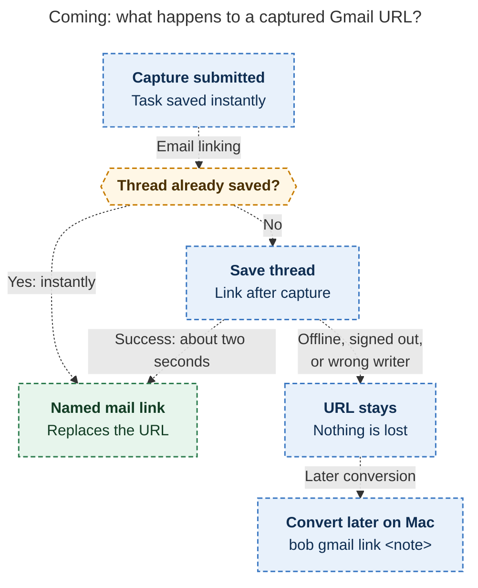
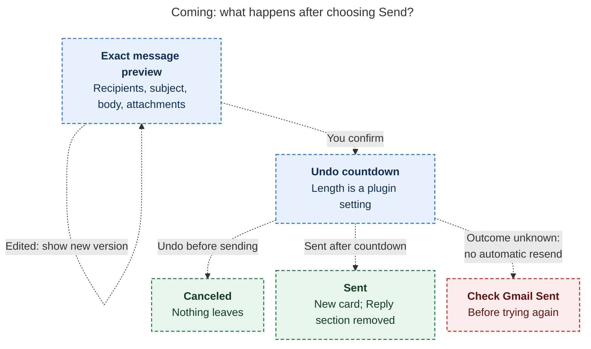

# Diagram proposals: Get the most out of Bob Gmail

Proposals for the swarm linker, not a report. Each diagram restates only what the source
report says.

```yaml
source: research:202611/bob_gmail_everyday_guide/bob_gmail_everyday_guide__final.md
producer: research.5s.image
check: "mmdc 12.0.0 with the PDF-mirroring config rendered 2 of 2 Mermaid diagrams"
```

## capture-fallback

```yaml
anchor: |-
  If anything goes wrong (offline, signed out, or not the writer machine)
question: |-
  What happens to a captured email URL when linking succeeds or fails?
illustrates: |-
  The task saves instantly; an already saved thread links instantly, while a new thread links after capture or leaves its URL for later conversion if linking fails.
caption: Planned capture saves the task immediately; linking either replaces its URL or leaves it intact for later conversion on the Mac.
review: "508.992×964 px, fit 92.6%; question and visual checks passed; source trace checked; 0 revisions"
```



## send-safeguards

```yaml
anchor: |-
  If you edit after previewing, Bob shows you the new version
question: |-
  What keeps a previewed reply from being sent unexpectedly or twice?
illustrates: |-
  For planned replies, edits trigger a new preview, confirmation starts the Undo countdown, and an unknown send outcome calls for checking Gmail's Sent folder.
caption: Planned replies require confirmation; edits trigger another preview, Undo stops delivery, and an unknown outcome calls for checking Gmail Sent before retrying.
review: "677.234×614 px, fit 96.4%; question and visual checks passed; source trace checked; 0 revisions"
```


