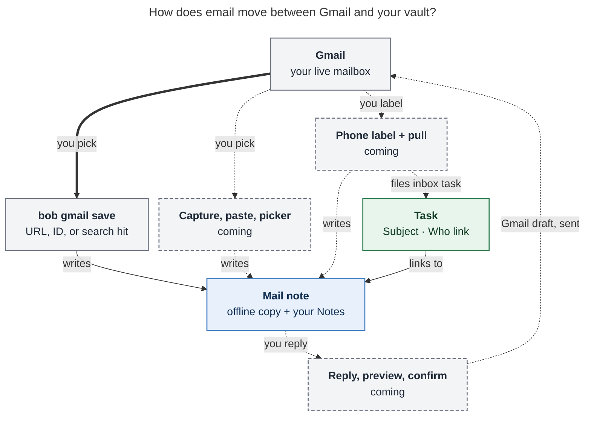

# Get the most out of Bob Gmail

_A user guide for the `bob gmail` integration (epic `bob-cli-hg`). Checked on 6 November
2026 against bob-cli master `e1e80060` and the approved plan `plan:202611/bob_gmail.md`._

**✅ works today · 🚧 in progress in this epic.** Setup, saving, listing, search, peek,
and new-reply counts work today. Linking, capture, the Bob Mail Obsidian plugin, replies,
phone pull, and attachment import are still being built. This guide describes them as
designed, so you only have to learn the workflow once. bob ships on a daily release
train, so run `bob gmail --help` to see what your installed version has.

## The idea in one minute

- **Gmail stays your mailbox.** Bob never archives, labels, marks read, or deletes
  anything. Completing a task does nothing to Gmail. The only change Bob ever makes in
  Gmail is a draft or a send that you asked for.
- **You choose what comes in.** Each thread you pick becomes one **mail note** under
  `mail/<year>/`. It is a readable offline copy that only ever grows.
- **Tasks link by name, not by URL.** A task reads
  `Ask Dana about parking ✉️ Lease renewal for 14 Elm St · Dana Whitfield`. The subject
  says what, and the name says who.
- **Three promises.** Capture never waits on the network. Nothing inside an email can
  run in your vault. Nothing is sent until you have seen the exact message and
  confirmed it.



_Every way in ends at the same mail note, and tasks link to that note. The only way back
out to Gmail is a reply you preview and confirm. Dashed boxes and lines are still in
progress._

## 1. Set up once (Mac, about 10 minutes) ✅

Start on the Mac. It is the one machine that should write mail notes and send mail.

1. Install [gog](https://github.com/openclaw/gogcli) v0.44.0 or newer on your `PATH`.
2. Add your account to `~/.config/bob/config.yml`:

   ```yaml
   gmail:
     account: you@example.com
   ```

3. Run `bob gmail login`. Bob reuses a Google client it can find, or walks you through
   creating one: enable the Gmail API, then create an OAuth client of type **Desktop
   app**. **Set the consent screen to In production.** If you leave it in Testing, your
   sign-in expires every 7 days.
4. Run `bob gmail doctor` until every row is `ok` or a skip it explains. Copy the host
   label it prints into `writer:`, so mail notes are only ever written from the Mac:

   ```yaml
   gmail:
     account: you@example.com
     writer: <host label printed by doctor>
   ```

5. Later, when replies ship, run `bob gmail login -s compose` **on the Mac only**.
   Google's compose permission can also send mail, so keep it off athena, apollo, and
   agent hosts.

On other machines, a plain `bob gmail login` gives read-only use: search, peek, list,
and `save -d` previews. Over SSH, login switches to a "paste the link back" flow by
itself. Bob's Gmail sign-in is separate from Calendar, and `bob gmail logout` removes
only the Gmail access.

## 2. Save a thread and link it to a task ✅

This is the everyday loop today. You don't have to dig a URL out of Gmail, because
search gives you the thread ID.

```bash
bob gmail search 'from:dana lease'   # Gmail search syntax; saved threads show their note
bob gmail save 1a0b9eb2cc26ab96 -P house -f json | jq -r .link
```

The second command saves the thread, files it under the `house` area, and prints a
ready-made link:

```text
[[mail/2026/260919_lease_renewal_for_14_elm_st|✉️ Lease renewal for 14 Elm St · Dana Whitfield]]
```

Paste the link into your task. On the Mac, add `| pbcopy` to copy it straight to the
clipboard. Without `jq`, copy the `link` field from the JSON. Then run `bob gmail` and
check that the thread's **backlinks** count went up.

**Tips**

- **Any reference works.** You can pass a Gmail URL (in quotes), a thread ID from
  search, or the path of a mail note you already saved (to refresh it).
- **Preview first** with `-d`. The preview shows paths and structure, never message
  text.
- **Not sure what an old URL points to?** `bob gmail peek '<URL>'` prints
  `✉️ Subject · Who · 3 messages · Nov 3` and saves nothing.
- **Save several at once:** `bob gmail save URL1 URL2`. If one fails, nothing is
  written, so drop the bad one and rerun.
- **Write the action and let the link say the rest.**
  `Ask Dana about parking [[…|✉️ Lease renewal… · Dana Whitfield]]` already names the
  subject and the person.
- **Want shorter task lines?** Set `gmail.link_label: "✉️ {subject}"`. The sender
  still appears inside the note.
- **Save from the work, not from the inbox.** Save threads that back a task, a
  decision, or a project, and leave the rest in Gmail. Mirroring the whole mailbox
  would only give you a worse Gmail.
- **From Obsidian today:** in Command Mode, press `:` and type `gmail` to run list,
  search, save, or doctor.

## 3. Coming: link in one gesture 🚧

| Where you are                  | What you do                                         | What happens                                                                                                                                                                                       |
| ------------------------------ | --------------------------------------------------- | -------------------------------------------------------------------------------------------------------------------------------------------------------------------------------------------------- |
| Mac Capture                    | Type the task, paste the Gmail URL, submit          | The URL is underlined and the preview reads `✉️ Lease renewal… · Dana Whitfield · 3 messages · will link after capture`. The task saves instantly. About two seconds later, the URL becomes the link. |
| Obsidian, URL on the clipboard | Paste it                                            | Bob saves the thread and swaps the URL for the link.                                                                                                                                               |
| Obsidian, no URL handy         | **Bob Mail: Link email…**, type to search, Enter    | Bob saves your choice and inserts the link at the cursor.                                                                                                                                          |
| Reading a mail note            | **Bob Mail: Task from this email**                  | A prefilled task that already links the email. With the cursor in a card, it links that exact message.                                                                                             |
| Command Mode                   | Press `:` with a Gmail URL copied                   | A FROM CLIPBOARD row saves it.                                                                                                                                                                     |
| Your phone                     | Apply the `bob` label                               | See §6.                                                                                                                                                                                            |

These rules keep linking safe:

- A thread you already saved links instantly.
- If anything goes wrong (offline, signed out, or not the writer machine), **the URL
  simply stays**, and nothing is lost. `bob gmail link <note>` on the Mac converts it
  later.
- A link you wrote yourself, such as `[sign the lease](gmail-url)`, keeps your words as
  the label.

**Backfill once when it ships.** `bob gmail link -a -d` previews, as a diff, how every
old Gmail URL in the vault would become a link. `bob gmail link -a` applies it. Dead
URLs (deleted mail, or another account's mail) stay as plain text and are remembered,
so later sweeps skip them. Mail notes, `done/`, and generated folders are left alone.
Today, the `gmail_urls` row in `bob gmail doctor` already counts how many raw Gmail URLs
in your vault would resolve.

## 4. Read and annotate a mail note ✅

A mail note reads like a calm, offline Gmail:

- **At the top:** the subject, **Open in Gmail ↗**, and a summary line like
  `Dana Whitfield ↔ you · 3 messages · Sep 19 → Nov 3`.
- **`## Notes`:** this section is yours. Bob never touches it.
- **`## Conversation`:** one card per message. The newest card is open and older cards
  are folded. Quoted history and signatures fold away, so each card shows only what is
  new. 🚧 The Bob Mail plugin will color the cards: others' mail blue, yours green and
  indented. Until then they appear as plain callouts.

**What you'll see inside**

- Remote images never load. You get a `🖼 host` link instead, and tracking pixels are
  dropped. Images embedded in the email itself are saved locally and shown.
- Newsletters and notifications come in as plain text with safe links.
- Attachments are listed as `📎 name · size` (see §7).
- Text from an email can't turn into tasks, tags, Dataview queries, or Templater code
  in your vault.
- `mail.base` at the vault root is a table of everything you have saved.

**How to use it**

- **Put your thinking in `## Notes`:** decisions, open questions, negotiation points.
  Refreshes never touch it. Don't edit the message cards themselves, because a `-R`
  rebuild replaces them.
- **Link to one message.** Every card has a block ID, so Obsidian's _Copy link to block_
  gives a task a link to that exact message.
- **Refresh before you act** on an older thread:
  `bob gmail save mail/2026/260919_lease_renewal_for_14_elm_st.md`, or 🚧 **Bob Mail:
  Refresh this email**. Only new messages are added. Old cards stay even if they were
  deleted in Gmail, and a refresh with nothing new changes nothing.
- **See who replied.** `bob gmail -r` adds `+N new` to saved threads that have grown in
  Gmail. It reads Gmail once per row shown. It only reports; refresh to bring the
  replies in.
- **File it.** `-P <area or project>` sets a new note's `parent:` when you save it. After
  that, `parent:` is yours to edit. The file itself stays under `mail/`.

## 5. Reply and write new mail from Obsidian 🚧 (Mac)

1. In a mail note, run **Bob Mail: Reply** (or **Reply all**). A `## Reply` section
   appears below the conversation.
2. Write your reply in plain Markdown.
3. Choose one:
   - **Send.** A window shows exactly who the mail goes to, the subject, the body (with
     your Gmail signature), and any attachments. Confirm, and a 5-second **Undo**
     countdown starts before it sends. Your message then appears as a new card and the
     Reply section goes away.
   - **Save draft.** The reply lands in Gmail Drafts, so you can finish it on your phone.

**New email.** **Bob Mail: New email** asks for To and Subject, then opens a note in
`mail/`. Once you send, that note becomes the thread's mail note, and later replies
collect there.

**Good to know**

- `## Notes` is never sent, so you can keep private thoughts right next to a draft.
- Wikilinks are sent as plain text, and the preview lists which ones were converted.
  Vault-only syntax (checkboxes, Dataview, embeds, Templater, `key:: value`) is refused,
  and Bob points at the exact spot.
- If you edit after previewing, Bob shows you the new version instead of sending the
  old one.
- Undo cancels before the mail leaves; it can't recall delivered mail. The countdown
  length is a plugin setting.
- If Bob says **outcome unknown**, check Gmail's Sent folder before trying again. Bob
  never resends on its own.
- To leave out your Gmail signature, set `gmail.signature: none`.

## 6. File email from your phone 🚧

1. In the Gmail app, create a `bob` label once. Apply it to any thread you want to act
   on.
2. At the Mac, run `bob gmail pull -d` to preview, then `bob gmail pull` (it's also in
   Command Mode). Each labelled thread is saved and gets one task in `gmail_inbox.md`.
3. Those tasks show up in the NEW tier of your morning `]s` walk, next to `mac_inbox.md`
   and `gkeep_inbox.md`. Rewrite each one as an action and route it like any other inbox
   task.

**Tips**

- Pulling twice only files a thread once. Starring does nothing; only the label counts.
- Bob never removes the label. Remove it in Gmail yourself when you're done.
- Pull takes up to 20 threads by default. Use `-l 50` for a bigger batch.
- **Mail from other accounts:** forward it to `you+bob@gmail.com`, and add a Gmail filter
  that applies the `bob` label to that address.

## 7. Attachments 🚧

Attachments stay listed until you need one. `bob gmail attach <note> 2 -d` previews,
and running it again without `-d` imports the second 📎 file under `file/mail/` (up to
25 MiB) and turns its line into a link. Don't bother for logos and signature images.

## 8. Keep sensitive mail out ✅

Saved mail is committed to the vault's git history and synced to every machine. Decide
up front what should never land there:

```yaml
gmail:
  never_save:
    from: ["@mybank.com", "doctor@clinic.org"] # addresses or whole domains
    labels: ["Medical"] # Gmail label names
```

- Bob refuses a thread if any of its messages matches. That holds for every way in:
  save, paste, capture, and pull.
- For a one-off, `bob gmail save '<URL>' -B headers` keeps the headers and Gmail's short
  preview, but not the body. Set `gmail.body: headers` to make that the default. To
  upgrade a note later, run `bob gmail save <note> -B full -R`.
- Changing these settings doesn't remove mail you already saved.

## 9. A five-minute weekly routine

1. Run `bob gmail -r`, then refresh any thread with `+N new` that a task is waiting on.
2. Run `bob gmail`. A thread with **0 backlinks** has no task pointing at it, so it is
   either done or forgotten.
3. 🚧 Walk `gmail_inbox.md` along with your other inboxes.
4. Run `bob gmail doctor`. Check that it's still green and note how many raw Gmail URLs
   are left. 🚧 Clean them up with `bob gmail link -a -d`.

This epic doesn't include automatic reminders when a waiting task gets a reply. Use
`-r` for that.

## 10. When something looks wrong

| You see                                  | What to do                                                                                  |
| ---------------------------------------- | ------------------------------------------------------------------------------------------- |
| `invalid_grant` after about a week       | The consent screen is still in Testing. Publish it, then run `bob gmail login`.             |
| `invalid_grant` out of the blue          | A Google password change, or 6 months without use. Run `bob gmail login`.                   |
| `account_ambiguous` or the wrong account | Set `gmail.account`. The `/u/1/` in a copied URL doesn't choose the account.                |
| A writer refusal on athena or apollo     | Working as intended. Save on the Mac, or add `-d` to preview.                               |
| A `never_save` refusal                   | Working as intended. Use Gmail for that thread.                                             |
| 🚧 A URL in a task never became a link   | Run `bob gmail link <note>` on the Mac, or check `bob gmail doctor`.                        |
| 🚧 `gone`                                | The mail was deleted or belongs to another account. The URL stays as text.                  |
| 🚧 Send says **outcome unknown**         | Check Gmail's Sent folder before doing anything else.                                       |
| 🚧 "Update bob to use Bob Mail"          | Your bob is older than the plugin. Update bob.                                              |
| Anything else                            | Run `bob gmail doctor`. Each row explains its fix.                                          |

## Cheat sheet

```text
bob gmail [-a] [-r]                    saved threads, offline; -a all; -r live +N new   ✅
bob gmail search ['QUERY']             find threads (default: inbox, last 30 days)      ✅
bob gmail peek URL|ID                  what is this link? saves nothing                 ✅
bob gmail save URL|ID|NOTE…            save or refresh; -d preview, -P parent,
                                       -B headers, -R rebuild cards, -f json for link   ✅
bob gmail doctor                       explain setup problems                           ✅
bob gmail login [-s compose]           sign in (compose: Mac only)                      ✅
bob gmail logout -y                    remove Bob's Gmail access only                   ✅
bob gmail link [NOTE…] [-a] [-d]       turn Gmail URLs into links / backfill            🚧
bob gmail pull [-d] [-l N]             file bob-labelled threads as inbox tasks         🚧
bob gmail attach NOTE N [-d]           import attachment N                              🚧
bob gmail new | reply | draft | send   write and send mail (Mac)                        🚧
```

Obsidian (🚧 Bob Mail plugin): **Link email…** · paste-to-link · **Open in Gmail** ·
**Refresh this email** · **Task from this email** · **Reply** / **Reply all** · **New
email** · **Save draft** · **Send**.

## Your first 15 minutes

Today ✅:

1. Run `bob gmail login`, then `bob gmail doctor` until it's green, and pin
   `gmail.writer`.
2. Use `bob gmail search` to find and save one receipt and one real conversation.
3. Open both notes in Reading view and Live Preview, in light and dark mode, and on your
   phone.
4. Link one note from a task, then check that `bob gmail` shows the backlink.
5. Run `bob gmail peek` on an old Gmail URL from your vault.

As features land 🚧:

6. Capture a task with a Gmail URL from Mac Capture.
7. Run `bob gmail link -a -d`, read the preview, then apply it.
8. Reply to a test address you control. Cancel Undo once on purpose, then send.
9. Label one thread `bob` on your phone, then run `bob gmail pull`.

---

## About this guide

**Basis.** This guide merges five independent reports (cdx, cld, grk, mus, gem, in this
directory) with the lead's own check of bob-cli master `e1e80060`: `docs/gmail.md`,
`docs/reference/cli/gmail.md`, `docs/guides/connect-google-mail.md`,
`src/native/gmail/{save,search_peek,list}.rs`, the command catalog, the epic bead
`bob-cli-hg` (phases .1–.6 and .9 closed; .7, .8, and .10–.14 in progress), the approved
plan `plan:202611/bob_gmail.md` (§§2–4 and 5.7–5.14), and `glossary:inbox-file`. No live
Gmail account or deployed plugin was exercised. The 🚧 behavior comes from the approved
plan and may shift as phases land.

**Conflicts and gaps resolved**

1. **Search, peek, and `-r` already work.** All five reports marked them as planned.
   Phase hg.9 landed in `e1e80060` after the reports were written, and `docs/gmail.md`
   now documents §Search, §Peek, and `list -r`.
2. **The thread-ID loop is new here.** The reports' "today" loop required copying a URL
   out of Gmail's address bar. Search returns thread IDs, `save` accepts them, and
   `-f json` returns `link` (the human output prints only the path), so the loop works
   without the address bar.
3. **Undo.** gem calls the 5-second countdown mandatory. The plan makes it a plugin
   setting (`undoSeconds`) that defaults to 5, which matches cdx.
4. **`send -d`.** cld says it still creates or updates the Gmail draft; grk says it
   "sends nothing". Both are right, because the plan drafts first and then previews. The
   guide leaves this CLI detail out.
5. **Edits inside cards.** cld says highlights inside cards survive refresh. That holds
   for ordinary refresh, which never edits existing cards, but `-R` rebuilds them. The
   guide therefore steers commentary into `## Notes`.
6. **Setup order.** gem's quick start grants compose and enables the Bob Mail plugin up
   front. The plugin hasn't shipped, and compose belongs only on the Mac, so the guide
   defers both.
7. **Account selection.** cdx is right: `/u/N/` and `authuser=` in a URL are ignored, and
   the account always comes from config (plan §4.1).
8. **Inbox triage.** grk and cld are right that pulled tasks carry no freshness stamp
   and surface in the NEW tier of `]s` (`glossary:inbox-file`).

**Follow-ups for published docs**

- `docs/guides/connect-google-mail.md` still says saving hasn't landed and that
  `bob gmail` lists nothing (intro and "Try it"). That has been stale since hg.6, as cdx
  and grk both note.
- grk's suggestion fits Bob's guide budget (about 1,500 words each): publish this
  walkthrough as goal-sized guides as the phases land. The plan already names
  `link-emails-to-tasks.md`, `send-email-from-obsidian.md`, and
  `file-email-from-your-phone.md`, plus a `docs/bob-mail.md` plugin reference.
