# bob-cli-jf: how bad was the bob-cli history push onto bob-mac-capture, and what must we redo?

**Date:** 2026-11-10 06:50 EST · **Question:** How much did bead `bob-cli-jf` hurt, and what lost work must we
re-implement after the fix? · **Repos:** bob-cli `f2882ea6`, bob-mac-capture `3fb3a2be` (live GitHub `master`)

## TL;DR

- **Impact: moderate, and it is still going on (about 10.5 hours so far).** Nothing was destroyed. The push was a
  fast-forward, and every bob-cli commit in it is already on bob-cli. Three things are still broken, though:
  bob-mac-capture's `master` is polluted, `just docs-check` fails in every bob-cli workspace, and Mac Capture's own
  `AGENTS.md`, `README.md`, `justfile`, and CI workflow are bob-cli's copies.
- **Nothing needs re-implementing from scratch.** Three pieces need carrying over or flipping back:
  1. Two real Mac Capture commits from `bob-cli-j8.8` were pushed on top of the polluted history: `b20ceca5` and
     `3fb3a2be` (46 files, +1,524/−88). Both replay onto the clean base with **no conflicts** (checked with
     `git merge-tree`).
  2. One CI setting points at a workflow that exists only in the polluted tree: `macos-swift.yml`. It must go back to
     `ci.yml` in two places, bob-cli `f2882ea6` and the replayed `b20ceca5`.
  3. Twelve bob-cli commits that touched docs landed without a passing `just docs-check`. They need one re-check, not a
     rewrite.
- ⚠️ **The restore gate on file is stale.** Gate `custom-192d8c97` only moves `master` if it is still `9a0bb25c`, and
  it is now `3fb3a2be`, so the gate will refuse to run. That refusal is safe. The danger is a "quick fix" that bumps
  the lease and force-resets to `29147289`. That would silently delete j8.8's two commits.

## 1. What is on `master` now, and what has to survive

```mermaid
---
title: "What is on bob-mac-capture master, and what must survive the restore?"
accTitle: "bob-mac-capture master before and after the restore"
accDescr: "Today master is the real Mac history, then 2,253 rebased bob-cli commits, then two real Mac commits. The restore keeps the real history and replays only the two Mac commits."
config:
  flowchart:
    rankSpacing: 22
    nodeSpacing: 28
    wrappingWidth: 260
---
flowchart TB
  subgraph FIXED["Master after the restore (proposed)"]
    REAL2["`**29147289**<br/>last genuine Mac commit`"]
    B20R["`**b20ceca5 replayed**<br/>no conflicts, 0 bob-cli paths`"]
    F3FR["`**3fb3a2be replayed**<br/>no conflicts`"]
    CI["`**CI workflow fix**<br/>macos-swift.yml back to ci.yml`"]
    REAL2 -.->|"cherry-pick"| B20R -.->|"cherry-pick"| F3FR -.->|"then fix"| CI
  end
  subgraph NOW["GitHub master today (3fb3a2be)"]
    REAL["`**29147289**<br/>last genuine Mac commit`"]
    JUNK["`**2,253 bob-cli commits**<br/>rebased copies, all already on bob-cli`"]
    IZ5["`**9a0bb25c** bob-cli-iz.5<br/>re-landed on bob-cli as d3f022a4`"]
    B20["`**b20ceca5** bob-cli-j8.8<br/>notebook targets and previews`"]
    F3F["`**3fb3a2be** bob-cli-j8.8<br/>nested parent and test fix`"]
    REAL --> JUNK --> IZ5 --> B20 --> F3F
  end
  classDef outcome fill:#E7F5EC,stroke:#2E7D4F,stroke-width:1.5px,color:#123D24
  classDef risk fill:#FDECEC,stroke:#C0392B,stroke-width:1.5px,color:#5F1414
  classDef focus fill:#E8F1FB,stroke:#3B78C2,stroke-width:1.5px,color:#0F2E52
  classDef proposed stroke-dasharray:5 3
  class REAL,REAL2 outcome
  class JUNK,IZ5 risk
  class B20,F3F,B20R,F3FR focus
  class CI focus
  class B20R,F3FR,CI proposed
  style NOW fill:none,stroke:#C0392B
  style FIXED fill:none,stroke:#2E7D4F
```

*Only the two blue j8.8 commits are real work at risk. Everything red is a copy of something bob-cli already has.
Rendered with mermaid-cli 12.0.0: 723 × 649 px, 90% PDF fit.*

## 2. Impact scorecard

| Area                                    | What happened                                                                                                                                                                                                                                                                                      | Severity                    | Status                                             |
| --------------------------------------- | -------------------------------------------------------------------------------------------------------------------------------------------------------------------------------------------------------------------------------------------------------------------------------------------------- | --------------------------- | -------------------------------------------------- |
| **bob-mac-capture `master`**            | 2,253 bob-cli commits added 1,991 bob-cli files, which took the file count from 1,478 to 3,469. They also overwrote 10 Mac files: `AGENTS.md`, `README.md`, `justfile`, `.gitignore`, `.github/workflows/ci.yml`, and 5 `docs/develop/*` pages. Agents that open the repo now read bob-cli's `AGENTS.md`. | 🔴 High                     | Still polluted                                     |
| **Mac Capture CI**                      | While resolving rebase conflicts, the bob-cli_10 agent moved the real Mac CI from `ci.yml` to a new `macos-swift.yml` ("Mac Capture CI"). bob-cli's Rust CI now runs as `ci.yml`. Every run since the push is red.                                                                                    | 🟠 Medium                   | Still broken                                       |
| ↳ but…                                  | The Mac tests were **already red before the incident**: `29147289` failed on ``cannot find 'fakeBobPath'``. So that failure is not this bug's fault, and `3fb3a2be` fixes it.                                                                                                                       | —                           | 3fb3a2be's CI run was still in progress at writing |
| **bob-cli `just docs-check`**           | The bob-mac-capture docs mount now ships bob-cli's `docs/index.md`, which collides with `docs/reference/mac-capture/index.md`. The check fails in every workspace. At least 7 agent runs hit it: iz.land, j5.5, j5.6, j5.8, j5.land, and both refresh_docs runs.                                    | 🟠 Medium                   | Still broken                                       |
| ↳ docs landed unchecked                 | 12 bob-cli commits that touch docs (23 files, +525/−195) shipped without the full docs gate. `527f30ad` and `4a0206ec` say so in their commit messages.                                                                                                                                             | 🟡 Low                      | Needs one re-check                                 |
| **bob-cli-iz.5 gcal commit**            | It was pushed only to bob-mac-capture as `9a0bb25c`. The land agent re-landed it on bob-cli as `d3f022a4` and extended it in `8ad8e270`.                                                                                                                                                             | 🟢 Recovered                | Done (Nov 9, 21:08)                                |
| **bob-cli history**                     | All 2,253 rebased subjects are on bob-cli `master`. The mixed copy is not even faithful: 42 files differ from the matching bob-cli commit `97f0b8f1`. Discard it; don't mine it.                                                                                                                   | 🟢 None lost                | —                                                  |
| **Releases / Pages on bob-mac-capture** | bob-cli's release and docs-publish workflows came along with the push, but none of them ran there. There are no releases and no Pages site.                                                                                                                                                         | 🟢 None                     | —                                                  |
| **SASE root cause**                     | A linked checkout with no `.git` of its own resolves to the host repo, and a later Git step rewrites the host repo's `origin`.                                                                                                                                                                      | 🔴 High (can happen again)  | Not fixed                                          |

## 3. What to carry over or redo once it is fixed

| #   | Item                                                                         | Size                                    | Action                                                                                                         |
| --- | ---------------------------------------------------------------------------- | --------------------------------------- | -------------------------------------------------------------------------------------------------------------- |
| 1   | `b20ceca5` feat(capture): present notebook capture targets and previews      | 43 files, +1,283/−82                    | Cherry-pick onto `29147289`. It applies cleanly and touches only `Sources/`, `Tests/`, `Scripts/`, and Mac `docs/`. |
| 2   | `3fb3a2be` fix(capture): name nested notebook parent and restore Mac tests   | 7 files, +250/−15                       | Cherry-pick. It applies cleanly.                                                                               |
| 3   | `"workflow": "macos-swift.yml"` for the bob-mac-capture profile              | 1 line in each of 2 repos               | Set it to `"ci.yml"` in Mac `Scripts/macos-ci-check` (from item 1) and in bob-cli `scripts/dev/macos-ci-check` (`f2882ea6`). Keep the new per-profile `workflow` key. |
| 4   | Any further push to bob-mac-capture before the restore                       | unknown                                 | j8.8 is still in progress, and agent `1ao--code` was working in workspace #11 at 06:37. Replay **`9a0bb25c..origin/master`**, not a fixed list. |
| 5   | bob-cli docs that skipped the gate                                            | 12 commits                              | Run `just docs-check` once on bob-cli `master` after the restore, and fix whatever it finds.                    |
| —   | bob-cli-iz.5, or any bob-cli commit                                           | —                                       | **Nothing to do.** Already on bob-cli.                                                                         |

## 4. Timeline (EST)

| When        | Event                                                                                                                                       |
| ----------- | ------------------------------------------------------------------------------------------------------------------------------------------- |
| Nov 9 10:11 | `bob-cli-iz.5` opens the bob-mac-capture linked checkout in `bob-cli_10`. The checkout resolves to the host repo, and the host's `origin` becomes bob-mac-capture. |
| 19:25–20:21 | `bob-cli_10` rebases bob-cli onto Mac history, resolving conflicts by hand. This is where `macos-swift.yml` is created.                      |
| 20:19       | The real Mac tip `29147289` is pushed by `bob-cli-je.land`.                                                                                  |
| **20:22**   | **`9a0bb25c` is pushed to bob-mac-capture `master`** as a fast-forward.                                                                      |
| 21:02–21:08 | `bob-cli-jf` is filed, restore gate `custom-192d8c97` is filed (lease on `9a0bb25c`), and iz.5 is re-landed on bob-cli.                     |
| Nov 10 00:16–00:51 | The refresh_docs commits land with docs-check blocked.                                                                               |
| 05:02       | j8.8 on apollo pushes `f2882ea6` (bob-cli) and `b20ceca5` (Mac) on top of the polluted master.                                              |
| 06:36       | j8.8 pushes `3fb3a2be`. **The restore gate is now stale.**                                                                                   |

## 5. Updated restore checklist

1. **Pause pushes to bob-mac-capture** (j8.8 and any Mac Capture agent) until the restore lands.
2. **Build the clean tip:** check out `29147289`, cherry-pick `9a0bb25c..origin/master`, and apply the
   `ci.yml` fix. Confirm macOS CI on a `ci/**` branch with `scripts/dev/macos-ci-check`.
3. **Force-move `master` with a lease on the *current* tip**, not `9a0bb25c`. Withdraw or re-file gate
   `custom-192d8c97` to match.
4. **Flip the `f2882ea6` value on bob-cli** in the same change window, so neither repo's gate looks for
   `macos-swift.yml`.
5. **Reset stale checkouts.** 11 of 32 bob-cli workspaces have a bob-mac-capture linked checkout, and bob-docs prefers
   a linked checkout over its cache. `sase repo open` fast-forwards linked checkouts, and a forced rewind is not a
   fast-forward. So any checkout still on the polluted history will keep failing docs-check, and it could push that
   history back. Also check apollo's workspaces and the Mac's own checkout. (Opening the checkout for this research
   fast-forwarded `bob-cli_13`'s copy to `3fb3a2be`.) The `~/.cache/bob-docs` clone repairs itself: every run does
   `fetch` + `reset --hard`.
6. **Fix the SASE root cause** from `bob-cli-jf`'s remediation step 2: refuse Git changes in any linked path whose
   `git rev-parse --show-toplevel` is not that path, and check `origin` before any push.

## Evidence

- `git ls-remote …/bob-mac-capture refs/heads/master` → `3fb3a2be` (06:49 EST). `29147289` is an ancestor of
  `9a0bb25c`, which is the parent of `b20ceca5`, which is the parent of `3fb3a2be`.
- Dry-run replay: `git merge-tree --write-tree --merge-base=9a0bb25c 29147289 3fb3a2be` exits 0, and the diff against
  `29147289` touches 46 files with 0 bob-cli paths.
- Subject check: `29147289..9a0bb25c` (2,253 commits) has 0 subjects missing from bob-cli `origin/master`.
- `macos-swift.yml`: it is absent from bob-cli and from `29147289`. It is added by the *rebased* copy of
  `1d1b8fec`, while the original only adds `ci.yml`.
- CI: `gh run list --repo bobs-org/bob-mac-capture`. Runs 42734965825 (pre-incident) and 42795804211 (`b20ceca5`)
  both fail on the same `fakeBobPath` compile error.
- Beads `bob-cli-jf`, `bob-cli-iz` (land notes #1–2), `bob-cli-it`, and `bob-cli-j8.8`. The `bob-cli-j5.land` +1
  evidence covers docs-check.
