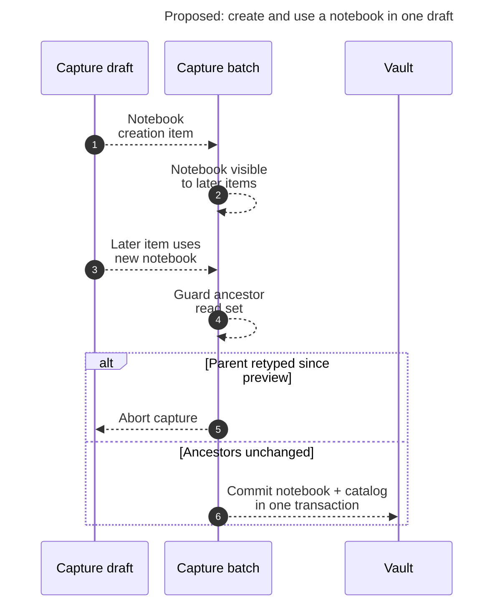

# Diagram proposals: Notebooks for Bob: consolidated design, critique, and recommendation

Proposals for the swarm linker, not a report. Each diagram restates only what the source
report says.

```yaml
source: research:202611/bob_notebooks/bob_notebooks__final.md
producer: research.3x.image
check: "mmdc 12.0.0 with --no-sandbox and the PDF-mirroring config rendered 1 of 1 Mermaid diagrams"
```

## capture-batch-consistency

```yaml
anchor: |-
  A notebook created earlier in the same batch is visible to later items.
question: |-
  Can one draft create and use a notebook safely?
illustrates: |-
  A notebook created earlier in the same batch is visible to later items, and the ancestor guard can abort the all-or-nothing notebook and catalog write.
caption: Proposed capture exposes new notebooks within a draft, commits notebooks and catalogs together, and aborts when an ancestor was retyped.
review: "660x752 px, fit 98.9%; question, source-trace, anchor, and visual checks passed; 1 revision; batch parse passed; deliberately broken diagram exited 1"
```


