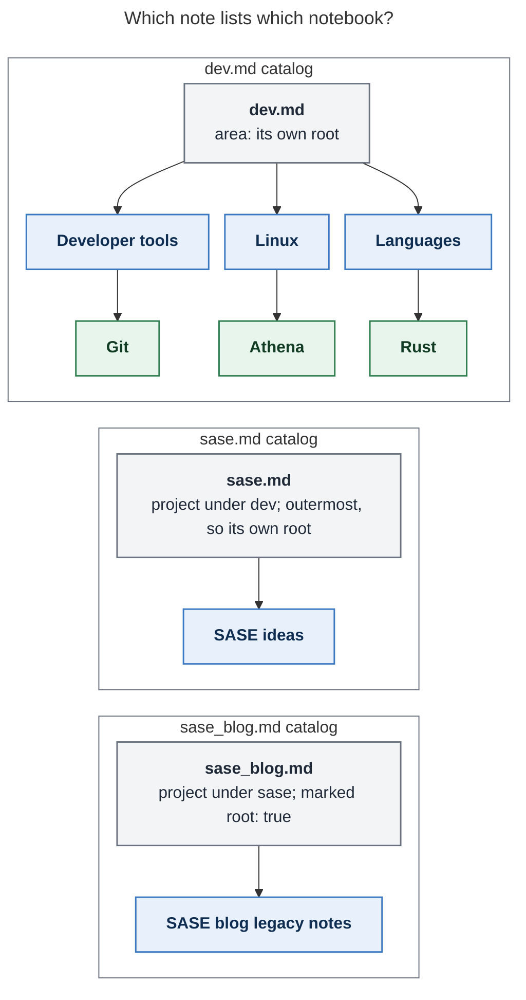

# Notebooks for Bob: consolidated design, critique, and recommendation

- **Lead researcher:** consolidation of five independent reports (`__cdx`, `__cld`,
  `__grk`, `__mus`, `__gem`) plus lead verification · 2026-11-09
- **Pinned sources:** bob-cli `f231b9d3`, capture grammar revision 22. bob-plugins
  `a2045cc`. bob-mac-capture `b81302b`. Installed `bob 0.5.0` probed against a
  disposable vault. The live `~/bob` vault was read only; nothing in it was changed.
- **Question:** Should Bob gain a `type: "[[notebook]]"` note kind with capture
  syntax, a root-parent index, a glossary term, and a first vault migration? What is
  the best way to build it, and what should change in the request?

---

## Bottom line

**Build it.** The vault already holds dozens of notebooks that have no type. 500 root
notes are untyped, and the parent chains of about 413 of them never reach an area or
project. You have also hand-written indexes of "Related notes" in `dev.md`,
`meet.md` (with one-line summaries), `ks.md`, `linux.md`, and `dog.md`. A notebook
type plus a generated catalog turns that hand labour into a system. It also fills the
one gap in Bob's note kinds: knowledge that belongs to an area or project but carries
no obligations.

Keep the core of the request: the type, the parent rule, the summary, the root
catalog, `%n` on a project-capture seal to create a notebook, block-ID prompts, and a
first migration. **Change one thing: how notes are written.**

- **Let the destination decide.** On a notebook, the existing `@nb`, `@nb#section`,
  `@nb+id`, and `@nb^id` forms write notes instead of tasks.
- **Keep `@@nb` as the draft-wide declaration.** On a notebook, every unrouted item
  becomes a note. So `Some idea @@foo`, typed exactly as in the request, works.
- **Do not add `@@nb#…`, `@@nb+…`, or `@@nb^…` to the grammar.** An optional editor
  assist rewrites them to their `@nb…` forms as you type.
- **Every alias you listed then works with no new rules:** `.`→`@`, `.`→`^`,
  `/`→`#`, and `,`→`+`.

The rest of this report is the evidence, the resolved disagreements, the design, and
a 22-file first migration across 9 roots.

---

## 1. What I verified

The five reports disagreed on several facts. Where they did, I checked the code,
docs, binary, or vault directly. Items marked **new** were missed by every
researcher.

| # | Finding | How verified | Consequence |
|---|---|---|---|
| V1 | `@@route` is a whitespace-free, draft-wide declaration, legal anywhere in a draft. A line holding only declarations is metadata. A second declaration errors. `@@foo#x`, `@@foo^id`, `@@foo+id`, `@@foo:id` are errors "rather than literal task text". | `docs/capture.md:481–560` | Giving `@@` a second scope collides with an established contract. |
| V2 | **New:** You removed the draft-wide `@@route+block-id` form on 2026-10-31 as a breaking change ("`@@` now accepts only `@@route`"). | commit `36c48075`; bead `bob-cli-ey.1.1.1` | Bringing suffixed `@@` forms back nine days later would reverse a deliberate decision. |
| V3 | `capture-rewrite` also performs **bare `@@` absorption**: a bare `@@` folds an item's local route into a declaration, and explicitly refuses `#section`, `^id`, and `+id` markers ("`@@ cannot take a section`"). | `bob capture-rewrite --help`; `rewrite.rs:992–2191` | `@@` already has an editor contract that rules out place suffixes. |
| V4 | `capture-rewrite` is **purely lexical**: it never opens the vault. | `--help` text | Any alias that depends on whether `foo` is a notebook cannot be built without breaking that property. |
| V5 | Today's aliases: `Idea .`→`Idea @`; `@book.`→`@book^`; `@book/`→`@book#`; `@book,`→`@book+`. These stay literal: `@@book.`, `@@book/`, `@@book,`, `@.`, and `@book#bar.`. **No alias types `@@`.** | `bob capture-rewrite --cursor` probes | All requested aliases already work on `@nb` forms. The vault task's "`./foobar` types `@@foo+bar`" note is not true today. |
| V6 | On a file with `type: "[[notebook]]"`: `A note @book` and `A note @@book` plan `- [ ] #task …`. `@book#bar` writes a plain bullet. `@book#nope` **silently** falls back to the pre-heading region. `@book+anchor` is refused ("not a task"). `@dev^shell@ %n` is refused (`%n` cannot combine with a route). | `bob capture --dry-run` in a disposable vault | Every `@nb` form already parses; only what it writes needs to change. Note sections need stricter matching. |
| V7 | **New:** `.` is legitimate section-selector text (`@note#1.3` reaches `## 1.3 Agent CLIs`). | `docs/capture.md` "Section bullets" | Do **not** add a `.`→`^` alias after `#section`, as cld proposed. It would break numbered selectors. |
| V8 | `parent_candidates()` reuses the capture-target scan and filters only `Record`. Gmail routing and ref parents consume it. | `parent_notes.rs:32`; `gmail/route.rs:43` | Adding `CaptureTargetKind::Notebook` without filtering would let reading tasks and Gmail routes land in notebooks. |
| V9 | Bob Mac Capture decodes an **unknown** block-ID intent as `.link`. Target `kind` is a free string with a `doc` icon fallback. | `CaptureModels.swift:10881–10888`; `CapturePickerView.swift:1079` | A new `kind: "notebook"` is safe for old apps. A new block-ID intent is **not**: ship the Mac fix first, or reuse `new`. |
| V10 | The Obsidian block-ID prompt seeds a suggestion only on checkbox lines. A plain note bullet gets a blank prompt. | bob-plugins `015-prompt-block-id-naming.js:72`, `095-prompt-suggestion-resolver.js:112,283` | Needs a small plugin fix for notebooks. |
| V11 | **New:** `_templates/new_note.md` writes parents as `[[love.md\|love]]`. `bob projects sync` ignores such parents, because `scan.rs` `wikilink_ref_from_inner` keeps the `.md`. The root-parent walk resolves them by path (`facts.rs:120`). Nine vault notes use this form, including the `family` and `vacation` **areas**, `haircut`, `tv`, `legacy_job`, and `legacy_gkeep_notes`. | `projects sync --dry-run` probe: `[[proj]]` child added, `[[proj.md\|proj]]` child skipped | Notebook validation must use the path-aware resolver. The migration and a new template should write `[[stem]]`. This is a separate bug in its own right, filed as task **bob-cli-j7**. |
| V12 | `docs/capture.md:8327` says "a `%n` after the seal opens Pomodoro-name completion". It is `#`; `%n` there is a conflict error. (cld found this.) | read + probe | Fix it in the same docs pass, since `%n` after the seal is about to gain a meaning. Already filed as task **bob-cli-j3**. |
| V13 | Your own vault tasks already describe this feature. `bob.md ^notebooks` (in progress) blocks `^n-notebook-directive` ("use `%n` … to create a notebook instead of a project") and `^h2-to-notebook`. `^notes-type` was merged into it. | `~/bob/bob.md:29–99` | Creating with `%n` and extracting H2s in a later phase are your stated intent. |
| V14 | Vault census of root `.md` files: 665 total; 504 untyped, 500 of them not dated notes. 67 untyped notes reach an area or project; about 413 dead-end in the zorg tree (`org`); 20 have no `parent`. 18 areas, 98 projects. | read-only frontmatter scan | Matches cld (500 / 67 / 433 ± chain-ending rules). The real orphan problem is dead-end chains, not missing parents. |
| V15 | The `ks` ("References") hub is a ready-made, orphaned notebook tree. `lang` › `rust` 39, `python` 28, `shell` 23, `lua` 19 bullets. `vim` › `vim_plugins` › `nvim_plugins` 44 bullets. All have zero checkboxes. | scan | A natural nested-notebook pilot. Nobody proposed re-homing `lang` except cdx (as wave 2). |
| V16 | The capture grammar is at revision **22** (grk said 21). | `capture_language/mod.rs:51` | Notebook writes change the meaning of existing tokens on retyped files, so the revision must be bumped. |

---

## 2. Is this a good idea?

**Yes.** All five researchers agree, and the evidence is strong:

1. **Bob has no home for knowledge without obligations.** Areas carry Ready caps,
   `## Tasks` grouping, Stats roots, and off-clock defaults. Projects carry a `^prj`
   lifecycle. Records are schema-driven entities, references are external sources,
   and articles are long-form prose. A topic you keep notes on (Linux, your dogs, SASE
   ideas) fits none of these. It is the "Resources" bucket in PARA, the
   Projects/Areas/Resources/Archive scheme, which Bob currently lacks.
2. **You already build notebooks by hand.** Examples: `legacy_dad` (moved out of
   `abby` on 2026-11-02), `legacy_gkeep_notes`, `haircut`, the `*_ideas` files, and
   hand-maintained "Related notes" indexes, `meet.md`'s even with summaries. Nobody
   keeps those indexes current.
3. **The zorg backlog needs a landing zone.** Hundreds of notes are invisible to
   every Bob consumer because their chains end at `org`. Retyping and reparenting
   rescues them without rewriting bodies or renaming files.
4. **Area notes get lighter.** Large `## Legacy Notes` sections can move out of task
   notes. That is phase 3, but the design should allow for it now.

**What would make it a bad idea:**

- letting tasks into notebooks, which recreates small areas;
- a second capture grammar that splits `@@` into two scopes;
- a catalog that rots, as the hand indexes have;
- bulk-converting every orphan without triage.

The design below closes each of those.

**Alternatives I would not take:**

| Alternative | Why not |
|---|---|
| A `#notebook` tag | It cannot change capture behaviour, validation, or discovery, which are the parts that matter. |
| Small sub-areas instead | They drag in Ready caps, `## Tasks`, a separate Stats root, and inbox routing, and they invite tasks. |
| Folders | Capture routes are vault-root stems and the vault is flat by `parent:` convention. Folders would fork navigation. |
| Record types | Records are many one-entity notes with a schema. A notebook is one free-form outline with many bullets. These are different axes. |
| Dataview/Bases-only index | Invisible to git, agents, graph view, and mobile, and it cannot roll up through sub-projects. A global `notebooks.base` on the type note is still a cheap add-on. |

---

## 3. Where the reports disagreed, and how I resolved it

| Topic | Positions | Resolution |
|---|---|---|
| **How notes are written** | cdx: `@@nb` becomes item-local when `nb` is a notebook, `@nb` refuses, and globals stay elsewhere. cld, grk: the destination decides on the existing `@` forms, and `@@` stays draft-wide. mus: bare `@@nb` errors, and only suffixed `@@` forms are claimed. gem: `@@` dispatches on type, plus suffixed forms. | **cld/grk.** V1–V5 decide it. The `@` forms already exist, already parse, and already have every alias (V5, V6). `@@`'s place suffixes were removed on purpose (V2) and are refused by absorption (V3). `capture-rewrite` cannot know types (V4). A lexical editor assist (§5.2) keeps your typed `@@foo#bar` working. |
| **Creating a notebook** | cdx, cld, grk, gem: `@parent^id@ %n`. mus: a new `@parent^^stem` seal. | **`%n`.** It is your own stated intent (V13). The carve-out is narrow and the `%` sigil already means "how". A second seal spelling adds more to learn. |
| **Which notes get a catalog** | cdx, gem, mus: root parents only. cld: every area or project, covering its subtree down to the next root. grk: the immediate parent plus the root. | **cld's rule.** For a root it is exactly the requested recursive rollup. It also stops a non-root sub-project's notebooks from being invisible on the note you have open. grk's "immediate parent" list would also put a managed region *inside notebooks*, which breaks their "only note bullets" contract. |
| **Catalog form** | cdx: a managed Markdown list with comment markers. cld: a `[!notebooks]` callout under `## Notebooks`. grk: cards with counts written into the note. mus: a single line. gem: a plain bulleted H2. | **H2 + comment fence + callout holding a nested link list.** Use real wikilinks with **no numbers in Markdown** (the `docs/periods.md:119` rule). A callout is the only stable CSS hook that works in both Reading view and Live Preview. mus's single line cannot hold summaries readably. grk's written counts churn the note on every capture. |
| **When the catalog is written** | cld, gem: in the same batch as creation. grk: a later sync. | **Both.** The creating capture rewrites the affected catalogs in its all-or-nothing batch. `bob notebooks sync` (run nightly, plus a debounced plugin trigger) repairs hand edits such as reparenting. |
| **Notebook title** | cdx: a `title:` key. cld, grk: an H1. others: none. | **H1, else the first `aliases:` entry, else the humanized stem.** Creation writes an H1; migration inserts one. No duplicate key. |
| **Section matching** | cdx, cld, grk: exact match, created on demand. gem: normalized match. mus: prefix. | **Exact title or whole slug, created on demand, no pre-heading fallback.** This matches `decisions:capture-sigils-say-where-what-how` ("commit matching is exact and creation is on demand"). Area and project section bullets keep today's behaviour. |
| **`#section^id`** | cdx, cld: add it. cld: also alias `.`→`^` after `#section`. | **Add the form, without the alias** (V7). |
| **`%n` + `@nb`** | cld: accept as redundant. cdx, grk: refuse. | **Refuse.** Keep the existing `pomodoro_note_conflict` unchanged: one rule, no special case. |
| **`URL @nb`** | cld: save a bookmark note. others: silent. | **Accept cld.** A notebook cannot own a reading task. Write the URL as a plain note without fetching it; `URL @owner` stays the reading-queue route. |
| **Size of the first migration** | cdx: 4 + 1 orphan. grk: 6. cld: 18. mus: about 5 + an H2. gem: 11, several with wrong parents. | **22 files across 9 roots** (§6). Each is a frontmatter edit plus an H1. Seven of them rescue orphans from the zorg tree, which is the part you asked for. |
| **An alias that types `@@`** | gem: `@.`→`@@`. | **Rejected.** It collides with the fast double-`.` literal escape, and with the destination-decides rule `@@` is rarely needed. |
| **Depth limit** | mus: a hard maximum of about 8. cdx: no product limit, bounded traversal. | **No product limit.** Detect cycles and bound traversal internally. |

### Corrections to individual reports

- **gem's migration cohorts get several parents wrong.**
  - `work_ideas` sits under untyped `work`, not `job`.
  - `sase_ideas` sits under `work_ideas`, not `sase`.
  - `tin`, `build_pages`, `before_mail_playbook`, `fscarpel_meet_2024Q3`, and
    `team_meet_2024Q3` are unfiled under Google-era hubs (`test`, `build`, `review`,
    `fscarpel_meet`, `team_meet`), not under `dev` or `job`.
  - `math` has 3 bullets under `org`.
  - gem's alias table describes `@.`→`@@` and `@@x.`→`@@x^` as if they exist; neither
    does.
- **mus has several counts wrong.**
  - `dev_tools` is not orphaned; its parent is `dev`.
  - `dev_ideas` has about 223 bullets; 131 is `gtd_ideas`.
  - Unfiled notes number about 413, not 304.
  - 20 files have no parent, not 1.
- **grk:**
  - `interview_notes` has a single bullet, so it is a weak candidate.
  - The grammar is revision 22.

---

## 4. Requirement adjustments (called out)

Each item is numbered so you can accept or reject it on its own.

1. **A1. Notes are written with `@nb` forms; the destination decides.** `@nb`,
   `@nb#sec`, `@nb^id`, and `@nb+id` write notes when `nb.md` is a notebook, and keep
   writing tasks or section bullets elsewhere. *Why:* V1–V6. No new tokens, aliases
   for free, `@@` keeps one meaning, and it is consistent with "`@` says where".
2. **A2. `@@nb` stays draft-wide; on a notebook its items become notes.**
   - `Idea @@foo` works for a one-item draft exactly as you wrote it, and turns
     multi-item drafts into bulk note capture.
   - `@@nb#sec`, `@@nb^id`, and `@@nb+id` stay parse errors. Each error teaches the
     `@nb…` spelling.
   - **Optional** editor assist, "`@@` collapse": typing `#`, `\`, `^`, `.`, `+`, or
     `,` glued to a complete `@@route` rewrites the pair to `@route#`, `@route^`, or
     `@route+` and opens the same picker. It is lexical, valid for every route, and
     the counterpart of absorption. `/` is excluded because it is route text inside
     `@@` today.
3. **A3. Add `@route#sec^id`**, a section note with a block ID, valid on every route
   so that parsing stays lexical. No `.`→`^` alias after `#sec`, because `.` is valid
   section text (V7).
4. **A4. Create notebooks with only the `^` seal plus `%n`:**
   `@parent^id@ %n <summary>`. The `:` offer seal, `#pomodoro` after the seal, `%c`,
   `s:`, `$`, and task move bullets are refused, because notebooks have nothing to
   link or offer. A bare `%n` stays a Pomodoro note, and `%n` with a plain route stays
   a conflict.
5. **A5. `summary:` is required when Bob creates a notebook and tolerated when
   missing on read.** It is one plain line of at most about 140 characters that
   describes **scope**, not contents. A missing summary shows an "add summary" chip
   and a `check` warning; the notebook never disappears.
6. **A6. No tasks, ever (hard rule).**
   - Capture never writes a task into a notebook.
   - `bob task move`, Ctrl+Shift+M, inbox routing, Gmail routes, and ref parents all
     exclude notebooks.
   - `bob notebooks check` errors on any checkbox line.
7. **A7. "Only note bullets" means a shape, not a byte filter.** An optional H1, one
   optional preamble paragraph, top-level bullets (each may hold nested bullets, code,
   quotes, and images), and `##` sections. Anything else, such as numbered lists,
   `====` dividers, or H3+, is a soft lint warning, so legacy notes can migrate
   without being rewritten.
8. **A8. Every area or project lists the notebooks in its subtree**, stopping at the
   next root. For roots this is exactly your recursive rollup. Notebooks themselves
   carry no written index; the plugin renders a breadcrumb and child chips instead.
9. **A9. No numbers in Markdown.** bob writes only stable facts (links, titles,
   summaries, nesting). Counts and recency are live plugin chips.
10. **A10. Parents:**
    - A notebook's parent is an area, a project (any status), or a notebook.
    - It has one parent, no cycles, and its chain must reach an area or project.
    - Only notebooks (or untyped notes) may name a notebook as their parent.
    - Parents are resolved by path, so `[[x.md|x]]` works (V11).
11. **A11. `URL @nb` writes a plain note** instead of queuing a reference job.
12. **A12. H2 extraction is phase 3, but design for it now.** It must reuse
    `bob task move`'s vault-wide link repair; cld counted 137 inbound block links into
    the `## Legacy Notes` sections alone.
13. **A13. Migration never renames files** and never drops block IDs or zorg
    provenance keys. Wave 1 is frontmatter edits plus an H1.

---

## 5. Recommended design

### 5.1 The contract

```yaml
---
parent: "[[dev]]"
type: "[[notebook]]"
summary: Linux machine setup, shell shortcuts, and troubleshooting notes.
created: 2026-11-09T09:14:00-05:00
---
```

```markdown
# Linux

#dev notes on Linux            ← optional preamble paragraph (kept from legacy notes)

- Use <C-x><C-e> to edit the current command in $EDITOR [created::2026-11-09] ^edit-cmd
	- nested detail is free-form: code, links, images, sub-bullets

## Troubleshooting

- Check which process owns a port before restarting services [created::2026-11-09]
```

| Rule | Kind | Enforced by |
|---|---|---|
| `type: "[[notebook]]"` (bare `[[notebook]]` also accepted). `notebook.md` type note under `[[type]]`. `notebook` reserved as a record id. | definition | `frontmatter_is_notebook` next to `frontmatter_is_area/project/article`; `RESERVED_RECORD_IDS` |
| One parent that resolves (by path) to an area, a project, or a notebook. Acyclic. The chain reaches an area or project. | hard | capture and create refuse; `bob notebooks check` errors |
| No checkbox line anywhere | hard | capture, task move, and pickers refuse; `check` errors |
| Areas, projects, refs, and records never name a notebook as parent | hard | `check` errors; the parent picker hides notebooks for those kinds |
| `summary` present, one line, at most about 140 characters | soft | creation requires it; `check` warns; the catalog shows a chip |
| Shape: H1, preamble, bullets, `##` sections | soft | `check` warns |
| Block IDs unique within the file | hard | capture and ID writers refuse duplicates |
| Transparent to root, clock, and type walks. Never a Pomodoro home, Stats root, Ready lane, or review item. | derived | `NoteKind::Notebook`, treated like `Other`; it opts out of `walk_typed_notes` task consumers |

Notebook identity is the file stem. Reparenting changes placement, not the name.

### 5.2 Capture

**The rule:** an item's route is its own `@route`, otherwise the draft's `@@route`. If
that route is a notebook, the item writes a note. A sealed `@parent^id@` with `%n`
creates a notebook. Everything else is unchanged.

| Draft (`dev_tools.md` is a notebook, `dev.md` an area) | Result |
|---|---|
| `Try mergiraf @dev_tools` (or `@dev_tools Try mergiraf`) | Top-level note `- Try mergiraf [created::DATE]`, appended after the last top-level bullet before the first `##` |
| `Try mergiraf @dev_tools#git` | Note appended in `## Git`. Exact title or slug match; a missing section is created at the end in Title Case and the preview says so; `#"Exact Title"` forces creation; a near miss is refused with suggestions |
| `Try mergiraf @dev_tools^mergiraf` | Named note `… ^mergiraf`. A bare `@dev_tools^` opens the ID picker pre-filled with a suggestion |
| `Try mergiraf @dev_tools#git^mergiraf` | Named note in `## Git` (A3) |
| `Faster with -j @dev_tools+mergiraf` | Child bullet appended under the bullet `^mergiraf` at any depth. Task, heading, code-fence, missing, or duplicate targets are refused. No ledger writes |
| `@dev_tools#git` alone, then `- a` / `- b` | Section list: each bullet becomes a note in `## Git`; `- text ^id` names one |
| `@dev_tools+mergiraf` alone, then bullets | Each bullet becomes a child note (mirrors `decisions:capture-bullets-mirror-the-task-block`) |
| `Idea A` / `Idea B` / `@@dev_tools` | Both items become top-level notes in `dev_tools.md` |
| `https://… @dev_tools` | Plain note holding the URL; no reference job (A11) |
| `Neovim config notes and plugin picks @dev^nvim@ %n` | Creates `dev_nvim.md` with `parent: "[[dev]]"`, `type`, `summary` (the item text), `created`, `template: "[[new_notebook]]"`, and `# Nvim`. The `dev.md` catalog is rewritten in the same batch |
| …plus `- First note` / `- PLUGINS` with nested bullets | Plain bullets seed top-level notes. An ALL-CAPS bullet with nested notes becomes `## Plugins` |
| `@dev_nvim^lua@ %n Lua for my config` | Nested notebook `dev_nvim_lua.md` |
| `Fix the bug @dev` / `remembered it %n` / `Ship it @dev^ship@` | Unchanged: task, Pomodoro note, project note |

**Teaching refusals on a notebook route.** Each refusal names the owner route so the
fix is one edit. For example: "`dev_tools.md` is a notebook; notes take no schedule.
Capture the task in its home with `@dev`."

| Marker on a notebook route | Refusal |
|---|---|
| `s:<N>`, `$<N>`, free `#type` | notes take no schedule, priority, or type |
| `@nb:id`, `=…`, `x…`, `!`, `&`, `*`, `~` | notebooks hold no tasks to link, start, close, or relate |
| a lone `@nb` (task pull) and `>` transfers | notebooks hold no tasks |
| `%n` | keep the existing `pomodoro_note_conflict` |
| `@@nb#…`, `@@nb^…`, `@@nb+…` | "`@@` declares a draft-wide route. Put the place on the item: `@nb#sec`." |

**Block IDs and prompts.**

- `capture-complete` on `@nb^` returns bob's `block_id_suggestions` (for example
  `Try mergiraf` → `try-mergiraf`). The used-ID list includes non-task bullets.
- Mac Capture **pre-selects** the first suggestion, so Return accepts it and typing
  replaces it. This matches the Obsidian prompt's existing default-selection UX.
- Reuse the existing `new` intent for `@nb^`. It *is* a new ID on the captured item.
  Signal the note-ness through an additive `destination_kind: "notebook"` field
  rather than a new intent string, which old Mac builds would decode as `link` (V9).
- Before any new intent ships, change the Mac decoder so unknown intents are treated
  as unsupported rather than as `link`.
- `@nb+` lists note bullets: ID'd ones first, then ID-less ones carrying
  `requires_block_id`. Choosing an ID-less bullet mints its ID through a
  `capture-task-id` sibling generalized to note bullets.
- Fix Obsidian's block-ID prompt so plain bullets get a suggestion (V10).

**Parse and preview.**

- `capture-parse` gets a memoized notebook policy, the same shape as today's record
  policy: a lexical preflight, then one frontmatter read per route.
- It reports the modes `notebook_note`, `notebook_sub_note`, and `notebook_create`,
  reusing the existing `route`, `section`, and `block_id` fields.
- One resolver serves completion, parse, dry run, and commit, so they cannot disagree.
- Previews read `📓 Note → Developer tools › Git` and
  `📓 New notebook dev_nvim.md · in dev`.
- A notebook created earlier in the same batch is visible to later items.
- The read set guards ancestors, so a parent retyped between preview and commit
  aborts the capture.

**Compatibility.**

- Bump the grammar revision to 23 and mark the commit `!`: retyped files change what
  an existing `@route` writes.
- Order the release so the bob-cli writer ships before any vault file is retyped.
- `capture-targets` lists notebooks with `kind: "notebook"`, `owner`, `root`,
  `summary`, and a breadcrumb label. Notebooks sort after projects, with a 📓 badge.
- `parent_candidates` and Gmail routes **exclude** them (V8).
- **Coordinate with the in-progress epic bob-cli-j6.** It makes `.` and `;` fall back
  to `&` and `*` wherever the `^`, `@`, and `:` aliases do not apply. Because
  `capture-rewrite` is lexical, a spaced `.` after a notebook route will become `&`,
  which the parser then refuses with the teaching copy above; that is acceptable. If
  the optional `@@` collapse assist ships, it must claim a glued `.` after `@@route`
  ahead of that fallback.

### 5.3 The Notebooks catalog

**Scope (A8).**

- Each area or project note lists every notebook whose nearest area or project
  ancestor lies in its subtree, stopping at descendants that are roots themselves.
- This uses Bob's existing Root Parent walk: an area at any depth, a project marked
  `root: true`, or the outermost project.
- Notebooks nest under their parent notebook. Notebooks owned by non-root
  sub-projects are grouped under a `🧩 [[sub-project]]` line.



**Figure 1.** Arrows mean "is the parent of". The example shows the vault after the
proposed wave-1 migration. `sase` sits under `dev` but is its own root, so SASE ideas
appear in `sase.md`'s catalog and not in `dev.md`'s. Nested notebooks (Git, Athena,
Rust) appear under their parent notebook in their root's catalog. Rendered with
mermaid-cli 12.0.0: 642 × 963 px, 92.7% fit.

**Bytes bob writes.** The content is machine-owned; the *position* is yours. On first
write the block goes just before `## Tasks` (or at the end of the note). After that it
is rewritten in place wherever you move it, and deleted when the subtree has no
notebooks. Output is byte-stable when nothing structural changed.

```markdown
## Notebooks

<!-- bob:notebooks:begin v1 -->
> [!notebooks|blue]
> - **[[dev_tools|Developer tools]]** — Command-line tools and dotfile setup I rely on: chezmoi, tmux, git, and more.
>   - **[[git|Git]]** — Git commands, configuration, and workflow tips.
> - **[[lang|Languages]]** — Notes on the programming languages I use.
>   - **[[rust|Rust]]** — Rust features, tools, and crates worth knowing.
> - **[[linux|Linux]]** — Linux machine setup, shell shortcuts, and troubleshooting notes.
>   - **[[athena|Athena]]** — Upkeep, update, and recovery notes for the athena home server.
<!-- bob:notebooks:end -->
```

- The `## Notebooks` H2 gives an outline entry, an anchor, native folding, and a
  capture boundary. `@x#…` never targets it; it joins the status-group headings on the
  non-target list.
- The fence follows house style, as with `bob:gmail` and `bob:task-status-group`.
- The callout gives a stable CSS hook (`.callout[data-callout="notebooks"]`) in both
  Reading view and Live Preview.
- `|blue` is the root note's existing `color:`. It is omitted when the root has none.
- Every link is a real wikilink, so graph view, backlinks, agents, `git diff`, and
  mobile all see the structure.
- Summaries are emitted as escaped text and never as HTML.
- Order is alphabetical by title within each level, which keeps it stable.

**What makes it beautiful (bob-ledger-tools).**

- **CSS only, always on:**
  - a soft card with a `lucide-notebook-tabs` icon and the root-colour accent;
  - the callout title hidden, because the H2 already names the block;
  - titles in semibold with summaries in `--text-muted` after an em dash;
  - nested rows hung from a thin tree rule;
  - 12–16 px row padding and a visible keyboard focus;
  - checked in light and dark themes, Reading view and Live Preview, and at mobile
    widths.
- **Live chips**, rendered and never written, from `bob notebooks list -f json`:
  right-aligned tabular `48 notes · 3 §` and `updated 2d`, an amber **add summary**
  chip, and a subtle `↻` when the written summary is stale.
- **Inside each notebook**, rendered only: a header breadcrumb `📓 dev › Linux ›
  Athena` plus child-notebook chips. Notebooks stay pure note bullets.
- **Without the plugin** it degrades to a default callout containing a clean bulleted
  list.

```text
 ▤ Notebooks                                                       ← H2
 ┃ 📓 Developer tools — Command-line tools and dotfile setup …    45 notes · 2d
 ┃ │  └ Git — Git commands, configuration, and workflow tips.       7 notes
 ┃ 📓 Languages — Notes on the programming languages I use.          8 notes
 ┃ │  └ Rust — Rust features, tools, and crates worth knowing.     39 notes
 ┃ 📓 Linux — Linux machine setup, shell shortcuts, and troub…      34 notes · 5d
 ┃ │  └ Athena — Upkeep, update, and recovery notes for athena.     32 notes
   (blue left accent from dev.md's color; chips are live, never in Markdown)
```

**Who writes it, and when.**

- The capture batch that creates a notebook.
- `bob notebooks sync`, which is idempotent, runs in `bob nightly`, and can be
  triggered after a debounced plugin event when a notebook's `parent`, `summary`, or
  `type` changes.
- A cross-root reparent rewrites both affected roots.
- One indexed vault scan builds parent and reverse-child maps; there is no scan per
  root.
- `bob projects sync` must never list notebooks on a Sub-projects line.

### 5.4 Surfaces by repository

| Repo | Work |
|---|---|
| **bob-cli** | Recognition (`frontmatter_is_notebook`, `NoteKind::Notebook`, reserved record id). `CaptureTargetKind::Notebook`, with capability filtering for task, ref, and Gmail parents. The capture policy, modes, writers, refusals, and `#sec^id` (grammar 23). The `bob notebooks` noun: `list` (bare default; `-f human\|json`, `-r ROOT`), `check` (exits 1 on errors), `sync` (`-d`), `create PARENT ID -s SUMMARY [-t TITLE]`, and later `extract`. Every option gets a short alias, per `cli_rules`. The nightly step. Optionally the `@@` collapse assist. `docs/notebooks.md`, plus rows in `capture.md` and `capture-syntax.md`. Fix `capture.md:8327`. |
| **bob-plugins** | Callout CSS and live chips (bob-ledger-tools). The notebook header breadcrumb. A **Create notebook here** command, whose ID is pre-filled from the title. The block-ID prompt for plain bullets (V10). Pickers that never offer notebooks as task destinations. A checkbox lint on notebooks, like the articles `holds-tasks` lint. Deploy with `bob plugins sync`. |
| **bob-mac-capture** | Treat unknown block-ID intents as unsupported, not `link`, **first** (V9). A `book.closed` icon for `kind == "notebook"`. Notebook preview copy. Pre-selecting the default ID suggestion. Labels for the three new modes. Watch the exact-SHA macOS CI to green. |
| **vault** | A `notebook.md` type note under `[[type]]` that embeds a global `notebooks.base`. `_templates/new_notebook.md`, writing `[[stem]]` parents. Fix `new_note.md`'s `[[x.md\|x]]` form (V11). The wave-1 migration (§6). |
| **memory** | The glossary strand (§5.5). A decision record: "Notebooks hold notes; the destination decides what a route writes; `@@` stays draft-wide". Scoped touches to the Capture, Capture Alias, Project Note Capture, Root Parent, and Area Note strands. All through `/sase_memory_write`; accepted records are superseded, never edited. |

### 5.5 Glossary term (final draft)

> **Notebook**
>
> *aka notebook note*
>
> A Bob vault Markdown file with frontmatter `type: "[[notebook]]"` that keeps a named
> collection of related notes (observations, explanations, ideas, logs) without the
> obligations of a new [[area-note]] or [[project-note]]. Its body is note bullets,
> optionally grouped under `##` sections below an H1 title. Each bullet may carry
> nested detail, a `[created::]` stamp, and a stable `^id`. It never holds a `#task`
> line, so it is never a task's residence, a Pomodoro home, a Ready lane, a review
> item, or a [[root-parent]]. Root, clock, and type walks pass through it to the
> nearest area or project above it.
>
> Its single `parent` names an area note, a project note, or another notebook, and
> the chain always reaches an area or project. A required one-line `summary:` states
> what belongs there. Every area or project lists the notebooks beneath it, down to
> the next root parent, in a machine-owned **Notebooks** catalog that
> `bob notebooks sync` maintains. The catalog's content is bob's; its position is
> Bryan's.
>
> In [[capture]], the destination decides. On a notebook, `@nb` adds a top-level
> note, `@nb#section` adds one to that `##` section (exact match, created on demand),
> `@nb^id` or `@nb#section^id` adds a named note, `@nb+id` adds a child of the note
> bullet `^id`, and a draft-wide `@@nb` sends every unrouted item there as a note.
> Task-only markers are refused with a rewrite to the owner's route. A
> [[project-note-capture]] seal plus the `%n` directive creates one:
> `@parent^id@ %n <summary>` writes `<parent>_<id>.md`. A bare `%n` stays a Pomodoro
> note.
>
> Not a [[reference-note]], a record note, a [[task-drawer]], a [[period-note]], the
> Pomodoro note `%n` writes, or an Obsidian folder. See `docs/notebooks.md`.

---

## 6. Vault migration

### 6.1 Wave 1: migrate with this change (22 files, 9 roots)

**Edits per file:**

- add `type: "[[notebook]]"`;
- normalize `parent` to the quoted `"[[stem]]"` form, or reparent for the rescues;
- add a `summary:` (the drafts below come from your own preamble lines plus a content
  sample; edit them in the manifest);
- insert one H1.

Bodies, preamble lines, `^z-…` IDs, and the `zorg_*` provenance keys all stay. The
**R** rows rescue notes whose chains currently end at `org`.

| Root | File → title | Today | New parent | Draft `summary` |
|---|---|---|---|---|
| dev | `dev_tools` → Developer tools | under `dev`, 45 bullets | `[[dev]]` | Command-line tools and dotfile setup I rely on: chezmoi, tmux, git, and more. |
| dev | `git` → Git | under `dev_tools`, 7 | `[[dev_tools]]` | Git commands, configuration, and workflow tips. |
| dev | `linux` → Linux | under `dev`, 34 | `[[dev]]` | Linux machine setup, shell shortcuts, and troubleshooting notes. |
| dev | `athena` → Athena | under `linux`, 32 | `[[linux]]` | Upkeep, update, and recovery notes for the athena home server. |
| dev | `networking` → Networking | under `dev`, 18 | `[[dev]]` | Networking protocols, fediverse/ActivityPub notes, and port diagnostics. |
| dev | `ai` → AI | under `dev`, 14 | `[[dev]]` | Definitions and notes on LLMs, AI assistants, and agentic coding tools. |
| dev | `dev_ideas` → Dev ideas | under `dev`, 223 | `[[dev]]` | Open, uncommitted ideas and proposals for my developer tooling. |
| dev | **R** `mac` → Mac | under `own` → `org`, 95 | `[[dev]]` | macOS questions, tools, shortcuts, and new-laptop setup steps. |
| dev | **R** `lang` → Languages | under `ks` → `org`, 8 | `[[dev]]` | Notes on the programming languages I use. |
| dev | **R** `rust` → Rust | under `lang`, 39 | `[[lang]]` | Rust features, tools, and crates worth knowing. |
| dev | **R** `python` → Python | under `lang`, 28 | `[[lang]]` | Python language notes and tooling. |
| dev | **R** `shell` → Shell | under `lang`, 23 | `[[lang]]` | Bash and zsh idioms, builtins, and completion setup. |
| dev | **R** `lua` → Lua | under `lang`, 19 | `[[lang]]` | Lua language notes and references. |
| sase | **R** `sase_ideas` → SASE ideas | under `work_ideas` → `org`, 167 | `[[sase]]` | Open ideas and proposals for SASE, captured in zorg (Oct 2025 – Feb 2026). |
| sase_blog | `sase_blog_0_legacy_notes` → SASE blog legacy notes | under `sase_blog`, numbered list | `[[sase_blog]]` | Early outline, arguments, and topic ideas from the first SASE blog post. |
| gtd | `gtd_ideas` → GTD ideas | under `gtd`, 131 | `[[gtd]]` | Open ideas and experiments for improving my GTD habits and system. |
| love | `word_of_day` → Word of the day | under `love`, 28 | `[[love]]` | Kelly's and my word-of-the-day list, with definitions. |
| love | `dog` → Dogs | under `love`, 14 | `[[love]]` | Our dogs' vet, food, and care notes. |
| love | `vet_log` → Vet log | under `dog`, 35 | `[[dog]]` | Dated log of vet visits. |
| love | `bugyi_dog_policy` → Dog cost policy | under `dog`, 13 | `[[dog]]` | Our self-insurance policy for deciding on costly vet care. |
| abby | `legacy_dad` → Legacy dad notes | under `abby`, 106 | `[[abby]]` | Zorg-era notes on being Abby's dad, moved here 2026-11-02. |
| meet | `the_monthly` → The Monthly | under `meet`, 75 | `[[meet]]` | Notes from The Monthly meeting with thazel's reports (Google era). |
| cash | `taxes` → Taxes | under `cash`, 5 | `[[cash]]` | Where tax documents live, plus per-year filing notes. |
| kelly | `kellys_salary_info` → Kelly's salary info | under `kelly`, 23 | `[[kelly]]` | Reference numbers for Kelly's pay and benefits; verify yearly. |

(Note: `abby` and `kelly` are areas under `love`, so each is its own root.)

**After applying:**

1. Run `bob notebooks sync`. Nine catalogs appear: `dev`, `sase`, `sase_blog`, `gtd`,
   `love`, `abby`, `meet`, `cash`, and `kelly`.
2. In `meet.md` and `dev.md`, you choose whether to drop the now-duplicated
   hand-written "Related notes" lines; the migration does not do it.
3. `the_monthly` has three legacy zorg `o` todo lines. Triage them into `meet` or
   archive them before `check` can pass.
4. Separately, normalize the nine `[[x.md|x]]` parent links (V11). That is hygiene,
   not notebook conversion.

**Expected attribution changes:** none for tasks, because no wave-1 file holds a
checkbox. The rescued files become visible to Bob for the first time.

### 6.2 Wave 2: after wave 1 is in use (each needs a decision)

- **`vim` › `vim_plugins` › `nvim_plugins`** → `dev`. Caveat: `nvim_ref` (a ref with
  60 tasks) sits under `vim` › `nvim`. Re-homing `vim` moves those tasks' Root Parent
  from `@unfiled` to `dev`. Preview that attribution change first.
- **`work_ideas`** (211 bullets), only after deciding what `work` is. Do not quietly
  parent it to `job` or `dev`.
- **More from the Google era:** `java`/`java_tips`, `dart`, `security`,
  `best_practice`, `shortcuts`, `goog_tools`, `fscarpel_meet_*`, and `team_meet_*`.
  For each, choose archive or a notebook under `job`.
- **SASE history in subfolders:** `text/sase_notify.md`, `plans/sase_xprompt_jinja.md`,
  `chat/sase_fix_tests_prompt.md` (cdx). Capture routes are root stems, so these need
  a move with link rewrites.
- **Idea queues containing ticklers** (`dev_ideas`, `gtd_ideas`, and `ideas` with 171
  bullets): triage the inert `tick::` children into real tasks or delete them.
  Converting first is safe; those fields do nothing today either.

### 6.3 Wave 3: dogfood extraction (phase 3)

| Extraction | Notes |
|---|---|
| `## Legacy Notes` out of `gtd`, `dev`, `fun`, `cash`, and `body` → `legacy_<area>` | Follows your own `legacy_dad` naming. Must repair the 137 inbound block links (cld). |
| `bob.md ## Future Work` (23 top-level bullets) | The product note for this very feature. |
| `meet.md`'s dated meeting H2s → a meeting-log notebook | Leaves `meet.md` holding only the area's own content. |

### 6.4 Not notebooks

- zorg-system notes;
- tickler and recurrence files (`tick_*`, `*_ticks`, `recur_meet`);
- `now_*`/`soon_*`/`wait_*` action lists;
- `pomodoro.md`;
- dashboards;
- record collections;
- `lib/` sources and `_meta/`, templates, and agent instruction files;
- reference catalogs such as `agent_ref` and `xprompt_ref`, which follow ref
  ownership rules;
- empty `Untitled*.md` files (deletion candidates, pending your confirmation).

### 6.5 Procedure

1. Ship recognition, `check`, `sync`, the capture writers, and the guards first.
2. Generate a manifest recording, for each file, its path, digest, new parent,
   summary, and planned edits. Show the diff, then apply under the vault-sync lock
   with one commit per root, so each root reverts independently.
3. Success criteria:
   - `bob notebooks check` reports zero errors;
   - every migrated notebook appears in exactly one root catalog;
   - no block ID was lost or duplicated;
   - task counts and ledger bytes are unchanged;
   - a re-run is a no-op.

---

## 7. Phasing, risks, and open questions

| Phase | Scope | Size |
|---|---|---|
| 0 | Decision record, glossary term, `docs/notebooks.md`, type note, template. Mac unknown-intent fix. `capture.md:8327` fix. | S |
| 1 | Recognition, `bob notebooks list/check/sync`, catalog writer, nightly step, picker and parent exclusions, catalog CSS | M |
| 2 | Capture: policy, modes, the four write forms plus `#sec^id`, creation with an in-batch catalog write, refusals, ID suggestions; Mac icon, copy, and default pre-select; Obsidian block-ID fix | L |
| M1 | Wave-1 migration (after phases 1–2 are on the release train) | S |
| 2b | Live chips, notebook header breadcrumb, **Create notebook here**, the optional `@@` collapse assist | M |
| 3 | `bob notebooks extract`, an Obsidian **Extract section to notebook** command, and moving note bullets, all on task-move link repair. Wave 3. | M |

**Risks and mitigations:**

- **Type-dependent meaning.** Retyping a note flips what `@x` writes. Mitigations:
  preview always labels it "📓 Note →", every refusal teaches the owner route, and
  notebooks are badged in route completion.
- **Catalog churn and sync conflicts across athena, apollo, and the Mac.** The
  catalog holds only stable facts and is written only on structural change, with
  byte-stable output, and it can be fully regenerated.
- **Old clients.** Ship bob-cli first, per the release train and the thin-client
  decision. A new Mac intent waits on the decoder fix (V9).
- **Broken links on moves.** No move or extract gesture ships without task-move link
  repair.
- **Summaries rot.** The rule is that a summary describes scope, not contents, and
  the stale `↻` chip catches drift.

**Open questions for you:**

1. Do you accept A1/A2, where `@nb` is canonical and `@@` stays draft-wide? Is the
   optional `@@` collapse assist worth having?
2. Should non-root projects get their own catalog slice (A8)? I recommend yes.
3. Should new notes be appended (chronological, matching section bullets; my
   recommendation) or prepended in idea notebooks?
4. Wave 2 homes: `work` (area or archive?), and the `vim` tree's knock-on effect on
   `nvim_ref` attribution.
5. Should `_templates/new_note.md` stay as it is, or default to notebooks? Either
   way, fix its `[[x.md|x]]` link form.

---

## Recommended solution

1. **Add `type: "[[notebook]]"`** as Bob's third kind of work-adjacent note. It holds
   task-free note bullets with optional `##` sections, has one parent (an area,
   project, or notebook), and requires a one-line scope `summary:`. It is transparent
   to root walks and never holds a task. Hard rules guard tasks and parents; soft
   lint covers the body shape, so legacy notes migrate untouched.
2. **Let the destination decide in capture.**
   - On a notebook, `@nb`, `@nb#section`, `@nb^id`, `@nb#section^id`, and `@nb+id`
     write notes.
   - `@@nb` stays the draft-wide declaration and writes notes, so `Idea @@foo` works
     as you asked.
   - Every alias you listed already works.
   - Section matching is exact with on-demand creation and no silent fallback.
   - The ID picker pre-selects bob's suggestion.
   - Task-only markers are refused with a rewrite to the owner route.
   - An optional editor assist turns a typed `@@foo#`, `@@foo^`, or `@@foo+` into the
     `@foo…` form.
3. **Create notebooks with `@parent^id@ %n <summary>`**, sharing project capture's
   seal, naming, and bullet-to-section mirroring. The new catalog row is written in
   the same all-or-nothing batch.
4. **Generate a `## Notebooks` catalog** in every area or project that has notebooks
   beneath it, down to the next root. This is exactly your recursive root rollup. It
   is a fenced `[!notebooks]` callout of real wikilinks with titles and summaries,
   with no numbers in Markdown. bob-ledger-tools makes it beautiful: a root-coloured
   card, a tree rule, and live count and recency chips.
5. **Ship `bob notebooks list|check|sync|create`** now and `extract` in phase 3,
   with `sync` running nightly and inside every creating batch. Exclude notebooks
   from every task, ref, and Gmail parent picker. Fix the Mac intent fallback first.
6. **Migrate 22 notes across 9 roots now:**
   - frontmatter plus an H1, no renames, all IDs and provenance kept;
   - rescue `sase_ideas`, `mac`, and the `lang` tree from the zorg dead end;
   - replace the hand-written indexes with generated catalogs.

   Then wave 2 after decisions, and wave 3 to dogfood extraction.
7. **Record the decision** "Notebooks hold notes; the destination decides what a
   route writes; `@@` stays draft-wide" and add the **Notebook** glossary term (§5.5)
   through the memory workflow. Separately, fix the `[[x.md|x]]` parent-link bug in
   `bob projects sync` (V11, task bob-cli-j7).
