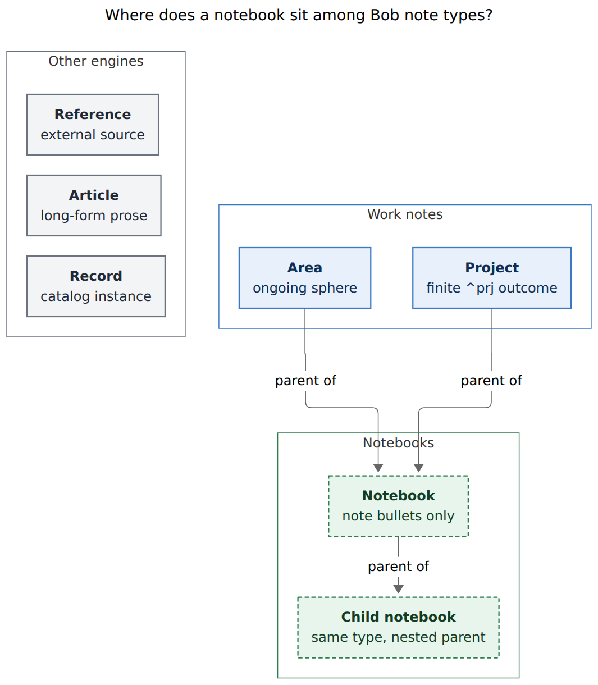
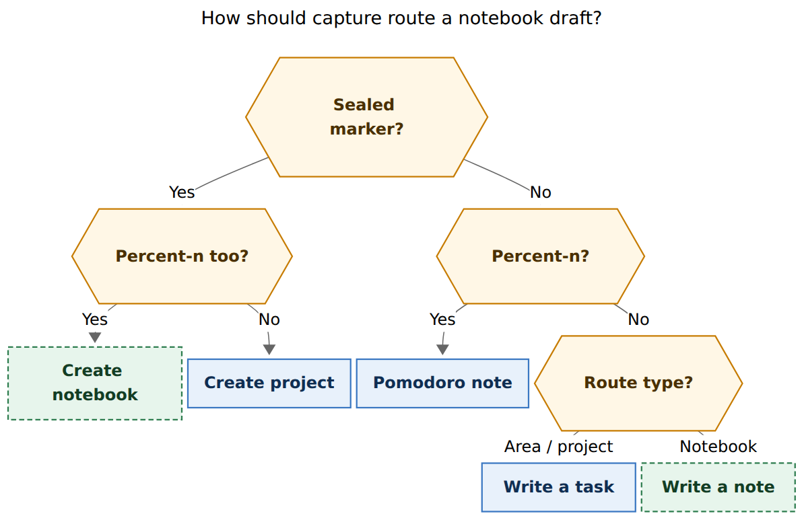

# Notebooks as a Bob note type

- **Researcher:** grk
- **Date:** 2026-11-09
- **Question:** How should Bob add a `notebook` note type that groups related note bullets under an area, project, or another notebook, with capture, a root-parent index, a glossary term, and a first-wave vault migration? Is the requested plan sound, and what should change?
- **Verdict:** Build notebooks. They fill the PARA Resources gap the vault already lives with as untyped `*_ideas.md` files. Keep the type, the parent rule, the glossary term, and `%n` on a sealed project-note marker as the create form. **Do not** give `@@route` a second meaning. Route writes by destination type, so `@foo` / `@@foo` already add notes once `foo.md` is a notebook. Extracting H2 sections is phase 2.

---

## 1. In one breath

Bob already has engines for work (`[[area]]`, `[[project]]`), long-form prose (`[[article]]`), external sources (`[[ref]]`), mail, days, and catalog records (`[[restaurant]]` and kin). It has no type for a **parented collection of note bullets** that is not a project, not an area, and not a schema instance. The vault has been faking that type for years: `dev_ideas.md`, `gtd_ideas.md`, `sase_ideas.md`, `work_ideas.md`, leftover `## Legacy Notes` hubs, and `## Future Work` dumps.

The requested feature is a good idea. The requested **capture spelling** is not. `@@foo` is already the draft-wide task destination (`docs/capture.md`). `@@foo#`, `@@foo^id`, and `@@foo+id` are currently errors. `@@route+block-id` was a breaking removal. The live task's claim that `./foobar` types `@@foo` / `@@foo+bar` is false given today's sigil aliases.

Recommended capture:

```text
@dev^ideas@ %n Dev ideas          → create ~/bob/dev_ideas.md (type notebook)
@dev_ideas A new rust linter      → note bullet at the top of that notebook
@dev_ideas#Rust Try mergiraf      → note bullet under ## Rust
@dev_ideas+old-id a sub-point     → nested bullet under ^old-id
@dev_ideas^mergiraf Try mergiraf  → note bullet with that block ID
@@dev_ideas                       → draft-wide destination; unrouted items become notes
remembered the timeout %n         → still a Pomodoro note
```

Mac Capture stays a thin client of `bob`. Indexes are machine-owned Markdown, in the Sub-projects / Gmail fence tradition, with a compact line on the immediate parent and a card rollup on the root parent.

---

## 2. Is this a good idea?

Yes. Three facts make it the right type, rather than stretching an existing one.

**The vault already behaves as if notebooks exist.** A frontmatter scan of `~/bob` (excluding `.git`, `.obsidian`, `.bob`, `_generated`, `_templates`, `_conflicts`, `done/`, `ref/`, `mail/`, `lit*`, `lib/`, `img/`, and daily/period notes) found **969** notes. **654** have no `type:`. Eighteen are typed areas, ninety-eight are typed projects. The strongest notebook-shaped files are untyped, taskless, parented bullet dumps: `dev_ideas.md` (235 bullets, parent `[[dev]]`), `gtd_ideas.md` (150, parent `[[gtd]]`), `sase_ideas.md` (173, parent `[[work_ideas]]`), `work_ideas.md` (211, parent untyped `[[work]]`). Articles already refuse `#task`. Records already own one-entity catalogs. Nothing in between is allowed to be a first-class `@route`.

**PARA has a hole in Bob.** Areas are ongoing spheres with tasks. Projects are finite outcomes with a `^prj` line. References are external sources. Articles are long-form writing. The missing bucket is Resources: a topic you keep notes on, with no completion criteria and no Ready cap. Notebooks are that bucket, filed under an area or project so Stats, root-parent walks, and capture routes still have a home.

**The live work already split the feature correctly.** `bob.md#^notebooks` is In Progress and blocks two children: `%n` on a project capture (`^n-notebook-directive`) and H2-to-notebook (`^h2-to-notebook`). A cancelled `^notes-type` was merged into notebooks. That split should survive implementation: type plus capture in v1, extract in v2.

What would make it a bad idea: inventing a parallel `@@` grammar, stuffing notes into fake projects (a `^prj` with no outcome), or stuffing them into areas (Ready caps, `## Tasks` grouping, inbox routing). Those all collide with engines that already own those files.



**Figure 1.** Areas and projects remain the work notes that may parent a notebook. Nested notebooks keep the same type. Articles, references, and records stay separate engines. Rendered with mermaid-cli 12.0.0; 710 × 814 px, fit 91.9%.

---

## 3. Critique of the requested plan

The type, the parent rule, the glossary term, the index, `%n` on create, section/block-id/sub-bullet writes, alias support, and a first-wave migration are the right shape. Five collisions in the capture brief would make the feature worse than the status quo.

### 3.1 `@@foo` already means something else

`docs/capture.md` Grammar at a glance: `@@route` is the **shared task destination, anywhere in the draft, for otherwise-unrouted items**. A draft-only declaration is metadata: it never becomes note text. Unsupported forms `@@foo#Ideas`, `@@foo^id`, `@@foo:id`, `@@foo+id`, `@@foo^id@`, and `@@foo:id+` are errors. `CHANGELOG.md` records a breaking removal of `@@route+block-id`.

Giving `@@foo` a second meaning ("write a note into `foo.md`") would make every bulk capture that currently says `@@groceries` plus unrouted tasks ambiguous, and would revive a retired `+` form. The user's bulk example is already expressible: `@@foo` as a global destination whose **write kind** follows `foo.md`'s type.

### 3.2 The existing `@` grammar already covers writes

These forms already exist and already do the jobs the brief assigned to `@@`:

| Requested | Already exists | Today |
| --- | --- | --- |
| `@@foo` add a note | `@foo text`, or `@@foo` plus unrouted items | writes a **task** into an area/project |
| `@@foo#bar` | `@foo#bar` and `@foo#bar` section lists | writes an ordinary bullet under heading Bar |
| `@@foo+baz` | `@foo+baz` | child bullet under `^baz` |
| `@@foo^some-id` | `@foo^some-id` | **task** with that block ID, plus the block-ID prompt |
| `@foo^bar@ %n` create | `@foo^bar@` | creates a **project** note `foo_bar.md` |

The missing piece is **type-dependent execution**, plus one carved exception so `%n` on a sealed marker creates a notebook instead of erroring (`pomodoro_note_conflict` today: `%n` cannot share an item with `@route`).

### 3.3 The alias story in the live task is wrong

`docs/capture.md` Sigil alias, and `src/native/capture_language/rewrite.rs`:

- `.` after a space that follows body text aliases `@` (route completion).
- `.` immediately after `@route` aliases `^` (block-ID picker).
- `/` and `\` alias `#` (section / type / drawer / Pomodoro name).
- `,` aliases `+` (parent-task picker).
- `.` at a line start stays literal.

Consequences:

- `Buy milk .dev_ideas` becomes `Buy milk @dev_ideas`.
- `@dev_ideas.mergiraf` becomes `@dev_ideas^mergiraf`.
- `@dev_ideas/Rust` becomes `@dev_ideas#Rust`.
- `./foobar` at a line start stays `./foobar`. Even if the leading `.` aliased `@`, `/` would become `#`, producing `@#foobar`, never `@@foo`.
- `..foo` after a space becomes `@^foo`, never `@@foo`.
- There is **no** alias that types `@@`.

Teaching `./foobar` as the notebook shortcut would ship a lie. Teach the real aliases instead.

### 3.4 `%n` already means Pomodoro note

`%n` is "plain-text note on a Pomodoro" and "does not open task-type completion." Combining it with `@route` is `pomodoro_note_conflict`. Dual-purposing `%n` is still the right call, because the live task `^n-notebook-directive` asked for it and because `%` already means *how*. The carve-out must be **narrow**: only a sealed `@parent^id@` (create form, never the `:` offer form) plus `%n`. Unrouted `%n` stays a Pomodoro note. `%n` plus a plain `@route` stays a conflict.

### 3.5 The index belongs on two notes, not only the root parent

The brief asks for a beautiful section on the **root parent**, recursive through non-root children. That rollup is right, and it should use the existing Root Parent walk (area at any depth, `root: true` project, or outermost project). A notebook nested under a leaf sub-project would otherwise be invisible on the note you actually have open. **Adjustment:** also write a compact machine-owned line on the **immediate** parent, in the Sub-projects style.

### 3.6 H2 extract is a second product

`bob.md#^h2-to-notebook` is already a blocked child of notebooks. Factoring `## Future Work` out of `bob.md` (28 bullets, 0 tasks) is the poster child, but it needs a previewed rewrite, link repair, and a heading tombstone. Shipping extract in the same capture epic would stall the type. v1 migrates whole files; v2 extracts headings.

---

## 4. Requirement adjustments

Each row is a justified change to the brief. The type, parent rule, glossary, `%n` create, block-ID prompt, alias support, and first-wave migration stay.

| # | Adjustment | Why |
| --- | --- | --- |
| A1 | Keep `@@route` as the draft-wide destination. Do not add a second `@@` grammar. | Existing contract; `@@route+block-id` was already removed. |
| A2 | Add notes with `@foo`, `@foo#bar`, `@foo+id`, `@foo^id`. Destination type decides task vs note. | Those tokens already parse; only execution is new. |
| A3 | Create with `@parent^id@ %n` only (the `^` create seal). Refuse `@parent:id@ %n`. | The `:` seal offers successors; notebooks have none. |
| A4 | Unrouted `%n` remains a Pomodoro note. `%n` plus a plain `@route` remains a conflict. | Teaches one exception, not a new `%` letter. |
| A5 | Document real aliases. Do not claim `./foobar` types `@@foo`. | `rewrite.rs` has no `@@` alias. |
| A6 | Dual index: compact line on the immediate parent, card rollup on the root parent. | Root-parent-only hides notebooks on the open note. |
| A7 | Required `summary:` on create; migration may seed it from the H1 or first body line. | The rollup needs a stable one-liner; deriving it later is guesswork. |
| A8 | H2 extract is phase 2 (`bob notebooks extract`), not v1 capture. | Matches the blocked `^h2-to-notebook` task. |
| A9 | First-wave migrate only files whose parent is already a typed area or project, plus one reparent (`sase_ideas.md` → `[[sase]]`). | Untyped parents (`work`, `z_key`, `zorg`, `books`) cannot satisfy the parent invariant. |
| A10 | Refuse `#task` on notebooks, article-style. Refuse inbox, record, ref, article, and day parents. | Tasks have a residence rule; notebooks are not it. |
| A11 | Notebooks are transparent on the root-parent clock/type walk. They do not declare `offclock` or `task_type`. | Same as today's `NoteKind::Other` traversal. |
| A12 | Reserve `notebook` as a record id. Add `notebook.md` under `type.md`. | `docs/records.md` already reserves `project`, `area`, `ref`, `day`, `done`, `mail`, `article`, `type`. |
| A13 | Files live at the vault root as `<parent>_<id>.md`, same as project notes. No `notebooks/` folder. | Capture routes and wikilinks stay one hop. Existing `dev_ideas.md` already matches. |
| A14 | Machine-owned Markdown index. Optional `notebooks.base` on `type.md`. No in-note Dataview. | Sub-projects, Gmail fences, and Highlights cards are the house style. |
| A15 | CLI noun `bob notebooks` (`list`, `sync`; later `extract`). Do not grow `bob projects` or `bob capture` subcommands. | `cli_rules.md`: nest under a noun; never add a subcommand under `bob capture`. |
| A16 | Mac Capture remains a thin client. New preview fields come from `bob`. | `decisions:mac-capture-is-a-thin-client`. |
| A17 | ALL-CAPS first-level bullets on create become `## Title Case` sections. | Reuses `decisions:capture-bullets-mirror-the-task-block`; notebooks have no `## Tasks`. |

---

## 5. What the engines already give us

### 5.1 Note types

`docs/reference/vault-format.md` § Note types, `docs/records.md`, `docs/articles.md`:

| Type | Engine | Holds `#task` | Capture create |
| --- | --- | --- | --- |
| `[[area]]` | routes, Ready cap, clock defaults | yes | Templater / existing file |
| `[[project]]` | `bob projects`, `@route^id@` | yes (`^prj`) | sealed `@route^id@` |
| `[[article]]` | `bob articles` | **refused** | `bob articles adopt` |
| `[[ref]]` | `bob ref` | reading task lives in the parent | URL / `bob ref create` |
| `[[mail]]` | `bob gmail` | no | `bob gmail new` |
| `[[day]]` | periods | ledger, not ordinary tasks | daily flow |
| record ids | `bob records` / catalog capture | no | `@dir/` |
| **`[[notebook]]`** | **proposed `bob notebooks`** | **refused** | **`@parent^id@ %n`** |

`NoteKind` today is `Area | Project | Other` (`src/native/pomodoro_homes/facts.rs`). `CaptureTargetKind` is `Inbox | Area | Project | Record` (`src/native/capture_targets.rs`). Both need a `Notebook` variant. `frontmatter_is_article` in `src/native/projects/scan.rs` is the predicate to copy.

`~/bob/type.md` already hubs type notes and embeds `projects.base`, `refs.base`, and `articles.base`. `area.md` and `project.md` are short type-notes with `parent: "[[type]]"`. `notebook.md` should be the same shape.

### 5.2 Capture grammar (revision 21)

Relevant existing behavior, all from `docs/capture.md`:

- `@` says where, `#` names a place or a type, `%` says how (`decisions:capture-sigils-say-where-what-how`).
- `@route#Section` writes an ordinary bullet into a matching non-`Tasks` heading.
- `@route+block-id` files a child bullet under an existing task (and, after A2, under an existing note bullet).
- `@route^block-id` authors a block ID on a new task (and, after A2, on a new note bullet).
- `@route^block-id@` creates `<route>_<block_id>.md` as a project note; hyphens in the id become underscores.
- `%n` is a Pomodoro note; with `@route` it is `pomodoro_note_conflict`.
- `@@route` is the one draft-wide destination; a second declaration errors.
- Project-note capture already refuses `%c`, `!`, `@@`, and session operators; notebook create should refuse the same set, plus `#pomodoro` after the seal (nothing to link) and the `:` offer seal.
- `capture-complete` `BlockIdIntent` is `Link | New | ProjectNote` (`src/native/capture_block_ids.rs`). Add `NoteBullet` for `@notebook^id` so the picker pre-fills a suggestion from the body and lists used IDs with `task: false`. Keep `ProjectNote` for the sealed create; `%n` on that item is what flips create-from-project to create-notebook in preview.

`bob capture-parse` currently reports `grammar: 21`. A new parse mode `notebook_create` for the sealed+`%n` exception is additive (an error becomes valid). Type-dependent writes of existing `@route` tokens can keep the same token grammar and add `destination_kind: "notebook"` / `mode: "note_bullet"` so Mac preview says "note" rather than "task". Mark `!` in the Conventional Commit **only** if a previously valid write changes meaning. After migration, `@dev_ideas` becomes a listed capture target for the first time; that is a feature, not a silent break of a picker route.

### 5.3 Visual analogs for the index

- **Sub-projects:** `- 🧩 **Sub-projects:** [[alpha]] • 🗓️ [[future]] • ~~[[done]]~~ ✅` under `^prj`, fully machine-owned (`docs/projects.md`).
- **Gmail conversation:** `<!-- bob:gmail:begin v1 -->` … `<!-- bob:gmail:end -->` wrapping `[!mail]` callouts (`bob-plugins` mail styles).
- **Highlights annotation sections:** `[!summary|section]` cards with a caption, a `^s-<slug>` block, and members under `####` (`glossary:annotation-section`).
- **Task status groups:** `<!-- bob:task-status-group:v1:* -->` fences.

Dataview is a shell query engine (`docs/dataview.md`). It is a poor in-note index: it is not machine-owned, it does not survive as readable Markdown in git, and `type` in DQL already clashes with YAML `type:`.

---

## 6. Recommended type

### 6.1 Frontmatter

```yaml
---
parent: "[[dev]]"
type: "[[notebook]]"
summary: "Open #dev ideas and proposals."
created: 2026-11-09T10:00:00-05:00
---
```

- `type: "[[notebook]]"` is the marker. Mixed types (`[[notebook]]` plus `[[project]]`) refuse, same as articles.
- `parent` is required and must resolve to an area, a non-terminal project, or another notebook. Cycles refuse. Inbox files, records, refs, articles, days, and untyped notes refuse.
- `summary` is required, one line, ≤ 120 characters. Capture create seeds it from the parent-line text when the author does not override it. `bob notebooks sync` warns on missing/blank summaries and does not invent prose.
- `created` matches project-note capture.
- No `status`, no `^prj`, no `ready_cap`, no `offclock`. Those keys on a notebook are ignored and reported, like `offclock` on other non-work kinds today.
- Optional later, not v1: `archived: true`.

Body is an H1, optional `##` sections, and ordinary bullets (with optional `^id`). Nested bullets are notes, not drawers, unless we later opt into drawers; v1 can reuse `@route+id#drawer` if the destination bullet is a drawer, but notebooks should not grow `## Tasks`.

### 6.2 Invariants

1. A notebook contains no `#task` checkbox line. `bob notebooks sync` and capture refuse; a plugin formatter can match articles' `holds-tasks` finding.
2. Every notebook has exactly one `parent` wikilink, of a legal kind.
3. Capture never creates a notebook without `%n` on a sealed `^` marker.
4. Capture never writes a task into a notebook; it writes a note bullet.
5. A lone `@notebook` does not note-pull (there are no Ready tasks). Teach "notebooks have no tasks; add a bullet".
6. Root-parent, clock, and `task_type` walks traverse notebooks and do not stop on them.
7. File identity is the stem. Rename later can follow the reference-rename pattern; not v1.

### 6.3 Glossary term (draft)

**Notebook** (*aka* notebook note)

A Bob vault Markdown file with frontmatter `type: "[[notebook]]"` that holds related note bullets, optionally grouped under `##` headings, and holds no `#task` lines. Its `parent` names an [[area-note]], a [[project-note]], or another notebook; that chain always ends at an area or project, never at an inbox, a record, a [[reference-note]], or an [[article]]. `summary` is a required one-line description used by the machine-owned Notebooks index on the immediate parent and on the [[root-parent]]. Capture creates one with a sealed `@<parent>^<id>@ %n` item, writing `<parent>_<id>.md` at the vault root. `@<notebook>`, `@<notebook>#Heading`, `@<notebook>^id`, and `@<notebook>+id` add bullets, headings, block IDs, and nested bullets; a draft-wide `@@<notebook>` declaration sends otherwise-unrouted items there as notes. Unrouted `%n` remains a Pomodoro note. Notebooks are not projects (no `^prj`, no done/canceled lifecycle), not areas (no Ready cap, no `## Tasks` grouping), not articles (no section numbering), and not record notes (no catalog schema). See `docs/reference/vault-format.md` and `docs/capture.md`.

That term should land in the glossary memory web so `just docs-gen` publishes it next to Area Note and Project Note.

---

## 7. Recommended capture



**Figure 2.** A sealed parent marker plus `%n` creates a notebook; the same seal without `%n` still creates a project. Unrouted `%n` stays a Pomodoro note. Any other local or global route writes a task or a note from the destination type. Rendered with mermaid-cli 12.0.0; 795 × 516 px, fit 82.1%.

### 7.1 Create

```text
@dev^ideas@ %n Dev ideas
- RUST
  - try mergiraf
- PYTHON
  - try import-linter
```

Writes `dev_ideas.md`:

```yaml
---
parent: "[[dev]]"
type: "[[notebook]]"
summary: "Dev ideas"
created: <stamp>
---
```

```markdown
# Dev ideas

## Rust

- try mergiraf

## Python

- try import-linter
```

Rules, mirroring project-note capture:

- `<parent>` must already be an area, a non-terminal project, or a notebook (`bob capture-targets` plus notebooks).
- Target path `<parent>_<id>.md` must not exist in the same batch.
- ALL-CAPS first-level bullets with nested notes become `## Title Case` sections (A17).
- Plain first-level bullets become top-level notes; nested bullets nest.
- `^id` / `:id` on those bullets name note block IDs. `:` does **not** link into a Pomodoro (nothing to link). Prefer teaching `^` here; a `:` on a notebook-create bullet can mean "name only" with a warning, or refuse. Prefer refuse: `:` is the task-link spelling.
- Refuse `%c`, `--clip`, `!`, `@@`, session operators, `#pomodoro` after the seal, the `:` offer seal, `#task` in the body, and inbox/record/ref/article/day parents.
- Mac preview: `mode: "notebook_create"`, title "Create notebook", destination path, summary line. The block-ID picker on `@dev^` with a following `@` remains `ProjectNote` until `%n` is present, then flips the preview to notebook; the thin client renders what `bob` returns.
- `bob notebooks sync` then adds the child to the parent's index in the same all-or-nothing batch, or a follow-up sync like `bob projects sync` after project-note capture. Prefer the follow-up sync so capture stays one note writer; document that indexes land on the next `bob notebooks sync` (cron / `bob sync` later). Capture may also stage the index edit in the same planner; that is nicer and is the better v1 if the planner already stages multiple files (it does: project create + parent Sub-projects is currently a later `projects sync`). Match that pattern: capture writes the notebook, `bob notebooks sync` writes indexes. Accept the small delay.

### 7.2 Write notes into an existing notebook

Once `dev_ideas.md` is `type: "[[notebook]]"` and listed by `bob capture-targets` as `kind: notebook`:

| Draft | Write |
| --- | --- |
| `Try mergiraf @dev_ideas` | Top-level note bullet |
| `@dev_ideas` then bullets | Note list (today this is a task list on areas/projects) |
| `Try mergiraf @dev_ideas#Rust` | Bullet under `## Rust`, created on demand |
| `Try mergiraf @dev_ideas^mergiraf` | Note with `^mergiraf`; block-ID prompt pre-fills `mergiraf` |
| `detail @dev_ideas+mergiraf` | Nested bullet under `^mergiraf` |
| `@@dev_ideas` plus unrouted items | Each unrouted item is a note in that notebook |

Aliases that then work without any new rewrite rules:

- `Try mergiraf .dev_ideas` → `@dev_ideas`
- `@dev_ideas.mergiraf` → `@dev_ideas^mergiraf`
- `@dev_ideas/Rust` → `@dev_ideas#Rust`
- `@dev_ideas,mergiraf` → `@dev_ideas+mergiraf`

`@@dev_ideas#Rust` stays an error (A1). Teach `@dev_ideas#Rust` as the section list header, which already exists.

### 7.3 `%n` teaching copy

Keep one sentence in help and in the incomplete-`%` menu:

> `%n` is a Pomodoro note. After `@parent^id@` it creates a notebook instead.

Do not add `%notebook`. A second letter would split a grammar Bryan already assigned to `%n` on `^n-notebook-directive`.

---

## 8. Recommended index

### 8.1 Immediate parent (compact)

On an area, project, or notebook that has direct notebook children, one machine-owned line, **not** under `^prj` (notebooks are not sub-projects):

```markdown
- 📓 **Notebooks:** [[dev_ideas]] • [[linux]]
```

Place it after the H1 and before `## Tasks`, or after the Sub-projects line's file-level sibling region. Because it is not a `^prj` child, a `## Notebooks` heading with a single compact list is cleaner than a fake task bullet:

```markdown
## Notebooks

<!-- bob:notebooks:local v1 -->
- 📓 [[dev_ideas]] · Open #dev ideas and proposals.
- 📓 [[gtd_ideas]] · Open #gtd ideas and proposals.
<!-- bob:notebooks:end -->
```

Rewrite in canonical form. Delete the heading when the last child leaves. Nested children of those notebooks do **not** appear here; they appear on their own immediate parent and in the root-parent rollup.

### 8.2 Root parent (the beautiful rollup)

On the Root Parent of any notebook in the tree — using the existing walk — a fenced card section. Hue follows the area color already stored on that root (`color: blue` on `dev.md`, `grey` on `gtd.md`). Plugin CSS, modeled on bob-mail:

```css
.callout[data-callout="notebook"] {
  --callout-color: var(--color-blue-rgb, 72, 130, 196);
  --callout-icon: lucide-notebook;
}
```

Vault Markdown (readable even when CSS is absent):

```markdown
## Notebooks

<!-- bob:notebooks:root v1 -->
> [!notebook] [[dev_ideas]]
> Open #dev ideas and proposals.
> 235 notes · updated 2026-11-09
>
> Nested: [[dev_ideas_rust]]

> [!notebook] [[gtd_ideas]]
> Open #gtd ideas and proposals.
> 150 notes
<!-- bob:notebooks:end -->
```

Counts are derived at sync time (top-level bullets, not nested). `summary:` is the card body. Nested notebooks indent as a Nested line, not a second heading. The fence is the write boundary; prose above or below stays user-owned.

If the immediate parent **is** the root parent (`dev.md` for `dev_ideas.md`), write **only** the root rollup. Do not emit both a compact list and the cards on the same file.

### 8.3 Optional Base

`notebooks.base` filtered by `note.type == link("notebook")`, embedded on `type.md` next to `projects.base`. This is a dashboard, not the in-note index. Ship it in the same epic if cheap; it must not replace the fenced section.

### 8.4 Writer

`bob notebooks sync` is the only writer of those fences, the way `bob projects sync` owns Sub-projects. `list` is read-only. Cron can fold it into the future `bob sync` wrapper (`bob.md#^bob-sync`); until then, run it next to `bob projects sync`.

---

## 9. Vault mining: first-wave notebooks

### 9.1 Promote (v1)

These files already look like notebooks: untyped, **zero** `#task` lines, parented to a typed area or project, and used as idea/note collections.

| File | Parent today | Bullets | H2 | Action |
| --- | --- | --- | --- | --- |
| `dev_ideas.md` | `[[dev]]` (area) | 235 | 0 | `type: "[[notebook]]"`; seed `summary` from "Open #dev ideas/proposals live here" |
| `gtd_ideas.md` | `[[gtd]]` (area) | 150 | 0 | same |
| `sase_ideas.md` | `[[work_ideas]]` (untyped) | 173 | 0 | **reparent to `[[sase]]`** (typed project, itself parented to `[[dev]]`); then type as notebook |
| `interview_notes.md` | `[[job]]` (area) | 1 + related-notes hub | 0 | type as notebook; keep the related-notes list as ordinary bullets |
| `sase_blog_0_legacy_notes.md` | `[[sase_blog]]` (project, `root: true`) | 18 | 0 | type as notebook; summary "Obsolete notes about sase_blog_0" |
| `word_of_day.md` | `[[love]]` (area) | 28 | 0 | type as notebook; it is already a pure note collection |

Migration is frontmatter-only plus `summary:`. Do not rewrite zorg bodies in v1. `bob notebooks sync` then paints indexes on `dev.md`, `gtd.md`, `sase.md` (and up to `dev.md` if sase is not its own root — sase is a project under `dev`, so the root parent of a task in `sase.md` is sase itself as outermost project; the notebook rollup for `sase_ideas` therefore lives on `sase.md`), `job.md`, `sase_blog.md`, and `love.md`.

### 9.2 Hold (do not migrate in v1)

| File / region | Why |
| --- | --- |
| `work_ideas.md` (211 bullets, parent untyped `work.md`) | Parent is not an area or project. Typing `work.md` as an area is a separate PARA cleanup. |
| `ideas.md` (parent `z_key`) | Untyped parent; global leftover. |
| `book_ideas.md` (parent `books`) | Untyped parent; closer to a maybe-read catalog than a notebook. |
| `zorg_ideas*.md` | Parent chain is untyped `zorg` / `zorg_ideas`. |
| `now_dev.md`, `now_work.md`, `now_*` | Action lists with zorg `o P0` rows, not note collections. |
| `pomodoro.md` (parent `gtd`) | Rollover tickler dump; skip. |
| `body_ticks.md`, `work_ticks.md`, `home_ticks.md` | Recurring tickler files. |
| `the_monthly.md`, `fscarpel_meet_*`, `team_meet_*` | Meeting archives under `meet`. |
| `inbox.md` `## Migrated Zorg Inbox` (177 bullets) | Inbox dump, not a notebook. |
| `sase_blog.md` `## Requirements` / `## Outline` | Project support; stay on the project. |
| Tiny `## Future Work` on many `sase_*` projects (3–11 bullets) | Leave until extract exists; not worth a file each. |
| `_meta/**`, `prompts/**`, `chat/**`, `plans/**` | Tooling, not Bob notes. |
| `agent_ref.md`, `claude_code_ref.md` | Reference dumps under `ai_ref`. |
| Record folders `eat/`, `podcasts/` | Catalog types, already designed elsewhere. |

### 9.3 Extract later (phase 2)

Best H2 candidates inside typed work notes, all with 0 `#task` in the heading:

| Note | Heading | Lines | Bullets |
| --- | --- | --- | --- |
| `bob.md` | Future Work | 30 | 28 |
| `gtd.md` | Legacy Notes | 45 | 31 |
| `dev.md` | Legacy Notes | 32 | 20 |
| `cash.md` | Legacy Notes | 25 | 23 |
| `fun.md` | Legacy Notes | 30 | 18 |
| `body.md` | Legacy Notes | 20 | 12 |
| `sase.md` | Future Work | 8 | 6 |

`bob.md ## Future Work` is the one worth extracting first: it is the product note for this very feature, and 28 taskless bullets next to a live `## Tasks` is the pain the type exists to remove. `gtd.md ## Legacy Notes` still contains a "Related notes:" hub that already points at `gtd_ideas`; extracting it is a cleanup, not a new collection. Phase 2 command:

```bash
bob notebooks extract --from bob.md --heading "Future Work" --id future-work
```

Preview, then write `bob_future_work.md`, move the bullets, leave a `[[bob_future_work]]` stand-in, and sync indexes.

`dev.md ## Legacy Notes` already lists `[[dev_ideas]]` in a related-notes hub. After `dev_ideas` is a notebook, that hub can shrink to the managed Notebooks section.

---

## 10. Implementation sketch

Not an implementation plan; a map for whoever writes `plan:…/notebook_note_type`.

**bob-cli**

- `frontmatter_is_notebook`; `NoteKind::Notebook`; `CaptureTargetKind::Notebook`.
- Reserve `notebook` in `docs/records.md` and the record-id validator.
- `bob capture-targets` lists non-nested and nested notebooks after areas/projects.
- Capture planner: sealed `@parent^id@` + `%n` → `notebook_create`; destination-kind on ordinary `@route` / `@@route`.
- `BlockIdIntent::NoteBullet` for `@notebook^id`; suggestions from body; `used[].task == false`.
- `bob notebooks list|sync` (short aliases on every public long option). `extract` in the same noun, later.
- Tests: create, write, global dest, aliases, parent refusals, `#task` refusal, `%n` conflict still holds for `@dev Buy milk %n`, indexes idempotent.

**Docs**

- `docs/reference/vault-format.md` new subsection.
- `docs/capture.md` + `docs/reference/capture-syntax.md`: `%n` exception, destination-kind, teaching errors.
- `docs/reference/cli/notebooks.md` (generated from clap).
- Glossary memory web → `just docs-gen`.
- Decision record once the capture spelling is accepted (`%n` on the seal, type-dependent `@`, `@@` unchanged).

**bob-plugins**

- Notebook callout CSS (mail analog).
- Optional: refuse `#task` on notebook buffers the way articles do.
- Do not parse capture in the app.

**Bob Mac Capture**

- Render `notebook_create` and `note_bullet` previews from `bob`. No Swift grammar.
- Block-ID card already consumes `block_id.intent`; add the new intent string.

**Vault (implementation epic, not this research)**

- Add `notebook.md` type-note.
- Frontmatter-only migration of the v1 table.
- Reparent `sase_ideas.md` to `[[sase]]`.
- Run `bob notebooks sync`.

**Release**

- Daily train. Additive capture modes. `!` only if a valid write changes meaning.

---

## 11. Risks

- **`%n` overload.** Mitigate with preview copy and a single help sentence. Reopens if Bryan would rather spend a new letter.
- **Type-dependent `@route` surprises.** `@dev_ideas Buy milk` today is not a picker target; after migration it becomes a note, not a task. That is the point. A teaching error if the body looks like a task (`#task`, checkbox) protects the invariant.
- **Index churn.** Fences must be byte-stable when the child set is unchanged, like Sub-projects.
- **Zorg bodies.** First-wave files are `generated_from_zorg: true` with zorg dates and `* NOTES:` trees. Do not pretty-print them in v1. New captures append ordinary Bob bullets above or below, in one documented slot (top of the file after H1, matching section-bullet insertion).
- **`work.md` remains untyped.** Holding `work_ideas.md` is correct and will feel incomplete until `work` is an area. Do not silently parent `work_ideas` to `[[job]]` or `[[dev]]`.
- **Nested notebooks vs Sub-projects.** A notebook must never appear on a Sub-projects line. Sync filters `type: "[[notebook]]"` out of that writer.

---

## 12. Recommended solution

Ship **notebooks as a first-class `type: "[[notebook]]"`** with this contract:

1. **Body.** Note bullets and optional `##` sections. No `#task`. No `^prj`.
2. **Parent.** Area, project, or notebook. Always. Cycle-checked.
3. **Create.** `@parent^id@ %n`, writing `<parent>_<id>.md` at the vault root, `summary:` seeded from the capture line. Unrouted `%n` stays a Pomodoro note.
4. **Write.** Type-dependent `@route` / `@@route`. Existing `#` / `^` / `+` suffixes and existing sigil aliases. No new `@@` forms.
5. **Index.** `bob notebooks sync` writes a compact immediate-parent list and a callout rollup on the Root Parent. HTML comment fences. Optional Base.
6. **Glossary.** The term in §6.3, in the memory web.
7. **Migrate now.** `dev_ideas`, `gtd_ideas`, `sase_ideas` (reparent to `sase`), `interview_notes`, `sase_blog_0_legacy_notes`, `word_of_day`. Frontmatter only.
8. **Migrate later.** H2 extract (`bob.md ## Future Work` first); `work_ideas` after `work.md` is typed.

That is smaller than the brief (no new `@@` grammar, no v1 extract) and larger in the one place that makes the feature beautiful (a real type, a required summary, a dual index that looks like Bob). It is the design I would implement.