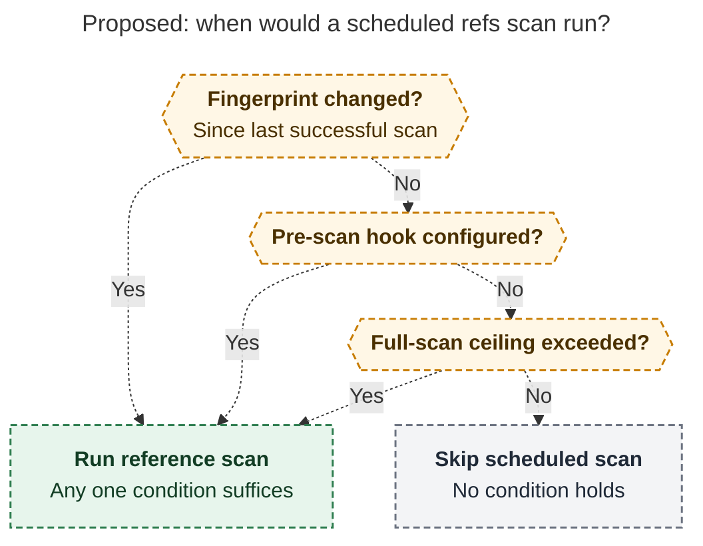
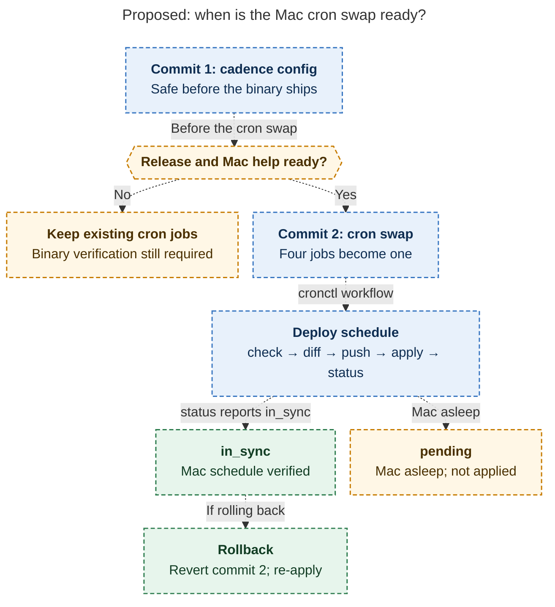

# Diagram proposals: One command for Bob's frequent Mac work: build `bob tick`

Proposals for the swarm linker, not a report. Each diagram restates only what the source
report says.

```yaml
source: research:202611/bob_periodic_orchestrator/bob_periodic_orchestrator__final.md
producer: research.5c.image
check: "mmdc 12.0.0 with the PDF-mirroring config rendered 2 of 2 Mermaid diagrams"
```

## refs-admission

```yaml
anchor: |-
  The `refs` step's scheduled gate: run only when
question: |-
  Which conditions admit a scheduled PDF library scan?
illustrates: |-
  The proposed refs gate admits a scheduled scan when the listing fingerprint changes, a pre-scan hook is configured, or the full-scan safety ceiling has elapsed.
caption: "A changed library listing, configured pre-scan hook, or elapsed full-scan ceiling admits a scheduled reference scan; otherwise it is skipped."
review: "559.813x760 px, fit 100.0%; question, source, and visual checks passed; 0 revisions"
```



## rollout

```yaml
anchor: |-
  Then the crontab skill's workflow:
question: |-
  When can the cron swap happen, and what if application is pending or rollback is needed?
illustrates: |-
  The proposed two-phase rollout keeps the cron swap behind the shipped binary and Mac help check, reports pending application honestly, and preserves rollback through commit 2.
caption: "Verify bob tick --help on the Mac before swapping cron; report sleep as pending, and roll back only the schedule commit."
review: "688.914x1092 px, fit 81.8%; question, source, and visual checks passed; 0 revisions"
```


