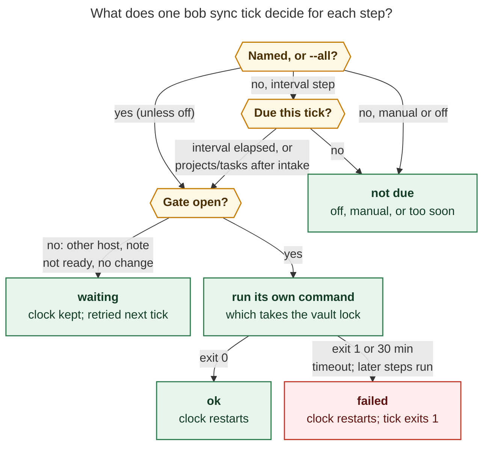

# `bob sync`: one ordered, configurable pass for Bob's frequent background work

**Date:** 2026-11-18 · **Task:** `bob.md` `^bob-sync` · **Researcher:** cld · **Evidence:** bob-cli at `41b1dab3`,
chezmoi at `origin/master`, the live Mac crontab (`cronctl status mac`, in sync), nine days of Mac cron logs
(2026-11-09 → 2026-11-18), the vault, and the earlier review `research:202611/bob_sync_task_review.md`

## TL;DR

- **Build it, keep the name `bob sync`.** I scored a dozen alternatives. `sync` is the only one that says what the
  command does, and your system already uses that word for this job: the `^bob-sync` task, the `#pre #sync` GTD stage,
  and the verb in every member command. The old git-sync meaning was retired three months ago. Its only live trace is an
  unmanaged wrapper on apollo that nothing calls. **Runner-up: `bob tend`**, if you'd rather not reuse a retired name.
- **Shape:** one leaf command with a fixed registry of **six steps in a fixed order**:
  `gcal → gmail → gkeep → refs → projects → tasks`. You configure only **how often** each step runs: an interval
  (`15m`, `1h`), `manual`, or `off`, set in `sync.steps` in `~/.config/bob/config.yml`. Cron calls `bob sync` every
  **5 minutes**, and each step keeps its own pace.
- **Your gcal requirement:** pin `sync.steps.gcal: 1h` in chezmoi. Scheduled gcal runs then start at least 60 minutes
  apart (measured to the minute). Runs you ask for by name are not throttled, and neither is Ledger Tools'
  once-a-day run when it creates the daily note. I'm calling that interpretation out as an adjustment (§5).
- **The Mac crontab** goes from four staggered jobs to one: `*/5 * * * *  bob sync`. That is a single chezmoi commit,
  and it lands only after the release containing `bob sync` is installed on the Mac.
- **The biggest win is one the task didn't name.** The Mac's 15-minute Highlights job ran a **full scan of all 708
  PDFs in 521 of 521 runs**: the wrapper's "anything modified today?" gate never once skipped. That is about
  **1.7 hours of scanning per day**. A "did `lib/` or `xlib/` change?" gate in the `refs` step should skip most ticks.
- **Where I differ from the earlier review:**
  - **Steps run as subprocesses**, not in-process like `bob nightly`. That gives crash and hang isolation and a real
    timeout, and it needs zero changes to the step commands.
  - **gcal runs first, not fourth.**
  - **Yesterday's calendar syncs once a day, not every run.** Every gcal run rewrites the `↻ synced` line in each note
    it touches.
  - **No "time budget, then move on".** That cannot work without killing the child. Instead there is a 30-minute hard
    ceiling, measured in awake time.

## 1. What exists today

**Mac cron (live, `in_sync`),** from `cron:` in chezmoi `home/.chezmoidata.yaml`:

| Job | Schedule | Command | Runs (9 d) | Failed | p50 | p90 | Wall time |
| --- | --- | --- | ---: | ---: | ---: | ---: | ---: |
| `bob-highlights-sync` | :00/:15/:30/:45 | `maybe_bob_highlights_sync -w` | 521 | 8 | 79 s | 133 s | 13.7 h* |
| `bob-projects-sync` | :05/:20/:35/:50 | `bob projects sync` | 528 | 12 | 5 s | 8 s | 2.0 h |
| `bob-gmail-sync` | :07 | `bob gmail sync -q` | 123 | 5 | 25 s | 67 s | 1.5 h |
| `bob-task-reconcile` | :10/:25/:40/:55 | `bob task reconcile --retry-timeout 120` | 524 | 53 | 12 s | 24 s | 6.9 h |
| *gcal* | **none** | Ledger Tools runs `bob gcal sync` once, when the daily note is created | | | | | |

\* Excludes 5 runs over 30 minutes, which are almost certainly the Mac sleeping mid-run. With them the total is 23.7 h.

What the code and docs establish:

- **`bob nightly`** (`src/native/nightly.rs`) holds the shared vault lock (`/tmp/bob_sync.lock`) for its whole run. It
  calls each step in-process and returns the first non-zero exit code. That is fine at 03:30 on athena. Every 5 minutes
  on the Mac it would freeze every interactive gesture.
- **`cronrun`** (chezmoi `home/bin/executable_cronrun`) already provides an overlap guard per job name. A second
  overlapping run logs `skipped` and exits 0. cronrun logs every run, and only on a non-zero exit does it print the last
  40 log lines to stderr, which cron mails.
- **`subprocess_runner.rs`** (used by gkeep and gcal) already spawns a child in its own process group, drains its pipes,
  and kills the whole group at a deadline. A step runner needs exactly that.
- **gcal fetches Google before it checks the note** (`gcal/sync.rs:306`, then the `WaitingReason` gate at
  `:407–430`). A missing or still-rendering daily note makes it exit 0 as `waiting`, but only after the fetch.
  `WaitingReason::of_contents` (`:904`) is a reusable "is today's note ready?" test.
- **Every gcal run rewrites the `↻ synced` stamp** in each note it touches, and vault-sync commits that change
  (`docs/gcal.md` "Events stamp": "Every run at a new minute rewrites it, even when the calendar is unchanged."). So
  gcal's frequency directly sets the daily-note churn, which is the likely reason to cap it at hourly.
- **The Highlights wrapper's gate is ineffective.** It skips the scan only when no `lib/` file changed within 24 hours
  (`find -mtime 0`). On the Mac, 12 of 708 PDFs had changed within 24 hours, and all 521 logged runs took over 5
  seconds.
- **`bob ref scan`** already writes a receipt to `<state>/bob-cli/ref/last-scan.json` and posts the Darwin
  notification `org.bobs.bob.ref.scan-finished` for Bob Mac Capture. That is a ready pattern for a `bob sync`
  receipt.
- **Name history.** `docs/develop/migration-notes.md` says "`bob sync` … retired in favor of `bob vault-sync` … no
  longer registered". That happened around 2026-08-27 (`eee290ab`). On apollo, `~/bin/bob_sync` (dated 3 Jul, not
  managed by chezmoi, no callers) still runs `exec bob sync "$@"`. Apart from the `^bob-sync` task, no vault note uses
  `bob sync`.
- **Host pinning is not set up yet.** `gcal.writer` and `gmail.writer` are commented out in the chezmoi config, and the
  open bug `bob-cli-ew` says the Mac's host label drifts (Kellys-MBP / Kellys-MacBook-Pro / `-local`).

## 2. Is this a good idea?

**Yes, as a small orchestrator that only decides what runs and in what order.** Here is my critique, including where it
could go wrong.

**What it really buys you (ranked):**

1. **gcal becomes periodic.** Today an invitation you accept at 11:00 shows up only the next morning, or whenever you
   run sync by hand.
2. **Quiet cron.** 60 of the 78 failures in nine days were not real problems:
   - 50 were reconcile finding no daily note yet;
   - 10 were lock collisions between the staggered jobs.

   A daily-note gate and sequential steps remove all of them.
3. **About 1.7 hours a day of PDF scanning goes away.** This comes from the `refs` change gate (§4.4). It is
   independent of the orchestrator, but the orchestrator is its natural home, and the shell wrapper can be deleted.
4. **The order becomes real.** Today minute offsets only make it likely that reconcile tidies what Gmail just filed.
   Inside one pass it is guaranteed.
5. **The morning `#gtd #pre #sync` chore becomes `bob sync -a`**, or can be retired.

**What could go wrong, and the answer to each:**

| Risk | Why it's real | Answer |
| --- | --- | --- |
| **One wedged run stops everything** | Four failure domains become one. A hung child would block every later tick. | Each step gets a hard ceiling of 30 awake minutes; the timer does not run while the Mac sleeps. The run lock is a `flock`, so a crash cannot leave it stale. cronrun's overlap guard stops ticks from piling up. |
| **Reinventing cron** | A home-grown scheduler is a classic trap. | Keep it to one rule: run a step when its interval has passed since it last ran. This is the anacron model, and it is exactly what a sleeping laptop needs. Cron fires on schedule and skips ticks while the Mac sleeps; a stateful interval catches up on the first tick after wake. |
| **Cadence lives in two places** | The crontab says `*/5`, but the real cadence lives in `config.yml`. | `bob sync -d` prints the effective schedule. The cron description points to `sync.steps`. The cron tick changes only if you want faster catch-up. |
| **Config creep** | "Highly configurable" can turn into a mini DSL. | One knob per step (cadence). The order is fixed. No arbitrary commands and no per-step arguments; use the direct command for those. |
| **A slow step delays the rest** | Refs p99 is about 18 minutes. | Order fast, time-sensitive steps first. With the change gate, refs is near zero on most ticks. |
| **Reusing a retired name** | `cli_rules.md` exists to stop old spellings from silently changing meaning. | No live caller exists. Delete apollo's wrapper. Help ends with "For Git sync, use `bob vault-sync`." The host pin (§4.6) makes a mistaken run elsewhere harmless. This needs your explicit OK. |

**Would I take a different approach?** I considered three alternatives:

- **(a) Keep the four jobs, add a fifth hourly gcal job, and make reconcile return `waiting`.** This captures about
  half the value. But it keeps the races, has no catch-up after wake (an hourly job at a fixed minute is skipped
  whenever the Mac sleeps through that minute), and gives no single status view.
- **(b) launchd LaunchAgents.** These catch up on wake natively, but cronctl doesn't manage them, and the refs docs
  explicitly say "do not replace it with a LaunchAgent".
- **(c) A long-running daemon that watches files.** Too much machinery for a laptop that sleeps.

The orchestrator wins, with the adjustments in §5.

## 3. The name

**Criteria:** it says what the command does, it is short, it doesn't collide with Bob's vocabulary, it reads well with
steps (`bob X gmail gcal`), and it works both in cron and by hand. Collision counts are case-insensitive whole-word
hits in `docs/` and `src/`.

| Name | Says what it does | Short | Bob collisions | `bob X gmail gcal` | Verdict |
| --- | :---: | :---: | --- | :---: | --- |
| **`sync`** | ● | ● | Retired git name; `vault-sync`, `bob_sync.lock` | ● | **Pick.** Matches the task, the `#sync` stage, and each member's verb. |
| **`tend`** | ◐ | ● | **None** (0 hits) | ● | **Runner-up.** Fits "frequent light care" next to `nightly`'s deep clean, but needs a gloss on first read. |
| `refresh` | ● | ◐ | 254+ uses; reads as Task Freshness | ● | Reject |
| `tick` | ◐ | ● | TICKLER tier; 27× "tick" (checkbox sense) | ○ | Reject |
| `pull` | ◐ (misses projects, tasks) | ● | `git pull`, `gkeep pull` | ● | Reject |
| `poll` | ◐ (misses derivation) | ● | Minor | ● | Weak |
| `rounds` | ◐ | ● | Pomodoro "rounds" | ○ | Reject |
| `jobs` | ◐ | ● | `ref scan -j/--jobs`; needs a `run` verb | ○ | Reject |
| `upkeep` | ● | ◐ | Freshness "upkeep" budget; nightly is "maintenance" | ◐ | Reject |
| `cron` | ○ (names the mechanism) | ● | `cronctl`, `cronrun` | ○ | Reject |
| `pulse` | ○ | ● | None | ○ (noun) | Reject |
| `routine` | ◐ | ◐ | Minor | ○ | Reject |

**Why `sync` beats `tend`:**

- **Intuitive comes first.** Months from now, a crontab line reading `bob sync` explains itself; `bob tend` needs
  `--help`.
- **The members are all syncs.** The jobs are literally `gcal sync`, `gmail sync`, `projects sync`,
  `bob-highlights-sync`, and reconcile, which is a status sync. An umbrella `bob sync` that runs "the syncs" is the
  least surprising name.
- **The collision is mostly historical and fixable.** Nothing in the vault or chezmoi uses the old meaning. The help
  line, the migration-notes update, and the host pin make the rare mistaken `bob sync` (meaning git) harmless. Each step
  pushes through vault-sync anyway.
- **The cost to accept:** `bob_sync.lock` keeps its historic name as the shared vault lock. Don't rename it, because
  plugins and every step depend on it. The docs should say plainly that `bob sync` does not hold it across steps.

If any of this tension bothers you, choose `bob tend`. The rest of this design is the same under either name.

## 4. Recommended design

### 4.1 Steps: a limited set with a fixed order

Each step runs its own existing command as a subprocess (`std::env::current_exe()`, `-f json`). It reports one outcome:
`ok`, `waiting`, or `failed`. The order is the design. **Outside data comes in first, fastest first; derived state
comes last.**

| # | Step | Runs | Default | Safety gates (always apply) | Extra rule |
| ---: | --- | --- | --- | --- | --- |
| 1 | `gcal` | `bob gcal sync` | `1h` | Host; today's note ready (`WaitingReason`), checked **before** any Google fetch | The day's first run also syncs **yesterday**; after that, today only |
| 2 | `gmail` | `bob gmail sync` | `1h` | Host | Gmail's own two-hour busy-skip rule still decides its exit code |
| 3 | `gkeep` | `bob gkeep pull` | `manual` | Host | No TTY, so URL-only notes go to `gkeep_inbox` (no prompt) |
| 4 | `refs` | `bob ref scan -w` | `15m` | Host | **Change gate (scheduled runs only):** see §4.4 |
| 5 | `projects` | `bob projects sync` | `15m` | Host | Also runs after any intake step (1–4) ran in this tick |
| 6 | `tasks` | `bob task reconcile --retry-timeout 120` | `15m` | Host; today's note ready | Also runs after any intake step ran in this tick |

**Membership rule** (`cli_rules.md` asks for one): *a step belongs in `bob sync` if it should run more than once a day
on the writer host. Once-a-day maintenance stays in `bob nightly`, and Git transport stays in `vault-sync` and its
LaunchAgent.*

**Why gcal first, not fourth:**

- gcal and gmail are short and time-sensitive; refs can take minutes.
- gcal is also the step whose "at most hourly" spacing matters. Starting it first means its start time is the tick's
  start time, so its spacing doesn't drift with the length of the refs scan.

**Why yesterday only once:**

- A past-day sync closes eligible Event Tasks, and it rewrites yesterday's `↻ synced` stamp on every run.
- Your morning `gcal sync -n 2` exists to close out yesterday once. Running it hourly would churn yesterday's note about
  16 times a day for no benefit.
- The state file records `yesterday_synced_for: <date>`.



**Figure 1.** Every step passes the same three questions in the fixed order. Only a step that actually runs restarts
its clock. A closed gate never fails the tick or sends mail; it just retries on the next tick. (Rendered with
mermaid-cli 12.0.0 under the PDF config: 718×1008 px, 88.6% fit.)

### 4.2 Scheduling semantics: one rule, stated exactly

- **Due:** `floor_min(now) − floor_min(last_ran_at) ≥ interval`. Here `last_ran_at` is the start of the tick in which
  the step last *ran* (`ok` or `failed`).
  - `waiting` never restarts the clock, so a step that waited on a missing daily note runs on the first tick after the
    note appears.
  - Failures do restart it. That is what makes `gcal: 1h` a real cap: a failing gcal does not retry every 5 minutes.
- **Explicit beats the schedule.** `bob sync gmail gcal` and `bob sync -a` run those steps now, whether or not they are
  due, and restart their clocks. Safety gates (host, note readiness) still apply. The refs economy gate does not: naming
  `refs` forces a full scan.
- **Intake then derive.** `projects` and `tasks` also run in any tick where an intake step ran. That keeps the "tidy what
  was just filed" promise even when intervals don't line up. (`manual` and `off` are never pulled in this way.)
- **Times:**
  - Intervals use absolute UTC instants, so DST changes don't double-run or skip a step.
  - "Yesterday" uses Bob's configured `timezone`.
  - Every time decision honors `BOB_NOW`, for tests.
- **State:** `$XDG_STATE_HOME/bob-cli/sync/state.json`, the scheduler's memory.
  - It is written atomically (temp file plus rename) **after each step**, so a crash loses at most the step in flight.
  - If the file is unreadable, every interval step is treated as due and a warning is printed, never a failure.

### 4.3 Concurrency and failure

- **No lock held across steps.** Each step takes `bob_sync.lock` itself with its existing bounded waits, as it does
  today, so interactive gestures stay responsive.
- **Run lock.** `bob sync` holds an `flock` on `<state>/bob-cli/sync/run.lock` and writes `running.json` (pid, started
  at, current step).
  - A second **non-interactive** run (cron) prints `skipped · a sync started 10:15 is still running (refs)` and exits 0.
  - An **interactive** run waits with a spinner naming the step in flight, then does what you asked.
- **Per-step ceiling.** The ceiling is 30 minutes of **awake** time. Rust's `Instant` doesn't advance while macOS
  sleeps, so a lid-close mid-scan isn't a timeout. At the ceiling, the step gets SIGTERM, then the process group gets
  SIGKILL after a 30-second grace. Refs p99 (about 18 minutes) fits under the ceiling. Refs and gmail already have
  interrupted-write recovery.
- **Exit status:**
  - 0 when every step that ran succeeded or only waited, including "nothing due" and "skipped (already running)".
  - 1 when any step failed.
  - 2 for usage or config errors, which name the key, for example
    `sync.steps.gcal: "hourly" is not an interval; use 1h`.

  Mail therefore means a real failure.

### 4.4 The `refs` change gate (replaces `maybe_bob_highlights_sync`)

A scheduled `refs` run is due only when at least one of these holds:

1. The **listing fingerprint** of `lib/` and `xlib/` changed since the last successful scan. The fingerprint is a hash
   of every file's sorted relative path, size, and modification time, so new, moved, or edited PDFs and sidecars all
   count. Statting 708 files takes milliseconds.
2. `highlights.pre_scan_hook` is configured. This preserves the wrapper's rule.
3. The last full scan is more than 6 hours old, as a safety net for vault-side repairs that the fingerprint can't see.

The wrapper's own `mkdir` lock becomes redundant under the run lock, so delete the wrapper and its bash test from
chezmoi. A better long-term home is a per-PDF unchanged-skip cache inside `bob ref scan` itself, which would help
manual scans too. File that as a follow-up rather than blocking on it.

### 4.5 Configuration (chezmoi `home/dot_config/bob/config.yml`)

```yaml
# `bob sync` runs Bob's frequent background work in one fixed order:
# gcal → gmail → gkeep → refs → projects → tasks. Mac cron calls it every
# 5 minutes; a step runs only when its interval has passed since it last ran
# on this host (projects and tasks also follow any intake step that ran).
# Values: an interval (15m, 1h, 1d), manual (only `bob sync -a` or
# `bob sync <step>`), or off. `bob sync -d` shows what is due and why.
# See docs/sync.md in bob-cli. Older bob builds ignore this block.
sync:
  # host: kellys-macbook-pro   # set once bob-cli-ew pins the Mac's host label
  steps:
    gcal: 1h        # never more often: each run rewrites today's ↻ synced line
    gmail: 1h       # stays inside Gmail's two-hour staleness warning
    gkeep: manual   # clips web pages; runs with the morning `bob sync -a`
    refs: 15m       # skips quickly unless lib/ or xlib/ changed (full scan ≥ every 6h)
    projects: 15m
    tasks: 15m
```

- **Grammar:** `<N>m`, `<N>h`, `<N>d` with N ≥ 1, or `manual` / `off`. This matches Bob's own `25m` and `[off:: Nm]`
  style and the `ready_cap: off` precedent.
  - An unknown step is a config error.
  - A step you leave out takes its default.
  - The block is optional; without it, `bob sync` uses the defaults in the table above.
- **Pin the values anyway.** Your gcal requirement shouldn't rest on a default that could change. The explicit `1h`
  states the requirement in the source of truth.
- **Change the gcal block's comment** from "the Mac syncs when you run `bob gcal sync`, and Ledger Tools runs it once…"
  to "`bob sync` runs it hourly on the Mac (`sync.steps.gcal`); Ledger Tools also runs it once when today's note is
  created."
- **Room to grow (additive later):** a step value may become an object (`gcal: {every: 1h, …}`) if a real per-step
  option ever earns its place. Not in v1.

### 4.6 Host pinning

`bob sync` writes the vault, gcal, and Gmail, and those writes must come from the Mac. The gcal docs warn that another
host writing today's note can get its live ledger edits quarantined by vault-sync's remote-wins policy.

- **Add `sync.host`.** It defaults to `gcal.writer` when that is set, and to any host otherwise. On any other host,
  `bob sync` refuses with exit 2 and a hint: `bob sync runs on <host>; this is apollo · for Git sync use bob
  vault-sync`. `-d` still works anywhere.
- **Interim pin:** until `bob-cli-ew` fixes the Mac's drifting label, the crontab is the de facto pin. **Delete
  apollo's stale `~/bin/bob_sync`** in the same rollout.

### 4.7 CLI and output: intuitive, and beautiful

```text
Usage: bob sync [OPTIONS] [STEP]...

Run Bob's frequent background work in one ordered pass. Each step runs its own
command when its sync.steps interval has passed, so cron can call bob sync every
few minutes while each step keeps its own pace.

Arguments:
  [STEP]...  Run only these steps, now: gcal, gmail, gkeep, refs, projects, tasks

Options:
  -a, --all              Run every step that is not off, now
  -b, --bob-dir <DIR>    Bob vault root; defaults to BOB_DIR or ~/bob
  -d, --dry-run          Show each step's plan, last result, and next run; run nothing
  -f, --format <FORMAT>  Output format: human or json [default: human]
  -q, --quiet            Print only failures
  -h, --help             Show help

Steps, in run order:
  gcal      bob gcal sync        today; yesterday too on the day's first run
  gmail     bob gmail sync       file bob-labelled threads, watch for replies
  gkeep     bob gkeep pull       drain the Keep inbox
  refs      bob ref scan -w      when lib/ or xlib/ changed, or every 6h
  projects  bob projects sync    also after any intake step ran
  tasks     bob task reconcile   also after any intake step ran

Examples:
  bob sync              Run every due step (what cron runs)
  bob sync -d           Show what is due, and why
  bob sync -a           Run everything now (the morning catch-up)
  bob sync gmail gcal   Run Gmail and Calendar now
  bob sync -f json      Print the run receipt

For Git sync, use `bob vault-sync`.
```

The options follow `cli_rules.md`: each has a short alias and they are sorted alphabetically.
`bob sync` lists under **Vault**, next to `nightly` and `vault-sync`.
Making `-d` double as the status view follows `make -n`: an orchestrator's dry run shows what it would run.

**A tick, as it appears on a terminal and in the cron log** (colors on a TTY only; `NO_COLOR` honored):

```text
bob sync · Wed 10:15 · kellys-macbook-pro
  ✓ gcal      today · 2 rows changed                     2.1s
  ✓ gmail     1 thread filed · 4 watched                 24s
  – gkeep     manual
  ✓ refs      1 PDF changed · 1 note updated, 2 tasks    14s
  ✓ projects  no changes                                 4.9s
  ✓ tasks     3 promoted · 1 link consumed               11s
  ok in 57s · next: refs, projects, tasks 10:30 · gcal, gmail 11:15
```

`bob sync -d` adds the last result and the reason for each step:

```text
bob sync · plan for Wed 10:20 · kellys-macbook-pro
  · gcal      1h      next 11:15   last ✓ 10:15
  · gmail     1h      next 11:15   last ✓ 10:15
  – gkeep     manual               last ✓ 07:31 (bob sync -a)
  ▸ refs      15m     due          lib/ changed since 10:15
  ▸ projects  15m     follows refs
  ◌ tasks     15m     waiting      the daily note doesn't exist yet
  2 steps would run · dry run, nothing written
```

The glyphs are fixed: `✓` ok (green), `◌` waiting (yellow), `✗` failed (red), `▸` would run, `·` not due (dim),
`–` manual or off (dim).

- **A tick with nothing due** prints one dim line: `nothing due · next refs 10:30`.
- **A failed step** prints an indented tail of its stderr and its own hint. The summary line comes last, so cronrun's
  40-line failure mail always contains it.

**Receipt:**

- `-f json`, and `<state>/bob-cli/sync/last.json` after every run, contain:
  - top level: `schema_version`, `started_at`, `finished_at`, `host`, `trigger` (`scheduled` | `named` | `all`),
    `exit_code`, `steps`;
  - each entry in `steps`: `name`, `decision`, `outcome`, `reason`, `exit_code`, `duration_ms`, `summary`, `next_at`.
- On macOS, `bob sync` posts `org.bobs.bob.sync-finished`, mirroring the `ref` receipt. A future Mac Capture health
  badge then needs no new protocol.

## 5. Adjustments to your requirements (called out)

1. **Name:** keep `bob sync` (§3). This consciously reuses a retired name; runner-up `bob tend`. *Needs your OK.*
2. **"Not more than hourly" means scheduled runs.** Scheduled gcal runs are at least 60 minutes apart, measured to the
   minute. Not throttled:
   - an explicit `bob sync gcal` or `-a`, which restarts the hour;
   - a direct `bob gcal sync`;
   - Ledger Tools' once-a-day run when the daily note is created.

   Optional stricter variant: count gcal's own host status (`$XDG_STATE_HOME/bob/gcal/status.json`) as "last ran".
   Then *every* gcal run on the Mac resets the hour, at the cost of coupling to gcal's state.
3. **Cron ticks every 5 minutes, not 15.** That gives faster catch-up after wake and lets intervals of `5m` or `10m` be
   set from config alone. It costs one cheap process start when nothing is due.
4. **"Configurable" means cadence only.** The step set and order are fixed; there are no custom commands or per-step
   arguments. Order is a correctness property, not a preference.
5. **gcal: yesterday once a day, today every run** (the earlier review said both every run).
6. **Order: gcal → gmail → gkeep → refs → projects → tasks** (the earlier review put refs first).
7. **Subprocess steps with a hard ceiling**, instead of in-process steps with soft budgets.
8. **Added the `refs` change gate** and retired `maybe_bob_highlights_sync`. This is not in the task, but it is the
   largest measured cost.
9. **Added host pinning** (`sync.host`), and delete apollo's `~/bin/bob_sync`.
10. **Out of scope, filed as follow-ups:**
    - Mac Capture health badge;
    - a staleness hint for the `↻ synced` painter (it currently assumes on-demand sync);
    - a per-PDF scan cache;
    - fixing `bob-cli-ew`.

## 6. Recommended solution and rollout

**Phase 1: bob-cli, about 1.5k lines including tests (medium).** Add `src/native/sync/` with these modules:

| Module | What it holds |
| --- | --- |
| `mod.rs` | CLI and run loop |
| `schedule.rs` | Pure due logic; unit-tested against `BOB_NOW` |
| `steps.rs` | The registry: args, gates, and JSON summary parsing |
| `state.rs` | State and receipt files, written atomically |
| `render.rs` | Human and JSON output |
| `lock.rs` | The run lock |

The phase also covers:

- `sync:` config parsing and validation, with errors that name the key;
- a hidden `BOB_SYNC_STEP_EXE` test hook, following the precedent of `BOB_GCAL_GOG` and `BOB_GKEEP_ADAPTER`, so
  integration tests drive fake steps;
- `docs/sync.md` (the contract), generated CLI reference (`just docs-gen`), and updates to the docs that go stale:
  - `vault-git-sync.md` § Mac scheduled maintenance;
  - `gcal.md` § Where it runs ("no periodic sync");
  - `gmail.md` § Where it runs;
  - `highlights-ref-sync.md` § Scheduled Scan;
  - `calendar-events.md` (the painter);
  - `migration-notes.md` (the name reuse).

Commit as `feat(sync): …`. The release train ships it, with no version edits.

**Phase 2: chezmoi, one commit, after `ssh mac bob sync --help` works.** If the swap lands first, every tick fails
with "unrecognized subcommand" and mails you every 5 minutes.

```yaml
# home/.chezmoidata.yaml: replace the four staggered mac jobs and their comment
    # mac: one ordered tick. `bob sync` decides what is due from sync.steps in
    # ~/.config/bob/config.yml (gcal and gmail hourly; refs, projects, and tasks
    # every 15 minutes; gkeep manual) and runs it gcal → gmail → gkeep → refs →
    # projects → tasks. See bob-cli docs/sync.md; `bob sync -d` shows the plan.
    - name: bob-sync
      machines: [mac]
      schedule: "*/5 * * * *"
      description: Run Bob's due background syncs in one ordered pass
      command: bob sync
```

The same commit also:

- adds the `sync:` block (§4.5) to `home/dot_config/bob/config.yml` and updates the gcal comment;
- deletes `home/bin/executable_maybe_bob_highlights_sync` and `tests/bash/maybe_bob_highlights_sync_test.sh`.

Then follow the crontab skill's steps:

1. `cronctl check --source <checkout>`
2. `cronctl diff mac --source <checkout>`, which should show four lines out and one in
3. push
4. `cronctl apply mac`
5. `cronctl status mac`, which should report `in_sync`

**Rollback:** revert that commit and run `cronctl apply mac`.

**Phase 3: soak and tidy.**

- After a day, check `cronctl logs bob-sync --machine mac` and `ssh mac bob sync -d`.
- Delete apollo's `~/bin/bob_sync`.
- Change the `#gtd #pre #sync` chore to "Run `bob sync -a`", or retire it.
- Set `sync.host` once `bob-cli-ew` lands.
- Record a decision, e.g. *"Bob's frequent background work is one ordered `bob sync` pass; cadence is per-step config,
  order is fixed"*, with alternatives (a)–(c) from §2 as the rejected options.

**What a normal morning looks like afterwards:**

| When | Happens | `bob sync` |
| --- | --- | --- |
| Overnight, Mac awake | No daily note yet | `gcal` and `tasks` are **waiting**: no Google fetch, no mail. Other steps run on their own cadence. |
| ~07:08 | Obsidian creates today's note; Ledger Tools runs gcal and gmail once | (no tick) |
| 07:10 tick | Note ready | `gcal` syncs **yesterday and today** and closes yesterday's eligible Event Tasks. Then `gmail` if due, `refs` if anything changed, then `projects` and `tasks`. |
| Your `#sync` chore | — | `bob sync -a` also drains Keep |
| 08:10, 09:10, … | — | `gcal` syncs today only, at most hourly |

## Sources

- **bob-cli:**
  - `src/native/nightly.rs`; `src/native/subprocess_runner.rs`
  - `src/native/gcal/sync.rs` (lines 306, 407–430, 904–950); `src/native/gcal/journal.rs:622`
  - `docs/gcal.md` (§ Where it runs; § Events stamp; status JSON); `docs/gmail.md` (§ Where it runs; § Exit status)
  - `docs/vault-git-sync.md` § Mac scheduled maintenance; `docs/highlights-ref-sync.md` (§ Scan receipt;
    § Scheduled Scan)
  - `docs/reference/plugins/calendar-events.md`; `docs/reference/plugins/bob-ledger-tools.md` (on-create toggles)
  - `docs/develop/migration-notes.md`
  - `bob <cmd> --help` for `ref scan`, `projects sync`, `gmail sync`, `gcal sync`, `task reconcile`, `gkeep pull`,
    `vault-sync`
- **chezmoi:** `home/.chezmoidata.yaml` (`cron:`); `home/bin/executable_cronrun`;
  `home/bin/executable_maybe_bob_highlights_sync`; `home/dot_config/bob/config.yml`.
- **Live systems:**
  - `cronctl status mac` (in sync, 2026-11-18)
  - Mac `~/.local/state/cron/bob-*.log` and `.log.1`: 1,696 run end-lines
  - `find ~/bob/lib -name '*.pdf'` on the Mac: 708 PDFs, 12 changed in the last 24 h
  - apollo `~/bin/bob_sync`
- **Vault:** `bob.md` `^bob-sync`; `gtd_daily.md` (the `#pre #sync` chore); a grep for `bob sync` across `*.md`.
- **Memory and beads:** `crontab.md`, `cli_rules.md`, `docs.md`, `tailnet.md`; bead `bob-cli-ew`.
- **Prior research:** `research:202611/bob_sync_task_review.md`;
  `research:202611/gcal_haircut_lost_to_daily_note_race.md` (why the note-readiness gate matters).
