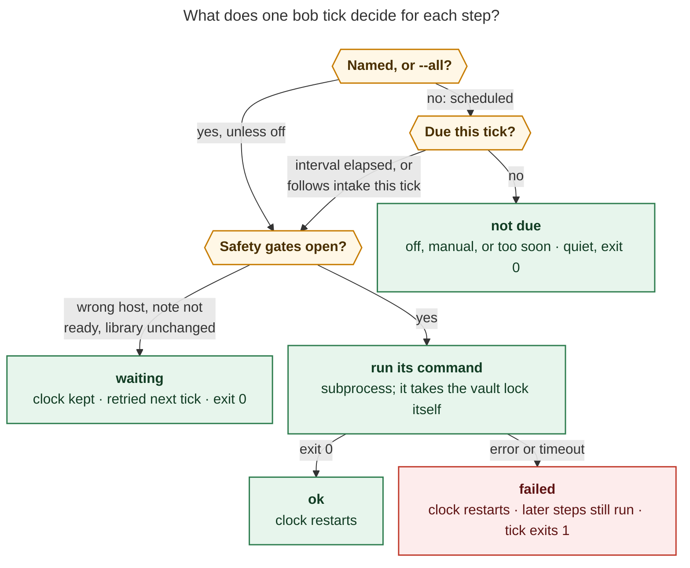

# One command for Bob's frequent Mac work: build `bob tick`

**Date:** 2026-11-18 · **Lead researcher consolidation** of five independent reports
(`__cdx`, `__cld`, `__grk`, `__mus`, `__gem`, siblings in this directory) plus the lead's own
verification against bob-cli at `41b1dab3`, apollo's live filesystem, and the earlier review
`research:202611/bob_sync_task_review.md`.

## TL;DR

- **All five researchers say build it, and so do I.** One orchestrator command replaces the
  Mac's four staggered cron jobs, gives Google Calendar its first periodic sync, guarantees
  the fetch→file→tidy order that minute offsets only hope for, and silences the ~77% of cron
  failure mail that was never a real problem (50 of 78 failures in nine days were "no daily
  note yet"; 10 more were the staggered jobs fighting the shared lock).
- **Name: `bob tick`** (grk's pick; runner-up in two other reports). The requested `bob sync`
  is a retired name — `docs/develop/migration-notes.md` retired it in favor of `bob vault-sync`,
  and a live `~/bin/bob_sync` wrapper still runs `exec bob sync "$@"` on apollo (I confirmed
  it; grk reports the same file on athena). Three of five researchers independently rejected
  `sync`. If you value the recognition (`^bob-sync`, the `#sync` chore) over precision, `bob
  sync` is workable — two researchers chose it — but it needs your explicit OK, wrapper
  deletion, and a permanent "for Git, use `bob vault-sync`" disclaimer.
- **Shape:** a Vault-section leaf verb next to `nightly`. Closed catalog of six steps in a
  fixed order — **gcal → gmail → refs → projects → tasks**, with **gkeep manual-only** — each
  run as a supervised subprocess of its existing command. Config controls *how often*, never
  *what order*: `tick.steps.<name>: 15m | 1h | manual | off` in chezmoi-managed
  `~/.config/bob/config.yml`.
- **Your gcal requirement:** `tick.steps.gcal: 1h` in chezmoi, enforced by a persisted
  due-gate inside the command (failures consume the hour too), and the gate also counts any
  `bob gcal sync` recorded in gcal's own host status — so the Ledger Tools note-creation run
  and a manual morning run push the next scheduled sync out past the hour.
- **Mac crontab:** four jobs become one — `*/5 * * * *  bob tick -q` — in one chezmoi commit
  that lands only after the release train ships the command to the Mac.
- **Biggest win nobody asked for:** the current Highlights wrapper's "anything changed?" gate
  never skipped once in 521 runs, so the Mac burns **~1.7 hours of full-library PDF scanning
  per day** (708 PDFs, 100–223 s per run on active days). A real change gate inside the
  `refs` step makes most ticks near-free and deletes the shell wrapper.

## 1. What all five reports agree on

The consensus is broad enough to treat as settled:

1. **Proceed, scoped to a small orchestrator.** Not a daemon, not a LaunchAgent, not a
   workflow language, and never folded into `bob task reconcile` (CLI rules reserve
   `bob task <verb>` for vault-wide task-line rewrites, and network failures don't belong in
   reconcile's 2-minute retry budget).
2. **No lock held across steps.** `bob nightly` holds `bob_sync.lock` for its whole run
   (confirmed at `src/native/nightly.rs:104`); copying that every few minutes would freeze
   capture, task moves, and the 15-second vault-sync LaunchAgent. Each step takes the shared
   lock itself, exactly as today. The orchestrator adds only its own run lock; a second
   concurrent run exits 0 with "already running".
3. **Per-step outcomes `ok` / `waiting` / `failed`.** The tick exits 1 only when a step that
   actually ran failed. A missing or unrendered daily note is `waiting`, exit 0 — this alone
   kills the 50-mails-a-night failure class. Gmail's own two-hour stale-busy rule and gcal's
   `WaitingReason` machinery pass through untouched.
4. **Closed catalog, fixed order, cadence-only config.** "Highly configurable" is honored as
   which steps and how often — never arbitrary commands, user ordering, or per-step flag
   passthrough. Order is a correctness property (fetch → file → tidy, reconcile last).
5. **gkeep stays manual in v1.** It clips web pages, can prompt, and needs a separately
   reviewed unattended policy. This means the morning `#gtd #pre #sync` chore shrinks to one
   command but is not automatically retired on day one.
6. **The hourly gcal cap is enforced in code and expressed in chezmoi.** A cron schedule
   alone cannot hold the bound across re-timed ticks, wake bursts, and hand-runs; a persisted
   host-local due-gate can.
7. **Two-phase rollout, binary first.** The cron swap lands only after
   `ssh mac bob tick --help` works; otherwise cron mails "unrecognized subcommand" every
   tick. All changes go through `cronctl check` / `diff` / `apply` / `status` — never raw
   `crontab`. The release train ships the binary; no version or CHANGELOG edits.
8. **One receipt.** A versioned JSON receipt saved to the state dir after every run (plus
   `-f json`), mirroring the `ref scan` receipt pattern, so a future Bob Mac Capture health
   badge needs no new protocol. Writer/host pinning (slug verified on the live Mac first —
   `gcal.writer` and `gmail.writer` are currently commented out, and bead `bob-cli-ew` says
   the Mac's label drifts).
9. **Finish with a decision record** ("Bob's frequent background work is one ordered
   `bob tick` pass; cadence is per-step config, order is fixed") and docs updates
   (`vault-git-sync.md`, `gcal.md`, `gmail.md`, `highlights-ref-sync.md`,
   `migration-notes.md`, generated CLI reference).

## 2. The name (the main dispute, resolved)

Five researchers produced four different names. The tally, with what my own verification
adds:

| Candidate | Votes | For | Against | Verdict |
| --- | --- | --- | --- | --- |
| **`tick`** | grk (pick), mus (hidden alias), gem (#3) | 4 letters; says exactly what the command is (one scheduler tick: run what's due); cron-native; the 49 repo hits are UI-animation and checkbox senses, not commands | "Tick of what?" on first read; slightly mechanical for the morning hand-run | **Pick** |
| `sync` | cld (pick), mus (pick) | Matches `^bob-sync`, the `#sync` chore, `pre_stages: [sync]`, and every member command's verb; 4 letters | Retired name (migration notes, confirmed); live `~/bin/bob_sync` wrapper on apollo (confirmed: `exec bob sync "$@"`) and reportedly athena; collides with `vault-sync` + five nested `<noun> sync` subcommands; 3 of 5 researchers reject | Fallback, needs your OK |
| `pulse` | gem (pick) | 5 letters; pairs with `nightly`; only 6 repo hits, all UI senses | Describes the heartbeat, not the effects; "doctor" owns health language | Viable third |
| `refresh` | cdx (pick) | Everyday English | **473** whole-word hits in docs/src — Task Freshness owns this word (`[refresh::]`, freshness upkeep) | Reject |
| `tend` | cld (runner-up) | Zero repo hits | Vague; needs `--help` to understand | Reject |

**Recommendation: `bob tick`.** The command's true nature is a scheduler tick — most
invocations check what's due and often run nothing, which "sync" would misdescribe. It has
the broadest cross-report support, zero meaningful collisions, and a crontab line reading
`bob tick -q` every 5 minutes explains itself. Do **not** register `bob sync` as a hidden
alias (CLI alias rules cover renames, not new commands, and an alias would reactivate the
stale wrappers); add an unknown-command hint instead ("vault Git is `bob vault-sync`;
periodic maintenance is `bob tick`"), and delete the unmanaged `~/bin/bob_sync` wrappers in
the rollout regardless of the name chosen.

## 3. Disagreements between reports, and how I resolved them

| Question | Positions | Resolution |
| --- | --- | --- |
| **In-process or subprocess steps?** | In-process like `nightly` (mus, gem) vs supervised subprocess (cdx, cld, grk) | **Subprocess**, via `std::env::current_exe()` with each command's `-f json`. cdx's safety argument is decisive: arbitrary synchronous Rust work cannot be timed out by abandoning a thread, so in-process steps make the per-step ceiling a fiction. Subprocess gives panic/hang isolation, a real process-group kill, and zero changes to the step commands. `subprocess_runner.rs` (used by gkeep/gcal) already spawns into a process group, drains pipes, and kills at a deadline. |
| **Step order** | refs first, per today's docs (cdx, grk, mus) vs fast external fetches first (cld, gem) | **gcal → gmail → refs → projects → tasks.** The refs-first order is an artifact of cron-stagger history, not a data dependency. Fast, time-sensitive steps (gcal ~3 s, gmail ~25 s) shouldn't queue behind a scan with p90 133 s; starting gcal first also keeps its hourly spacing from drifting with scan length (cld), and projects after gmail/refs lets newly filed tasks reach `^prj` and catalogs in the same tick (gem). Reconcile last is unanimous. |
| **Cron heartbeat** | every 5 min (cdx, cld) vs every 15 min (grk, mus, gem) | **Every 5 minutes.** The heartbeat is not the work interval: due-gates decide what runs, so a 5-minute tick costs one cheap no-op process and buys fast catch-up after wake and a prompt retry once Templater finishes the daily note. cronrun's per-job overlap guard plus the run lock make wake bursts harmless. |
| **Timeout semantics** | budget → `waiting`, move on (review, grk, mus) vs timeout = failure (cdx) vs 30-min awake-time ceiling (cld) vs no timeouts, fix root causes (gem) | **Both gem and cdx are right.** First remove the reason steps are slow (the refs change gate, §5). Then keep a generous per-step ceiling measured in **awake** time (`Instant` doesn't advance during macOS sleep, so a lid-close mid-scan is not a timeout — cld), and when it fires, SIGTERM then process-group SIGKILL, and record **`failed`**, never `waiting` — a killed child may have partial work, and later steps run only once mutation has provably stopped (cdx). Calibrate ceilings on awake-machine measurements, not sleep-inflated tails. |
| **Does a failure restart a step's clock?** | Yes (cdx: reservation consumed; cld) vs stamp on attempt (mus) vs read last-success externally, ignoring errors (gem) | **Yes — failures consume the interval.** This is what makes `gcal: 1h` a real cap: a failing gcal retries next hour, not every 5 minutes. `waiting` never restarts the clock (a step waiting on the daily note runs on the first tick after it appears). Track `last_success` separately so a persistently failing step still looks broken in status. |
| **gcal yesterday window** | `-n 2` every run (cdx, mus, gem) vs yesterday once a day (cld) | **Yesterday once per day, today every admitted run.** Every gcal run rewrites the `↻ synced` stamp in each note it touches even when nothing changed (`gcal/stamp.rs`, confirmed by gem and cld independently); hourly `-n 2` would churn yesterday's note ~16×/day for nothing. The day's first run closes out yesterday, matching your morning `-n 2` habit. |
| **`--all`** | Omit as hidden-behavior (cdx) vs keep (others) | **Keep `-a/--all`**: run every non-`off` step now, `manual` included. It is the morning-chore replacement, which is a stated goal. Safety gates (writer, note readiness) still apply; only due-gates are bypassed. |
| **Strictness of the new config block** | Unknown keys are errors (cdx, grk) vs warn-and-ignore (mus) | **Strict inside `tick:`, lenient elsewhere.** A typo like `gcal: 1hr` silently ignored would silently drop your cap. I verified bob's config has no `deny_unknown_fields` anywhere, so an unknown *top-level* `tick:` block is ignored by older binaries — the config can safely land in chezmoi before the binary ships. |
| **Follow-up reconcile across interval boundaries** | `tasks.after_changes` with a persisted marker (cdx) vs "projects and tasks follow intake" (cld) | **Merge both:** `projects` and `tasks` also run in any tick where an intake step (gcal/gmail/gkeep/refs) actually ran, and the pending-follow-up marker is persisted so a crash or a waiting daily note cannot lose the final tidy pass. |

## 4. The consolidated design

### Steps

| # | Step | Runs | Default | Gates | Extra rule |
| --- | --- | --- | --- | --- | --- |
| 1 | `gcal` | `bob gcal sync` | `1h` | writer; today's note ready, checked **before** any Google fetch | Day's first run also syncs yesterday; failures consume the hour; shared cooldown with gcal's own status (§6) |
| 2 | `gmail` | `bob gmail sync -q` | `1h` | writer | Its own two-hour busy-skip rule still decides its exit |
| 3 | `refs` | `bob ref scan -w` | `15m` | writer; **change gate** (§5) | Naming `refs` explicitly forces a full scan |
| 4 | `projects` | `bob projects sync` | `15m` | writer | Also runs after any intake step ran this tick |
| 5 | `tasks` | `bob task reconcile --retry-timeout 120` | `15m` | writer; today's note ready | Also runs after any intake step; always last |
| — | `gkeep` | `bob gkeep pull` | `manual` | writer; TTY rules | Never on the timer; `-a` or named only |

Out of catalog on purpose: `vault-sync` (15-second LaunchAgent), `nightly` (athena 03:30),
`plugins sync`, and all once-a-day maintenance. Membership rule for the docs: *a step
belongs in `bob tick` if it should run more than once a day on the writer host.*



**Figure 1.** Every step passes the same three questions in the fixed order. Only a step
that actually runs restarts its clock — so a step waiting on the missing daily note runs on
the first tick after the note appears, while a failing gcal cannot retry inside its hour.
A closed gate never fails the tick or sends mail. (Rendered with mermaid-cli 12.0.0 under
the PDF config: 789.7 × 1034 px, fit 82.7%.)

### Configuration (chezmoi `home/dot_config/bob/config.yml`)

```yaml
# `bob tick` runs Bob's frequent background work in one fixed order:
# gcal → gmail → refs → projects → tasks (gkeep is manual). Mac cron calls it
# every 5 minutes; a step runs only when its interval has passed since it last
# ran on this host (projects and tasks also follow any intake step that ran).
# Values: an interval (15m, 1h), manual, or off. `bob tick -d` shows the plan.
# Older bob builds ignore this block.
tick:
  # writer: kellys-macbook-pro   # set after verifying the slug (bob gcal doctor)
  steps:
    gcal: 1h        # never more often: each run rewrites the ↻ synced stamp
    gmail: 1h       # stays inside Gmail's two-hour staleness warning
    refs: 15m       # skips fast unless lib/ or xlib/ changed (full scan ≥ every 6h)
    projects: 15m
    tasks: 15m
    gkeep: manual   # clips web pages; runs only with -a or when named
```

Grammar: `<N>m` / `<N>h` with N ≥ 1, or `manual` / `off` (matching the existing
`gkeep.check_interval` dialect and the `ready_cap: off` precedent). Unknown step names and
unknown keys **inside this block** are config errors (exit 2, naming the key). An absent
block uses the defaults above; pin the values in chezmoi anyway so the gcal requirement
lives in the source of truth, not in a default that could change. A step value may later
grow into an object (`gcal: {every: 1h, days: 2}`) if a typed option earns its place — not
in v1, and never a user-configurable `order` (gem proposed one; rejected, order is
correctness).

### CLI

```text
bob tick                 # run every due step (what cron runs)
bob tick -a, --all       # run every non-off step now, gkeep included (the morning catch-up)
bob tick gmail gcal      # run only these steps, now (due-gates bypassed, safety gates kept)
bob tick -d, --dry-run   # show each step's plan, last result, and why it would wait
bob tick -s, --status    # show stored results, last success, next due (read-only)
bob tick -f json         # machine-readable receipt
bob tick -q, --quiet     # print only waiting reasons and failures
```

A leaf verb in the Vault help section next to `nightly` (a group whose bare form mutates
would violate CLI rules). Options alphabetical, every long flag with a short alias. `-d` and
`-s` are read-only everywhere, including non-writer hosts; on a non-writer host the default
run prints the writer hint and exits 0.

Output copies `nightly`'s visual discipline (box-drawing headers, ✓/✗/◌ glyphs, TTY-gated
color via the existing `Styler`, `NO_COLOR` honored, structure never color-only so cron logs
read clean), one line per step plus a summary line last so cronrun's 40-line failure mail
always contains it. State and receipts live under `$XDG_STATE_HOME/bob-cli/tick/` (atomic
writes after each step; schema-versioned `last.json`), and on macOS the run posts a
`org.bobs.bob.tick-finished` Darwin notification mirroring the ref-scan receipt, so a future
Mac Capture badge is free.

## 5. The refs change gate (the biggest measured win)

Two researchers independently found the same thing: the current wrapper's skip gate is
broken in practice. `maybe_bob_highlights_sync` skips only when **no** `lib/` file changed
within 24 hours (`find -mtime 0`), so touching one PDF forces full-library scans every 15
minutes for the next day — and in cld's nine-day log census the gate **never once skipped**
(521 of 521 runs scanned, p50 79 s, ~1.7 h/day; gem measured 100–223 s per run on an active
afternoon). Folding `bob ref scan -w` into the orchestrator *without* a better gate would
keep burning that.

The `refs` step's scheduled gate: run only when (1) a **listing fingerprint** of `lib/` and
`xlib/` — a hash of each file's sorted relative path, size, and mtime, milliseconds to
compute for 708 files — differs from the last successful scan's, (2) `highlights.pre_scan_hook`
is configured, or (3) the last full scan is older than a safety ceiling (6–24 h) covering
vault-side repairs the fingerprint can't see. This answers cdx's caution about naive mtime
heuristics (the fingerprint sees additions, deletions, moves, and edits) while preserving
scan's own clean no-work path and PDF `.forMerging` coordination untouched. The shell
wrapper and its bash test are then deleted from chezmoi. Follow-up, not a blocker: a per-PDF
unchanged-skip cache inside `bob ref scan` itself, which would speed manual scans too.

## 6. The hourly gcal cap, precisely

The requirement — "`bob gcal sync` not run more than hourly on my mac" — is enforced in
three layers, weakest to strongest:

1. **Chezmoi expresses it:** `tick.steps.gcal: 1h` in `config.yml`, with the cron line
   carrying no gcal-specific schedule at all, so there is no second place for the bound to
   drift.
2. **The due-gate enforces it for scheduled runs:** persisted host-local state; the clock
   restarts on every run that actually fetched, **including failures** (a failing gcal
   retries next hour, not next tick), and never on `waiting` (a missing daily note consumes
   nothing — otherwise a 07:25 wait could starve the 07:30 note's first sync).
3. **The gate also counts other callers:** before admitting gcal, the due-gate takes
   `max(tick state, gcal's own host status timestamp)` for attempts that actually fetched
   (gem's mechanism; it answers grk's open question). Ledger Tools' once-a-day run at
   note creation and a manual `bob gcal sync` therefore push the next *scheduled* sync out
   past the hour, instead of double-running minutes apart.

Under this design, explicit runs you ask for by name (`bob tick gcal`, direct
`bob gcal sync`) are **not throttled** — the cap governs the automated paths, and your
manual run delays the next automatic one. That is my reading of your intent, called out as
an adjustment below. cdx designed the stricter variant — a durable admission guard inside
`bob gcal sync` itself that throttles *every* caller including manual and `-F` — and its
report (sibling `__cdx`, "Calendar: make 'no more than hourly' a real invariant") is the
blueprint if you mean the requirement literally. I recommend not starting there: it adds
clock-anomaly and state-loss machinery and makes an urgent manual reset wait, for a
guarantee the three layers above already provide in practice.

Why the cap matters at all: not Google quota (two calendars × two days × 24 runs is noise
against the 600 req/min/user limit) but note churn — every sync rewrites the `↻ synced`
stamp in each touched note — plus the Templater race that made aggressive unattended gcal
dangerous (the rejected 5-minute LaunchAgent, the Haircut incident, and
`decisions:gcal-force-resets-the-day`).

## 7. Chezmoi and the Mac crontab (the exact change)

**Commit 1 (chezmoi, safe immediately):** add the `tick:` block to
`home/dot_config/bob/config.yml` (older binaries ignore unknown top-level keys — verified:
no `deny_unknown_fields` in bob's config structs), update the gcal comment ("`bob tick` runs
it hourly on the Mac; Ledger Tools also runs it once when today's note is created"), and set
`gcal.writer` / `gmail.writer` / `tick.writer` once the Mac's slug is confirmed via
`bob gcal doctor` (the current comments guess two different slugs; don't copy a guess).

**Commit 2 (chezmoi, only after the release train ships `bob tick` and
`ssh mac bob tick --help` works):** in `home/.chezmoidata.yaml`, replace
`bob-highlights-sync`, `bob-projects-sync`, `bob-gmail-sync`, and `bob-task-reconcile` with:

```yaml
    # mac: one ordered tick. `bob tick` decides what is due from tick.steps in
    # ~/.config/bob/config.yml (gcal and gmail hourly; refs, projects, tasks
    # every 15 minutes; gkeep manual) and runs it gcal → gmail → refs →
    # projects → tasks. See bob-cli docs/tick.md; `bob tick -d` shows the plan.
    - name: bob-tick
      machines: [mac]
      schedule: "*/5 * * * *"
      description: Run Bob's due background work in one ordered pass
      command: bob tick -q
```

The same commit deletes `home/bin/executable_maybe_bob_highlights_sync` and its bash test.
Then the crontab skill's workflow: `cronctl check --source <checkout>` →
`cronctl diff mac --source <checkout>` (expect four lines out, one in) → push →
`cronctl apply mac` → `cronctl status mac` reporting `in_sync` (report `pending` honestly if
the Mac is asleep; config edits alone are not "applied"). Also delete the unmanaged
`~/bin/bob_sync` wrappers on apollo (confirmed present) and athena (grk reports it; verify).
Rollback is reverting commit 2 and re-applying; the individual commands stay installed, so
the swap changes scheduling, not capability.

Leave alone: the `com.bbugyi.bob-vault-sync` LaunchAgent (15-second Git transport), athena's
03:30 `bob nightly`, and apollo's `bob-ref-intake` timer (intake-at-birth stays split from
the Mac annotation scan per `decisions:references-are-ingested-at-birth`).

## 8. Adjustments to your requirements (called out)

1. **Name:** `bob tick`, not `bob sync` — your instinct that the name wasn't right is
   shared by three of five researchers. `bob sync` remains available as a deliberate choice
   if recognition wins for you (§2).
2. **Six steps, not four.** The task named four commands; `projects sync` is the fifth
   periodic Mac job and belongs in the pass, and `gkeep` joins as a manual-only sixth so
   `bob tick -a` can replace the whole morning chore.
3. **"Not more than hourly" reads as: automated gcal runs at least 60 minutes apart, with
   every caller counting toward the clock; explicit manual runs stay unthrottled.** The
   literal all-callers variant exists (cdx's admission guard) if you want it.
4. **Cron ticks every 5 minutes; the work keeps today's cadence** (15 m local, hourly
   remote). The heartbeat is not the work interval; it buys catch-up after wake.
5. **"Highly configurable" means cadence only.** Closed catalog, fixed order, typed values.
   No arbitrary commands, no user ordering, no per-step flag passthrough.
6. **gcal syncs yesterday once a day**, not on every run — the stamp-churn evidence makes
   hourly `-n 2` strictly worse.
7. **Added, beyond the task's ask:** the refs change gate (the largest measured cost, ~1.7
   h/day), subprocess supervision with timeout-as-failure, host pinning, wrapper deletion,
   and the shared gcal cooldown across callers.
8. **Not promised in v1:** retiring the `#sync` chore on day one (keep it until
   `bob tick -a` has been used by hand), a Mac Capture health badge (the receipt makes it
   cheap later), and any change to vault-sync or nightly.

## 9. Open questions for you

1. **The name.** `bob tick` as recommended, or do you want `bob sync`'s recognition despite
   the retired meaning and wrappers? (Everything else in this design is identical under
   either name.)
2. **The cap's letter.** Is "not more than hourly" about the automated paths (my reading),
   or literally every invocation including your own hand-runs? The latter picks cdx's
   in-command admission guard.
3. **The morning chore.** Change `gtd_daily`'s `#pre #sync` row to `bob tick -a` in the
   same rollout, or after a soak week?
4. **The writer slug.** What does `bob gcal doctor` print on the Mac? That string belongs in
   `tick.writer` (and in the currently commented `gcal.writer` / `gmail.writer`).

## 10. Where the full detail lives

Each sibling report in this directory goes deeper on one axis: **`__cdx`** on supervision
correctness, truthful outcomes, and the strict gcal invariant (read §"Timeouts need a
truthful safety boundary" before implementing); **`__cld`** on the failure census, the refs
fingerprint gate, scheduling semantics stated exactly, and the richest CLI/output sketches;
**`__grk`** on CLI-rules fit, the ownership split between cron and config, and the
alternatives table; **`__mus`** on the case for `sync`, config conventions, and the
layered-enforcement argument; **`__gem`** on measured step behavior (stamp churn, the
3-second projects lock wait, cooldown sharing) and the status view. The implementation plan
should start from cld's module layout (`schedule.rs` pure and `BOB_NOW`-tested, `steps.rs`
registry, `state.rs` atomic, `render.rs`, `lock.rs`) with cdx's acceptance-test table as the
proof bar and grk's implementation order (reconcile-waiting first, as an independently
valuable slice that can ship a train earlier).

## Sources

- The five sibling reports and their own cited evidence: bob-cli at `41b1dab3`, chezmoi at
  `002760c3`, live `cronctl` state and nine days of Mac cron logs (2026-11-09 → 2026-11-18,
  ~1,700 runs), the vault (`bob.md` `^bob-sync`, `gtd_daily.md`), bob-plugins Ledger Tools.
- Assigned context: `research:202611/bob_sync_task_review.md`.
- Lead's own verification this session (apollo, bob-cli workspace at `41b1dab3`):
  `~/bin/bob_sync` on apollo (114 bytes, 3 Jul, `exec bob sync "$@"`); `src/runner.rs` (no
  top-level `sync`; nested `sync` subcommands at lines 463/516/638);
  `docs/develop/migration-notes.md:39-41` (retirement); no `deny_unknown_fields` in
  `src/native/config/`; `src/native/gkeep/config.rs` (`check_interval` duration dialect);
  `src/native/nightly.rs:104` (whole-run shared lock); whole-word collision counts in
  docs/src — `refresh` 473, `tick` 49 (UI/checkbox senses), `pulse` 6 (UI senses), `tend` 0.
- Memory: `crontab.md`, `cli_rules.md`, `docs.md` (via the researchers' audited reads);
  decisions `bob-gcal-is-read-only-and-proposes-once`, `gcal-force-resets-the-day`,
  `references-are-ingested-at-birth`, `bob-cli-releases-ride-a-daily-train`.
