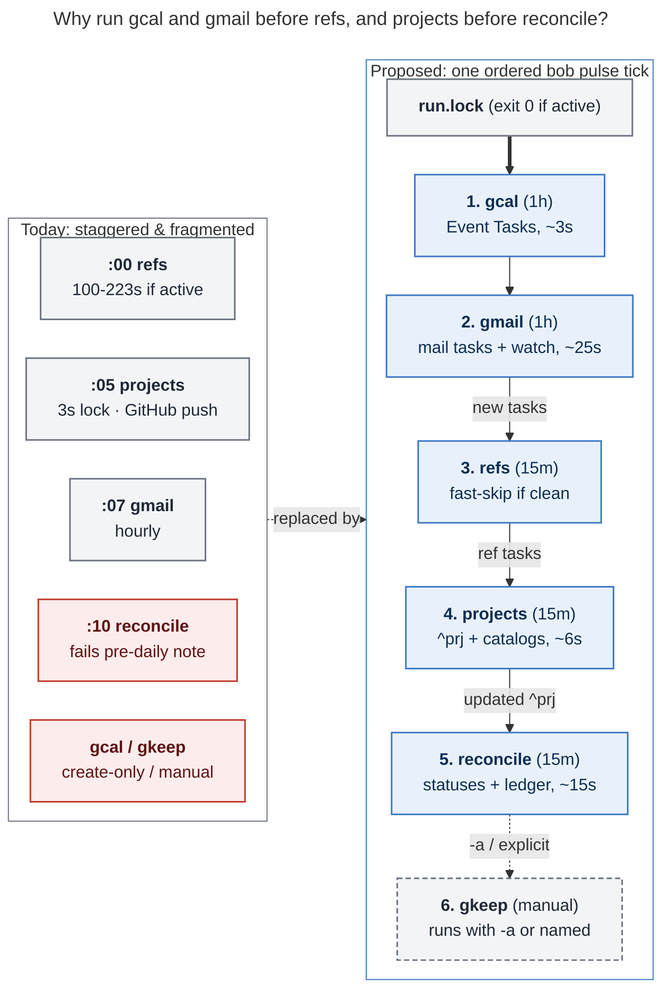
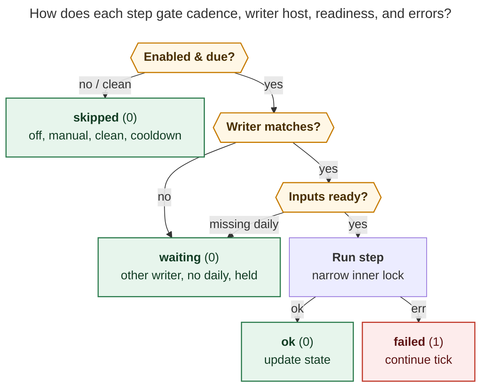

# Designing `bob pulse`: Orchestrating Frequent Periodic `bob` Maintenance

**Date:** 2026-11-18 · **Role:** Independent Researcher (`gem`) · **Context:** `research:202611/bob_sync_task_review.md`, `bob-cli` source & docs, `chezmoi` (`dot_config/bob/config.yml`, `home/.chezmoidata.yaml`, `cronrun`, `maybe_bob_highlights_sync`), live `cronctl` Mac logs, `bob-plugins`, `bob-mac-capture`

---

## TL;DR & Recommendation

- **Overall verdict:** **Proceed — with important architectural adjustments.** Replacing four staggered Mac cron jobs plus an unscheduled `gcal` sync and a manual `#sync` morning chore with one in-process Rust orchestrator is a clear win, **provided** you fix three traps in a naive sequential design: the 100–223 s `ref scan` bottleneck, `projects sync`'s 3-second lock wait + redundant GitHub push, and `task reconcile`'s nightly failure before the daily note exists.
- **Recommended command name:** **`bob pulse`** (5 chars) — paired symmetrically with **`bob nightly`**. Avoid `bob sync`: it collides with `bob vault-sync` and the retired `bob sync` command, invites Git-sync confusion, and requires help-text disclaimers. (`bob sweep` and `bob tick` are the strongest runner-ups.)
- **Core architecture:** Implement `bob pulse` as a **Vault-section Leaf command** (matching `bob nightly`, compliant with `cli_rules.md`) driven by a strongly typed `pulse:` block in `~/.config/bob/config.yml` over a **curated 6-step allowlist** (`gcal`, `gmail`, `refs`, `projects`, `reconcile`, `gkeep`).
- **Adjusted step order:** **`gcal` → `gmail` → `refs` → `projects` → `reconcile`** (plus `gkeep` as `manual` by default). Fast `gcal` and `gmail` run before slow `refs`, `projects` runs *after* both `gmail` and `refs` so new project tasks update `^prj` in the same tick, and `reconcile` runs last.
- **Guaranteeing `bob gcal sync` runs at most hourly on Mac:** Configure `pulse.steps.gcal.interval: 1h` in `chezmoi/home/dot_config/bob/config.yml` AND have `bob pulse` check `max(pulse/state.json, bob/gcal/status.json)` timestamps so even Obsidian's create-time `bob gcal sync` trigger counts toward the 1-hour cooldown.
- **Mac crontab:** Replace the four staggered Mac cron jobs (`bob-highlights-sync`, `bob-projects-sync`, `bob-task-reconcile`, `bob-gmail-sync`) in `chezmoi/home/.chezmoidata.yaml` with **one** 15-minute job (`bob-pulse` running `bob pulse`), retiring `maybe_bob_highlights_sync`.

---

## 1. Ground-Truth Context & Empirical Audit

Inspecting `bob-cli`, `chezmoi`, `bob-plugins`, and live Mac cron logs via `cronctl` confirms the core findings in `research:202611/bob_sync_task_review.md` and uncovers several critical runtime details that directly shape the design.

### 1.1 Current Mac Schedule and Measured Runtime Behavior

From `chezmoi/home/.chezmoidata.yaml` and `cronctl status --all --all-schedulers` / `cronctl logs ... --machine mac` on 2026-11-18:

| Trigger | Mechanism | Schedule | Actual Mac Runtime / Behavior Observed |
| --- | --- | --- | --- |
| `bob-highlights-sync` | `cronrun` | `0,15,30,45 * * * *` | Runs `maybe_bob_highlights_sync -w`. On 2026-11-18, **every 15-minute run from 13:00Z–16:45Z took 100–223 s** (`duration=105s`, `104s`, `100s`, `201s`, `159s`, `102s`). |
| `bob-projects-sync` | `cronrun` | `5,20,35,50 * * * *` | Runs `bob projects sync` across 100 projects (**5–10 s**), taking `bob_sync.lock` for **3 s max** (`LOCK_WAIT`) and running two GitHub `vault_sync` cycles (`run_locked`). |
| `bob-gmail-sync` | `cronrun` | `7 * * * *` | Runs `bob gmail sync -q` (**25–209 s** on 2026-11-18; holds host-local guard `sync-<digest>.lock` with 2 h staleness escalation). |
| `bob-task-reconcile` | `cronrun` | `10,25,40,55 * * * *` | Runs `bob task reconcile --retry-timeout 120` across 5,723 files (**14–15 s**). Exits **1** whenever today's daily note does not exist yet (00:10–07:10 daily). |
| `com.bbugyi.bob-vault-sync` | LaunchAgent | Every 15 s | Runs `exec /Users/bbugyi/.cargo/bin/bob vault-sync -q` under `bob_sync.lock`. |
| `bob gcal sync` | Obsidian plugin | On daily-note create | `bob-ledger-tools` (`291-plugin-gcal-events.js`) runs `bob gcal sync -q --format json` once after Templater finishes today's note; no periodic trigger exists. |
| `#gtd #pre #sync` chore | Manual | Daily | Runs `gcal sync -n 2`, `gkeep pull`, and `gmail sync` manually. |

### 1.2 Critical Technical Findings Missed or Understated Previously

1. **Why `maybe_bob_highlights_sync -w` runs for 2+ minutes every 15 minutes on active days:**
   `chezmoi/home/bin/executable_maybe_bob_highlights_sync` skips `bob highlights scan -w` only when `pre_scan_hook` is unset, `xlib/` is empty, **and** `find "$lib_dir" -type f -mtime 0` returns nothing. Because `-mtime 0` stays true for **24 hours** after modifying or adding a single PDF, reading or annotating one PDF forces a full library PDF parse (~100–223 s!) every 15 minutes for the next 24 hours. Worse, folding `bob ref scan -w` into a new orchestrator *without* replacing `maybe_bob_highlights_sync`'s check would run that 100+ s scan even on zero-PDF days.
2. **Why `bob projects sync` suffers spurious lock & DNS failures:**
   Standalone `bob projects sync` delegates to `host_catalog::run_locked` (`src/native/host_catalog/txn.rs:38`), which waits only **3 seconds** for `bob_sync.lock` and always executes pre-sync and post-sync GitHub `vault_sync` cycles. On a Mac waking from sleep alongside a 15-second `bob-vault-sync` LaunchAgent, a 4-second sync cycle or waking Wi-Fi DNS causes avoidable failures (9 lock errors + 3 DNS errors in 9 days).
3. **Why `bob gcal sync` must NOT run every 15 minutes (and why `-n 2` has stamp churn):**
   In `src/native/gcal/plan.rs:705` and `src/native/gcal/stamp.rs:5-6`, `plan_stamp` rewrites `*↻ synced <when> · [<account>](...)*` on **every** synced day at every new minute, even when zero events changed. Running `bob gcal sync -n 2` every 15 minutes would dirty both yesterday's and today's notes ~96 times/day unnecessarily. Running hourly (`1h`) aligns directly with Bryan's constraint and keeps stamp churn low.
4. **`cronrun` already separates log output from cron mail:**
   `chezmoi/home/bin/executable_cronrun:450-530` captures all stdout/stderr into `~/.local/state/cron/<job>.log` (rotated at 1 MiB) and emits **nothing** on `exit 0`. Only a non-zero exit prints a 1-line summary + last 40 log lines to stderr for `MAILTO`. Therefore, the new command can print a rich, readable human summary on every cron run without causing email spam.
5. **Host writer pins in `chezmoi/home/dot_config/bob/config.yml` are currently commented out:**
   Lines 95 and 113 have `#   writer: kellys-macbook-pro` and `# writer: kellys-macbook-pro-local` commented out, while `cronctl logs` reports `host=Kellys-MacBook-Pro` (which `vault_sync::hostname_slug()` maps to `kellys-macbook-pro`, unless `scutil --set HostName Kellys-MacBook-Pro.local` from `.chezmoidata.yaml:42` was run). Any `writer:` setting must be verified on the live Mac first.
6. **`cli_rules.md` constrains CLI group defaults:**
   `sase/memory/cli_rules.md` states: *"A bare group may default only to a flag-only, read-only member; `vault-sync` (bare = `run`) is the grandfathered exception and is labeled in help."* A bare command that executes mutations must therefore be a **Leaf command** (like `bob nightly`), not a `Target::Group`.

---

## 2. Plan Critique & Justified Adjustments to Requirements

### 2.1 Is This Plan a Good Idea?

**Yes — with targeted scope corrections.** Consolidating the Mac's four cron jobs + unscheduled `gcal` + manual `#sync` chore into one in-process Rust orchestrator delivers five real gains:

1. **Eliminates cross-job lock contention:** One sequential runner means `projects`, `gmail`, `gcal`, `refs`, and `reconcile` never fight each other over `bob_sync.lock` on Mac wake.
2. **Fixes sleep-induced cadence starvation:** Fixed-minute cron (`7 * * * *` for Gmail) skips an entire 2-hour window if the Mac is asleep at `:07`. Elapsed-time interval checks inside a 15-minute runner execute due `1h` jobs (`gcal`, `gmail`) on the **first awake tick** after sleep.
3. **Provides causal ordering in a single tick:** Tasks created by `gcal`, `gmail`, or `refs` flow directly into `projects` (`^prj` visibility/catalogs) and `reconcile` (status lanes, dependencies, `LINKS`/`LINKED FROM`) inside the same pass.
4. **Silences false nightly alarms:** Treating missing/unrendered daily notes in `reconcile` as `waiting` (`exit 0`, matching `gcal`) removes ~64% of observed cron failure mail while preserving alerts for real faults (like multiple open timed Pomodoros).
5. **Creates a single inspectable state + receipt:** Terminal status (`-s`) and a `last-run.json` receipt give both Bryan and `Bob Mac Capture` one place to check background health.

### 2.2 Justified Adjustments to Initial Requirements & Task Review

| # | Original Assumption / Requirement | Proposed Adjustment | Justification |
| --- | --- | --- | --- |
| **1** | Name the command `bob sync` | **Rename to `bob pulse`** (Section 3) | `bob sync` collides with `bob vault-sync` and retired `bob sync` history, misleads users expecting Git sync, and forces help disclaimers. |
| **2** | Order `refs → projects → gmail → gcal → reconcile` (`bob_sync_task_review.md`) | **Reorder to `gcal → gmail → refs → projects → reconcile`** (+ manual `gkeep`) | Fast `gcal` (~3 s) and `gmail` (~25 s) shouldn't wait 2–4 min behind `refs`; `projects` must run *after* `gmail` and `refs` so newly filed tasks update `^prj` `#hide` in the same tick; `reconcile` stays last. |
| **3** | Abort slow steps via hard step timeout budgets (`bob_sync_task_review.md`) | **Fix root cause with an mtime-frontier fast-skip in `refs` + bounded internal retries** | Killing an in-process Rust step mid-write or mid-lock is unsafe and arbitrary (`ref scan` routinely takes >100 s). Skipping `refs` unless `xlib/` is non-empty, `pre_scan_hook` is set, or a file in `lib/` has `mtime > last_scan` cuts idle ticks to <5 ms without unsafe aborts. |
| **4** | Run `gcal` every 15m (`bob_sync_task_review.md`) | **Set `gcal` default & Mac config to `interval: 1h`** and share cooldown with `bob/gcal/status.json` | Honors Bryan's explicit ≤hourly cap on Mac, prevents 96/day stamp-only note edits, and avoids double-firing 3 minutes after Obsidian's create-time `gcal sync`. |
| **5** | Call `bob projects sync` standalone wrapper (`run_locked`) as-is | **Use a dedicated step entry with `30s` lock wait and `sync_git: false` option** | Eliminates the 9 lock timeouts (3 s wait was too short against 15 s `vault-sync`) and 3 wake-DNS failures; `bob-vault-sync` commits & pushes local scoped commits within 15 s. |
| **6** | Unbounded/arbitrary command configurability | **Typed `pulse:` YAML config over a curated 6-step allowlist** with validated durations, order, and per-step options | Gives Bryan full control over which steps run, order, cadence (`1m..24h | manual | off`), and step flags without turning `bob` into a brittle shell-script runner (`sh -c` cron already exists for arbitrary commands). |

---

## 3. Naming Analysis: Why `bob pulse` Beats `bob sync`

### 3.1 What Makes a Great Name Here?

Bryan's constraints: **better semantic fit than `bob sync`, intuitive, and not too long.** In `bob-cli`, top-level commands follow crisp, 1-word verbs/nouns grouped by workflow (`capture`, `freshness`, `plan`, `ready`, `walks`, `nightly`, `vault-sync`).

Why **`bob sync` fails**:
- **History collision:** `bob sync` was the former name of `bob vault-sync` (`docs/develop/migration-notes.md:39-41`). Muscle memory and older notes/scripts (including the stale `~/bin/bob_sync` wrapper) associate `bob sync` with Git sync.
- **Ambiguity with `vault-sync`:** Every `bob` help page and agent instruction would have to disambiguate `bob sync` vs `bob vault-sync`.
- **Inaccuracy:** `task reconcile` and `projects sync` (lifecycle pruning) are local vault reconciliation, not external syncs.

### 3.2 Candidate Comparison

| Candidate | Chars | Pairs with `nightly`? | Collision with existing `bob` terms? | Intuitive meaning (cron & manual) | Verdict |
| --- | ---: | --- | --- | --- | --- |
| **`bob pulse`** | **5** | **Excellent** (`nightly` = deep sleep pass; `pulse` = daytime heartbeat) | **None** | `bob pulse` (tick), `bob pulse -a` (full run), `bob pulse -s` (status) | **#1 Recommended** |
| `bob sweep` | 5 | Good (sweep inboxes, refs, projects, tasks) | None | Strong action feel (`bob sweep -a`); slightly less natural for `gcal` | #2 Runner-up |
| `bob tick` | 4 | Good | None | Very crisp for cron (`bob tick`), slightly mechanical for manual `-a` | #3 Runner-up |
| `bob refresh` | 7 | Fair | Minor ("refresh" sounds read-only, unlike `gmail` archiving or `reconcile`) | Clear intent, slightly long | Alternative |
| `bob cycle` | 5 | Good | Minor (`vault-sync` calls its run a "reconcile cycle") | Slightly generic | Reject |
| `bob upkeep` | 6 | Good | **Yes** (`freshness`/`walks` docs use "upkeep" for ROTTEN/POST review) | Domain term clash | Reject |
| `bob sync` | 4 | Poor | **High** (`vault-sync`, retired `bob sync`, `bob_sync`) | Confusing with Git sync | Reject |
| `bob cron` | 4 | Poor | Leaks implementation detail | Awkward for manual `-a` runs | Reject |

### 3.3 Help Section & Leaf vs. Group Placement (`cli_rules.md`)

- **Help section:** **`Vault`** (alphabetically between `periods` and `query`, alongside `nightly` and `vault-sync`), since it orchestrates vault-level maintenance across integrations and reconcilers.
- **Leaf vs. Group:** Make `bob pulse` a **`Target::Leaf`** (identical to `bob nightly` in `src/runner.rs:1143`) rather than a `Target::Group`:
  - `cli_rules.md` forbids a `Target::Group` from defaulting bare `bob <cmd>` to a mutating subcommand (`vault-sync` is the sole grandfathered exception).
  - As a **Leaf**, `bob pulse` runs due steps cleanly (so cron is simply `bob pulse` and the morning chore is `bob pulse -a`), while `-s, --status` provides a zero-side-effect status view and `-d, --dry-run` previews without mutating.

---

## 4. Recommended Solution: Complete Feature Design

### 4.1 Execution Pipeline & Step Gate Model



**Figure 1.** Putting fast `gcal` and `gmail` before `refs` keeps calendar and mail latency under ~30 s, putting `projects` after both `gmail` and `refs` lets new project tasks surface `^prj` immediately, and keeping `reconcile` last settles every write in the same tick.



**Figure 2.** Every step passes the same preflight gates before touching locks or network APIs. Only a `failed` step exits `1`; remaining steps always continue so `reconcile` never gets starved by an upstream error.

### 4.2 The Curated Step Allowlist ("Limited Set")

To stay reliable, typed, and self-documenting, `bob pulse` accepts a **closed set of 6 registered steps** (`gcal`, `gmail`, `refs`, `projects`, `reconcile`, `gkeep`). Arbitrary shell strings are intentionally excluded (that is `cron`'s job).

| Step ID | Underlying Bob Core | Default Cadence | Writer Pin | Inner Lock Behavior | Readiness / Fast-Skip Gate |
| --- | --- | --- | --- | --- | --- |
| `gcal` | `gcal::sync` | `1h` | `gcal.writer` | `bob_sync.lock` (30 s wait, write only) | Skips if cooldown active (`pulse/state.json` or `bob/gcal/status.json`!); `waiting` if daily note missing/unrendered/no-Pomodoros/held. |
| `gmail` | `gmail::sync` | `1h` | `gmail.writer` | `sync-<digest>.lock` + `bob_sync.lock` | Skips if cooldown active (`pulse/state.json` or `bob/gmail/sync-state.json`); quiet busy-skip is `waiting` until 2 h `STALE_AFTER`. |
| `refs` | `highlights_ref::scan` | `15m` | Optional | `bob_sync.lock` → `scan.lock` (write only) | `only_when_changed: true`: skips in <5 ms when `pre_scan_hook` unset, `xlib/` empty, and no file in `lib/` has `mtime > last_scan`! |
| `projects` | `projects::sync_engine` | `15m` | None | `bob_sync.lock` (`30s` configurable wait) | Local scoped commit (`sync_git: false` option skips redundant GitHub fetch/push when `vault-sync` handles Git). |
| `reconcile` | `task_status_hooks` | `15m` | None | `bob_sync.lock` (`120s` jittered retry) | `wait_for_daily: true`: missing daily note, unrendered `<% … %>` note, or missing `## Pomodoros` maps to **`waiting` (exit 0)**. Multi-open-timed stays **`failed`**. |
| `gkeep` | `gkeep::pull` | `manual` | Optional | `gkeep/pull.lock` + `bob_sync.lock` | Skipped on normal tick (`manual`); runs on `bob pulse -a` or `bob pulse gkeep` (`--quiet` avoids TTY parent prompt, defaulting to `gkeep_inbox`). |

**Explicitly excluded commands (and why):**
- `vault-sync`: already runs every 15 s via LaunchAgent (Mac) and inotify service (Linux); mixing it in blurs the distinction between Git sync and task/integration sync.
- `nightly` steps (`task archive`, `articles`, `periods`, `areas sync`, `notebooks sync`, `albums sync`, `records tidy`): once-a-night heavy maintenance owned by `bob nightly` on `athena` at 03:30.
- `task reroll`, `plugins sync`, `ref jobs run`: explicit interactive/setup actions or already self-triggered on capture.

### 4.3 CLI Surface & Ergonomics

Following `sase/memory/cli_rules.md` (alphabetical options, short alias for every public long option, colored output, `NO_COLOR`/`CLICOLOR_FORCE` support):

```text
bob pulse [OPTIONS] [STEPS...]

Arguments:
  [STEPS...]   Run only these steps immediately, ignoring interval cooldowns
               (valid: gcal, gmail, refs, projects, reconcile, gkeep)

Options:
  -a, --all            Run all non-off steps now (including manual steps like gkeep)
  -b, --bob-dir <DIR>  Bob vault root; defaults to BOB_DIR or ~/bob
  -d, --dry-run        Preview due checks and step plans without writing or updating state
  -f, --format <FMT>   Output format: human or json [default: human]
  -h, --help           Print help
  -q, --quiet          Suppress normal output when no step fails or waits with warnings
  -s, --status         Show step configuration, last runs, and next due times (read-only)
```

**Usage patterns:**
- **Cron (every 15m):** `bob pulse` — runs due scheduled steps (`reconcile`, `projects`, dirty `refs`, hourly `gcal`, hourly `gmail`). Exits `0` on `ok`/`skipped`/`waiting` (including `run.lock` overlap); exits `1` only on real `failed` steps.
- **Morning `#sync` chore:** `bob pulse -a` — runs `gcal` (`-n 2`), `gmail`, `refs`, `projects`, `reconcile`, and `gkeep` in one command!
- **Targeted catch-up:** `bob pulse gcal gmail` — bypasses cooldowns and runs just those two steps in configured order.
- **Safe inspection:** `bob pulse -s` (instant read-only dashboard from state files) or `bob pulse -d` (dry-run preview without touching locks, Google APIs, or `state.json`).

### 4.4 Configuration Schema (`~/.config/bob/config.yml`)

Add a dedicated `pulse:` top-level loader in `src/native/config/pulse.rs` (following `src/native/config/gcal.rs`, `src/native/config/gmail.rs`, and reusing duration parsing like `src/native/gkeep/config.rs`'s `CheckInterval`). Invalid values exit `2` naming the exact key without breaking other `bob` commands.

```yaml
pulse:
  # Optional host pin for scheduled/default runs (`bob` hostname_slug).
  # On other hosts, default ticks record `waiting (writer: ...)` and exit 0;
  # explicit `bob pulse projects reconcile` or `-s` / `-d` still work anywhere.
  writer: kellys-macbook-pro

  # Grace window subtracted from intervals when evaluating due status so a
  # 15m cron tick firing 2s early after a 15m00s run is never skipped for 15m.
  grace: 60s

  # Execution order (subset or permutation of the 6 allowed steps).
  # Defaults to [gcal, gmail, refs, projects, reconcile, gkeep].
  order:
    - gcal
    - gmail
    - refs
    - projects
    - reconcile
    - gkeep

  steps:
    gcal:
      interval: 1h         # Duration (1m..24h), "manual", or "off" (false)
      days: 2              # 1 = today only; 2 = yesterday + today (-n 2)
    gmail:
      interval: 1h
      limit: 50            # Max new filings per run (0..500)
      retry_timeout: 120s
    refs:
      interval: 15m
      write_pdfs: true     # Same as `bob ref scan -w`
      only_when_changed: true   # Fast-skip unless xlib/ non-empty, hook set, or lib/ mtime > last scan
      max_stale: 24h       # Optional safety ceiling: force a full ref scan once per 24h even if clean
      no_hooks: false
    projects:
      interval: 15m
      lock_wait: 30s       # Generous wait vs standalone 3s
      sync_git: false      # Skip pre/post GitHub push when vault-sync LaunchAgent runs continuously
    reconcile:
      interval: 15m
      retry_timeout: 120s
      wait_for_daily: true # Missing/unrendered daily note => `waiting` (exit 0)
    gkeep:
      interval: manual     # Excluded from default tick; included by `bob pulse -a` or `bob pulse gkeep`
```

**Design niceties for config ergonomics:**
1. **Scalar shorthand + map form:** Both `gcal: 1h` / `gkeep: off` / `gkeep: manual` AND `{ interval: 1h, days: 2 }` parse cleanly.
2. **Optional per-host overrides (`pulse.hosts.<slug>`):** Allows `chezmoi` to keep `home/dot_config/bob/config.yml` as **one shared non-templated file** across `athena`, `apollo`, and `mac` while still permitting host-specific overrides if `athena` or `apollo` ever runs `bob pulse`!
3. **Cooldown sharing across entry points (critical for the `gcal` ≤ 1 h guarantee):**
   To compute whether `gcal` (or `gmail`, `refs`) is due, `bob pulse` computes `last_run = max(pulse.state[step].last_success_at, external_status_ts)`:
   - For `gcal`: reads `$XDG_STATE_HOME/bob/gcal/status.json` (`src/native/gcal/journal.rs:1529`) when `outcome` is `"written"` or `"unchanged"` (ignoring `"waiting"`/`"error"` so a missing daily note never blocks syncing once the note appears!). If Obsidian created today's note and ran `bob gcal sync` at 08:05, the 08:15 cron tick sees `08:05` + `1h` and skips `gcal` until 09:05.
   - For `gmail`: reads `$XDG_STATE_HOME/bob/gmail/sync-state.json`'s `last_success_at`.
   - For `refs`: reads `$XDG_STATE_HOME/bob-cli/ref/last-scan.json`'s `generated_at`.
4. **`order` lint:** If `reconcile` is placed before `gcal`, `gmail`, `refs`, `projects`, or `gkeep`, `bob pulse -s` and startup print a yellow warning explaining that new tasks won't reconcile until the next tick.

### 4.5 Locking, State, Receipts & Internal Implementation

- **No outer `bob_sync.lock`:** `bob pulse` acquires only `$XDG_STATE_HOME/bob-cli/pulse/run.lock` (`fs2::try_lock_exclusive`, non-blocking). If contended on a normal tick, it logs `pulse: already running` and exits `0`. Each step takes `bob_sync.lock` only during its own short mutation window, keeping `bob capture`, `bob task move`, and the 15 s `bob-vault-sync` responsive.
- **In-process step dispatch (like `bob nightly`):** Instead of spawning `bob` subprocesses, extract thin `pub(crate)` step entry points returning structured `StepOutcome { status, summary, metrics, warnings, error }` from `gcal::sync`, `gmail::sync::command`, `highlights_ref::scan_apply`, `projects::sync_engine`, `task_status_hooks`, and `gkeep::pull`.
- **Two durable state files** (atomic temp-file + rename, mode `0600` in `0700` `$XDG_STATE_HOME/bob-cli/pulse/`):
  - `state.json` — per-step `last_attempt_at`, `last_success_at`, `last_outcome`, `last_duration_ms`, `consecutive_failures`, updated **after each step completes** so an interruption never loses completed-step cooldowns.
  - `last-run.json` — full schema-1 JSON receipt (`schema_version: 1`, `ok`, `host`, `started_at`, `finished_at`, `duration_ms`, `mode`, `steps[]` with `{ name, outcome, reason, duration_ms, summary, error }`). Readable by `bob pulse -s` and future `Bob Mac Capture` status indicators.

### 4.6 Making It Beautiful (TTY, Cron Log & `-s` Status Output)

Modeled directly on `src/native/nightly.rs` and `src/native/style.rs` (`Styler::detect()` auto-disables ANSI escapes when piped to `cronrun` logs while preserving full color on TTY and `CLICOLOR_FORCE=1`):

**Live run (`bob pulse`):**

```text
━━━━━━━━━━━━━━━━━━━━━━━━━━━━━━━━━━━━━━━━━━━━━━━━━━━━━━━━━━━━━━━━━━━━
  bob pulse · 2026-11-18T16:45:00 · kellys-macbook-pro
  Periodic Bob sync and reconciliation — ~/bob
━━━━━━━━━━━━━━━━━━━━━━━━━━━━━━━━━━━━━━━━━━━━━━━━━━━━━━━━━━━━━━━━━━━━

╭─ step 1/6 · gcal — Google Calendar (-n 2) ────────────────────────
│ ✓ synced today · +1 task, 4 in sync · yesterday unchanged
╰─ ✓ gcal ok (2.4s)

╭─ step 2/6 · gmail — Gmail inbox & reply watch ────────────────────
│ ○ not due (last ran 38m ago · next in 22m · interval 1h)
╰─ ○ gmail skipped

╭─ step 3/6 · refs — Highlights & intake scan ──────────────────────
│ ○ unchanged since 16:15 (0 queued in xlib/)
╰─ ○ refs skipped

╭─ step 4/6 · projects — Project lifecycles & catalogs ─────────────
│ ✓ 100 projects · catalogs current
╰─ ✓ projects ok (5.1s)

╭─ step 5/6 · reconcile — Task statuses & dependencies ─────────────
│ ✓ 2026/20261118.md · +1 next, 1 grouped · 5723 files
╰─ ✓ reconcile ok (12.8s)

╭─ step 6/6 · gkeep — Google Keep drain ────────────────────────────
│ ○ manual only (run `bob pulse -a` or `bob pulse gkeep`)
╰─ ○ gkeep skipped

━━ Summary ━━━━━━━━━━━━━━━━━━━━━━━━━━━━━━━━━━━━━━━━━━━━━━━━━━━━━━━━━
  ✓ gcal        ok        2.4s   +1 task, 4 in sync
  ○ gmail       skipped   —      due in 22m (interval 1h)
  ○ refs        skipped   —      no PDF changes since 16:15
  ✓ projects    ok        5.1s   100 projects current
  ✓ reconcile   ok       12.8s   +1 next, 1 grouped
  ○ gkeep       skipped   —      manual only
  2 ok · 3 skipped · 0 waiting · 0 failed · total 20.3s
━━━━━━━━━━━━━━━━━━━━━━━━━━━━━━━━━━━━━━━━━━━━━━━━━━━━━━━━━━━━━━━━━━━━
```

**Read-only status view (`bob pulse -s`):**

```text
━━━━━━━━━━━━━━━━━━━━━━━━━━━━━━━━━━━━━━━━━━━━━━━━━━━━━━━━━━━━━━━━━━━━
  bob pulse · status · kellys-macbook-pro
  Last run 2026-11-18T16:45:20 (12m ago) · 20.3s · ok
━━━━━━━━━━━━━━━━━━━━━━━━━━━━━━━━━━━━━━━━━━━━━━━━━━━━━━━━━━━━━━━━━━━━

  STEP        INTERVAL  LAST RUN       NEXT DUE   LAST     DETAIL
  gcal        1h        16:45 (12m)    in 48m     ✓ ok     2.4s · +1 task, 4 in sync
  gmail       1h        16:07 (50m)    in 10m     ✓ ok     25.1s · 0 pulled, 3 watching
  refs        15m       16:15 (42m)    now        ○ skip   0s · lib/ unchanged
  projects    15m       16:45 (12m)    in 3m      ✓ ok     5.1s · 100 projects current
  reconcile   15m       16:45 (12m)    in 3m      ✓ ok     12.8s · +1 next, 1 grouped
  gkeep       manual    08:15 (8h)     manual     ✓ ok     11.4s · 2 pulled

  Receipt: ~/.local/state/bob-cli/pulse/last-run.json
━━━━━━━━━━━━━━━━━━━━━━━━━━━━━━━━━━━━━━━━━━━━━━━━━━━━━━━━━━━━━━━━━━━━
```

Semantic palette: `✓` **green** (`ok`), `○` **dim** (`skipped`), `◔` **yellow** (`waiting`), `✗` **red** (`failed`), cyan `━`/`╭─`/`╰─` frames.

---

## 5. Exact `chezmoi` & Mac Crontab Implementation Plan

### 5.1 Verify Mac Hostname Slug First

Before enabling `writer:` in `config.yml`, verify what `bob`'s `hostname_slug()` (`src/native/vault_sync.rs:2541`) resolves to on the live Mac:
- `cronctl logs` currently shows `host=Kellys-MacBook-Pro` → slug **`kellys-macbook-pro`**.
- `chezmoi/home/dot_config/bob/config.yml:113` notes `kellys-macbook-pro-local` if `scutil --set HostName Kellys-MacBook-Pro.local` was applied.
Confirm with `ssh mac '~/.cargo/bin/bob gcal doctor'` so `writer:` matches reality.

### 5.2 `chezmoi/home/dot_config/bob/config.yml` Changes

Add the `pulse:` block (keeping `config.yml` shared across `athena`, `apollo`, and `mac`), explicitly enforcing `gcal.interval: 1h` (and uncommenting `gcal.writer` / `gmail.writer` once verified):

```yaml
pulse:
  writer: kellys-macbook-pro # verify exact slug via `bob gcal doctor` on Mac
  grace: 60s
  order: [gcal, gmail, refs, projects, reconcile, gkeep]
  steps:
    gcal:
      interval: 1h # Never run Google Calendar sync more than hourly on Mac
      days: 2
    gmail:
      interval: 1h
      limit: 50
      retry_timeout: 120s
    refs:
      interval: 15m
      write_pdfs: true
      only_when_changed: true
      max_stale: 24h
    projects:
      interval: 15m
      lock_wait: 30s
      sync_git: false
    reconcile:
      interval: 15m
      retry_timeout: 120s
      wait_for_daily: true
    gkeep:
      interval: manual
```

### 5.3 `chezmoi/home/.chezmoidata.yaml` & Cleanup

Replace the four Mac jobs (`bob-highlights-sync`, `bob-projects-sync`, `bob-task-reconcile`, `bob-gmail-sync`) in `cron.jobs` with one job:

```yaml
    # mac: one ordered 15-minute pulse tick (`bob pulse`), configured via
    # ~/.config/bob/config.yml (gcal & gmail <= 1h; refs, projects, reconcile 15m;
    # gkeep manual). Runs alongside the 15-second bob-vault-sync LaunchAgent.
    - name: bob-pulse
      machines: [mac]
      schedule: "0,15,30,45 * * * *"
      description: Periodic Bob sync and reconciliation (gcal, gmail, refs, projects, reconcile)
      command: bob pulse
```

Also remove `chezmoi/home/bin/executable_maybe_bob_highlights_sync` once `bob-highlights-sync` is retired (and clean up the stale unmanaged `~/bin/bob_sync` on `apollo`).

### 5.4 Safe Rollout Order

1. **Land `bob-cli` implementation:** Add `src/native/config/pulse.rs` and `src/native/pulse/` (`cli.rs`, `state.rs`, `render.rs`, `mod.rs`), wire `NativeCommand::Pulse` into `src/runner.rs` (Vault section) and `completion/`, add `docs/reference/cli/pulse.md` + update `docs/vault-git-sync.md` + `docs/gcal.md` + `docs/reference/configuration.md` (`just docs-gen && just docs-check`), and run full CI.
2. **Deploy `bob` binary to Mac:** Ensure `ssh mac '~/.cargo/bin/bob pulse --help'` and `bob pulse -d` succeed *before* touching `chezmoi` cron!
3. **Update `chezmoi`:** Edit `home/dot_config/bob/config.yml` and `home/.chezmoidata.yaml`, remove `home/bin/executable_maybe_bob_highlights_sync`, verify with `cronctl check --source <checkout>`, `cronctl diff mac --source <checkout>`, and `ssh mac "bash -s -- --dry-run bob-pulse 'bob pulse'" < <checkout>/home/bin/executable_cronrun`. Commit & push.
4. **Converge Mac:** Run `cronctl apply mac` (or `chezmoi update -a --force` on the Mac). Verify `cronctl status mac` shows `bob-pulse` `in_sync` and inspect `cronctl logs bob-pulse --machine mac`.
5. **Vault & Decision Hygiene:** Add a decision record in `sase/memory/decisions/` documenting the single ordered periodic tick and `bob pulse` name; simplify the `gtd_daily.md` `#sync` chore to `bob pulse -a`; close `bob.md ^bob-sync`.

---

## 6. Sources

- **Task Review:** `research:202611/bob_sync_task_review.md`
- **Bob CLI Source:**
  - `src/runner.rs` (command catalog, `SUBCOMMANDS`, `ALIASES`, `Section`, `BOB_RUN_RECEIPT`)
  - `src/native/nightly.rs`, `src/native/style.rs`, `src/native/ob.rs`
  - `src/native/vault_sync.rs` (`hostname_slug` at line 2541)
  - `src/native/config/mod.rs`, `src/native/config/gcal.rs`, `src/native/config/gmail.rs`, `src/native/gkeep/config.rs` (`CheckInterval`)
  - `src/native/gcal/{cli.rs,sync.rs,plan.rs,stamp.rs,journal.rs}` (`WaitingReason`, `record_status`, `status.json`)
  - `src/native/gmail/{cli.rs,sync/command.rs,sync/health.rs,sync/report.rs}` (`STALE_AFTER`, `sync-state.json`)
  - `src/native/projects/{mod.rs,sync_engine.rs}`, `src/native/host_catalog/txn.rs` (`LOCK_WAIT = 3s`)
  - `src/native/task_status_hooks/{mod.rs,sync.rs,retry.rs}`
  - `src/native/highlights_ref/{cli.rs,sync.rs,scan_plan.rs,scan_apply.rs,hooks.rs}`
  - `src/native/gkeep/cli.rs`
- **Bob CLI Docs & Memory:** `sase/memory/cli_rules.md`, `sase/memory/docs.md`, `docs/reference/cli/{index.md,nightly.md}`, `docs/reference/configuration.md`, `docs/vault-git-sync.md`, `docs/develop/migration-notes.md`, `docs/gcal.md`, `docs/gmail.md`, `docs/gkeep.md`, `docs/task-status-hooks.md`, `docs/projects.md`, `docs/highlights-ref-sync.md`, `docs/ref-jobs.md`
- **Decisions & Plans:** `plan:202610/bob_gcal_daily_events.md`, `decisions:bob-gcal-is-read-only-and-proposes-once`, `decisions:gcal-force-resets-the-day`, `decisions:references-are-ingested-at-birth`
- **Chezmoi & Live Cron:** `chezmoi/home/.chezmoidata.yaml`, `chezmoi/home/dot_config/bob/config.yml`, `chezmoi/home/bin/executable_maybe_bob_highlights_sync`, `chezmoi/home/bin/executable_cronrun`, `chezmoi/home/Library/LaunchAgents/com.bbugyi.bob-vault-sync.plist`, `chezmoi/home/dot_config/systemd/user/bob-ref-intake.{service,timer}`, `cronctl status --all --all-schedulers`, `cronctl logs` on `mac` (2026-11-18)
- **Plugins:** `bob-plugins/plugins/bob-ledger-tools/src/291-plugin-gcal-events.js` (`setupGcalSyncOnCreate`)
