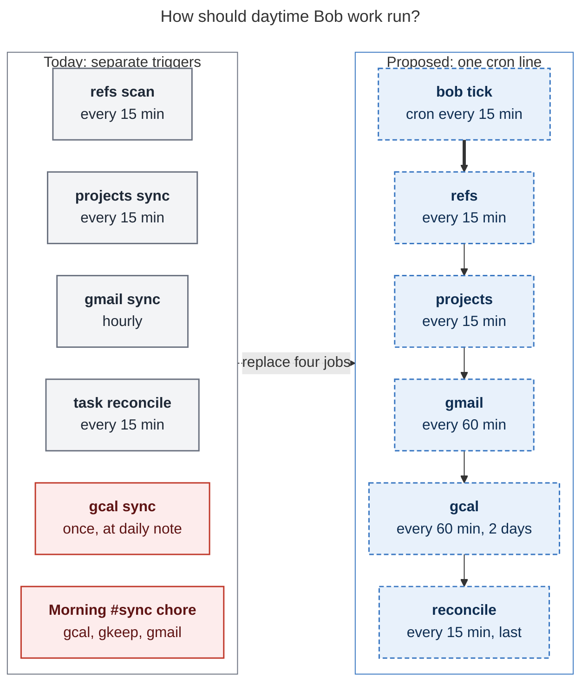
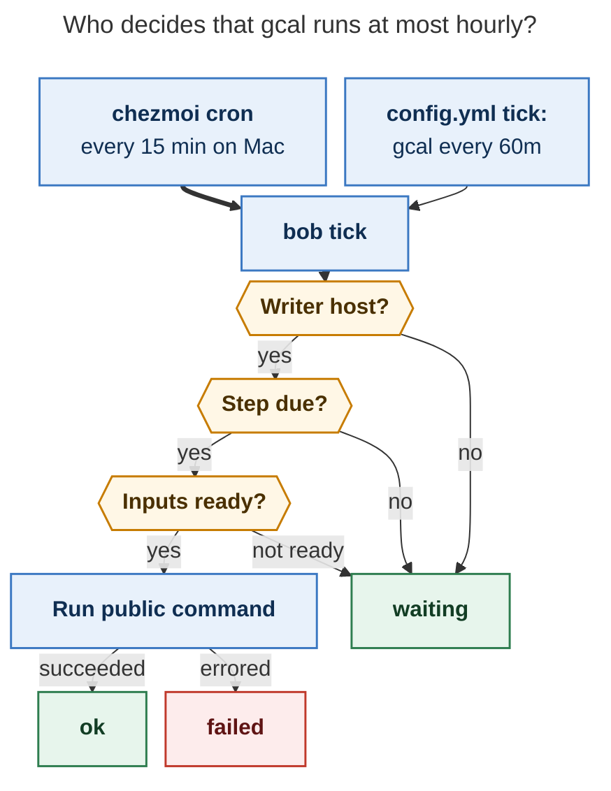

# Daytime Bob work should be `bob tick`, with cadence in config

Researcher: `grk`. Independent design research for a command that orchestrates Bryan's more-than-daily Mac `bob` jobs. Assigned context: `research:202611/bob_sync_task_review.md` and the open vault task `^bob-sync`. Peer swarm reports were not consulted.

This research ran on 2026-11-18 against bob-cli at `41b1dab3`, the chezmoi linked checkout, live `cronctl` state, `~/bob` (`gtd_daily`, `^bob-sync`), and `plan:202610/bob_gcal_daily_events.md`.

## Verdict

Build the orchestrator. Name it **`bob tick`**. Keep chezmoi cron as the clock (one 15-minute Mac job) and put **which steps run, and how often**, in chezmoi-managed `~/.config/bob/config.yml`. Cap `gcal` at **60 minutes** on the Mac. Leave `bob vault-sync` and `bob nightly` where they are.

The original `bob sync` idea is the right *shape* and the wrong *name*. A closed catalog of existing commands, run in a fixed order with per-step intervals, is how to make this intuitive, reliable, and beautiful. A generic in-process mini-cron, a 5-minute LaunchAgent, or stuffing this into `bob task reconcile` would fight the CLI rules and the systems already in place.

## Bottom line

1. **One Mac cron line calls `bob tick -q` every 15 minutes.** `bob tick` is a Vault-section leaf verb next to `bob nightly`: daytime, frequent, no outer maintenance lock. Nightly stays athena's 03:30 catalog-and-archive pass.
2. **Cadence lives in `tick:` in chezmoi's `home/dot_config/bob/config.yml`.** Cron is the tick; bob decides what is due. `gcal.every: 60m` is the Mac hourly cap the prompt asked for. Unknown step names are a config error. `off` and `manual` are how a step drops out of unattended runs.
3. **Closed catalog, fixed order:** `refs → projects → gmail → gcal → reconcile`. `gkeep` is `manual` only and refuses to run off a TTY. `vault-sync` stays the 15-second LaunchAgent. Individual commands remain public.
4. **Do not revive `bob sync`.** That name is retired in favor of `vault-sync`, the shared lock is still called `bob_sync.lock`, and `~/bin/bob_sync` on athena and apollo still `exec bob sync`. Registering the new work under that name would make those stale wrappers start doing Mac-writer work on the Linux hosts.
5. **Ship the binary, then swap the crontab.** Add the `tick:` block to config.yml as soon as the parser knows it (current bob already ignores unknown top-level keys). Replace the four Mac jobs only after `ssh mac '~/.cargo/bin/bob tick --help'` works.

---

## 1. Is this a good idea?

Yes, with the adjustments in §6. The vault task is nine days unblocked, kept three times, and still open:

> Add a new `bob sync` command that wraps task reconcile, Google Calendar sync, Gmail sync, and ref task sync so there is only one cron job!

That is the right instinct. Four staggered cron lines plus a once-a-day calendar sync plus a morning `#pre #sync` chore are one job wearing three costumes.

### Why it is worth doing

**Google Calendar has no periodic trigger.** `docs/gcal.md` is explicit: Ledger Tools runs `bob gcal sync -q -f json` once when today's daily note is created, and otherwise you run it by hand. Invitations accepted later in the day wait until tomorrow's note, or until the morning chore. The gcal epic offered a 5-minute LaunchAgent (`StartInterval 300`) as an optional `launch_agent` decision; that plist was never installed. The Mac still has only `com.bbugyi.bob-vault-sync.plist` (`StartInterval 15`). Hourly `gcal` inside `bob tick` is the missing middle: later-day RSVPs land, and we stay far away from the 5-minute agent and from the Haircut race (`decisions:gcal-force-resets-the-day`) that made aggressive periodic sync dangerous.

**Minute offsets do not order the work.** `docs/vault-git-sync.md` documents the stagger so "reconcile tidies the same Gmail-filed rows minutes later." Offsets cannot guarantee that. One process, one order, reconcile last, does.

**A Mac wake currently stampedes four jobs.** `cronrun` overlap-guards *per job name*. After sleep, highlights, projects, gmail, and reconcile can start in the same second and fight `bob_sync.lock`. The assigned review counted 10 lock-busy failures in nine days, clustered on wake. One job with one run lock turns that into a single ordered catch-up: every *due* step runs, including gmail and gcal if an hour has passed.

**The false-alarm mail is a product bug of its own.** `bob gcal sync` already treats a missing or unrendered daily note as `waiting` and exits 0. `bob task reconcile` still errors (`daily note does not exist: …`) and cron mails it. The assigned review attributed 50 of 78 failed Mac runs in nine days to that gap. That is worth fixing even if the orchestrator waited.

**The morning chore is the same work, typed.** `gtd_daily` `#pre #sync` still says `Run gcal sync -n 2 + gkeep pull + gmail sync`. `freshness.pre_stages` includes `sync`. An attended `bob tick -a` can become that row later; v1 does not have to retire the chore on day one.

### Why it could still be a bad idea

It is not urgent. Highlights, projects, gmail, and reconcile already succeed most of the time. `bob nightly` already repairs project catalogs at 03:30. The Mac sleeps through wall-clock jobs. A smaller slice — hourly `bob gcal sync` plus reconcile-waiting-on-missing-note — would close the two loudest gaps with almost no new surface.

That smaller slice fails the prompt: *highly configurable which commands run and how often*, from a limited set, with chezmoi owning the Mac gcal cap. Once those requirements are in, an orchestrator with a closed catalog is the small design, and four independently configurable cron lines are the large one.

---

## 2. Current state (evidence)

### 2.1 Live Mac jobs (2026-11-18)

`cronctl list` / `cronctl status --all`:

| Job | Schedule | Host | Last run (UTC) | Exit |
| --- | --- | --- | --- | ---: |
| `bob-highlights-sync` | `0,15,30,45 * * * *` | mac | 16:45–16:50 | 0 |
| `bob-projects-sync` | `5,20,35,50 * * * *` | mac | 16:50–16:50 | 0 |
| `bob-task-reconcile` | `10,25,40,55 * * * *` | mac | 16:40–16:40 | 0 |
| `bob-gmail-sync` | `7 * * * *` | mac | 16:07–16:07 | 0 |
| `bob-nightly` | `30 3 * * *` | athena | 08:30–08:30 | 0 |

No `gcal` job exists. Mac was `in_sync`. Athena and apollo were `pending` (chezmoi source behind origin); that is unrelated drift.

chezmoi `home/.chezmoidata.yaml` is the source of those four Mac lines. `bob-highlights-sync` runs `maybe_bob_highlights_sync -w`, which exits 0 when there is no same-day `lib/` file, no `xlib/` queue, and no `highlights.pre_scan_hook`. That skip is load-bearing: a naive `bob ref scan -w` every 15 minutes would ignore it.

### 2.2 Other schedulers that must stay out of this command

- **Mac LaunchAgent** `com.bbugyi.bob-vault-sync`: `bob vault-sync -q` every 15 seconds. Shared `bob_sync.lock`. Putting vault-sync inside `bob tick` would either stall the 15-second agent or hold the lock across network steps.
- **athena `bob nightly`**: 03:30, holds the shared lock for the whole run, vault-sync → archive → article/period reports → areas/projects/notebooks/albums/records → vault-sync. Daytime `projects` in `bob tick` calls the public command; nightly keeps its lock-free core.
- **apollo `bob-ref-intake.timer`**: systemd user timer for intake-only drain. `decisions:references-are-ingested-at-birth` already split "file a new PDF on the creating host" from "Mac annotation scan." `bob tick`'s `refs` step is the Mac full scan.

### 2.3 Writer pins and leftover names

chezmoi already manages `home/dot_config/bob/config.yml`. `gcal.writer` and `gmail.writer` are commented out. Docs still say the Mac is the single writer for both, and for daily notes. `bob tick` should pin `tick.writer` explicitly in that file.

`docs/develop/migration-notes.md`: `bob sync`, `bob bulk-git-commit`, and the `bob_sync` binary were retired in favor of `bob vault-sync` and are unregistered. The lock path is still `${XDG_RUNTIME_DIR:-/tmp}/bob_sync.lock`. Athena and apollo still have a 114-byte `~/bin/bob_sync` (3 Jul) that `exec bob sync "$@"`. It is not in chezmoi. Reusing the `sync` command name would turn those wrappers on.

### 2.4 Contracts the orchestrator must preserve

- `bob gcal sync` is read-only toward Google (`decisions:bob-gcal-is-read-only-and-proposes-once`). Waiting on a missing, unrendered, or Pomodoros-less daily note exits 0. A replaced Events section holds until `bob gcal sync -F`.
- `bob gmail sync -q` is hourly so an awake Mac stays inside the two-hour busy-skip mail threshold. A quiet contention skip is 0 until that two-hour mark.
- `bob task reconcile --retry-timeout 120` is a vault-only rewriter. CLI rules reserve `bob task <verb>` for commands that rewrite task lines across the vault. Network failures do not belong in its retry budget.
- `bob gkeep pull` can prompt for a parent route on a TTY. `gkeep.check_interval` already uses the `30m` / `2h` / `off` duration language; `bob tick` should speak the same dialect.
- Google Calendar API quotas (600 requests/minute/user, 1,000,000/day/project) are not the reason to cap gcal at hourly. Two calendars × two days × 24 runs is noise. The cap is product: Templater races, rejected 5-minute agent, and "enough for later-day RSVPs."



**Figure 1.** Four staggered Mac jobs, a once-a-day calendar sync, and a morning chore become one 15-minute `bob tick` whose steps keep their own intervals. Vault-sync (15 s LaunchAgent) and athena nightly stay outside the figure. Rendered 750×697 px, fit 87.1%.

---

## 3. Naming

The prompt asked for a better fit than `bob sync`, and to keep it short. CLI rules: nest only under a noun with a stated membership rule; a new group may default only to a flag-only read-only member; never hard-rename; help sections follow Daily workflow / Tasks and projects / Vault / Integrations / Setup.

`bob nightly` is the existing pattern: a **leaf verb** in the Vault section that runs a sequence. The daytime command should sit next to it as another leaf verb. Making it a group whose bare form *runs* would repeat the grandfathered `vault-sync` exception.

| Candidate | Fit | Cost |
| --- | --- | --- |
| **`tick`** | Short. Clock-accurate. Scheduler-agnostic (cron today, launchd tomorrow). Pairs with "cron tick" in the docs. No collision in `bob --help`. | Slightly cute. Newcomers may ask "tick of what?" Help's first line answers: due daytime maintenance. |
| `upkeep` | Clear purpose. | Sounds like it includes nightly. Six letters, still fine, less clock-like. |
| `chores` | Matches the `#pre #sync` chore. | Informal, and the GTD chore is attended. |
| `pulse` / `beat` | Heartbeat metaphor. | Cute without being clearer than `tick`. |
| `jobs` | Noun group: `bob jobs run`, `bob jobs status`. | Cron becomes two words. Bare `bob jobs` would have to be read-only status. Heavier than nightly. |
| `sync` | Matches the vault task and "sync the integrations." | Retired top-level name. Collides with `vault-sync`, `plugins sync`, `projects sync`, `gcal sync`, `gmail sync`, `areas sync`, `notebooks sync`, `albums sync`. Lock file still named `bob_sync.lock`. Stale `~/bin/bob_sync` wrappers. Help would need a "for git, use vault-sync" apology on every invocation. |
| `refresh` | Everyday English. | Collides with task freshness / `[refresh::]`. |
| `cron` | Honest about the caller. | Wrong if the scheduler ever changes. Leaks implementation. |
| `daily` / `daytime` / `hourly` | Time-of-day pairing with nightly. | The cadence is 15 minutes, including overnight if the lid is open. `hourly` lies about refs/projects/reconcile. |

**Recommendation: `bob tick`.** Do not register `bob sync` as a hidden alias. Optional polish: an unknown-command hint if someone types `bob sync` ("vault Git is `bob vault-sync`; daytime maintenance is `bob tick`"). Delete `~/bin/bob_sync` on athena and apollo as part of the chezmoi change (a small `run_onchange` that removes the unmanaged wrapper, or a one-shot note in the rollout).

Help sketch (Vault section, immediately after `nightly`):

```text
usage: bob tick [STEP ...]

Run due daytime Bob maintenance. Cron should call this every 15 minutes
on the writer host. Each step has its own interval in config (`tick:`);
this command adds a run lock and does not hold the shared vault lock
across steps.

workflow:
  1. acquire the bob-tick run lock (a second run exits 0, already running)
  2. refs       — Highlights scan when due (skips when there is nothing to scan)
  3. projects   — project lifecycles and catalogs when due
  4. gmail      — file labelled threads when due (default 60m)
  5. gcal       — Event Tasks for yesterday and today when due (default 60m)
  6. reconcile  — task-status tidy last, so it sees this tick's writes

options:
  -a, --all          run every enabled step now, including `manual` ones
  -d, --dry-run      print each step's plan and why it would wait
  -f, --format FMT   human or json (json is the receipt)
  -h, --help
  -q, --quiet        print waiting reasons and failures only
  -s, --status       print the last receipt and exit (no work)
```

Positional `STEP` values are the closed catalog names. Named steps run now and ignore `every`, still honoring writer pin, TTY rules, and input readiness. Options stay alphabetical (`-a` before `-d` before `-f` before `-q` before `-s`). Every long option has a short alias.

`bob tick -s` is a flag on a verb, so we never have to make `tick` a group. Last receipt lives at `$XDG_STATE_HOME/bob-cli/tick.json`.

---

## 4. Design

### 4.1 Split of ownership



**Figure 2.** Chezmoi crontab is the 15-minute metronome. Chezmoi `config.yml` is the hourly gcal cap. `bob tick` only runs a step that is due on the writer host with ready inputs. Rendered 561×1064 px, fit 83.9%.

This is the important split. If cadence lived in crontab, every frequency change would be a cron edit, and `gcal` hourly would mean a *second* job, which is the status quo. If cadence lived only in bob-cli defaults, the Mac hourly cap would not be in the chezmoi repo the prompt named. Putting `tick:` in chezmoi-managed config.yml satisfies both.

`cron.jobs` have no per-machine overrides (crontab memory: different behaviour means two jobs). `bob tick` is Mac-only, so one job is enough. Writer pin makes `bob tick` on athena or apollo a dry wait, which also neuters any leftover wrapper that might someday call it.

### 4.2 Closed catalog and defaults

Unknown names in `tick.steps` are a config error (exit 2). The catalog is the feature: this is not a shell job runner.

| Step | Public command | Default `every` | Default `budget` | Notes |
| --- | --- | --- | --- | --- |
| `refs` | `bob ref scan -w` after the maybe-skip | `15m` | `3m` | Port `maybe_bob_highlights_sync`'s "nothing to scan" short-circuit into the step. Annotation sync stays Mac-only. |
| `projects` | `bob projects sync` | `15m` | `1m` | Nightly still runs the lock-free core. |
| `gmail` | `bob gmail sync -q` | `60m` | `2m` | Keep the command's own two-hour busy-skip mail rule. |
| `gcal` | `bob gcal sync -n 2 -q` | `60m` | `1m` | Yesterday + today, matching the morning `-n 2`. Ledger Tools may still fire once at daily-note creation; gcal is idempotent. |
| `reconcile` | `bob task reconcile --retry-timeout 120` | `15m` | `2m` | Always last among due steps. Missing/unrendered daily note → `waiting`, exit 0. |
| `gkeep` | `bob gkeep pull` | `manual` | `2m` | Unattended ticks never run it. Off a TTY it waits even under `-a`. |

Out of catalog on purpose: `vault-sync`, `nightly`, `plugins sync`, `areas` / `notebooks` / `albums` / `records`, `task archive`. Those already have owners.

Duration vocabulary copies `gkeep.check_interval`: `15m`, `60m`, `1h`, `off`. Add `manual` (only `-a` or an explicit `STEP`). YAML `false` may normalize to `off`, as gkeep already does.

### 4.3 Suggested `tick:` block (chezmoi `config.yml`)

```yaml
# Daytime maintenance (`bob tick`). Cron on the Mac should call
# `bob tick -q` every 15 minutes; this block is which steps are due.
# Older bob builds ignore unknown top-level keys.
tick:
  writer: kellys-macbook-pro   # vault-sync hostname slug; confirm with `bob gcal doctor`
  steps:
    refs:
      every: 15m
      budget: 3m
    projects:
      every: 15m
      budget: 1m
    gmail:
      every: 60m
      budget: 2m
    gcal:
      every: 60m
      budget: 1m
      days: 2
    reconcile:
      every: 15m
      budget: 2m
    gkeep:
      every: manual
```

Confirm the writer slug from vault-sync commit subjects / `bob gcal doctor` before writing it. The comments in today's config.yml already guess `kellys-macbook-pro` and `kellys-macbook-pro-local`; do not copy a guess.

While touching that file, set `gcal.writer` and `gmail.writer` to the same slug. They are currently commented out, so any host that is logged in may write.

### 4.4 Locking, process model, outcomes

**No outer `bob_sync.lock`.** `bob nightly` holds it for the whole sequence because every step is vault maintenance. A 15-minute daytime run that did the same would freeze capture, vault-sync, and task moves for minutes, every 15 minutes, including a slow Highlights scan. Each step takes the shared lock itself, as today. `bob tick` adds only `$XDG_RUNTIME_DIR/bob_tick.lock` (or `bob-cli/tick.lock` under state): a second concurrent run exits 0 with `already running`. `cronrun` still overlap-guards the cron job name.

**Subprocess each public command.** Nightly is in-process because it already holds the lock and calls lock-free cores. `bob tick` does not hold that lock, and the slow steps talk to the network or to Highlights file coordination. Subprocess gives a real `budget` (kill, record `waiting`/`over_budget`, continue), isolates panics, and keeps each command's tests as the contract. Parse `-f json` where it exists; otherwise map exit 0/1/2 plus known "waiting" stdout. Process start is negligible next to a 79-second scan.

**Outcomes per step: `ok` | `waiting` | `failed`.** The tick exits 1 only if a step `failed`. `waiting` covers: interval not reached, wrong host, already running, nothing to scan, daily note missing/unrendered, gkeep off a TTY, budget exceeded (step abandoned, later steps still run). Quiet cron logs stay quiet on `ok` and `waiting`; cronrun mails on exit 1.

Reconcile's missing-daily-note path should become `waiting` in the command itself, so a forgotten standalone cron job would also stop mailing. That is a two-line behavior tweak with its own test, and it can ship before `bob tick`.

### 4.5 Output

Follow `bob nightly`'s box-drawing, ✓/✗ markers, and labeled steps. Add a third marker for waiting (dim `…` / yellow if color is on). Structure must survive `NO_COLOR` and a cron log. `-q` prints waiting reasons and failures only. `-f json` prints one receipt (`schema_version: 1`, host, started/finished, per-step name/outcome/reason/duration/exit) and writes the same file to state.

Beauty here is nightly's discipline: one screen, one summary, no stack traces on the happy path, color as emphasis rather than meaning.

### 4.6 Mac crontab (chezmoi)

Replace the four Mac jobs with one. Leave `bob-nightly` on athena.

```yaml
- name: bob-tick
  machines: [mac]
  schedule: "0,15,30,45 * * * *"
  description: >-
    Daytime Bob tick: due refs, projects, gmail, gcal, and reconcile
  command: bob tick -q
```

Do this in a **second** chezmoi commit, after the Mac binary lists `tick`. vault-git-sync already says: confirm `ssh mac '~/.cargo/bin/bob tick --help'` before a job relies on a new command. Rollback is reverting that one cron commit.

Keep `maybe_bob_highlights_sync` in chezmoi for a release or two as a manual escape hatch; stop scheduling it.

---

## 5. Alternatives considered

| Approach | What it gets right | Why it loses |
| --- | --- | --- |
| **A. `bob tick` orchestrator (recommended)** | One log, guaranteed order, configurable cadence, Mac wake catch-up, gcal finally periodic, chezmoi still owns the clock. | New command, two-phase rollout, must port the highlights skip. |
| **B. Add hourly `bob gcal sync` and fix reconcile waiting** | Smallest patch for the two loudest bugs. | Leaves four-job wake stampedes, no single receipt, no closed-catalog configurability, morning chore unchanged. A fair *slice 0* if `bob tick` slipped a release; it is not the destination. |
| **C. Keep four cron jobs, put intervals only in crontab** | No new bob surface. | Frequency changes are cron edits. `gcal` hourly is a fifth job. Order still hoped-for. chezmoi cron has no per-machine overrides other than more jobs. |
| **D. 5-minute gcal LaunchAgent** | The gcal epic already designed it. | Optional decision, never installed. Third scheduler. 5 minutes is more often than the prompt allows. First LaunchAgent run can Keychain-prompt. Haircut race wants *less* aggressive unattended gcal, not more. |
| **E. Fold into `bob task reconcile`** | One command already on a 15-minute timer. | CLI rules: `bob task` rewrites task lines. Mixing gog failures into a 2-minute retry budget blurs what a reconcile failure means. The Keep note that proposed this was cancelled as "Obsolete in favor of Bob sync?" |
| **F. Generic bob job runner / crontab-inside-bob** | Maximal configurability. | Arbitrary shell is cron's job. The limited set is a safety feature. |
| **G. In-process cores like `bob nightly`** | Faster, structured returns, matches nightly. | Nightly holds the lock on purpose. Daytime network steps need a killable budget. Subprocess is the matching tool. |
| **H. Revive `bob sync` as the name** | Matches the vault task. | See §3. The stale wrappers make this actively dangerous. |

I would take **A**. If implementation had to split across trains, I would ship reconcile-waiting (part of A, useful alone) on the first train, `bob tick` plus config.yml on the second, and the cron swap on the third. I would not ship B as the end state.

---

## 6. Requirement adjustments (called out)

These change the prompt or the assigned review. They are the design, not nits.

1. **Name the command `bob tick`.** The prompt invited a better fit than `bob sync`. `sync` is retired, overloaded, and wired into leftover wrappers. `tick` is short and pairs with the 15-minute cron tick.
2. **Do not register `bob sync` as an alias.** CLI hidden-alias rules apply to *renames*. This is a new command. An alias would activate `~/bin/bob_sync` on athena and apollo.
3. **`gcal` at most hourly, default `60m`.** The assigned review recommended 15-minute gcal. The prompt caps it hourly on the Mac. Hourly is also the better product default: the 5-minute LaunchAgent was declined, and the Haircut race is why unattended gcal must keep treating an unrendered daily note as `waiting`.
4. **Cadence in chezmoi `config.yml`, clock in chezmoi cron.** The prompt asked for highly configurable commands and frequencies, and for the Mac gcal cap to be a chezmoi configuration change. Both are true if `tick.steps.gcal.every: 60m` lives in `home/dot_config/bob/config.yml` and crontab is one 15-minute `bob tick -q`.
5. **Closed catalog, no arbitrary commands.** "Limited set" is a requirement, not a limitation. Config cannot add `rm` or `bob plugins sync`.
6. **No outer shared lock; subprocess + per-step budget.** Copying nightly's lock-held in-process sequence would block gestures. The assigned review already warned about this; this report also drops in-process cores for the network steps.
7. **`gkeep` stays manual and TTY-gated.** The morning chore includes it. Unattended Keep pull can prompt. Even a mis-set `every: 15m` must wait off a TTY.
8. **Port the highlights skip into the `refs` step.** Scheduling `bob ref scan -w` without `maybe_bob_highlights_sync`'s short-circuit would scan on empty 15-minute ticks.
9. **Make reconcile wait (exit 0) on a missing daily note** in the command itself, so the 50-mails-a-night class of failure dies even without `bob tick`.
10. **Two-phase chezmoi rollout, binary first.** A cron line that calls a command the Mac binary does not have will mail every 15 minutes.
11. **Leave vault-sync and nightly alone.** Daytime tick is complementary.
12. **Do not promise the `#pre #sync` chore disappears in v1.** `bob tick -a` can replace it once gkeep's TTY rule is proven. Until then the chore can stay, or shrink to `bob tick gcal gmail` plus `gkeep pull`.
13. **Write a decision record** when implementing: "Daytime Bob work is one ordered `bob tick`." It records why four Mac jobs became one, why the name is `tick`, and why gcal is hourly.

---

## 7. Recommended solution

### CLI

- New leaf `bob tick` in the Vault help section, after `nightly`.
- Catalog entry: writes, daily-workflow-adjacent keywords `tick`, `maintenance`, `cron`, `sync` (search keyword only).
- Flags as in §3. Positional steps from the closed catalog.
- Hidden alias: none. Optional unknown-command hint for `bob sync`.

### Config

- `tick.writer`: hostname slug, default `gcal.writer` then `gmail.writer`.
- `tick.steps.<name>.every`: duration / `off` / `manual`.
- `tick.steps.<name>.budget`: duration, optional.
- `tick.steps.gcal.days`: positive int, default 2.
- Defaults match the table in §4.2 so an empty `tick:` still does the right Mac thing once the writer pin is set.

### Runtime

- Run lock. No outer `bob_sync.lock`.
- For each catalog step in order: writer → due → ready → subprocess with budget → record outcome → continue.
- `refs` skip = maybe-wrapper logic. `gcal` / `reconcile` missing note = waiting. `gkeep` off TTY = waiting.
- Receipt JSON in state; human output in nightly's visual language; `-q` for cron.

### chezmoi (after the Mac binary has `tick`)

1. Add the `tick:` block to `home/dot_config/bob/config.yml` with `gcal.every: 60m`. Set `tick.writer` (and the commented `gcal.writer` / `gmail.writer`) to the confirmed Mac slug.
2. Replace `bob-highlights-sync`, `bob-projects-sync`, `bob-gmail-sync`, and `bob-task-reconcile` with `bob-tick` (`0,15,30,45 * * * *`, `bob tick -q`).
3. Remove unmanaged `~/bin/bob_sync` on athena and apollo.
4. `cronctl check --source <checkout>`, `cronctl diff mac --source <checkout>`, commit, then `cronctl apply mac` (Mac may stay `pending` until `chezmoi update -a` on the laptop).

### Docs and tests

- `just docs-gen` for `docs/reference/cli/tick.md`.
- Rewrite `docs/vault-git-sync.md` § Mac scheduled maintenance.
- `docs/gcal.md` § Where it runs: periodic trigger is `bob tick`'s gcal step, default 60m, still waiting on Templater.
- `docs/gmail.md` § Where it runs: hourly via `bob tick`, no longer its own cron line.
- Decision record as in adjustment 13.
- Tests: config parse (durations, `off`, `manual`, unknown names); due-ness around interval boundaries; writer mismatch waits; missing daily note waits for gcal and reconcile; dry-run starts no subprocess; run-lock second caller exits 0; gkeep off TTY waits; JSON receipt schema.

### Implementation order

1. Reconcile missing-note → waiting (small, independently valuable).
2. `tick:` config + `bob tick` + tests + docs-gen.
3. chezmoi `config.yml` `tick:` block (safe on old bob: `RawConfig` has no `deny_unknown_fields`).
4. Release train ships `bob tick`.
5. Confirm Mac binary; chezmoi cron swap; delete stale wrappers.
6. Optional follow-up: `gtd_daily` `#sync` row becomes `bob tick -a`; Mac Capture health reads `tick.json`.

---

## 8. Open questions for Bryan

1. **Writer slug.** `gcal.writer` is unset. What does `bob gcal doctor` on the Mac print as the host label? That string belongs in `tick.writer`.
2. **Morning chore in v1.** Keep the three-command `#pre #sync` row until `bob tick -a` has been used by hand, or change it in the same vault commit as the cron swap?
3. **Ledger Tools + hourly gcal.** First hour of the day may run gcal twice (note creation, then the first due tick). Harmless. Should v1 teach `bob tick` to honor gcal's own last-success timestamp, or keep tick-owned timestamps only?

---

## Sources

- Assigned context: `research:202611/bob_sync_task_review.md`; vault `bob.md` `^bob-sync`; `gtd_daily` `#pre #sync`.
- Live schedule: `cronctl list`, `cronctl status --all` (2026-11-18); chezmoi `home/.chezmoidata.yaml` `cron:`; `home/bin/executable_maybe_bob_highlights_sync`; `home/Library/LaunchAgents/com.bbugyi.bob-vault-sync.plist`; `home/dot_config/bob/config.yml`.
- Leftover name: athena and apollo `~/bin/bob_sync` (114 bytes, 3 Jul 2026, `exec bob sync`); `docs/develop/migration-notes.md`.
- bob-cli: `src/native/nightly.rs`, `src/native/gcal/sync.rs` (`WaitingReason`, process exit 0 on waiting), `src/native/task_status_hooks/sync.rs` (missing daily note is an error), `src/native/config/mod.rs` (`RawConfig`, `gkeep.check_interval`), `src/runner.rs` (Vault section, `nightly` leaf), `docs/vault-git-sync.md` § Mac scheduled maintenance, `docs/gcal.md` § Where it runs, `docs/gmail.md` § Where it runs, `docs/reference/cli/nightly.md`, `sase/memory/cli_rules.md`.
- Plans and decisions: `plan:202610/bob_gcal_daily_events.md` (optional `launch_agent`, 5-minute plist); `decisions:bob-gcal-is-read-only-and-proposes-once`; `decisions:gcal-force-resets-the-day`; `decisions:references-are-ingested-at-birth`.
- Calendar API quotas: [Google Calendar usage limits](https://developers.google.com/workspace/calendar/api/guides/quota) (600/min/user, 1,000,000/day/project). Not a driver of the hourly cap.
- Glossary: Event Task, Gmail Task, Pomodoro, Reference Note (Mac annotation scan vs intake-at-birth).
