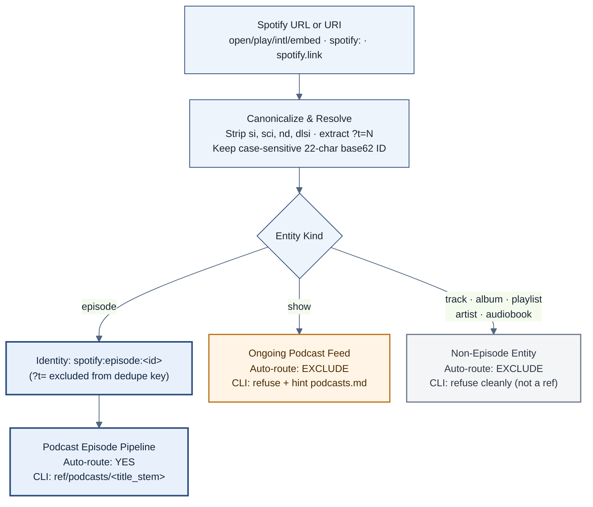
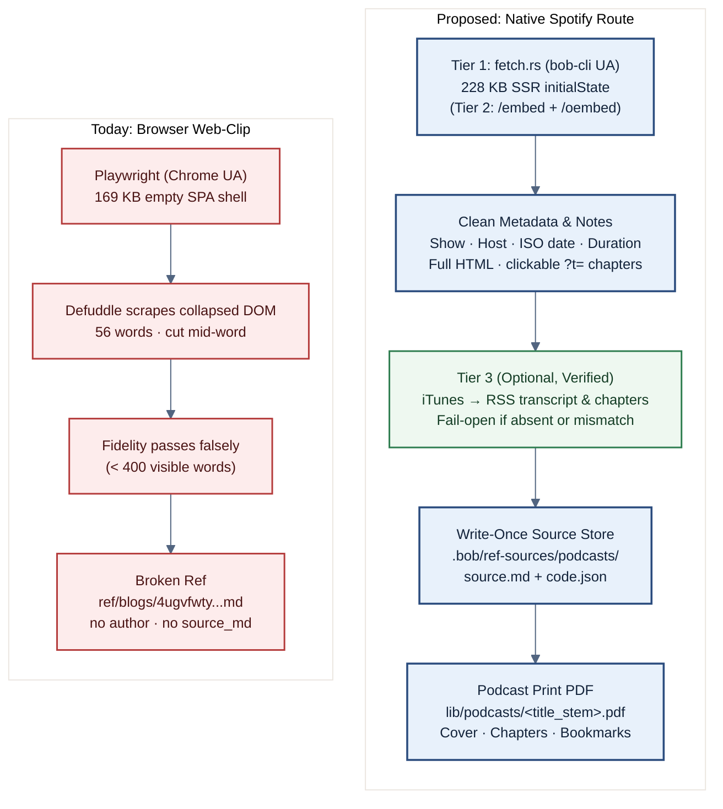

# Making `bob ref create` Smarter About Spotify URLs

**Date:** 2026-11-21
**Scope:** `bob-cli` (`highlights_ref`, `ref_library`, `url_routing`, `web_clip`), coordinated with `bob-mac-capture` (`RefsCore` / `RefsVisualTokens`), `bob-plugins` (`bob-ledger-tools`), and vault `~/bob/refs.base`
**Baseline Audited:** `~/bob/ref/blogs/4ugvfwty2i8hgagsvt7pjc.md`, `~/bob/lib/blogs/4ugvfwty2i8hgagsvt7pjc.pdf`, `~/bob/sase.md` (`^ref-4ugvfwty2i8hgagsvt7pjc`), corroborated with vault sibling `~/bob/ref/blogs/5ygcxo9nxh38ns7ghtbddm.md`, `~/bob/sase_blog_zettel/microsoft_ceo_thinks_model_agnostic_architecture_is_good.md`, `~/bob/podcasts.md`, and `~/bob/lit/podcasts.md`

---

## Executive Summary & Verdict

**Verdict: Yes — this is a genuinely high-value feature, *provided* its scope is sharpened from "handle Spotify URLs" to "first-class Podcast Episode capture + explicit exclusion of non-episode Spotify entities."**

Today, capturing a Spotify episode through `bob ref create` or Google Keep (`bob gkeep pull` → `bob ref jobs run`) produces a **broken 56-word artifact**: Playwright sends a desktop Chrome User-Agent, Spotify returns an empty client-side SPA shell with a collapsed description, Defuddle scrapes three sponsor bullets cut off mid-word (`Built for th`), fidelity validation passes falsely, the opaque 22-character base62 ID (`4ugvfwty2i8hgagsvt7pjc`) leaks into the filename, note ID, block ID, and wikilinks, `author` and `published` stay `null`, Spotify share params (`?si=...&sci=...`) break deduplication, and `source_markdown` is never written by the ingest path.

Two empirical discoveries unlock a **fast, browserless, reliable, and genuinely beautiful** native route (`src/native/highlights_ref/spotify.rs`, paralleling `arxiv.rs`):

1. **Unauthenticated Spotify SSR (`bob-cli` User-Agent):** Live probing across `episode`, `show`, `track`, `album`, `playlist`, and `artist` URLs revealed a sharp User-Agent split. Desktop Chrome/Safari UAs get a 169 KB empty SPA shell (0 `ld+json`, 0 `initialState`). Plain HTTP clients — including `bob-cli`'s own `fetch.rs` User-Agent — receive a **228 KB server-rendered HTML document** containing a complete base64-encoded `initialState` payload plus `ld+json` and `<meta>` tags: exact title, full untruncated `htmlDescription` (4,210–4,729 chars with all clickable links and chapter timestamps), show name, publisher/host, ISO-8601 release timestamp, millisecond duration, language, media types, and high-res cover art. **No Playwright browser, no login, and no Spotify OAuth credentials are needed.** Public `/embed/episode/<id>` (`__NEXT_DATA__`) and `/oembed` form a resilient Tier 2 fallback.
2. **Verified Public Podcast RSS + `<podcast:transcript>`:** Looking up the episode's show via the unauthenticated iTunes Search API and strictly verifying the RSS match (show + publisher + episode title + release date + duration) unlocks **official Podcasting 2.0 `<podcast:transcript>` files** (4 of 9 major tech podcasts probed, including *The Pragmatic Engineer*, *Dwarkesh*, *Latent Space*, and *Oxide & Friends*) and `<podcast:chapters>`. On Bryan's own Satya Nadella episode (`5ygCxO9NxH38Ns7ghTBDDm`), that transcript immediately surfaces **9 exact timestamped passages** matching Bryan's zettel claim about model-agnostic architecture — turning a dead 50-word stub into a searchable, highlightable, chapter-bookmarked Highlights PDF.

**Recommended solution at a glance:**
- Add a first-class **`spotify.rs` episode route** (no browser needed) defaulting to **`ref_type: podcasts`** (coordinated cleanly across `bob-cli`, `bob-mac-capture`, `bob-plugins`, and `refs.base`).
- **Exclude non-episode Spotify URLs** (`show`, `track`, `album`, `playlist`, `artist`, `audiobook`) from silent auto-routing (`url_routing`) and refuse them cleanly in `bob ref create` (pointing `show` URLs to Bryan's existing `~/bob/podcasts.md` Album Note).
- **Canonicalize Spotify identity** (`https://open.spotify.com/episode/<id>` + `spotify:episode:<id>`), stripping tracking params (`si`, `sci`, `nd`, `dlsi`, `pt`, `context`, `dl_branch`, `sp_cid`, `go`) while preserving `?t=<seconds>` as a **shared-moment highlight** (excluded from dedupe keys).
- **Fix general bugs exposed along the way:** base62 opaque-ID detection in `clip_url.rs:403` (`is_opaque_segment`) and write-once source-store persistence (`source_markdown` + `code.json`) in `ingest.rs:1178`.
- **Render a bespoke Bob Podcast Print PDF** (cover-art masthead, demoted sponsor block, clickable `?t=` chapter index, Mentioned Links indexed for `bob ref links`, and an auto-attached, speaker-coalesced, chapter-bookmarked transcript when verified RSS `<podcast:transcript>` exists — with fail-open degradation to a crisp 1–2 page Episode Dossier when none is published).

---

## 1. Forensic Audit of Today's Baseline

Inspecting `~/bob/ref/blogs/4ugvfwty2i8hgagsvt7pjc.md`, its reading task in `~/bob/sase.md`, its PDF `~/bob/lib/blogs/4ugvfwty2i8hgagsvt7pjc.pdf`, and its vault sibling `~/bob/ref/blogs/5ygcxo9nxh38ns7ghtbddm.md` (`~/bob/lib/blogs/5ygcxo9nxh38ns7ghtbddm.pdf`) reveals **eight concrete defects**, several of which affect non-Spotify web clips too.

### Observed Vault Artifacts

| Field / Dimension | `4ugvfwty2i8hgagsvt7pjc` (Harjot Gill) | `5ygcxo9nxh38ns7ghtbddm` (Satya Nadella) | Ground Truth (Spotify SSR + RSS) |
|---|---|---|---|
| **File & Ref ID** | `ref/blogs/4ugvfwty2i8hgagsvt7pjc.md` | `ref/blogs/5ygcxo9nxh38ns7ghtbddm.md` | Title stem under `ref/podcasts/` |
| **Ref Task** | `~/bob/sase.md:653` (`^ref-4ugvfwty2i8hgagsvt7pjc`) | `~/bob/sase_blog.md:32` (`^ref-5ygcxo9nxh38ns7ghtbddm`) | Readable `^ref-<title_stem>` |
| **`ref_type`** | `blogs` | `blogs` | `podcasts` |
| **`author`** | `null` | `null` | `The Pragmatic Engineer (Gergely Orosz)` |
| **`published`** | `null` (PDF shows `"Wednesday"`) | `null` (PDF shows `"Monday"`) | `2026-11-18` / `2026-11-16` |
| **`source_url`** | `...?si=wMZ6dn...&sci=spotify%3Acard-config%3A...` | `...?si=sScJhryRRjmCDovgXj04Dg` | `https://open.spotify.com/episode/<id>` |
| **`source_markdown`** | `null` (`bob ref links` broken) | `null` (`bob ref links` broken) | `.bob/ref-sources/podcasts/<stem>--<hash>/source.md` |
| **PDF Body** | 1 page, **56 words**, sponsor blurbs cut mid-word (`Built for th`) | 2 pages (page 2 has 2 stray lines), **50 words**, cut mid-bullet (`• Linear –`) | Full 4,210–4,729 char show notes, 16 chapters, 8 deep-dive links, + 18,736 / 11,540 word official VTT transcripts |

### Root-Cause Defect Ledger

1. **Defect 1 — Playwright Chrome UA triggers Spotify's stripped SPA shell and collapsed DOM.**
   `scripts/web_clip/snapshot.js` fetches pages using Playwright's Chromium User-Agent. Empirical testing against `open.spotify.com/episode/4UgVFWty2I8hGAgSvT7pjC` shows Spotify serves a **169 KB empty SPA shell** (0 `ld+json` blocks, 0 `initialState`) to Chrome/Safari desktop UAs, rendering a collapsed `"See more"` description widget in React. Defuddle extracts only the visible pre-fold fragment (`Built for th`) plus UI chrome (`Podcast Episode`, duplicated title under a giant unstyled square cover, `See all episodes`).
2. **Defect 2 — Web-clip fidelity validation silently passes truncated Spotify stubs.**
   In `scripts/web_clip/web_clip_adapter.py:634`, the `thin` check only fails when `kept_words < 300 and page_words >= 400`. Because Spotify's collapsed SPA page exposes fewer than 400 total visible words, `fidelity_verdict` falsely reports `"ok"` and commits a 56-word broken PDF.
3. **Defect 3 — Base62 opaque IDs bypass `is_opaque_segment()` and leak everywhere.**
   `src/native/highlights_ref/clip_url.rs:403` defines `is_opaque_segment()` to reject only hex IDs (`[0-9a-f]{6,}` containing a digit) and UUIDs. Spotify's 22-character base62 IDs (`4UgVFWty2I8hGAgSvT7pjC`) contain letters `g`–`z`, so `stem_from_url()` accepts the lowercased gibberish instead of falling back to `title_stem()`. That gibberish propagates irreversibly into the `.md` filename, `.pdf` filename, `id:`, `^ref-...` block ID, and downstream zettel wikilinks (`[[sase_blog#^ref-5ygcxo9nxh38ns7ghtbddm]]` in `~/bob/sase_blog_zettel/microsoft_ceo_thinks_model_agnostic_architecture_is_good.md`).
4. **Defect 4 — Dirty `source_url` breaks deduplication across shares and locales.**
   `src/native/highlights_ref/clip_url.rs:15` (`TRACKING_PARAMS`) strips only `utm_*`, `fbclid`, `gclid`, `mc_cid`, `mc_eid`, and `ref_src`. Spotify appends ephemeral per-share tracking params (`si`, `sci`, `nd`, `dlsi`, `pt`, `context`, `dl_branch`, `sp_cid`, `go`). Because Spotify mints a fresh `si` on every share, sharing the same episode twice yields two distinct `dedupe_key` values — defeating `bob ref create` dedupe, `bob ref find`, and Keep duplicate detection. Locale prefixes (`/intl-en/`), `/embed/`, `play.spotify.com`, and `spotify:episode:<id>` URIs also fail to coalesce.
5. **Defect 5 — Missing metadata and rotting relative dates.**
   Because Chrome UA gets no `ld+json` and no `<meta name="music:release_date">`, `author` and `published` are both `null` in frontmatter, while the PDF prints Spotify's relative UI string (`Wednesday` / `Monday`), which becomes meaningless a week after capture.
6. **Defect 6 — Wrong `ref_type: blogs` misclassifies audio episodes as blog articles.**
   Both `DEFAULT_ARTICLE_REF_TYPE` (`create.rs:50`) and `INGEST_ARTICLE_REF_TYPE` (`ingest.rs:37`) hardcode `"blogs"`, filing podcast episodes into `ref/blogs/` and `lib/blogs/` alongside Substack essays.
7. **Defect 7 — Cross-cutting bug: `ingest.rs` never persists `.bob/ref-sources/` (`source_markdown: null`).**
   `clip.rs:810` calls `web_source::persist_article_store(...)` during direct CLI `bob ref create`, storing write-once `source.md` + `code.json` (which powers `bob ref code` and `bob ref links` per `decisions:reference-sources-are-preserved-write-once`). However, `ingest.rs:1178` (`ingest_article_route`, used by `bob gkeep pull` and `bob ref jobs run`) **never calls `persist_article_store`** and passes `expected_source_pointer: None` at `ingest.rs:811`. Auditing `~/bob/.bob/ref-sources/blogs/` confirms only **1 of 28** `ref/blogs/` notes has a saved source store! Neither Spotify ref can use `bob ref links` to extract the 8 Pragmatic Engineer deep-dive URLs.
8. **Defect 8 — Unconstrained auto-routing catches non-episode Spotify links, and `-L` is a trap.**
   `src/native/url_routing/policy.rs:18` (`DEFAULT_EXCLUDE_HOSTS`) excludes `youtube.com`, `github.com`, `x.com`, and `google.com`, but not `spotify.com`. Pasting a Spotify song, playlist, artist, or podcast show URL into Keep or Mac Capture currently routes it into the web-article clipper. Conversely, passing `-L / --listen` on a Spotify episode would run paid TTS (`sase listen render`) to narrate show notes of something that is already an audio recording.

---

## 2. Critique of the Plan & Justified Requirement Adjustments

Before designing the implementation, let's critically examine the premise: *"Make `bob ref create` much smarter about how it handles Spotify URLs."*

### Is This a Good Idea?

**Yes — for podcast episodes, it is an unambiguously strong fit for Bob's Reference Library.** Vault evidence proves Bryan already relies on Spotify podcast episodes as first-class intellectual references:
- `~/bob/sase_blog_zettel/microsoft_ceo_thinks_model_agnostic_architecture_is_good.md` explicitly records: *"Quote the Microsoft CEO regarding the importance of model-agnostic architecture in order to make sure you own your own product. Link to podcast! — See the `[[sase_blog#^ref-5ygcxo9nxh38ns7ghtbddm]]` podcast!"*
- `~/bob/sase.md:653` tracks the Harjot Gill episode as a reading/research reference under his `sase` project.
- `~/bob/podcasts.md:59` documents Bryan's exact mobile capture habit: *"Taking a fleeting note from Spotify: 3 dots → Share → More → `#gkeep`. The share includes a Spotify link that jumps to the exact timestamp you shared from."* (Seen live in `~/bob/lit/podcasts.md:14` with `?t=857`.)

That vault evidence reveals **two distinct jobs** a Spotify episode ref must perform in Bob:
1. **Durable Reference & Show-Note Hub:** Clean title, show/host, exact publish date, duration, full show notes, clickable `?t=` chapter timestamps, and extractable mentioned links (`bob ref links`).
2. **Quotable Source Material in Highlights:** When a show publishes an official transcript, Bryan shouldn't have to scrub blindly through a 60-minute Spotify audio stream to transcribe Satya Nadella's exact phrasing — he should be able to `⌘F` inside the Highlights PDF, highlight the verbatim spoken passage, and let `bob ref scan` sync the quote straight into his reference note.

### Where a Naive "Support All Spotify URLs" Approach Goes Wrong

A naive implementation that treats every `open.spotify.com/*` URL as a PDF capture target — or tries to pull audio/user data — would introduce four design mistakes:

1. **Category error on music (`track`, `album`, `playlist`, `artist`):** A 3-minute song or 50-track playlist is not a reading/annotation document for Highlights. Generating PDFs for songs pollutes `ref/` and `lib/` with zero-highlight clutter and breaks Bob's Reading Board mental model.
2. **Duplicating `~/bob/podcasts.md` on `show` URLs:** Bryan *already* maintains an Album Note (`~/bob/podcasts.md` with per-show Record Notes like `~/bob/podcasts/talk_python.md`) to track ongoing podcast shows. Turning a `open.spotify.com/show/<id>` URL into a static Highlights PDF duplicates his Album system and immediately goes stale when the next episode drops.
3. **Never download full podcast MP3 enclosures into `~/bob/lib/`:** Public RSS feeds include full `<enclosure>` MP3s, which are **64–91 MB per episode** (measured on Bryan's two Pragmatic Engineer episodes: 64.2 MB and 90.5 MB). Storing those beside PDFs in the Git-backed vault would bloat repository history rapidly and hit Bob's 95 MiB file-size guard. Podcasts already stream effortlessly in Spotify via clickable `https://open.spotify.com/episode/<id>?t=<sec>` deep links — **link to Spotify, never mirror podcast MP3s.**
4. **Do NOT couple `bob ref create` to `sase spotify` (authenticated user OAuth):** `sase spotify` holds private user OAuth credentials, enforces strict privacy/project-isolation constraints, and may not be logged in on every host (e.g., headless sync/CI or another machine). Every piece of public episode metadata is available unauthenticated via Spotify's own SSR payload and public RSS, with zero credential fragility.

### Justified Adjustments to Requirements

| # | Implicit / Initial Framing | Proposed Adjustment | Justification |
|---|---|---|---|
| **A1** | "Handle Spotify URLs" broadly | **Scope capture strictly to podcast `episode` URLs.** Exclude `show`, `track`, `album`, `playlist`, `artist`, and `audiobook` from auto-routing and refuse them cleanly on CLI. | Prevents music clutter in Highlights and respects Bryan's existing `~/bob/podcasts.md` Album Note for shows. |
| **A2** | Fix Spotify clipping inside web-clipper | **Build a browserless native route (`spotify.rs`)** using `fetch.rs` SSR + Embed/oEmbed fallback, bypassing Playwright/Defuddle entirely. | 10× faster (~0.4s vs 8–15s), immune to Chrome SPA collapse, zero Chromium dependency, exact structured fields. |
| **A3** | Keep Spotify episodes in `ref/blogs/` | **Introduce `ref_type: podcasts`** as default for Spotify episodes, coordinated across `bob-cli`, `bob-mac-capture`, `bob-plugins`, and `refs.base`. | Episodes are not blog articles; Mac Refs currently omits `author` and page-1 thumbnails for `.other` kinds unless wired. |
| **A4** | Strip all query params when cleaning | **Strip tracking params (`si`, `sci`, `nd`, `dlsi`, etc.) but preserve `?t=<seconds>`** as an explicit *shared moment* (excluded from dedupe keys). | Directly honors Bryan's documented `?t=` fleeting-note workflow (`~/bob/podcasts.md:59`, `~/bob/lit/podcasts.md:14`). |
| **A5** | Capture show notes only | **Add optional, verified, fail-open RSS enrichment** (`<podcast:transcript>` + `<podcast:chapters>`) enabled by default (`auto`), controllable via config and `-R / --transcript`. | Unlocks verbatim highlighting & quoting in Highlights for the 40–50% of tech podcasts that publish transcripts, with zero regression when unavailable. |
| **A6** | Treat `-L / --listen` uniformly | **Refuse `-L / --listen` on Spotify episodes** with a clear hint (audio already exists on Spotify; link directly instead of paying TTS to narrate show notes). | Avoids accidental paid TTS spend and redundant audio generation. |
| **A7** | Fix Spotify only | **Fix two general pipeline bugs exposed by the audit:** base62 IDs in `is_opaque_segment()` and missing `.bob/ref-sources/` persistence in `ingest.rs`. | Fixes `bob ref links` for *all* Keep/capture-ingested articles and protects future opaque-ID hosts. |

---

## 3. Empirical Technical Deep Dive: Data Sources & Reliability Ladder

### Discovery 1: Spotify's User-Agent SSR Split (Verified Live)

Live HTTP probes against `https://open.spotify.com/episode/4UgVFWty2I8hGAgSvT7pjC` (and verified across `5ygCxO9NxH38Ns7ghTBDDm`, plus 2-year-old vault episodes `2y9PdcAsko6SKrUEjXWGmn` and `4fxG9AioT6um7g9xq6bI7Z`) revealed deterministic behavior:

| Client / Endpoint | Response Size | `initialState` (base64 JSON) | `ld+json` | `<meta>` Tags | Usability |
|---|---:|---|---|---|---|
| Desktop Chrome / Safari UA (Playwright default) | 169 KB | Absent (0) | Absent (0) | `og:site_name` only | Broken — triggers collapsed SPA shell |
| `Googlebot` UA | 194 KB | Absent (0) | Present (1) | Present | Partial — plain text description only |
| **`bob-cli/<ver>` UA (`fetch.rs:285`) / `curl`** | **228 KB** | **Present (full GraphQL entity)** | **Present (1)** | **Present (`music:release_date`, `music:duration`, `og:image`)** | **Complete — full `htmlDescription`, show, publisher, colors, art** |
| `open.spotify.com/embed/episode/<id>` | ~42 KB | `__NEXT_DATA__` JSON | Absent | Basic | Strong Tier 2 fallback (title, show, ISO date, duration, art) |
| `open.spotify.com/oembed?url=...` | ~0.6 KB | JSON | N/A | N/A | Official public Tier 2b fallback (accepts `spotify:` URIs too!) |

**Exact fields verified in `initialState.entities.items["spotify:episode:<id>"]`:**
- `name`: `"Software factories and code reviews with Harjot Gill"`
- `htmlDescription`: **4,210 characters** of clean semantic HTML (`<p>`, `<a href="...">`, `•` bullets, `—` dividers, 16 `Timestamps` lines, 8 deep-dive links) — note: contains occasional Unicode Word Joiners (`U+2060`) injected by Spotify for Creators around links, which must be stripped during sanitization!
- `description`: plain-text fallback
- `releaseDate.isoString`: `"2026-11-18T18:08:00Z"` (exact UTC timestamp → `published: 2026-11-18`)
- `duration.totalMilliseconds`: `5197032` → `1h 26m`
- `language.code`: `"en"`
- `mediaTypes`: `["AUDIO"]` (or `["AUDIO", "VIDEO"]` for video podcasts)
- `coverArt.sources`: `[{height: 64}, {height: 300}, {height: 640}]` + `extractedColors`
- `showOrAudiobook.data`: `__typename` (distinguishes `Podcast` vs `Audiobook`!), `name` (`"The Pragmatic Engineer"`), `uri` (`"spotify:show:2Bho9xCbOQMWMJ7UKmqCzD"`), `publisher.name` (`"Gergely Orosz"`), show `coverArt`

*Implementation note discovered during probing:* For `track` URLs, Spotify emits a JSON **array** (`[MusicRecording, VideoObject]`) inside `<script type="application/ld+json">`, not an object. Any `ld+json` fallback parser must accept both object and array top-level JSON values. Also, **Spotify base62 IDs are strictly case-sensitive** (`5ygCxO9NxH38Ns7ghTBDDm` returns 200; `5YGCXO9nXh38NS7Ghtbddm` returns 404) — canonicalization and dedupe keys must NEVER lowercase the ID path segment.

### Discovery 2: Public Podcast RSS & `<podcast:transcript>` Survey (Verified Live)

Using only unauthenticated public endpoints (`https://itunes.apple.com/search?media=podcast&entity=podcast&term=<show>` → RSS `feedUrl`), we probed 9 representative engineering/tech podcasts:

| Show | Host Platform | iTunes RSS Found | `<podcast:transcript>` | `<podcast:chapters>` | Full Show Notes |
|---|---|:---:|:---:|:---:|:---:|
| **The Pragmatic Engineer** *(Bryan's baseline)* | Substack | Yes | **Yes (`text/vtt`, speaker-diarized)** | No (in HTML) | Yes |
| **Dwarkesh Podcast** | Substack | Yes | **Yes (`text/vtt`)** | No (in HTML) | Yes |
| **Latent Space** | Beehiiv / Substack | Yes | **Yes (`text/vtt`)** | No | Yes |
| **Oxide and Friends** | Transistor.fm | Yes | **Yes (`.vtt`, `.srt`, `.json`, `.txt`, `.html`)** | No | Yes |
| **The Changelog** | Changelog | Yes | No (in RSS) | **Yes (JSON chapters)** | Yes |
| **Acquired** | Transistor | Yes | No | No | Yes |
| **Lex Fridman Podcast** | Libsyn | Yes | No | No (in HTML) | Yes |
| **Syntax.fm** | Megaphone | Yes | No | No | Yes |
| **Hard Fork** | Simplecast (NYT) | Yes | No | No | Yes |

**Key empirical measurements on Bryan's two Pragmatic Engineer episodes:**
- **Harjot Gill (`4UgVFWty2I8hGAgSvT7pjC`):** Spotify duration `5197.0s` == RSS `<itunes:duration>` `5197s` (**0s DAI drift!**). WebVTT has **1,750 raw cues** (18,736 words, `SPEAKER_00` / `SPEAKER_01`). Coalescing consecutive same-speaker cues up to ~700 chars collapses 1,750 choppy caption fragments into **274 clean conversational paragraphs** (~35–40 cleanly typeset PDF pages). Spot-checking show-note chapter `46:05 Evals` against VTT `00:45:57` confirms exact topical alignment (`"every day we are like evaluating something"`).
- **Satya Nadella (`5ygCxO9NxH38Ns7ghTBDDm`):** WebVTT has **1,102 raw cues** → **125 coalesced speaker turns** (11,540 words, ~22–26 PDF pages). Searching `"agnostic"` / `"model"+"own"` immediately surfaces **9 exact timestamped passages** for Bryan's zettel.

### Three-Tier Reliability Ladder

1. **Tier 1 (Primary, Required): Spotify SSR via `fetch.rs`** (`bob-cli` UA, DNS-pinned SSRF-safe curl). Extracts `initialState` → `ld+json` → `<meta>` in one ~300–500 ms HTTP round-trip.
2. **Tier 2 (Resilient Fallback): Embed + oEmbed.** If Spotify ever renames/removes `initialState` keys or returns a 429/SPA shell on the main page, fall back automatically to `open.spotify.com/embed/episode/<id>` (`__NEXT_DATA__`) + `open.spotify.com/oembed?url=...`. If *both* Tier 1 and Tier 2 fail to yield a real episode title and metadata, **fail closed** with an actionable error hinting `-H / --html <saved.html>` — never silently produce a 56-word stub.
3. **Tier 3 (Optional Enrichment, Strictly Verified, Fail-Open): iTunes Search → Public RSS.** Bounded timeout (e.g., 8s total across search + RSS + transcript download) and strictly fail-open: if the show is Spotify-exclusive, rate-limited, offline, or fails confidence verification, capture still succeeds cleanly with the full Tier 1 Show Notes Dossier.
   - **Multi-signal RSS verification gate (prevents false-positive transcripts):** Attach RSS `<podcast:transcript>` / `<podcast:chapters>` *only* when:
     1. Show candidate matches `normalized(show_name)` AND publisher tokens overlap (or exact show name match when unambiguous);
     2. Episode item matches normalized episode title (token Jaccard ≥ 0.75 or exact normalized match); AND
     3. Release date is within ±72 hours AND (when `<itunes:duration>` is present) duration is within `max(120s, 5%)` of Spotify's `duration_ms`.
   - **Dynamic Ad Insertion (DAI) timestamp-drift guard:**
     - If `|spotify_duration_s - rss_duration_s| <= 10s`: audio tracks are byte-aligned — every transcript timestamp and chapter heading becomes a clickable `https://open.spotify.com/episode/<id>?t=<sec>` deep link!
     - If `|spotify_duration_s - rss_duration_s| > 10s`: DAI pre-roll/mid-roll ads shifted the RSS audio clock relative to Spotify — still include the transcript, display RSS timestamps as non-link monospace labels (`[20:35 RSS]`), and print a subtle provenance note so Bryan never clicks a drifted timestamp link.

---

## 4. Architecture & UX Design

### 4.1 URL Canonicalization, Entity Routing & Deduplication

*Figure 1 — How `bob ref create`, `bob capture`, and `bob gkeep` classify, canonicalize, and route every Spotify URL or URI shape.*



*Caption: All Spotify URL variants normalize to a single case-sensitive entity identity before deduplication or routing. Only podcast episodes enter the Highlights reference pipeline; shows point to `~/bob/podcasts.md`, and music/audiobook entities stay plain links.*

**Concrete parsing & identity rules (`src/native/highlights_ref/spotify.rs`, mirroring `arxiv.rs`):**

1. **Recognized inputs:**
   - Hosts: `open.spotify.com`, `play.spotify.com` (and `www.` variants); optional leading locale segment `/intl-[a-z]{2}(-[a-z]{2})?/` and optional `/embed/` prefix.
   - Entity grammar: `/<kind>/<id>` where `<kind>` ∈ `{episode, show, track, album, playlist, artist, audiobook, chapter, user}` and `<id>` is a **case-sensitive 22-character base62 string** (`[A-Za-z0-9]{22}`).
   - Native URIs: `spotify:<kind>:<id>` accepted directly on `bob ref create` and `bob ref find` (normalized to `https://open.spotify.com/<kind>/<id>`).
   - Short links (`spotify.link/<slug>`, `spoti.fi/<slug>`): in `bob ref create` (which already makes network calls), resolve redirects via SSRF-safe `fetch.rs` and dispatch on the resolved `open.spotify.com/<kind>/<id>` URL. In offline synchronous `url_routing::classify_token` (Mac Capture typing preview), exclude `spotify.link` / `spoti.fi` because a short link could be a song — note that Spotify's mobile `Share → More → Keep` flow already emits full `https://open.spotify.com/episode/...` URLs.
2. **Tracking-parameter scrubbing vs. `?t=` preservation:**
   - Strip Spotify tracking params (`si`, `sci`, `nd`, `dlsi`, `pt`, `context`, `dl_branch`, `sp_cid`, `go`, plus `utm_*`) from both `source_url` and `dedupe_key`.
   - Parse optional `?t=<seconds>` (positive integer seconds, e.g., `?t=857` or `?t=1235`):
     - **Excluded** from `dedupe_key` and stored canonical `source_url` (`https://open.spotify.com/episode/<id>`), so sharing two moments from the same episode never creates duplicates.
     - **Passed** as `shared_timestamp_secs: Option<u64>` into the episode renderer (producing a clickable `Shared at 20:35 ↗` masthead chip + highlighted transcript paragraph + PDF bookmark) and recorded on the reading task or note when present.
     - **Already-captured `?t=` capture:** When a user later shares a *second* timestamp from an already-captured episode, print the canonical ref match plus the deep-linked timestamp (`hint: already captured as ref/podcasts/<stem>.md — shared moment: https://open.spotify.com/episode/<id>?t=2765`) instead of silently dropping the timestamp.
3. **Identity integration (`clip_url.rs` + `ref_library/identity.rs`):**
   - `clip_url::dedupe_key_for()` delegates to `SpotifyUrl::parse()` right next to `ArxivPaper::parse()` (`clip_url.rs:82`), returning `https://open.spotify.com/<kind>/<id>`.
   - `ref_library/identity.rs` emits `spotify:<kind>:<id>` alongside the URL key (parallel to `arxiv:<id>`), and adds `QueryKind::Spotify` so `bob ref find spotify:episode:4UgVFWty2I8hGAgSvT7pjC` or `bob ref find "https://open.spotify.com/episode/4UgVFWty2I8hGAgSvT7pjC?si=NEW&t=42"` hits immediately — **including Bryan's two existing vault notes** whose frontmatter still has `?si=...`!
4. **General stem fix (`clip_url.rs:403`):**
   - Expand `is_opaque_segment()` to also reject base62-like opaque IDs (e.g., length ≥ 16, alphanumeric only with no `-`/`_`, containing mixed case and/or digits with no recognizable word separators — or specifically Spotify's 22-char base62 IDs while still deriving stems cleanly from the episode title via `title_stem()`).
   - For Spotify episodes, derive the default stem directly from the episode title (`software_factories_and_code_reviews_with_harjot_gill`, or capped cleanly at `STEM_MAX_LEN = 80`), **never** the base62 ID.
5. **Path-aware `url_routing` (`src/native/url_routing/policy.rs` & `intent.rs`):**
   - Today `url_routing` only excludes by host (`DEFAULT_EXCLUDE_HOSTS`). Adding a Spotify classifier check before host exclusion lets `open.spotify.com/episode/...` route cleanly as a podcast ref in `bob capture` and `bob gkeep`, while `open.spotify.com/track|album|playlist|artist|show/...` is excluded cleanly without blocking episodes.

---

### 4.2 End-to-End Pipeline: Today vs. Proposed

*Figure 2 — Side-by-side comparison of today's broken Playwright web-clip path versus the proposed browserless native Spotify Episode pipeline.*



*Caption: Moving Spotify episodes off Playwright onto `fetch.rs` SSR eliminates SPA truncation, restores complete metadata, optionally enriches with verified RSS transcripts, persists write-once Markdown/links for `bob ref links`, and renders a dedicated Highlights print layout.*

**Rendering engine choice:** Reuse Bob's existing `scripts/web_clip/web_clip_render.py` (WeasyPrint / Chromium print pipeline with Bob's bundled `Source Serif 4` + `Inter` + `JetBrains Mono` fonts and Highlights text-layer guarantees) with a dedicated **Podcast Episode HTML template + `template/spotify.css`** rather than Pandoc/LaTeX. Why?
1. WeasyPrint/Chromium HTML-to-PDF already powers Bob's gorgeous web-article typography (`reader.css`), handles square cover-art image grids, subtle rounded badges/pills, clean multi-column chapter tables, and clickable hyperlinks effortlessly without LaTeX image-float or Unicode-font headaches.
2. Still emits the exact same **write-once Markdown + `code.json` link catalog** into `.bob/ref-sources/podcasts/<stem>--<hash12>/` so `bob ref links` works identically on every podcast episode — and fixing `ingest.rs:1178` ensures Keep-ingested episodes and articles get it too!

---

### 4.3 Designing a *Genuinely Beautiful* Podcast Episode PDF

A great podcast reference PDF shouldn't look like a dumped web page OR a wall of unformatted subtitles. It should feel like an **editorial print dossier paired with an indexed interview transcript**, designed natively for Apple's Highlights app on Mac/iPad.

#### Visual Architecture (Page-by-Page Spec)

```text
┌─────────────────────────────────────────────────────────────────────────┐
│  ┌──────────┐  PODCAST EPISODE · THE PRAGMATIC ENGINEER                 │
│  │  88×88   │  Software factories and code reviews with Harjot Gill     │
│  │ rounded  │                                                           │
│  │  cover   │  Gergely Orosz · Nov 18, 2026 · 1h 26m · Audio            │
│  │   art    │  [ ▶ Open in Spotify ↗ ]   [ ⏱ Shared at 20:35 ↗ ]        │
│  └──────────┘  open.spotify.com/episode/4UgVFWty2I8hGAgSvT7pjC          │
│ ─────────────────────────────────────────────────────────────────────── │
│                                                                         │
│  OVERVIEW                                                               │
│  In this conversation, we step into the world of an AI-pilled CEO to    │
│  explore how their startup works. Harjot Gill is founder and CEO of     │
│  CodeRabbit, an AI code review business, and he shipped over 5,000      │
│  pull requests last month…                                              │
│                                                                         │
│  CHAPTERS  (16 · timestamps open Spotify at that moment)                │
│   00:00  Intro                                                          │
│   03:17  How Harjot shipped over 5,000 pull requests in a month         │
│   20:35  Software factories explained                                   │
│   25:37  What's replacing human code review                             │
│   …                                                                     │
│                                                                         │
│  MENTIONED LINKS  (8 deep dives · also indexed for `bob ref links`)     │
│   • Inside OpenAI's agentic software factory ↗                          │
│   • What is happening with code reviews? ↗                              │
│   • Formal methods with Hillel Wayne ↗                                  │
│                                                                         │
│  ┌─ Sponsors (demoted, muted 8.5pt card) ─────────────────────────────┐ │
│  │ Brought to you by turbopuffer, Entire, and WorkOS.                 │ │
│  └────────────────────────────────────────────────────────────────────┘ │
└─────────────────────────────────────────────────────────────────────────┘
  ── Page break (only when verified RSS transcript is attached) ──────────
┌─────────────────────────────────────────────────────────────────────────┐
│  TRANSCRIPT  ·  Auto-transcribed via RSS (WebVTT) · 18,736 words        │
│ ─────────────────────────────────────────────────────────────────────── │
│  ## Software factories explained                                20:35 ↗ │
│                                                                         │
│  ▌ 20:35 · SPEAKER 00   [Clipped at 20:35]                              │
│  ▌ When you move from interactive chat to a software factory, the       │
│  ▌ bottleneck stops being typing code and becomes verification…         │
│                                                                         │
│    21:14 · SPEAKER 01                                                   │
│    And how does CodeRabbit keep test quality from degrading at 5,000    │
│    PRs a month?                                                         │
└─────────────────────────────────────────────────────────────────────────┘
```

#### Specific Craft Details That Make It Shine

1. **Compact Editorial Masthead (Zero Wasted Space):**
   - Left: Crisp `88×88pt` (`1.22in`) square episode artwork fetched once during capture (preferring 300px/640px `coverArt.sources`, rounded `8px` corners, subtle `0.5pt` hairline border so light covers like Pragmatic Engineer's `#F0F0F0` don't vanish into white paper). Never a giant half-page square image pushing text off page 1!
   - Right: Uppercase tracked show kicker (`THE PRAGMATIC ENGINEER`, `#2b4c7e` Bob steel-blue), `Source Serif 4` bold episode title (`18–20pt`, tight `1.2` leading), crisp `Inter` metadata line (`Gergely Orosz · November 18, 2026 · 1h 26m · Audio`), clickable `▶ Open in Spotify ↗` pill (subtle `#eef4fb` fill with `#2b4c7e` text — refined, never loud neon Spotify green on print paper!), optional `⏱ Shared at MM:SS ↗` warm amber pill when `?t=` was captured, and the clean canonical URL in muted `JetBrains Mono`.
2. **Smart Sponsor Separation (Huge Readability Win):**
   - Notice why *both* of Bryan's existing PDFs were 100% ads: most modern tech podcasts put `Brought to You By:` / `Sponsors:` at the very top of show notes, separated by `—` or `<hr>`!
   - A conservative structural detector identifies a leading sponsor block (starts with `Brought to you by` / `Sponsored by` / `Sponsors:` / `This episode is brought to you by` before the first horizontal rule or `—` divider) and **moves it into a quiet, muted 8.5pt collapsible-style card at the bottom of the Show Notes dossier** (never deleting information, so links remain intact, while letting the actual Episode Overview own the top of Page 1!).
3. **Interactive Chapter Index (Clickable `?t=` Deep Links):**
   - Parse chapters from two sources in priority order: (a) RSS `<podcast:chapters>` JSON when verified and DAI-aligned, else (b) timestamp lines in `htmlDescription` matching `^(\d{1,2}:\d{2}(?::\d{2})?)\s*[-–—:]?\s+(.+)$` (verified on both Harjot Gill's 16 chapters and Satya Nadella's chapters).
   - Render as a clean two-column borderless table (tabular monospace timestamps on the left, chapter title on the right). Each timestamp is a real PDF hyperlink to `https://open.spotify.com/episode/<id>?t=<seconds>`, so tapping `46:05` in Highlights opens Spotify straight to the Evals segment!
4. **Structured Mentioned Links + `bob ref links` Integration:**
   - Clean up Spotify for Creators' stray `\u2060` Word Joiners and `newsletter.pragmaticengineer.com/subscribe?utm_medium=podcast` boilerplate footer.
   - Preserve every deep-dive link cleanly in Markdown (`source.md`) so `bob ref links <stem>` lists all 8 Pragmatic Engineer essays cleanly for quick follow-up capture (`bob ref create $(bob ref links <stem> 3)`!).
5. **Readable, Highlights-Native Transcript Typography:**
   - Starts on a fresh page so Pages 1–2 remain a crisp executive dossier.
   - **Speaker-turn coalescing:** Merge consecutive same-speaker VTT/SRT cues into natural ~80–140 word paragraphs (collapsing 1,750 choppy lines into 274 readable blocks).
   - **Chapter alignment & PDF Outline Bookmarks:** Insert each parsed chapter title as an `<h2>` heading right before the first turn at/after that chapter's timestamp, emitting **PDF outline bookmarks** (`Overview`, `Chapters`, `Mentioned Links`, `Transcript` → each chapter) so Highlights' sidebar becomes an instant podcast table of contents!
   - **Highlights text-layer invariants (strictly preserved):** CID TrueType fonts (`Source Serif 4`, `Inter`, `JetBrains Mono`), `font-variant-ligatures: none`, `hyphens: none`, ragged-right alignment (`text-align: left`), generous margins (`0.85in`), and clean selection order so every highlight in Highlights copies spotless prose into the reference note.

---

### 4.4 Frontmatter, Reference Note & Cross-Repo `ref_type: podcasts` Contract

#### Reference Note Frontmatter (`~/bob/ref/podcasts/software_factories_and_code_reviews_with_harjot_gill.md`)

Keeping Bob's existing frontmatter schema clean and backward-compatible (no breaking schema overhaul required):

```yaml
---
status: ready
parent: "[[sase]]"
type: "[[ref]]"
ref_type: podcasts
title: "Software factories and code reviews with Harjot Gill"
author: "The Pragmatic Engineer (Gergely Orosz)"
published: "2026-11-18"
id: software_factories_and_code_reviews_with_harjot_gill
source_url: "https://open.spotify.com/episode/4UgVFWty2I8hGAgSvT7pjC"
source_markdown: ".bob/ref-sources/podcasts/software_factories_and_code_reviews_with_harjot_gill--<hash12>/source.md"
captured: "2026-11-21T12:12-0500"
created: 2026-11-21T12:12:41-0500
source_pdf: lib/podcasts/software_factories_and_code_reviews_with_harjot_gill.pdf
...
---
```

*Why format `author` as `"The Pragmatic Engineer (Gergely Orosz)"` (or just show name when publisher duplicates show name)?*
- Because `bob ref list`, Mac Refs (`RefsCaption.swift`), Obsidian Reading Board, and `refs.base` all display `author` as the primary attribution line. Putting the **show name first** (and publisher in parentheses only when distinct and non-redundant — e.g., `"The Pragmatic Engineer (Gergely Orosz)"`, whereas `"TED Radio Hour"` avoids `"TED Radio Hour (NPR)"` noise or keeps `"TED Radio Hour (NPR)"`) makes podcasts instantly scannable and searchable by show name without inventing a mandatory new top-level field! (Optional informational fields like `duration: "1h 26m"` or `show: "The Pragmatic Engineer"` can be evaluated in Phase 2, keeping the Highlights marker payload lean.)

#### Coordinated Cross-Repo Touchpoints for `ref_type: podcasts`

Auditing `bob-cli`, `bob-mac-capture`, `bob-plugins`, and `~/bob/refs.base` shows how compact and clean first-class `podcasts` support is:

| Repo / File | Current Behavior for `ref_type: podcasts` | Exact Coordinated Update |
|---|---|---|
| **`bob-cli`** (`create.rs`, `ingest.rs`, `spotify.rs`) | Hardcodes `blogs` for all non-arXiv URLs | Add `DEFAULT_PODCAST_REF_TYPE = "podcasts"`, route Spotify episodes through `spotify.rs`, persist `.bob/ref-sources/` in both CLI and `ingest.rs`. |
| **`bob-mac-capture`** (`Sources/RefsCore/RefsModel.swift:86`) | Falls into `.other("podcasts")` (`"doc"` icon, no scope) | Add `case podcast` (`case "podcasts":`), SF Symbol `"mic"` (or `"headphones"`), label `"Podcast"`, and optional `.podcasts` scope pill. |
| **`bob-mac-capture`** (`Sources/RefsCore/RefsCaption.swift:36,90`) | **Omits `author` for `.other`!** | Add `.podcast` alongside `.paper, .article, .doc` so the show/host appears in every Mac Refs row caption. |
| **`bob-mac-capture`** (`Sources/RefsCore/RefsRanking.swift:557`) | No kind keywords for podcasts | Add `case .podcast: return ["podcast", "podcasts", "episode", "spotify", "audio"]` so typing `podcast` in the Refs palette boosts podcast refs! |
| **`bob-mac-capture`** (`Sources/BobMacCapture/Refs/RefsVisualTokens.swift:231` & `RefsInspectorView.swift:562`) | Secondary tint; **hides page-1 thumbnail slot for `.other`!** | Add distinct tint (e.g. `.green` or `.mint` or `.orange` — note `.purple`/`.teal`/`.brown`/`.indigo` are used, `.pink` is reserved for Now lane; `.orange` or `.mint` stays distinct!) AND include `.podcast` in `showsThumbnailSlot(for:)` so the gorgeous cover-art masthead renders in the Mac Refs inspector! |
| **`bob-plugins`** (`plugins/bob-ledger-tools/src/242-plugin-reading-board-models.js:6`) | Falls back to generic `🔖 Podcasts` | Add `podcasts: { icon: "🎙️", label: "Podcast" }` to `READING_BOARD_KIND_MAP`. |
| **Vault** (`~/bob/refs.base:7`) | `category` formula falls through to raw `ref_type` | Add `if(ref_type == "podcasts", "Podcast", ...)` to the `category` formula. |

---

### 4.5 CLI UX, Dry-Run, Flags & Error Messages

Following `cli_rules.md` (alphabetical options, every public long option paired with a short alias, colored output, non-breaking additive surface):

- **Zero-flag default magic:**
  ```bash
  bob ref create "https://open.spotify.com/episode/4UgVFWty2I8hGAgSvT7pjC?si=..." -P sase
  bob ref create spotify:episode:4UgVFWty2I8hGAgSvT7pjC -P sase
  bob ref create https://spotify.link/abc123 -P sase
  ```
- **Transcript control (minimal surface, consistent with `Vault notes` help heading):**
  - Config key in `~/.config/bob/config.yaml`: `highlights.spotify.transcript: auto | off` (default: `auto`).
  - CLI override under a `Spotify` help heading: `-R, --transcript <MODE>` where `MODE` ∈ `{auto, off, require}` (`-R` is currently unused in `bob ref create`; `-R off` forces a fast 1–2 page Show Notes Dossier; `-R require` fails closed if no verified RSS transcript exists).
- **Rich, informative dry-run (`-d`):**
  ```text
  route:      spotify episode (SSR initialState)
  canonical:  https://open.spotify.com/episode/4UgVFWty2I8hGAgSvT7pjC
  moment:     20:35 (https://open.spotify.com/episode/4UgVFWty2I8hGAgSvT7pjC?t=1235)
  title:      Software factories and code reviews with Harjot Gill
  author:     The Pragmatic Engineer (Gergely Orosz)
  published:  2026-11-18
  duration:   1h 26m (Audio)
  chapters:   16 parsed from show notes
  transcript: verified RSS WebVTT (The Pragmatic Engineer, 18,736 words, 0s drift)
  target:     xlib/podcasts/software_factories_and_code_reviews_with_harjot_gill.pdf
  parent:     [[sase]]
  writes:     none
  ```
- **Actionable, opinionated refusals (no wasted browser launches):**
  - **Spotify show URL:**
    `bob ref: error: Spotify show URLs represent an ongoing podcast feed, not a single episode to annotate`
    `hint: track shows in ~/bob/podcasts.md (bob records new podcasts), or pass a specific episode URL (open.spotify.com/episode/...)`
  - **Spotify track / album / playlist / artist URL:**
    `bob ref: error: Spotify track URLs are not captured as Highlights PDFs`
    `hint: save music in Spotify or as a plain vault link; pass -H <file.html> only if you intentionally saved a page to clip`
  - **`-L / --listen` on a Spotify episode:**
    `bob ref: error: --listen is not supported for Spotify episodes (the episode is already audio on Spotify)`
    `hint: omit -L; the generated PDF links directly to Spotify and each chapter timestamp`
- **`-f overwrite` & `-f` reread:** Works cleanly via existing `recapture.rs` / `overwrite/` machinery once `spotify:episode:<id>` is in `identity.rs`, so updating a show-notes-only capture later (e.g., if a show publishes its transcript a day after release!) is simply `bob ref create <url> -f overwrite`.

---

## 5. Alternatives Considered & Trade-Off Matrix

| Option | Summary | Pros | Cons | Verdict |
|---|---|---|---|---|
| **A. Patch Playwright/Defuddle** | Make `snapshot.js` click Spotify's `"See more"` button + strip tracking params + keep `web_clip` | Smallest initial code delta; keeps one generic web route | Fragile against React DOM class/button changes; still slow (8–15s headless Chromium); still misses exact ISO date (`"Wednesday"`), duration, publisher, and transcripts; generic blog CSS looks ugly on podcasts | **Reject** — treats symptoms, stays brittle and slow |
| **B. Spotify Web API via `sase spotify`** | Shell out to or share OAuth tokens with `sase spotify` | Official JSON schema for episodes/shows | Breaks privacy/project-isolation boundary; requires user login on every capture host; Spotify API still lacks `htmlDescription` fidelity differences & transcripts; brittle token refresh in background ingest | **Reject** — unnecessary auth coupling when public SSR already returns richer data |
| **C. Native Browserless Spotify Episode Route + Optional Verified RSS Transcript *(Recommended)*** | First-class `spotify.rs` (`fetch.rs` SSR → Embed/oEmbed fallback) + verified fail-open iTunes/RSS transcript + `ref_type: podcasts` + bespoke Podcast Print Template | ~0.5–1.5s, zero browser, zero auth, rich show notes + clickable `?t=` chapters + quotable Highlights transcripts, fixes `ingest.rs` source store + base62 stems, clean exclusion of music/shows | Moderate cross-repo footprint (`bob-cli` + small coordinated edits in `bob-mac-capture` / `bob-plugins` / `refs.base`); must maintain Tier 2 fallback if Spotify changes SSR `initialState` | **Recommended** |
| **D. Exclude Spotify Completely** | Add `spotify.com` to `DEFAULT_EXCLUDE_HOSTS` and keep podcasts strictly in `~/bob/podcasts.md` | Zero maintenance | Breaks Bryan's proven research/zettel workflow (`4ugvfwty2i8hgagsvt7pjc` and `5ygcxo9nxh38ns7ghtbddm` are real reading tasks linked to `sase` & `sase_blog_zettel`) | **Reject** — throws away real value |

---

## 6. Edge Cases, Failure Modes & Existing-Vault Migration

### Edge Cases Handled Explicitly

1. **Spotify-exclusive shows & shows without RSS transcripts:** Tier 3 RSS lookup returns no match and fails open cleanly; PDF prints the 1–2 page Episode Dossier with a muted footer note (`Transcript not published in public RSS`) — zero errors.
2. **Spotify audiobooks (`showOrAudiobook.data.__typename == "Audiobook"`):** Detected from `initialState`; refused cleanly on auto-routing and CLI (explaining DRM audiobook pages aren't full text) instead of creating a 3-sentence publisher blurb PDF.
3. **Deleted, private, or geo-blocked episodes (HTTP 404/410/403):** Fail closed with a clear message before creating any vault files.
4. **Unicode & messy show notes:** Strip Spotify for Creators' `\u2060` Word Joiners, sanitize empty anchor tags (`<a href="..."></a>`), normalize smart dashes, and deduplicate repeated sponsor/subscribe links.
5. **Very long podcasts (3–4 hour interviews, e.g., Lex Fridman / Acquired):** Cap transcript size safely (e.g., warn & cleanly truncate or skip transcript above ~120k words / ~10 MB raw VTT) so PDF rendering stays fast and Highlights remains snappy.
6. **Multi-URL collections (`bob ref create URL1 URL2`):** Consistent with `arxiv.rs`, refuse Spotify URLs inside multi-URL article collections with a clear hint (`capture each episode separately under the same -P`).
7. **Concurrent `gkeep` / Mac Capture / CLI dedupe:** Because `spotify:episode:<id>` is computed deterministically from the raw URL *before* network fetch, `url_routing::library_verdicts` catches already-captured episodes instantly in Mac Capture preview and `bob gkeep list`!

### Migrating Bryan's Two Existing Vault Notes

Because `decisions:reference-ids-follow-file-stems` and `decisions:reference-renames-keep-identity` govern existing refs — and note that `bob ref rename` renames stems within a `ref_type` directory rather than moving between `blogs/` and `podcasts/`, while `-f overwrite` keeps the existing stem and `ref_type`:

1. **Immediate automatic win (no file moves needed):** Wiring `SpotifyUrl::parse()` into `clip_url.rs` and `identity.rs` immediately gives both `4ugvfwty2i8hgagsvt7pjc.md` and `5ygcxo9nxh38ns7ghtbddm.md` canonical Spotify deduplication via `bob ref find` and `bob ref create`.
2. **Clean in-place upgrade of their PDFs + metadata:**
   - First rename their gibberish stems via `bob ref rename` (which automatically updates `id:`, `source_pdf`, `^ref-...` block IDs, and every inbound wikilink in `~/bob/sase.md`, `~/bob/sase_blog.md`, `~/bob/bob.md`, and `~/bob/sase_blog_zettel/microsoft_ceo_thinks_model_agnostic_architecture_is_good.md`!):
     ```bash
     bob ref rename 4ugvfwty2i8hgagsvt7pjc software_factories_and_code_reviews_with_harjot_gill
     bob ref rename 5ygcxo9nxh38ns7ghtbddm software_engineering_after_code_becomes_cheap_with_satya_nadella
     ```
   - Then upgrade both PDFs, metadata, and write-once source stores in place with `-f overwrite`:
     ```bash
     bob ref create "https://open.spotify.com/episode/4UgVFWty2I8hGAgSvT7pjC" -f overwrite
     bob ref create "https://open.spotify.com/episode/5ygCxO9NxH38Ns7ghTBDDm" -f overwrite
     ```
   - *(Optional)* If Bryan also wants those two notes moved from `blogs/` into `podcasts/`, either teach `bob ref rename` an optional `-t / --ref-type` move in a small follow-up, or move those 2 bundles cleanly (neither has any Highlights annotations yet: `highlights_count: 0`).

---

## 7. Recommended Solution & Phased Implementation Roadmap

### Phase 1 — Core First-Class Spotify Episode Pipeline & Bug Fixes *(Highest ROI, Independently Shippable)*

1. **Spotify URL parser & identity (`bob-cli`):**
   - Add `src/native/highlights_ref/spotify.rs`: parse `open.spotify.com`, `play.spotify.com`, `/intl-*/`, `/embed/`, `spotify:<kind>:<id>`, and redirect resolution for `spotify.link` / `spoti.fi`.
   - Strip Spotify tracking params (`si`, `sci`, `nd`, `dlsi`, `pt`, `context`, `dl_branch`, `sp_cid`, `go`), preserve optional `?t=<seconds>`, preserve case-sensitive 22-char base62 IDs.
   - Wire into `clip_url.rs` (`dedupe_key_for` + `is_opaque_segment` base62 fix), `ref_library/identity.rs` (`spotify:<kind>:<id>` + `QueryKind::Spotify`), and `url_routing/` (route `episode`, exclude `show`/`track`/`album`/`playlist`/`artist`/`audiobook`/`spotify.link`).
2. **Browserless extraction (Tier 1 + Tier 2):**
   - Fetch via `fetch.rs` (`bob-cli` UA) → parse `initialState` + `ld+json` + `<meta>`; fall back to `/embed/episode/<id>` (`__NEXT_DATA__`) + `/oembed`. Fail closed on missing title/metadata or `Audiobook` entity.
   - Refuse `show`, music entities, and `-L / --listen` cleanly with actionable hints before any browser/TTS work.
3. **Beautiful Podcast Episode Dossier PDF + Write-Once Source Store:**
   - Add `DEFAULT_PODCAST_REF_TYPE = "podcasts"`.
   - Implement show-note sanitizer (strip `\u2060`, demote leading sponsor block, parse clickable `?t=` chapters, extract Mentioned Links).
   - Add dedicated Podcast HTML/CSS print template (`scripts/web_clip/template/spotify.css`) with rounded cover-art masthead, `▶ Open in Spotify ↗` + optional `⏱ Shared at MM:SS ↗` pills, chapter table, Mentioned Links, and PDF outline bookmarks.
   - **Fix `ingest.rs:1178`** so both Spotify episodes and web articles ingested via `bob gkeep pull` / `bob ref jobs run` persist `.bob/ref-sources/` (`source_markdown` + `code.json`), restoring `bob ref links` everywhere.

### Phase 2 — Verified RSS Transcript & Chapters Enrichment + Cross-Repo `podcasts` Polish

1. **Tier 3 RSS Enrichment (`bob-cli`):**
   - Implement timeout-bounded, multi-signal-verified iTunes Search → RSS lookup for `<podcast:transcript>` (WebVTT, SRT, JSON, plain text) and `<podcast:chapters>` (Podcasting 2.0 JSON).
   - Add DAI duration-drift guard (`<= 10s` → clickable Spotify `?t=` links; `> 10s` → non-link `[MM:SS RSS]` stamps + subtle provenance note).
   - Coalesce consecutive speaker cues into readable paragraphs, align chapter `<h2>` headings + PDF outline bookmarks, highlight the `?t=` shared-moment paragraph when present, and expose `highlights.spotify.transcript` + `-R / --transcript <auto|off|require>`.
2. **Coordinated `ref_type: podcasts` UI polish:**
   - `bob-mac-capture`: add `RefKind.podcast` (`"mic"` icon, distinct tint, author in `RefsCaption`, page-1 thumbnail in `RefsInspectorView`, search keywords in `RefsRanking`).
   - `bob-plugins`: add `podcasts: { icon: "🎙️", label: "Podcast" }` in `READING_BOARD_KIND_MAP`.
   - Vault: add `podcasts` branch in `~/bob/refs.base`, and rename + `-f overwrite` Bryan's two existing Pragmatic Engineer refs.

### Phase 3 — Optional Follow-Ups (Only If Desired Later)

- **Show-to-Album linking:** When creating a Spotify episode ref, if a matching `~/bob/podcasts/<show>.md` Record Note exists in Bryan's `~/bob/podcasts.md` Album, optionally link it cleanly (e.g., via a `show` note link or `bob ref create` hint) without coupling `parent:` away from his project note (`[[sase]]` / `[[sase_blog]]`).
- **Speaker-name inference:** On ASR transcripts with `SPEAKER_00` / `SPEAKER_01`, optionally keep raw labels cleanly styled (`Speaker 1` / `Speaker 2`) rather than guessing names — reliable beats clever when host/guest order varies.
- **`bob ref rename -t <ref_type>`:** Support cross-type moves cleanly for migrating historical refs between `blogs/` and `podcasts/` while keeping `decisions:reference-renames-keep-identity` intact.
