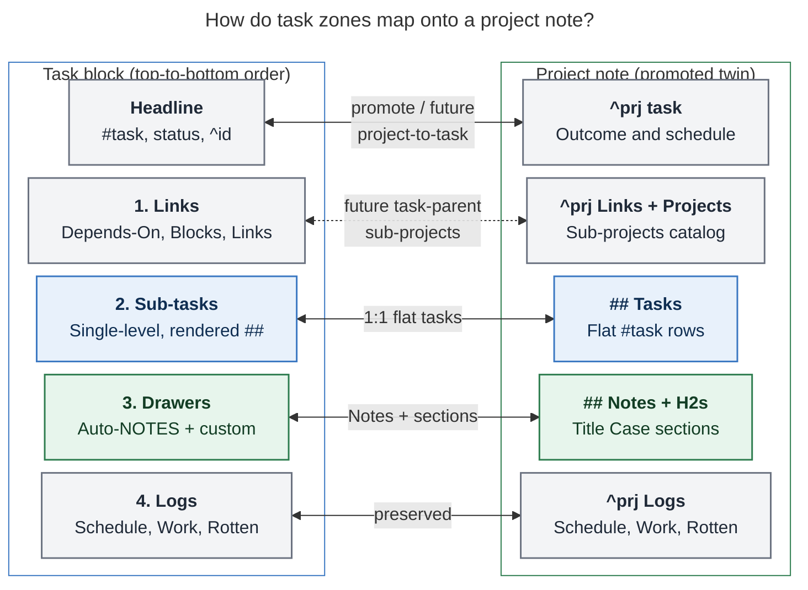
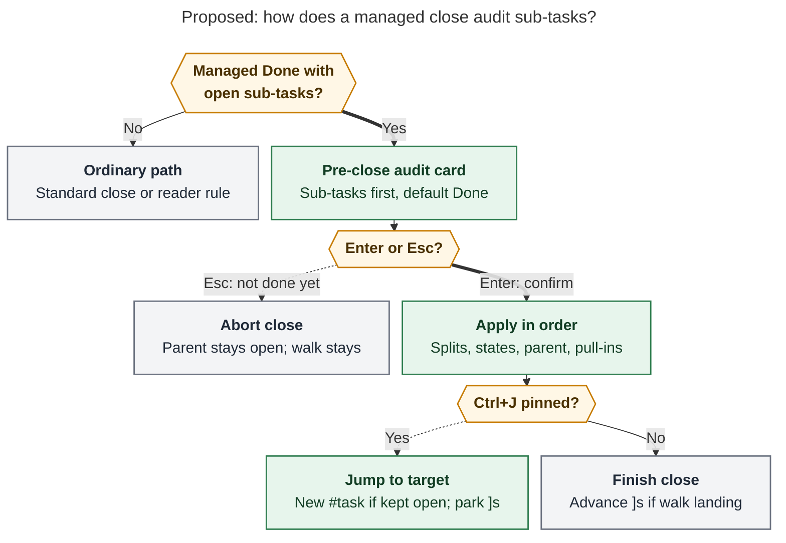

# Sub-Tasks for Bob: Rethinking `bob-cli-of` Around Flat Scope, Ordered Anatomy, and Quiet Aesthetics

> **Research question:** How should Bob design and implement first-class support for
> sub-tasks — replacing the cancelled `bob-cli-of` ("explicit micro tasks") epic in
> light of `^micro-tasks-cleanup` and the roadmap tasks blocked on `^micro-tasks`
> (`^better-o`, `^no-all-caps-for-drawers`, `^tasks-parent-projects`, and
> `^task-to-project`)? Is this redesign a good idea, where are the hidden traps or
> tensions, what requirement adjustments are justified, and what is the most intuitive,
> reliable, and beautiful architecture across `bob-cli`, `bob-plugins`, and
> `bob-mac-capture`?

---

## Executive Summary & Verdict

**Verdict: Canceling `bob-cli-of` was the right call — build this redesigned version.**

`bob-cli-of` (`plan:202611/explicit_micro_tasks.md`) got the storage primitive right (a
plain Markdown checkbox `- [ ]` without `#task` under a `#task` line) and the core
value right (explicitly separating work items from prose notes, audited at close time).
However, `bob-cli-of` tried to turn sub-tasks into **arbitrarily nested, independently
checkable mini-tasks** (`☐ ⌗⌗`, `☐ ⌗⌗⌗`, …) mixed loosely beside unstructured notes,
typed via a fragile `..` dot-alias, and lacking `Ctrl+J` jump support.

Reviewing `^micro-tasks-cleanup` alongside the four roadmap tasks downstream of
`^micro-tasks` in `~/bob/bob.md` reveals a much stronger, cleaner architectural thesis:

1. **A task block is a compact, single-level twin of a Project Note.** Keeping sub-tasks
   strictly **single-level** (`⌗⌗` only), grouping notes into an auto-created `NOTES`
   drawer whenever sub-tasks exist, and enforcing one canonical four-zone child order
   (**Links < Sub-tasks < Drawers < Logs**) makes `Task Block ⇄ Project Note` a genuine
   1:1 structural isomorphism — directly paving the way for `^better-o`,
   `^no-all-caps-for-drawers`, `^tasks-parent-projects`, and `^task-to-project`.
2. **Sub-tasks are a task's scope contract, not a shadow task tracker.** Refusing early
   completion while the parent is open (allowing only **obsolete/cancel `[-]`** with an
   optional reason, or **split out `[>]`** via `Ctrl+Shift+T`) keeps Bob's task-vs-project
   boundary sharp and makes hiding the `[ ]` checkbox completely honest: there is no
   checkbox to click, only a crisp double slanted hash **`⌗⌗`**.
3. **Every surface becomes simpler and more cohesive.** Dropping nesting removes ~40% of
   cross-repo complexity (no recursive depth walks, no non-focusable nested rows on close
   cards, no depth-shifting on merge/split). Replacing `..` with **`- [<space>` →
   `- [ ] `** (and atomic **`<Backspace>` → `- `**) eliminates every dot-alias collision.
   Supporting **`Ctrl+J` jump pins** (on `api.successors` **v6**, since `bob-cli-oe`
   already shipped v5) lets a kept-open sub-task focus its brand-new `#task` line
   immediately after close.

### Summary of Justified Adjustments to the Requirements

Before diving into the full design, here are the **eight deliberate adjustments** I
recommend — either refining `^micro-tasks-cleanup` or fixing latent flaws carried over
from `bob-cli-of`:

| # | Requirement / Prior Plan | Recommended Adjustment | Why It Is Justified |
| --- | --- | --- | --- |
| **A1** | Rename "micro task" to "task requirement" (`req`)? | Name the feature **Sub-task** (`sub-task` in prose/UI; `subtask` in CLI/JSON/code). | "Requirement" collides directly with the live `REQUIREMENTS` drawer (one of the 4 open drawers in `~/bob/` today and the canonical example in `glossary:task-drawer`) and reads awkwardly for errands and merged tasks. Meanwhile, `~/bob/` has **0** open nested `#task` lines today, so "sub-task" is clean and natural. |
| **A2** | `bob-cli-of` wrote parent `[x]` *before* opening Obsidian's close card (`Esc` left parent closed). | **Unified pre-close audit in both Obsidian and Mac Capture:** when a managed Done closes a non-recurring task with ≥1 open sub-task, `Esc` **aborts the close** ("Not done yet", leaving the parent open and keeping the `]s` walk in place). | With pre-completion disabled, the close card is the *only* moment you review open sub-tasks. Reflexively hitting `Esc` after spotting a forgotten step must never silently close the task and advance `]s`. |
| **A3** | Auto-create `NOTES` drawer when ≥1 sub-task exists (capture only?). | **Auto-sweep existing loose notes into `NOTES` on the 0 → ≥1 sub-task transition** in Bob writers (capture, merge, Obsidian sub-task creation/toggle), while keeping **readers tolerant** and keeping `bob task reconcile` to safe zone-sorting only. | Only routing *future* notes into `NOTES` leaves tasks in a split-brain state (some notes loose beside sub-tasks, newer notes in `NOTES`). Conversely, having background `reconcile` yank hand-typed bullets mid-edit would be jarring. |
| **A4** | Sort order `links < reqs < drawers < logs` (all logs at bottom?). | Keep **`❌ **CANCEL LOG**` at slot 0** on cancelled tasks (preserving `blocks.rs`, `task_relations/format.rs`, and `bob.md`), and enforce strict **`Links < Sub-tasks < Drawers < Logs`** (`SCHEDULE`, `WORK`, `ROTTEN`) on every task block. | Open tasks never carry a `CANCEL LOG`, so active tasks exhibit pure 4-zone order while existing cancel-log placement contracts stay unbroken. (Moving `CANCEL LOG` to Zone 4 is easy if preferred, but breaks existing vectors for little practical gain.) |
| **A5** | Sub-tasks cannot be completed before parent; hide `[ ]` checkbox, show only `##`. | Enforce no-pre-completion in **gestures**, but keep **`[x]` as a valid stored & rendered state**, and give resolved states distinct checkbox-free glyphs (`⌗⌗` muted for `[x]`, `⊘` for `[-]`, `→` for `[>]`) while overriding `task-statuses.css`'s grey row banner on `[-]`. | Closed parents, reopened parents, and future `^task-to-project` conversions *all* produce `[x]` sub-tasks. And if `[x]` and `[-]` both rendered as muted `⌗⌗` + strike, you could not distinguish finished work from obsoleted work. |
| **A6** | Single-level sub-tasks only (no nested `###`) vs. Task Merge of a task that has sub-tasks. | Allow **nested plain notes** under a sub-task; when merging a source task `S` that has its own sub-tasks into target task `T`, **fold `S`'s sub-tasks into plain child notes under `- [ ] <S>`** (with a dry-run warning) rather than writing illegal level-2 checkboxes (alternative: strict refusal via `merge_source_open_subtasks`). | `bob-cli-of` relied on depth-2 nesting for merges. Single-level sub-tasks require an explicit rule when `S` itself owns sub-tasks; folding keeps merges fluid while still auditing `- [ ] <S>` on `T`'s close card. |
| **A7** | `- [<space>` → `- [ ] ` and `<Backspace>` → `- ` in capture. | Implement `- [<space>` → `- [ ] ` and atomic `<Backspace>` → `- ` in **both** Mac Capture (via `bob capture-rewrite` with a `[` prefilter so normal spaces never spawn `bob`) **and** Obsidian CM6 Live Preview (handling Obsidian's default `autoPairBrackets`), plus `@route+id [<space>` and a dedicated Obsidian **`Ctrl+Shift+X`** obsolete/restore gesture. | Muscle memory breaks if `- [ ` and Backspace work in Mac Capture but fight Obsidian's auto-paired `[]` when editing the same note. And banning early completion requires a crisp, low-friction Obsidian chord to obsolete a sub-task with an optional reason. |
| **A8** | Support `^ctrl-j-successor-jump` on sub-task rows. | Keep **`Ctrl+J` strictly navigation-only** (`decisions:successor-jump-parks-the-walk`): pinning a Kept-Open / Pulled-In sub-task lands on the **newly created `#task` line**; pinning a Done / Not-Done sub-task lands on its closed sub-task line with a status hint (`⌃X to keep open as a task`). Bump `api.successors` to **v6** (v5 is already shipped by `bob-cli-oe`). | Preserves the accepted "pin is navigation only" contract, avoids mutating verdicts on pin moves, and makes `Ctrl+X` → `Ctrl+J` (or `Space` → `Ctrl+J`) land cleanly on the brand-new task. |

---

## 1. Critique of `bob-cli-of` and the Direction of `^micro-tasks-cleanup`

### 1.1 Ground Truth in the Codebase and Vault (Verified 2026-11-21)

Before critiquing the design, I verified the live state of `~/bob/`, `bob-cli`,
`bob-plugins`, and `bob-mac-capture`:

- **Vault cleanliness (`~/bob/`, excluding `done/`, `_generated/`, `_templates/`,
  `_conflicts/`):**
  - **776** open `#task` lines across the vault.
  - **0** plain single-character checkboxes (`- [c] ` without `#task`) under open `#task`
    lines — the checkbox position remains 100% collision-free.
  - **0** open nested `#task` lines under open `#task` lines — flat tasks are already the
    lived reality of the vault.
  - **229** open tasks hold **353** loose plain child bullets (notes mixed with unwritten
    steps), while only **4** open tasks currently use ALL-CAPS drawers (`NOTES:`, `DONE`,
    `REQUIREMENTS`, `MOTIVATION`). That tiny drawer count is direct empirical evidence
    behind `^no-all-caps-for-drawers`: ALL-CAPS headers feel heavy enough that they are
    rarely typed by hand.
- **Codebase state:**
  - `bob-cli`: `GRAMMAR_REVISION` is `28` (`src/native/capture_language/mod.rs:63`).
    `TaskChildKind` already exists in `src/native/task_children.rs`, classifying
    `Authored`, `Drawer`, `ManagedLink` (including `SubProjects`!), `ManagedLog`, and
    `NestedTask`. `bob-cli-oe` (`853246f0`, `d27041cd`) has landed `Ctrl+J` jump pin
    (`src/native/capture/jump.rs`, `docs/task-dependencies.md` §12.24).
  - `bob-plugins`: `bob-navigation-hotkeys` already publishes `api.successors` **v5**
    (`src/206f-successor-picker-api.js:7`) and `api.notice` **v5**; `task-status-cycler`
    is at **v6** (`src/110-plugin-lifecycle.js:13`). `bob-ledger-tools` renders task tag
    marks (`src/264-plugin-task-tag-marks.js`) and custom blocked-reason checkboxes via
    `Decoration.line` + CSS on `input.task-list-item-checkbox` (`src/142f-block-marks-editor.js`,
    `styles.css:3324–3425`). Crucially, `~/bob/.obsidian/snippets/task-statuses.css`
    applies a grey left border and grey row background to *every* `data-task="-"` line
    (`task-statuses.css:44–81`), which would hit cancelled sub-tasks unless explicitly
    overridden.
  - `bob-mac-capture`: `CapturePanelController.swift` already establishes two exact
    precedents we need: `deleteCloseTaskCommaInEditableTextView` (line 1466) for
    provenance-tracked atomic Backspace deletion of an auto-expanded token, and
    `deleteEmptyBulletRowInEditableTextView` (line 3793) for one-key Backspace removal of
    `- `. `CapturePanelModel.swift` (`noteSeparatorToggleIntent`, line 3253) triggers
    `bob capture-rewrite --cursor` only on whitelisted trigger keys.

### 1.2 What `bob-cli-of` Got Wrong — and Why `^micro-tasks-cleanup` Is a Real Leap Forward

| Dimension | What `bob-cli-of` Designed | Why It Felt Wrong | How the Redesign Fixes It |
| --- | --- | --- | --- |
| **Hierarchy** | Arbitrary nesting (`##`, `###`, `####`, capped at 5) with non-focusable nested subtrees on close cards. | Built a mini-outliner inside a task block; competed with real Projects; made close cards, merges, and depth rendering noisy. | **Single-level only (`⌗⌗`).** Nested plain notes are allowed under a sub-task; deeper work hierarchies belong in Projects (`Ctrl+Shift+Alt+N` or future `^tasks-parent-projects`). |
| **Visuals** | Visible checkbox *plus* double hash (`☐ ⌗⌗ Write parser`). | Double glyph looks busy and screams "click this checkbox while working." | **Hide `[ ]`, show only `⌗⌗`** in the checkbox's slot. Clean, calm, unmistakably subordinate to `☐ ⌗`. |
| **In-flight state** | `Ctrl+Enter` silently flipped `[ ]` ↔ `[x]` on any micro task while the parent was open. | Created a shadow task tracker where multi-day work avoided promotion and undermined the close-time audit. | **No early completion** while parent is open; only **Obsolete (`Ctrl+Shift+X`)** with optional reason, or **Split (`Ctrl+Shift+T`)** into a real task. |
| **Block layout** | Unordered child bullets; loose notes interleaved freely with micro tasks (`captured_notes = loose`). | Tasks with both steps and prose became visually tangled, and `o` / `Ctrl+Shift+O` had no canonical target zone. | **Strict 4-zone anatomy** (`Links < Sub-tasks < Drawers < Logs`) + **auto-`NOTES` drawer** whenever ≥1 sub-task exists. |
| **Typing alias** | `..` → `[ ] ` with carve-outs for `.bashrc` and project-note `- .` Move. | Non-obvious mnemonic; fragile overlap with existing dot aliases and 350ms double-dot collapse. | **`- [<space>` → `- [ ] `** with atomic **`<Backspace>` → `- `** (zero collisions, universal Markdown intuition). |
| **Close card** | Obsidian wrote `[x]` before showing the card (`Esc` left task closed); no `Ctrl+J` jump support (`api.successors` v5). | Asymmetric with Mac Capture; dangerous on `]s` walk if you spotted a forgotten step; missed `bob-cli-oe`'s jump pin. | **Pre-close audit on both surfaces** (`Esc` aborts cleanly) + full **`Ctrl+J` jump** to newly split tasks (`api.successors` **v6**). |

### 1.3 Honest Critique: Where the New Requirements Have Real Tension

Good design means stress-testing even the user's own updated instincts. Three genuine
tensions deserve candid attention before writing a line of code:

1. **Banning pre-completion vs. multi-day WIP tasks (and `^task-to-project`):**
   - *The upside is real:* Refusing `[ ] → [x]` while the parent is open prevents sub-tasks
     from turning into a shadow tracker and creates healthy pressure to promote multi-day
     work into a Project Note (`Ctrl+Shift+Alt+N`). It also keeps the checkbox-free `⌗⌗`
     rendering visually honest.
   - *The tension is also real:* Look at `~/bob/bob.md` lines 60–123 — several `[/]` WIP
     tasks stay open for 2–5 days across multiple Pomodoros. If a WIP task has 4 sub-tasks
     and you finish 2 on Monday, you cannot check them off until the whole parent finishes;
     and at close time, all 4 appear defaulted to `✓ Done`, re-introducing mild
     rubber-stamp fatigue if you don't scan them carefully.
   - *Furthermore, `[x]` under an open parent is unavoidable structurally:* Reopening a
     closed parent (`Ctrl+Enter` on `[x]` parent) leaves its `[x]` sub-tasks intact, and
     future `^task-to-project` conversion must represent a project's already-completed
     `## Tasks` rows as `[x]` sub-tasks under the resulting open task.
   - *Design verdict:* **Follow Bryan's no-pre-completion rule in gestures** (it fits Bob's
     small-task + project-promotion philosophy and makes the checkbox-free UI shine),
     **while keeping `[x]` fully supported in storage, readers, and rendering.** Because
     `[x]` is already in the format, relaxing the `Ctrl+Enter` guard later (if lived
     experience demands it) is a 5-line policy change with zero data migration.

2. **Auto-`NOTES` drawer while ALL-CAPS drawers still exist:**
   - Until `^no-all-caps-for-drawers` ships, auto-creating `- NOTES` puts an ALL-CAPS
     header on every task that has both sub-tasks and notes. That looks slightly loud right
     now — *which is precisely why Bryan filed `^no-all-caps-for-drawers` right behind
     `^micro-tasks`!*
   - *Design verdict:* **Keep auto-`NOTES` when ≥1 sub-task exists** (and keep tasks with
     0 sub-tasks on loose notes so 90%+ of tasks stay untouched), AND **decouple all
     drawer detection/formatting behind `capture_drawers`** so when `^no-all-caps-for-drawers`
     lands (e.g., `▸ Notes` / `**Notes:**` / icon-prefixed headers), the entire sub-task
     and 4-zone system upgrades automatically without rework.

3. **Single-level sub-tasks vs. merging & future `^task-to-project`:**
   - Single-level sub-tasks are a massive net win, *but* they mean any operation that
     collapses a two-level structure into a single task faces a flattening boundary:
     - **Task Merge (`S` → `T`)** when source `S` itself has sub-tasks.
     - **Future `^task-to-project`** when a project note contains a `#task` that itself has
       sub-tasks.
   - *Design verdict:* Don't re-introduce nested `###` sub-tasks to dodge this rare edge
     case. Define one clean, transparent flattening rule for merge (fold `S`'s sub-tasks
     into plain notes under `- [ ] <S>` with a dry-run notice, or refuse when `S` has open
     sub-tasks) and keep the core model flat.

---

## 2. How the Blocked Roadmap Fits Together

Reviewing every task blocked on `^micro-tasks` in `~/bob/bob.md` makes it clear that
sub-tasks are the keystone of a unified task/project architecture:

- **`^better-o`** (`bob.md:127`): "`o` should create new task below current one when task
  headline is selected! Both should respect the task sub-bullet ordering (links < reqs <
  drawers < logs)!"
  - *What this design gives it:* One shared `TaskChildZone` classifier and zone-boundary
    helper (`bob-cli` + `bob-plugins` vectors). `o` on a task headline skips all four zones
    to insert a sibling `#task`; `o` on a sub-task inserts a sibling `- [ ] ` after its
    nested notes inside Zone 2; `Ctrl+Shift+O` on a task headline jumps cleanly past Zone 1
    (Links) into Zone 2 (or `NOTES` in Zone 3 once `^better-o` defines its exact cursor
    rule).
- **`^no-all-caps-for-drawers`** (`bob.md:131`): "Stop requiring that drawers use all caps
  (mark them some different way instead)!"
  - *What this design gives it:* Zero hardcoded ALL-CAPS regexes in sub-task recognition,
    zone sorting, or auto-`NOTES` creation. Every caller routes through the drawer module's
    `is_drawer_header` / `format_drawer_header` abstraction, so replacing `- NOTES` with a
    quieter drawer marker is a single-seam change.
- **`^tasks-parent-projects`** (`bob.md:164`) → **`^task-to-project`** (`bob.md:199`):
  "Allow tasks to be parents of projects!" → "Add support for converting any project note
  to a task!"
  - *What this design gives them:* Because sub-tasks are strictly single-level, deeper
    workstreams under a task become child Project Notes (`parent: "[[note#^task-id]]"`),
    tracked by the existing `ManagedLinkKind::SubProjects` slot (`src/native/task_children.rs:21`)
    in Zone 1! And because sub-tasks preserve `[ ]`, `[x]`, `[-]`, and trailing `^anchor`
    block IDs while notes live in `NOTES` and custom sections live in drawers, converting
    *any* project note back into a task becomes a near-lossless 1:1 structural map:



*Figure 1. A task's four ordered child zones (Links, Sub-tasks, Drawers, Logs) mirror a
project note's sections one-to-one, turning promotion and future project-to-task
conversion into structural twins. Dashed edges mark planned downstream tasks
(`^tasks-parent-projects` and `^task-to-project`). (Rendered with mermaid-cli 12.0.0
under the PDF config; 820 × 729 px, fit 79.6%.)*

---

## 3. Recommended Solution: Complete Architecture & UX Design

### 3.1 Terminology & Data Model

**Canonical name:** **Sub-task** (UI copy: `Sub-task` / `Sub-tasks`; CLI/JSON/internal
identifiers: `subtask` / `subtasks`; glossary slug: `sub-task`, aka `subtask`, `step`).

**Definition (strictly single-level).** A line is a **sub-task** iff all four conditions
hold:
1. It is a list item outside code fences and blockquotes whose body starts with a
   single-character Markdown checkbox `[c] `.
2. Its body does **not** carry the configured Tasks global filter token (`#task`), matched
   as a whole token identically to `note_tasks`.
3. Its nearest shallower list-item parent is a `#task` line (its **owner**).
4. It is **not** inside a drawer, under a note bullet, or under another sub-task.

```markdown
- [/] #task Ship the export command [created::2026-11-21] ^export
	- ⛓️ **DEPENDS ON:** [[#^schema-freeze]]
	- [ ] Write the CSV parser
		- Must handle CRLF and trailing blank lines
	- [ ] Add `--format` CLI flag ^export-flag
	- [-] Benchmark against v1
		- *2026-11-21* — ⊘ v1 is already retired
	- [>] [[#^export-docs|Update the export docs]]
	- NOTES
		- Old flag name confused people in review
	- FUTURE WORK
		- Streaming output for multi-GB tables
	- 🛠️ **WORK LOG**
		- *2026-11-21 10:15* — Started parser prototype
```

**What is NOT a sub-task:**
- A checkbox nested under another sub-task (invalid nesting; refused in capture, flagged
  by `bob task check`, never rendered as `⌗⌗⌗` and never offered on the close card).
- A checkbox inside a drawer or under a note bullet (drawers and notes hold prose only;
  refused in capture).
- A checkbox in a notebook, Pomodoro ledger row, bank row, or code fence.
- Any line carrying `#task` (a tracked task of its own).

**States (stored strictly in the 1-byte checkbox):**

| Stored | State | Who Writes It | Meaning |
| --- | --- | --- | --- |
| `[ ]` | **Open** | Capture, merge, Obsidian `- [ ` / `Ctrl+]`, hand edit | Required part of the owner's committed scope. |
| `[x]` / `[X]` | **Done** | Owner's close-time audit card (default verdict); future `^task-to-project` | Completed with the owner. Never written by in-flight gestures while the owner is open. |
| `[-]` | **Obsoleted / Not done** | Obsidian `Ctrl+Shift+X` (with optional reason), or close card `Ctrl+Shift+X` | Dropped from scope without completing; optional child note `*YYYY-MM-DD* — ⊘ <reason>`. |
| `[>]` | **Carried** | Obsidian `Ctrl+Shift+T`, `bob task split`, or close card `Keep open` (`Ctrl+X` / `Space`) | Extracted into its own `#task`; body becomes `[[<note?>#^<id>\|<Alias>]]`. |

Any unrecognized checkbox character under a `#task` reads as open and is flagged by
`bob task check`, never silently rewritten.

**What a sub-task never has:** `#task`, `[created::]`, lane (`*`/`/`/`?`), freshness,
priority, schedule, dependencies, Task Links, review-walk membership, Ready-cap count,
Today membership, or Stats time. It **may** carry a trailing `^anchor` block ID (reused
as the new task's ID on split / Keep open, and preserved across future project ⇄ task
conversions), and it **may** have indented **plain note bullets** beneath it (which travel
with it on split or promotion). Attempting to link a sub-task's anchor into a Pomodoro
(`@route:subtask-id`) is refused with a clear teaching message naming the owner.

**Reader rule (unmanaged closes):** If a parent closes without going through a managed
Done gesture (raw checkbox edit, cancel, automated gcal/collect-done close), Bob writes no
sub-task bytes; readers interpret any `[ ]` sub-task under a closed `[x]` owner as Done
and under a `[-]` owner as Not done. Reopening the parent restores them untouched.

```mermaid
---
title: "Which gestures write each sub-task state?"
accTitle: "Sub-task lifecycle"
accDescr: "An open sub-task cannot be marked done before its parent; while the parent is open it may be obsoleted, split out, or promoted, and only the parent close card writes done."
---
stateDiagram-v2
  direction LR
  state "Open  [ ]<br/>rendered as ##" as OPEN
  state "Done  [x]<br/>closed with parent" as DONE
  state "Obsoleted  [-]<br/>optional reason" as OBSOLETE
  state "Carried  [>]<br/>links new #task" as CARRIED
  state "Project #task<br/>in ## Tasks" as PROJECT
  [*] --> OPEN: authored / merged
  OPEN --> OBSOLETE: Ctrl+Shift+X / card
  OBSOLETE --> OPEN: restore
  OPEN --> CARRIED: Ctrl+Shift+T / card
  OPEN --> DONE: parent close confirm
  OPEN --> PROJECT: promote parent
```



*Figure 2. While its parent is open, a sub-task can only be obsoleted (`[-]`), split out
(`>`), or promoted with its parent; only confirming the parent's close card writes Done
(`[x]`). (Rendered with mermaid-cli 12.0.0 under the PDF config; 796 × 518 px, fit
82.0%.)*

---

### 3.2 Canonical 4-Zone Task-Block Anatomy & Auto-`NOTES` Drawer

Every direct child of a `#task` belongs to one canonical zone in `src/native/task_children.rs`
(mirrored by shared vectors in `bob-plugins`):

| Order | Zone | Direct-Child Kinds | Notes |
| --- | --- | --- | --- |
| *(0)* | *(Cancelled top slot)* | `❌ **CANCEL LOG**` | Closed `[-]` tasks only; stays first per `blocks.rs:333` & `bob.md:530` so existing cancel-log contracts stay intact. |
| **1** | **Links** | `⛓️ **DEPENDS ON:**` → `🧱 **BLOCKS:**` → `SUB-PROJECTS` → `🪢 **LINKS:**` → `🪢 **LINKED FROM:**` | Exact order already enforced by `task_dependencies` and `task_relations`. |
| **2** | **Sub-tasks** | Single-level sub-tasks (`- [ ]`, `- [x]`, `- [-]`, `- [>]`) — *or loose notes when 0 sub-tasks exist* | Preserves authored order within the zone (so Bryan can order sub-tasks deliberately). |
| **3** | **Drawers** | `NOTES` (placed first among drawers when auto-created), then other drawers (`REQUIREMENTS`, `FUTURE WORK`, …) | Detected/formatted exclusively through `capture_drawers` (ready for `^no-all-caps-for-drawers`). |
| **4** | **Logs** | `🗓️ **SCHEDULE LOG**`, `🛠️ **WORK LOG**`, `🥀 **ROTTEN LOG**` | Always last. |

#### Exact Rules for Auto-`NOTES` and Zone Enforcement

1. **Tasks with 0 sub-tasks (no behavioral change):** Plain notes stay loose in Zone 2
   (after Links, before Drawers and Logs). Existing note-only tasks suffer zero visual
   churn or mandatory `NOTES` nesting.
2. **Tasks with ≥1 sub-task — capture & merge writers:**
   - Capturing a plain note to a task that has ≥1 sub-task (`@bob+export Some note`, or a
     plain bullet under a note-less `@bob+export`) routes through `ensure_drawer("NOTES")`
     in **Zone 3** (creating `- NOTES` as the first drawer after Zone 2 if absent). Dry-run
     preview explicitly displays `NOTES` as the target drawer.
   - Capturing a brand-new task whose draft mixes `- [ ]` sub-tasks and plain note bullets
     emits all sub-tasks in **Zone 2**, sweeps the plain bullets into `- NOTES` at the top
     of **Zone 3**, and places other drawers below `NOTES`. Live preview shows the exact
     resulting block before submit.
   - **0 → ≥1 transition (adding the first sub-task to a task with loose notes):** When
     capture (`[ ] Step @bob+export`), Task Merge, or Obsidian's `Ctrl+]` sub-task toggle
     adds the first sub-task to a task that already has loose plain direct children, the
     same atomic edit places the new sub-task in **Zone 2** and sweeps those existing loose
     notes (with their indented children intact, in original order) into `- NOTES` in
     **Zone 3** (appending to an existing `NOTES` drawer if one already exists). Guarded
     Undo reverts the whole transition in one step.
3. **Reader tolerance & `bob task reconcile`:**
   - Readers (promotion, split, lints) still treat any stray hand-typed loose note beside a
     sub-task as a note (promotion merges loose notes + `NOTES` drawer into `## Notes`).
   - Every Bob writer inserts into its exact canonical zone (Links → Zone 1, Sub-tasks →
     Zone 2, Drawers → Zone 3, Logs → Zone 4).
   - `bob task reconcile` stably sorts out-of-zone direct children of a `#task` (moving
     each direct child with its full subtree as an atomic unit, preserving within-zone
     order), **without** yanking loose bullets into `NOTES` in the background (so live
     hand-editing in Obsidian is never ambushed mid-sentence). `bob task check` / doctor
     reports stray loose notes beside sub-tasks with an opt-in fix.

---

### 3.3 Visual Craft: Making Sub-Tasks Genuinely Beautiful

The visual goal is **calm structural clarity**: at a glance, a reader should instantly see
which lines are real tracked tasks (`☐ ⌗`), which lines are sub-tasks of that task
(`⌗⌗`, no checkbox!), which sub-tasks were resolved or carried, and which lines are notes.

```text
☐ ⌗ Ship the export command                     (tracked task: checkbox + single slanted hash)
    ⛓️ DEPENDS ON: #schema-freeze
    ⌗⌗ Write the CSV parser                     (open sub-task: NO checkbox, double hash in owner's ink)
        • Must handle CRLF and trailing blanks  (plain child note of sub-task)
    ⌗⌗ Add --format CLI flag                    (open sub-task: clean, aligned, zero box clutter)
    ⊘  Benchmark against v1                     (obsoleted [-]: quiet struck glyph, no heavy grey bar!)
        • 2026-11-21 — ⊘ v1 is already retired
    →  Update the export docs ↗                 (carried [>]: muted arrow, wikilink stays live)
    NOTES
        • Old flag name confused people
    🛠️ WORK LOG
        • 2026-11-21 10:15 — Started prototype
```

#### Concrete Rendering Design Across All Three Surfaces

1. **Obsidian Live Preview & Reading View (`bob-ledger-tools`) — Reuse the Proven
   Attribute + Checkbox-Slot Pattern:**
   - **Why NOT a `Decoration.replace` over `[ ]` in CM6?** Obsidian's built-in Live Preview
     already decorates `- [ ]` into a checkbox widget. Layering a competing
     `Decoration.replace` risks range overlap or exposing a stray `- ` bullet dot beside
     `⌗⌗`.
   - **Instead, follow `bob-ledger-tools`'s proven Blocked Marks architecture
     (`142f-block-marks-editor.js` + `styles.css:3324–3425`):**
     - **Live Preview:** Emit `Decoration.line({ attributes: { "data-bob-subtask": state, "data-bob-subtask-hue": ownerHue } })` on `.HyperMD-task-line` (recomputed only on doc/viewport/type-catalog changes — zero flicker on cursor moves!).
     - **Reading View:** Attribute-only markdown post-processor sets `data-bob-subtask` and
       `data-bob-subtask-hue` on eligible `li.task-list-item` elements (zero extra DOM
       nodes; survives Dataview round-trips!).
     - **One shared CSS rule set** gated by `body.bob-task-tag-marks`:
       - Targets `input.task-list-item-checkbox` inside `[data-bob-subtask]` and strips all
         checkbox chrome (`appearance: none; border: none; background: transparent;
         box-shadow: none; pointer-events: none;`) — **completely removing the visual
         checkbox AND preventing accidental mouse clicks!**
       - Draws the glyph cleanly inside `input.task-list-item-checkbox::after` using SVG
         masks in the exact `16×16` / `stroke-width: 1.8` / round-cap Lucide stroke
         language of `--bob-task-tag-glyph` (`docs/task-tag-marks.md`):
         - **`open` (`[ ]`)**: A dedicated paired double-hash SVG mask
           `--bob-subtask-glyph` (width `1.58em`, tight optical kerning between the two
           slanted hashes so it looks crafted rather than doubled!) in the **owner's hash
           ink** (default teal `--bob-task-tag-hue`, or the owner's explicit `[type::]`
           ink), opacity `0.9`.
         - **`done` (`[x]`)**: Same `--bob-subtask-glyph` faded to `color-mix(in srgb,
           var(--bob-subtask-ink) 40%, var(--text-faint))` at `0.75` opacity (matching
           closed `#task` `⌗`), with muted struck-through text.
         - **`obsolete` (`[-]`)**: Quiet `--bob-subtask-obsolete-glyph` (`⊘` stroked circle
           with diagonal slash in `--text-faint`), muted struck-through text — **plus an
           explicit override resetting `background: none; border-inline-start: none;`** so
           `~/bob/.obsidian/snippets/task-statuses.css` never paints a loud full-width grey
           cancelled-task bar across a sub-task row!
         - **`carried` (`[>]`)**: Quiet `--bob-subtask-carried-glyph` (`→` stroked arrow in
           `--text-muted`), muted text with clickable live wikilink.
       - **Cursor reveal & toggle reversibility for free:** When the cursor moves into
         `- [ ] ` in Live Preview, Obsidian naturally reveals raw Markdown `- [ ] `; when
         `Toggle task tag marks` is toggled off, removing `body.bob-task-tag-marks`
         instantly restores native checkboxes everywhere.
       - **Lazy hover tooltip** (reusing `handleBlockMarkMouseOver` in
         `142f-block-marks-editor.js:283`):
         `Sub-task of “Ship the export command” · Ctrl+Shift+T splits · Ctrl+Shift+X obsoletes`.

2. **Bob Mac Capture Editor (`CapturePanelView.swift`)**:
   - `bob capture-parse` emits a `subtask` `SpanKind` covering the 3 bytes `[ ]` (only in
     eligible positions).
   - Mac Capture's highlighter sets the `[ ]` span foreground clear and draws the paired
     double-hash `⌗⌗` in the owner item's hash ink using the existing
     `RecordRouteEmojiOverlay` pattern (`CapturePanelView.swift:1670`), revealing raw `[ ]`
     whenever the caret touches the span.
   - Preview cards (`TaskBlockView.swift`) render sub-tasks with the same `⌗⌗` mark (no
     checkbox!), placed cleanly in Zone 2 above any auto-created `NOTES` drawer.

3. **Close Cards (Obsidian & Mac Capture)**:
   - Sub-task rows display `⌗⌗` before the step text, with a crisp verdict pill on the
     right (`✓ Done` in quiet green by default, `→ Keep open` in blue, `→ Pull in` in
     accent + destination badge, `⊘ Not done` in muted grey, plus the solid accent `↗ Jump`
     capsule when `Ctrl+J` is pinned).

---

### 3.4 Authoring & In-Flight Editing Ergonomics

#### Capture & Obsidian Typing: `- [<space>` → `- [ ] ` and `<Backspace>` → `- `

Drop the `..` alias entirely. Replace it with one natural, cross-platform typing assist:

1. **Bob Mac Capture (`bob capture-rewrite --cursor` + `CapturePanelController.swift`):**
   - **Expansion (`expand_subtask_marker`):**
     - In `CapturePanelModel.swift` (`noteSeparatorToggleIntent`, line 3253), add `" "` to
       the trigger guard **strictly when `precedingChar == "["`** (zero subprocess calls on
       normal prose spaces!).
     - `bob capture-rewrite --cursor` remains the sole grammar authority: it expands `[ `
       to `[ ] ` (placing the cursor right after the trailing space) ONLY in eligible
       sub-task positions:
       - First-level bullet under a new task or note-less `@route+id`: `- [ ` → `- [ ] `.
       - Second-level bullet under a sealed project-note capture's task bullet:
         `  - [ ` → `  - [ ] ` (because the first-level bullet becomes a `#task` row, so its
         child is a single-level sub-task of that task!).
       - Same-line sub-task capture right after an un-drawered `@route+id `:
         `@bob+export [ ` → `@bob+export [ ] `.
     - Ineligible positions (item start before route, inside a drawer, under a note bullet,
       under another sub-task, or on a notebook route) stay literal `[ `.
     - `⌘Z` (Undo) restores literal `- [ ` (native undoable edit).
   - **Atomic Backspace (`deleteSubtaskCheckboxInEditableTextView`):**
     - Add one step at the top of `case .deleteBackward:` in `CapturePanelController.swift:2102`
       (right beside `deleteCloseTaskCommaInEditableTextView` and
       `deleteEmptyBulletRowInEditableTextView`):
     - When the collapsed caret sits immediately after `[ ] ` on a sub-task bullet
       (`<indent>- [ ] |` or `<indent>- [ ] |text`) — whether just expanded from `- [ ` or
       navigated back to — Backspace deletes the entire 4-character `[ ] ` in one native
       `insertText("", replacementRange:)` call, leaving `<indent>- |` (or `<indent>- |text`).
     - A second Backspace on empty `- |` falls straight into
       `deleteEmptyBulletRowInEditableTextView` and removes the empty bullet row!
     - Because `[ ]` is rendered visually as `⌗⌗`, atomic Backspace makes deleting `⌗⌗ `
       feel like deleting a single visual object rather than chewing through invisible
       brackets.
   - **Keep `Ctrl+G T` (`bob capture-rewrite --toggle-subtask --cursor A --selection-end B`):**
     Still invaluable for turning an already-written note bullet (or multi-line selection)
     into sub-tasks without jumping to the start of the line. Footer hint:
     `⌃G · U case · T sub-task · esc cancel`.

2. **Obsidian Live Preview (`bob-plugins`):**
   - **Same `- [<space>` & `<Backspace>` assist:** Add a tiny CM6 input handler scoped
     strictly to direct-child bullets of a `#task` line:
     - Typing `<space>` when the prefix is `<child-indent>- [` (or `<child-indent>- [|]`
       under Obsidian's default `autoPairBrackets: true`) rewrites the prefix cleanly to
       `<child-indent>- [ ] |` in one transaction!
     - Pressing `<Backspace>` when the collapsed caret sits right after
       `<child-indent>- [ ] |` deletes `[ ] ` back to `<child-indent>- |` in one undoable
       edit!
   - **`Ctrl+]` (`toggle-task-checkbox-marker`):** Toggles a direct-child bullet under a
     `#task` between plain note and `- [ ] ` sub-task — enforcing 4-zone order (moving the
     toggled sub-task into Zone 2 and sweeping any remaining loose notes into `NOTES` on
     the 0 → ≥1 transition), and refusing inside drawers, on managed lines, or nested under
     another sub-task.
   - **Capture Grammar Refusals (`GRAMMAR_REVISION` 28 → 29):**

| Refusal Code | Situation | User-Facing Copy |
| --- | --- | --- |
| `subtask_nested` | `- [ ]` indented under another sub-task | `Sub-tasks are single-level — promote to a project or split this step first` |
| `subtask_in_drawer` | `- [ ]` inside a drawer bullet or on `@route+id#drawer` | `Drawers hold notes — put sub-tasks directly under the task` |
| `subtask_parent` | `- [ ]` under a plain note bullet | `A sub-task belongs directly under a task` |
| `subtask_state` | Pre-checked `[x]`, `[-]`, `[>]`, etc. in capture | `Capture adds open sub-tasks — settle or obsolete them in Obsidian` |
| `subtask_link` | `@route:id` resolving only to a sub-task's `^id` | `Sub-tasks aren't planned — link “{Owner}”, or Ctrl+Shift+T makes it a task` |

#### In-Flight Obsidian Gestures on a Sub-Task Line (No Early Completion!)

Modeled on `task-status-cycler/src/192-bank-row-guard.js`, one shared `isSubtaskLine`
helper guards every task gesture in Obsidian:

| Gesture on a Sub-Task Line | Behavior |
| --- | --- |
| **`Ctrl+Enter`** on `[ ]` | **Refused** with teaching notice: `Sub-tasks close with their parent · ⌃⇧X obsoletes · ⌃⇧T splits` |
| **`Ctrl+Enter`** on `[x]` / `[-]` / `[>]` | **Refused** (`Closed with parent` / `Obsoleted · ⌃⇧X restores` / `Carried · open the linked task`). Never mutates parent or ledger. |
| **`Ctrl+Shift+X`** *(new Obsidian command)* on `[ ]` | **Obsolete / Cancel sub-task:** opens a compact inline/modal prompt `Why obsolete? (optional)` (Enter with blank submits immediately; Esc cancels). Writes `[-]` on the line; if reason is nonblank, inserts first child bullet `*YYYY-MM-DD* — ⊘ <reason>`. Single guarded Undo. |
| **`Ctrl+Shift+X`** on `[-]` | **Restore sub-task** back to `[ ]` (leaving any prior `⊘` note as history or letting the user edit it). |
| **`Ctrl+Shift+T`** (`bob task split`) on `[ ]` | **Carry now:** splits the sub-task into `- [ ] #task <text> [created:: today] ^<id>` (carrying nested plain notes verbatim, reusing trailing `^anchor`), replaces the sub-task line with `- [>] [[<note?>#^<id>\|<Alias>]]`, and adds generated `🪢 LINKED FROM` on the new task. Refuses `[x]`, `[-]`, `[>]`. |
| **`Alt+]` / `Alt+[` / `Ctrl+Shift+]` / Task Card / `Alt+N` / `Alt+F`** | **Refused** with crisp teaching notice: `Sub-tasks have no lane or properties · ⌃⇧T makes it a task`. |
| **Freshness (`bob-ledger-tools`)** | `freshnessTaskStatus` / `freshnessStampLine` require the `#task` global filter — sub-tasks never get `[fresh::]` stamps or review rows. |

---

### 3.5 The Pre-Close Audit Card & `Ctrl+J` Jump Pin



*Figure 3. Both Obsidian and Mac Capture audit open sub-tasks before finalizing the close:
Esc aborts cleanly with the parent untouched, while Enter applies splits, states, parent
closure, pull-ins, and any Ctrl+J jump in safe order. (Rendered with mermaid-cli 12.0.0
under the PDF config; 844 × 1056 px, fit 77.3%.)*

#### Card Behavior & Keys (Unified Across Obsidian `api.successors` v6 and Mac Capture)

- **Trigger:** Any managed Done gesture (`docs/task-dependencies.md` §12.1) whose closing
  set includes a **non-recurring** task with ≥1 open (`[ ]`) sub-task contributes one
  `subtask` group per owner **first on the card** (before hand-offs, project residents,
  keep-moving, or relation offers). The group alone suffices to open the card. Already
  resolved sub-tasks (`[x]`, `[-]`, `[>]`) fold into one quiet footer line on the group
  (`· 1 obsoleted earlier · 1 split earlier`; zero segments omitted).
- **Pre-close safety gate (`Esc` = "Not done yet"):**
  - On Mac Capture, the card already opens before any file write (`--require-pull-in-choice`);
    `Esc` returns to the unchanged draft.
  - In Obsidian (`task-status-cycler`), when the target task has open sub-tasks, compute
    both the sub-task rows and the dry-run successor plan **before committing `[x]`** (or
    revert cleanly if aborted before ledger writes). If the user presses `Esc`, **nothing
    is written, the parent stays open, and a `]s` walk stays on the parent** with a quiet
    notice `Close cancelled — task stayed open`. (If the user staged edits on sub-tasks,
    the existing double-Esc guard protects them first.)
  - When a closing task has **no** open sub-tasks, `Esc` keeps 100% of today's behavior
    ("parent stays closed, skip pull-ins").
- **Keys on a sub-task row** (all involutive, matching `bob-cli-of` plus `Ctrl+J`):
  - *(untouched)* → **✓ Done** (default; writes `[x]`).
  - **`Ctrl+X`** → Toggles **✓ Done ↔ → Keep open** (splits into a new `#task`, leaves
    `[>] [[#^id|Alias]]`). On a pulled row, clears pull-in and returns to Done.
  - **`Ctrl+Shift+X`** → **⊘ Not done** with inline optional reason `Why not done? (optional)`
    (writes `[-]` + optional `*YYYY-MM-DD* — ⊘ <reason>`). Pressing again returns to Done.
  - **`Space` / `Tab`** → Toggles **→ Keep open + pull in** in one keystroke (splits +
    links into Today's Pomodoro + raises to Next, no freshness stamp). Clearing restores
    previous verdict; `Tab` also advances.
  - **`Ctrl+Shift+Enter`** → Overrides Pomodoro destination for a pulled-in sub-task.
  - **`Ctrl+J`** → **Jump pin** (navigation only, `decisions:successor-jump-parks-the-walk`):
    - Pins/unpins this sub-task row (at most one pin per card across all groups).
    - If committed as **Keep open** or **Pulled in**, Bob resolves the jump landing to the
      **newly split `#task` line** (`new_path`, `new_line`, `new_block_id`) — never the
      closed `[>]` stub! Status bar: `↗ Jumps to “{T}” (new task) after the close`.
    - If committed as **Done** or **Not done**, Bob resolves the jump landing to the
      sub-task's final `[x]` / `[-]` line inside the owner note (re-located after any
      earlier splits shifted lines). Status bar explicitly reminds:
      `↗ Jumps to closed sub-task “{T}” (⌃X to keep open as a task)`.
    - Pressing `Ctrl+X` or `Space` while pinned seamlessly upgrades the jump target to the
      new task without re-pinning!
    - On a `]s` review landing, a committed pin parks the walk at the closed parent's
      neighbour instead of advancing (`decisions:successor-jump-parks-the-walk`).
  - **`Ctrl+A` / `⌘A`** → Never marks sub-task rows.
- **Safe apply ordering:**
  1. Kept-open splits execute first (bottom-to-top per note), persisting each new `#task`
     before its `[>]` stub so unfinished work always has a surviving active copy.
  2. Done (`[x]`) and Not-done (`[-]`, plus optional reason bullet) writes follow.
  3. Parent task closes (`[x]`, completion date, ledger retirement, dependent recovery).
  4. Pull-in links (both split sub-tasks and picked ordinary offers) insert last.
  5. If `Ctrl+J` was pinned, focus the settled jump landing last (parking `]s` if needed).
  - Capture remains all-or-nothing (stale rows fail write-free with `subtask_close_stale`);
    Obsidian wraps the batch in guarded Undo.

---

### 3.6 Task Merge, Task Split, and Project Promotion

| Operation | Exact Behavior Under Single-Level Sub-Tasks |
| --- | --- |
| **Task Split (`Ctrl+Shift+T` / `bob task split`)** | On an open `[ ]` sub-task: creates `- [ ] #task <text> [created:: today] ^<id>` (reusing any trailing `^anchor`), moves its nested plain notes verbatim into the new task, replaces the sub-task line with `- [>] [[<note?>#^<id>\|<Alias>]]`, and adds generated `🪢 LINKED FROM`. Refuses `[x]`, `[-]`, `[>]` via `split_not_splittable` with state-specific copy. Plain note bullets inside `NOTES` or other drawers keep today's split behavior. |
| **Task Merge (`bob task merge`, capture `>` / `<`, `merged into` label)** | When targeting **the task itself** (`MergeContainer::Task`): writes `- [ ] <source description>` into **Zone 2** of target `T` (sweeping `T`'s existing loose notes into `NOTES` if `T` just crossed 0 → ≥1 sub-task). Source's plain notes copy beneath `- [ ] <source>` as nested plain notes. **Single-level boundary:** if source `S` itself owns sub-tasks, fold them into plain notes under `- [ ] <source>` (prefixing `⊘ ` on `[-]` and `✓ ` on `[x]`) and report `"N sub-tasks folded as notes"` in dry-run preview (alternative: refuse open source sub-tasks via `merge_source_open_subtasks` if Bryan prefers zero loss of sub-task granularity). Drawer and section merge targets keep writing plain notes. |
| **Project Promotion (`Ctrl+Shift+Alt+N`, `110-project-seed.js`)** | Direct `[ ]` / `[x]` / `[-]` sub-tasks → flat `## Tasks` `#task` rows (keeping status and carrying each sub-task's nested plain notes). Direct `[>]` carried stubs → `## Notes` verbatim. `NOTES` drawer + any legacy loose notes → merged into one `## Notes` section. Other drawers → `## Title Case` sections. Managed links & logs → under `^prj`. A notes-only task promotes to an empty `## Tasks` with notice `No sub-tasks to promote — mark steps with - [␣ or Ctrl+] first`. |

---

### 3.7 Contracts, Versioning & Compatibility

- **CLI (`bob capture`):**
  - Bare capture (no `--subtask-choice`) applies default Done verdicts to open sub-tasks
    and reports them in receipts.
  - Flags: `-k, --keep-open <PICKS>` (alphabetical between `--inbox-route` and `--move-in`),
    `-x, --complete-offer` (explicit Done), `-X, --cancel-offer N[=why]` (Not done +
    optional reason), `-p, --pull-in N` (Keep open + pull in; `-p all` excludes sub-tasks),
    **`-j, --jump-offer <N|KEY>`** (resolves sub-task numbers/keys, landing on the newly
    created task when kept open or the final sub-task line when closed), hidden
    `--subtask-choice` capability flag.
  - Conflicts (`-x` with `-k`/`-p`, `-X` with `-k`/`-p`, etc.) refuse write-free via
    `offer_verdict_conflict`.
- **JSON (additive):**
  - Sub-task rows join `offers[]` numbered first with `group: "subtask"`, stable key
    `<owner_key>/subtask/<8-hex-sha256(clean_text)>[~k]`, and `subtask: {owner, state,
    default: "done", consequences}` (no nested `children` array needed!).
  - `pull_in.groups[]` gains `subtask` groups with `folded: {done, obsolete, carried}`.
  - `pull_in.subtask: {supported: true, open_count}` gates Mac Capture's `--subtask-choice`.
  - Receipts add `subtask_outcomes[]` (including `task: {note_path, line, block_id,
    linked}` for kept-open splits), and `jump` (`CaptureJumpJson`) supports
    `outcome: "done" | "not_done" | "kept_open" | "pulled_in"` with `landing` resolved
    from final staged text.
- **Rewrite & Parse (`GRAMMAR_REVISION` 28 → 29, commit with `!`):**
  - `bob capture-parse` emits `SpanKind::Subtask` covering `[ ]` (no `depth` field needed!).
  - `bob capture-rewrite --cursor` adds `RewriteRule::ExpandSubtaskMarker`
    (`expand_subtask_marker`) for `- [<space>` and `@route+id [<space>`.
  - `bob capture-rewrite --toggle-subtask --cursor A --selection-end B` powers Mac `Ctrl+G T`.
- **Obsidian Plugin API Gate:**
  - `bob-navigation-hotkeys` bumps `api.successors` **v5 → v6** (carrying `subtasks` group,
    `preCloseAbort: true`, `pick()` returning `{picks, closes, subtasks, jump}`).
  - Older `nav` (< v6) falls back cleanly: cycler skips the sub-task group and leaves bytes
    to the reader rule.
- **Shared Test Vectors (`tests/fixtures/subtasks/vectors.json` + `subtask_close/vectors.json`):**
  - Owned by `bob-cli`, copied byte-for-byte into `bob-plugins` (matching `offer_close` and
    `task_split`), pinning recognition, single-level refusal, 4-zone ordering, auto-`NOTES`
    sweep, split/merge, close verdicts, `Esc` abort, and `Ctrl+J` jump landings.

---

### 3.8 Phased Rollout Plan

1. **Phase 1 — Contract, Recognizer, 4-Zone Ordering & Reader Hardening (`bob-cli`):**
   - `src/native/subtasks.rs` + `TaskChildZone` ordering & auto-`NOTES` helper in
     `src/native/task_children.rs` + `tests/fixtures/subtasks/vectors.json`.
   - Fix `src/native/projects/scan.rs` (`parse_task_line` requiring global filter `#task`
     so `bob projects sync` never writes `[scheduled::]` onto sub-tasks) and audit the
     other any-checkbox readers (`vault_task_loss`, `vault_clobber`, `event_task`,
     `capture_pomodoros_agenda`, `dataview`).
   - Write `docs/subtasks.md` and register in `docs/_meta/contracts.yml`.
2. **Phase 2 — Capture Grammar, Auto-`NOTES`, `- [<space>` Rewrite, Merge & Split (`bob-cli`):**
   - `- [ ]` capture grammar + 5 refusals + `SpanKind::Subtask` + `GRAMMAR_REVISION` 29 (`!`).
   - 4-zone insertion + auto-`NOTES` drawer creation and 0 → ≥1 loose-note sweep in capture
     and `task_merge`.
   - `expand_subtask_marker` (`- [<space>` → `- [ ] `) and `--toggle-subtask` in
     `capture_language/rewrite.rs`.
   - `task_split` `[>]` stub + `pub(crate)` split entry for close engine; `task_merge`
     single-level handling.
3. **Phase 3 — Close Engine & `Ctrl+J` Jump Support (`bob-cli`):**
   - Sub-task offers, `-k`/`-x`/`-X`/`-p`/`-j`/`--subtask-choice`, safe apply ordering,
     `jump.rs` resolution to newly split `#task` lines, `subtask_close/vectors.json`,
     `docs/task-dependencies.md` §12 update (`!`).
4. **Phase 4 — Obsidian Rendering, Guards & Authoring (`bob-plugins`):**
   - `bob-ledger-tools`: JS twin passing `subtasks/vectors.json`; checkbox-free `⌗⌗` /
     `⊘` / `→` rendering via `Decoration.line` + Reading post-processor + CSS (with
     `task-statuses.css` `[-]` override); freshness global-filter guard.
   - `task-status-cycler`: sub-task guards (`Ctrl+Enter` refused on `[ ]`, `Ctrl+Shift+X`
     obsolete/restore with optional reason, `Ctrl+]` 4-zone toggle + auto-`NOTES` sweep,
     CM6 `- [<space>` & atomic `<Backspace>` assist).
   - `bob-navigation-hotkeys`: `256-task-split-plan.js` (`[>]` stub) and
     `110-project-seed.js` promotion switch (sub-tasks → `## Tasks`, notes/`NOTES` →
     `## Notes`).
5. **Phase 5 — Obsidian Pre-Close Audit Card & `Ctrl+J` Jump (`bob-plugins`):**
   - `bob-navigation-hotkeys` `api.successors` **v6** + `task-status-cycler` pre-close
     audit (`Esc` abort leaves parent open & keeps `]s` parked; `Enter` executes bottom-up
     splits + writes + pull-ins + `Ctrl+J` jump landing).
6. **Phase 6 — Bob Mac Capture (`bob-mac-capture`):**
   - `- [<space>` trigger (prefiltered on `[`) + atomic `<Backspace>` deletion of `[ ] `
     back to `- `; `Ctrl+G T` toggle; `⌗⌗` span overlay; Pull-In card sub-task group +
     `Ctrl+J` jump pin (`--subtask-choice`, `-j`, `-k`), verified via `Scripts/macos-ci-check`
     and exact-SHA macOS CI green.
7. **Phase 7 — Reviewed Vault Migration & SASE Memory:**
   - Gated, human-reviewed migration over the 353 loose bullets across 229 open tasks in
     `~/bob/` (plus reporting any Dataview `TASK` queries lacking `#task`) — zero silent
     vault rewrites.
   - Update glossary (`sub-task`, `task-drawer`, `task-merge`, `task-split`,
     `successor-offer`, `task-successor`, `capture-alias`) and record accepted decision via
     `/sase_memory_write`.

---

## 4. Open Decisions for Bryan

Before writing the new epic plan, four concise calls lock down every remaining degree of
freedom:

1. **Name:** Confirm **Sub-task** (`sub-task` / `subtask`), or prefer **Task requirement**
   (`req`) and retire the `REQUIREMENTS` drawer convention?
2. **Task Merge when source has sub-tasks:** Fold source's sub-tasks into plain child notes
   under `- [ ] <source>` with a preview warning (recommended, friction-free), or refuse
   merging a task that has open sub-tasks via `merge_source_open_subtasks`?
3. **Obsidian `Esc` on a sub-task close card:** Confirm **pre-close abort** (`Esc` leaves
   the parent open and keeps `]s` in place, matching Mac Capture — strongly recommended),
   or keep Obsidian's legacy post-close `Esc` and rely on a separate `Ctrl+Backspace` abort
   key?
4. **`CANCEL LOG` placement:** Keep `❌ **CANCEL LOG**` at slot 0 on cancelled tasks
   (recommended; open tasks stay pure `Links < Sub-tasks < Drawers < Logs` and zero
   existing cancel vectors break), or move `CANCEL LOG` into Zone 4 with the other logs?
