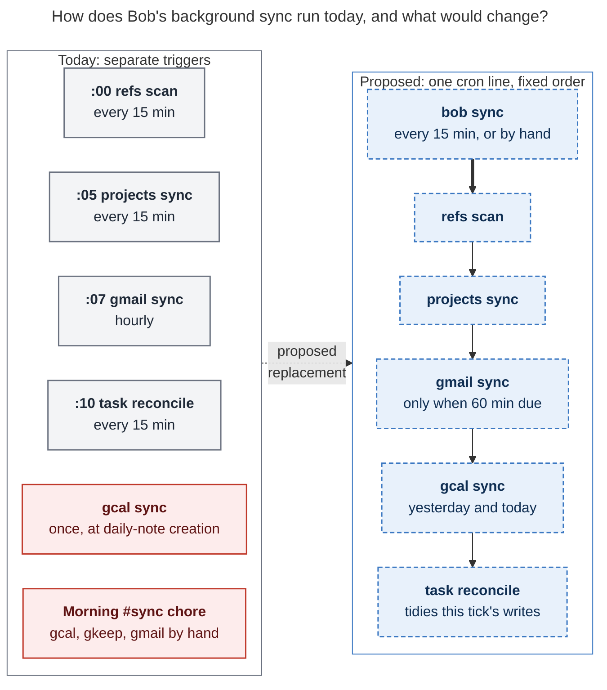
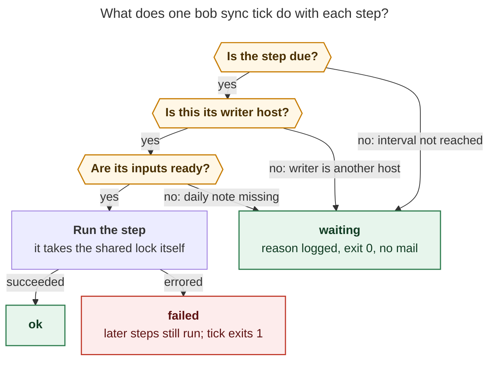

# `^bob-sync`: should one `bob sync` command replace Bob's Mac cron jobs?

**Date:** 2026-11-18 · **Task:** `bob.md` `^bob-sync` · **Evidence:** live `cronctl` state, nine days of Mac cron
logs (2026-11-09 → 2026-11-18, about 1,700 runs), bob-cli docs and source at `f0857be8`, vault history

## TL;DR

- **The task:** add one `bob sync` command that runs the refs scan, Gmail sync, Google Calendar sync, and task
  reconcile, so the Mac needs **one cron line instead of four**. Projects sync is the fifth job today and belongs in it
  too.
- **Verdict: proceed, with a narrow scope.** Build a small orchestrator in the style of `bob nightly`. It calls the
  commands that already exist, in a fixed order. Do not grow `bob task reconcile` into a syncer (the Keep idea this
  task replaced).
- **Three wins carry it:**
  1. Google Calendar gets a regular sync for the first time. Today it runs once, when the daily note is created.
  2. One run per tick means reconcile cleans up what Gmail and gcal just wrote in that same run.
  3. Your daily `#gtd #pre #sync` chore becomes one command.
- **It also cuts the noise.** 60 of the 78 failed cron runs in nine days were not real problems: either reconcile
  found no daily note yet, or one Bob job held the lock another needed.
- **The main traps all have cheap fixes.** Three things could go wrong: holding the shared lock for the whole run,
  letting one slow step delay the rest, and merging every failure into one exit code.

## 1. What the task asks for

> Add a new `bob sync` command that wraps task reconcile, Google Calendar sync, Gmail sync, and ref task sync so there
> is only one cron job!

- Created 2026-11-07. It replaced a Keep note that wanted *reconcile itself* to own these syncs; that note was
  cancelled the next day as "Obsolete in favor of Bob sync?"
- Its only blocker, `^gmail-sync`, closed on 2026-11-09, so the task has been unblocked for nine days.
- You have kept it three times. It decayed from Next to Ready on 2026-11-13 and was kept again on 2026-11-16. Nothing is
  on fire, but the task keeps coming back.



**Figure 1.** Today, five triggers run independently and only minute offsets keep them apart. The red ones (gcal and the
morning chore) are the gaps a single ordered `bob sync` closes. The dashed boxes are proposed.

**What runs on the Mac today**, measured from `~/.local/state/cron/*.log`:

| Job | Schedule | Runs | Failed | p50 | p90 | What it writes |
| --- | --- | ---: | ---: | ---: | ---: | --- |
| `bob-highlights-sync` (refs scan) | :00/:15/:30/:45 | 517 | 8 | 79 s | 133 s | ref notes, ref tasks, PDF markers |
| `bob-projects-sync` | :05/:20/:35/:50 | 524 | 12 | 5 s | 8 s | project status, catalogs |
| `bob-gmail-sync` | :07 hourly | 122 | 5 | 25 s | 67 s | mail notes, Gmail task rows |
| `bob-task-reconcile` | :10/:25/:40/:55 | 521 | 53 | 12 s | 24 s | task status, Pomodoro ledger tidy |
| `bob gcal sync` | **not scheduled** | — | — | — | — | Event Tasks in the daily note |

The `bob-vault-sync` LaunchAgent commits every 15 seconds alongside these. On athena, `bob nightly` runs at 03:30 and
is out of scope.

## 2. Should you do it? Yes, scoped to an orchestrator

### What the failures say

These are all 78 failed runs from the nine days, grouped by cause:

| Cause | Runs | | What `bob sync` would make of it |
| --- | ---: | --- | --- |
| reconcile: today's daily note doesn't exist yet | 50 | `█████████████████████████` | **waiting**, exit 0 |
| projects: shared lock held by another Bob job | 9 | `████▌` | **gone**, because steps run one after another |
| refs: a per-PDF write failed | 8 | `████` | failed (real) |
| gmail: `gog` request errors | 3 | `█▌` | failed (real) |
| projects: GitHub unreachable (DNS) | 3 | `█▌` | failed (real) |
| gmail: archive needs your `-c <digest>` confirm | 2 | `█` | failed: needs you |
| reconcile: vault changed mid-write | 2 | `█` | failed (real; the next tick retries) |
| reconcile: shared lock busy | 1 | `▌` | **gone** |

The biggest bucket is a gap every night. On 2026-11-18, every reconcile tick from **00:10 to 07:10** failed, and cron
mailed each one, because Templater had not yet made the daily note. `bob gcal sync` already treats the same situation
as `waiting … exit 0`. Most of the lock failures happen when the Mac wakes and several jobs fire in the same second.
For example, on 2026-11-16 at 21:27:39Z, projects and reconcile started together.

### Reasons to proceed, most important first

1. **gcal stops being a once-a-day sync.** The docs say: "There is no periodic sync, so invitations accepted later in
   the day land on the next run." The gcal plan offered a 5-minute LaunchAgent as an optional decision; it was never
   installed (the Mac has only `com.bbugyi.bob-vault-sync.plist`). The gcal journal shows just 2–4 sync commits per
   day.
2. **One ordered pass.** The docs already justify the minute offsets by order ("reconcile tidies the same Gmail-filed
   rows minutes later"), but offsets cannot guarantee that order. Running the steps in sequence makes it real, and it
   brings gcal's Event Tasks into the same order.
3. **The daily chore goes away.** `gtd_daily.md` has you run `gcal sync -n 2` + `gkeep pull` + `gmail sync` by hand
   every morning. An earlier version also included `task reconcile`.
4. **Quieter cron.** 60 of 78 failures (77%) become `waiting` or disappear, so the mails you do get are worth reading.
5. **One log and one receipt.** That gives one health signal Bob Mac Capture could show later.

### Reasons to hesitate, and the cheap answer to each

| Risk | Evidence | Answer |
| --- | --- | --- |
| **Blocking your gestures.** `bob nightly` holds the shared lock for its whole run. Copying that would freeze every interactive write for minutes, every 15 minutes. | `/tmp/bob_sync.lock` is also taken by vault-sync, task move/merge/split, and Gmail compose. | No outer lock. Each step takes the shared lock itself, as it does today. `bob sync` adds only its own run lock. |
| **One slow step delays everything after it.** | The refs scan has p99 ≈ 18 min; Gmail once took 15.6 min. Some of these tails probably include the Mac sleeping. | Give each step a time budget, and when it runs out record `waiting` and move on. Reconcile always runs last. |
| **Different cadences.** | Gmail is hourly on purpose, to stay inside its two-hour staleness warning. | Each step has its own minimum interval. The cron line is one 15-minute tick. |
| **One exit code hides which step broke.** | The causes above are very different from each other. | Each step reports `ok`, `waiting`, or `failed`, and the tick exits 1 only if a step failed. |
| **You lose per-job off switches.** | Today `cronctl` can disable one job. | Make intervals configurable, with an `off` value. |
| **The name has history.** | `bob sync` was retired in favor of `bob vault-sync` and is unregistered today. A stale `~/bin/bob_sync` wrapper on apollo still runs `exec bob sync`. | Reuse the name (it is free), delete the wrapper in the same change, and add a "for git, use vault-sync" line to the help text. |
| **Not urgent.** | All jobs succeed more than 90% of the time; you've deferred this task three times. | Fair. It is small, though: the steps already exist and `bob nightly` is a ready pattern. |

**Verdict:** worth doing as a **small-to-medium** change: one orchestrator module, two small behavior tweaks, config,
docs, and a one-commit cron swap in chezmoi. Do **not** put this inside reconcile. CLI rules reserve `bob task <verb>`
for commands that rewrite task lines across the vault. Mixing network failures into reconcile's 2-minute retry budget
would also blur what a reconcile failure means.

## 3. Recommended answers to the key design questions



**Figure 2.** Every step passes the same three gates. Only a step that actually runs and errors can fail the tick, and
even then the later steps still run.

| # | Question | Recommendation | Why |
| --- | --- | --- | --- |
| 1 | New command, or extend reconcile? | **New top-level `bob sync`** that calls each command's existing entry point in-process, like `bob nightly`. | Each command keeps its own contract and tests, and reconcile stays a vault-only reconciler. |
| 2 | Which steps, in what order? | **refs → projects → gmail → gcal → reconcile.** Add `gkeep` as a **manual-only** step. | This is today's documented order plus gcal, with reconcile last so it tidies the run's writes. `gkeep pull` clips web pages and can prompt, so keep it out of cron for now. |
| 3 | How often? | **One cron tick every 15 minutes.** Per-step intervals in config, defaulting to `gmail: 60m`, `gkeep: manual`, and 15 minutes for the rest. | One cron line, while Gmail's hourly cadence stays as it is. |
| 4 | Locking? | **No lock held across steps.** A `bob sync` run lock makes a second concurrent run exit 0 with "already running". | Interactive gestures stay responsive, and cron and manual runs can't overlap. |
| 5 | Exit codes and mail? | Each step reports **`ok`, `waiting`, or `failed`**. Exit 1 only on `failed`. Keep Gmail's rule that busy skips fail only after 2 hours without a success. | Removes the 60 false alarms and keeps the real ones. |
| 6 | The missing daily note? | Treat it as **`waiting`** for gcal (already true) and for reconcile. | That one change covers 50 of the 78 failures. |
| 7 | Which days does gcal sync? | **Yesterday and today** on every run, the same as your morning `-n 2`. | Late changes to yesterday's meetings still land. A run fetches each calendar once per span of consecutive days, so the extra day costs almost nothing. |
| 8 | Which host? | Pin it to the Mac (`sync.writer`, defaulting to `gcal.writer`). Anywhere else, `bob sync` behaves like `-d`. | The Mac is already the single writer for Gmail, gcal, and daily notes. This also makes the old apollo wrapper harmless. |
| 9 | Output? | One line per step with its outcome and reason. `-f json` prints a receipt, and every run saves one in the state dir. | One log for cron, one file for Mac Capture. |
| 10 | Rollout? | Ship the command first. Then replace the four Mac cron jobs with one in a single chezmoi commit. Leave the individual commands as they are. | Rollback is just reverting that commit. |

**A suggested CLI shape** (each long option gets a short alias, following the CLI rules):

```text
bob sync                 # run every due step (what cron runs)
bob sync -a, --all       # run every step now, gkeep included (replaces the morning chore)
bob sync gmail gcal      # run only these steps, now
bob sync -d, --dry-run   # show each step's plan and why it would wait
bob sync -f json         # machine-readable receipt
bob sync -q, --quiet     # print only waiting reasons and failures
```

Once this ships, the morning `#sync` chore can be just `bob sync -a`, or retired.

## 4. Open questions for you

1. **Was skipping a periodic gcal sync a deliberate choice?** The gcal plan offered a 5-minute LaunchAgent as an
   optional decision, the docs now say "no periodic sync", and no decision record gives a reason. If it was deliberate
   (for example to save API quota, or because of the Templater race), keep gcal manual-only inside `bob sync`.
   Otherwise, a 15-minute gcal step is the biggest single win here.
2. **Should `gkeep pull` ever run unattended?** This report assumes not, for now.
3. **Should this get a decision record?** Something like "Bob's Mac background work is one ordered `bob sync` tick". It
   would explain why the four separate jobs went away.

## Sources

- Task and history: `~/bob/bob.md` `^bob-sync`; `done/bob_done.md` `^gmail-sync`;
  `done/gkeep_inbox_done.md` (the superseded Keep note); `gtd_daily.md` (the `#sync` chore).
- Live schedule: `cronctl list` and `cronctl status --all` (2026-11-18); Mac `~/.local/state/cron/bob-*.log`.
- Docs: `docs/vault-git-sync.md` § Mac scheduled maintenance; `docs/gcal.md` § Where it runs, § Sync;
  `docs/gmail.md` § Where it runs; `docs/reference/cli/nightly.md`; `docs/develop/migration-notes.md`.
- Plan: `plan:202610/bob_gcal_daily_events.md` (phase rollout, the `launch_agent` decision).
- Memory: `crontab.md`, `cli_rules.md`, `decisions:bob-gcal-is-read-only-and-proposes-once`,
  `decisions:gcal-force-resets-the-day`, `decisions:references-are-ingested-at-birth`.
