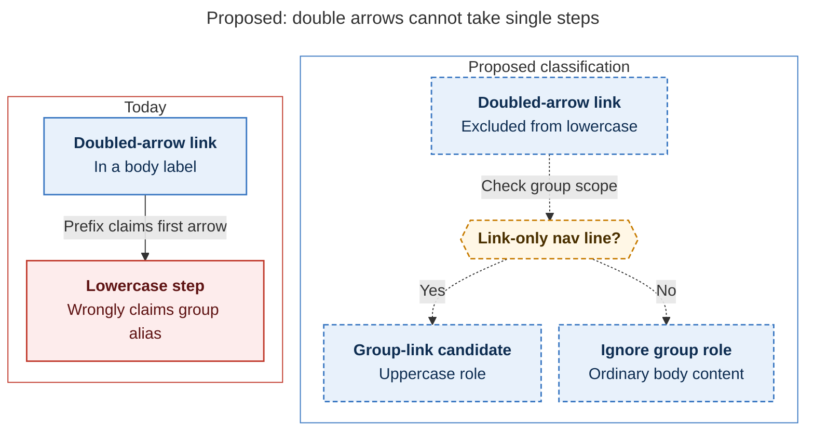
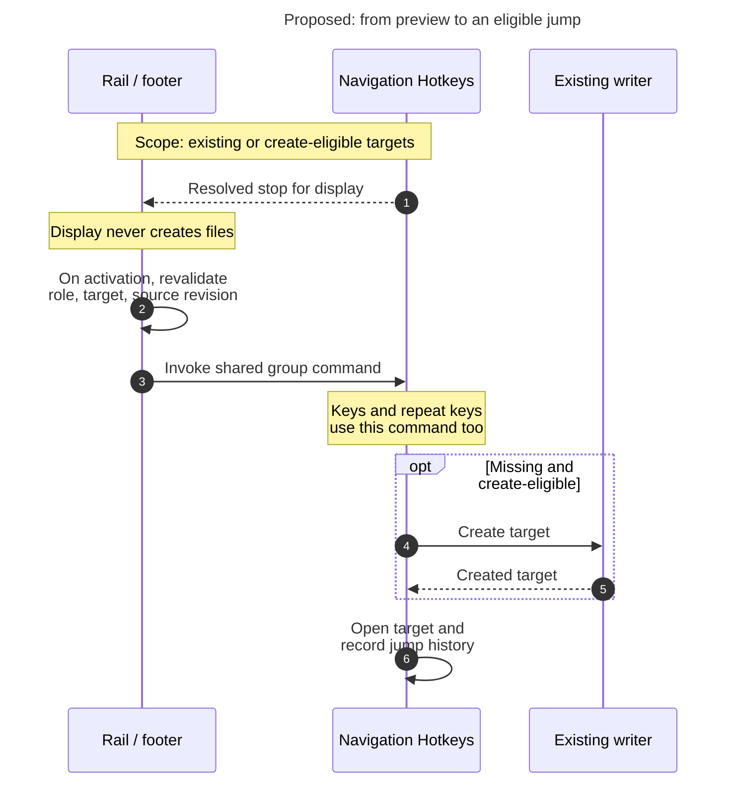

# Diagram proposals: `[N` / `]N` group jumps for days, periods, and records

Proposals for the swarm linker, not a report. Each diagram restates only what the source
report says.

```yaml
source: research:202611/bracket_n_group_jumps/bracket_n_group_jumps__final.md
producer: research.5l.image
check: "mmdc 12.0.0 with the PDF-mirroring config and Puppeteer no-sandbox rendered 2 of 2 Mermaid diagrams"
```

## double-arrow-classification

```yaml
anchor: |-
  Check doubles before singles so
question: |-
  How can double-arrow aliases avoid hijacking lowercase navigation?
illustrates: |-
  Checking doubles before singles keeps the four roles disjoint, while link-only nav lines limit where authored group-link candidates are recognized.
caption: "`<<` / `>>` bypass lowercase navigation; only link-only nav lines can supply uppercase group-link candidates."
review: "838x611 px, fit 77.9%; question, label, arrow, source and visual checks passed; 1 visual revision"
```



## preview-to-activation

```yaml
anchor: |-
  the footer all consume one resolved answer; rail/footer clicks re-validate
question: |-
  For existing or create-eligible targets, how do displayed stops become safe jumps?
illustrates: |-
  Rail/footer clicks re-validate role, target, and source revision before invoking the same command the keyboard uses, separating read-only display from target creation and opening.
caption: "For existing or create-eligible targets, clicks revalidate before the shared command creates if needed, opens, and records jump history."
review: "823x816 px, fit 79.3%; question, label, arrow, source and visual checks passed; 1 visual revision and 1 syntax repair"
```


