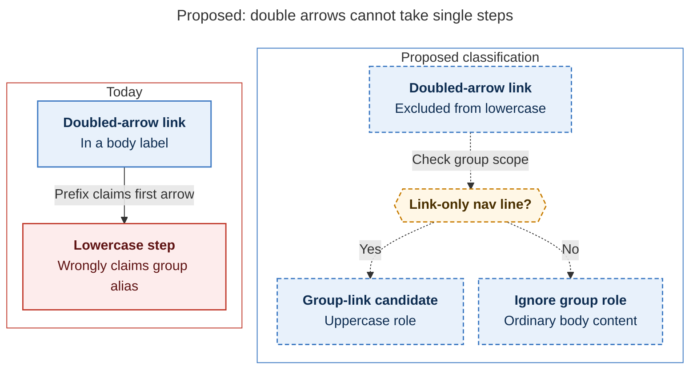
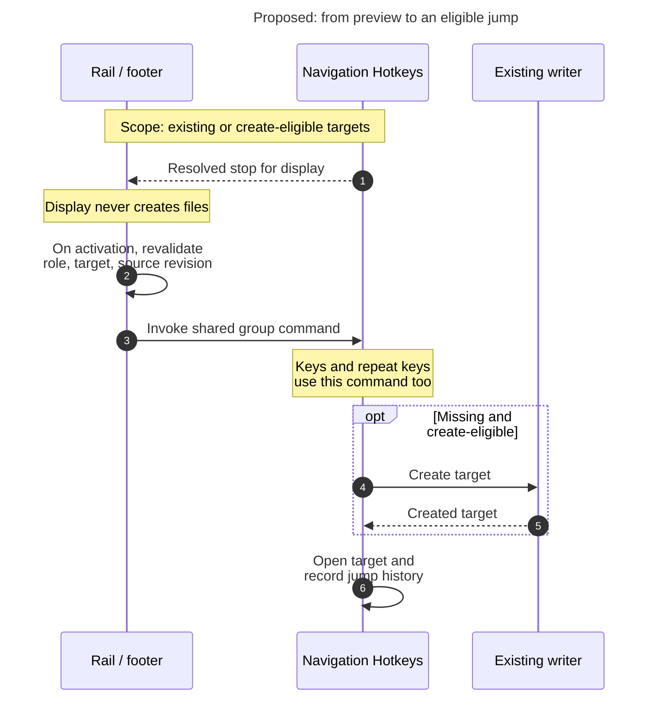

# `[N` / `]N` group jumps for days, periods, and records — consolidated research

> **Research query:** Once the `property_card_title_block.md` work is done, what is the
> best way to add `[N` / `]N` keymaps for daily files, period notes, and record notes,
> configurable in any Obsidian note (first thought: links starting with `<<` / `>>`),
> where dailies jump to the first day of the previous / next week, period notes jump to
> the first same-level note of the previous / next higher-level period (none for yearly
> notes, with missing files made visually clear), and albums configure a grouping field
> so `[n` / `]n` walk record groups in sequence and `[N` / `]N` jump to the first record
> of the previous / next group? It should start with `sase_blog_zettel.md` grouped by
> `section`, weigh which other albums would benefit, work with `[{` / `]}`, render
> nicely at the bottom of property cards, and add walker-footer hints. Is this a good
> idea, what would you do differently (calling out any requirement adjustments), and
> what is the recommended solution?


## Bottom line

**Build it — all five researchers independently said yes, and so do I.** Family `n` is
the only bracket walk whose uppercase plan is `null`
(`546-plugin-bracket-repeat.js:54`, verified); `[{` / `]}` on `n` currently show
`No uppercase link walk`. Filling that hole with [one rule](#the-one-rule) — **uppercase opens the first
member of the previous / next group** — completes the grammar `]S`, `]W`, and `]B`
already taught, and grouped record walks fix a real problem: the SASE Blog Zettel ring
is alphabetical today, so it hops between blog sections at random.

[Three amendments](#requirement-adjustments), each reached independently by at least three researchers and verified
here, reshape the request's letter while keeping its spirit:

1. **[Derive the group stops](#the-central-decision) on Bob's own note types; never write `<<` links into
   dailies, periods, or records.** The targets are pure functions of the note's
   identity, ~1,020 of ~1,196 dailies have no nav line to extend, and written record
   group-links would break the record walk's churn contract. Authored links remain the
   configuration for *any other* note — and they override the derived answer.
2. **The canonical glyphs are `«` / `»`, with `<<` / `>>` accepted as typing aliases —
   after [tightening today's `[n` / `]n` matcher](#grammar).** Verified: the current prev matcher
   `/^[‹<]/` already claims any label starting with `<`, so a raw `<< W14` link would be
   hijacked by `[n` on most notes. This collision must be fixed whatever else happens.
3. **[Albums get one new key](#records-and-the-album-key), `walk_by: <choices field>`, separate from `index_by`.**
   bob rewrites the existing three-link walk lines in grouped order (so `[n` / `]n`
   walk group by group with no new keymap logic), and the `«` / `»` stops are derived
   from the same model. [Adopt `section` on the zettels](#album-adoption) and `status` on `subscriptions`
   and `eat`; leave `tv` alone.

One hazard no other surface had caught — found by gem and **verified in this pass** —
must be designed in: `bob periods ensure` creates the whole week/quarter/year chain for
its date (`ensure.rs` header), and `problems.rs:93-110` treats *any year with a weekly
note* as adopted. A naive `[N` from `2026-W01` to the missing `2025-W40` would scaffold
`2025-W40.md`, `2025-Q4.md`, and `2025.md` and immediately flood `bob periods` problems
with `DanglingDailyParent` findings for every Zorg-era 2025 daily. Pre-adoption targets
must be [non-creatable ghost stops](#missing-targets-and-the-creation-guard).

## Verified ground truth

Facts every design element below rests on. All were asserted by at least two reports;
the starred ones I re-verified directly against source or `bob` this pass.

- ★ `renderedLinkMatchesNavLabel` (`bob-navigation-hotkeys/src/680-plugin-link-parse.js`):
  prev is exact `prev` or `/^[‹<]/`; next is exact `next` or `/^[›>]/` or `/[›>]$/`.
  First body link outside frontmatter/fences wins. So `<< X` matches `[n` and `X >>`
  matches `]n` today.
- ★ `BRACKET_REPEAT_UPPERCASE_PLANS.n` is `null`
  (`546-plugin-bracket-repeat.js:54`); `[{` / `]}` on `n` show
  `BRACKET_REPEAT_NO_UPPERCASE_NOTICE`. The `547` mode-indicator tooltip says `]} / [{
  have no link variant (no ]N / [N)`. The vault vimrc maps `[n`/`]n` and `[{`/`]}` but
  not `[N`/`]N`.
- ★ `walk.rs::parse_link_run` rejects lines with more than 3 links (`walk.rs:598`); the
  plugin's `242t-plugin-record-walk-model.js` mirrors the cap and independently
  reconstructs title order to cross-check written lines (`⟳ syncing` on mismatch).
- ★ `periods ensure` is create-only and creates the week/quarter/year/all-time chains
  for DATE and DATE+7; `problems.rs` computes `adopted_years` from existing weekly
  notes and then lints every canonical daily in an adopted year.
- ★ Album schemas (my `bob albums list -f json` run, 2026-11-20):
  `sase_blog_zettel.section` is a required, non-list **choices** field with **17**
  declared values (mus's "16" was a miscount), 8 occupied across 12 records;
  `eat.location` and `eat.category` are **text**, not choices (`status`: 3 choices —
  to_try 12 / liked 86 / not_liked 7 per the census); `subscriptions.status` has **4**
  declared choices (3 occupied: to_decide 9 / active 13 / cancelled 6) and `cadence` 4;
  `movies.status` 2 (10/2); `podcasts.status` 3 (9/6), `category` text; `tv.status` 4
  declared but all 23 records `to_watch`.
- Vault census (cld/grk, mutually consistent): ~1,196 canonical dailies, only **176**
  carry a `prev · Www · next` nav line — `[n` / `]n` already do nothing on ~85% of
  dailies. Periods: 2026-W01–W48, 2026-Q1–Q4, 2027-W01/W02/Q1, years 2024–2027; **no
  2024/2025 weeks or quarters exist**, and 2026-W49–W53 are missing while 2027-W01
  exists — missing targets occur in the past, the future, and mid-sequence.
- Bob quarters are 13 ISO weeks (W01–13, 14–26, 27–39, 40–52/53; Q4 has 14 weeks in a
  53-week year); daily paths use the date's **Gregorian** year while week paths use the
  **ISO week-year**. All calendar math must go through `PeriodId`
  (`calendar.rs`: `week_for_date`, `parent`, `prev`, `next`, `start`, `quarter_weeks`,
  `year_quarters`), never string arithmetic.
- The title-block consolidation already reserved a docked bottom nav rail on property
  cards, with reveal-on-touch for owned source lines and fail-open everywhere; property
  cards read caches and confirmed bytes, never spawn bob, and never write the vault.

## The one rule

> **`[N` / `]N` open the first member of the previous / next group.** Lowercase steps
> one note; uppercase leaps to the adjacent group's head.

| Current note | Group | `[N` opens | `]N` opens | Wraps? |
| --- | --- | --- | --- | --- |
| Daily `YYYY/YYYYMMDD` | its ISO week | Monday of the previous week | Monday of the next week | no |
| Week `YYYY-Www` | its Bob quarter | first week of the previous quarter (always W01/W14/W27/W40) | first week of the next quarter | no |
| Quarter `YYYY-Qn` | its ISO year | Q1 of the previous year | Q1 of the next year | no |
| Year, `all_time` | none | — (notice, no arms) | — | — |
| Record in a `walk_by` album | records sharing the field value | first record of the previous occupied group | first record of the next occupied group | **yes**, `↺` like the ring |
| Any other note | as authored | first `«` nav-line link | first `»` nav-line link | as authored |

Worked examples (independently checked with Python `isocalendar` by two researchers;
consistent across cdx, cld, grk, gem):

| From | `[N` | `]N` |
| --- | --- | --- |
| `2026/2026-W30.md` | `2026/2026-W14.md` (exists) | `2026/2026-W40.md` (exists) |
| `2026/2026-W01.md` | `2025/2025-W40.md` (**never created** — ghost) | `2026/2026-W14.md` |
| `2026/2026-W47.md` | `2026/2026-W27.md` | `2027/2027-W01.md` (exists) |
| `2026/2026-Q3.md` | `2025/2025-Q1.md` (**never created** — ghost) | `2027/2027-Q1.md` (exists) |
| `2026/20261120.md` (Fri, W47) | `2026/20261109.md` | `2026/20261123.md` (not yet — creatable) |
| `2026/20261231.md` (Thu, **2026-W53**) | `2026/20261221.md` | `2027/20270104.md` |
| `2025/20251229.md` (Mon, **2026-W01**) | `2025/20251222.md` | `2026/20260105.md` |
| zettel *Bead Lifecycle* (🔮 Future Work, 2 of 3) | *AI Slop* (🛑, head of the previous section) | ↺ *sase is many abstractions* (🧱, wrap) |

Two deliberate consequences, called out so they don't read as bugs later:

- **A group jump is not reversible by the other key.** From W30, `[N` lands on W14;
  `]N` from W14 lands on W27, not back on W30. "First member of the adjacent group" is
  the rule (parity with `[S`/`[W`/`[B`); use jump history (`<C-o>`) to return.
- **Quarter jumps are year-scale.** Q2, Q3, and Q4 of 2026 all share `[N` → 2025-Q1.
  Consistent, large, and worth naming in the hint (`]} next year`).

The rejected alternative "same weekday next week" for dailies (a calendar-app habit)
would break the one shared definition; rejected unanimously.

## The central decision

_Derive, don't write._

This was the main split between the five reports, and the rest of the design follows
from it. The request's phrasing — "the `<<` link should point to…" — implies written
link bytes. Three mechanisms were on the table:

| Option | Advocates | Cost found |
| --- | --- | --- |
| **B — write `«»` links into dailies, periods, and records** | cdx (with full migration machinery) | Backfill of ~1,196 dailies in five historical shapes (~1,020 need a brand-new nav line); a 5-link record line needs parser-cap raises, sanitizers, damage states, and fixtures in both Rust and JS; a new first-group member rewrites **every record's group arm in both neighboring groups** (30+ files in `eat`), breaking the documented churn promise (create 3 / delete 2 / retitle ≤5); every quarter-head week gains ~26 inbound backlinks |
| **M — write only where bob owns stable bytes (periods)** | grk (second scaffold line, ~60 notes) | Two mechanisms inside one calendar family; bytes duplicate what a pure function already knows; same backlink noise |
| **P — derive on Bob's species; author anywhere else** | cld, mus, and gem's resolver core | On Bob's species `«»` don't appear in Source mode or git; recovered via `↑` then neighbor |

**Resolution: P.** Derived stops need zero migration, work on all ~1,196 dailies
immediately (including the 85% where `[n` is dead today), cannot drift, add no graph
noise, and sidestep the pre-adoption creation hazard cleanly. The one genuine loss —
Source-mode visibility — is acceptable because the primary step links `‹ ›` stay as
bytes wherever they exist, and `[N`/`]N` are desktop Vim keys whose surfaces (card
rail, footer) are desktop surfaces. cdx's strongest counterargument (portable links are
the established `n`-family language) is honored where it matters: **authored `«`/`»`
links work in any note and override the derived answer**, the same way an explicit
`[root::]` beats the derived root.

Record grouping still materializes in written bytes — but as **reordering of the
existing three-link walk lines**, not as new group links. That delivers "`[n` walks the
group, then the next group" through the line-following machinery that already exists,
keeps the 3-link cap, keeps the plugin cross-check meaningful, and confines new churn
to one honest case: an edit to the `walk_by` field's value rewrites ≤5 walk lines (old
neighbors, new neighbors, self) in the same guarded transaction. The 5-link line
(cdx/grk/gem) is rejected: its churn blow-up is structural, not an implementation
detail, because group-arm targets change whenever any neighboring group's head changes.

## Grammar

| Stop | Canonical label | Typing aliases | Recognized where |
| --- | --- | --- | --- |
| previous step (`[n`) | `‹ X`, exact `prev` | single `< X` | anywhere in the body (unchanged) |
| next step (`]n`) | `X ›`, exact `next` | single `X >` / `> X` | anywhere in the body (unchanged) |
| previous group (`[N`) | `« X` | `<< X` | **only on a nav line** |
| next group (`]N`) | `X »` / `» X` | `X >>` / `>> X` | **only on a nav line** |

- **Tighten the lowercase matcher first:** prev becomes `^‹ | ^<(?!<)` and next
  `^›|›$ | ^>(?!>)|(?<!>)>$` (doubled arrows never step). No vault note relies on
  doubled arrows for stepping, so nothing regresses. Check doubles before singles so
  the four roles are disjoint (gem's precedence sketch).
- **A nav line is a body line holding only links** (separated by `·`, `|`, or spaces).
  This is cld's rule, adopted over anywhere-in-body prefix matching (mus/grk/gem):
  web-clipped prose is full of `Read more »` and `« Back` links, and group keys
  following those would be silently wrong. The period nav line, daily nav line, record
  walk line, and a hand-written `[[part_2|« Part 2]] · [[part_4|Part 4 »]]` all
  qualify.
- `«`/`»` pair typographically with the `‹`/`›` Bob already renders: single = step,
  double = leap, readable without a legend. They also avoid Markdown autolink escaping
  issues with raw `<`/`>` (gem). mus's extra `‹‹`/`››` spellings are dropped — two
  accepted spellings per direction are enough surface.
- Two *distinct* same-role group links on the nav lines refuse with
  `Two next-group links — choose one` rather than first-match-wins (cdx); identical
  duplicates deduplicate. Record-walk title sanitizers additionally strip `«`/`»` so a
  record titled "« Draft" can never pose as a group link.

[The double-arrow classification diagram](#figure-double-arrow-classification) traces the proposed order: doubled arrows are checked first and never step, and only link-only nav lines supply group-link candidates.

<div id="figure-double-arrow-classification">



_`<<` / `>>` bypass lowercase navigation; only link-only nav lines can supply uppercase group-link candidates._

</div>

## Records and the album key

Album key: `walk_by`.

```yaml
# sase_blog_zettel.md — top level, beside index_by / index_facets
walk_by: section
```

- **A new key, not `index_by` reuse.** grk's lone dissent (reuse `index_by`) is
  rejected on verified grounds: `index_by` has established *display* semantics
  (subgroups only inside >12-member status groups) and two live albums already set it
  (`eat: location`, `subscriptions: category`) — overloading it would reorder the
  105-record eat walk and the subscriptions walk the day the feature ships, with no
  opt-in. `walk_by` says what it changes; unset means today's flat title ring and zero
  churn. The index and the walk stay deliberately independent (the zettel index still
  groups by `status` while the walk follows `section`).
- **v1 accepts only a non-list choices field**, validated like `index_by`
  (`walk_by names undeclared field` / `walk_by must be a choices field`; fail-open to
  flat title order, never a damaged line). Group order is the field's **declaration
  order** (the zettel's 17-value map *is* the blog outline); members keep `title_order`
  within a group; empty groups are skipped by `]N`; missing/invalid values form one
  trailing `⚠ Needs <field>` group so records stay reachable. These rules are simple
  enough for one golden fixture shared by `cargo test` and the plugin tests — which is
  the point. Free-text grouping (`eat.location`, with its mix of plain text and
  wikilinked values) needs the Rust display-folding logic that has no JS counterpart
  and an explicit linked-value identity rule (cdx documented the trap: alias equality
  is not value identity); it is the named v2 extension, not v1.
- **Choice order must come from bob's report** (`fields[].choices[]`), never from JS
  `Object.keys` — integer-like keys reorder in JS (cld).
- **What bob writes:** `ring_slots` orders group-major, then title; walk-line format is
  unchanged. Setting/unsetting `walk_by` rewrites the album's lines once (like a
  retitle); a `walk_by`-field value edit rewrites ≤5 lines in the same transaction
  (was 0 — the one honest churn increase, worth a `docs/records.md` churn-table row).
  `bob albums list|check` gains `walk.group_field` / `walk.groups[]` plus a
  `record_walk_groups_v1` capability; `bob records show` gains group position and
  prev/next group; `bob albums update` gains the set/unset op; the Schema Card gains a
  "walks by" pill.
- **The plugin mirrors the grouped order in `242t`** so the live cross-check still
  works; disagreement shows today's honest `⟳ syncing`, never a wrong jump.

### Album adoption

_Resolved against verified schemas._

| Album | Setting | Resolution rationale |
| --- | --- | --- |
| `sase_blog_zettel` | **`walk_by: section`** | Requested; unanimous. 8 occupied sections in outline order — `]N` moves between essay sections, which is how you draft a post. |
| `subscriptions` | **`walk_by: status`** | cdx/cld/gem agree; beats mus's `cadence` — status mirrors the triage workflow, and `]n` walks all 9 `to_decide` in one run. |
| `eat` | **`walk_by: status`** now; revisit `location` in v2 | `location` (cdx's pick) is a text field — not v1-eligible. Status makes the 12 `to_try` restaurants one contiguous walk. Cost: a status flip after a visit rewrites ≤5 walk lines. |
| `movies`, `podcasts` | **Leave unset** (opt-in later) | Reports split (cdx/gem yes, cld/mus no). Both albums are already short walks (12/15 records, two groups); the jump saves almost nothing, and a smaller first deployment is easier to validate. One-line follow-ups if wanted. |
| `tv` | **None** | Unanimous negative: 23/23 `to_watch` is one group; `service`/`recommended_by` are 74–83% empty and would dump most records into the needs bucket. |

Adopt only **after** both plugins are synced on every host: an old `242t` would
cross-check grouped walk lines against title order and show `⟳` indefinitely (cld's
deployment gate). Then one scoped `bob albums sync` per adopted album (12 + 28 + 105
lines).

## Missing targets and the creation guard

One visual rule: **dashed or hollow means "not created yet"; ghost means "won't be
created."** Never error-red, never Obsidian's `.is-unresolved` warning styling — a
missing future week is expected, not broken.

| State | Appearance | Activation |
| --- | --- | --- |
| Exists | normal arm | open through the shared command; jump history recorded |
| Missing daily / adopted-era or future period | dashed outline, faint ink, `+` badge (`Mon Nov 23 +`); tooltip `isn't created yet — ]N creates it from the daily template` / `…asks bob periods ensure` | one press/click creates through the **existing** writer (Templater daily path for dailies, `periodNotes.ensureNote` for periods), then opens |
| Missing **pre-adoption** period (target year has no weekly notes, e.g. `2025-W40`, `2025-Q1`) | hollow dotted ghost, `(not in vault)`; tooltip explains pre-adoption years are never auto-created | **no creation** — verified hazard: ensure would scaffold the year chain, adopt 2025, and flood `bob periods` problems for every Zorg-era 2025 daily |
| Missing album record | existing ghost-record guard | never created; stale walk shows `⟳ syncing` |
| No group route (year, `all_time`, ungrouped or single-group album) | no group row/arms at all | `[{`/`]}` show a truthful notice: `Years have no » group — ]n steps years`, `No » group — set walk_by on the album`, `Only one section group — ]n walks it` |

Repeat safety (gem): holding `]}` across missing territory must not chain-create notes
— the first missing hop may create (parity with `]n` today); a repeat that would create
again stops with `press ]N to create`. Forced-colors mode keeps the dashed/dotted
borders (`CanvasText`), so no state depends on color. Store nothing: existence is
resolved live and invalidated on file create/delete/rename.



*Caption: Authored `«`/`»` links on a nav line win on any note; otherwise the calendar
or record-group provider derives the stop from the note's own identity, and a missing
target may only be created where the existing writers are safe — pre-adoption periods
and album records are ghost stops that never auto-create. Dashed nodes are proposed
components. Rendered with mermaid-cli 12.0.0 at 756.9 × 1120 px (fit 79.7%).*

## One resolver for four surfaces

The difficult part is agreement, not the two keys (cdx): there are already separate
parsers in Rust and JS, a rendered rail, and a status footer, and a superficial
implementation would preview one destination and execute another.

- **Bob Navigation Hotkeys** owns the grammar, the two commands
  (`open-prev-group-link` / `open-next-group-link`), opening/creating targets, and jump
  history. `walkMode.links()` gains additive fields — `prevGroup`, `nextGroup`, and
  `group {noun, label, index, count}` — each stop carrying
  `source: authored|calendar|record`, `exists`, `createEligible`, and `wraps`, behind a
  version bump plus per-field feature detection (don't repeat the v2-threshold
  mistake cdx flagged).
- **Bob Ledger Tools** owns the derived providers, because it already owns the calendar
  subject model (`296a`, with Bob's 13-week quarters) and the record walk model
  (`242t`). Providers read the metadata cache and cached album state only — **never
  spawn `bob` on a keypress** (the property-card family rule).
- **Precedence:** authored nav-line link → provider. Keys, `[{`/`]}`, the card rail,
  and the footer all consume one resolved answer; rail/footer clicks re-validate
  role, target, and source revision before invoking the same command the keyboard uses.
- **Fail-soft:** without Ledger Tools (or an old version), authored links still work
  and a `]N` on a daily explains `Day and period groups need Bob Ledger Tools`.
- `[N` / `]N` record family `n` (no fifth family, no new selector letter);
  `BRACKET_REPEAT_UPPERCASE_PLANS.n` routes `[{`/`]}` to them; after `]N`, `]]` still
  steps one note and `]}` still leaps one group. Update the notice strings, command
  titles (`(]S, ]W, ]N, or ]B)`), and the `547` tooltip. Vimrc gains the two `exmap` +
  `nnoremap` pairs beside `[n`/`]n`.
- **Counts are ignored in v1**, as `]n` ignores them today (cld/cdx/mus; grk's dissent
  — parity with `N]S` — noted for a later consistent pass; multi-hop group jumps
  through creation guards are exactly the async surprise v1 should not have).

[The preview-to-activation sequence diagram](#figure-preview-to-activation) follows a rail or footer click from read-only display through re-validation into the keyboard's own command, which creates a missing create-eligible target before opening it.

<div id="figure-preview-to-activation">



_For existing or create-eligible targets, clicks revalidate before the shared command creates if needed, opens, and records jump history._

</div>

**Bonus adjustment (recommended, clearly added scope):** the same calendar provider
should also fill missing `‹ › ↑` *step* answers on canonical dailies and periods
(written links still win). That makes `[n` / `]n` work on the ~1,020 legacy dailies
where they are dead today — the same code path, and the request's own census exposed
the gap (cld's A7, grk concurring).

## Property-card rail

Two clearly ranked rows docked at the bottom of the card (extending the title-block
rail, its tokens, and its reveal-on-touch/fail-open rules), not five links crammed into
one line (which dies at 600px — gem measured it):

```text
‹ W29                    ↑ 2026-Q3 · week 4 of 13                    W31 ›
« Q2 · W14            ▬ ▬ ▬ ■ ▬ ▬ ▬ ▬ ▬ ▬ ▬ ▬ ▬                 Q4 · W40 »
```

```text
‹ Host-owned…           ↑ SASE Blog Zettel · 8 of 12       SASE is Too… ›
« VCS                 Future Work · section 7 of 8 · 1 of 2    Future Work »  ↺
```

- Row 1 is today's step rail, primary. Row 2 is the group row: quieter type,
  `«`/`»` glyphs (aria-hidden; words carry meaning), **group label first, landing note
  second** — `« Q2 · W14` says *why* the landing is W14 (cld's labeling rule, adopted
  over landing-only labels).
- The row-2 center is a track of the current group — one tick per member, you
  highlighted, hollow ticks for not-yet-created members (the record rail's thin
  location track, generalized; gem adds group-boundary ticks on record tracks).
  Optional: clicking a tick opens that member.
- Row 2 appears **only when a group route exists**: year notes, `all_time`, ungrouped
  and single-group albums keep exactly today's one-row rail — absence, not disabled
  placeholders.
- Narrow (<28rem): transport form `« ‹ 4/13 › »`, 32px minimum targets, full accessible
  names, dashed states preserved. Wrap shows `↺` on the wrapping arm only (records;
  calendar never wraps).
- Derived stops have no bytes to reveal in Live Preview; authored nav lines keep the
  dock-and-reveal rule. The card never writes the note; a failed mount restores native
  rendering.

## Walker footer

The `n` panel is the only walker with an empty hint slot (`hintText: ""`, verified
claim across three reports). Fill its existing slots — glyph + position, current group,
detail, remaining groups, hint, meter — with the group model, shedding end-first as the
bar narrows (group arms shed **before** the primary step arms):

| Context | Position | Group | Arms | Hint |
| --- | --- | --- | --- | --- |
| Daily (Fri, W47) | `⇄ 5/7` | `W47` | `‹ Thu · Sat+ ›` + `« W46 · W48+ »` | `]} next week` |
| Week W30 | `⇄ 4/13` | `2026-Q3` | `‹ W29 · W31 ›` + `« Q2 · Q4 »` | `]} next quarter` |
| Quarter Q3 | `⇄ 3/4` | `2026` | `‹ Q2 · Q4 ›` + `« 2025-Q1 (ghost) · 2027-Q1 »` | `]} next year` |
| Year | `⇄` | — | `‹ 2025 · 2027 ›` only | tooltip: years have no group jump |
| Grouped record | `⇄ 4/12` | `🤖 Agent CLIs 2/2` | step + `« 📜 · 🔁 »` | `]} next section` (the field's label) |
| Authored note | `⇄` | — | step + authored group arms | `]} group` |

The `]} next day` bank precedent sets the hint grammar. At a group boundary the hint
turns predictive: on the last member of a group, `]n enters W48` (or `]n wraps to
What is SASE?`), so a step that crosses a boundary is announced before it is taken
(cld). Group arms are clickable with the same re-validation as step arms; `+` keeps
marking create-eligible, faint-ink for ghosts. The current empty state must not hide
group routes: a note with only `«`/`»` links still gets a useful `n` panel.

## Researcher disagreements and resolutions

| Question | Positions | Resolution |
| --- | --- | --- |
| Write vs derive group stops | write+migrate (cdx) / write periods only (grk) / derive (cld, mus, gem-core) | **Derive** on Bob's species; authored overrides elsewhere ([§ central decision](#the-central-decision)) |
| Record walk line shape | 5-link (cdx, grk, gem) vs reordered 3-link (cld, mus) | **Reordered 3-link** — keeps the churn contract and the 3-link cap; group stops derived |
| Album key | `walk_by` (4 reports) vs reuse `index_by` (grk) | **`walk_by`** — overloading `index_by` would reorder two live albums' walks with no opt-in |
| v1 grouping fields | all scalars with identity rules (cdx) / text via folding (gem) / choices-only (cld, mus) | **Choices-only, non-list** — one golden fixture keeps Rust and JS provably agreed; text identity (eat `location`) is the named v2 |
| `eat` | `location` (cdx) / `status` (cld, gem) / none (mus) | **`status`** (location is a text field — ineligible in v1 anyway) |
| `movies`/`podcasts` | configure `status` (cdx, gem) / leave (cld, mus, grk) | **Leave**; one-line opt-ins later |
| Counts on `]N`/`]}` | ignore v1 (cdx, cld, mus) / consume (grk) | **Ignore in v1**, documented |
| Group-link recognition scope | nav-line-only (cld) / anywhere in body (mus, grk, gem) | **Nav-line-only** — immunizes against `Read more »` web clippings |
| Pre-adoption creation hazard | only gem caught it | **Adopted and verified**; [ghost-stop guard above](#missing-targets-and-the-creation-guard) |
| Legacy-daily step fill-in | proposed by cld (A7), grk implied | **Recommended** as flagged added scope |
| Period count of `section` choices | 17 (cdx, gem) vs 16 (mus) | **17**, verified via `bob albums list` |

## Requirement adjustments

_Explicit, vetoable individually._

1. **Canonical glyphs are `«` / `»`; `<<` / `>>` are typing aliases; the `[n`/`]n`
   matcher is tightened so doubled arrows never step.** (Was: "links that start with
   `<<` or `>>`.")
2. **On daily, period, and record notes the group stops are derived, never written.**
   "W30 should have a `<<` link" becomes "W30 *offers* a `«` stop to W14" in its rail,
   footer, and `[N`. Authored `«`/`»` links on link-only nav lines configure any other
   note and override derived stops.
3. **`[N` from mid-group goes to the *previous group's* first member** (parity with
   `[S`/`[W`/`[B`), not the current group's start; group jumps are not mutually
   inverse — jump history is the way back.
4. **Albums:** new `walk_by` key, choices-only non-list in v1, declaration order,
   empty groups skipped, trailing needs-group, ring wraps with `↺`; written `‹ ›` walk
   lines reorder group-major; a `walk_by`-field edit rewrites ≤5 lines (was 0).
5. **Calendar jumps never wrap and never create unsafely:** pre-adoption-year periods
   are visible ghost stops that refuse creation; create-eligible targets use the
   existing writers with one-press parity and a repeat guard.
6. **Group labels name the group first, landing second** (`« Q2 · W14`).
7. **Adoption set:** zettel `section`, subscriptions `status`, eat `status`; tv never
   (today); movies/podcasts deliberately deferred.
8. **[Added scope (recommended)](#one-resolver-for-four-surfaces):** the calendar provider also fills missing `‹ › ↑`
   step answers on legacy dailies/periods, fixing `[n`/`]n` on ~1,020 notes.
9. **Counts ignored by `]N`/`]}` in v1**, like `]n` today.

## Rollout

1. **Navigation Hotkeys — grammar and keys.** Matcher tightening, nav-line
   recognition, the two commands, `BRACKET_REPEAT_UPPERCASE_PLANS.n`, additive
   `walkMode.links` fields, notice/tooltip updates, vimrc mappings. Authored group
   links work from this phase on.
2. **Ledger Tools — calendar provider + footer.** `navGroups` provider on the `296a`
   model (including the legacy step fill-in and the pre-adoption guard), footer slots
   and hints. Days and periods work end to end.
3. **bob-cli — `walk_by`.** Validation, grouped `ring_slots`, report/show fields and
   capability, `albums update` op, `«»` sanitizers, shared golden fixtures,
   `docs/records.md` order and churn rows. CLI-rule and docs memory apply at
   implementation time.
4. **Ledger Tools — record-group provider + [two-row rail](#property-card-rail)** (needs the title-block rail
   host), Schema Card pill, group track. Fix the pre-existing
   `--bob-area-purple`→`violet` CSS token bug in passing (gem).
5. **Adoption.** `bob plugins sync` on every host **first**, then the three `walk_by`
   edits, then scoped `bob albums sync`. Verify in real Obsidian (extend
   `obsidian-record-walk-e2e.cjs` / walker-footer e2e: the four keys on a week, legacy
   daily, today's daily, and a zettel including `↺`; dashed-stop creation; ghost
   refusal; boundary hints; light/dark × narrow/wide).
6. **Docs and memory.** Plugin docs (bracket-repeat table, links footer, record card),
   `docs/records.md` / `docs/periods.md`, glossary updates through `/sase_memory_write`
   (Record Note's walk-order sentence, Walker Footer's links-footer clause, Album Note
   gains `walk_by`), and a proposed decision record: *"Group stops are derived, never
   written; authored only on nav lines."*

Each phase is independently useful and fails soft. Ship as its own follow-up epic after
`bob-cli-nh`; do not widen the in-flight extraction (grk/mus, consistent with the
title-block plan).

## Risks worth proving in acceptance

| Risk | Proof required |
| --- | --- |
| `<< X` hijacks `[n` / web-clip `»` hijacks `]N` | Matcher vectors: `<< X`, `X >>`, `‹ X`, `X ›`, `prev`/`next`, prose `Read more »`; nav-line-only scoping |
| Rust and JS disagree on grouped order | One golden fixture (members + schema → order and groups) in both suites; disagreement renders `⟳`, never a wrong jump |
| ISO edge cases | W53 years, W01 Mondays filed in the previous Gregorian year, 14-week Q4, cross-year labels, 1970/2999 bounds (no wrap, no `expect`) |
| Accidental vault scaffolding | Pre-adoption ghost refusal; repeat guard; no render/preview/hover path ever creates files |
| Preview ≠ destination | Rail/footer activation re-resolves against source revision before opening (existing `linksWalkerFooterSameLink` pattern) |
| Old plugin meets grouped lines | Adoption gate; `⟳` is the worst case, never a wrong neighbor |
| Ring invariants | Every record exactly once; groups contiguous; uppercase always lands on an occupied group head; single-group and two-group cases; wrap disclosure |

## Open decisions for Bryan

1. May `]N` create a daily up to 7 days ahead (full parity with `]n`'s next-link
   creation)? Default: yes — the dashed `+` stop warns first.
2. `movies` / `podcasts` `walk_by: status` now, or wait? Default: wait.
3. `eat` → `walk_by: location` when free-text grouping ships in v2? Default: yes,
   with the linked-value identity cleanup cdx documented.
4. `{` / `}` group jumps inside the intention-card editor (beside its `[` / `]`)?
   Default: later follow-up.
5. An opt-in for album indexes to follow `walk_by` (index order = walk order)?
   Default: not in v1.

## Recommended solution

Fill the `n` family's uppercase slot with one rule — **lowercase steps one note,
uppercase opens the first member of the adjacent group** — resolved by [one shared
resolver](#one-resolver-for-four-surfaces) with authored-link precedence:

1. `«`/`»` (typed `<<`/`>>`) on [link-only nav lines](#grammar) configure any note and win;
   tightened lowercase matchers keep the four roles disjoint.
2. Derived providers answer for Bob's species from note identity alone: dailies →
   neighboring Mondays; weeks → W01/W14/W27/W40 of neighboring quarters; quarters → Q1
   of neighboring years; years/`all_time` → honest absence; `walk_by` records → heads
   of neighboring occupied groups, wrapping with `↺`. No bytes are written for group
   stops anywhere.
3. [Albums opt in with `walk_by`](#records-and-the-album-key) (choices-only v1); bob rewrites the existing
   three-link walk lines group-major so `[n`/`]n` walk the group first; adopt
   `section` on the zettels and `status` on subscriptions and eat after plugins are
   deployed everywhere.
4. [Missing targets are honest and calm](#missing-targets-and-the-creation-guard): dashed `+` creates through the existing
   writers; pre-adoption periods and album records are ghosts that never auto-create.
5. The property card gains a [quiet second rail row](#property-card-rail) with a group track; the [walker
   footer](#walker-footer) finally gets its hint (`]} next quarter`, `]n enters W48`); `[{`/`]}` repeat
   the group jump and every surface answers from the same model.

The result completes a grammar Bryan's hands already know: after `]n`, `]}` finally
does something — and it does the thing `]W` and `]B` taught, beautifully.

## Request and inputs

> **Request as restated by the lead:** After the `property_card_title_block.md` work lands, add `[N` /
> `]N` keymaps that are immediately useful for daily files, period notes, and record
> notes. Make them configurable in any Obsidian note (first thought: links starting with
> `<<` / `>>`). Daily: first day of the previous / next week. Period: first same-level
> period of the previous / next higher period (`2026-W30` → `2026-W14` / `2026-W40`;
> yearly notes get none). Albums: configure a grouping field so `[n` / `]n` walk group
> by group and `[N` / `]N` jump to the first record of the previous / next group,
> starting with `sase_blog_zettel.md` grouped by `section`; configure other albums if
> they benefit. `[{` / `]}` must work, the links must render nicely at the bottom of
> property cards, the walker footer needs hints, and missing files must be visually
> clear. Critique the plan and end with a recommended solution.

Consolidated by the lead researcher from five independent reports — [cdx](bracket_n_group_jumps__cdx.md),
[cld](bracket_n_group_jumps__cld.md), [grk](bracket_n_group_jumps__grk.md),
[mus](bracket_n_group_jumps__mus.md), [gem](bracket_n_group_jumps__gem.md) — plus an
independent verification pass over bob-cli (`b7007011`), bob-plugins, and the live album
schemas (`bob albums list -f json`, 2026-11-20). Every load-bearing disagreement between
the reports was re-checked against source before being [resolved here](#researcher-disagreements-and-resolutions).

## Sources

- The five swarm reports in this directory (each with its own verified source lists):
  [cdx](bracket_n_group_jumps__cdx.md) — exclusive role classifier, ambiguity refusal,
  linked-value identity, acceptance matrix; [cld](bracket_n_group_jumps__cld.md) —
  derive-vs-write analysis, daily census, nav-line rule, provider architecture, rail
  mockup (`group_jump_keymaps_mockup__cld.png`); [grk](bracket_n_group_jumps__grk.md) —
  family-grammar framing, routing/label/period SVG figures; [mus](bracket_n_group_jumps__mus.md)
  — compute-vs-author split, walk-line reorder without new links;
  [gem](bracket_n_group_jumps__gem.md) — parser-collision precedence, pre-adoption
  hazard, album audit, two-tier rail spec.
- ★ Independent verification this pass (bob-cli `b7007011`, bob-plugins master):
  `src/native/periods/problems.rs:93-151`, `src/native/periods/ensure.rs` (header
  contract), `src/native/albums/walk.rs:587-598`,
  `bob-navigation-hotkeys/src/680-plugin-link-parse.js`,
  `src/546-plugin-bracket-repeat.js:54`; live `bob albums list -f json` schema dump
  (field kinds, choice counts, list flags) on 2026-11-20.
- Prerequisite design input:
  `research:202611/property_card_title_block/property_card_title_block.md` (docked
  rail, reveal-on-touch, always-mount, fail-open). SASE glossary strands consulted:
  Album Note, Record Note, Period Note, Walker Footer, Property Card.
