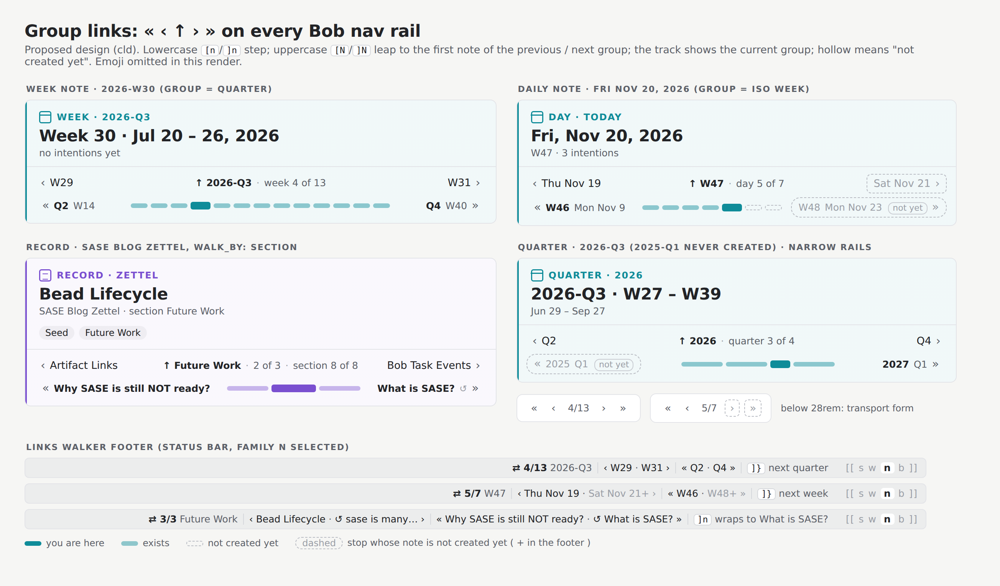
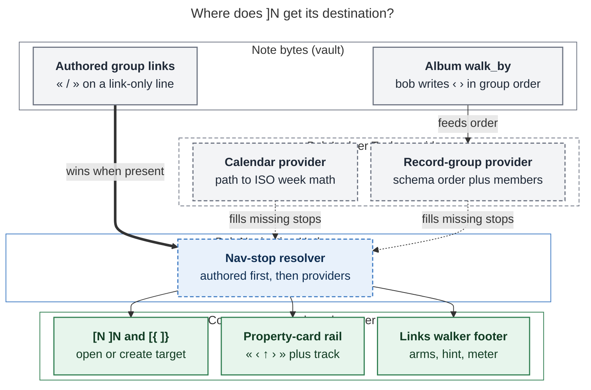

# `[N` / `]N` group jumps: derived « » stops for days, periods, and records

> **Research query:** After the property-card title-block work lands, add `[N` / `]N`
> keymaps that jump to the first note of the previous / next *group*: for daily notes the
> first day of the previous / next week; for period notes the first same-level note of the
> previous / next higher period (2026-W30 → W14 / W40; years have none); for record notes a
> group defined by an album-configured field (first use: `section` on
> `sase_blog_zettel`), with `[n` / `]n` walking group by group. Make it configurable in any
> note (perhaps links starting with `<<` / `>>`), make missing targets visibly clear, make
> `[{` / `]}` work, render the links at the bottom of property cards, and add walker-footer
> hints. Is this a good idea, what is the best implementation, which requirement changes
> are justified, and what is the recommended solution?

Researcher: `cld` (one of five in the swarm), 2026-11-20. Evidence is from bob-cli
`ab341446`, bob-plugins `5c41b5b`, the live `~/bob` vault, and the prior research reports
cited inline.



_Mockup (rendered HTML; emoji omitted): every Bob nav rail reads « ‹ ↑ › ». The track
shows the current group's members, and a dashed stop marks a note that has not been
created yet._

## Bottom line

**Build it. The keymaps are a good idea, but write no `<<` links into Bob's notes.**

The feature fills the one empty slot in a grammar Bob already teaches. Lowercase bracket
keys step and uppercase keys leap to the next group: `]S` review groups, `]W` lanes,
`]B` bank days. The `n` family is the only one with no uppercase jump. Today `]}` on
family `n` just shows `No uppercase link walk`
(`plugins/bob-navigation-hotkeys/src/546-plugin-bracket-repeat.js`). `]N` makes the
family complete, and grouping fixes a real problem with records. The SASE Blog Zettel
walk is alphabetical today, so it jumps between blog sections at random. Grouped by
`section`, it reads in outline order.

My main change is to the mechanism. Your idea treats a group stop as a link written into
the note. I recommend treating a group stop as a **derived nav stop** instead, computed
from what Bob already knows. You can still write group links by hand in any note.

1. **On Bob's own note types (dailies, periods, records), derive the stops and never
   write them.** Writing them would need a backfill of 1,196 daily notes, and 1,020 of
   those have no nav line to extend. Record group links would also break the record
   walk's churn guarantee (one create rewrites at most 3 files), because a group link
   changes whenever the first member of the neighbouring group changes. Calendar math is
   already in the plugin (`intentionCardSubjectForPath`), and record grouping is a small
   extension of the record walk model.
2. **In any other note, author them with `«` / `»`.** `<<` / `>>` are accepted as
   typing aliases, but only on a link-only "nav line". `«` and `»` are the doubled forms
   of the `‹` / `›` Bob already uses: single = step, double = leap. A raw `<<` label also
   collides with today's `[n` matcher, which accepts any label that starts with `<`.
3. **One resolver answers for everything.** `[N` / `]N`, `[{` / `]}`, the property-card
   rail, and the links walker footer all read the same nav stops, so the preview always
   shows where the key will go.

Records get a new album key, `walk_by: <choices field>`. The `‹ ›` walk lines bob already
writes follow grouped order (groups in the field's declared order, then title order). The
`« »` stops are derived. I recommend `walk_by: section` on `sase_blog_zettel` (requested)
and `walk_by: status` on `subscriptions` and `eat`. No other album benefits today.

## 1. What exists today (verified)

| Fact | Evidence |
| --- | --- |
| `[n` / `]n` open the **first** link in the body (skipping frontmatter and fences) whose label is `prev` / `next` or an arrow label: prev **starts with `‹` or `<`**, next **starts or ends with `›` or `>`** | `bob-navigation-hotkeys/src/680-plugin-link-parse.js:5-13`, `670-plugin-project-files.js:151-166, 794-834` |
| A label like `<< W14` therefore **already matches `[n`**, and so does `>> W40` for `]n`, whenever it is the first match | same matcher (`/^[‹<]/`, `/^[›>]/`) |
| The `n` family has no uppercase jump; `]}` / `[{` on `n` show a notice | `546-plugin-bracket-repeat.js` (`n: null`, `BRACKET_REPEAT_NO_UPPERCASE_NOTICE`) |
| The links walker footer and its activation read `walkMode.links({path, content})`, which returns only `{prev, next}`, each with `exists` | `482-walk-mode-nav-api.js:117-180`; `bob-ledger-tools/src/124-links-walker-footer.js` (`+` suffix for create-eligible arms, album ghost tooltip) |
| A missing link target is created by type: period notes through `bob periods ensure` (`api.periodNotes`), album-folder targets **refused** (ghost-record guard), everything else through Templater (the daily template for `YYYY/YYYYMMDD`) | `640-plugin-notes-and-task-move.js:380-420`, `670-plugin-project-files.js:116-148` |
| Ledger Tools already computes canonical calendar subjects: `kind`, `id`, `path`, `shortLabel`, `start/end`, `state` (past/open/future), `parent`, `previous`, `next`, with Bob's 13-week ISO quarters (Q4 = W40–52/53) and ISO week-year | `bob-ledger-tools/src/296a-plugin-intention-card-model.js:180-275` |
| The intention card editor already has `[` / `]` (sibling subject) and `=` (climb) | `bob-plugins/docs/intention-card.md` |
| Period scaffolds write a bob-owned nav line `[[…|‹ W29]] · [[…|↑ 2026-Q3]] · [[…|W31 ›]]` plus a children line (days / weeks / quarters) | `src/native/periods/scaffold.rs:59-110, 112-150` |
| Record walk lines are bob-written: `[[album/p|‹ P]] · [[album|↑ Album]] · [[album/n|N ›]]`, a **title-ordered ring over the whole album, flat across status groups**. Churn: create 3 files, delete 2, retitle ≤ 5, **status or field edit 0** | `src/native/albums/walk.rs` (`ring_slots` → `title_order`), `docs/records.md` "Record walk" |
| Album indexes already group records: by `status` if it is a choices field, else by the first choices field (declared order, empty groups skipped, "⚠️ Needs a status" last), with `index_by` sub-groups only inside groups larger than 12 (alphabetical, missing last) | `src/native/albums/grouping.rs:105-200, 300-370` |
| The record rail paints `‹ arm · album · N of M · arm ›` with a thin location track and `↺` on wrap; counts are computed live and cross-checked against the written links | `bob-ledger-tools/src/242u-plugin-record-walk-rail-dom.js`, `242t-plugin-record-walk-model.js` |
| `[N` / `]N` are unmapped in the vault vimrc; `[n`/`]n` (l.27-28) and `]}`/`[{` (l.79-80) are | `~/bob/obsidian_vimrc.md` |

**Vault census (2026-11-20):**

- **Daily notes:** 1,196 in total (2023: 164 · 2024: 355 · 2025: 365 · 2026: 312).
  **Only 176 carry a `prev · W · next` nav line.** Every 2023–2025 daily, plus part of
  2026, is a Zorg-converted shape with no labelled links. `[n` / `]n` already do nothing
  on 85% of dailies.
- **Period notes:** 2026-W01–W48, 2026-Q1–Q4, 2027-Q1/W01/W02, and the year notes
  2024–2027. **No 2025 or 2024 weeks or quarters exist**, and 2026-W49–W53 are missing
  while 2027-W01 exists. Missing targets therefore occur in the past, in the future, and
  in mid-sequence gaps.
- **Albums (records / field spread):**

  | Album | Records | Field spread |
  | --- | --- | --- |
  | `eat` | 105 | status: liked 86 / to_try 12 / not_liked 7; `index_by: location`, about 25 free-text towns |
  | `subscriptions` | 28 | status: active 13 / to_decide 9 / cancelled 6 |
  | `tv` | 23 | all `to_watch` |
  | `podcasts` | 15 | status: subscribed 9 / unsubscribed 6 |
  | `movies` | 12 | to_watch 10 / watched 2 |
  | `sase_blog_zettel` | 12 | 8 of 17 sections occupied; every record is a `seed` |

## 2. Is this a good idea?

**Yes for records, a moderate yes for days, and a cheap "yes, for consistency" for
periods.**

- **Records (high value).** `sase_blog_zettel.section` is a 17-value choices field whose
  declared order is the blog outline: Intro → What is SASE? → … → Conclusion. Today's
  ring runs alphabetically, so it hops between sections at random: *AI Slop* (🛑),
  *Artifact Links* (🔮), *Bead Lifecycle* (🔮), *Beads and Birds* (🧿)… Grouped, it reads
  the outline: 🧱 *sase is many abstractions* → 📜 *Prompts Managed Like Code* → 🤖
  *Memory*, *Usage Limits…* → 🔁 → 🧿 → 💾 → 🛑 *AI Slop*, *SASE is Too Complex* → 🔮
  three records → ↺. `]N` moves to the next section, which is how you draft a post.
  `subscriptions` gains the same thing for its keep-or-cancel review (`to_decide` records
  become one contiguous run).
- **Days (moderate value).** Week-hopping through history ("what did last week start
  with?") is useful, and the provider that makes it work also fixes `[n` / `]n` on the
  1,020 legacy dailies with no nav line (see [A7](#5-requirement-adjustments-called-out)).
- **Periods (low frequency).** Jumping 13 weeks or a year is rare, but it costs about
  ten lines once the calendar provider exists, and leaving it out would make the family
  inconsistent.

**What is risky or wrong in the request as written:**

1. **`<<` / `>>` labels collide with `[n` / `]n` today.** The prev matcher accepts any
   label starting with `<`, and next accepts any label starting or ending with `>`. A
   `<< W14` link placed before `‹ W29` hijacks `[n`. This has to be fixed whatever the
   group-link syntax is.
2. **"W30 should have a `<<` link" implies writing bytes.** That is the expensive and
   fragile path for two of the three species (§3).
3. **"Configurable in any note" by link label alone is too loose.** Web clippings are
   full of `Read more »` and `« Back` links. A first-match label rule would make `]N`
   follow them. Group links need a stricter recognition rule than `[n` / `]n` have today.
4. **"Group" is not yet a defined concept for albums.** The index already groups by
   status, sub-groups by `index_by`, and the walk ignores both. Adding a field for the
   walk is right. It needs a name that does not suggest the index changes too, and v1
   rules simple enough that bob-cli (Rust) and the plugin (JS) cannot disagree.

## 3. The central decision: write group links, or derive them?

This is the decision the rest depends on. The record-nav-ring consolidation
(`research:202611/record_nav_ring/record_nav_ring.md`) chose to **write `‹ ›` links and
paint the count**. Its argument was that the bytes in the note *are* the walk and stay
visible in Source mode, on mobile, and in git. The same report names the asymmetry that
decides this question: *"calendar neighbours never reshuffle; album neighbours do."*
Group stops push that asymmetry further.

| Option | Daily notes | Period notes | Records | Verdict |
| --- | --- | --- | --- | --- |
| **B — write links everywhere** | Change the Templater template **and** backfill 1,196 notes in five historical shapes; 1,020 need a brand-new nav line (the title-block consolidation already ruled out daily byte rewrites) | Scaffold change plus a one-time repair of about 60 notes; bytes are stable | `« »` target the *first record of the neighbouring group*, so adding a record that sorts first in a group rewrites **every record in both neighbouring groups** (30+ files in `eat`); relabelling a choice rewrites them all again | ✗ breaks the ring's 3/2/5 churn promise and needs a risky daily migration |
| **M — write where bob owns stable bytes (periods), derive elsewhere** | derived | written | derived | ✗ two mechanisms inside one calendar family; the period bytes duplicate what the provider already knows; backlink noise (W14 gains 26 inbound links, one from each week of Q3 and of Q1) |
| **P — derive for Bob's species; author anywhere else** ✅ | Derived from the path: works on all 1,196 now, zero writes | Derived from the id: zero writes | Derived from the album model; only `‹ ›` stay written, in grouped order | ✓ zero backfill, nothing can drift, no graph pollution, one resolver |

**What P gives up:** on Bob's species, `« »` do not appear in Source mode, on mobile, or
in git. That is acceptable for three reasons:

- The step links `‹ ›`, which are the primary walk, stay as bytes wherever they exist
  today.
- `« »` can be recovered from visible structure: follow `↑` to the parent, then its
  neighbour.
- `[N` / `]N` are desktop Vim keys, and the rail is a desktop property-card surface. The
  title-block design already fails open to native rendering on mobile.

If you still want Source-mode visibility on period notes, decision
[D1](#9-decisions-for-bryan) offers M as an opt-in. I recommend against it.

## 4. Recommended design

### 4.1 Grammar: `«` `»`, and one tightening

| Stop | Canonical label | Accepted while typing | Where recognized |
| --- | --- | --- | --- |
| previous step (`[n`) | `‹ X` (or exactly `prev`) | `< X` (single `<` only) | anywhere in the body (unchanged) |
| next step (`]n`) | `X ›` (or exactly `next`) | `X >` / `> X` (single only) | anywhere in the body (unchanged) |
| **previous group (`[N`)** | **`« X`** | **`<< X`** | **only on a nav line** |
| **next group (`]N`)** | **`X »`** | **`X >>`** / `» X` / `>> X` | **only on a nav line** |

- A **nav line** is a body line that holds only links, separated by `·`, `|`, or spaces.
  The daily nav line, period nav lines, and record walk lines all qualify, and so does a
  hand-written `[[part_2|« Part 2]] · [[part_4|Part 4 »]]`. Prose such as
  `[Read more »](…)` never counts.
- **Tighten `[n` / `]n`:** prev is `^‹|^<(?!<)` and next is `^›|^>(?!>)|›$|(?<!>)>$`. A
  doubled arrow is then never a single step. No current vault note relies on doubled
  arrows for stepping, so this cannot regress anything.
- **Sanitizers:** record-walk labels already strip leading `‹<` and trailing `›>`. Add
  `«` and `»` in both `walk.rs` and `242t` so a record titled "« Draft" can never pose as
  a group link.
- `«` and `»` are awkward to type (Option+\\ on a Mac, Compose `<<` on Linux), which is
  why `<<` / `>>` stay accepted aliases. Bob writes none of these bytes.

### 4.2 What "group" means for each note type

One definition covers every note type: **a group stop opens the first member of the
group before or after the current note's own group.** It always opens that group's
*first* member, even from the middle of a group, exactly like `[B` ("from mid-day `[B`
takes the previous day") and `[S` / `[W`.

| Note | Group | Its members, in order | `«` / `»` open | Wraps? | Position shown |
| --- | --- | --- | --- | --- | --- |
| Daily `YYYY/YYYYMMDD` | its ISO week | Mon → Sun | Monday of the previous / next week | no (linear time) | `day 5 of 7` |
| Week `YYYY-Www` | its quarter (W1–13, 14–26, 27–39, 40–52/53) | weeks of that quarter | first week of the previous / next quarter | no | `week 4 of 13` |
| Quarter `YYYY-Qn` | its ISO year | Q1 → Q4 | Q1 of the previous / next year | no | `quarter 3 of 4` |
| Year, `all_time` | none (`all_time` has no siblings) | — | **no group stops** | — | — |
| Record in an album with `walk_by` | records sharing the field's value | title order | first record of the previous / next **occupied** group | **yes**, like the ring and `]S` | `2 of 3 · section 8 of 8` |
| Any other note | whatever its author links | — | authored `« »` on a nav line | as authored | — |

Worked checks (ISO math verified with Python `isocalendar`):

| From | `«` / `[N` | `»` / `]N` |
| --- | --- | --- |
| 2026-W30 | 2026-W14 (exists) | 2026-W40 (exists) |
| 2026-W47 | 2026-W27 | 2027-W01 (exists) |
| 2026-W01 | 2025-W40 (**never created**) | 2026-W14 |
| 2026-Q3 | 2025-Q1 (**never created**) | 2027-Q1 (exists) |
| 2026/20261120 (Fri, W47) | 2026/20261109 (Mon W46) | 2026/20261123 (Mon W48, **not yet**) |
| 2026/20261231 (Thu, 2026-W53) | 2026/20261221 | 2027/20270104 |
| 2025/20251229 (Mon, **2026**-W01) | 2025/20251222 | 2026/20260105 |
| zettel *Bead Lifecycle* (🔮 2 of 3) | *AI Slop* (🛑, first of the previous section) | ↺ *sase is many abstractions* (🧱) |

**Group labels name the group, not the landing note.** The rail shows `« Q2 · W14`,
because "W14" alone does not tell you *why* that week. The footer shows `« Q2`, and
tooltips and accessible names add the landing note ("Previous quarter: Q2, opens week
14"). For records the label is the choice label (`🔁 Turn < Session < Clan < Tribe`),
truncated with an ellipsis.

### 4.3 One resolver, three sources



_Authored nav-line links win; the calendar and record-group providers (proposed, dashed)
fill only the stops that are missing. The keys, the rail, and the footer all read the
same resolver, so the preview always matches the destination. Rendered with
mermaid-cli 12.0.0 at 798.7 × 1163.6 px (76.7% fit)._

- **Navigation Hotkeys** owns the grammar, the commands, opening and creating targets,
  and jump history. Its `walkMode.links()` gains the additive fields `prevGroup`,
  `nextGroup`, and `group` (`{noun, label, index, count, members[]}`). Each stop carries
  `source: "authored" | "calendar" | "record"`, `exists`, and `wraps`. The footer keeps
  the API's version check and also feature-detects the new fields.
- **Ledger Tools** owns the providers, because it already owns the calendar model
  (`296a`), the record walk model (`242t`), and the album report. It exposes them as
  `api.navGroups` v1 with a synchronous `resolve(path)`. Both providers read
  metadataCache plus cached state only and never spawn `bob`, which matches the intention
  card's rule.
- **Precedence:** for each stop, an authored link on a nav line wins and a provider
  fills the gap. That gives Bryan an escape hatch on any note, for the same reason an
  explicit `[root::]` beats the derived root.
- **Fail-soft:** without Ledger Tools (or with an old version), only authored links work.
  A `]N` on a daily then explains `Day and period groups need Bob Ledger Tools`.

### 4.4 Records: the album key `walk_by`

```yaml
# sase_blog_zettel.md (album frontmatter, top level, beside index_by / index_facets)
walk_by: section
```

- **Name.** `walk_by` sits beside `index_by` and `index_facets`, and it says it changes
  the walk, not the `[!records]` index. The two are deliberately independent. The
  zettel index still groups by `status` (what is ready) while the walk follows `section`
  (the outline).
- **v1 accepts only a non-list choices field.** Order is the declared order of the
  values. Members whose value is empty or not a declared value go into one trailing group
  (`⚠ No section`). Empty groups are skipped by `]N` but still listed in the tooltip.
  Within a group, records keep the existing `title_order`. These rules are simple enough
  for Rust and JS to share one golden fixture.
  - Two traps to design around. Free-text grouping (`eat.location`) needs the Rust
    `display_value` / `fold_display` logic, which has no JS counterpart yet, so it
    waits for v2.
  - JS objects reorder integer-like keys. A `values: {1: …, 2: …}` mapping must take its
    order from bob's report (`fields[].choices[]`), never from `Object.keys`.
- **What bob-cli writes:**
  - `walk.rs` orders the ring by group, then by title. Walk-line bytes keep the same
    format.
  - Churn changes in exactly one way: **editing the `walk_by` field now rewrites at most
    5 walk lines** (the old neighbours, the new neighbours, and the record itself),
    instead of 0. `records update`, capture updates, and Record Card writes stage those
    edits in the same guarded transaction that creation already uses, so the ring is
    never left wrong in between. Every other field edit still rewrites 0.
  - Turning `walk_by` on or off rewrites the album's M lines once, like an album retitle.
  - `« »` are never written.
- **Reports:**
  - `bob albums list|check` adds `walk.group_field` and
    `walk.groups[] {value, label, count, first}`, plus the capability
    `record_walk_groups_v1`.
  - `bob records show` adds
    `walk.group {field, value, label, index, count, position}` and
    `walk.prev_group` / `walk.next_group`.
  - A bad `walk_by` value is reported like a bad `index_by` (`walk_by names undeclared
    field`, `walk_by must be a choices field`).
- **Editing:** `bob albums update` gains a `walk_by` set/unset op, and the Schema Card
  gains a "walks by" pill beside the grouping pill. Hand edits stay legal.
- **Plugin:** `242t` mirrors the grouped order (so the live count still cross-checks the
  written links) and derives `« »`. If the plugin and bob disagree, the result is today's
  honest `⟳ syncing` state, never a wrong jump.

### 4.5 Which albums should use `walk_by`

Rule of thumb: configure `walk_by` when a field splits the album into **at least two
groups you would actually walk one at a time**.

| Album | Recommendation | Why |
| --- | --- | --- |
| `sase_blog_zettel` | **`walk_by: section`** (requested) | Declared order is the blog outline; 8 occupied sections. Note: inside a section, records sort alphabetically, not in argument order. A later optional `rank` number field could order them (out of scope). |
| `subscriptions` | **`walk_by: status`** | to_cancel → to_decide → active → cancelled is a review workflow. `]N` lands on the first record to decide, and `]n` walks all 9 in a row. |
| `eat` | **`walk_by: status`** (v1); revisit `location` when free-text `walk_by` exists | Makes the 12 to-try restaurants one walkable run and matches the index's top-level grouping. Location (Cranford 34, Westfield 20, …) is the better browsing axis but needs v2. Cost: a status flip after a visit now rewrites ≤ 5 walk lines. |
| `tv` | none, for now | All 23 records are `to_watch`, so there is one group and nothing to jump to. Revisit once `watching` is used. |
| `podcasts` | none | 15 records, 9/6 split; the whole album is already a short walk. |
| `movies` | none | 12 records, 10/2 split. |

Adopt only **after** both plugins understand `walk_by` on every host. An old plugin would
cross-check the new grouped walk lines against title order and show `⟳` indefinitely.
After adoption, `bob albums sync` rewrites each adopted album's walk lines in one scoped
commit: 12 + 28 + 105.

### 4.6 Keys, repeat, counts, and notices

- **Commands:** `open-prev-group-link` and `open-next-group-link` ("Open previous /
  next group link"). Vimrc: `nnoremap [N :bob_prev_group_link<CR>`,
  `nnoremap ]N :bob_next_group_link<CR>`, plus the matching `exmap` lines.
- **Family:** `[N` / `]N` record family `n`, just as `[S` / `]S` record `s`.
  - `BRACKET_REPEAT_UPPERCASE_PLANS.n` becomes the group open, so **`]}` / `[{` on `n`
    run `]N` / `[N`**, and `]]` / `[[` keep stepping.
  - The `No uppercase link walk` notice is retired. Command names become `(]S, ]W, ]N,
    or ]B)`, and the `n` selector tooltip names `]N`.
- **Counts:** ignored in v1, the same as `]n` today (documented). The record and calendar
  models could support `3]N` later. Authored chains would need to read link labels from
  metadataCache, which is not worth it yet.
- **Wrap:** record groups cycle (`↺`, consistent with the ring and `]S` / `]W`); calendar
  groups never wrap.
- **Notices teach configuration:**
  - Record in an album without `walk_by`: `No » group — set walk_by on the album to
    group its records`.
  - Year note: `Years have no » group — ]n steps years`.
  - Single-group album: `Only one section group — ]n walks it`.
  - Other notes: `No » link — add a [[note|Part 4 »]] line`.

### 4.7 Missing targets: dashed stops and creation parity

The request asks that a missing target be clear and look good. Bob gets one visual rule
for this: **dashed or hollow means "not created yet".**

- **Rail stop:** a dashed hairline outline, faint text, and a small `not yet` pill on
  wide layouts. Track ticks for members that do not exist are hollow (Sat and Sun of the
  current week, W49–W53).
- **Footer arm:** keeps the existing `+` suffix (`W48+ »`), drawn in faint ink.
- **Tooltips and accessible names explain the case and what the key will do:**
  - Future: `W48 · Mon Nov 23 isn't created yet — ]N creates it from the daily template`.
  - Past gap: `2025-Q1 was never created — ]N asks bob periods ensure to create it`.
  - Forced-colors mode keeps the dashed border (`CanvasText`), so the cue never depends
    on colour.
- **Following a dashed stop works exactly like following a link to the same path:**
  - period notes are created through `bob periods ensure`;
  - daily notes through the daily template, as `]n` does today for tomorrow;
  - album records are never created (the existing ghost-record guard).

  One rule means nothing new to learn. Decision [D2](#9-decisions-for-bryan) asks whether
  creating a daily note up to seven days ahead is acceptable. The default is parity with
  `]n`.

### 4.8 The property-card rail

This builds on the docked rail from the title-block work
(`research:202611/property_card_title_block/property_card_title_block.md`, A7). The rail
grows from one row to two (see the mockup):

```text
‹ W29                     ↑ 2026-Q3 · week 4 of 13                     W31 ›   ← step row (today's rail)
« Q2 · W14     ▬ ▬ ▬ ■ ▬ ▬ ▬ ▬ ▬ ▬ ▬ ▬ ▬                         Q4 · W40 »   ← group row: neighbours + this group's track
```

- **The group row is the picture of the keys.** The current group sits in the middle as
  a track, one tick per member, with you highlighted. The neighbouring groups sit at
  either end. The record rail's existing thin location track becomes this group track.
  An album without `walk_by` keeps exactly today's look: the whole album is one group, so
  there are no `« »`.
- **Hierarchy:** step stops are primary (body text). Group stops are secondary
  (UI-small, group label in semibold, landing in muted text). Glyphs are `aria-hidden`,
  and the species and direction words carry meaning ("Next quarter: Q4, opens week 40").
  Colours come from the title-block tokens: `--bob-day-accent` for the calendar family
  and the root hue for records.
- **Narrow (< 28rem):** the transport form `« ‹ 4/13 › »`, keeping 32px targets and full
  accessible names. Dashed stops stay dashed.
- **Year notes:** step row only. **Live Preview:** derived stops have no bytes to
  reveal. Authored nav lines keep the dock-and-reveal-on-touch rule.
- **Optional:** clicking a track tick opens that member (day, week, or record), with
  tooltips on every tick. Inside the intention card editor, `{` / `}` could mirror
  `[N` / `]N` beside its existing `[` / `]` (decision [D5](#9-decisions-for-bryan)).

### 4.9 Links walker footer and hints

The `n` panel keeps its slot order (shedding from the end as the bar narrows) and fills
the slots it leaves empty today:

| Slot | Content | Examples |
| --- | --- | --- |
| glyph + position | position **within the current group** | `⇄ 4/13`, `⇄ 5/7`, `⇄ 2/3` |
| current group | the group label | `2026-Q3`, `W47`, `🔮 Future Work` |
| detail | step arms (today's arms) | `‹ W29 · W31 ›` |
| remaining groups | group arms (clickable, re-validated like step arms) | `« Q2 · Q4 »`, `« W46 · W48+ »` |
| hint | `]} next <noun>`, using the bank footer's `]} next day` precedent | `]} next quarter`, `]} next week`, `]} next section` |
| meter | a 7/13/4-tick mini track | |

The hint changes at a boundary. On the last member of a group it reads `]n enters W48`
(or `]n wraps to What is SASE?` on the last record). On the first member it reads
`[n back to W46`. A step that crosses into a new group is then announced before you take
it. The group noun comes from the provider: week / quarter / year / the `walk_by` field
label / "group" for authored links. The `[[ s w n b ]]` selector stays as it is; `n`
still never carries attention.

## 5. Requirement adjustments (called out)

| # | Adjustment | Why |
| --- | --- | --- |
| **A1** | Canonical glyphs are **`«` / `»`**; `<<` / `>>` are typing aliases. **Tighten `[n` / `]n`** so doubled arrows never count as steps. | Typographic pair with `‹ ›`; removes the `<<`-matches-`[n` collision. |
| **A2** | On daily, period, and record notes, group stops are **derived, never written**. "W30 should have a `<<` link" becomes "W30 *offers* a `«` stop to W14 in its rail, footer, and `[N`". | Avoids rewriting 1,196 daily notes (1,020 without a nav line), keeps the ring's churn promise, no graph noise (§3). |
| **A3** | Hand-written group links count **only on link-only nav lines** (unlike `[n` / `]n`), and they **override** derived stops. | Configurable in any note without `Read more »` hijacks; gives an escape hatch. |
| **A4** | Group stops are labelled with the **group** (`« Q2`) and show the landing note second (`W14`). | Says *why* the landing is W14. |
| **A5** | The album key is **`walk_by`**, v1 accepts a **non-list choices field only**, empty groups are skipped, missing/invalid values form a trailing group, record groups **cycle**. | Rust and JS stay provably in agreement; `walk_by` does not imply the index changes. |
| **A6** | With `walk_by`, the **written `‹ ›` follow grouped order**, and a `walk_by` field edit rewrites ≤ 5 walk lines in the same transaction (was 0). | This is how "`[n` walks group by group" is delivered; it is the one honest cost. |
| **A7** | The calendar provider **also fills missing `‹ › ↑`** on canonical dailies and periods (written links still win), so `[n` / `]n` start working on the 1,020 legacy dailies. | The same code, and fixes an existing gap the request exposes. |
| **A8** | **`[N` from mid-group goes to the previous group's first member**, not the start of the current group. | Parity with `[B` / `[S` / `[W`. |
| **A9** | Counts are ignored for `]N` / `]}` on `n` in v1. | Parity with `]n`. |
| **A10** | Following a dashed stop has **link parity** (bob for periods, daily template for days, never records). | One rule; the dashed style warns beforehand. |
| **A11** | Configure `walk_by: status` on `subscriptions` and `eat` as well; leave `tv` / `podcasts` / `movies` alone. | §4.5. |

## 6. Alternatives considered and rejected

- **Write `<<` / `>>` bytes (option B or M):** rejected in §3.
- **Put configuration in frontmatter (`prev_group:` / `next_group:` keys):** this
  clutters Properties and is invisible in Reading view. It also disagrees with the
  link-label convention `[n` / `]n` already teach. Authored links on nav lines are
  enough.
- **Same weekday next week for days** (from Wed, `]N` → next Wed): a calendar-app habit,
  but it breaks the one definition (first member of the next group) that `]S` / `]W` /
  `]B` share and that periods and records need.
- **`[N` to the start of the current group first** (Vim's `[[`): rejected for parity with
  `[B` / `[S` / `[W` (A8). The start of the current group is reachable through the track
  ticks.
- **Reuse the index's grouping instead of a new key:** the index groups by `status` for
  reading the catalog, and the zettel walk needs `section` for traversal. Different
  purposes need different fields. (Follow-up idea, not v1: let a separately opted-in
  index follow `walk_by`, so the walk order equals the index order.)
- **`group_by:` as the key name:** it suggests the index regroups too. `walk_by` is
  precise.
- **Record groups computed only in bob (report-carried) and no plugin derivation:** the
  rail is designed to render without the cached report ("Rendering needs no cached album
  report"). Live derivation cross-checked against the bob-written `‹ ›` keeps that
  property.
- **A new walker family `g` for groups:** an uppercase key already means "group" in every
  family, so a separate family would only add a letter.

## 7. Reliability: failure modes and proof

| Risk | Guard |
| --- | --- |
| A web-clip `»` link hijacks `]N` | Nav-line-only recognition (A3) |
| `<< X` hijacks `[n` | Tightened matcher (A1), with tests for `<< X`, `X >>`, `‹ X`, `X ›`, `prev` / `next` |
| JS and Rust disagree on grouped order | One golden fixture (members + schema → order and groups) run in `cargo test` and plugin tests; disagreement shows as `⟳`, never a wrong jump |
| Integer-like choice keys reorder in JS | Choice order comes from bob's report |
| ISO edge cases | Golden table: W53 years, W01 Mondays filed in the previous calendar year, Q4 = W40–W53, cross-year labels (`« 2025-Q4`) |
| Preview and destination disagree | Footer and rail activation re-resolve before opening (the existing `linksWalkerFooterSameLink` pattern) |
| Creating a record by accident | Existing album ghost guard applies to derived targets too |
| Ledger Tools missing or old | Authored-only behaviour with a teaching notice; never throws |
| Old plugin meets grouped walk lines | Adoption gate: deploy plugins on all hosts before setting `walk_by` |

Real-Obsidian e2e (following the existing `obsidian-record-walk-e2e.cjs` harness):

- `]N` / `[N` / `]}` / `[{` on a week, a legacy daily, today's daily, and a zettel
  record (including ↺);
- dashed-stop creation through `bob periods ensure`;
- the album ghost guard;
- footer hint transitions at group boundaries;
- light/dark × narrow/wide screenshots of the rail.

## 8. Rollout

1. **Navigation Hotkeys: grammar and keys (small).** Matcher tightening, nav-line
   recognition, the `[N` / `]N` commands, the `]}` / `[{` plan for `n`, the additive
   `walkMode.links` fields, and the vimrc lines. Hand-written group links work from this
   phase on.
2. **Ledger Tools: calendar provider and footer.** `api.navGroups` using the `296a` model
   (including A7's `‹ › ↑` fill-in), plus the footer slots and hints. Days and periods
   work.
3. **bob-cli: `walk_by`.** Parse and validate, grouped `ring_slots`, report and show
   fields, `albums update` op, update-path walk staging, `«»` sanitizer, docs
   (`docs/records.md` order and churn rows).
4. **Ledger Tools: record-group provider and rail group row.** Needs the title-block
   rail. Includes the Schema Card "walks by" pill.
5. **Adoption.** `bob plugins sync` on every host first, then `walk_by` on the zettel,
   subscriptions, and eat albums, then `bob albums sync`.
6. **Docs and memory.** Plugin docs (bracket repeat table, links footer, record card,
   intention card), the bob-cli records and albums docs, and glossary updates through
   `/sase_memory_write`: Walker Footer (`n` gains group arms), Record Note (walk order
   with `walk_by`), Album Note (`walk_by`), and a new **Group Link** strand. Propose a
   decision record, "Group stops are derived, never written; authored only on nav
   lines".

## 9. Decisions for Bryan

| # | Question | Default |
| --- | --- | --- |
| D1 | Write `« »` into period nav lines too (option M), for Source-mode visibility? | **No.** The provider already knows the answer, and every first week of a quarter would gain 26 backlinks. |
| D2 | May `]N` create a daily note up to 7 days ahead (link parity), or should it refuse more than 1 day ahead? | **Parity:** it creates, and the dashed stop warns first. |
| D3 | `eat`: `walk_by: status` now, `location` later (needs free-text v2), or nothing? | **status now.** |
| D4 | Fill missing `‹ › ↑` on legacy dailies from the calendar provider (A7)? | **Yes.** |
| D5 | `{` / `}` group jumps inside the intention card editor? | **Later**, as a follow-up. |
| D6 | Let a separately opted-in album index follow `walk_by` (index order = walk order)? | **Not in v1.** |

## 10. Recommended solution

1. **Grammar.** `«` / `»` are Bob's group-link glyphs; `<<` / `>>` are typing aliases.
   Hand-written group links count only on link-only nav lines. `[n` / `]n` are tightened
   so doubled arrows never step.
2. **One resolver in Navigation Hotkeys.** Hand-written links win. The Ledger Tools
   providers derive the rest: **days → Mondays of the neighbouring ISO weeks; weeks →
   the first week of the neighbouring 13-week quarters; quarters → Q1 of the neighbouring
   years; years → none; records → the first record of the neighbouring occupied
   `walk_by` group, cycling.** Bob writes no group bytes anywhere.
3. **Albums get `walk_by: <choices field>`.** bob writes the existing `‹ ›` walk lines in
   grouped order, and a `walk_by` edit rewrites ≤ 5 lines in the same transaction. Adopt
   `section` on `sase_blog_zettel`, and `status` on `subscriptions` and `eat`.
4. **Keys.** `[N` / `]N` join family `n`, so `]}` / `[{` repeat them and `]]` / `[[`
   still step. Counts are ignored in v1, and notices teach how to configure groups.
5. **Visuals.** Every property-card rail reads `« ‹ ↑ › »`. A group row shows the
   neighbouring groups at either end around a track of the current group. Dashed and
   hollow mean "not created yet" in the rail, and `+` means the same in the footer. The
   compact form is `« ‹ 4/13 › »`.
6. **Footer.** Position within the group, the group label, group arms, `]} next <noun>`,
   and a boundary hint (`]n enters W48`).
7. **Missing targets** follow link parity: bob for periods, the daily template for days,
   never records.
8. **Ship in order:** nav grammar → calendar provider and footer → bob-cli `walk_by` →
   record provider and rail → adoption → docs and memory. Each step is independently
   useful and fails soft.

## Appendix: observations made along the way

- `linksWalkerFooterAlbumRecord` titles an album from `frontmatter.title || stem`.
  Albums have no `title:` key, so the record-ghost tooltip reads "the Sase_blog_zettel
  walk". The title-block plan's album `title:` key (its A5) fixes this; it needs no
  separate task.
- 2027-W01/W02, 2027-Q1, and `2027.md` exist while 2026-W49–W53 do not. Something
  created notes ahead of `bob periods ensure`'s one-week horizon (probably link
  following). This is harmless, but it shows that "missing" can sit between existing
  neighbours, which the hollow track ticks make visible.
- The mockup's colours follow the title-block consolidation's tokens: the
  `--bob-day-accent` teal for the calendar family and the root-area hue for records.
