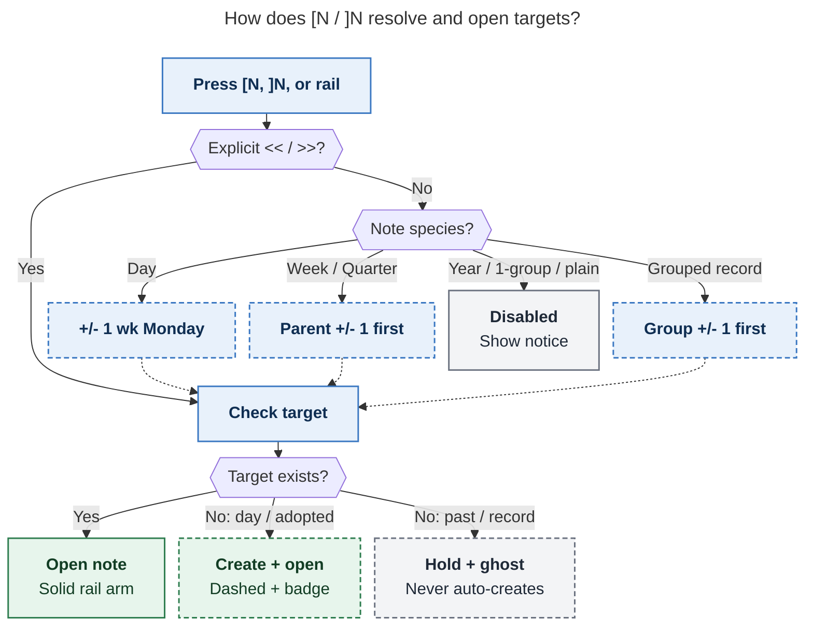

# `[N` and `]N` Coarse & Group Navigation: Design, Critique, and Vault Audit

**Status:** Research & design recommendation (pre-implementation; assumes `property_card_title_block.md` and `bob-cli-nh` land first)  
**Author:** Researcher `gem`  
**Scope:** `bob-cli`, `bob-plugins` (`bob-navigation-hotkeys`, `bob-ledger-tools`), `~/bob/obsidian_vimrc.md`, and live vault notes & schemas

---

## Executive summary

**Strong yes — build `[N` and `]N`, and wire them into `[{`, `]}`, property-card bottom rails, and the `n` walker footer.** Closing the only remaining gap in Bob's bracket-walk matrix (`]S/[S`, `]W/[W`, `]B/[B` all exist, while `BRACKET_REPEAT_UPPERCASE_PLANS.n` is currently `null` in `546-plugin-bracket-repeat.js:54`) creates a single, memorable muscle-memory rule across the entire vault: lowercase brackets step one item; uppercase brackets jump one structural tier.

**However, implementing the initial idea literally — "author `<<` / `>>` Markdown links everywhere and look them up" — would fail or regress four parts of the existing system:**

1. **Immediate parser collision in `bob-navigation-hotkeys`:** `renderedLinkMatchesNavLabel` (`680-plugin-link-parse.js:10-11`) matches `/^[‹<]/` for `"prev"` and `/^[›>]|/[›>]$/` for `"next"`. Any `[[...|<< W14]]` or `[[...|W40 >>]]` link on a note will be hijacked by `[n` / `]n` before reaching `[N` / `]N`.
2. **Rigid 2/3-link caps in both Rust and JS:** Both `record_walk` parsers (`src/native/albums/walk.rs:598`, `242t-plugin-record-walk-model.js:185`) reject lines with `> 3` links (marking extra links `Damaged(ExtraText)`), and `intentionCardIsNavigationLine` (`296a-plugin-intention-card-model.js:464-491`) strictly accepts `2` or `3` links for daily and period nav lines.
3. **~1,195 historical daily notes and all existing periods have no `<<` / `>>` links:** Following the same lesson established in `property_card_title_block.md` (Resolution 1), calendar navigation targets (`YYYYMMDD`, `YYYY-Www`, `YYYY-Qq`) are deterministic functions of a note's identity and must **not** depend on backfilling ~1,195 historical Templater dailies.
4. **Silent pre-adoption period corruption risk:** Calling `openPeriodNoteThroughBob` (`bob periods ensure`) blindly when `[N` targets a missing prior-year note like `2025/2025-Q1.md` or `2025/2025-W40.md` would add `2025` to `adopted_years` in `src/native/periods/problems.rs:93-151`, flooding `bob periods list -p` with historical `DanglingDailyParent` / `MissingPeriodNote` errors for 2025 dailies.

**Recommended architecture in one sentence:** Use a **hybrid two-layer resolver (`Explicit << / >> / « / » body link > Computed species resolver`)**, introduce a decoupled album-level **`walk_by:`** schema key serialized onto 5-link record walk lines, protect pre-adoption/record missing targets with **safe ghost handling**, and render `[N`/`]N` as a **two-tier docked sub-rail** on eligible property cards alongside shed-aware controls in the `n` walker footer.

---

## 1. Critique of the Initial Plan & Justified Requirement Adjustments

### Why the four bracket families belong together

Every active Bob bracket walk (`s`, `w`, `n`, `b`) shares one desktop key grammar in `~/bob/obsidian_vimrc.md:40-80` and `546-plugin-bracket-repeat.js:14-65`:

| Family | Lowercase (`[x` / `]x`) | Repeat (`[[` / `]]`) | Uppercase (`[X` / `]X`) | Upper Repeat (`[{` / `]}`) | Current `n` Gap |
| --- | --- | --- | --- | --- | --- |
| `s` (Review) | Due task step | Repeats `]s`/`[s` | First task of prev/next review group | Repeats `]S`/`[S` | Complete |
| `w` (Lanes) | Pending/Next/Ready step | Repeats `]w`/`[w` | First task of prev/next lane | Repeats `]W`/`[W` | Complete |
| `b` (Bank) | Bank row step | Repeats `]b`/`[b` | First row of prev/next bank day | Repeats `]B`/`[B` | Complete |
| **`n` (Links)** | `prev` / `next` link (`‹` / `›`) | Repeats `]n`/`[n` | **`[N` / `]N` (Missing)** | **`null` (`BRACKET_REPEAT_NO_UPPERCASE_NOTICE`)** | **Closes here** |

Bridging this gap with `[N` / `]N` matches how users already reason about `[S`/`]S` (review groups) and `[B`/`]B` (bank days).

### Seven justified adjustments to the requirements

| ID | Original Requirement | Critique / Gap Found in Code & Vault | Recommended Adjustment |
| --- | --- | --- | --- |
| **A1** | Look for `<<` / `>>` links in any Obsidian note | Purely searching Markdown bodies fails on ~1,195 existing daily notes and all live period notes unless migrated, and collides with `intentionCardIsNavigationLine` (`296a:464`). | **Hybrid precedence:** Honor explicit `<<`/`>>` (and `«`/`»`) body links *first* on any note as an override/custom mechanism, falling back to **computed resolvers** for canonical dailies, week/quarter periods, and grouped records. |
| **A2** | Match links that "start with `<<` or `>>`" | In English labels, trailing `>>` (`W40 >>`, matching `W31 ›` in `labels.rs:124`) is more natural than leading `>>`, while some authors will type `>> Label`. Also `680:10-11` (`renderedLinkMatchesNavLabel`) currently hijacks both `<`/`>` prefixes & suffixes. | Accept **both** `Label >>` / `Label »` **and** `>> Label` / `» Label` for `"nextUpper"`, and leading `<< Label` / `« Label` for `"prevUpper"`. Check double glyphs (`<<`, `>>`, `«`, `»`) *before* single glyphs (`<`, `>`, `‹`, `›`) so `[n`/`]n` and `[N`/`]N` never collide. |
| **A3** | Period missing files look nice / follow open behavior | Calling `bob periods ensure` (`292b:389`) on missing `2025/2025-Q1.md` or `2025/2025-W40.md` would mark `2025` as an adopted year in `problems.rs:93-112` and trigger missing-period errors; repeating `]}` past `2027` could spam empty future years. Also `296b:153-157` styles unresolved links with an error tooltip (`INTENTION_CARD_LINK_HINT`). | Split missing destinations into **(a) create-eligible** (`+` dashed pill: dailies & period targets with `year >= earliest_adopted_year` on single press) vs **(b) ghost-held** (hollow dashed pill, no auto-create: pre-adoption periods like `2025-*`, repeat-guard overshoot beyond current horizon without confirm, and unsynced record targets). Never apply error `.is-unresolved` styling. |
| **A4** | Configure a grouping field on album notes | Albums already have implicit `group_field` (`status` else first choices field) and `index_by` (sub-grouping inside `>12`-item `> [!records]` buckets, e.g., `eat.md` uses `index_by: location` inside `Liked`). Reusing `index_by` forces walk order and `[!records]` index sub-grouping to match even when workflows differ. | Add an explicit top-level album YAML key **`walk_by: <field>`** parallel to `index_by`, validated in `bob-cli` (`mod.rs`, `ops.rs`, `report.rs`) and surfaced in Schema Card (`241x` / `241yc`), completely decoupled from `index_by`. |
| **A5** | Record `[n`/`]n` walks group-by-group; `[N`/`]N` jumps to group starts | Prompt asks for group walking, but live albums contain wikilinked values (`eat.location: "[[nj_towns#^z-241117-0b|cranford]]"`), missing optional values (`tv.service` 19/23 empty), narrative choice order (`sase_blog_zettel.section`), and 1-group albums (`tv.status` 23/23 `to_watch`). | Order **`choices`** groups in **schema declaration order** (preserving blog outline in `sase_blog_zettel`); order **text/suggest** fields via `grouping.rs`'s `wikilink_phrase` + `fold_display` collation; group missing values into a trailing `"—"` bucket (never drop records); reject `list: true` fields as `walk_by`; disable `[N`/`]N` cleanly when `populated_groups <= 1`. |
| **A6** | Unspecified whether `walk.rs` writes `[N`/`]N` record links to disk | `[n`/`]n` relies on `bob albums sync` writing line 1 (`‹ Prev · ↑ Album · Next ›`), cross-checked by `242t` (`neighbors_mismatch`). If `[n`/`]n` changes to group-major order, `walk.rs` and `242t` must agree on that order anyway. | Have `walk.rs` & `242t` both adopt `walk_by` ordering and emit a **5-link canonical walk line** (`« PrevGroup · ‹ Prev · ↑ Album · Next › · NextGroup »`) when `walk_by` yields `>= 2` groups (raising `parse_link_run` max from `3` to `5`). `[N`/`]N` then uses the exact same Markdown-verified contract offline & online. |
| **A7** | Render links nicely at the bottom of property cards | `property_card_title_block.md` settles on a docked 3-column step rail (`‹ prev · ↑ parent · next ›`). Cramming 5 long labels into 1 line (`« Macros · ‹ Prompts · ↑ SASE Blog Zettel · Usage › · Turn »`) truncates nearly every title in 600px Obsidian splits. | Use a **two-tier docked footer rail**: row 1 keeps the primary 3-column single-step rail (`‹ · ↑ · ›`); row 2 docks a slim coarse/group sub-rail (`« Left · Context · Right »`) **only** when `[N`/`]N` applies (absent on `year`, `all_time`, ungrouped, and 1-group albums). |

---

## 2. Core Resolution & Syntax Design

### 2.1 Authored Link Grammar (Any Obsidian Note)

To support *"configurable in any Obsidian note somehow"* cleanly alongside `bob-navigation-hotkeys`:

- **Accepted authored aliases (`680-plugin-link-parse.js`):**
  - **`"prevUpper"` (`[N`):** `renderedText` starts with `<<` or `«` (e.g., `[[part_1|<< Intro]]`, `[[part_1|« Intro]]`, `[[part_1|<<]]`, `[[part_1|«]]`).
  - **`"nextUpper"` (`]N`):** `renderedText` starts with **or** ends with `>>` or `»` (e.g., `[[part_3|>> Part 3]]`, `[[part_3|Part 3 >>]]`, `[[part_3|Part 3 »]]`, `[[part_3|>>]]`).
  - **Strict precedence over `"prev"` / `"next"`:**
    ```js
    // Check double chevrons before single chevrons so `[n`/`]n` and `[N`/`]N` are disjoint.
    const isDoublePrev = /^(?:<<|«)/.test(text);
    const isDoubleNext = /^(?:>>|»)/.test(text) || /(?:>>|»)$/.test(text);
    if (wanted === "prevUpper") return isDoublePrev;
    if (wanted === "nextUpper") return isDoubleNext;
    if (wanted === "prev") return !isDoublePrev && /^[‹<]/.test(text);
    if (wanted === "next") return !isDoubleNext && (/^[›>]/.test(text) || /[›>]$/.test(text));
    ```
  - **Markdown safety note:** In `render_walk_line` (`walk.rs`) and `recordWalkInertText` (`242t:69`), ASCII `<` and `>` are backslash-escaped when sanitizing titles because unescaped `<`/`>` can form HTML autolinks. Using typographic **`«` / `»`** for generated canonical record walk lines avoids escaping issues completely and pairs visually with Bob's existing **`‹` / `›`** single chevrons, while `680-plugin-link-parse.js` still accepts user-typed ASCII **`<<` / `>>`** in any regular Markdown note!
- **Display normalization (`124-links-walker-footer.js:15`, `242t:96`, `242u:24`):** Strip leading/trailing `<<`, `>>`, `«`, `»` in addition to `‹`, `<`, `›`, `>` when extracting clean destination names for footer pills and rail tooltips.

### 2.2 Resolution Flow & Safety Routing

**Reader question:** *How does pressing `[N`, `]N`, `[{`, `]}`, or clicking a card rail arm resolve its target and decide whether to open, create, or hold?*



*Caption: Explicit `<<`/`>>`/`«`/`»` body links take precedence on any note; otherwise canonical daily, week/quarter period, and grouped album record notes compute targets deterministically while holding unsafe auto-creations.*

### 2.3 Exact Calendar Arithmetic (`bob-cli` `PeriodId` & `bob-ledger-tools`)

All calendar computation should mirror `src/native/periods/calendar.rs` (`week_for_date`, `parent`, `prev`, `next`, `quarter_weeks`, `year_quarters`, `start`):

| Active Note | Path Pattern | `[N` Target (`upperPrev`) | `]N` Target (`upperNext`) | Verified Vault Example (`~/bob/`) |
| --- | --- | --- | --- | --- |
| **Canonical Daily** | `YYYY/YYYYMMDD.md` | Monday of `week_for_date(date).prev()` (formatted `calendarYYYY/YYYYMMDD.md`) | Monday of `week_for_date(date).next()` | From `2026/20261120.md` (`2026-W47` Fri): `[N` → `2026/20261109.md` (exists); `]N` → `2026/20261123.md` (**missing** — Mon of W48). |
| **Weekly Period** | `YYYY/YYYY-Www.md` | First week of `id.parent().prev()` (`quarter_weeks()[0]`) | First week of `id.parent().next()` (`quarter_weeks()[0]`) | From `2026/2026-W30.md` (`2026-Q3`): `[N` → `2026/2026-W14.md` (exists); `]N` → `2026/2026-W40.md` (exists). From `2026/2026-W47.md` (`2026-Q4`): `[N` → `2026/2026-W27.md`, `]N` → `2027/2027-W01.md` (exists). |
| **Quarterly Period** | `YYYY/YYYY-Qq.md` | First quarter of `id.parent().prev()` (`(year-1)-Q1`) | First quarter of `id.parent().next()` (`(year+1)-Q1`) | From `2026/2026-Q3.md` (`2026`): `[N` → `2025/2025-Q1.md` (**missing**); `]N` → `2027/2027-Q1.md` (exists). |
| **Yearly Period** | `YYYY.md` | `null` (`AllTime.prev() == None`) | `null` (`AllTime.next() == None`) | `2026.md`: disabled cleanly; no `«`/`»` arms or sub-rail. |
| **All time** | `all_time.md` | `null` | `null` | `all_time.md`: disabled cleanly. |

**ISO Week-Year Boundary Check (must get right!):**
Suppose today is `2025/20251229.md` (Mon Dec 29, 2025). Its ISO week (`PeriodId::week_for_date`) is **`2026-W01`**.
- `week.prev()` = `2025-W52` → `.start()` = `2025-12-22` → file path `2025/20251222.md`.
- `week.next()` = `2026-W02` → `.start()` = `2026-01-05` → file path `2026/20260105.md`.
- Conversely, from `2027/20270101.md` (Fri Jan 1, 2027 = `2026-W53`): `week.prev()` = `2026-W52` → `2026/20261221.md`; `week.next()` = `2027-W01` → `2027/20270104.md`.
Using `PeriodId::week_for_date` + `.prev()`/`.next()` + `.start()` instead of naive calendar arithmetic guarantees 53-week ISO years (`2026` has 53 weeks, verified in `~/bob/2026.md`) never drift by 7 days!

### 2.4 Missing Destination Semantics (Solving the Vault-Creation Hazard)

Because we checked the live vault directly, missing targets actually fall into **three distinct safety categories**:

1. **Create-eligible dailies (`2026/20261123.md`):**
   `createNoteFromLinkCandidate` (`640-plugin-notes-and-task-move.js:407-444`) uses Templater (`_templates/daily.md`). Creating one missing daily has bounded side effects (it creates one note; if later empty, daily cleanup rules still apply).
   - **Rule:** Mark `+` (`createEligible = true`). Single `[N`/`]N` press or rail click creates via Templater. **On `]}` / `[{` repeat:** optional safety cap or explicit prompt after `> 1` missing hop avoids holding `]}` and creating dozens of empty Mondays.
2. **Pre-adoption period notes (`2025/2025-Q1.md`, `2025/2025-W40.md` — verified non-existent in `~/bob/`):**
   In `src/native/periods/problems.rs:93-151`, `adopted_years` is computed as *"all years with at least one weekly note"*. If clicking `«` or pressing `[N` on `2026-W01` calls `bob periods ensure -d 2025-09-29` (`2025-W40`), `bob` scaffolds `2025-W40.md` (and `2025-Q4.md`, `2025.md`) — flipping `2025` into `adopted_years` and immediately flagging historical 2025 daily notes with `DanglingDailyParent` / `MissingPeriodNote`!
   - **Rule:** Determine `earliestAdoptedYear` from existing period folders/files (e.g., `2026`). Any computed period target with `target.year < earliestAdoptedYear` MUST set **`createEligible: false`** (never call `bob periods ensure` automatically!). Show it as a **ghost non-creatable arm** (`absent`), and clicking / pressing `[N` shows: `"2025-W40 isn't in the vault (pre-2026 periods aren't auto-created)"`.
3. **Adopted-era / future missing period notes (`2026-W40` before Nov 9, `2028-Q1`):**
   Targets in `target.year >= earliestAdoptedYear` and within `currentYear + 1` (single `[N`/`]N` press or explicit rail click) are `createEligible: true` via `openPeriodNoteThroughBob`; targets further out or reached via repeated `]}` should require confirmation (`PeriodJumpConfirm` or notice `"2028-Q1 doesn't exist yet — use ]N to create"`), preventing accidental multi-year scaffolding.

---

## 3. Album Grouping & Vault Audit (All 6 Live Albums)

### 3.1 Schema Contract (`walk_by:` vs `index_by:`)

- **Proposed album frontmatter key:** top-level **`walk_by: <field>`** (optional string; mirrors `index_by:` right above `record:` in `src/native/albums/mod.rs:120-275`).
  - Why top-level and separate from `index_by`: Look at `~/bob/eat.md` (`index_by: location`) and `~/bob/subscriptions.md` (`index_by: category`). `index_by` controls *secondary* sub-grouping only inside groups larger than `LARGE_GROUP = 12` in `> [!records]` (`grouping.rs:24, 312-317`). Keeping `walk_by` separate allows an album to keep `index_by: location` in its index while walking records by `status` (or vice versa!), without coupling index layout to hotkey traversal.
- **Validation in `bob-cli` (`src/native/albums/`):**
  1. `mod.rs`: Parse `walk_by`, verify field exists in `record_type` (`album_walk_field_unknown`), reject `field.list == true` (`album_walk_field_list` — a record can only hold one slot in `[n`/`]n`). Note: allow both `FieldKind::Choices` and scalar non-list fields (`suggest`, `text`, etc.).
  2. `update/ops.rs` (`apply_album_set` line 295 & delete guard line 1201): Allow editing `walk_by` via `bob albums update` `album.set` (and block removing a field referenced by `walk_by`, matching `index_by`).
  3. `report.rs`: Emit `"walk_by": self.walk_by` plus per-album `walk.groups` summary (`[{ value, label, first_stem, count }]`) in `bob albums list -f json`, and bump/add capability (e.g. `record_walk_v2` or keep backwards-compatible additive fields alongside `record_walk_v1`).
  4. Schema Card (`241w`, `241x`, `241yc`): Add a `"groups walk"` pill alongside `"groups index"` and `"sub-groups index"`, and show `walked by <Field>` in `albumHeaderGroupingClause` (`241u:207`).

### 3.2 Exact Group Order & Ring Semantics (`walk.rs` & `242t`)

Let the album's configured `walk_by` field be $F$:
1. **Determine group key & label for each record:**
   - If $F$ is `FieldKind::Choices(choices)`: group index follows **`choices` declaration order** (skipping choices with 0 records). Unknown/unfilled values fall into a trailing `"—"` group (`null` key).
   - Otherwise (scalar text/suggest/date/number): reuse `grouping.rs`'s normalization (`field_text` → `wikilink_phrase` → `fold_display` case-insensitive sort; `representative_display` chooses canonical heading like `cranford` across `[[nj_towns#^z-241117-0b|cranford]]` and plain strings; missing values sort last under `"—"`).
2. **Flatten into global walk order:**
   For non-empty groups $G_0, G_1, \dots, G_{k-1}$ in group order, sort each $G_i$'s members by `title_order` (`recordWalkOrder`: lowercase title, then path). Concatenate $[G_0, G_1, \dots, G_{k-1}]$ into one global ring $R$ of length $N$.
   - **`[n` / `]n`:** Step $-1$ / $+1 \pmod N$ along $R$. Finishing the last record of $G_i$ naturally advances `[n` / `]n` to the first record of $G_{(i+1) \bmod k}$ (and vice versa on `[n` backward into the last record of $G_{i-1}$), wrapping seamlessly at $R[0] \leftrightarrow R[N-1]$.
   - **`[N` / `]N` (only active when $k \ge 2$):**
     - `nextUpper` (`]N`) from any member in $G_i$ → first record of $G_{(i+1) \bmod k}$.
     - `prevUpper` (`[N`) from any member in $G_i$ → first record of $G_{(i+k-1) \bmod k}$ (mirrors `[S` / `]S` semantics in `490-plugin-lifecycle.js:294-312` and `[W`/`]W`, `[B`/`]B`: uppercase always lands on the destination group's first item!).
   - **Why `« GroupLabel` as wikilink alias?**
     Write the 5-link canonical line (when $k \ge 2$):
     ```markdown
     [[<album>/<prev_grp_first>|« <PrevGroupLabel>]] · [[<album>/<prev>|‹ <PrevTitle>]] · [[<album>|↑ <AlbumTitle>]] · [[<album>/<next>|<NextTitle> ›]] · [[<album>/<next_grp_first>|<NextGroupLabel> »]]
     ```
     Using the **group's short display label** (e.g., `« 🔁 Turn` and `💾 VCS »`) in Source/Markdown rather than repeating `<PrevTitle>` means single-record groups (like 5 of `sase_blog_zettel`'s 8 sections today!) still read distinctly (`« 🔁 Turn · ‹ Microsoft CEO...` rather than `« Microsoft CEO... · ‹ Microsoft CEO...`). Both Rust (`walk.rs:598`) and JS (`242t:185`) raise `parse_link_run`'s link cap from `3` to `5` (`<= 2` before `↑` and `<= 2` after `↑`, preserving `ExtraText` detection on damaged edits!).

### 3.3 Concrete Audit of All 6 Albums in `~/bob/`

Measured directly across all **195 live record notes** and **`bob albums list -f json`**:

| Album | Records | Fields & Live Fill Distribution | Recommended `walk_by` | Rationale & Caveats |
| --- | --- | --- | --- | --- |
| **`sase_blog_zettel.md`** | **12** | `status`: `seed` (12/12)<br>`claim`: 12 distinct (0 missing)<br>**`section`**: required choices, **8 populated of 17** (`future`: 3, `not_ready`: 2, `the_agent_cli`: 2, `beads`: 1, `macros`: 1, `project`: 1, `turn`: 1, `what`: 1; 0 missing) | **`section`** *(Configure)* | **Required first use-case.** Groups follow the 17-section YAML outline (`intro` → `close`), not A–Z. Essential now as zettels scale past 30 (`20261120.md` headline). Currently 5 of 8 active sections are 1-record groups, making distinct `« Group` / `Group »` labels + tooltips crucial. |
| **`subscriptions.md`** | **28** | **`status`**: required choices — **`to_decide` (9), `active` (13), `cancelled` (6)** (0 missing)<br>`cadence`: `monthly` (15), `yearly` (12), `four_weekly` (1)<br>`category`: 6 values (`tech` 16, `media` 8, plus four singletons)<br>`pricing`: `fixed` (24), `variable` (4) | **`status`** *(Configure)* | **Clear win.** Aligns record walk 1:1 with the album's subscription triage workflow (`🤔 To decide` → `💚 Active` → `🚫 Cancelled`). `]n`/`[n` triages all 9 `to_decide` items together; `[N`/`]N` hops past the 13 active or 6 cancelled records in 1 keystroke. Beats `category` (4 size-1 singletons). |
| **`eat.md`** | **105** | **`status`**: required choices — **`to_try` (12), `liked` (86), `not_liked` (7)** (0 missing)<br>`location`: required suggest — **28 towns** (`cranford` 34, `westfield` 20, `Clark` 7, `garwood` 6, `NYC` 5, ~23 small/singletons; 0 missing, uses wikilinks like `[[nj_towns#^z-241117-0b|cranford]]`)<br>`category`: **44 cuisines** (longest tail) | **`status`** *(Configure)*<br>*(Alt: `location`)* | **Recommended over `location`.** Without grouping, 105 restaurants jump randomly between `to_try`, `liked`, and `not_liked` (`1 Walnut` → `1950s originals`). `walk_by: status` creates 3 clean triage tiers so you can walk only `To try` (12) or `Liked` (86) or hop cleanly to `Not liked` (7). `location` is already set as `index_by: location`; as a single `walk_by`, 28 towns (~20 size 1–2) makes `]N` noisy unless sub-town browsing outweighs status triage for Bryan. |
| **`podcasts.md`** | **15** | **`status`**: required choices — **`subscribed` (9), `unsubscribed` (6)** (0 missing)<br>`category`: required text — 7 values (`programming` 4, `python` 3, `ai` 2, `productivity` 2, `tech` 2, `ideas` 1, `comedy` 1) | **`status`** *(Configure)*<br>*(Alt: `category`)* | **Clean win.** Separating 9 active `🎧 Subscribed` podcasts from 6 archived `🚫 Unsubscribed` shows stops routine browsing from hitting dead shows, while `]N`/`[N` toggles cleanly between active and unsubscribed rosters. Choose `category` instead only if Bryan primarily browses shows by topic regardless of subscription state. |
| **`movies.md`** | **12** | **`status`**: required choices — **`to_watch` (10), `watched` (2)** (0 missing)<br>`year` (0/12), `service` (1/12), `recommended_by` (0/12), `verdict` (1/12), `watched_on` (0/12) | **`status`** *(Optional / Marginal)* | Non-`status` fields are 92–100% empty. `walk_by: status` keeps `To watch` (10) apart from `Watched` (2), which is harmless today and gains value as watched movies grow — worth configuring for consistency with `eat`/`podcasts`, though minor impact right now. |
| **`tv.md`** | **23** | `status`: **`to_watch` (23/23)** (1 group!)<br>`recommended_by`: 6 filled (`eric` 3, `nona` 3), **17 missing (74%)**<br>`service`: 4 filled (`Apple TV+` 4), **19 missing (83%)**<br>`verdict`/`watched_on`/`url`: 0/23 | **None *(Leave unconfigured)*** | **Important negative finding.** `status` has only 1 populated value (`[N`/`]N` disabled); `service` (83% missing) and `recommended_by` (74% missing) would dump 17–19 of 23 shows into a giant trailing `"—"` group. Leave `tv.md` unconfigured until `watching`/`watched` statuses diversify or `service` is backfilled, then enable `walk_by: status`. |

*(Preview of `sase_blog_zettel.md` with `walk_by: section` on today's 12 zettels: `[1] sase is many abstractions` (`what`) → `[2] Prompts Managed Like Code` (`macros`) → `[3–4] Memory, Usage Limits and API Costs` (`the_agent_cli`) → `[5] Microsoft CEO...` (`turn`) → `[6] Beads and Birds` (`beads`) → `[7] Host-owned Completion` (`project`) → `[8–9] AI Slop, SASE is Too Complex` (`not_ready`) → `[10–12] Artifact Links, Bead Lifecycle, Bob Task Events` (`future`).)*

---

## 4. Keymaps, `[{` / `]}`, `[[ s w n b ]]` Indicator, & Walker Footer

### 4.1 Commands & Vimrc (`obsidian_vimrc.md` & `bob-navigation-hotkeys`)

Add two commands in `490-plugin-lifecycle.js` alongside `open-next-link` (`164-170`) and `open-prev-link` (`172-179`):

```js
this.addCommand({
  id: "open-next-upper-link",
  name: "Open next coarse or group link (]N)",
  callback: () => {
    this.rememberBracketRepeatType("n");
    return this.openUpperNavLink(1);
  },
});

this.addCommand({
  id: "open-prev-upper-link",
  name: "Open previous coarse or group link ([N)",
  callback: () => {
    this.rememberBracketRepeatType("n");
    return this.openUpperNavLink(-1);
  },
});
```

Bind in `~/bob/obsidian_vimrc.md` right below `[n` / `]n` (lines 27–28):

```vim
exmap bob_prev_upper_link obcommand bob-navigation-hotkeys:open-prev-upper-link
exmap bob_next_upper_link obcommand bob-navigation-hotkeys:open-next-upper-link
nnoremap [N :bob_prev_upper_link<CR>
nnoremap ]N :bob_next_upper_link<CR>
```

### 4.2 `[{` and `]}` Uppercase Repeat & Indicator (`546`, `547`, `482`)

1. **`546-plugin-bracket-repeat.js:54`:** Replace `n: null` in `BRACKET_REPEAT_UPPERCASE_PLANS` with:
   ```js
   n: Object.freeze({
     forward: Object.freeze({ method: "openUpperNavLink", args: Object.freeze([1]) }),
     backward: Object.freeze({ method: "openUpperNavLink", args: Object.freeze([-1]) }),
   }),
   ```
   Update the `repeat-next-uppercase-bracket-walk` / `repeat-prev-uppercase-bracket-walk` command titles (`490:195,201`) to name `(]S, ]W, ]N, or ]B)` and `([S, [W, [N, or [B)`.
2. **When a specific note has no `[N`/`]N` target:** Pressing `[{` / `]}` while `n` is active should flash `"empty"` on `.bob-bracket-mode` (`546:147`) and emit a truthful note-specific notice (`"Yearly period notes do not support [N / ]N"`, `"All records are in one <field> group"`, or `"No << / >> link found in this note"`) rather than `"have no link variant"`.
3. **Repeat-safety guard on `]}` / `[{`:** Repeating `]}` across future periods stops instead of auto-creating once it crosses into uncreated territory (show `"Mon Nov 23 doesn't exist yet — press ]N to create"`), so holding `]}` never creates a chain of empty notes.
4. **`547-bracket-mode-indicator.js:29`:** Update `type: "n"` `upperTooltip` to `" ]} / [{ jump to the next / previous coarse or group link (]N / [N)"`.
5. **`482-walk-mode-nav-api.js:118-183`:** Extend `walkMode.links({ path, content })` (keeping `prev` and `next` untouched for backwards compatibility, bumping `LINKS_WALKER_FOOTER_API_VERSION`) to also resolve and return `upperPrev`, `upperNext`, `upperKind` (`"explicit" | "week-monday" | "quarter-week" | "year-quarter" | "record-group" | null`), `upperGroup` (`{ label, index, total, memberIndex, memberCount }`), and `upperDisabledReason`. Each target carries `{ text, target, path, exists, createEligible, label }`.

### 4.3 Walker Footer (`124-links-walker-footer.js` & `121-freshness-footer-paint.js`)

Right now, `124-links-walker-footer.js:279-280` leaves `detailText: ""` and `hintText: ""` empty! Status-bar width is tight in Obsidian split panes, and `freshnessFooterFit` (`121:460-575`) already defines a battle-tested shedding ladder (`groups` → `compactDetail` → `detail` → `arms` → `hint` / `meter`).

Use that ladder cleanly without crowding primary `[n` / `]n` buttons:

| Note Context | Footer Strip (Wide Desktop Bar) | Narrow Pane Shed Behavior (`freshnessFooterFit`) |
| --- | --- | --- |
| **Daily (`2026-11-20`)** | `⇄ Links` · `‹ Thu Nov 19 · Sat 21+ ›` · `« Mon 9 · Mon 23+ » [N/]N` | Drops `[N/]N` hint & compact `upperArms` *before* hiding primary `‹ · ›` arms (`linkPrev`/`linkNext`). |
| **Week (`2026-W30`)** | `⇄ Links` · `‹ W29 · W31 ›` · `« W14 · W40 » [N/]N` | Keeps `‹ W29 · W31 ›` visible; full paths remain in container tooltip. |
| **Quarter (`2026-Q3`)** | `⇄ Links` · `‹ Q2 · Q4 ›` · `« 2025-Q1 (absent) · 2027-Q1 »` | Missing non-creatable `2025-Q1` shows muted `.bob-freshness-link-unavailable` without `+`. |
| **Year (`2026`)** | `⇄ Links` · `‹ 2025 · 2027 ›` · *(no upper arms)* | Single-tier strip cleanly omitted. Tooltip still explains `"Yearly notes have no [N / ]N jump"`. |
| **Grouped Record** | `⇄ Links 4/12` · `🤖 Agent CLIs 2/2` · `‹ Memory · Microsoft CEO ›` · `« 📜 · 🔁 »` | Uses `contextText` / `detailCompactText` for group pill (`Agent CLIs 2/2` → sheds to group count, then `4/12` remains). |
| **Arbitrary Note (`<<`/`>>`)** | `⇄ Links` · `‹ Ch 2 · Ch 4 ›` · `« Ch 1 · Ch 5 » [N/]N` | Clickable `upperPrev` / `upperNext` arms dispatch `open-prev-upper-link` / `open-next-upper-link`. |

Hover tooltips name exact operations matching `linksWalkerFooterPathTooltip` (`124:51-59`):
- Exists: `« W14 — Open: 2026/2026-W14.md ([N or [{)`
- Create-eligible: `Mon 23+ » — No note yet; ]N creates 2026/20261123.md`
- Ghost-held: `« 2025-Q1 — Not in vault (pre-2026 periods are never auto-created)`

---

## 5. Property Card Visual Design ("Intuitive, Reliable, and Beautiful")

`property_card_title_block.md` settles on one shared docked bottom-rail visual grammar across Album, Record, Day, and Period cards (`--bob-day-accent` for temporal notes; `--bob-walk-ink` area hue on records). Extending that rail cleanly means preserving its calm 3-column single-step top row and **stacking a slender, conditional `[N`/`]N` sub-rail directly below only when applicable**.

### 5.1 Two-Tier Docked Bottom Rail Layouts

#### A. Weekly Period Note (`2026/2026-W30.md` — both `W14` & `W40` exist)
```text
┌─────────────────────────────────────────────────────────────────────────┐
│ 📅  WEEK · 2026-W30                                           ==    ▾   │
│ 2026-W30 · Jul 20 – 26                                                  │
│ ↑ 2026-Q3 · 7 days · Closed                                             │
├─────────────────────────────────────────────────────────────────────────┤
│   ... intentions / summary / reflection bands ...                       │
├╌╌╌╌╌╌╌╌╌╌╌╌╌╌╌╌╌╌╌╌╌╌╌╌╌╌╌╌╌╌╌╌╌╌╌╌╌╌╌╌╌╌╌╌╌╌╌╌╌╌╌╌╌╌╌╌╌╌╌╌╌╌╌╌╌╌╌╌╌╌╌╌╌┤
│  ‹  W29                    ↑ 2026-Q3 · W30                    W31  ›    │  ← row 1 (primary [n / ]n)
├ ─ ─ ─ ─ ─ ─ ─ ─ ─ ─ ─ ─ ─ ─ ─ ─ ─ ─ ─ ─ ─ ─ ─ ─ ─ ─ ─ ─ ─ ─ ─ ─ ─ ─ ─ ─ ┤
│  «  W14 (Q2)             [N · Q-starts · ]N                (Q4) W40  »  │  ← row 2 (only on Day/W/Q)
└─────────────────────────────────────────────────────────────────────────┘
```

#### B. Daily Note (`2026/20261120.md` — `Mon Nov 9` exists; `Mon Nov 23` does NOT exist yet!)
```text
├╌╌╌╌╌╌╌╌╌╌╌╌╌╌╌╌╌╌╌╌╌╌╌╌╌╌╌╌╌╌╌╌╌╌╌╌╌╌╌╌╌╌╌╌╌╌╌╌╌╌╌╌╌╌╌╌╌╌╌╌╌╌╌╌╌╌╌╌╌╌╌╌╌┤
│  ‹  Thu Nov 19               ↑ W47 · Fri               [+ Sat Nov 21] › │  ← missing target = dashed + pill
├ ─ ─ ─ ─ ─ ─ ─ ─ ─ ─ ─ ─ ─ ─ ─ ─ ─ ─ ─ ─ ─ ─ ─ ─ ─ ─ ─ ─ ─ ─ ─ ─ ─ ─ ─ ─ ┤
│  «  Mon Nov 9                Prev/next Monday             [+ Mon Nov 23] »│
└─────────────────────────────────────────────────────────────────────────┘
```

#### C. Quarterly Period Note (`2026/2026-Q3.md` — pre-adoption `2025-Q1` ghost vs existing `2027-Q1`)
```text
├╌╌╌╌╌╌╌╌╌╌╌╌╌╌╌╌╌╌╌╌╌╌╌╌╌╌╌╌╌╌╌╌╌╌╌╌╌╌╌╌╌╌╌╌╌╌╌╌╌╌╌╌╌╌╌╌╌╌╌╌╌╌╌╌╌╌╌╌╌╌╌╌╌┤
│  ‹  Q2                     ↑ 2026 · Q3 of 4                     Q4  ›   │
├ ─ ─ ─ ─ ─ ─ ─ ─ ─ ─ ─ ─ ─ ─ ─ ─ ─ ─ ─ ─ ─ ─ ─ ─ ─ ─ ─ ─ ─ ─ ─ ─ ─ ─ ─ ─ ┤
│  «  2025-Q1 (not in vault)    Year starts                     2027-Q1  »│  ← muted hollow ghost (no +)
└─────────────────────────────────────────────────────────────────────────┘
```

#### D. Yearly Period Note (`2026.md` — no coarse jump!)
```text
├╌╌╌╌╌╌╌╌╌╌╌╌╌╌╌╌╌╌╌╌╌╌╌╌╌╌╌╌╌╌╌╌╌╌╌╌╌╌╌╌╌╌╌╌╌╌╌╌╌╌╌╌╌╌╌╌╌╌╌╌╌╌╌╌╌╌╌╌╌╌╌╌╌┤
│  ‹  2025                    ↑ All time · 53w                   2027  ›  │  ← Row 2 omitted completely!
└─────────────────────────────────────────────────────────────────────────┘
```

#### E. Grouped Record Note (`sase_blog_zettel/usage_limits_and_api_costs.md`)
```text
┌─────────────────────────────────────────────────────────────────────────┐
│ 📄  RECORD · zettel                                          ==    ▾    │
│ Usage Limits and API Costs                                              │
│ 📇 SASE Blog Zettel · 🌱 Seed · 🤖 Agent CLIs                           │
├─────────────────────────────────────────────────────────────────────────┤
│  section: 🤖 Agent CLIs                                                 │
│  claim: An agentic IDE must display usage limits / API costs...         │
├╌╌╌╌╌╌╌╌╌╌╌╌╌╌╌╌╌╌╌╌╌╌╌╌╌╌╌╌╌╌╌╌╌╌╌╌╌╌╌╌╌╌╌╌╌╌╌╌╌╌╌╌╌╌╌╌╌╌╌╌╌╌╌╌╌╌╌╌╌╌╌╌╌┤
│  ‹  Memory           📇 SASE Blog Zettel · 4 of 12   Microsoft CEO…  ›  │  ← row 1: intra/cross-group step
│ ─ ─ ─ ─ ─ ─ ─ ─ ─ ─ ─ ─ ─ ─ ─ ─ ─ ─ ─ ─ ─ ─ ─ ─ ─ ─ ─ ─ ─ ─ ─ ─ ─ ─ ─ ─ │
│  «  📜 Macros           🤖 Agent CLIs · 2 of 2          🔁 Turn  »     │  ← row 2: section jump + local count
│ ──────────────●─────────────────────────────────────────────────────────│  ← hairline track w/ faint group ticks
└─────────────────────────────────────────────────────────────────────────┘
```

#### F. Narrow Container (`@container record-walk (max-width: 28rem)`)
Following the proven collapse in `styles.css:11652-11661`:
```text
├╌╌╌╌╌╌╌╌╌╌╌╌╌╌╌╌╌╌╌╌╌╌╌╌╌╌╌╌╌╌╌╌╌╌╌╌╌╌╌╌╌╌╌╌╌╌╌╌╌╌╌╌╌╌╌╌╌╌╌╌╌╌╌╌╌╌╌╌╌╌╌╌╌┤
│  ‹                            4/12 (or W30)                         ›   │
│  «                            2/2  (or Mon 23+)                     »   │
└─────────────────────────────────────────────────────────────────────────┘
```

### 5.2 Visual Specification for Missing Notes & Accessibility

To make uncreated files **unmistakable, calm, and accessible without relying on color alone**:

1. **Three visual states on every rail arm (existing / create-eligible / ghost-held):**
   - **Existing note:** Plain transparent button background (`background: transparent`), `--text-muted` shifting to `--text-normal` on `:hover`, crisp `‹`/`›` or `«`/`»` glyph (`1.2em–1.35em` matching `styles.css:11639`).
   - **Missing — Create-eligible (`data-target-state="create"`):**
     - `border: 1px dashed color-mix(in srgb, var(--bob-walk-ink) 38%, transparent);`
     - `border-radius: 5px; padding: 0 0.45em;`
     - Appends a tiny typographic `+` badge (`bob-walk-badge-create`, `font-size: 0.8em; font-weight: 600; color: var(--bob-walk-ink)`) right inside the arm (`Mon Nov 23 +`), immediately separating *"click or press `]N` to create"* from *"already exists"* even in monochrome / `forced-colors: active`!
     - Never reuses `296b:155`'s `.is-unresolved` warning/error styling (`INTENTION_CARD_LINK_HINT`).
   - **Missing — Ghost-held (`data-target-state="absent"` e.g. `2025-Q1`):**
     - Muted ink (`color: var(--text-faint); opacity: 0.78`), subtle hairline `1px dotted` border, compact muted suffix or tooltip `(not in vault)` instead of `+`. Clearly tells the reader where `«` points in calendar geometry while communicating it is outside the created era and won't be scaffolded silently.
2. **Double-chevron typography & spacing:**
   - Primary row height stays `>= 32px` (`min-height: 32px`, matching `styles.css:11628`).
   - Coarse sub-rail uses `font-size: 0.92em` (scaled from `.bob-property-card` `var(--font-ui-small)`), `min-height: 28px`, subtle `color-mix(in srgb, var(--bob-property-card-accent) 2%, transparent)` background tint, and a thin dashed divider so the eye cleanly reads **step (`‹` / `›`)** first and **jump (`«` / `»`)** second.
3. **Wrap & Group-Boundary Ticks:**
   - Reuse `bob-record-walk-wrap` (`↺`, `styles.css:11637`) when `[N` wraps from `G_0` to `G_{k-1}` or `]N` wraps from `G_{k-1}` to `G_0`!
   - On the hairline track (`styles.css:11642-11643`), render subtle `1px × 4px` muted tick marks at normalized group boundaries (`boundaryIndex / total * 100%`) so the user sees the album's clusters right alongside the position thumb!
4. **Fix verified CSS bug in passing:** `bob-ledger-tools/styles.css:11649` defines `.bob-record-walk-rail[data-root-hue="purple"]` referencing `--bob-area-purple` (non-existent; Bob emits `violet` and `--bob-area-violet`). Fix alongside shared property-card rail tokens.

---

## 6. Explicit Decisions, Open Choices & Phased Implementation Plan

### Decisions for Bryan before coding

1. **`eat.md` grouping field:** **`status`** (`to_try` 12 / `liked` 86 / `not_liked` 7 — **recommended**) vs `location` (28 towns with ~20 singletons/pairs)?
2. **`podcasts.md` & `movies.md`:** Enable **`status`** on `podcasts` (`subscribed` 9 / `unsubscribed` 6) and **`status`** on `movies` (`to_watch` 10 / `watched` 2), while leaving **`tv.md` unconfigured** (`23/23 to_watch`)?
3. **Album key name:** Top-level **`walk_by: <field>`** parallel to `index_by:` (over `walk_group_by` or overloading `index_by`)?
4. **Pre-adoption period guard:** Confirmed **NO auto-creation** via `[N`/`[{` when targeting pre-adoption years (`year < earliestAdoptedYear`, e.g., `2025-Q1` / `2025-W40`), preventing `problems.rs` from adopting `2025`?

### Suggested Phased Implementation Plan

1. **Phase 1 — Link parser & `[N`/`]N` + `[{`/`]}` hotkey core (`bob-navigation-hotkeys`, `~/bob/obsidian_vimrc.md`):**
   - Disjoin double chevrons (`<<`, `>>`, `«`, `»`) from single chevrons in `renderedLinkMatchesNavLabel` (`680-plugin-link-parse.js`).
   - Add `openUpperNavLink(direction)` supporting `explicit body << / >>` → `daily` (`+/- 1 wk Mon`) → `week/quarter` (`parent +/- 1 first child`), returning structured `null` + honest notices for `year`/`all_time`/absent targets.
   - Register `open-prev-upper-link` / `open-next-upper-link`, fill `BRACKET_REPEAT_UPPERCASE_PLANS.n` in `546-plugin-bracket-repeat.js`, update `547-bracket-mode-indicator.js` tooltip, extend `walkMode.links` (`482`), add `obsidian_vimrc.md` mappings (`[N` / `]N`), and guard repeated `]}` auto-creation + pre-adoption periods.
2. **Phase 2 — Album `walk_by:` schema, group-major `walk.rs`, & `242t` sync (`bob-cli` + `bob-ledger-tools`):**
   - Add `walk_by` parsing/validation/edit-ops/JSON reporting to `src/native/albums/` (`mod.rs`, `ops.rs`, `report.rs`).
   - Update `walk.rs` & `242t-plugin-record-walk-model.js` to group-major sort, extend `render_walk_line` to 5-link runs when `k >= 2`, and raise `parse_link_run` cap `3 -> 5`.
   - Surface `"groups walk"` badge and `walked by` summary in Album Header / Schema Card (`241l`, `241u`, `241w`, `241x`, `241yc`).
   - Apply verified `walk_by:` edits to `~/bob/sase_blog_zettel.md` (`section`), `subscriptions.md` (`status`), `eat.md` (`status`), `podcasts.md` (`status`), and optionally `movies.md` (`status`), then run `bob albums sync`.
3. **Phase 3 — Visual rails & `n` walker footer (`bob-ledger-tools`, layered on `property_card_title_block.md`):**
   - Implement the two-tier docked rail component shared by Day/Period cards and Record sheets (`242u` + `296b`/title-block kit), with solid / dashed-`+` / hollow-ghost states, group counter + boundary ticks, `<28rem` responsive collapse, and `--bob-area-violet` fix (`styles.css:11649`).
   - Wire upper jump arms, group badge, and `freshnessFooterFit` shedding priority into `124-links-walker-footer.js` + `121-freshness-footer-paint.js`.
   - Real-Obsidian visual + Playwright/CDP & Rust unit-test verification covering ISO year transitions (`2025-12-29`, `2027-01-01`), missing daily/period states, yearly exclusion, all 6 albums, light/dark themes, and narrow splits.
