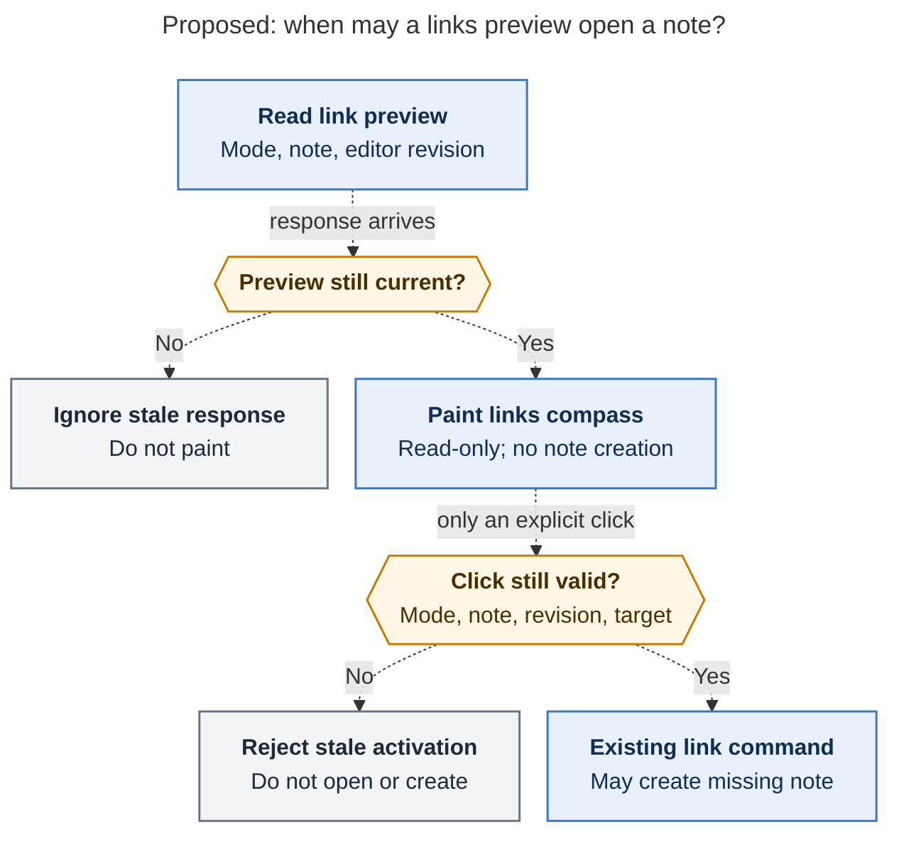

# Diagram proposals: Walker footers: the status bar follows the active bracket walk

Proposals for the swarm linker, not a report. Each diagram restates only what the source
report says.

```yaml
source: research:202611/bracket_walk_footers/bracket_walk_footers__final.md
producer: research.4e.image
check: "mmdc 12.0.0 with the PDF-mirroring config rendered 1 of 1 Mermaid diagrams"
```

## link-preview-safety

```yaml
anchor: |-
  click revalidates note, revision, and destination before opening
question: |-
  How do link previews avoid stale navigation and accidental note creation?
illustrates: |-
  Generation-checked link previews paint only for the current family, source file, and editor revision; direction clicks revalidate context before the existing command may create a note.
caption: "Preview reads cannot create notes; only a context-validated explicit click may invoke the existing creation route."
review: "652.453x1010 px, fit 88.4%; question, visual, and source-trace checks passed; 0 revisions"
```


