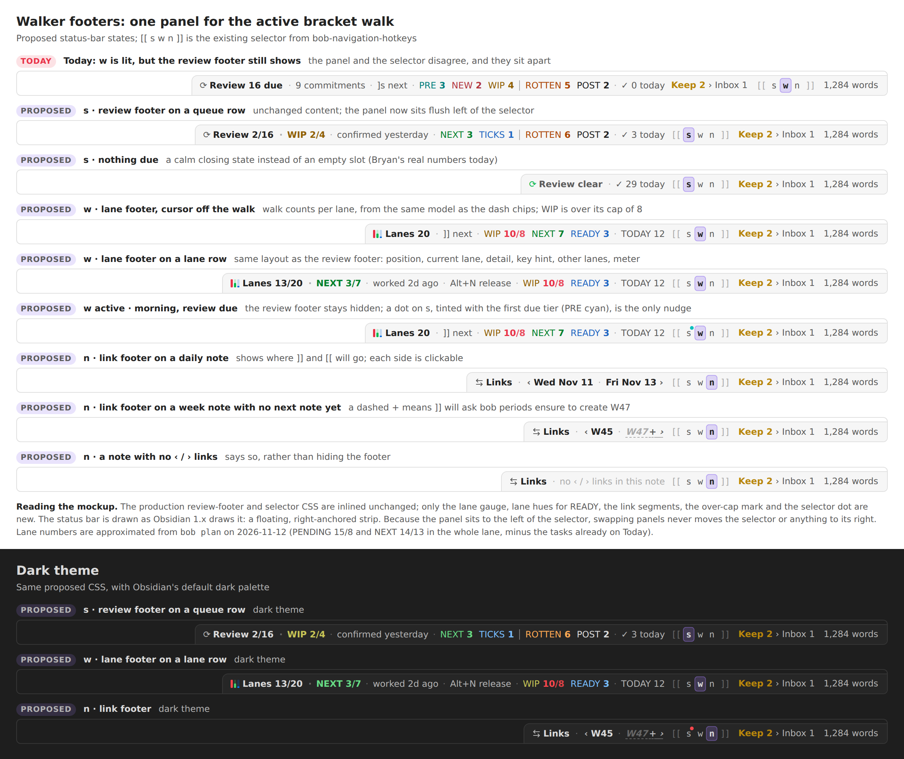
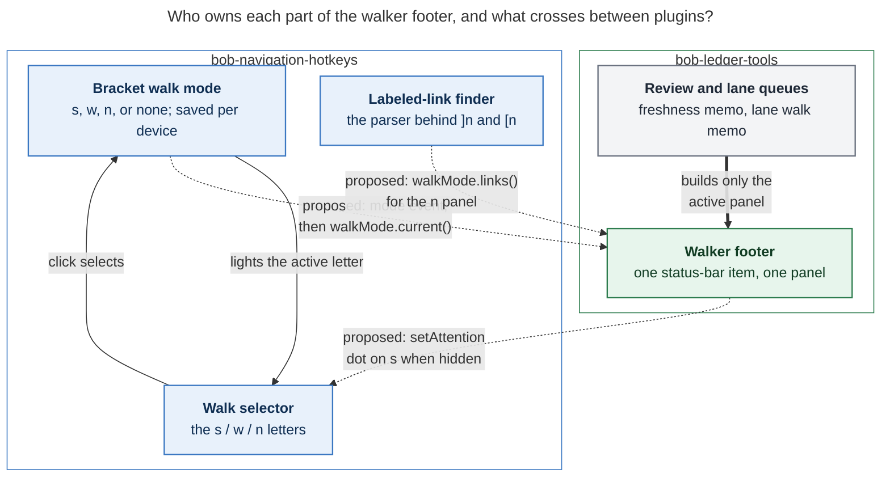

# Walker Footers: One Status-Bar Panel for the Active Bracket Walk

- **Researcher:** cld (one of five independent reports). Date: 2026-11-12.
- **Code inspected:** bob-plugins `00edf76`, bob-cli `753b4e48`, the live vault's
  `.obsidian` config (read-only), and the prior research
  `research:202610/gkeep_inbox_footer_indicator/gkeep_inbox_footer_indicator__final.md`.
- **Live numbers:** read-only `bob plan`, `bob freshness`, and `bob ready` on 2026-11-12.
- **What I did not do:** edit any plugin, memory note, or vault file. Obsidian is not
  installed on apollo, so I could not screenshot the real status bar. The mockup
  (Figure 1) uses the production CSS in headless Chromium instead.

## Bottom line

**Yes, build it. The request is right, but it is really one component, not three
footers.** The `[[ s w n ]]` selector already tells you which walk `]]` / `[[` will
repeat. The status bar should show one panel beside it, for that walk. Today the review
footer and the selector sit apart and can disagree: `w` is lit while the review footer
still talks about the review walk.

My recommended design, in one paragraph: **one "walker footer" status-bar item, owned
by bob-ledger-tools, sits immediately left of the selector and shows exactly one panel:
the review footer (`s`), a new lane footer (`w`), or a new link footer (`n`).** All three
panels share the review footer's anatomy, colors, and narrowing rules. bob-navigation-hotkeys
announces mode changes through a small `api.walkMode` v1 namespace and a workspace
event. Two safeguards keep the change from costing anything:

1. When the review footer is hidden and review commitments are due, a **small dot on the
   selector's `s`** keeps the morning nudge.
2. A selected walk **never leaves an empty slot**: `s` with nothing due reads
   `⟳ Review clear · ✓ 29 today`.

Section 3 lists every change I made to the requirements, each called out explicitly.

---

## 1. What the code establishes

Each row was checked in the revisions above.

| Fact | Where | Why it matters |
| --- | --- | --- |
| The bracket mode is `bracketRepeatType` (`s`, `w`, `n`, or unset). It is saved per device under local-storage key `bob-navigation-hotkeys-bracket-repeat` and survives restarts | nav `546-plugin-bracket-repeat.js` | This is exactly "the walk `]]` / `[[` will trigger". It is explicit and visible, which makes it the right signal for gating footers |
| The mode is recorded only by family commands (`]s`, `]S`, `Ctrl+Alt+J/K`, `]w`, `]W`, `]n`, …) and by clicking a selector letter. `rememberBracketRepeatType` repaints only when the type **changes** | nav `490-plugin-lifecycle.js` lines 161–340; `546` | Mode-change events would be rare and cheap. Answer gestures (Alt+N, Ctrl+Alt+F, decay card) never change the mode |
| `[[ s w n ]]` is an always-visible desktop status-bar item in **nav**, with a sliding thumb, glyph flashes, and click-to-select that never walks | nav `547-bracket-mode-indicator.js`; `styles.css` §"Bracket mode indicator" | It is already a tab control. It just has no panel |
| The review footer is a separate status-bar item in **ledger-tools**. It shows when the queue is nonempty, or hint-only when nothing is due and the cursor is on a prioritized task. Otherwise it hides. It uses `margin-right: auto` and a ResizeObserver that sheds groups, then detail, then hint, then meter | ledger `240-plugin-freshness-status.js`, `120-freshness-footer.js`, `121-freshness-footer-paint.js` | The panel logic, fit algorithm, and tier colors to reuse already exist. The footer knows nothing about the bracket mode |
| Ledger already reads the nav api (`dependencyNavApi()` → `api.quickRoll` v1). **Nothing flows from nav to ledger**: no mode event or getter exists | ledger `270-plugin-dependency-model.js`; nav `480-review-jump-and-nav-api.js` `createDependencyNavApi` | The one new contract this feature needs |
| Plugin load order in the vault: `bob-ledger-tools` loads **before** `bob-navigation-hotkeys` | `~/bob/.obsidian/community-plugins.json` | Ledger must resolve the mode after layout-ready, not in `onload` |
| Ledger already serves the lane walk: `api.laneWalk` v2 `queue()` returns entries with `lane`, `rank`, `laneRank`, `laneTotal`, and counts `{pending, next, ready, todayPending, todayNext, todayReady, reviewReady}`. It is memoized on the Tasks array, date, Today generation, and READY gate | ledger `071-lane-walk-model.js`; `180-plugin-plan-and-ready.js` `apiLaneWalkQueue` | The `w` panel's numbers are free, and they match the dash chips by construction (documented equivalence) |
| Lane caps and pressure tones already exist: `dashboardLaneBadgeModel`, `readyBudgetFromTasks`, and the seven-tone `workBadgeTone(count, cap)` | ledger `070-ready-and-review.js`, `075-work-badge-tone.js` | Over-cap marking can reuse the dash's exact rule |
| `]n` / `[n` open the first body link labelled `next` / `prev`, or with an arrow label (`‹ W45`, `W47 ›`). The scan is `findFirstRenderedLink(content, label)` in nav. Missing period notes are created through ledger `api.periodNotes` v1 | nav `670-plugin-project-files.js`, `680-plugin-link-parse.js` | The `n` panel can preview exactly where `]]` goes, as long as it reuses nav's parser |
| Real nav lines: daily `[[2026/20261111\|prev]] · [[2026/2026-W46\|W46]] · [[2026/20261113\|next]]`; week `[[2026/2026-W45\|‹ W45]] · [[2026/2026-Q4\|↑ 2026-Q4]] · [[2026/2026-W47\|W47 ›]]` | `~/bob/2026/20261112.md`, `2026-W46.md` | Daily labels say only `prev`/`next`, so the footer must name the target date itself |
| The lane-walk toast already uses lane hues (PENDING in-progress yellow, NEXT green, READY blue) and "Lanes clear / REVIEW n / TODAY m" empty states | nav `543-lane-walk-notice.js`; `styles.css` `.bob-nh-lane-walk.is-*` | The `w` panel should speak the same visual language as its toast |
| **No decision record** governs footer visibility. The glossary's *Morning GTD Review Footer* and bob-cli `docs/freshness.md` ("persistent review footer") describe the current behavior | `sase memory read decisions:review-walk-is-tiered`; bob-cli `docs/freshness.md:990` | The change is unconstrained by policy, but those texts become false and must be updated |
| The vault uses Obsidian's **default theme** with no status-bar snippet, so the status bar is Obsidian 1.x's floating, right-anchored strip | `~/bob/.obsidian/appearance.json`, `snippets/` | Order matters: items to the right of a width-changing panel stay still (§4.6) |
| **Today's numbers:** review `0 due · ✓ 29 today`. Whole lanes `PENDING 15/8` and `NEXT 14/13`, both over cap. `TODAY 12` (5 In Progress + 7 Next). Ready roughly 3 (sase 2, bob 1) | `bob freshness`, `bob plan -f json` (caps 8/13/21), `bob ready` | Off today's plan, the `w` panel would read about `WIP 10/8 · NEXT 7 · READY 3 · TODAY 12`, with WIP over its cap. The `s` panel would read `Review clear` |

---

## 2. Critique: is this a good idea?

**Yes.** Four reasons:

1. **It fixes a real mismatch.** The selector is the source of truth for `]]` / `[[`, yet
   the panel beside it ignores it. A footer that changes with the selector answers
   "what will `]]` do, and where am I in it?" That is the whole value of a status-bar
   walk indicator.
2. **It fights wallpaper.** The prior Keep research named the risk: a number that is
   always on becomes invisible. After the morning review, the review footer spends the
   day saying `Commitments done · ✓ n today` or showing ROTTEN upkeep you have chosen to
   stop. When it appears only while you are in that walk, it is noticed again.
3. **The `w` walk deserves a persistent view.** Today lane walking has only transient
   toasts. Lane grooming is about pressure (`PENDING 15/8` today), and pressure is
   exactly what an ambient count shows well.
4. **It makes `[[ s w n ]]` self-explanatory.** Click `w` and you see lane counts
   without walking. Click `s` and you see the review. The selector becomes a real tab
   strip.

**Where the plan as written would go wrong:**

1. **Hiding the review footer loses the morning nudge.** The mode is sticky across days.
   If you ended yesterday on `]n`, this morning's 9 due commitments vanish from the
   status bar entirely. *Fix:* a calm dot on the `s` letter (§4.5).
2. **"Show only when active" leaves an empty slot.** With `s` lit and nothing due, the
   footer hides, and the lit letter sits beside nothing. That is ambiguous: is the
   review finished, or is the footer broken? *Fix:* every selected walk paints a panel,
   including a closing state (§4.2).
3. **Three independent footers means three status-bar items** with three
   show/hide/position behaviors. Switching walks would jitter the bar. *Fix:* one host
   item that swaps panels (§5).
4. **The panel and selector currently sit apart.** Ledger's footer and nav's selector
   are positioned by plugin load order, with the Keep item between them. Panel and tab
   need to touch. *Fix:* CSS `order`, with the panel left of the selector (§4.6).
5. **The off-walk `Alt+P` preview is a cursor affordance that rides on the review
   footer today.** Hiding the review footer hides it too. *Fix:* the `w` panel inherits
   it. The `n` panel deliberately drops it (§3, A6).

**Would I take a different approach?** I considered six (§7). I would keep your
approach of gating on the bracket mode. The changes I would make are structural: one
host, adjacency, the attention dot, and no empty slot. I don't think the premise
needs changing.

---

## 3. Requirement adjustments (explicitly called out)

| # | You asked | I recommend | Why |
| --- | --- | --- | --- |
| **A1** | Two new footers, plus the review footer gated | **One walker footer item** that swaps among three panels. Same anatomy, same CSS, one fit algorithm | No jitter, one code path, one preview harness, one test file. "Walker footer" is then a real component, not just a family name |
| **A2** | — | **The panel sits immediately left of `[[ s w n ]]`.** Set `order` on both items so they are adjacent and leftmost | In Obsidian's right-anchored bar, a panel left of the selector can change width without moving the selector or anything to its right. The click target never slides under the mouse |
| **A3** | Show the review footer only when `s` is active | **…and when `s` is not active but review commitments are due, put a small dot on the `s` letter.** It is tinted with the first due tier's hue: PRE cyan in the morning, NEW red | Keeps the morning nudge without bringing back the always-on footer. No number, no motion. ROTTEN upkeep and POST alone never light it |
| **A4** | — | **A selected walk always shows a panel.** `s` with nothing due reads `⟳ Review clear · ✓ 29 today`, replacing today's hidden state and the `⟳ Nothing due` hint-only state. `w` reads `Lanes clear`. `n` reads `no ‹ / › links in this note` | No ambiguous empty slot. "Review clear" pairs with the lane toast's existing "Lanes clear". Panels still hide when the data is untrustworthy (Tasks indexing), as today |
| **A5** | — | **Hints say `]] next`** (was `]s next`) | Whenever a walker footer is visible, `]]` repeats its walk, so the hint is true for every panel. It also teaches the repeat key. `]s` still works |
| **A6** | — | **The off-walk `Alt+P` preview** stays in the `s` panel and is added to the `w` panel's hint slot. **The `n` panel drops it** | `s` and `w` are task walks, while `n` walks notes. On a lane row, the hint slot goes to the lane's own answer (`Alt+N release` / `Alt+N next`), and the `Alt+P` sentence moves to the tooltip |
| **A7** | `w` shows how many pending/next/ready tasks are in the walk | **Exactly the walk's counts, off today's plan:** `WIP n · NEXT n · READY n`, plus `TODAY m` as the meter. A lane over its cap reads `n/cap` in the over-cap tone, reusing the dash badge rule. A three-bar gauge glyph mirrors the same ratios | These are the `]w` entries and the dash's `### PENDING/NEXT/READY Tasks` counts. Showing `/cap` only when over keeps the bar quiet until it matters, and the text, not just the color, carries the warning |
| **A8** | An `n` footer | **The `n` panel is a destination preview:** `⇄ Links · ‹ Wed Nov 11 · Fri Nov 13 ›`. Each side is clickable. A missing target shows a dashed `+` | A link walk has no count. The useful answer is where `]]` and `[[` will go, using nav's own parser so the preview can never disagree with the keys |
| **A9** | — | **Never switch the mode automatically** (for example, to `s` at day rollover) | `]]` must never surprise. The dot in A3 covers the morning case without stealing the repeat key |
| **A10** | — | **Degrade to today's behavior.** If nav lacks `api.walkMode`, ledger shows the review footer exactly as now. With no saved mode (a fresh device), there is no panel, but the dot still works | Each plugin can ship and roll back on its own. Nothing silently disappears |
| **A11** | One new glossary term | **One `Walker Footer` term** whose aliases cover the lane and link footers. The *Morning GTD Review Footer* term is edited to say it is the `s` member. **Optionally, a decision record** for "walker footers follow the bracket walk" | One family term, like *Stats Strip*, beats three thin terms. The review footer term is now partly false either way |

---

## 4. Design

### 4.1 One anatomy for every panel

Every panel fills the same six slots, left to right. Every panel sheds in the same
order as the bar narrows, which is the review footer's existing order.

| Slot | `s` review footer (exists) | `w` lane footer (new) | `n` link footer (new) | Sheds |
| --- | --- | --- | --- | --- |
| Glyph + position (bold, button) | `⟳ Review 2/16` or `⟳ Review 16 due` | lane gauge + `Lanes 13/20` or `Lanes 20` | `⇄ Links` | never |
| Current group | `WIP 2/4` (tier hue) | `NEXT 3/7` (lane hue) | `‹ W45 · W47 ›` | never |
| Detail | `confirmed yesterday`, `rotten 4d` | `worked 2d ago` / `created Oct 3` | — | 2nd (shortened first) |
| Hint | `Alt+P …` on rows, `]] next` off | `Alt+N release` / `Alt+N next` on rows, `Alt+P …` or `]] next` off | — | 3rd |
| Remaining groups | other tiers, hairline before ROTTEN | other lanes | — | 1st, from the end, `…` |
| Meter | `✓ 3/5 today` | `TODAY 12` | — | 4th |

Clicking the glyph + position button acts like `]]`: `jump-to-next-due-task`,
`jump-to-next-lane-task`, or `open-next-link`. In the `n` panel, the `‹` side runs
`open-prev-link`.

### 4.2 `s`: the review footer, gated

The content is unchanged except for three things:

- **Visibility:** shown only while `s` is the active mode, or in legacy fallback (A10).
- **Closing state (A4):** with nothing due, it reads `⟳ Review clear · ✓ 29 today`, in a
  calm muted ink with a green `⟳`. On a prioritized task it still adds the `Alt+P`
  preview, replacing today's `⟳ Nothing due · <preview>`.
- **Hint (A5):** `]] next` replaces `]s next`.

### 4.3 `w`: the lane footer

These states mirror the lane-walk toast (nav `543`):

| State | Reads | Notes |
| --- | --- | --- |
| Cursor off the walk | `▥ Lanes 20 · ]] next · WIP 10/8 · NEXT 7 · READY 3 · TODAY 12` | Today's numbers. WIP shows `/8` in red because 10 > 8 |
| Cursor on a lane row | `▥ Lanes 13/20 · NEXT 3/7 · worked 2d ago · Alt+N release · WIP 10/8 · READY 3 · TODAY 12` | Same structure as the review footer. The current lane leaves the trailing groups |
| Every lane task already planned | `▥ Lanes clear · TODAY 12` | Matches the toast's "every task is on today's plan" |
| Ready tasks waiting in review | `▥ Lanes clear · REVIEW 5 · ]s walks NEW and ROTTEN` | Matches the toast's hand-off to `]s` |
| No lane tasks at all | `▥ No Pending, Next, or Ready tasks` | — |
| Tasks indexing, or today loading | hidden | Never guess (same rule as the review footer) |

- **Cursor matching:** reuse `freshnessMatchQueueCursor(entries, cursor)` unchanged.
  Lane entries already carry `path`, `lineNumber`, `originalMarkdown`, and `blockId`.
- **Detail:** use the toast's chip (latest Work Log stamp age, else created date), so
  the toast and the footer never disagree. `readLatestWorkLog` is a pure helper in nav
  `542`. Copy it as a shared fragment, as `005-done-archive-path.js` already is in both
  plugins, rather than calling across plugins on every cursor move.
- **Gauge glyph:** three 3 px bars (WIP, NEXT, READY) in lane hues, each filled to
  `min(1, n / cap)`, turning red when over. It is decorative (`aria-hidden`), because the
  text carries the numbers. Fallback: Lucide `kanban`.
- **Tooltip:** `20 tasks off today's plan · WIP 10 of 8 (over) · NEXT 7 of 13 ·
  READY 3 of 21`, then `TODAY 12 already planned · REVIEW 5 wait in ]s`, then
  `]] / [[ step · ]} / [{ jump lanes`.

### 4.4 `n`: the link footer

| State | Reads |
| --- | --- |
| Daily note | `⇄ Links · ‹ Wed Nov 11 · Fri Nov 13 ›`. Plain `prev` / `next` labels show the target's date |
| Week, quarter, or year note | `⇄ Links · ‹ W45 · W47 ›`. Arrow labels show their own text minus the arrow |
| Target does not exist yet | `W47+ ›` in faint, dashed, italic. Tooltip: `No W47 note yet — ]] asks bob periods ensure to create it` |
| Only one direction | `‹ W45 · no next` |
| No labelled links | `⇄ Links · no ‹ / › links in this note` |
| Non-Markdown view | `⇄ Links · open a note` (faint) |

The `↑ 2026-Q4` up link is **not** shown, because `]n` / `[n` never walk it. The
footer shows the walk and nothing else.

### 4.5 The selector: the attention dot and its tooltip

- **When the dot shows:** mode ≠ `s`, and review **commitments** (PRE, NEW, PROJECTS,
  PENDING, NEXT, RECURRING, TICKLER) are > 0. This is the same commitment set the
  footer already counts as `K commitments`.
- **What it looks like:** a 5 px dot at the top right of the `s` letter, with a 1.5 px
  ring in the status-bar background, tinted with the first due tier's hue. There is no
  count and no animation.
- **Its tooltip:** the `s` button's tooltip and `aria-label` gain
  `Review: 9 due · 5 commitments — click to show`.
- **Forced colors:** the dot uses `Highlight`.
- **What it deliberately ignores:** ROTTEN-only and POST-only queues, because upkeep is
  "fine to stop partway".

### 4.6 Placement, motion, color

- **Order:** `.bob-walker-footer { order: -2 }` and `.bob-bracket-mode { order: -1 }`.
  The bar then reads `[panel][[ s w n ]][Keep][core…]`. In the right-anchored bar, only
  the panel's left edge moves as it grows or shrinks. Drop the review footer's
  `margin-right: auto` and `flex-grow: 1` on the host, because they assume a full-width
  bar. **Verify on the Mac:** I could not run Obsidian on apollo.
- **Motion:** a mode switch cross-fades the panel content over 120 ms while the
  existing thumb slides over 180 ms. Count changes never animate. The existing TICKS
  answer-chip land animation stays. `prefers-reduced-motion` removes the fade.
- **Color:** tier hues for `s` (existing). Lane hues for `w`, where PENDING and NEXT
  reuse the tier hues exactly and READY uses the READY chip's blue. Neutral ink for
  `n`. The same OKLCH ink normalization as today keeps every ink at 4.5:1 or better.
  Over-cap uses `--color-red` plus `n/cap` text.



*Figure 1. Top row: today, with `w` lit while the review footer still shows, and the
two items apart. Below: the proposed panels, built from the production review-footer
and selector CSS, unchanged, plus about 60 lines of new CSS (lane gauge, READY hue,
over-cap mark, link segments, `s` dot). Rendered in headless Chromium at 2×, with
Obsidian's default palettes. Lane numbers are approximated from `bob plan` on
2026-11-12. The Keep item and word count are stand-ins for neighbouring items.*

---

## 5. Architecture and the cross-plugin contract



*Figure 2. Navigation keeps what it already owns: the mode, the selector, and the link
parser. Ledger Tools keeps the data and the one panel. Only three thin, proposed
(dashed) contracts cross between them. Rendered 715 × 1060 px, fit 84.2% (Mermaid CLI
12.0.0).*

**Why ledger-tools hosts the panel.** It already owns two of the three data sources and
the whole review-footer painter: 925 + 546 lines, plus a 2,140-line test. Moving the
painter into nav would be the larger, riskier change. The `n` data is the exception,
and a pure preview call covers it.

### 5.1 nav: `api.walkMode` v1

This is an additive namespace on nav api v3, following the existing per-member
versioning pattern (`quickRoll`, `notice`, `successors`, …).

```js
walkMode: {
  version: 1,
  current(),           // "s" | "w" | "n" | null — readBracketRepeatType()
  select(type),        // same as a letter click: records the type, never walks
  links({ path, content }),
  //   -> { ok, prev: { text, target, path, exists } | null, next: … }
  //   uses findFirstRenderedLink + metadataCache.getFirstLinkpathDest;
  //   read-only, never creates
  setAttention(type, value), // value: null | { tier, label }; display-only
}
```

`rememberBracketRepeatType` (on change) and `setupBracketModeIndicator` (once, after
reading storage) call
`app.workspace.trigger("bob-navigation-hotkeys:walk-mode")`. **The event is only a
doorbell.** Receivers re-read `current()`, so a stale payload can never win. The repo
already uses this pattern for `obsidian-tasks-plugin:reload-open-search-results`.

### 5.2 ledger: the walker footer host

- **Setup:** `setupFreshnessStatusBar` becomes `setupWalkerFooter`. It creates the same
  item hidden, with a `.bob-walker-footer` class alongside the existing `.bob-freshness`
  classes so the CSS is reused. It registers the event with
  `this.registerEvent(app.workspace.on(...))`, which tears itself down on unload. On
  `onLayoutReady` it resolves the mode, because nav loads after ledger.
- **Update:** `updateWalkerFooter()` reads the mode and builds **only the active
  panel's** view model: `freshnessFooterView` for `s`, a new `laneFooterView` for `w`,
  and a new `linkFooterView` for `n`. It then paints through the existing
  `freshnessFooterPaint` and `freshnessFooterFit`, with the paint-key short-circuit.
- **Triggers:** today's triggers (Tasks cache update, today reload, cursor context at
  50 ms), plus the mode event, which **paints synchronously with no 150 ms debounce**
  because the user just pressed a key. For `n`, it also listens to
  `active-leaf-change`.
- **Attention:** after each review memo refresh (already computed for freshness marks,
  so it costs nothing extra), ledger computes `{ tier, label }` or `null`. It calls
  `walkMode.setAttention("s", …)` **only when the key changes**, and re-pushes on every
  mode event, which also covers nav loading second.
- **Legacy fallback:** if `api.walkMode?.version >= 1` is absent, ledger behaves exactly
  as today.

### 5.3 Modes at a glance

| Mode | Panel | `s` dot |
| --- | --- | --- |
| `s` | review footer (clear state when nothing is due) | never |
| `w` | lane footer | when commitments > 0 |
| `n` | link footer | when commitments > 0 |
| none (fresh device) | none | when commitments > 0 |
| nav missing or older | review footer exactly as today | n/a |
| Tasks unavailable | hidden, as today | hidden (no guess) |
| mobile | nothing, as today | nothing |

---

## 6. Reliability: failure modes and guards

| Risk | Guard |
| --- | --- |
| Panel shows the wrong walk after a quick `]s` → `]w` | The event fires on every change. The paint is synchronous and re-reads `current()`. The paint key includes the mode |
| Load order (ledger before nav) leaves the panel blank | Resolve on `onLayoutReady`. nav fires the event once after reading storage. Ledger re-pushes attention on that event |
| nav disabled or downgraded at runtime | Each update feature-detects `walkMode` and falls back to legacy review behavior. No crash, and nothing vanishes |
| The `n` preview disagrees with `]n` | Both call the same `findFirstRenderedLink` on the same editor text. A parity test asserts `links()` targets equal what `openLabeledBodyLink` would open |
| Lane counts disagree with the dash | Use the same `apiLaneWalkQueue` memo and badge models. A parity test pins `laneFooterView` counts to `dashboardLaneBudgetFromTasks` and `readyCountFromTasks` |
| Wasted work while idle | Only the active panel computes. The lane memo is identity-keyed. The `n` scan runs only on leaf change, or on debounced edits while `n` is active |
| The selector jumps when panels swap | Panel left of selector in a right-anchored bar (§4.6). The e2e check asserts the selector's `getBoundingClientRect()` is unchanged across `s` → `w` → `n` |
| The dot becomes wallpaper | It counts only commitments, has no number and no motion, and is never shown while `s` is active |
| Event-name collision | Plugin-prefixed name. No payload is trusted |

---

## 7. Alternatives considered

| Approach | Verdict |
| --- | --- |
| **Three independent status-bar items**, one per walk, each hiding itself | **Reject.** Three show/hide paths, possible jitter, triplicated CSS, and the review painter still split from the others |
| **Move the review painter into nav**, so nav hosts selector and panel together | **Reject for now.** It is the cleanest end state on paper, but it moves about 1,500 lines plus tests across plugins and still needs ledger's data through an API. Revisit only if the two items ever need to be one DOM node |
| **Context-sensitive footer**: show whichever walk the cursor's row belongs to | **Reject.** Pending and Next rows are in both `s` and `w`, so it would be ambiguous. It would flicker as you move, and it would decouple the footer from what `]]` does |
| **Session-based**: show the review footer for N minutes after a `]s`, or until POST closes | **Reject.** It is hidden state that nothing on screen explains. The bracket mode is already visible |
| **Keep the review footer always, add `w` and `n` beside it** | **Reject.** The status bar is already short of space (review, Keep, selector, Highlights hints, Command Mode, core), and it keeps the wallpaper problem |
| **Collapse the hidden review footer to a mini `⟳ 9`** instead of a dot | **A credible fallback.** If cross-plugin attention is unwanted, ledger can render `⟳ 9` at the panel's right edge, right next to `[[ s`. It costs two characters and is less precise than a dot on the letter |
| **Auto-select `s` each morning when PRE is due** | **Reject.** It violates "`]]` never surprises". The dot covers the need |

---

## 8. Glossary and decision drafts

**Authorization note.** These are drafts. I did not edit memory. In the implementation
plan:

- The new term is user-requested, so its memory decision can quote your request in
  `requested:`.
- The review-footer edit corrects claims the work makes false, so it can quote, for
  example, "When nothing is due, it hides unless the cursor is on an open task with a
  priority" in `corrects:`.

### 8.1 New term: Walker Footer

> **Walker Footer**
>
> aka walk footer, lane footer, link footer
>
> The desktop status-bar panel for the active bracket walk: the family `]]` / `[[` will
> repeat, lit in the `[[ s w n ]]` walk selector directly to its right. Exactly one
> member shows at a time. Only `]s`, `]w`, `]n` (or their uppercase and `Ctrl+Alt+J/K`
> forms) or a click on a selector letter switch it; the cursor never does:
>
> - `s` — the [[morning-gtd-review-footer]]: where the tiered review walk stands.
> - `w` — the lane footer: Pending (WIP), Next, and Ready tasks off today's plan,
>   counted per lane exactly as the dash chips count them (a lane over its cap reads
>   `n/cap`), plus how many are already on Today.
> - `n` — the link footer: the active note's previous and next labelled links, which is
>   where `[[` and `]]` will go.
>
> Every member shares one anatomy (position, current group, detail, key hint, remaining
> groups, meter), wears the review tier and lane hues, and sheds from the end as the bar
> narrows. A selected walk always shows a panel, even when clear. It is a read-only
> projection: it never writes, stamps, or moves a walk, and a click acts like `]]`.
> While another walk is active, due review commitments show only as a dot on the
> selector's `s`. Not a landing toast, the [[day-strip]], or a [[stats-strip]].

### 8.2 Edits to *Morning GTD Review Footer*

- **First sentence:** "The `s` member of the [[walker-footer]]: the bob-ledger-tools
  status-bar panel, shown while the review walk is the active bracket walk, that keeps
  the morning GTD review … in view while you work through it."
- **Off-row hint:** `]s next` becomes `]] next`.
- **Empty state:** replace "When nothing is due, it hides unless the cursor is on an open
  task with a priority; then it shows only `⟳ Nothing due` plus that preview" with
  "When nothing is due it reads `⟳ Review clear` with the upkeep meter, plus the
  `Alt+P` preview on a prioritized task."
- **New closing line:** "While another walk is active, it hides and a dot on the
  selector's `s` marks due commitments."

### 8.3 Optional decision record: `walker-footer-follows-bracket-walk`

- **Applies to:** bob-plugins (bob-ledger-tools, bob-navigation-hotkeys) and the Bob
  vault status bar.
- **Claim:** the status bar shows at most one walker footer, the one for the active
  bracket walk, beside the selector. The review footer is no longer persistent. While
  another walk is active, due review commitments appear only as an `s` dot. The mode
  never changes automatically.
- **Why:** it matches what `]]` does, avoids always-on wallpaper, and saves status-bar
  space.
- **Rejected:** context-sensitive, session-based, always-on-plus-extras, and morning
  auto-select (§7).
- **Costs:** no ambient review count while lane- or link-walking, and a cross-plugin
  contract.
- **Reopen if:** Bryan misses morning reviews because the footer was hidden, or the dot
  proves too subtle.
- **Evidence:** this research and your request. Per the decisions web's rules, ask
  before recording a reason no source states.

---

## 9. Implementation plan

Each phase is shippable on its own because of the legacy fallback.

1. **nav: `api.walkMode` v1** (current / select + event). Small, with no visible change.
   Tests: event only on change, once at setup; `select` never walks. Extends
   `test-navigation-bracket-repeat.cjs`.
2. **ledger: walker host + gated `s` panel.** Mode resolution, legacy fallback,
   "Review clear", `]]` hints, and `order` CSS in both plugins. Tests: extend
   `test-ledger-tools-freshness-footer.cjs` with mode gating, the clear state, and both
   load orders.
3. **ledger: `w` panel** (`laneFooterView`, gauge, over-cap, cursor match, Work Log
   detail via a shared fragment). Tests: new `test-ledger-tools-walker-footer.cjs`,
   plus the dash-parity fixture.
4. **nav `links()` + ledger `n` panel.** Tests: parity with `openLabeledBodyLink` on
   daily, period, missing-target, arrow-label, and fenced-code fixtures.
5. **Attention dot** (ledger push, nav paint, tooltip and aria). Tests: extend
   `test-navigation-bracket-mode-indicator.cjs`.
6. **Visual and e2e.** Generalize `scripts/preview-review-footer.cjs` into
   `preview-walker-footer.cjs`: every state, light and dark, at 3 widths, like Figure 1
   but with the real painter. Add an Obsidian e2e smoke on the Mac: `]w` swaps the panel
   within one frame, and the selector rect stays put.
7. **Docs and memory.** bob-plugins `docs/bob-ledger-tools.md` (footer section) and
   `docs/bob-navigation-hotkeys.md` (Bracket repeat table row, "Footer indicator";
   `npm run docs:check`). bob-cli `docs/freshness.md:990` and
   `docs/guides/run-morning-review.md` §2 ("`]s` selects the review walk, which shows
   the footer"). Glossary per §8. Then `bob plugins sync`.

---

## 10. Open questions for Bryan

1. **Dot tint:** tier hue (PRE cyan, NEW red, …), or one neutral accent? I recommend the
   tier hue, because it says *which* part of the review is waiting.
2. **Over-cap display:** `/cap` only when over (recommended), or always `n/cap` like the
   dash chips? Today WIP is over, so the recommended version would show `WIP 10/8` and
   plain `NEXT 7 · READY 3`.
3. **Fresh device (no saved mode):** no panel (recommended), or default to the review
   footer?
4. **Copy:** `Review clear` (recommended, pairs with `Lanes clear`), or keep
   `Nothing due`?
5. **Decision record:** record §8.3, or leave the glossary as the only record?

---

## 11. Recommended solution

Build a **walker footer**: one bob-ledger-tools status-bar item, placed immediately left
of the `[[ s w n ]]` selector. It shows only the panel for the active bracket walk:

- **`s`, the review footer:** content unchanged, `]] next` hints, and a calm
  `⟳ Review clear · ✓ n today` instead of vanishing when nothing is due.
- **`w`, the lane footer:** the review footer's anatomy over `api.laneWalk`:
  `Lanes r/N · <current lane i/M> · worked 2d ago · Alt+N release · WIP 10/8 · NEXT 7 ·
  READY 3 · TODAY 12`. Lane hues, `/cap` in red only when over, and a three-bar gauge
  glyph.
- **`n`, the link footer:** a destination preview, `⇄ Links · ‹ Wed Nov 11 · Fri Nov 13 ›`,
  drawn from nav's own `]n` parser, with a dashed `+` for notes bob would create.

bob-navigation-hotkeys exposes `api.walkMode` v1 (`current`, `select`, `links`,
`setAttention`) plus a doorbell event. Ledger builds only the active panel and paints
synchronously on a mode change. Two safeguards make it a pure gain:

- **The dot:** when the review footer is hidden and commitments are due, a small
  tier-tinted dot on the selector's `s` keeps the morning nudge.
- **The fallback:** without the new nav API, everything behaves exactly as today.

Document it as one *Walker Footer* glossary term (aliases: walk, lane, and link footer),
amend the *Morning GTD Review Footer* term, and consider a short decision record. Ship in
the six code phases of §9, with the legacy fallback making each one safe to land
alone.
