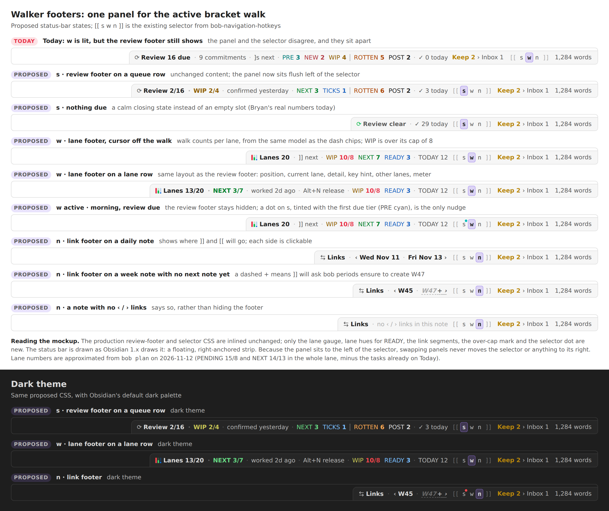
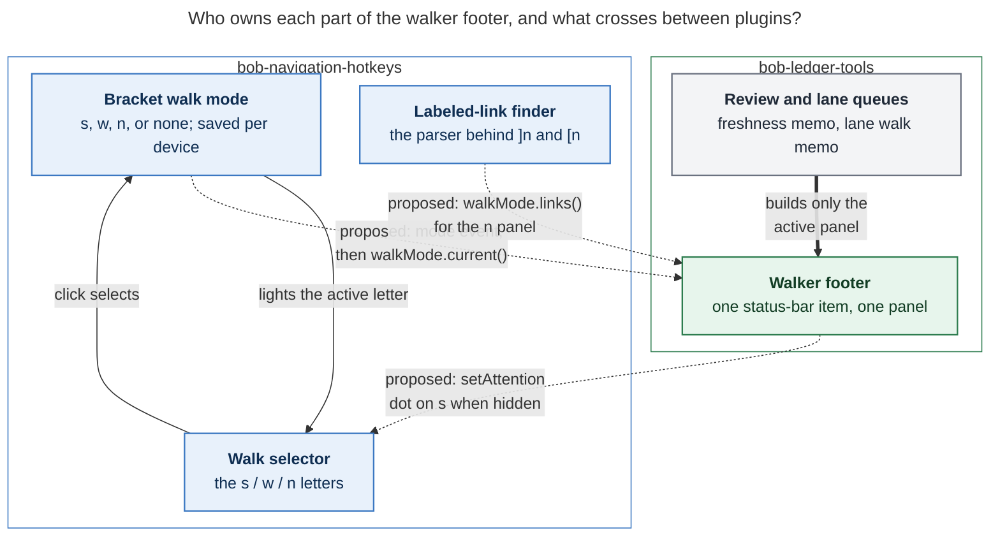

# Walker footers: the status bar follows the active bracket walk

**Consolidated report** (lead researcher) merging five independent reports —
[cdx](bracket_walk_footers__cdx.md), [cld](bracket_walk_footers__cld.md),
[grk](bracket_walk_footers__grk.md), [mus](bracket_walk_footers__mus.md),
[gem](bracket_walk_footers__gem.md) — plus the lead's own verification. 2026-11-12.

**Code verified by the lead:** bob-plugins `1b8982cf` (every file the swarm cited is
byte-identical to the `00edf76` snapshot the researchers inspected; the only newer
commit touches albums), bob-cli workspace at `8cef0d56` for the `docs/freshness.md`
claims, and the `morning-gtd-review-footer` / `task-freshness` glossary strands via
audited `sase memory read`. Nothing in this report edits code or memory.

## Bottom line

**Build it — all five researchers and the lead agree.** The request's premise is
exactly right: the `[[ s w n ]]` selector is the truth about what `]]` / `[[` will do,
yet the big panel beside it always narrates morning review. After `]w`, the bar says
`⟳ Review 12 due` while `]]` walks lanes. Making the footer follow the selected walk
turns the status bar back into an honest instrument and fights the wallpaper effect of
an always-on count.

**But the request's multiplicity is wrong, unanimously:** this is **one walker-footer
status-bar item with three panels**, not three footers. Three independently mounted,
auto-flexing items would jitter the bar, triplicate lifecycles and fit logic, and need a
cross-plugin "exactly one visible" arbiter. One host in bob-ledger-tools swaps a
view-model; "walker footer" names the family.

The one real cost is the loss of the ambient morning-review nudge, and the swarm's
answer (4 of 5) is a **quiet dot on the selector's `s` letter** when review commitments
are due while another walk is selected. With that safeguard, a per-panel clear state,
and a legacy fallback, the change is close to a pure gain.

## What the code establishes (verified)

| Fact | Where (bob-plugins unless noted) | Consequence for the design |
| --- | --- | --- |
| The bracket mode is `bracketRepeatType` (`s`, `w`, `n`, or unset), normalized, in-memory authoritative, persisted per device/vault under local-storage key `bob-navigation-hotkeys-bracket-repeat`; `rememberBracketRepeatType` acts only on change; `repeatBracketWalk` dispatches `jumpToDueTask` / `jumpToLaneTask` / `openLabeledBodyLink`; `n` has no uppercase walk | nav `546-plugin-bracket-repeat.js` (lead re-read in full) | This *is* "the walk `]]` will trigger". Gate on it; invent no second flag, no session timer, no DOM parsing |
| Only family commands (`]s ]S ]w ]W ]n`, `Ctrl+Alt+J/K`, due-task commands) and selector letter clicks record the mode; `]]`/`[[` repeats and internal advances never change it | nav `490-plugin-lifecycle.js`, `546` | Mode-change events are rare and cheap; answer gestures never flip the footer |
| `[[ s w n ]]` is nav's always-visible desktop status item with sliding thumb, flashes, click-selects-without-walking | nav `547-bracket-mode-indicator.js` (870 lines) | The switcher already exists; it just has no panel |
| The review footer is ledger's separate status item; it **hides when the queue is empty** except a hint-only `⟳ Nothing due · <Alt+P preview>` on a prioritized cursor row, and hides when Tasks is unavailable and on mobile | ledger `120-freshness-footer.js:685-712` (lead-verified), `240-plugin-freshness-status.js` | "Always shown" in the request means *regardless of family*, not unconditional. The empty-state question is a real design choice (see A5) |
| The footer host CSS is `margin-right: auto; flex: 1 1 auto`; the Keep inbox item "never flexes so the footer shrinks first" — a comment that documents a layout dependency | ledger `styles.css:324-330`, `:7293-7295` (lead-verified) | Any placement change must respect or deliberately replace this contract, verified in real Obsidian |
| `api.laneWalk` v2 `queue()` returns entries with `lane`, `rank`, `laneRank`, `laneTotal` and counts `{pending, next, ready, total, todayPending, todayNext, todayReady, reviewReady}`, memoized on Tasks identity, date, Today generation, and the READY gate | ledger `071-lane-walk-model.js`, `180-plugin-plan-and-ready.js:900-962` (lead-verified) | The `w` panel's numbers are already computed and match the dash by construction; never rescan checkboxes |
| `]n`/`[n` open the first body link whose rendered label is exactly `prev`/`next` or an arrow label (`‹`/`<` prefix for prev; `›`/`>` prefix or suffix for next), scanning live editor text, skipping frontmatter and fences; missing period notes create through Bob, generic safe notes through Templater | nav `680-plugin-link-parse.js` (lead re-read matcher), `670-plugin-project-files.js`, `640-…` | The `n` panel must reuse this exact matcher or it will disagree with the keys. `n` has **no queue, rank, or total** |
| Nav already exposes `api` v3 with per-member versioned namespaces (`quickRoll`, `notice`, `successors`); ledger already consumes `quickRoll` for the footer hint slot | nav `480-review-jump-and-nav-api.js:926-934` (lead-verified) | The additive-namespace pattern for the one new contract already exists |
| Ledger loads **before** nav in the live vault | `~/bob/.obsidian/community-plugins.json` (cld) | Resolve the mode on `onLayoutReady` / provider event, never in `onload` |
| Fragment cap is 1000 lines; `120-freshness-footer.js` is at 925, `547` at 870 | repo `AGENTS.md`, `wc -l` (lead-verified) | New view-models and pip logic go in new fragments |
| bob-cli docs call it a "persistent review footer"; the glossary strand says it "hides when Tasks is unavailable… When nothing is due, it hides unless the cursor is on an open task with a priority" | bob-cli `docs/freshness.md:990`, `docs/guides/run-morning-review.md:68`; `glossary:morning-gtd-review-footer` (lead-verified via audited read) | Both texts become false and must be updated with the feature |
| Live snapshot 2026-11-12 (cld, read-only `bob plan`/`bob freshness`/`bob ready`): review `0 due · ✓ 29 today`; lanes roughly `WIP 10 (cap 8, over) · NEXT 7 · READY 3 · TODAY 12` | cld §1 | Realistic copy for mockups; WIP over cap is today's true pressure story |
| No decision record governs footer visibility; `decisions:answering-advances-the-walk` rejected a *global review-mode toggle*, which gated answer keys — not this read-only projection | memory roster; grk, cld | The change is policy-unconstrained; answer keys stay landing-gated |

## Critique: is the plan a good idea?

Yes, for four reasons the swarm converged on independently:

1. **It fixes a real mismatch.** The selector and the panel beside it can disagree today;
   the footer should answer "what will `]]` do, and where am I in it?" (all five).
2. **It fights wallpaper.** An always-on number becomes invisible — the prior Keep-inbox
   research already named this risk. Shown only in its walk, the review footer gets
   noticed again (cld, gem).
3. **The `w` walk deserves a standing view.** Lane grooming is about pressure
   (`WIP 10/8` today), and today lanes have only transient toasts (cld, mus, gem).
4. **It makes the selector self-explanatory** — click a letter, see that walk's panel
   without walking. The selector becomes a real tab strip (cld, mus).

Where the plan *as literally written* would go wrong, with the consolidated fix:

- **Three items → one host.** Independent `margin-right: auto` items fight for the left
  edge and jitter on every switch (all five). → One ledger-owned item, three panels.
- **"Show when the review walk is active" must mean the persisted family, not a
  session.** A timeout, Esc, cursor position, or "review in progress" inference would be
  hidden state nothing on screen explains — and the family already persists across
  restarts (all five). Note the consequence honestly: after morning `]s` the review
  panel stays up all day until you click `w` or `n`; that is what was asked for, and
  the selector is how you put it away (grk).
- **Hiding the review footer hides the morning obligation.** The mode is sticky across
  days; end Tuesday on `]n` and Wednesday's due commitments vanish from the bar
  (cld, grk, mus, gem). → The `s`-dot (A4). cdx alone would accept the loss as an
  intentional tradeoff; the lead sides with the majority — the dot is tiny, static, and
  reversible.
- **`n` is not a list walk.** It follows the first matching prev/next body link in the
  active note; a rank/total would be fiction (all five). → A destination compass.
- **Don't turn the display into a progress dashboard.** Queue fractions are positions in
  a changing queue, never completion percentages; no bars, no percent done (cdx).

**Would anyone take a different approach?** Every researcher kept the premise. The
rejected alternatives (cld §7, cdx, grk): context-sensitive footers keyed on the
cursor's row (ambiguous — Pending/Next rows are in both `s` and `w` walks, and it
flickers), session-based visibility (hidden state), keeping the review footer always-on
with two more beside it (space, wallpaper), auto-selecting `s` each morning (violates
"`]]` never surprises"), and moving the review painter into nav (~1,500 lines plus tests
migrated for no user-visible gain).

## Requirement adjustments (explicitly called out)

Consolidated rulings. "Swarm" counts the five independent reports.

| # | Adjustment | Swarm | Lead ruling |
| --- | --- | --- | --- |
| A1 | **One walker-footer status-bar item with three panels**, not three footers | 5/5 | Adopt |
| A2 | **"Active" = the persisted bracket family** (`bracketRepeatType`), never a session, timer, or cursor inference | 5/5 | Adopt |
| A3 | **The `n` footer is a destination compass**, not a count HUD: previous/next targets, directional clicks, no invented totals | 5/5 | Adopt |
| A4 | **Quiet dot on the selector's `s`** when review *commitments* are due while another family is selected: ~5px, tier-tinted, no number, no motion, tooltip/aria `Review: 9 due · 5 commitments — click to show`; ROTTEN-only/POST-only never light it | 4/5 (cdx dissents: accept the loss) | Adopt. Reject grk's additional `w` pip — lanes are almost never empty, so it would be permanent wallpaper |
| A5 | **A selected walk always paints a panel**, including a calm clear state (`⟳ Review clear · ✓ 29 today`, `Lanes clear · TODAY 12`, `⇄ Links · no ‹ / › links in this note`); hidden only when data is untrustworthy (Tasks indexing / Today loading) or on mobile | cdx+cld for; grk+mus keep review's hide-on-empty | Adopt clear states. A lit letter beside an empty slot is ambiguous (done? broken?), and `Review clear` pairs with the existing `Lanes clear` toast copy. The off-walk Alt+P hint-only behavior folds into the `s` clear state |
| A6 | **Unset mode (fresh device) shows no panel**; the selector's existing unselected state and empty-repeat notice stand; the dot still works | cdx+cld+grk for; mus+gem default to `s` | Adopt no-panel. The footer explains what `]]` will do; with no family, `]]` only flashes "Nothing to repeat yet". Don't silently default |
| A7 | **Lane counts are walk membership** (`queue.counts.pending/next/ready`, Today excluded, NEW/ROTTEN Ready excluded) — exactly what `]w` can visit, matching the dash sections by construction; caps live in the tooltip; when a lane is over its cap, show `n/cap` in the existing over-cap tone (text carries the warning, not color alone) | counts 5/5; over-cap style split (cld `n/cap` when over; grk/mus tone-only; cdx counts-only) | Adopt counts + `n/cap`-only-when-over. Tone-only fails the no-color-alone rule |
| A8 | **Alt+P preview scope:** `s` keeps everything; `w` keeps the off-row prioritized-cursor preview, but a landed lane row's hint slot prefers the lane's own answer (`Alt+N release` / `Alt+N next`, Alt+P sentence to tooltip); `n` drops it | cld middle; gem full parity; cdx `s`-only; mus none for `w` | Adopt cld's middle. The preview is a cursor affordance, task walks share it, note walks don't |
| A9 | **Never auto-switch the mode** (no morning auto-`s`, no day-rollover change); internal advances never steal selection | 5/5 | Adopt |
| A10 | **Placement:** keep the selector in nav; target the panel *immediately left of the selector* (CSS `order`) so panel width changes never move the click target — but verify in real Obsidian, because the Keep item's layout documents a dependency on the review host's `margin-right: auto`; fall back to current positions if the host layout fights | cld adjacency; grk keep as-is this pass; mus+gem merge selector into the footer item | Adopt adjacency-as-target with explicit Mac verification. Reject merging the selector into ledger's item: the selector must survive when ledger is disabled, and cross-plugin DOM ownership is the fragility all five warned about elsewhere |
| A11 | **Legacy fallback:** nav API absent/old → ledger paints today's review footer exactly as now; ledger absent → nav's selector and commands keep working alone | 5/5 (cdx prefers hiding; others keep today's footer) | Adopt keep-today's-behavior — never strand a vault mid-upgrade, and each plugin ships/rolls back alone |
| A12 | **Hints read `]] next`** (was `]s next`): whenever a walker footer is visible, `]]` repeats its walk, so the hint is true in every panel and teaches the repeat key; family keys stay in tooltips | cld proposal | Adopt |
| A13 | **One glossary parent term** (*Walker Footer*) with the review footer amended as its `s` member — not three thin terms; plus a pointer fix in *task-freshness*; optional decision record | 5/5 on one term | Adopt (§ Glossary) |

## Design

### One anatomy, three panels

Every panel fills the same slots left to right and sheds in the same order as the bar
narrows, extending the review footer's proven fit choreography — with **per-panel drop
lists**, not a blind reuse of `freshnessFooterFit` (its TICK answer-chip exceptions are
review-specific; grk).

| Slot | `s` review (exists) | `w` lanes (new) | `n` links (new) |
| --- | --- | --- | --- |
| Glyph + position (button, acts like `]]`) | `⟳ Review 2/16` / `⟳ Review 16 due` | `Lanes 13/20` / `Lanes 20` (+ optional 3-bar lane gauge, `aria-hidden`) | `⇄ Links` |
| Current group | `WIP 2/4` (tier hue) | `NEXT 3/7` (lane hue) | `‹ Wed Nov 11 · Fri Nov 13 ›` (direction buttons) |
| Detail | `confirmed yesterday`, `rotten 4d` | work-log age / created date (same chip the lane toast shows) | — |
| Hint | `Alt+P …` on rows, `]] next` off | `Alt+N release` / `Alt+N next` on rows, `Alt+P …` or `]] next` off | — |
| Remaining groups | other tiers, hairline before ROTTEN | other lanes (zeros quiet but present) | — |
| Meter | `✓ 3/5 today` | `TODAY 12` | — |

Shed order protects the user-requested facts: remaining groups from the end (`…`), then
detail, then hint, then meter — and in `w`, the whole-walk position and captions go
before any lane count; the minimum lane state is `Lanes 20 · WIP 10/8 N 7 R 3` (cdx).
Ellipsis must never make a missing link destination look present.

### `s` — the review footer, gated

Content unchanged (nine tiers, commitment/upkeep hairline, stage detail, tier colors,
TICK answer chip, meter) with three deltas: visible only while `s` is the family (or in
legacy fallback), hint `]] next`, and the clear state
`⟳ Review clear · ✓ 29 today` — calm muted ink, green `⟳`, Alt+P preview retained on a
prioritized cursor row, no celebration, no auto-switch. "Clear" describes the current
eligible queue, not the week's commitments (cdx). Review answer/advance semantics,
freshness eligibility, and task writes are untouched.

### `w` — the lane footer

A pure view over `api.laneWalk` v2's immutable queue result. States (copy mirrors the
existing lane toast so the two surfaces never disagree):

| State | Reads |
| --- | --- |
| Off a walk row | `Lanes 20 · ]] next · WIP 10/8 · NEXT 7 · READY 3 · TODAY 12` |
| On a validated walk row | `Lanes 13/20 · NEXT 3/7 · worked 2d ago · Alt+N release · WIP 10/8 · READY 3 · TODAY 12` |
| Every lane task on today's plan | `Lanes clear · TODAY 12` |
| Ready waiting in review | `Lanes clear · REVIEW 5 · ]s walks NEW and ROTTEN` |
| No lane tasks at all | `No Pending, Next, or Ready tasks` |
| Tasks indexing / Today loading | hidden — never a success-like zero |

Rules the swarm agreed on: cursor matching reuses the existing queue-cursor matcher
(entries already carry path/line/blockId); the position fraction appears **only** for a
validated current member — no fabricated `0/24`, no stale fraction after the row leaves,
and a moved/released task never "teleports" the origin (the walk deliberately resumes
from the old lane tuple — cdx, per `resolveLaneWalkOrigin`); counts are informational in
v1 (clicking `READY 13` must not skip work or change filters — lane jumps already have
`]}`/`[{`, taught in the tooltip); the work-log detail helper is copied as a shared
fragment rather than called across plugins per cursor move (cld). Tooltip:
`20 tasks off today's plan · WIP 10 of 8 (over) · NEXT 7 of 13 · READY 3 of 21 ·
TODAY 12 already planned · REVIEW 5 wait in ]s · ]] / [[ step · ]} / [{ jump lanes`.

### `n` — the links footer

A destination preview drawn from nav's own matcher, never a second parser:

| State | Reads | Activation |
| --- | --- | --- |
| Both directions exist | `⇄ Links · ‹ Wed Nov 11 · Fri Nov 13 ›` | left arm `[n`, right arm `]n` |
| Arrow labels (period notes) | `⇄ Links · ‹ W45 · W47 ›` (label minus arrow) | same |
| Target missing but creation-eligible | `W47+ ›` faint/dashed; tooltip `No W47 note yet — ]] creates it` | existing creation route, only on activation |
| One direction only | `‹ W45 · no next` | live arm only |
| No matching labels | `⇄ Links · no ‹ / › links in this note` | disabled |
| Non-Markdown view | `⇄ Links · open a note` (faint) | disabled |

Daily labels are literally `prev`/`next`, so the panel shows the **resolved target's
readable stem/date**, with full path and subpath in the tooltip; duplicate basenames get
path context; names render as text, never HTML (cdx, cld, grk). Preview reads the live
editor content (matching the key), is generation-checked against the source file and
revision, and **never** calls `ensureNote`, loads templates for writing, or opens
anything while painting. The period up-link (`↑ Q4`) is not a walk target and stays out
of v1 (cld, gem; grk's center-context variant deferred). No Tasks/Today dependency —
`n` works when Tasks is unavailable (cdx). First-match rule preserved even when a later
same-label link would resolve.

### The dot, motion, and accessibility

- **Dot (A4):** on the `s` letter, mode ≠ `s`, commitments > 0; tier-tinted with a ring
  in the bar background; `Highlight` under forced colors; tooltip and `aria-label` carry
  the counts; re-pushed on every mode event so load order can't lose it (cld §4.5).
- **Motion:** mode switch crossfades panel content ~120 ms while the existing selector
  thumb slides; count changes never animate; `prefers-reduced-motion` removes the fade;
  height fixed; DOM stable — text updates only on change, no rebuild per cursor tick.
- **Accessibility:** real buttons for movement/selection with visible focus and
  selected/disabled states — but not every text chip; meaningful status changes
  announceable without focus moves and without a live region per cursor motion; active
  mode and current lane carry text/shape cues as well as color; small text targets
  4.5:1 in both themes; tabular numerals; test minimum widths with large counts and long
  Unicode names (cdx's WCAG-anchored criteria).



*Figure 1 (carried from cld). Top: today, `w` lit while the review footer still narrates
review. Below: the proposed panels, rendered from production CSS plus ~60 new lines, in
headless Chromium with 2026-11-12 lane numbers. grk's independent mockup
(`assets/mockup-walker-footers.png`) reaches the same layout.*

## Architecture and the cross-plugin contract

Ownership stays where expertise lives: **nav owns navigation state and link
interpretation; ledger owns the one contextual status item and both task queues.**
Ledger already hosts the review painter, fit algorithm, memoized queues, resize
observer, and lifecycle cleanup — moving any of that would be the larger, riskier
change (5/5).



*Figure 2 (carried from cld; re-rendered and re-measured by the lead: 714.9 × 1060 px,
fit 84.2%, Mermaid CLI 12.0.0). Navigation keeps what it already owns; Ledger Tools
keeps the data and the one panel; only three thin, proposed (dashed) contracts cross.*

**The nav API** is one additive namespace on nav api v3, following the existing
per-member versioning pattern (`quickRoll` et al.). Working name `api.walkMode` v1
(cld) — grk's `bracketRepeat`+`labeledLinks` and gem's `bracketMode`+`linkWalk` are the
same responsibilities; exact names are an implementation choice:

```js
walkMode: {
  version: 1,
  current(),                 // "s" | "w" | "n" | null — readBracketRepeatType()
  select(type),              // same as a letter click: records, never walks
  links({ path, content }),  // -> { ok, prev: {text,target,path,exists}|null, next: … }
                             //    uses findFirstRenderedLink; read-only, never creates
  setAttention(type, value), // value: null | { tier, label }; display-only
}
```

Plus a **doorbell** workspace event (`bob-navigation-hotkeys:walk-mode`) fired by
`rememberBracketRepeatType` on change and once at setup after reading storage.
Receivers re-read `current()`, so a stale payload can never win; the repo already uses
this event pattern. Do not expose the raw local-storage key as a contract; do not
mirror selection into ledger settings; a failing listener must never break a command.

**The ledger host** routes one controller: `setupWalkerFooter` creates the same hidden
item with `.bob-walker-footer` alongside the existing `.bob-freshness` classes (CSS and
tests keep applying); resolves the mode on `onLayoutReady` (ledger loads first);
`updateWalkerFooter` builds **only the active panel's** view-model
(`freshnessFooterView` / new `laneFooterView` / new `linkFooterView`) and paints through
the existing painter with the paint-key short-circuit, the key including the mode. New
models go in new fragments (`120` is at 925/1000 lines).

### Reliability invariants (condensed from cdx §"Reliability" + cld §6)

1. **One snapshot per paint** — counts and positions from the same immutable queue
   result; never today's counts with yesterday's rank.
2. **Generation-checked async** — a link-preview response paints only if family, source
   file, and editor revision are still current; switching to `w` invalidates an
   outstanding `n` read; unload invalidates everything.
3. **Mode paint is synchronous; data work is coalesced** — the mode event bypasses the
   150 ms data debounce (the user just pressed a key); cursor updates keep the 50 ms
   context path; no polling loop, no full-vault rescans.
4. **Lifecycle explicit** — subscribe at setup then `get()` once; test both plugin load
   orders, unload/reload, missing APIs, thrown listeners, no duplicate items; a missing
   provider is "unavailable", never "the mode is s".
5. **Activation rechecks context** — clicks route through existing commands with a mode
   guard; a stale `s` button never fires after the selector became `n`; a direction
   click revalidates note, revision, and destination before opening (and never creates
   a note from a vanished preview).
6. **Read-only means rendering** — paint, hover, focus, resize, and mode selection never
   write tasks or create notes; only explicit activation may (via existing commands).
7. **Selector geometry stable** — the e2e check asserts the selector's bounding rect is
   unchanged across `s` → `w` → `n` (cld).

## Glossary and memory

One new parent strand plus one amendment, published **with** the feature, through
`/sase_memory_write` (the new term can cite Bryan's request in `requested:`; the
amendment corrects claims the change makes false). Draft synthesized from all five:

> **Walker Footer** — aka walk footer, lane footer, links footer
>
> The contextual bob-ledger-tools panel in Obsidian's desktop status bar that explains
> the active bracket walk — the family `[[` and `]]` will repeat, lit in the
> `[[ s w n ]]` selector beside it. Exactly one member shows at a time, chosen by the
> persisted bracket-repeat mode and never by the cursor, a timer, or remaining work:
> the [[morning-gtd-review-footer]] for `s`; the **lane footer** for `w` — Pending
> (WIP), Next, and freshness-gated Ready tasks off today's plan, counted exactly as the
> `]w` walk visits them, with a position only on a validated current row; the **links
> footer** for `n` — a compass over the active note's first matching prev/next body
> links, which is where the keys will go, including whether following one would create
> its note. All members share one anatomy, the tier and lane hues, and end-first
> shedding. A selected walk always paints a panel, even when clear; loading or
> unavailable data is distinct from zero; queue fractions are positions, never
> progress, and links have no invented total. The footer is a read-only projection — it
> never stamps, moves, or creates; clicking acts like `]]` (the links footer's arms run
> `[n` / `]n`). While another walk is selected, due review commitments show only as a
> quiet dot on the selector's `s`. With no saved family, no panel shows. Not the
> selector itself, a landing toast, the [[day-strip]], or a [[stats-strip]].

Amend *Morning GTD Review Footer*: first sentence names it "the `s` member of the
[[walker-footer]], shown while the review walk is the active bracket walk"; `]s next` →
`]] next`; replace the hide-when-nothing-due sentence with the `⟳ Review clear` state
plus the retained Alt+P preview; closing line notes the dot. Point *task-freshness*'s
"its status-bar view is the [[morning-gtd-review-footer]]" at the `s` walker footer
(grk). **Optional decision record** `walker-footer-follows-bracket-walk` (cld §8.3) —
claim, rejected alternatives (§Critique), costs (no ambient review count off-`s`; a
cross-plugin contract), reopen-if (missed morning reviews; dot too subtle). Ask Bryan
whether to record it (decisions-web rule: never infer an unrecorded reason).

Docs to update in the same change: bob-plugins `docs/bob-ledger-tools.md` (footer
section) and `docs/bob-navigation-hotkeys.md` (bracket repeat + indicator); bob-cli
`docs/freshness.md` ("persistent review footer", :595/:990 passages) and
`docs/guides/run-morning-review.md` §2; `npm run docs:check` both sides; deploy via
`bob plugins sync`.

## Implementation plan (each phase shippable; legacy fallback makes each safe alone)

1. **nav `api.walkMode` v1** (`current`/`select` + doorbell event). No visible change.
   Extends `test-navigation-bracket-repeat.cjs`: event only on change, once at setup;
   `select` never walks.
2. **ledger walker host + gated `s` panel**: mode routing, legacy fallback,
   `Review clear`, `]] next` hints. Extends `test-ledger-tools-freshness-footer.cjs`
   with mode gating, the clear state, and both load orders.
3. **`w` panel**: `laneFooterView`, over-cap `n/cap`, cursor match, shared work-log
   fragment; new `test-ledger-tools-walker-footer.cjs` plus a dash-parity fixture
   pinning footer counts to the dash badge models.
4. **nav `links()` + `n` panel**: parity test asserting `links()` targets equal what
   `openLabeledBodyLink` would open on daily, period, arrow-label, missing-target,
   fenced-code, and unsaved-editor fixtures.
5. **Attention dot** (ledger push, nav paint, tooltip/aria). Extends
   `test-navigation-bracket-mode-indicator.cjs`.
6. **Visual + e2e + placement**: generalize `scripts/preview-review-footer.cjs` into a
   walker preview (every state, light/dark, three widths) with an integrated-bar fixture
   including the selector and Keep item; real-Obsidian smoke on the Mac — `]w` swaps the
   panel within a frame, selector rect fixed — and **decide adjacency (A10) here**, with
   current placement as the fallback.
7. **Docs + memory + sync** (§Glossary), then `bob plugins sync`.

No Rust/CLI change, no release-train or Mac Capture impact, no mobile surface.

### Acceptance areas that matter most (condensed from cdx's matrix)

Mode truth (cold/invalid storage, restored family, click-without-walk, failed family
command, internal advances don't steal); isolation (one panel visible, stale async can't
paint across modes, no Tasks requirement for `n`); lane truth (counts equal the exact
snapshot; zero lanes; Today/NEW/ROTTEN exclusions; release/move/delete/undo; midnight);
position (no stale or fabricated fractions); link truth (first-match, decoys, subpaths,
duplicate basenames, provider unavailable, source switched mid-read); side effects (zero
writes on paint; preview never creates); lifecycle (both load orders, unload, missing
APIs); visual fit (narrow widths, long names, large counts, reduced motion, forced
colors, neighboring items present).

## Open questions for Bryan

1. **Dot tint** — first-due-tier hue (recommended: says *which* part waits) or neutral?
2. **Over-cap copy** — `n/cap` only when over (recommended) or always, like dash chips?
3. **`Review clear`** vs keeping `Nothing due`? (Recommended: clear, pairs with lanes.)
4. **Decision record** — record `walker-footer-follows-bracket-walk`, or glossary only?
5. **Placement** — approve the adjacency target (panel immediately left of the
   selector), pending the real-Obsidian check of the Keep-item layout?

## Recommended solution

Build the **walker footer**: one bob-ledger-tools status-bar item that shows exactly the
panel for the persisted bracket walk — the review footer for `s` (content unchanged,
gated, with a calm `⟳ Review clear` instead of vanishing), a lane footer for `w` driven
by `api.laneWalk` v2's own counts (`Lanes r/N · WIP 10/8 · NEXT 7 · READY 3 · TODAY
12`, toast-matching empty states), and a links compass for `n` drawn from nav's own
`]n` matcher (`⇄ Links · ‹ Wed Nov 11 · Fri Nov 13 ›`, dashed create targets,
directional arms). bob-navigation-hotkeys exposes `api.walkMode` v1 plus a doorbell
event; ledger builds only the active panel and paints synchronously on a mode change.
Two safeguards make it a near-pure gain: the quiet tier-tinted dot on the selector's
`s` whenever review commitments are due off-`s`, and a byte-compatible fallback to
today's behavior when either plugin is missing the other. Publish one *Walker Footer*
glossary parent with the review footer amended as its `s` member, fix the two bob-cli
doc passages that say "persistent", and ship in the seven phases above — the selector
chooses the walk; the walker footer tells the truth about it.
