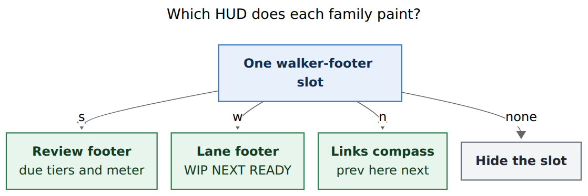
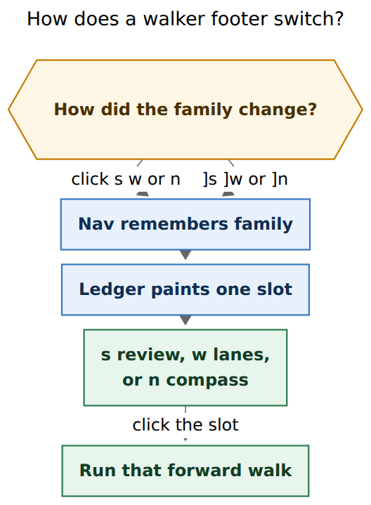
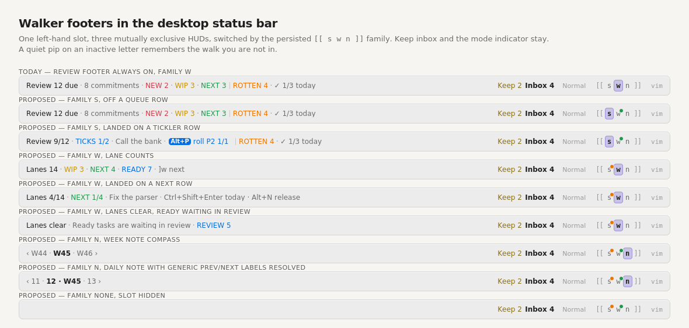

# Walker footers: one slot, three walks

> **Research query.** Show the GTD review footer only while the `s` walk is
> the active `[[` / `]]` family. Add matching footers for the `w` and `n`
> walks. Add a glossary term **walker footer** (the review footer is one).
> Lead the design so it is intuitive, reliable, and beautiful. Critique the
> plan; call out justified requirement changes; end with a recommended
> solution.

**Researcher:** grk. Independent swarm report. Baselines: glossary
`morning-gtd-review-footer`, `task-freshness`; decisions
`review-walk-is-tiered`, `recurring-occurrences-walk-when-due`,
`answering-advances-the-walk`; bob-ledger-tools
`src/120-freshness-footer.js`, `src/121-freshness-footer-paint.js`,
`src/240-plugin-freshness-status.js`, `src/071-lane-walk-model.js`;
bob-navigation-hotkeys `src/546-plugin-bracket-repeat.js`,
`src/547-bracket-mode-indicator.js`, `src/670-plugin-project-files.js`,
`src/680-plugin-link-parse.js`, `src/543-lane-walk-notice.js`;
`docs/freshness.md`, `docs/guides/run-morning-review.md`,
`docs/develop/plugins/plugin-apis.md`.

Mermaid CLI `@mermaid-js/mermaid-cli@12.0.0`. Figure 1: 745×250 px, fit
87.7%. Figure 2: 352×480 px, fit 100%. Status-bar mockup rendered with
`wkhtmltoimage` from `assets/mockup-walker-footers.html`.

## Bottom line

**Build it. Treat “two new footers” as two new HUDs in the existing
left-hand status-bar slot, not two extra items.**

The request is right about the lie: the review footer currently paints
whether or not `]]` would walk review. The fix is already sitting in the
bar. Navigation Hotkeys persists a bracket family (`s` / `w` / `n`) and
lights it on `[[ s w n ]]`. A walker footer is the HUD for that family.
Click `w`, the review chrome leaves, the lane counts arrive, and `]]`
does what the HUD says.

Three requirement changes are load-bearing. Without them the feature
either crowds the bar, lies about links, or blinds the other walks.

1. **One slot, three members.** Keep inbox research already called the
   bar crowded (review footer, Keep, bracket mode). Three
   `margin-right: auto` items will fight for the left edge. Conceptually
   there are three walker footers; physically there is one host that
   swaps a view-model.
2. **“Active” means the persisted family, not a review session.** Bryan
   defined it: the `s` key is active and `[[` / `]]` will fire it. That
   state already survives reloads. A timeout, Esc-to-dismiss, or
   cursor-on-queue-row session would be the global review-mode toggle
   `decisions:answering-advances-the-walk` already rejected.
3. **The `n` HUD is a compass, not a fake queue.** `]n` / `[n` follow
   the first body prev/next link. There is no rank/total. Show
   `‹ prev · here · next ›`, with independently clickable arms.

A quiet pip on an inactive `s` or `w` letter is the justified extra:
hiding the review HUD must not hide that review is still due.

**Recommended design, in one sentence:** one desktop walker-footer slot
in Ledger Tools, switched by Navigation’s persisted bracket family,
painting the existing review HUD for `s`, a PENDING/NEXT/READY count HUD
for `w`, and a prev/here/next compass for `n`.

## Is this a good idea?

Yes. The current review footer is an excellent HUD attached to the wrong
question. It answers “how is morning review going?” even when the last
walk was lanes or period notes. After `]w`, `]]` walks lanes and the bar
still says `⟳ Review 12 due`. That is how a status bar teaches the
wrong muscle.

Four facts make the gap concrete.

1. **The family is already first-class.** `BRACKET_REPEAT_STORAGE_KEY`
   remembers `s|w|n` per device and vault. Family commands, uppercase
   siblings, command palette, and a letter click all record it.
   `]]` / `[[` never change it. The indicator exists so those keys
   “never surprise.” The footer should stop surprising too.
2. **The review footer is already a projection, not a mode.** It never
   stamps. Clicking it runs `jump-to-next-due-task`, which *selects* `s`
   as a side effect. Gating visibility on family turns that click into
   “advance the walk I am in,” which is the honest button.
3. **Lane walk has counts and no persistent HUD.** `api.laneWalk` v2
   already returns `{ pending, next, ready, total, today*, reviewReady }`
   in dash order. The only live UI is a landing toast. A footer that
   shows `WIP 3 · NEXT 4 · READY 7` is the toast’s standing form.
4. **Link walk has a nav line that scrolls away.** Daily notes use
   `[[…|prev]] · [[week|W45]] · [[…|next]]`. Period notes use
   `‹ W44 · ↑ Q4 · W46 ›`. Once you leave the top of the note, `]]`
   still walks and nothing in the bar says where.

The rejected alternative in `answering-advances-the-walk` — “a global
review-mode toggle” — is a different idea. That toggle would gate
answer keys. This change gates a read-only projection. `Alt+F`,
`Ctrl+Enter`, and friends stay landing-gated, not family-gated.

## Critique of the plan as written

The plan as stated is the right product instinct with the wrong
multiplicity.

**Keep.** Hide the review HUD unless family `s` is the `[[` / `]]`
target. Give `w` a count HUD. Give `n` a HUD. Name the family
“walker footer.” Lead with beauty: one visual language, not three
plugins inventing chrome.

**Change.**

| Plan as written | Problem | Adjustment |
| --- | --- | --- |
| “Add two new footers” as extra status-bar items | The review host already takes leftover left width (`flex: 1 1 auto; margin-right: auto`). Keep inbox is `flex: 0 0 auto` beside it so the footer shrinks first. Two more auto-flex items jank the bar on every family change. | One host, three view-models. The two new footers are members, not siblings. |
| Implied: hide review except “while reviewing” | After morning `]s`, family stays `s` all day, so a family gate still shows the review HUD during ordinary writing. That is what Bryan asked for. A session clock or Esc would be a new mode. | Family gate only. To put the HUD away, click `w` or `n` — the indicator already teaches that. |
| `w` “should have indicators” of pending/next/ready | Easy to paint `n/cap` and fight the dash chips, or to count Today-linked tasks the walk excludes. | Walk membership only: the same PENDING/NEXT/READY section counts `]w` walks. Caps and today-in-lane live in the tooltip. Over-cap uses `workBadges` tones. |
| `n` as a third queue HUD | Links are a place, not a list. `rank/total` would be fiction. Daily labels are the words `prev` / `next`, which are ugly in a bar. | Compass. Resolve exact `prev`/`next` to a short target stem. Arrow labels stay. Left arm = `[n`, right arm = `]n`. |
| Review footer click as a way to *start* review from any family | Once the HUD is `s`-only, that click no longer selects `s` from `w`. | Starting review is `]s` or a letter click on `s` then `]]`. Do not keep a ghost review chip in other families. |
| Always-on ambient “12 due” while in `w` | Real loss. Bryan paused review with work remaining. | Quiet pip on the inactive `s` letter. Same for `w` when lanes are nonempty. No pip on `n`. |

**Would I take a different approach?** I would not merge the HUD into
the 1.3em letters — they cannot hold `WIP 3 · NEXT 4 · READY 7`. I
would not move the slot next to the indicator on this pass: Keep inbox
layout depends on the review host eating leftover left width. Kinship
comes from the pip, the lit letter, and a shared `[[` / `]]` flash.
I would not default family to `s` on a cold vault; empty family already
has a notice. I would not hide Keep inbox, the command-mode chip, or
the indicator.

## What exists today

| Fact | Where | Why it matters |
| --- | --- | --- |
| Review footer is a desktop status-bar item that hides when Tasks is unavailable, when the walk length is 0 (unless an off-walk `Alt+P` preview exists), and on mobile | `120-freshness-footer.js` `freshnessFooterView`; `240-plugin-freshness-status.js`; glossary `morning-gtd-review-footer` | “Always show” in the prompt means *regardless of family*, not *regardless of queue*. Empty review already hides. |
| Off a queue row: `⟳ Review N due · K commitments` (or `Commitments done` / `Upkeep budget met`), then nonempty groups in walk order, hairline before ROTTEN/POST, `✓ upkeep/budget today`, hint `]s next` or `Alt+P` | glossary; `freshnessFooterView` | This chrome is the `s` member. Keep it. Do not restyle it into a generic HUD. |
| On a queue row: `Review r/N · TIER i/M` plus detail; TICK rows can promote `Alt+P` to a tinted answer chip that outlasts the meter | `FRESHNESS_FOOTER_ANSWER_TIERS`; `121-freshness-footer-paint.js` `freshnessFooterFit` | Fit order is a contract. New members need their own drop lists, not a reused one that hides READY to save TICK chips. |
| Click runs `bob-navigation-hotkeys:jump-to-next-due-task`, which records family `s`; fallback opens `rotten` | `240-plugin-freshness-status.js`; nav docs “Bracket repeat” | Footer click is already a family selector. After the gate, click only advances. |
| Bracket family `s` / `w` / `n` is stored in Obsidian local storage, painted as `[[ s w n ]]`, clickable without walking, flashing on `]]` / `[[` / empty | `546-plugin-bracket-repeat.js`; `547-bracket-mode-indicator.js` | This is the switcher. It is not a walker footer. |
| `s` keys: `[s` `]s` `[S` `]S`, due-task commands, `Ctrl+Alt+J/K`, the review footer. `w` keys: `[w` `]w` `[W` `]W`. `n` keys: `[n` `]n` only — no uppercase | nav docs table | `[{` / `]}` on `n` already show a no-uppercase notice. The `n` HUD must not pretend `]N` exists. |
| Lane walk is PENDING then NEXT then READY, Today-linked dropped, NEW/ROTTEN Ready stay with `]s`. `api.laneWalk` v2 `queue()` is memoized and never throws | `071-lane-walk-model.js`; plugin-apis | The `w` HUD can be a pure view over an API that already exists. |
| Empty lane toasts: `Lanes clear` + `REVIEW n` when Ready waits in review; `TODAY m` when every lane task is planned; else `No Pending, Next, or Ready tasks` | `542-lane-walk-model.js`; `543-lane-walk-notice.js` | Reuse this copy. Do not invent a second empty language. |
| `]n` finds the first body wiki/Markdown link whose label is exactly `prev`/`next`, or an arrow label (`‹`/`<` start, `›`/`>` start or end), skipping frontmatter and fences | `680-plugin-link-parse.js`; `670-plugin-project-files.js` | The `n` HUD must use this matcher, not a second parser. |
| Daily nav line is `[[prev\|prev]] · [[week\|W45]] · [[next\|next]]`; period nav line is `‹ W44 · ↑ Q4 · W46 ›` | `docs/periods.md`; period fixtures | Daily labels need target stems. The up-link is not a walk target. |
| Keep inbox sits beside the review footer and “never flexes so the footer shrinks first” | `styles.css` Keep block | Do not steal its slot. Do not give new HUDs `margin-right: auto`. |
| `src/120-freshness-footer.js` is 925 lines against a 1000-line fragment cap | bob-plugins `AGENTS.md` | New view-models go in new fragments. Do not grow 120. |
| Nav `api` v3 already has `quickRoll`, `reviewWalk`, `lane` consumption of ledger `api.laneWalk`; ledger already calls `nav.quickRoll.preview` for the hint slot | `480-review-jump-and-nav-api.js`; `240-plugin-freshness-status.js` | Add `api.bracketRepeat` v1 and `api.labeledLinks` v1 in the same additive style. |
| Desktop only today: review footer, Keep item, bracket indicator | all three setup guards | Walker footers stay desktop only. |

## Recommended design

### One family, one slot

Name the slot a **walker footer**. The bracket-mode indicator remains
the switcher. The slot is visible only while a family is set **and**
that member has something to say (review’s empty-queue hide is
unchanged; see members).



*Figure 1 — One status-bar slot paints the review footer, the lane
footer, or the links compass from the persisted bracket family, and
hides when no family is set.*



*Figure 2 — Navigation remembers the family; Ledger Tools paints the
slot; a click on the slot runs that family’s forward walk.*



*Figure 3 — Today the review HUD stays up while `]]` would walk lanes.
Proposed: the left slot follows the lit letter, Keep inbox stays, and a
pip on an inactive `s` or `w` remembers the walk you are not in.*

### Member `s` — review footer

Keep the current view-model, inks, TICK answer chip, fit order, tooltip
legend (`WIP = PENDING`, `RECUR = RECURRING`, `TICKS = TICKLER`), and
`Alt+P` off-walk hint-only item. Add one gate: `family === "s"`.

Click still runs `jump-to-next-due-task`. Because the HUD is visible
only for `s`, the click no longer *selects* a family; it only advances.

### Member `w` — lane footer

Pure view over `api.laneWalk.queue()`. Off a walk row:

```
Lanes 14 · WIP 3 · NEXT 4 · READY 7 · ]w next
```

On a walk row (cursor matches an entry the same way the review footer
matches: path + exact line text):

```
Lanes 4/14 · NEXT 1/4 · Fix the parser · Ctrl+Shift+Enter today · Alt+N release
```

Hints stay the toast’s: PENDING/NEXT `Ctrl+Shift+Enter today · Alt+N
release`; READY `Ctrl+Shift+Enter today · Alt+N next`.

Empty walks **stay visible** (unlike empty review):

| Condition | HUD |
| --- | --- |
| `reviewReady > 0` | `Lanes clear · Ready tasks are waiting in review · REVIEW n` |
| else if today-in-lane > 0 | `Lanes clear · TODAY m` |
| else | `Lanes clear · No Pending, Next, or Ready tasks` |

`REVIEW n` is a hint to click `s` or press `]s`, not a second review
footer. Do not put due-tier groups on the lane HUD.

Counts are walk membership (Today excluded), matching dash *section*
counts, not whole-lane budgets. Tooltip carries `WIP a/10`, `NEXT b/15`,
`READY c/100` (live caps) and today-in-lane. A count over cap uses the
existing `workBadges` tone on that numeral. Omit a zero lane from the
off-row group list, same as empty review tiers.

Click runs `jump-to-next-lane-task`. Fit drops, farthest first: hint,
then the landed title, then READY, then NEXT, then WIP, then `Lanes N`.
Never drop the current lane on a landed row.

### Member `n` — links footer

A three-arm compass from nav `api.labeledLinks.preview()`:

```
‹ W44 · W45 · W46 ›
```

Center is the current note’s short label (period stem, or daily day
number plus the week label when the nav line has one). Left is the
first prev link; right is the first next link. Use the rendered arrow
label when the matcher already accepted an arrow. When the label is
exactly `prev` or `next`, show a short target stem (`11`, `13`,
`2026-W46`) instead of the word.

The period up-link (`↑ 2026-Q4`) may join the center as quiet context
(`W45 · ↑Q4`). It is never a walk target and is not clickable.

Empty: `No prev/next`. Clicking the empty HUD does nothing (the
indicator already flashes empty on a cold `]]`).

Click targets: left arm `[n`, right arm `]n`, center does not walk.
This is the one member whose click is directional, because both
destinations are on screen. Tooltip still teaches `]]` / `[[`.

Notes without a nav line (most area and project notes) keep the empty
compass so `]]` never surprises. Do not scrape random wiki links.

### Switcher pips

On the existing `[[ s w n ]]` letters, not in the HUD:

- `s` pip when the review walk length is > 0
- `w` pip when lane `counts.total` is > 0
- `n` never

Pips are presence, not numbers. A digit will not fit in `1.3em`. Use
review’s rotten orange for `s` and NEXT green for `w`, plus a tooltip
line `12 due` / `14 in lanes`. Text, never color alone.

### Motion and kinship

Reuse the indicator’s 180ms thumb and the 450ms `[[` / `]]` glyph
flash. When family changes, the slot crossfades in one frame; no layout
jump, because the host never unmounts. On `]]` / `[[`, flash the
indicator *and* a hairline on the slot so the two surfaces read as one
instrument. Honor `prefers-reduced-motion`. Forced-colors: keep the
existing indicator Highlight treatment; slot text stays CanvasText.

### Ownership

**Navigation Hotkeys** owns family state, the indicator, letter clicks,
`]]` / `[[` / `[{` / `]}`, and the labeled-link preview.

New additive namespaces (root `api` version stays 3):

```text
api.bracketRepeat v1
  get() -> "s" | "w" | "n" | null
  onChange(cb) -> unsubscribe
  # fires from rememberBracketRepeatType, including letter clicks

api.labeledLinks v1
  preview() -> {
    path, title, kind?,          # current note
    prev: { label, target, short } | null,
    next: { label, target, short } | null,
    up:   { label, target, short } | null   # not a walk target
  }
```

`preview()` uses `findFirstRenderedLink` on the active markdown view,
including unsaved editor text. Never throws.

**Ledger Tools** owns the slot, paint, fit, review queue, and lane
queue. `updateFreshnessStatusBar` becomes `updateWalkerFooter`: read
`bracketRepeat.get()`, dispatch, paint. Subscribe `onChange` at mount
and refresh immediately (do not wait for the 150ms Tasks debounce).
Cursor and doc updates keep the 50ms context path.

Click dispatch:

| Family | Command |
| --- | --- |
| `s` | `jump-to-next-due-task` (unchanged) |
| `w` | `jump-to-next-lane-task` |
| `n` left / right | `open-prev-link` / `open-next-link` |

If `api.bracketRepeat` is missing (old nav), paint today’s review
footer. Do not strand a vault mid-upgrade. If ledger is missing, the
indicator still works; there is simply no HUD.

### What does not change

- Walk algorithms, anchors, toasts, auto-advance, decay cards
- Answer keys: still landing-gated (and `Alt+N` still due-row-gated)
- Keep inbox, command-mode chip, Highlights chip
- Mobile: no slot, no indicator, as today
- `[{` / `]}` still do not change family
- Direct internals that must not record a family still must not

## Glossary

Add one parent term. Amend the review footer to name its parent. Do
not split lane/links into their own strands until the bodies grow;
the parent is the unit agents need.

**Walker Footer** (aka walk footer, walker footers)

The family of bob-ledger-tools items in Obsidian’s desktop status bar
that project the **active bracket-walk family** — whichever walk `[[`
and `]]` will repeat. One status-bar slot shows at most one member at
a time: the [[morning-gtd-review-footer]] while family `s` is active,
the **lane footer** while family `w` is active, and the **links
footer** while family `n` is active. The `[[ s w n ]]` bracket-mode
indicator is the switcher, not a walker footer. Clicking a letter, or
running `]s` / `]w` / `]n` (or `[S` / `]S` / `[W` / `]W`), selects the
family and repaints the slot without requiring a landing. Clicking the
slot runs that family’s forward walk, except the links footer, whose
left and right arms run `[n` and `]n`. Each member is a read-only
projection: it never stamps or changes tasks, its numbers are queue
positions rather than progress, and it hides on mobile. When no family
has been saved or used, the slot hides. A quiet pip on an inactive `s`
or `w` letter means that walk still has work. Family `n` gets no pip.

The lane footer answers how many PENDING, NEXT, and READY tasks are in
the `]w` walk (Today excluded, matching the dash section chips). Off a
walk row it reads `Lanes N · WIP a · NEXT b · READY c`; on a walk row
it reads `Lanes r/N · LANE i/M` plus the task title and the lane hint.
Empty walks stay visible as `Lanes clear`, with `REVIEW n` when Ready
tasks wait in `]s`, or `TODAY m` when every lane task is already on
today’s plan.

The links footer is a compass, not a queue. It shows the current note
between the first body prev and next links `]n` / `[n` would follow,
using each link’s arrow label, or a short target stem when the label
is exactly `prev` / `next`. Notes with no such links show
`No prev/next`. The period-note up-link is center context, never a
walk target.

**Morning GTD Review Footer** — add: it is the `s` member of the
[[walker-footer]] family and is visible only while family `s` is
active. The rest of the current body stands.

Also point [[task-freshness]] “Its status-bar view is the
[[morning-gtd-review-footer]]” at the parent: the status-bar view of
freshness is the `s` walker footer.

Docs to update once implemented: `docs/freshness.md` (status bar),
`docs/guides/run-morning-review.md`, `docs/reference/plugins/bob-ledger-tools.md`,
`docs/reference/plugins/bob-navigation-hotkeys.md` (footer indicator
section), `docs/develop/plugins/plugin-apis.md` (`bracketRepeat`,
`labeledLinks`). `docs/reference/glossary.md` is generated from
memory.

## Implementation sketch

New fragments, because `120-freshness-footer.js` is 925/1000:

| File | Role |
| --- | --- |
| nav `548-plugin-bracket-repeat-api.js` | `api.bracketRepeat` v1; `onChange` from `rememberBracketRepeatType` |
| nav `681-labeled-links-preview.js` | pure preview over `findFirstRenderedLink` |
| ledger `122-lane-footer.js` | `laneFooterView` / hidden / groups |
| ledger `123-links-footer.js` | `linksFooterView` compass |
| ledger `124-walker-footer-dispatch.js` | family gate, paint key, click |
| ledger `241-plugin-walker-status.js` | subscribe, refresh; keep `240` as review data plumbing or fold the status mixin here |
| both `styles.css` | `.bob-walker` host class on the existing el; family `data-walker-family`; pip on `.bob-bracket-mode-seg` |

Keep the DOM id/class `bob-freshness` as a compatibility alias for the
`s` paint path so existing tests and CSS still apply. Add
`bob-walker` alongside.

Tests, all pure:

- `freshnessFooterView` with `family: "w"|"n"|null` → hidden (except
  the nav-missing fallback)
- `laneFooterView` counts, landed row, three empty states, zero-lane
  omission, over-cap tone
- `linksFooterView` arrow labels, daily `prev`/`next` → short stem,
  up-link in center, empty compass
- `freshnessFooterFit` unchanged vectors
- new `laneFooterFit` / `linksFooterFit` drop orders
- `buildBracketModeView` pip flags
- `rememberBracketRepeatType` invokes `onChange` once per change
- click dispatch table
- nav-missing fallback still shows review

No CLI. No vault writes. No screenshot goldens unless an existing ACE
fixture already captures the status bar — inspect before discarding.

## Risks

| Risk | Mitigation |
| --- | --- |
| After morning `]s`, the review HUD still occupies the bar all day | Intended. The pip-and-click story is how you put it away. If Bryan still calls that “always on,” a follow-up can hide `s` once commitments are done *and* the cursor is off-queue; do not ship that now. |
| Cross-plugin `onChange` missed on first paint | Subscribe in `setupFreshnessStatusBar`, then `get()` once. Same pattern as `api.themes.onChange`. |
| Unsaved editor vs `]n` | Preview must read the live editor, matching `openLabeledBodyLink`. |
| Fit regressions on TICK chips | Do not reuse `freshnessFooterFit` for `w`/`n`. |
| Fragment cap | New files. `547-bracket-mode-indicator.js` is 870 lines; pips may need `547b`. |
| Beauty vs density | If the lane HUD overflows a narrow bar, drop READY first. The walk is PENDING → NEXT → READY, so the rightmost lane is the first to go. |

## Requirement adjustments (explicit)

1. **One slot, three HUDs**, not three status-bar items.
2. **Active = persisted bracket family**, not a timed review session.
3. **`n` is a prev/here/next compass** with directional arm clicks.
4. **Quiet pips on inactive `s` and `w`** for ambient remainder.
5. **Lane HUD stays visible when empty** (`Lanes clear…`); review HUD
   still hides when nothing is due.
6. **Lane counts are walk membership**, not `n/cap`; caps in tooltip.
7. **Daily `prev`/`next` labels resolve to short targets.**
8. **Nav-missing fallback** keeps today’s review footer.
9. **Display only** — do not gate answer keys on family.
10. **New fragments** — do not grow `120-freshness-footer.js`.
11. **One new glossary parent**, plus a one-sentence amendment to the
    review footer term.

## Recommended solution

Ship the walker-footer slot as a family dispatcher in bob-ledger-tools,
driven by a versioned `api.bracketRepeat` in bob-navigation-hotkeys.

1. Add `api.bracketRepeat` v1 (`get`, `onChange`) and paint pips on the
   existing indicator.
2. Gate the current review footer on `family === "s"`. Confirm empty
   queue, `Alt+P` hint-only, and nav-missing fallback still behave.
3. Add the lane footer over `api.laneWalk` v2, including the three
   `Lanes clear` states already copy-written in the toast.
4. Add `api.labeledLinks` v1 and the links compass.
5. Flash the slot with `]]` / `[[`. Keep Keep inbox where it is.
6. Glossary parent + review-footer amendment; plugin and freshness
   docs; pure view-model tests beside
   `scripts/test-ledger-tools-freshness-footer.cjs`.

Do not add a review-mode toggle. Do not keep a compact always-on
`Review 12 due` chip beside the lane HUD. Do not put digits inside
`[[ s w n ]]`. The indicator chooses the walk; the walker footer tells
the truth about it.
