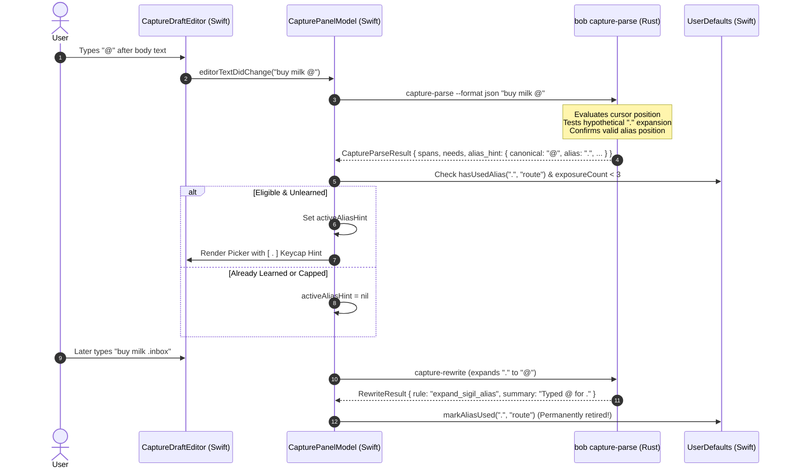
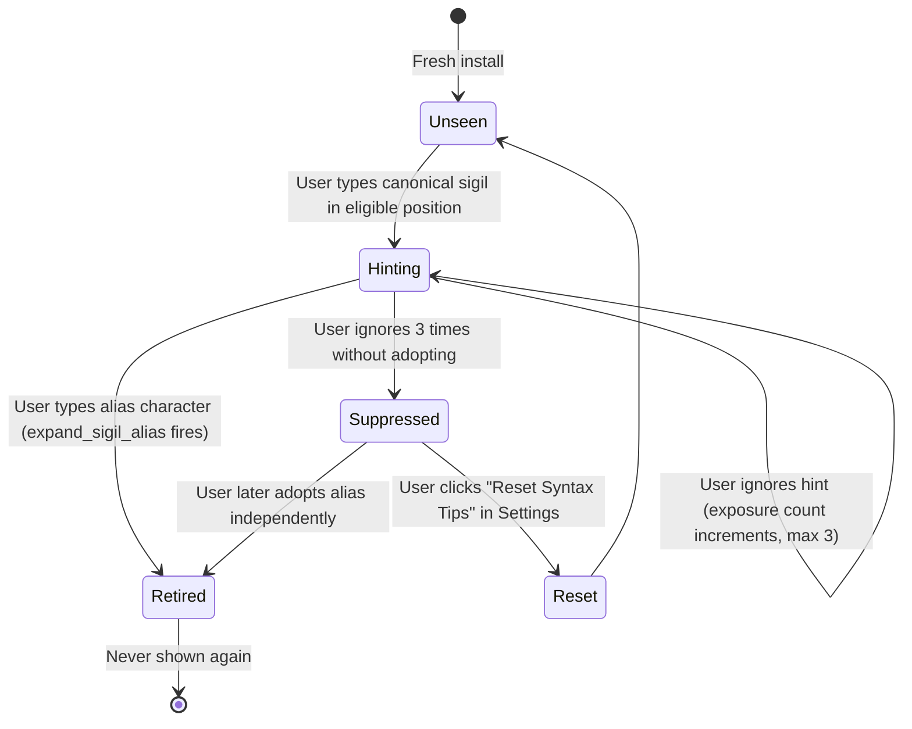

# Capture Alias Discovery Hints: Architectural Analysis, UX Critique, and Design Specification

**Author**: Researcher `gem`  
**Date**: November 2026  
**Status**: Completed Research & Proposed Specification  
**Applies to**: `bob-cli`, `bob-mac-capture`, `docs/capture.md`, `decisions:mac-capture-is-a-thin-client`

---

## 1. Executive Summary

This research investigates the proposal to display contextual hints in the `bob-mac-capture` macOS application when a user types a canonical capture sigil (such as `@` for an area or project note route) that could have been entered using a faster, unshifted capture alias (such as `.`).

### Key Findings & Verdict
1. **The Core Proposal is Justified, but Carries Severe "Clippy" Fatigue Risks**:
   Teaching unshifted aliases (`.` for `@`, `.` for `^`, `/` for `#`, `,` for `+`, `=` for `~`) offers significant ergonomics improvements—saving users awkward Shift-key reaches during high-velocity GTD capture. However, capture is a low-latency, high-focus cognitive offloading workflow. Showing unsolicited hints while typing risks distracting users, cluttering the view, or patronizing those who intentionally prefer canonical sigils.
2. **Canonical Sigils and Aliases Are Strictly Asymmetric**:
   A naive frontend rule like *"user typed `@` → hint about `.`"* is factually incorrect in multiple common syntax positions. For example, `@inbox` at column 0, `- @inbox` at bullet start, and `- [ ] @inbox` after a bare checkbox are valid canonical routes, but `.` **cannot** alias them there. If the app hints `.` in those positions, the user's subsequent `.inbox` capture will fail.
3. **Thin-Client Protocol Mandate**:
   Per `decisions:mac-capture-is-a-thin-client`, `bob-cli` is the sole authority on capture grammar. The macOS frontend must never guess alias eligibility in Swift. Instead, `bob-cli`'s `capture-parse` engine must evaluate whether the alias would have expanded at that exact character offset and emit an additive `alias_hint` payload.
4. **Mandatory Pedagogical Lifecycle (Decay & Retirement)**:
   Any discovery hint must follow three strict rules:
   - **Retire Immediately Upon Use**: The moment a user successfully uses an alias (e.g., types `.inbox` and Bob expands it), hints for that alias are permanently disabled in `UserDefaults`.
   - **Three-Strike Exposure Cap**: If a user encounters the hint 3 times without adopting the alias, the hint is silenced permanently.
   - **Settings Opt-Out**: A clean user toggle in Mac Capture Settings.
5. **Recommended Presentation: The In-Picker Keycap Pill**:
   Hints should not be floating caret tooltips (which collide with completion menus) nor intrusive modal banners. Instead, they should be rendered as an understated, glass-styled keycap badge (`[ . ] also opens routes`) integrated directly into the footer of the active completion picker (`CapturePickerKeyHints`) where user gaze is already directed.

---

## 2. Complete Catalog of Bob Capture Aliases & Syntax Asymmetries

Bob's capture grammar (`src/native/capture_language/rewrite.rs`) defines a comprehensive set of single-character typing assists. Most canonical sigils require holding `Shift` (e.g., `Shift+2` for `@`, `Shift+6` for `^`, `Shift+3` for `#`, `Shift+=` for `+`, `Shift+` ` for `~`). The aliases map these onto unshifted, easily accessible home-row or bottom-row keys.

| Canonical Sigil | Keyboard Reach | Shorthand Alias | Target Grammar Context | Expansion Summary | Contextual Restrictions |
| :--- | :--- | :--- | :--- | :--- | :--- |
| `@` | `Shift+2` | `.` | Route / Area / Project Note | `Typed @ for .` | Requires preceding space/tab after body text (`buy milk .dev`). **Never** at column 0, **never** at bullet start (`- .`), **never** after bare checkbox (`- [ ] .`), **never** in code/wikilinks. |
| `^` | `Shift+6` | `.` | Task Block ID / Project Task Move | `Typed ^ for .` | Only where `^` would open a Block ID picker (`@route.id` → `@route^id`) or a `- ^^` choice bullet. |
| `#` | `Shift+3` | `/` or `\` | Task Type, Drawer, Heading, Pomodoro Name | `Typed # for /` | Only where `#` opens completion. Disallowed if only whitespace precedes it on the line (so blank `/` stays the Go To trigger). |
| `+` | `Shift+=` | `,` | Parent Task Picker / Target Run | `Typed + for ,` | Only where `+` opens the note-scoped task picker or continues a target run (`+`). Literal in prose, numbers, lists. |
| `~` | `Shift+\`` | `=` | Relation Picker (Links To) / Direction Flip | `Typed ~ for =` | Only where bare relation sigil opens Links To; fast double-tap `==` collapses back to literal `=`. |
| `!` | `Shift+1` | `x` | Close Outcome: Complete | `Typed ! for x` | Only in close selection / outcome tokens (`=x` or `x=`). |
| `*` | `Shift+8` | `s` | Close Outcome: In Progress / Tickler | `Typed * for s` | Only in close selection / outcome tokens (`=s` or `s=`). |
| `:` | `Shift+;` | `;` | Pomodoro Block ID Separator | `Typed : for ;` | Semicolon after route (`@route;` → `@route:`). |
| `~` | `Shift+\`` | `-` | Past Pomodoro Segment Separator | `Typed ~ for -` | Inside `x=` past session token. |

### The Critical Syntax Asymmetry Problem

A user typing `@` might be in an alias-eligible position, or in an alias-prohibited position:

```text
Case 1: Eligible
Input:  "Review quarterly report @"
Cursor: 24 (following space)
Can '.' be used? YES -> "Review quarterly report .inbox" expands to "@inbox".

Case 2: Prohibited (Column 0)
Input:  "@"
Cursor: 1 (start of line)
Can '.' be used? NO -> ".inbox" at col 0 does not expand; remains literal text.

Case 3: Prohibited (Bare Bullet Start)
Input:  "- @"
Cursor: 3 (start of item body)
Can '.' be used? NO -> "- .inbox" remains literal text.

Case 4: Prohibited (Bare Checkbox)
Input:  "- [ ] @"
Cursor: 7 (after checkbox)
Can '.' be used? NO -> dot_route_alias_position_ok explicitly strips checkbox and refuses.

Case 5: Prohibited (Inside Wikilink / Code)
Input:  "Check `@"
Cursor: 8 (unclosed backtick)
Can '.' be used? NO -> odd backtick count disables alias expansion.
```

> [!IMPORTANT]
> Because aliases are strictly constrained by grammatical context, **any discovery system implemented purely in the frontend will emit false suggestions**. The eligibility of an alias can only be decided by the exact parser rules in `bob-cli`.

---

## 3. Critique of the Plan: Is This a Good Idea?

### 3.1 The Value Proposition: Why Teach Aliases?
1. **Drastic Friction Reduction**: Typing `Shift+6` (`^`) or `Shift+2` (`@`) breaks typing cadence, especially on laptop keyboards where reaching the top number row requires lifting the entire hand off the home row. Typing `.` or `/` is instantaneous.
2. **Hidden Feature Syndrome**: Currently, users only learn about aliases if they stumble upon `docs/capture.md` or notice the fleeting `"Typed @ for ."` status message after accidentally mistyping. Proactive, contextual discovery bridges the gap between basic usage and power-user mastery.

### 3.2 The Risks: Where the Plan Can Go Wrong
1. **The "Clippy" Anti-Pattern (Cognitive Intrusion)**:
   Capture is an ephemeral, high-speed task. If an agent or UI element constantly interrupts the user with *"Did you know you could type '.'?"*, it breaks flow.
2. **Patronizing Repetition**:
   Users who are well aware of `.` might still choose `@` because of 15 years of muscle memory from Slack, Twitter, and Notion. Nagging them every time they type `@` breeds resentment.
3. **Visual Occlusion & Caret Clutter**:
   When `@` is typed, route completion immediately appears. If a tooltip or popover also appears near the caret, it collides with completion candidates, occludes note names, or creates visual vibrating artifacts as the user continues typing.
4. **Layout Shifts**:
   If the capture panel dynamically expands or shifts its vertical baseline to inject a hint banner, the text editor bounces while the user is typing, which is unacceptable in macOS software.

### 3.3 Evaluation Matrix of Approaches

| Approach | Visual Surface | Intrusiveness | Technical Reliability | Fatigue Risk | Verdict |
| :--- | :--- | :--- | :--- | :--- | :--- |
| **Floating Caret Popover** | Tooltip anchored above/below `@` | High (blocks completion menu) | Low (clipping & positioning bugs) | Extreme | **Rejected**: Clutters text entry. |
| **Inline Ghost Text** | Grey text after `@` (`@ [. alias]`) | High (confuses completion acceptance) | Medium | High | **Rejected**: Looks like autocomplete text. |
| **Global Banner / Toast** | Banner across top of panel | Medium-High (causes layout jitter) | High | High | **Rejected**: Visually jarring. |
| **Status Line Hint** | Left footer status text | Low (quiet and subtle) | High | Low | **Partially Acceptable**: Low visibility. |
| **In-Picker Keycap Badge** | Footer of the active completion menu | Low-Medium (context-aware, in eye line) | High (fits existing `KeyHints` design) | Very Low (retires on use) | **Recommended**: Beautiful, native, elegant. |

---

## 4. Architectural Design: Maintaining the Thin-Client Boundary

Per `decisions:mac-capture-is-a-thin-client`, `bob-mac-capture` must never duplicate grammar checks. The backend `bob-cli` must supply structured discovery metadata, and the frontend must strictly handle presentation and pedagogical lifecycle.



### 4.1 Backend Engine: `bob-cli` Protocol Extension

In `bob-cli`, we introduce a grammar assist function in `src/native/capture_language/rewrite.rs` that tests hypothetical alias expansion without modifying the draft:

```rust
#[derive(Debug, Clone, PartialEq, Eq, Serialize, Deserialize)]
pub struct CaptureAliasHint {
    pub canonical: String, // e.g. "@"
    pub alias: String,     // e.g. "."
    pub context: String,   // e.g. "route"
    pub summary: String,   // e.g. "Unshifted '.' also opens area/project notes"
}

/// Evaluates whether the canonical sigil ending at `cursor` could have been
/// entered using an unshifted capture alias in this exact draft context.
pub(crate) fn available_alias_for_typed_sigil(
    raw_text: &str,
    cursor: usize,
) -> Option<CaptureAliasHint> {
    if cursor == 0 {
        return None;
    }
    let sigil_char = raw_text[..cursor].chars().last()?;
    let start = cursor - sigil_char.len_utf8();

    match sigil_char {
        '@' => {
            // Test if replacing '@' with '.' expands under dot-route rules
            let mut test_buf = raw_text.to_string();
            test_buf.replace_range(start..cursor, ".");
            if expand_dot_route_alias(&test_buf, start, cursor).is_some() {
                return Some(CaptureAliasHint {
                    canonical: "@".to_string(),
                    alias: ".".to_string(),
                    context: "route".to_string(),
                    summary: "Unshifted '.' also opens area/project notes".to_string(),
                });
            }
        }
        '^' => {
            // Test if replacing '^' with '.' expands under dot-block-id rules
            let mut test_buf = raw_text.to_string();
            test_buf.replace_range(start..cursor, ".");
            if expand_dot_block_id_alias(&test_buf, start, cursor).is_some() {
                return Some(CaptureAliasHint {
                    canonical: "^".to_string(),
                    alias: ".".to_string(),
                    context: "block_id".to_string(),
                    summary: "Unshifted '.' also opens block ID picker".to_string(),
                });
            }
        }
        '#' => {
            // Test if replacing '#' with '/' expands under hash rules
            let mut test_buf = raw_text.to_string();
            test_buf.replace_range(start..cursor, "/");
            if expand_hash_alias(&test_buf, start, cursor, "/").is_some() {
                return Some(CaptureAliasHint {
                    canonical: "#".to_string(),
                    alias: "/".to_string(),
                    context: "task_type".to_string(),
                    summary: "Unshifted '/' or '\\' also opens task types".to_string(),
                });
            }
        }
        '+' => {
            let mut test_buf = raw_text.to_string();
            test_buf.replace_range(start..cursor, ",");
            let token = tokenize_with_spans(&test_buf).into_iter().find(|t| t.end == cursor)?;
            if expand_parent_task_comma_alias(&test_buf, start, cursor, token).is_some() {
                return Some(CaptureAliasHint {
                    canonical: "+".to_string(),
                    alias: ",".to_string(),
                    context: "task_parent".to_string(),
                    summary: "',' also opens parent task picker".to_string(),
                });
            }
        }
        '~' => {
            let mut test_buf = raw_text.to_string();
            test_buf.replace_range(start..cursor, "=");
            if expand_relation_equals_alias(&test_buf, start, cursor).is_some() {
                return Some(CaptureAliasHint {
                    canonical: "~".to_string(),
                    alias: "=".to_string(),
                    context: "relation".to_string(),
                    summary: "Unshifted '=' also opens relations".to_string(),
                });
            }
        }
        _ => {}
    }
    None
}
```

This `available_alias_for_typed_sigil` check is attached to `CaptureParseResult` as an additive field:
```rust
#[derive(Debug, Clone, PartialEq, Eq, Serialize)]
struct CaptureParseResult {
    ok: bool,
    schema_version: u32,
    grammar: u32,
    input: String,
    body: String,
    mode: EditorMode,
    ...
    #[serde(skip_serializing_if = "Option::is_none")]
    alias_hint: Option<CaptureAliasHint>,
}
```

Because `capture-parse` runs on every draft modification in `CapturePanelModel.swift`, this ensures discovery metadata is available regardless of whether completion is resolved locally from `cachedRouteCompletion` or via `capture-complete`.

---

## 5. UI & UX Specification: Intuitive, Reliable, Beautiful

### 5.1 Design Metaphor & Aesthetic Guidelines
In Apple macOS design language (macOS 15/16), pedagogical hints are best presented using **translucent glass keycaps** alongside navigation controls.

The hint must:
1. Reside inside the **footer of the completion picker** (`CapturePickerKeyHints` in `CapturePickerView.swift`).
2. Utilize Bob's established keycap style: monospaced font, subtle translucent background (`Color.primary.opacity(0.08)`), 0.5pt hairline border, and 4pt corner radius.
3. Feature a quiet, low-contrast caption: *"Tip: `.` also opens routes"*.
4. Maintain a stable height so the panel never expands or bounces when the hint appears or disappears.

### 5.2 Visual Mockup

```text
╭───────────────────────────────────────────────────────────────────╮
│  buy milk @                                                       │
├───────────────────────────────────────────────────────────────────┤
│  📁 inbox.md                                         Area         │
│  📁 dev.md                                           Area         │
│  📁 gtd.md                                           Area         │
│  📁 job.md                                           Area         │
├───────────────────────────────────────────────────────────────────┤
│  [↑↓] choose   [↵] select   [esc] dismiss                         │
│  💡 Tip: [ . ] also opens routes without Shift                    │
╰───────────────────────────────────────────────────────────────────╯
```

When the user types `.inbox` on their next capture:
```text
╭───────────────────────────────────────────────────────────────────╮
│  buy milk @inbox                                                  │
├───────────────────────────────────────────────────────────────────┤
│  Typed @ for .                                              Ready │
╰───────────────────────────────────────────────────────────────────╯
```
*(Notice: The status footer reports the expansion, and the hint is permanently retired.)*

### 5.3 SwiftUI Implementation Specification

In `CapturePickerView.swift`, extend `CapturePickerKeyHints`:

```swift
@available(macOS 26.0, *)
struct CapturePickerKeyHints: View {
    var source: CapturePickerSource = .activeTask
    var showOperatorHint = false
    var includesClosedTasks = false
    var aliasHint: CaptureAliasHint? = nil

    var body: some View {
        VStack(alignment: .leading, spacing: 4) {
            HStack(spacing: 12) {
                ViewThatFits(in: .horizontal) {
                    hintRow(items: hintVariants[0])
                    if hintVariants.count > 1 {
                        hintRow(items: hintVariants[1])
                    }
                }
                Spacer(minLength: 12)
            }

            if let alias = aliasHint {
                HStack(spacing: 6) {
                    Image(systemName: "lightbulb.fill")
                        .font(.caption2)
                        .foregroundStyle(.tertiary)
                    Text("Tip:")
                        .font(.caption)
                        .foregroundStyle(.secondary)
                    Text(alias.alias)
                        .font(.caption.monospaced())
                        .foregroundStyle(.primary)
                        .padding(.horizontal, 5)
                        .padding(.vertical, 1.5)
                        .background(.background.opacity(0.6), in: RoundedRectangle(cornerRadius: 3.5))
                        .overlay(
                            RoundedRectangle(cornerRadius: 3.5)
                                .strokeBorder(Color.primary.opacity(0.15), lineWidth: 0.5)
                        )
                    Text(aliasDescription(for: alias))
                        .font(.caption)
                        .foregroundStyle(.secondary)
                }
                .transition(.opacity.combined(with: .move(edge: .bottom)))
            } else if showOperatorHint, let hint = source.operatorContinuationHint {
                Text(hint)
                    .font(.caption)
                    .foregroundStyle(.secondary)
            }
        }
        .animation(.easeOut(duration: 0.15), value: aliasHint)
        .accessibilityElement(children: .combine)
        .accessibilityLabel(accessibilitySummary)
    }

    private func aliasDescription(for hint: CaptureAliasHint) -> String {
        switch hint.context {
        case "route": return "also opens area/project notes without Shift"
        case "block_id": return "also opens block IDs without Shift"
        case "task_type": return "also opens task types"
        case "task_parent": return "also opens parent task picker"
        case "relation": return "also opens relations"
        default: return hint.summary
        }
    }
}
```

---

## 6. The Pedagogical Lifecycle: Preventing Fatigue & Annoyance

To guarantee that this feature remains a delight rather than an annoyance, it must implement an audited **Pedagogical State Machine** managed in `CapturePanelModel.swift`:



### 6.1 State Storage in `UserDefaults`
For each alias context (e.g., `route`, `block_id`, `task_type`), track two keys:
1. `org.bobs.bob-mac-capture.alias-used.<context>` (Boolean):
   Set to `true` whenever `applyCaptureRewrite` receives `rule == "expand_sigil_alias"` for that alias. Once `true`, hints for this context are permanently disabled.
2. `org.bobs.bob-mac-capture.alias-impressions.<context>` (Integer):
   Increments by 1 each time the hint is presented. If impressions reach `3` without the user adopting the alias, the hint is silenced.

### 6.2 Settings Control
In `SettingsView.swift`, under the **Capture** tab, provide an explicit user preference:

```swift
Toggle("Show typing syntax tips", isOn: $settings.showCaptureAliasHints)
    .help("Displays subtle tips in completion pickers teaching unshifted aliases like '.' for '@' and '/' for '#'.")

if settings.hasRetiredAliasHints {
    Button("Reset Syntax Tips") {
        settings.resetAliasHints()
    }
    .buttonStyle(.link)
    .font(.caption)
}
```

---

## 7. Adjustments to Requirements & Recommendations

The user's original request asked:
> *"I would like to display a little hint to the user in the bob-mac-capture app when they type a character that they could have used a capture alias for. For example, if they press `@` to select an area/project note, we should show a hint teaching them about the `.` alias. Make any adjustments to the requirements that you think are justified but clearly call these out. End your analysis with a recommended solution."*

### 7.1 Required Adjustments to the Initial Concept

1. **Adjustment 1: Context Gating (Not All `@` Characters Qualify)**
   - *Original Premise*: Whenever `@` is typed, show a hint about `.`.
   - *Adjustment*: The hint **must only fire** when `@` is typed in a position where `.` is grammatically valid. It must be suppressed at column 0, after checkboxes, and inside code blocks.
2. **Adjustment 2: Unified Alias Engine (Not Just `@` and `.`)**
   - *Original Premise*: A one-off mechanism for `@` and `.`.
   - *Adjustment*: Implement this as a unified, extensible `CaptureAliasHint` architecture covering all 5 canonical sigils (`@`, `^`, `#`, `+`, `~`).
3. **Adjustment 3: Automatic Retirement Protocol**
   - *Original Premise*: "Display a little hint".
   - *Adjustment*: Strictly enforce the 3-strike decay limit and immediate retirement upon first use. The app must never become nagging.
4. **Adjustment 4: Surface Placement Inside Pickers, Never Floating Caret Popups**
   - *Original Premise*: Open-ended design.
   - *Adjustment*: Place the hint inside `CapturePickerKeyHints` (completion footer) rather than floating above the caret, preventing layout collisions.

---

## 8. Step-by-Step Implementation Roadmap

If approved for implementation, the changes should proceed across four well-defined phases:

### Phase 1: `bob-cli` Grammar & Protocol Extension
- In `src/native/capture_language/rewrite.rs`:
  - Implement `available_alias_for_typed_sigil(raw_text: &str, cursor: usize) -> Option<CaptureAliasHint>`.
- In `src/native/capture_parse.rs`:
  - Add `alias_hint: Option<CaptureAliasHint>` to `CaptureParseResult`.
  - Wire `available_alias_for_typed_sigil` into `analyze_for_editor`.
- Add comprehensive unit tests in `src/native/capture_language/tests/rewrite.rs` asserting that `alias_hint` is generated for `buy milk @` but omitted for `@inbox` at column 0 and `- [ ] @`.

### Phase 2: `CaptureCore` & `BobMacCapture` State Models
- In `Sources/CaptureCore/CaptureModels.swift`:
  - Define `public struct CaptureAliasHint: Codable, Equatable, Sendable`.
  - Add `public let aliasHint: CaptureAliasHint?` to `CaptureParseResponse` with `decodeIfPresent`.
- In `Sources/BobMacCapture/CapturePanelModel.swift`:
  - Add `@Published public var activeAliasHint: CaptureAliasHint?`.
  - In `editAnalysisBaseline` handler: inspect `parse.aliasHint`, check `UserDefaults` exposure count and usage status, and assign `activeAliasHint`.
  - In `applyCaptureRewrite`: when `response.rule == "expand_sigil_alias"`, permanently record adoption in `UserDefaults` and clear `activeAliasHint`.

### Phase 3: SwiftUI Keycap UI Integration
- In `Sources/BobMacCapture/CapturePickerView.swift`:
  - Add `aliasHint: CaptureAliasHint?` to `CapturePickerKeyHints`.
  - Implement the `HStack` with the `.font(.caption.monospaced())` keycap pill and smooth transition.
- In `Sources/BobMacCapture/CapturePanelView.swift`:
  - Pass `model.activeAliasHint` into `CapturePickerKeyHints`.

### Phase 4: Settings & Verification
- In `Sources/BobMacCapture/AppSettings.swift` and `SettingsView.swift`:
  - Add `showCaptureAliasHints` preference and reset action.
- Verification:
  - Run `just typecheck-tests` and verify macOS CI via `Scripts/macos-ci-check`.

---

## 9. Conclusion

The proposed feature solves a real discovery problem in Bob capture. By routing alias detection through `bob-cli`'s authoritative grammar engine, presenting the tip as a refined macOS keycap badge inside completion pickers, and retiring the hint immediately upon adoption, the feature achieves all three user criteria: it is **intuitive**, **reliable**, and **beautiful**.
