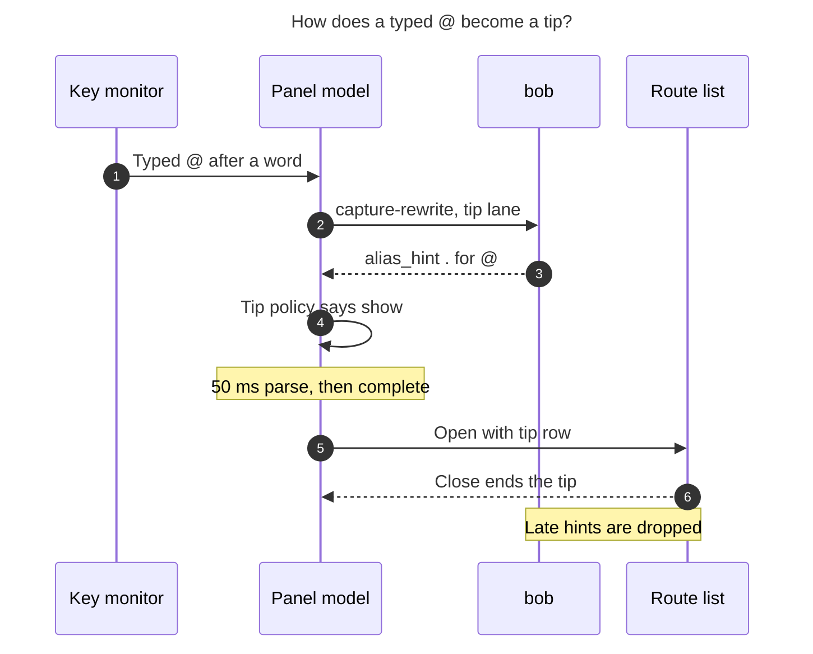

# Capture Alias Tips in Bob Mac Capture — Research, Critique, and Recommendation (cld)

**Question.** When Bryan types a sigil that a capture alias could have produced, should
Bob Mac Capture show a small hint, and how should it be built? For example, typing
`@` could teach the `.` alias.

**Short answer.** Yes, build it, but not as a lookup table from character to alias.
The rules for each alias depend on context. Bryan's own example is wrong for leading
routes: `.` stays literal at an item start, so `@errands Buy milk` must never get a `.`
tip. A tip that is wrong even occasionally teaches bad habits and costs trust. The
design I recommend has five parts:

1. **bob proves each tip.** bob checks the alias in reverse with the same function
   that performs the forward alias (`expand_sigil_alias`). It answers "if you had pressed
   `.` instead of `@` here, would bob have produced exactly this draft?" A tip is shown
   only when the answer is yes, byte for byte.
2. **Only a Shift-typed sigil triggers a tip.** Every alias exists to save a Shift. The
   tip fires only when Shift was actually pressed and was not needed.
3. **The tip appears in the surface the sigil opened.** That is the route list, the
   picker footer, or the Close card caption. It is never a toast or a status message,
   and it appears in that surface's first frame or not at all.
4. **Tips taper off.** Tips are frequent at first and space out when ignored. They stop
   for an alias once Bryan uses it fluently, return gently if he slips, and never appear
   more than once per capture.
5. **The tip is one quiet line.** It reads `Next time  [.] → @  after a word`, with the
   keycap and the sigil in the sigil's own editor color.

Section 10 gives the full recommended solution.

---

## 1. What I examined

- **bob-cli.**
  - `src/native/capture_language/rewrite.rs`: `rewrite_draft` at line 89, the
    `expand_sigil_alias` dispatcher at line 141, `finish_sigil_alias` at line 966, and
    the comma alias at lines 695–780.
  - `src/native/capture_rewrite.rs`, the JSON contract.
  - `docs/capture.md`, section "`bob capture-rewrite`" and "Sigil alias", lines
    9100–9400.
- **bob-mac-capture.** A delegated, read-only code sweep, with these spots checked by
  hand:
  - The key-down intent filter, `CapturePanelController.swift:1214-1311`, with the
    allowed key list at 1258–1262.
  - The completion gate that waits for the rewrite lane,
    `CapturePanelModel.swift:16709-16715`.
  - The 50 ms analysis debounce, `CapturePanelModel.swift:1575`.
  - The picker footer `CapturePickerKeyHints`, `CapturePickerView.swift:1297`.
  - The completion-list footer, `CapturePanelView.swift:3483-3497`.
  - The Close card hint tokens, `CapturePomodoroClosePresentation.swift:748-800`.
  - The picker-used flags in UserDefaults, `CapturePickerPresentation.swift:818-845`.
  - The alias-armed relation footer copy, `CapturePanelModel.swift:1855-1864`.
  - `docs/capture-panel.md` and `docs/keyboard.md`.
- **Memory.**
  - Glossary: *Capture Alias*, *Capture*, *Bulk Capture*, *Project Note Capture*.
  - Decisions: `mac-capture-is-a-thin-client`, `capture-sigils-say-where-what-how`,
    `relation-equals-alias-and-flips`, `similar-tasks-are-a-settled-heads-up`,
    `idle-capture-shows-ledger-agenda`.
- **Prior research (not from this swarm).**
  `202611/close_outcome_x_s_typing_aliases/…__mus.md` says the `x`/`s` aliases "would be
  invisible unless error text, `capture-rewrite` help, and `keyboard.md` name them".
  That flags the discoverability gap this feature closes.
- **Prior art.** Emacs `suggest-key-bindings`, IntelliJ Key Promoter X, Superhuman's
  shortcut nudges, KeyRocket, and the HCI literature on learning hotkeys (Sources at the
  end).

---

## 2. How aliases work today, and what that means for tips

### 2.1 The alias inventory, from the typed sigil's side

The tip feature works backwards from today's aliases: it starts from the sigil
Bryan typed. Every row below is an alias bob already performs.

| Shifted sigil typed | Unshifted alias | Where the alias fires (bob decides) | Surface that opens |
|---|---|---|---|
| `@` | `.` | After body text plus a space or tab, wherever a bare `@` opens route completion | Route completion list |
| `^` | `.` | Right after `@route`, where the Block ID picker opens; `- ^` move bullets | Block ID picker / Move picker |
| `:` | `;` | Right after `@route`; a whole-item `:` (Task Link); `- :` move bullets | Block ID / Task Link / Move picker |
| `+` | `,` | Wherever the Parent Task picker opens, including a whole item and after `@route` | Parent Task picker |
| ` +` (space then `+`) | `,` | Glued to a complete `@route+id` target, for the next parent | Parent Task picker |
| `#` | `/` or `\` | Wherever a `#` menu opens: type, section, drawer, Pomodoro name, wikilink heading, … | `#` menus |
| `~` | `=` | After a space or tab, where Links To opens | Relation (Links To) picker |
| `~` (second) | `=` | After a bare `~`, flipping to `~~` (Linked From) | Relation picker |
| `~` | `-` | Inside an `x=` past token | Past-segment list |
| `!` | `x` | Ending a close selection (`xx` → `x!`) | Close card |
| `*` | `s` | Ending a close selection (`xs` → `x*`) | Close card |

Every alias saves a Shift on a US keyboard. The real sigils `@ ^ : + # ~ ! *` all need
Shift, and the alias keys `. ; , / \ = - x s` do not. That makes a clean, testable
trigger rule (§4, A3).

### 2.2 Six facts that constrain the design

1. **Eligibility depends on context, and only bob knows it.**
   - The alias rules depend on line starts, glued words, backtick spans, wikilinks,
     template drafts, `#"…"` literals, close-slot lexing, and completion-grammar
     contexts.
   - The decision `mac-capture-is-a-thin-client` says the app "never decides syntax
     itself". A Swift table of sigil-to-alias pairs would be a second, partial grammar.
     That is the root cause the decision exists to prevent.
2. **`@` at an item start has no alias.** `.` stays literal there (`.bashrc`), after a
   checkbox, glued to a word, and inside code spans and wikilinks. Many captures use a
   leading route, so the requested example would mislead whenever the `@` leads.
3. **The app never sees a real `@`, `#`, `!`, or `*` keystroke today.**
   - The key-down intent filter only allows `: ^ + | , . ; - = ~`
     (`CapturePanelController.swift:1258-1262`). `docs/capture-panel.md:207` says
     plainly that "`@` itself is never a rewrite key".
   - Typing `^`, `:`, or `+` already calls `capture-rewrite` for separator toggles, and
     usually comes back `changed: false`.
   - So tips need one small new capability: noticing a physical, Shift-typed sigil.
4. **The rewrite lane is delicate.** It has escape arms, the 350 ms double-tap window,
   probes, and type-ahead holds. Recent history is full of race fixes, for example
   `0f6753b … isolate probe and replay races` and `1e0a092 … repair fast == escape and
   record race`. Completion also waits for that lane (`CapturePanelModel.swift:16709`).
   Tips must not add state to this lane or latency to it.
5. **Every alias-produced surface already has a teaching line.**
   - The completion list footer: `⇥ take the first · type a letter · ⏎ capture as
     typed`.
   - The picker key-hint footer: keycap rows, plus an operator hint when the filter is
     empty.
   - The Close card caption: `x* parks all · x! completes all · …`.
   - When an *alias* opened the relation picker, the footer already swaps in escape copy
     (`== types = · ~ flips`). The reverse case (a *sigil* opened it, so teach the alias)
     is the natural mirror.
6. **There is a precedent for "teach until used".** Per-picker booleans in UserDefaults
   (`org.bobs.bob-mac-capture.<source>-picker-used`) hide teaching lines after first
   use. App-local learning state is already accepted as presentation state.

---

## 3. Is this a good idea? Critique

### 3.1 Why it is worth building

- **Aliases are invisible by design.** A successful alias leaves no trace: the draft
  shows `@`, not `.`. The only way to discover one today is to read `keyboard.md` or the
  glossary, which nobody does mid-capture.
- **The alias set keeps growing, and the rules are subtle.** Over the last few weeks
  these arrived: `.`→`@`, `.`→`^`, `;`→`:`, `,`→`+`, `\`/`/`→`#`, `=`→`~`, `-`→`~`, and
  `x`/`s`→`!`/`*`. Each has its own context rules. Muscle memory trails the feature set.
- **Teaching at the moment of use is the established pattern for building expert habits.**
  - Emacs has shipped `suggest-key-bindings` for decades. It shows the equivalent key in
    the echo area for 2 seconds after `M-x`.
  - IntelliJ's Key Promoter X shows a notification when you click something that has a
    shortcut.
  - Superhuman nudges you toward the shortcut after a mouse action.
  - KeyRocket did the same for Office.
  - Grossman, Dragicevic and Balakrishnan (CHI 2007) argue that the move to expert use
    "can be accelerated by manipulating feedback and cost associated with menu
    selection".
- **The cost is small if done the right way.** Most of the work is one inverse function
  in bob, one non-blocking subprocess lane in the app, and one view component.

### 3.2 What could make it a bad idea, and the mitigation for each

| Risk | Why it matters | Mitigation in this design |
|---|---|---|
| **A wrong tip.** For example, `.` taught at an item start, `/` taught inside a wikilink path, or `,` taught where commas are prose. | One false tip teaches a habit that later produces literal `.`, `/`, or `,` in captures. Trust collapses fast. | bob's inverse check runs the real forward rewrite, so a tip is shown only if the alias would provably have produced the same draft. A completeness test ties every forward alias fixture to its inverse (§6.1). |
| **Nagging.** The Clippy effect. | A tip on every `@` forever becomes noise and gets turned off. | Graduation, Fibonacci spacing, at most one tip per capture, and a Settings switch (§6.4). |
| **Visual noise in a dense panel.** | The panel already has an agenda, a preview, Similar Tasks, pickers, and key hints. | The tip uses the teaching line the surface already has, takes a single line, has no buttons, and costs zero pixels when not shown. |
| **Latency.** | Picker opening is the hottest path in the app. | A separate fire-and-forget lane. The tip never gates completion, preview, or Return. A late tip is dropped. |
| **Misreading the tip as a command.** | Picker footers are full of keycaps that mean "press this now". | The tip starts with "Next time" and uses a distinct, sigil-tinted keycap. |
| **Two-repo cost.** | Every capture feature lands twice, and the Mac half is gated by macOS CI. | The bob half is small and testable on Linux. The Mac policy lives in `CaptureCore`, which `portable-check` can type-check. |

### 3.3 Would I take a different approach?

I would keep Bryan's core idea, teaching after the fact at the moment of use, and
change four things:

1. **bob proves the tip; the app does not guess.** No static table in Swift.
2. **The trigger is a Shift-typed sigil, not "a character".** That captures exactly
   "you paid for a Shift you didn't need".
3. **Learning has an end.** The tip graduates per alias instead of firing on every
   occurrence.
4. **The tip lives in the surface the sigil opened.** No notification, toast, or status
   message: it sits where Bryan is already looking.

I considered and rejected a purely *ambient* design, which would show every
picker's alias permanently, like a `.` keycap in the route list header. It needs no
state, but it is permanent noise for something learned once, it competes with the
key-hint rows, and it misses the moment that matters. A small *reflective* companion
is worth keeping as an optional later phase: a Settings list of aliases with a
"learned" mark, in the spirit of Skillometers.

---

## 4. Proposed adjustments to the requirements (explicit call-outs)

| # | Type | Adjustment | Rationale |
|---|---|---|---|
| A1 | **ADJUSTED** | "A character they could have used an alias for" becomes: **a Shift-typed sigil keystroke where bob confirms the alias would have produced the same draft and caret.** | Keeps tips truthful under the context rules (§2.2), and the thin-client decision requires that bob decide. |
| A2 | **ADJUSTED** | The `@` example applies **only after body text plus a space or tab**, never to a leading `@route`. | `.` is literal at an item start, so a tip there would teach something false. |
| A3 | **ADDED** | Only *physical* keystrokes count: never paste, picker accept or continuation, Undo or Redo, a sigil produced by an alias, or programmatic `setPlainDraft`. The key must have been typed **with Shift**. | Teaching only makes sense for a choice Bryan just made with his fingers, and Shift is the cost the alias removes. This also quietly skips layouts where the sigil needs no Shift. |
| A4 | **ADDED** | **Graduation and spacing:** at most one tip per capture. Tips space out when ignored, stop when the alias is used fluently, and return gently after a lapse. | Without this the feature becomes nagging within a week. |
| A5 | **ADDED** | The tip **lives in the surface the sigil opened**, appears in its **first frame or never**, and ends when that surface closes. No timers, no toasts, no status-line takeover. | It is where Bryan's eyes are. There is no pop-in, no layout jump, and nothing for the editor's fixed eye line to fight. |
| A6 | **ADDED** | A Settings switch, **"Teach capture aliases"** (on by default), plus **"Reset alias tips"**. | Every heads-up feature in the app has an off switch (compare "Show similar tasks while capturing"). |
| A7 | **DROPPED for v1** | No tips for aliases that sit next to the 350 ms double-tap escapes: the `~`→`~~` flip (`=` after `~`) and the `- ^^` move choice (`.` after `- ^`). | Teaching "`=` after `~`" invites `==`, and a fast `==` types a literal `=`. The interaction needs its own look before it is taught. |
| A8 | **DROPPED** | No tip for the app-local blank-draft `\` → `/` (Go To). | Both keys are unshifted, so nothing is saved. It is not a sigil alias in bob's sense. |
| A9 | **ADDED** | The tip text says **where**, not **why**: "after a word", "right after a route", "at an item start". | The same sigil serves several purposes in one spot. A lone `+` opens the Parent Task picker *and* starts `+2`, so purpose copy ("for a parent task") would mislead during `+2`. |
| A10 | **ADDED** | **Old-bob behavior is silent.** No `alias_hint` field means no tips and no "update bob" message. | Showing an upgrade nag for a nicety is itself noise. |

---

## 5. Design options considered

### 5.1 Who decides eligibility?

| Option | Verdict |
|---|---|
| A static Swift table of sigils and the alias keys that produce them. | **Rejected.** It is wrong at item starts, in wikilinks, in templates, and in close slots, and it breaks the thin-client decision. |
| bob, with a hand-written list of "hint rules" that mirror each alias. | **Rejected.** It is a second copy of every alias condition and will drift. |
| **bob, using an inverse check through the forward rewrite.** | **Chosen.** It is correct by construction, and every alias fixture also tests its tip. |

### 5.2 Where does the request go?

| Option | Verdict |
|---|---|
| Add the hint to `capture-complete`, which already runs when the picker opens. | **Rejected.** Completion runs on the 50 ms-debounced draft. Fast typing (`@er` within 50 ms) means the snapshot is no longer the post-key draft, and aliases are defined on the post-key draft (`.` must end its token). The check would not be exact. |
| Add `@ # ! *` to the existing rewrite lane. | **Rejected.** Completion waits for that lane, and the lane's arm, probe, and hold machinery is race-prone. |
| A new `bob capture-alias-hint` command. | Workable, but it adds a protocol name. The field fits `capture-rewrite` naturally ("typing assists"). |
| **An additive `alias_hint` field on `capture-rewrite --cursor` (`changed: false`), called from a separate, non-blocking app lane.** | **Chosen.** Exact post-key snapshot, no new command, and isolated from rewrite-lane state. It costs about 5 ms per Shift-typed sigil (the Mac spawn measured 4.7 ms in the Similar Tasks work), off the critical path. |

### 5.3 Where does the tip render?

| Option | Verdict |
|---|---|
| A macOS notification or a floating toast. | **Rejected.** Wrong place and wrong urgency, and it fights the HUD-like panel. |
| The panel footer status line. | **Rejected.** It clobbers real status ("Bob did not answer; press Return again") and moves VoiceOver focus on every announcement. |
| A tooltip anchored at the caret, pointing at the typed `@`. | Charming, but the editor is a SwiftUI `TextEditor` with no glyph-rect plumbing (no `firstRect` or caret-rect code exists). That is high risk for v1. Revisit later. |
| **The surface the sigil opened: the completion list footer, the picker key-hint footer, or the Close card caption.** | **Chosen.** It is where the eye already is, the slots already exist, and there is one view component. |

### 5.4 How often?

| Option | Verdict |
|---|---|
| Every time, like Emacs or Key Promoter X. | **Rejected.** It is the most common complaint about those tools (Key Promoter X added click thresholds, per-action suppression, and snooze). |
| Once ever per alias. | **Rejected.** One exposure rarely builds a motor habit. |
| **Spaced repetition that ends when the alias is used fluently.** | **Chosen.** Frequent early, sparse when ignored, gone when learned, and back after a lapse. |

---

## 6. Recommended design

### 6.1 bob-cli: the inverse check and its contract

**Algorithm.** It is lexical and read-only, like the rest of `capture-rewrite`.

```rust
// rewrite.rs, next to expand_sigil_alias.
// Pairs are (what the user typed, the alias key that would have produced it).
const HINTABLE_ALIASES: &[(&str, &str)] = &[
    ("@", "."), ("^", "."), (":", ";"), ("+", ","), (" +", ","),
    ("#", "/"), ("#", "\\"), ("~", "="), ("~", "-"), ("!", "x"), ("*", "s"),
];

pub(crate) fn alias_hint(raw: &str, cursor: usize) -> Option<AliasHint> {
    if template::analyze(raw).directive.is_some() { return None; }
    let mut hit: Option<AliasHint> = None;
    for (typed, key) in HINTABLE_ALIASES {
        let Some(start) = cursor.checked_sub(typed.len()) else { continue };
        if raw.get(start..cursor) != Some(*typed) { continue; }
        let mut candidate = raw.to_string();
        candidate.replace_range(start..cursor, key);
        // Run the WHOLE rewrite pipeline, not just expand_sigil_alias, so that
        // earlier branches (separator toggles, label attach, …) keep precedence
        // exactly as they would for the real keystroke.
        let r = rewrite_draft(&candidate, Some(start + key.len()));
        if r.rule == Some(RewriteRule::ExpandSigilAlias)
            && r.text == raw
            && r.cursor == Some(cursor)
            && r.alias.is_some_and(|a| a.id.is_hintable())
        {
            hit.get_or_insert_with(|| AliasHint::new(r.alias.unwrap(), start..cursor))
               .keys.push(key);
        }
    }
    hit
}
```

- **Alias ids.** Change `finish_sigil_alias`, and the ` +` and double-flip finishers,
  to stamp a stable `AliasId` on `DraftRewrite`. Each branch already knows which rule
  fired. Proposed ids:
  - `route_after_text`, `block_id_after_route`, `link_after_route`, `task_link_item`,
    `move_bullet`
  - `parent_task`, `next_parent`, `hash_menu`, `relation`, `past_segment`
  - `close_complete`, `close_park`
  - Not hintable in v1: `relation_flip`, `move_choice`
- **Why the inverse is exact.** The forward rewrite is a local edit: one alias byte
  becomes one sigil byte, or `,` becomes ` +`. So the inverse only has to try suffixes
  of length 1 or 2 ending at the caret, and every try runs the real forward code.
  There is no separate grammar to keep in sync.
- **Completeness test.** This is the reliability guarantee. Route every existing
  forward fixture that asserts `rule: expand_sigil_alias` through a helper that also
  asserts `alias_hint(output, output_cursor)` returns that alias key, unless the id is
  on an explicit, reasoned exclusion list (A7). A future alias added without a
  `HINTABLE_ALIASES` entry then fails CI. Add negative fixtures as well:
  - a leading `@route`
  - `foo@bar` (an email address)
  - a `#` heading or drawer at a line start
  - `[[folder/`
  - a standalone `!` or `*` (pickers, but no alias)
  - a template draft
  - `#"…"` literals
  - a glued `~`
- **JSON contract.** Additive, and `schema_version` stays 1.
  - With `--cursor` and `changed: false`, the optional `alias_hint` field:

    ```json
    "alias_hint": {
      "id": "route_after_text",
      "sigil": "@",
      "keys": ["."],
      "range": { "start": 9, "end": 10 },
      "where": "after a word"
    }
    ```

    `keys` is in bob's order of preference. For `#` it is `["/", "\\"]` when both work
    and `["\\"]` when only `\` works. `range` covers the typed sigil (2 bytes for
    ` +`). `where` is the short, bob-authored location phrase (A9).
  - With `rule: expand_sigil_alias`, the optional field
    `"alias": {"id": "route_after_text", "key": ".", "sigil": "@"}`. The app uses it to
    count adoption without parsing `summary`.
- **Human output.** One dim line, `alias hint: . → @ after a word`, after the existing
  `no rewrite` line.
- **Docs.** In bob-cli `docs/capture.md`, add an "Alias hints" paragraph under
  `capture-rewrite` and list both new fields in the JSON section.
- **Glossary.** The *Capture Alias* strand needs one sentence about tips. The
  implementer must route that change through `/sase_memory_write`.

**Proposed `where` phrases.** bob owns these; they describe position, not purpose.

| id | Tip as rendered |
|---|---|
| `route_after_text` | `Next time  [.] → @  after a word` |
| `block_id_after_route` | `Next time  [.] → ^  right after a route` |
| `link_after_route` | `Next time  [;] → :  right after a route` |
| `task_link_item` | `Next time  [;] → :  at an item start` |
| `move_bullet` | `Next time  [.] → ^  on a move bullet` (or `[;] → :`) |
| `parent_task` | `Next time  [,] → +  here` (or `at an item start` / `right after a route`, by context) |
| `next_parent` | `Next time  [,] → ␣+  after a parent` |
| `hash_menu` | `Next time  [/] → #  where # opens a menu` |
| `relation` | `Next time  [=] → ~  after a space` |
| `past_segment` | `Next time  [-] → ~  inside x=` |
| `close_complete` | `Next time  [x] → !  ending a close` |
| `close_park` | `Next time  [s] → *  ending a close` |

### 6.2 bob-mac-capture: noticing the keystroke and the tip lane

1. **Sigil intent.** In the existing key-down monitor, which already runs for every
   pass-through key, record a `ShiftedSigilIntent` (char, timestamp, expected post-key
   draft, caret). Conditions:
   - `characters ∈ {@ ^ : + # ~ ! *}`
   - `.shift` is in the modifier flags, and Command, Control, and Option are not
   - not a key repeat
   - a collapsed selection
   - no marked text
   - no modal field focused

   This is the same gate as `noteSeparatorToggleIntentIfEligible`, but it is a separate
   struct, so the rewrite lane's intent stays untouched.
2. **Matching.** In `editorTextDidChange`, the intent counts only if the new draft
   equals its expected draft. This is the same proof of physical typing the separator
   intent already uses, so paste, accepts, Undo, and alias outputs never match.
3. **Tip lane.** Launch `capture-rewrite --cursor N -f json -- <post-key draft>` on a
   new `"alias-tip"` lane.
   - It never gates completion, preview, Similar Tasks, or Return.
   - It has a short timeout (500 ms).
   - Each new intent replaces the one in flight (latest wins).
   - It is skipped when tips are off in Settings.
   - The lane reads only `alias_hint`. It never applies edits, even if bob happens to
     answer `changed: true` (for example a separator toggle that the main lane is
     applying anyway).
4. **Binding.** A returned hint stays valid while both of these hold:
   - The draft prefix through `range.end` is unchanged.
   - Either no surface has opened since the keystroke (the hint is held), or the
     surface that opened after the keystroke is still the same instance.

   The hint is offered to the **first frame** of the next surface. If that surface is
   already visible when the hint arrives, the hint is dropped and not counted. In
   practice the hint wins easily: a 5 ms spawn against at least 50 ms of debounce plus
   parse plus completion before a list opens.
5. **Adoption counting.** When the main lane applies a rewrite whose `alias.id` is
   present, record an *alias use*. If that rewrite is escaped (Undo, the fast `..` or
   `==`, or a Space or Escape restore), remove the use and silence that id for the rest
   of the capture: Bryan just rejected it on purpose.
6. **Lane isolation.** All eight sigils go through the tip lane, even `^ : +`, which
   also trigger a main-lane call. The duplicate call costs about 5 ms and keeps the tip
   feature completely out of the rewrite lane's arms, probes, and holds. That lane's
   recent bug history is the deciding factor here.



*Figure 1. The tip request runs beside the normal picker path, never in front of it.
bob's answer joins the first frame of the surface the sigil opened, or it is dropped.*

### 6.3 The tip itself: making it beautiful

**Anatomy.** One line, left-aligned to the surface's existing text inset:

```
 Buy milk @▌
 ┌───────────────────────────────────────────────┐
 │ ● errands               area · 14 open        │
 │   cash                  project · 6 open      │
 │   home                  area · 9 open         │
 │ ⇥ take the first · type a letter · ⏎ capture as typed
 │ Next time  ╭───╮ → @  after a word            │  ← tip row (only when live)
 │            │ . │                              │
 │            ╰───╯                              │
 └───────────────────────────────────────────────┘
```

(The keycap is drawn inline at caption height. The box above only shows its parts.)

- **"Next time".** `.caption`, `.secondary`. This makes the tip read as advice for the
  future, never as a key to press now. That matters because every other keycap in a
  picker footer is a live command.
- **Keycap.** The house keycap style everyone already knows: `.caption.monospaced()`,
  padding 6/2, corner radius 4, a 0.5 pt hairline. One difference: the hairline and an
  8% fill are tinted with the **color of the sigil it produces** (route accent for `@`,
  indigo for `^`, mint for `~`, green for `!`, teal for `*`, and so on, from
  `CaptureEditorPalette`).
- **`→ @`.** The arrow in `.secondary`, then the sigil in `.caption.monospaced()`
  semibold, in exactly the color the editor uses for that span. The tip quietly connects
  the unshifted key to the colored glyph Bryan just watched appear in his draft.
- **`after a word`.** bob's `where` phrase, in `.secondary`.
- **No icon, no close button, no link.** The keycap is the visual anchor. An icon would
  turn a whisper into a badge.

**Placement per surface.** One shared `CaptureAliasTipRow` view in three hosts:

| Surface | Host slot |
|---|---|
| Completion list (`@`, `#` menus, past segment) | A new last row inside the card, under `completionFooter`. The card sits in the auxiliary area below the editor, so the caret never moves. |
| Picker cards (Block ID, Task Link, Parent Task, Links To, Move) | A line in the `CapturePickerKeyHints` VStack, under the key rows. It goes through the existing measured-footer path (`updateMeasuredFooterHeight`), so the layout planner accounts for it. |
| Close card (`x!`, `x*`) | It takes over the caption row's hint tokens while it is live. The static copy (`x* parks all · x! completes all …`) returns when the tip ends. |

**Motion.** The tip is part of the surface's first frame, so it inherits the surface's
own appearance and has no separate pop-in. Nothing moves later. With Reduce Motion on
there is no animation at all.

**Light, dark, and contrast.** All colors are semantic palette entries plus
`.secondary`, so both appearances and Increase Contrast work with no new assets.

**Accessibility.** Append "Next time, period types at sign after a word" to the
surface's accessibility label. Never route the tip through `announceStatus`, which moves
VoiceOver focus.

**Hover.** `.help("Alias tips can be turned off in Settings › Capture")`. The tip is
not focusable and binds no keys.

### 6.4 Tip policy and the learning ledger (app-owned presentation state)

Keep the policy a **pure function in `CaptureCore`** (`AliasTipPolicy`), so
`portable-check` and unit tests cover it without AppKit.

- **Per-id ledger.**
  - `recent`: the last 8 outcomes, where alias use = 1 and Shift-typed sigil = 0.
  - `eligibleSinceTip`
  - `tipsShown`
- **Show a tip only when all of these hold:**
  1. Settings → "Teach capture aliases" is on (the default).
  2. No tip has been shown yet in this panel session (one capture).
  3. The id was not silenced this session by an escaped or undone alias.
  4. The id is **not fluent**. Fluent means `recent.count ≥ 4` and the alias share is
     at least 75%. Fluency is recomputed on every event, so a lapse brings tips back.
  5. The id is **due**: one of its first 3 eligible occurrences, or else
     `eligibleSinceTip ≥ fib(tipsShown)`. That gives gaps of 2, 3, 5, 8, then 13
     (capped), so an ignored tip fades to about one in 13.
- **Recording.**
  - Every eligible Shift-typed sigil records a 0 and increments `eligibleSinceTip`,
    whether or not a tip shows.
  - Every applied, non-escaped alias records a 1.
  - Showing a tip increments `tipsShown` and resets `eligibleSinceTip`.
  - A dropped late tip counts as eligible but **not** as shown.
- **Storage.** One Codable blob at UserDefaults key
  `org.bobs.bob-mac-capture.alias-tips` (`{version: 1, ids: {…}}`). Ids from a newer bob
  simply add entries. This is per-Mac motor-learning state, much like the existing
  picker-used flags. It is not vault-semantic preference data like the theme or relation
  journals, which bob alone writes to the vault.
- **Settings › Capture.**
  - `Toggle("Teach capture aliases")`, wired like `similarTasksEnabled`
    (`AppSettings.swift:67-69`, `SettingsView.swift:197-202`, the `AppDelegate` sink).
  - Caption: "Shows a one-line tip when a key without Shift would type the same sigil."
  - `Button("Reset alias tips")`.

### 6.5 Edge cases

| Case | Behavior |
|---|---|
| `@errands Buy milk` (leading `@`) | No tip, because bob's inverse fails (`.` is literal at an item start). |
| `Buy milk @` | Tip `[.] → @ after a word`. |
| Typed `.` and it became `@` | No tip: the intent only matches Shift-typed sigils. Counts as an alias use. |
| Pasted `Buy milk @` | No intent matches, so no tip. |
| Picker accept inserts ` +` (continuation) | Programmatic, so no tip. |
| `+2` at an item start | A truthful tip (`[,] → + at an item start`), because `,2` gives `+2` through the lone-`+` picker. The copy says where, not why (A9). |
| `!` or `*` standalone (Complete or blocked picker) | No tip: the `x`/`s` aliases exist only in close slots. |
| `~~` typed as two Shift-tildes | No tip in v1 (A7). The first `~` may get the `relation` tip. |
| Template draft, or `#"…"` | No tip, because bob never rewrites there. |
| Several sigils in one capture | Only the first eligible one shows a tip. The rest are still recorded in the ledger. |
| Old bob | No `alias_hint`, so no tips, silently. |
| Old app with new bob | Ignores the field. |
| Non-US layout where `@` needs no Shift | No tip, by the Shift rule. |
| The app's key-down prefilter would block the alias key in that context | Must never happen. Add a Mac test that for every hint fixture, the alias key passes `noteSeparatorToggleIntentIfEligible`'s gate. |

### 6.6 Tests

- **bob.** The completeness round trip (§6.1), the negative corpus, JSON shape tests for
  `alias_hint` and `alias`, and human-output snapshots.
- **Mac `CaptureCore`.** `AliasTipPolicy`:
  - due and fluent arithmetic
  - lapse and return
  - one tip per session
  - silencing after an escape
  - ledger encode and decode, with unknown ids kept
- **Mac `BobMacCapture`** (CI only):
  - A Shift-`@` after body text shows the tip in the completion card.
  - A leading `@` shows nothing.
  - A paste shows nothing.
  - An alias-produced `@` shows nothing.
  - A late reply is dropped and not counted.
  - The editor frame is unchanged when the tip appears (eye line).
  - The tip lane never delays `capture-complete`. Use a stub `BobProcessClient` that
    holds the tip reply and assert that the list opens.

---

## 7. Phasing

1. **bob-cli (one phase).** `AliasId` on forward rewrites; `alias_hint` and `alias` JSON
   fields; the completeness and negative tests; `docs/capture.md`. It ships on the daily
   release train as an additive, non-breaking change.
2. **bob-mac-capture (one or two phases).**
   - Intent, tip lane, binding, and `AliasTipPolicy` with its ledger.
   - `CaptureAliasTipRow` in the three hosts.
   - Settings toggle and reset.
   - Docs: `capture-panel.md` (an "Alias tips" paragraph), `keyboard.md` (a note under
     the alias rows), `settings.md`, and a `protocol.md` compatibility row (old bob:
     no tips).
   - Gate on macOS CI.
3. **Optional, later.**
   - A Settings "Aliases" list with learned marks, built from the ledger.
   - Tips inside open pickers for `actionContinuationAliases` (for example `+` pressed
     inside the lone-`+` Parent Task picker, where `,` would continue). bob already
     reports these mappings on the picker descriptor.
   - Folding the five private keycap views (`TemplateShelfHintKeycap`,
     `SimilarTasksKeycap`, two `keycap(_:)` helpers, the inline style in
     `CapturePickerKeyHints`) into one `CaptureKeycap`.
   - Re-checking A7 (flip and move-choice tips) once the double-tap interaction is
     settled.

**When to remove it.** After about 3 weeks, look at the ledger with
`defaults read org.bobs.bob-mac-capture alias-tips`. If the alias share has not risen
for the ids that showed tips, remove the feature rather than tune it. It costs little to
delete.

---

## 8. Open questions for Bryan

1. **`#` tip key.** `/` and `\` both alias `#`. Should the tip show only the first key
   bob prefers (I suggest `/`), or both (`[/] or [\]`)?
2. **Default on?** I recommend on, because the tips graduate themselves.
3. **Thresholds.** Fluent = at least 75% alias use over the last 8 events (minimum 4).
   Spacing = 1, 2, 3, then Fibonacci gaps capped at 13. These are judgment calls with
   no evidence behind them; tune them after the review in §7.
4. **Leading routes.** If most of your routes are leading (`@errands …`), the `@` tip
   will rarely fire, because no alias exists there. Do you want that gap in the alias
   grammar reopened? That is out of scope here, and `.bashrc`-style prose is the reason
   it is literal.
5. **Decision record.** Once accepted, record "Alias tips are bob-proved inverses that
   graduate" in the decisions web.

---

## 9. Rejected alternatives (summary)

- **A Swift table from sigil to alias.** It gives wrong tips and breaks the thin-client
  decision.
- **Hand-written bob "hint rules".** They duplicate every alias condition and drift.
- **Piggybacking on `capture-complete`.** It sees the debounced draft, not the post-key
  draft, so the check is not exact.
- **Adding the sigils to the main rewrite lane.** It adds latency (completion waits for
  that lane) and race risk.
- **Toasts, notifications, or the footer status line.** Wrong place, they clobber real
  status, and they move VoiceOver focus.
- **A tooltip anchored at the caret.** There is no glyph geometry in the `TextEditor`
  today, so v1 would be fragile.
- **Tips on every occurrence.** That is nagging, and it is the classic complaint about
  Key Promoter X.
- **Ambient alias keycaps in every picker header.** Permanent noise, and they miss the
  moment of use.
- **Teaching aliases in the static Close card copy.** That copy teaches the canonical
  grammar (`x*`, `x!`). The tip teaches the shortcut, so each surface keeps one job.

---

## 10. Recommended solution

Build **alias tips that bob proves and that graduate**:

- **bob-cli.** `capture-rewrite --cursor` gains an additive `alias_hint`
  (`id`, `sigil`, `keys`, `range`, `where`), computed by running the real forward
  rewrite on each `(typed sigil → alias key)` substitution. A tip exists only if the
  alias would have produced the identical draft and caret. Forward alias rewrites gain
  an `alias` object (`id`, `key`, `sigil`) for adoption counting. A completeness test
  makes every forward alias fixture double as a tip test, so tips cannot drift from
  aliases. The `~~` flip and the `- ^^` move choice are excluded in v1.
- **bob-mac-capture.**
  - **Trigger.** Only a Shift-typed sigil (`@ ^ : + # ~ ! *`), proven physical by a
    key-down intent that matches the post-key draft. A separate fire-and-forget
    `alias-tip` lane gates nothing.
  - **Display.** One quiet line, `Next time  [.] → @  after a word`, with the keycap
    and sigil tinted in the sigil's editor color. It sits in the surface the sigil
    opened (completion list, picker footer, or Close card caption), appears in that
    surface's first frame or never, and ends when the surface closes.
  - **Policy.** A pure `CaptureCore` function over a per-Mac UserDefaults ledger: at
    most one tip per capture, frequent at first, Fibonacci-spaced when ignored, off once
    fluent (at least 75% alias use), and back after a lapse. A Settings toggle (on by
    default) and a Reset button.

**Why this meets the three goals.**

- **Intuitive:** the tip appears where Bryan is looking, reads as advice for next time,
  and names a position, not a purpose.
- **Reliable:** bob proves every tip with the same code that performs the alias, the
  tip lane is isolated from the race-prone rewrite lane, and late answers are dropped
  rather than popped in.
- **Beautiful:** a single caption-height line in the house keycap style, colored to
  match the glyph it teaches, with no icons, no motion beyond the surface's own, and
  zero pixels once learned.

---

## Sources

- Emacs `suggest-key-bindings` variable:
  [doc.emacsen.de 29.4](https://doc.emacsen.de/29.4/var/suggest-key-bindings.html),
  [GNU Emacs manual, Key Help](https://www.gnu.org/software/emacs/manual/html_node/emacs/Key-Help).
- IntelliJ Key Promoter X:
  [JetBrains Marketplace](https://plugins.jetbrains.com/plugin/9792-key-promoter-x),
  [README](https://github.com/halirutan/IntelliJ-Key-Promoter-X/blob/014932a3c6ccb966fd467504e5d3318347188793/README.md),
  [How Key Promoter became Key Promoter X](https://halirutan.de/programming/key-promoter-x/).
  Covers click thresholds, per-action suppression, and snooze.
- Superhuman shortcut nudges:
  [Speed Up With Shortcuts](https://help.superhuman.com/hc/en-us/articles/45191759067411-Speed-Up-With-Shortcuts),
  [Keyboard vs. mouse](https://blog.superhuman.com/keyboard-vs-mouse/). This came from
  the search-result summary; the help page itself returned HTTP 403 to the fetcher.
- Grossman, Dragicevic, Balakrishnan, "Strategies for Accelerating On-line Learning of
  Hotkeys", CHI 2007:
  [PDF](https://www.dgp.toronto.edu/~ravin/papers/chi2007_learninghotkeys.pdf). Only the
  abstract-level claim is quoted. I could not extract the PDF text in this environment,
  so per-condition results are not cited.
- Malacria et al., "Skillometers: Reflective Widgets that Motivate and Help Users to
  Improve Performance", UIST 2013:
  [PDF](https://research.autodesk.com/app/uploads/2023/03/skillometers-reflective-widgets-that.pdf_reco6nF5Pb4FQHd2x.pdf).
  Cited only as inspiration for the optional "learned" list.
- ShoCons (2019), for a secondary summary of hotkey-learning work:
  [scitepress](https://scitepress.org/Papers/2019/84945/pdf/index.html).
- Internal: the bob-cli and bob-mac-capture files and memory records listed in §1.
