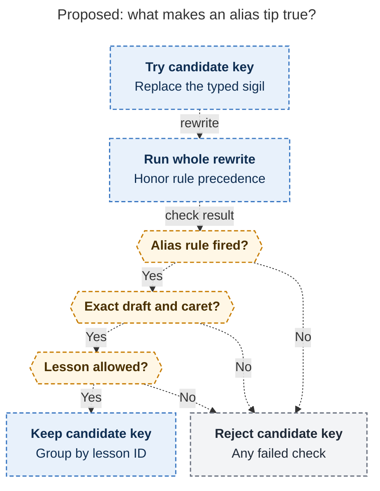

# Diagram proposals: Capture alias typing tips: teach the shortcut where the eye already is

Proposals for the swarm linker, not a report. Each diagram restates only what the source
report says.

```yaml
source: research:202611/capture_alias_typing_tips/capture_alias_typing_tips__final.md
producer: research.3y.image
check: "mmdc 12.0.0 with the PDF-mirroring config rendered 1 of 1 Mermaid diagrams"
```

## candidate-alias-proof

```yaml
anchor: |-
  **The candidate list is not the truth.** It only proposes substitutions.
question: |-
  How does bob prove one candidate alias key would recreate the typed edit?
illustrates: |-
  For one candidate key after the lexical checks, the whole rewrite pipeline must produce an allowed alias and exactly recreate the draft and caret before bob collects that key under its lesson ID.
caption: After lexical checks, a candidate key qualifies only when the full rewrite produces an allowed alias and recreates the original draft and caret.
review: "494.136x1088 px, fit 82.1%; reader question, source trace, labels, branches, arrowheads, and visual checks passed; 1 revision"
```


