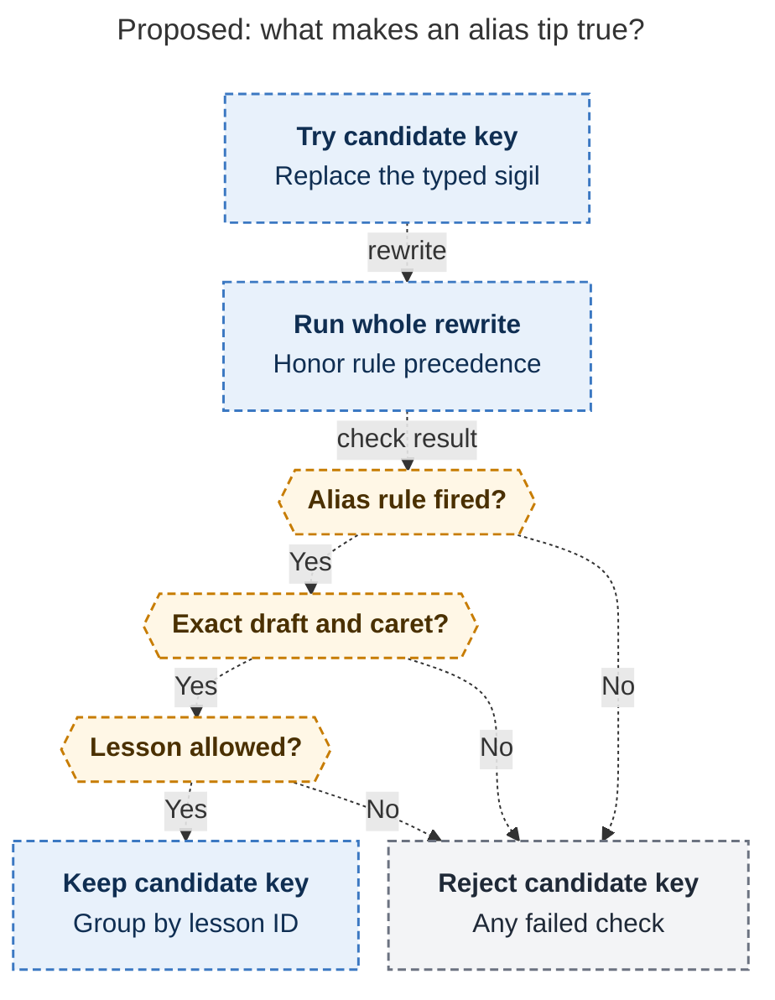
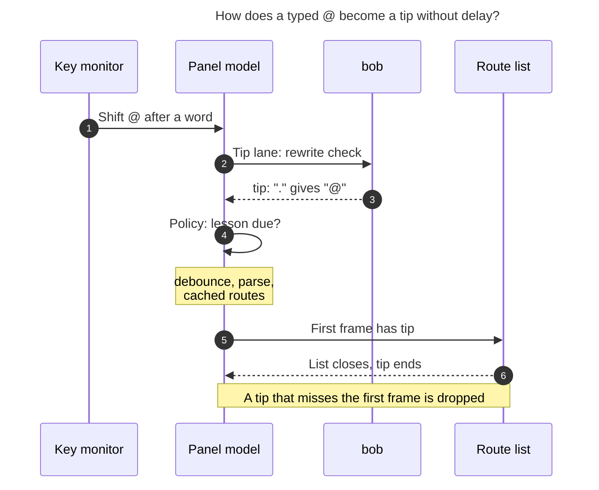
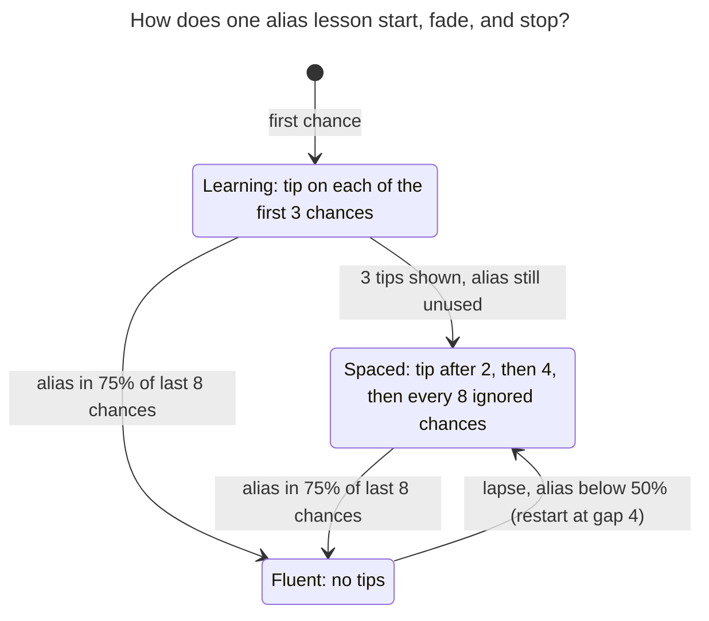

# Capture alias typing tips: teach the shortcut where the eye already is

> **Research query:** How should the bob-mac-capture app show a little hint when the user
> types a character they could have used a capture alias for, such as teaching the `.`
> alias when they press `@` to select an area or project note, so that the feature is
> intuitive, reliable, and beautiful? Is this a good idea, would a different approach be
> better, which requirement adjustments are justified, and what is the recommended
> solution?


## Bottom line

- **Build it, but as a lesson inside the list the sigil opened, not as a notification.**
  The tip is [one quiet line](#making-the-tip-itself-beautiful) pinned to the bottom of
  that card: `Next time  [.] → @  after a word`. It has no icon, no button, and no
  animation. It appears in the card's first frame or not at all.
- **The `@` example is only half true, so bob must prove every tip.** `.` becomes `@`
  only after body text and a space or tab. It stays literal for a leading `@`, after a
  leading `@route` that is already there, glued to a word, and inside code or a
  wikilink. [bob checks each tip](#the-bob-cli-reverse-check) by putting the alias key in
  place of the typed sigil and running its real forward rewrite. It shows a tip only if
  that rewrite rebuilds the same draft and caret, byte for byte. The Mac never keeps an
  alias table.
- **New finding: three of the five reports put the tip on a bob call the Mac never
  makes.** For a bare `@` with a warm target cache, the Mac
  [builds the route list locally](#what-the-mac-app-actually-does)
  (`cachedRouteCompletion`) and never calls `bob capture-complete`. `capture-parse`
  takes no cursor. The tip must therefore ride `bob capture-rewrite --cursor` on a
  separate, non-blocking app lane that is triggered by the sigil keystroke itself.
- **New finding: this is a habit problem, not a discovery problem.** Every sigil alias
  landed between 2026-11-04 and 2026-11-09, and `.`→`@` landed yesterday. Bryan wrote
  them, so retiring the tip after the first use, or after three views, would end it
  before the habit forms. The tips should
  [fade by fluency](#lesson-policy-that-fades-by-fluency): frequent at first, spaced out
  while ignored, silent once the alias is the habit, and back after a lapse.
- **Ship the six picker-opening lessons, with route `.`→`@` as the flagship.** Defer the
  close-outcome `x`/`s` tips to the Close card in a [later phase](#rollout). Exclude the
  double-tap-adjacent flips.
- **Set an honest bar.** The saving is one Shift per sigil.
  [Measure alias share for three weeks](#validation-and-the-stop-rule) from a local
  ledger, and delete the feature if alias use does not rise.

## Is this a good idea

**Yes, with modest ambitions and a hard stop.**

### Why it is worth doing

- **Aliases are invisible by design.** A successful alias leaves no trace in the draft,
  which shows `@`, not `.`. The only feedback today is the forward confirmation
  `Typed @ for .`, and that appears only once you already use the alias. Nothing teaches
  the reverse direction. If you keep paying for Shift, nothing tells you that you don't
  have to.
- **The alias set is new and its rules are subtle.** From `git log`: route sigil alias
  and comma→`+` on 2026-11-04, `/`→`#` and the relation dash aliases on 2026-11-05,
  `x`/`s` close outcomes and spaced `.`→`@` on 2026-11-08. Each has its own position
  rules. Muscle memory lags the feature set, and the first weeks are when a habit is
  cheapest to change.
- **The moment is right.** When `@` opens the route list, Bryan has just paid for the
  Shift and is looking at the list that both keys open.

### What the evidence says and what it does not

- **Grossman, Dragicevic, and Balakrishnan (CHI 2007)** is the closest study. I read
  the PDF text directly; grk's and cld's summaries were partly wrong.
  - In the 5-person pilot, hotkey use was 70% with audio feedback, 69.2% with disabled
    menu items, 59.1% with a delay, 57.1% for the control, and **50% for "visual"**.
    "Visual" was the strongest visual feedback they could build: a blinking hotkey,
    one that followed the cursor, and menu replacement. It did slightly worse than the
    control, though not significantly.
  - The authors explain why: users "switched their visual attention" to the next task
    as soon as they made a selection, so they never looked at the hotkey.
  - Visual was rated neutral for helpfulness (4 on a 7-point scale), not negative. Delay
    was the disliked condition (2.2).
  - In the formal experiment, hotkey use was 28.9% for the control, 66.6% for audio, and
    72.8% for disabled items.
- **The design lesson is about timing, not volume.** Feedback that arrives after
  attention has moved on is wasted, however loud it is. That rules out toasts, status
  lines, and post-capture messages. It favors a tip inside the list that is open while
  Bryan chooses. It also gives a real risk: if Bryan types `@er⇥` faster than he reads,
  the same failure comes back. Measure; don't assume.
- **The two techniques that worked are wrong here.** Speaking the alias aloud, or
  disabling `@` until `.` is used, would be hostile in a personal capture panel. The
  canonical sigil is the language, and the CLI and docs use it.
- **Other cited sources agree on cadence.**
  - cdx cites Apple's HIG and TipKit: tips are contextual, follow eligibility rules, and
    stop once the feature is used.
  - cld cites Emacs `suggest-key-bindings` and IntelliJ Key Promoter X. Key Promoter X
    added click thresholds, suppression, and snooze because always-on nudges annoyed
    people.
  - These are design-pattern sources, not effect sizes. No source shows that this tip
    will save Bryan measurable time.

### What would make it a bad idea

| Risk | Why it matters | Mitigation |
| --- | --- | --- |
| A false tip, such as `.` taught for a leading `@` | One wrong tip leaves a habit that types literal dots into captures, and trust drops fast. | bob proves each tip with its own forward rewrite. A completeness test ties every alias fixture to its reverse check. |
| Nagging | Bryan types `@` dozens of times a day. A tip on every one becomes noise and gets turned off. | At most one tip per capture. Spacing while ignored, silence once fluent, and a Settings toggle. |
| Tip read as a key to press now | Pressing `.` in an open route list types `.` into the query, and after an accepted route `.` means `^`. | The copy starts with "Next time". The tip stays out of the live key-hint row. |
| Latency or input races | Opening a list is the hottest path. The rewrite lane has a history of race fixes (`0f6753b`, `1e0a092`). | A separate fire-and-forget lane that gates nothing. A late tip is dropped. |
| Layout jump | The panel's eye line and the fixed picker heights are deliberate. | The tip's height is budgeted in the first frame and kept for the life of that list. |
| The flagship lesson rarely fires | If most captures route with a leading `@`, no `.` alias exists for them. | The ledger counts Shift-typed `@` that bob found ineligible. That answers the question with data ([open question 1](#open-questions-for-bryan)). |

### Would I take a different approach

I would keep the core idea, teaching right after the costly keystroke, and change five
things:

1. bob proves each tip instead of the app guessing.
2. The trigger is a physically typed sigil, not "a character".
3. The tip lives in the surface the sigil opened.
4. The tips fade by fluency, not by a view count.
5. A stop rule ends the feature if it does not change behavior.

I considered and rejected these [alternatives](#alternatives-considered):

- a permanent `.` keycap in every route list, like a menu accelerator
- a cheat sheet only
- a caret-anchored popover

## Verified ground truth

### Where each alias fires

The source is the Capture Alias glossary strand plus `rewrite.rs`.

| You typed | Alias | Where bob fires the alias | Surface that opens |
| --- | --- | --- | --- |
| `@` | `.` | After body text plus a space or tab, wherever a bare `@` opens route completion | Route completion list |
| `^` | `.` | Right after `@route`; a first-level `- .` in a project note | Block ID picker; Move picker |
| `:` | `;` | Right after `@route`; as a whole item (Task Link); `- ;` in a project note | Block ID, Task Link, or Move picker |
| `+` | `,` | Wherever the Parent Task picker opens; glued to `@route+id`, it inserts ` +` | Parent Task picker |
| `#` | `/` or `\` | Wherever a `#` menu opens. Never at a line start, glued to a word, or in `=/`, `[[folder/`, or `@@` routes | Task type, section, drawer, and Pomodoro-name menus |
| `~` | `=` | After a space or tab, where Links To opens | Relation picker |
| `~` in `x=` | `-` | Inside an `x=` past token | Past-segment list |
| `!` / `*` | `x` / `s` | Ending a close selection (`xx` → `x!`) | Close card |

### Probes

I ran `bob capture-rewrite --cursor <end> --format json`. These rewrite only the
returned text; they do not touch the vault.

| Draft (caret at end) | Result | Meaning for tips |
| --- | --- | --- |
| `Buy milk .` | `Buy milk @` | The flagship case is real. |
| `.` | unchanged | No tip for a leading `@`. |
| `@cash Buy milk .` | unchanged | **New negative case:** no route tip once a leading route exists. |
| `Buy milk @cash and .` | `… and @` | Eligibility depends on context, not on the character. |
| `- [ ] Buy .` | `- [ ] Buy @` | Fires after a checkbox plus body text, but not after a bare checkbox. |
| ``Buy `code .`` and `Buy [[a .` | unchanged | Code spans and wikilinks stay literal. |
| `foo.` | unchanged | A dot glued to a word stays literal. |
| `@errands.` | `@errands^` | `.` is two aliases, so tips need separate IDs. |
| `Buy milk ,` | `Buy milk +` | Comma after a word plus a space opens Parent Task. |
| `Buy milk @.` | unchanged | Pressing `.` now does nothing useful, hence "Next time". |

### What the Mac app actually does

- **`@` and `#` never reach the rewrite lane.** The key-down intent filter allows only
  `: ^ + | , . ; - = ~`, plus `\`, `/`, `x`, and `s` on their own branches
  (`CapturePanelController.swift:1258-1262`). The docs say "`@` itself is never a
  rewrite key". A tip needs one new observation hook.
- **A bare `@` usually builds its list without bob.** When the target cache is warm,
  `cachedRouteCompletion` builds the route list locally, and `capture-complete` is never
  called (`CapturePanelModel.swift:16746`, `:19988`). Only `@@` routes go to bob. This
  rules out the `capture-complete` vehicle that grk, mus, and cdx proposed.
- **`capture-parse` has no `--cursor`.** It runs on the debounced draft
  (`BobProcessClient.swift:199`, `bob capture-parse --help`). It cannot know which sigil
  was just typed, so gem's vehicle needs a CLI change and still sees a stale snapshot.
- **The route list has no stable footer slot.** `CompletionList` draws its footer only
  when no row is selected, and the route list opens with row 0 selected
  (`CaptureCompletionMenu.initialSelectedIndex`). The footer also sits inside the
  `ScrollView`, so it scrolls away below long lists (`CapturePanelView.swift:3462-3468`).
  The viewport is fixed at 5 rows × 48 pt + 12 = 252 pt (`CapturePanelView.swift:38-40`).
- **Pickers are fixed-height at open.** "The budget is fixed at open … so filtering never
  resizes the panel" (`CapturePickerView.swift:29-33`). `CapturePickerKeyHints` already
  has a second line for `operatorContinuationHint`, measured through
  `updateMeasuredFooterHeight`.
- **There is a precedent for "teach until used".** Per-picker `…-picker-used` UserDefaults
  flags hide teaching lines after first use (`CapturePickerPresentation.swift:818`). Local
  learning state is already accepted as presentation state.
- **Colors.** `CaptureEditorPalette.color(for:)` gives route = `accentColor` and
  block ID = `indigo`, and it is the single source for span colors.
- **"Alias" is already overloaded.**
  - Route candidates carry an `alias` field.
  - `aliasHint(for:query:)` already exists in the panel model (`CapturePanelModel.swift:20229`).
  - `action_continuation_aliases` exists on picker descriptors.
  - "Capture alias" in Settings is the global hotkey (`Command-\`).
  - So the new JSON field must not be called `alias_hint`, and the setting must not say
    "alias".

## Requirement adjustments as explicit call-outs

| # | Type | Adjustment | Why |
| --- | --- | --- | --- |
| R1 | **ADJUSTED** | "A character they could have used an alias for" becomes **a physically typed sigil where bob proves that the alias key would have produced the same draft and caret.** | Aliases depend on position. The thin-client decision says only bob decides syntax. |
| R2 | **ADJUSTED** | The `@` → `.` example applies **only after body text plus a space or tab**. It never applies to a leading `@`, after an existing leading route, glued to a word, or in code or wikilinks. | A tip there would teach a key that types a literal dot. |
| R3 | **ADDED** | Only direct key insertions count, made with Shift or Option and without Command or Control. Not a key repeat, with a collapsed selection and no marked text. Never paste, Undo or Redo, a picker accept, restored drafts, or a sigil the app wrote from an alias. | Teach only a choice the fingers just made. The modifier is the cost the alias removes. Counting Option keeps non-US layouts honest; for example, `@` is Option-L on German layouts. |
| R4 | **ADDED** | **The tip lives in the surface the sigil opened** and appears in that surface's first frame or never. No toast, status line, caret popover, or ghost text. | That is where attention is during the choice (Grossman 2007). |
| R5 | **ADJUSTED** | **Fade by fluency** instead of showing on every occurrence or retiring after one use. At most one tip per capture. | Bryan already knows these aliases. The gap is habit, and one use or three views is not a habit. |
| R6 | **ADJUSTED** | Scope v1 to **six picker-opening lessons**: `.`→`@`, `/`→`#`, `.`→`^`, `;`→`:`, `,`→`+`, `=`→`~`, plus project-note move bullets. Route `.`→`@` is the flagship. | The bob side is the same reverse check for all of them, and the Mac has two host surfaces. |
| R7 | **DEFERRED** | The `x`/`s` close-outcome tips go to a later phase, in the Close card caption. The past-segment `-` and the ` +` next-parent comma are also deferred. | These use a different surface or a two-byte reverse check. The status line is the wrong surface. |
| R8 | **DROPPED** | No tips for the `~`→`~~` flip (`=` after `~`) or the `- ^^` move choice. No tip for the app-local blank-draft `\`→`/` Go To. | The first two sit next to fast double-tap escapes. Go To saves no Shift. |
| R9 | **ADDED** | The copy says **where** the alias works, not why. bob authors that phrase. | A lone `+` opens Parent Task and also starts `+2`, so purpose wording would mislead. |
| R10 | **ADDED** | Add a Settings toggle **"Show typing tips"** (on by default) and **"Reset typing tips"**. The word "alias" stays out of the setting. | Every heads-up in the app can be turned off, and "Capture alias" already names the hotkey. |
| R11 | **ADDED** | A **stop rule**: review the local ledger after about 3 weeks, and remove the feature if alias share did not rise. | The saving is small, so the feature must earn its pixels. |
| R12 | **UNCHANGED** | Canonical typing stays fully valid. The draft, vault, CLI, and docs keep canonical sigils. No grammar change and no new subcommand. | The tip teaches a keystroke, not a new language. |

## Recommended design

### Ownership

- **bob owns:** eligibility, the lesson ID, the position phrase, the replacement range,
  and adoption identity.
- **The Mac owns:**
  - when to ask
  - whether the keystroke was physical
  - whether this lesson is due
  - pixels, accessibility, local learning state, and Settings

This is the thin-client split, and it matches the precedent of the Similar Tasks
decision: "bob owns meaning; the app owns timing and pixels."

### The bob-cli reverse check

**Algorithm.** It sits in `rewrite.rs` next to `expand_sigil_alias`. It is lexical and
read-only: `rewrite_draft` uses `completion_field_at`, with no vault I/O.

```text
sigil_alias_tip(raw, cursor) -> Option<SigilAliasTip>
  if template directive: return None
  for (typed, key) in CANDIDATES:         # @←.  ^←.  :←;  +←,  #←/ then \  ~←=
      start = cursor - len(typed); require raw[start..cursor] == typed
      candidate = raw with [start..cursor) replaced by key
      r = rewrite_draft(candidate, start + len(key))   # the WHOLE pipeline
      if r.rule == ExpandSigilAlias and r.text == raw and r.cursor == cursor
         and r.alias_id not in EXCLUDED:               # relation_flip, move_choice
          collect key under r.alias_id
  return first id with its keys in preference order    # "#" prefers "/"
```

- **Why the whole pipeline matters.** Separator toggles, the relation label attach, and
  the direction flip run before `expand_sigil_alias`. Running `rewrite_draft` keeps that
  precedence exactly as a real keystroke would (cld).
- **The candidate list is not the truth.** It only proposes substitutions. The forward
  rewrite decides.

[The candidate-proof diagram](#figure-candidate-alias-proof) traces the checks a
substituted key must pass before bob keeps it: the alias rule fired, the draft and caret
match exactly, and the lesson is allowed.

<div id="figure-candidate-alias-proof">



_After lexical checks, a candidate key qualifies only when the full rewrite produces an allowed alias and recreates the original draft and caret._

</div>

### The bob-cli tip contract, tests, and docs

- **Stable alias IDs.** Make `finish_sigil_alias`, and the ` +` and flip finishers,
  stamp an `AliasId` on `DraftRewrite`:
  - `route_after_text`, `block_id_after_route`, `link_after_route`, `task_link_item`
  - `move_bullet`, `parent_task`, `next_parent`, `hash_menu`, `relation`
  - `past_segment`, `close_complete`, `close_park`
  - `relation_flip` and `move_choice` are excluded.
- **JSON, additive, with `schema_version` staying 1:**

  ```json
  "sigil_alias_tip": {
    "id": "route_after_text",
    "sigil": "@",
    "keys": ["."],
    "range": { "start": 9, "end": 10 },
    "where": "after a word"
  }
  ```

  - **When it appears:** only on `--cursor` responses with `changed: false`.
  - **`range`:** UTF-8 bytes of the typed sigil, so the app can check it against its own
    insertion.
  - **`keys`:** listed in bob's preference order.
  - **Forward rewrites gain an `alias` object.** Responses with
    `rule: expand_sigil_alias` also carry `"alias": {"id", "key", "sigil"}`. The app
    counts adoption from this and never parses `summary` (cdx, cld).
- **Position phrases** are bob-authored and describe where, not why:

  | id | Typed | Key | Rendered tip | Host |
  | --- | --- | --- | --- | --- |
  | `route_after_text` | `@` | `.` | `Next time [.] → @ after a word` | Completion list |
  | `hash_menu` | `#` | `/` | `Next time [/] → # after a word`; bob picks the phrase by context | Completion list (type, drawer, and name menus) |
  | `block_id_after_route` | `^` | `.` | `Next time [.] → ^ right after a route` | Picker |
  | `link_after_route` | `:` | `;` | `Next time [;] → : right after a route` | Picker |
  | `task_link_item` | `:` | `;` | `Next time [;] → : at an item start` | Picker |
  | `parent_task` | `+` | `,` | `Next time [,] → + after a word`, or `right after a route` | Picker |
  | `move_bullet` | `^`/`:` | `.`/`;` | `Next time [.] → ^ on a move bullet` | Picker |
  | `relation` | `~` | `=` | `Next time [=] → ~ after a space` | Picker |

- **Tests that make it reliable:**
  - **Completeness round-trip.** Every forward fixture that asserts
    `expand_sigil_alias` also asserts `sigil_alias_tip(output, output_cursor)` returns
    that key, unless its ID is on the reasoned exclusion list. A new alias without a
    reverse entry then fails CI (cld).
  - **Negative corpus.** It must cover:
    - a leading `@`, `  @`, `- @`, a bare `- [ ] @`
    - `@cash Buy milk @`, `foo@`
    - backtick and `[[` spans
    - a line-start `#`, `=/`, `[[folder/`
    - template drafts, `#"…"` literals
    - `~~`, `- ^^`
    - a standalone `!` or `*`
  - **UTF-8 offsets**, for example `Café run @`, which cdx probed.
- **Docs and memory.**
  - Add one paragraph under `bob capture-rewrite` in `docs/capture.md`, then run
    `just docs-gen`.
  - The Capture Alias glossary strand needs one sentence about tips. The implementer
    routes that through `/sase_memory_write`.
  - This is an additive release-train change, so no `!` marker.

### Catching the keystroke and the tip lane in bob-mac-capture



*Figure 1. The tip check runs beside the normal list path and never in front of it. A
spawn takes about 5 ms, against at least 50 ms of debounce plus parse before the list
paints, so the tip normally wins. If it does not, it is dropped rather than popped in.
Rendered at 834 × 610 px, which fits the page at 78.3% (Mermaid CLI 12.0.0).*

1. **Record a sigil intent.** In the existing key-down monitor, record a
   `TypedSigilIntent` holding the character, the expected post-key draft, and the
   caret, when all of these hold:
   - the character is one of `@ # ^ : + ~` in v1 (`!` and `*` come in phase 3)
   - Shift or Option is pressed, and Command and Control are not
   - the key is not a repeat
   - the selection is collapsed, with no marked text
   - the editor has focus

   This is a separate struct from the rewrite lane's intents, so that lane's arms,
   probes, and holds stay untouched.
2. **Prove the edit was physical.** In `editorTextDidChange`, the intent counts only if
   the new draft equals its expected draft. That is the same proof the separator-toggle
   intent uses. Paste, accepts, Undo, and the app's own alias output never match.
3. **Run the tip lane.** Call
   `captureRewrite(draft, cursor:, lane: "alias-tip")`.
   - It has a 500 ms timeout, and the latest request wins.
   - It reads only `sigil_alias_tip`. It never applies edits, even when bob answers
     `changed: true` for a separator toggle the main lane is already applying.
   - It never gates completion, preview, Similar Tasks, or Return.
   - It is skipped when the Settings toggle is off.
   - **Cost:** one spawn of about 5 ms (Mac measurement in the Similar Tasks decision)
     per sigil keystroke, typically one to three per capture. No ordinary keystroke
     spawns anything.
4. **Bind the answer.** A returned tip stays valid while the draft prefix through
   `range.end` is unchanged. It is offered to the first frame of the next surface opened
   at that anchor. If that surface is already on screen, the tip is dropped; it counts
   as a chance but not as shown.
5. **Count adoption.** When the main lane applies a rewrite carrying `alias.id`, record a
   hit. If that alias is then escaped (a fast `..` or `==`, Undo, or a Space or Escape
   restore), withdraw the hit and silence that lesson for the rest of the capture.
   Bryan just rejected it on purpose.

### Making the tip itself beautiful

```text
 Buy milk @▌
 ╭───────────────────────────────────────────────╮
 │ ▌errands                            area      │  ← row 0 selected, unchanged
 │  cash                               project   │
 │  home                               area      │
 │  job                                area      │
 │  sase                               project   │
 │ ───────────────────────────────────────────── │  ← hairline, card's own separator
 │  Next time  ╭───╮ → @  after a word           │  ← pinned tip row, 24 pt
 │             │ . │                             │     (keycap drawn inline at caption height)
 ╰───────────────────────────────────────────────╯
```

**Anatomy.** This is one `CaptureAliasTipRow` view, used in every host.

| Part | Style | Purpose |
| --- | --- | --- |
| `Next time` | `.caption`, `.secondary` | Makes the tip read as advice for the future, never a key to press now. Every other footer keycap is a live command. |
| Keycap `.` | The house keycap from `CapturePickerKeyHints`: `.caption.monospaced()`, padding 6/2, radius 4, a 0.5 pt stroke at 12% primary, background at 60%. Neutral, not tinted. | It is a physical key, so it should look like the other keys. A tinted keycap would echo the selected-row accent. |
| `→` | `.caption`, `.tertiary` | Reads as "becomes". |
| `@` | `.caption.monospaced()` semibold, in `CaptureEditorPalette.color(for: .route)` | The same color as the span Bryan just saw appear in the draft. It quietly connects the key to the glyph. |
| `after a word` | `.caption`, `.secondary`, bob's `where` phrase | Keeps the tip true. The alias works here, not everywhere. |

**Rules:**

- **One line, never wrapped.** Use `ViewThatFits`: the full line, then the line without
  the position phrase, then no tip at all. Never truncate a candidate to make room.
- **No icon, emoji, "Tip:" label, button, link, or focus stop.** The keycap is the visual
  anchor; an icon would turn a whisper into a badge.
- **No motion.** The tip is part of the card's first frame and moves with the card.
  Nothing animates later, so Reduce Motion needs no special case.
- **Height:**
  - The route list's viewport grows from 252 pt to 276 pt (half a row) only when the
    tip is admitted at open.
  - It stays that size until the list closes, even as the query filters.
  - If the panel height budget binds, drop the tip before losing a candidate row.
- **Hosts:**
  - **Completion list:** the route list and the task type, drawer, and Pomodoro-name
    menus, all of which render inside `CompletionList`.
  - **Picker cards:** an extra line in `CapturePickerKeyHints` below the key rows and
    any `operatorContinuationHint`. It is budgeted at open through the
    measured-footer path, because picker height is fixed at open.
  - **Close card (phase 3):** the tip takes over the caption's hint tokens while it is
    live.
- **Light, dark, and Increase Contrast.** All colors are semantic palette entries or
  `.secondary`, so both appearances work with no new assets. Check the keycap hairline
  under Increase Contrast in the render fixtures. grk proposes raising it from 12% to
  28%, but the current picker keycap has no contrast-specific stroke to copy.
- **VoiceOver.**
  - Append to the list's existing accessibility label: "Route suggestions, 5 results.
    Tip for next time: after a word, period types at sign."
  - The app builds that sentence from bob's `keys`, `sigil`, and `where`, using a small
    glyph-name map (presentation only).
  - Never route the tip through `announceStatus`, which moves focus, and never
    re-announce it while filtering.
- **Hover.** Add `.help("Typing tips can be turned off in Settings › Capture")`.

### Lesson policy that fades by fluency



*Figure 2. A lesson teaches often while new, backs off while ignored, goes silent once
the alias is the habit, and comes back sparsely after a lapse. The gap between entering
Fluent at 75% and leaving it below 50% stops it flickering on and off. Rendered at
590 × 732 px, which fits the page at 100% (Mermaid CLI 12.0.0).*

**Policy rules** live in a pure `AliasTipPolicy` in `CaptureCore`, so `portable-check`
and unit tests cover it without AppKit.

- **A chance** for lesson L is one of two things:
  - **Miss:** bob returned `sigil_alias_tip` with ID L for a physically typed sigil.
  - **Hit:** a surviving `expand_sigil_alias` rewrite with `alias.id` L.
- **Fluent** means at least 4 recorded chances, and hits are at least 75% of the last 8.
  Fluency ends when hits fall below 50%.
- **Due** (when not fluent) means either:
  - fewer than 3 tips have been shown, or
  - misses since the last tip are at least the current gap. The gap runs 2, then 4,
    then 8, and stays at 8. A lapse from Fluent restarts at 4.
- **Global limits:**
  - At most one tip per panel session, for the first eligible sigil.
  - A lesson escaped this session is silent for the rest of it.
  - With Settings off there are no spawns and no tips. Hits are still recorded, because
    they cost nothing.
- **Storage.**
  - One Codable blob at `org.bobs.bob-mac-capture.typing-tips`, shaped
    `{version: 1, lessons: {id: {recent, tipsShown, missesSinceTip, gap}}, ineligible: {"@": n, …}}`.
  - It never stores draft text, target names, or keystroke history.
  - It stays local and is not synced to the vault. It is per-Mac motor-learning state
    like the picker-used flags, not product preference data like the theme or relation
    journals.
- **Thresholds are hypotheses.** These numbers are judgment calls (cld, cdx). The
  sources support the shape (fade on use, cap the cadence), not the constants. Tune
  them from the ledger.

### Settings and naming

- **Settings › Capture:**
  - `Toggle("Show typing tips")`, on by default, wired like `similarTasksEnabled`.
  - Caption: "A one-line tip when a key without Shift would have typed the same sigil."
  - `Button("Reset typing tips")`.
- **On-demand reference.** The existing alias tables in `docs/keyboard.md` and
  `docs/capture-panel.md` stay the reference. An optional later Settings list can show
  each lesson with a "learned" mark, built from the ledger (cld, after Skillometers).

## Rollout

1. **bob-cli.**
   - Stamp an `AliasId` on forward rewrites.
   - Add `sigil_alias_tip` (unchanged `--cursor` responses) and `alias` (forward alias
     responses).
   - Add the completeness round-trip and the negative corpus.
   - Update `docs/capture.md` and the glossary sentence.
   - This is additive, with no CLI option and no subcommand, which fits the
     `capture-*` "grow additively" rule.
2. **Mac A: route list host.**
   - Add `TypedSigilIntent`, the `alias-tip` lane, binding, and `AliasTipPolicy` with
     its ledger.
   - Add `CaptureAliasTipRow` pinned in `CompletionList`. This covers `.`→`@` and
     `/`→`#`.
   - Add the Settings toggle and reset.
   - Update docs: `capture-panel.md`, `keyboard.md`, `settings.md`, and a
     `protocol.md` row saying old bob means no tips.
   - Gate on the exact-SHA macOS CI run.
3. **Mac B: picker host.** Add the tip line to `CapturePickerKeyHints` for `.`→`^`,
   `;`→`:`, `,`→`+`, `=`→`~`, and move bullets.
4. **Later, only if phases 2 and 3 earn it:**
   - `x`/`s` tips in the Close card caption
   - `next_parent` (the ` +` comma)
   - `past_segment`
   - a Settings lessons list
   - revisiting the flip and move-choice exclusions

## Validation and the stop rule

| Area | Must hold |
| --- | --- |
| Truth | Every emitted tip passes the forward-equivalence check, and the negative corpus emits nothing. |
| Edit provenance | No tip after paste, restore, picker accept, the app's own alias output, Undo or Redo, IME marked text, a repeat key, or a selection replacement. |
| Independence | With tips on, the draft bytes, selection, Undo history, completion choice, and capture result are identical. The tip never delays the list or Return. Test with a stub `BobProcessClient` that holds the tip reply and assert the list still opens. |
| Async | A late, stale, or reordered tip reply never appears after the list opened, after an edit, or after a submit. A dropped tip counts as a chance, not as shown. |
| Layout | The editor frame and the candidate row positions are unchanged when the tip appears. Render fixtures at 760 and 620 pt widths, in light and dark, like `SimilarTasksBandDesignTests`. |
| Accessibility | The label is appended once per open, with no focus movement and no announcement while filtering. |
| Compatibility | Old bob means no field and no tips, silently. An old app ignores the field. Unknown IDs are ignored. |
| Policy | Fake-ledger tests cover learning, spacing, fluency entry and exit, lapses, one tip per capture, session silence after an escape, reset, and corrupt-blob recovery. |

**Stop rule.** After about three weeks, read the blob with
`defaults read org.bobs.bob-mac-capture typing-tips`.

- **Keep it** if alias share rose for lessons that showed tips.
- **Delete it, don't tune it,** if alias share did not rise. It is cheap to remove.
- **Stop immediately** on any false tip or input regression.
- **If ineligible `@` far outnumbers eligible ones**, the flagship lesson is moot for
  Bryan's habits, which is a finding in itself ([open question 1](#open-questions-for-bryan)).

## Alternatives considered

| Approach | Verdict |
| --- | --- |
| A Swift table from sigil to alias | **Reject.** It is wrong at item starts, after leading routes, and in wikilinks, templates, and close slots. It breaks the thin-client decision. |
| Hand-written bob "hint rules", one per alias | **Reject.** It duplicates every alias condition, skips rewrite precedence, and drifts. |
| An additive field on `capture-complete` | **Reject.** The flagship `@` list comes from the local route cache and never calls it. |
| An additive field on `capture-parse` | **Reject.** It needs a new `--cursor` option and sees the debounced draft. |
| Adding `@` and `#` to the main rewrite lane | **Reject.** Completion waits on that lane, and its arm, probe, and hold machinery is race-prone. |
| A new `bob capture-alias-tip` command | **Unnecessary.** It adds a protocol name, and the field fits `capture-rewrite`. |
| A toast or the status line | **Reject.** It arrives after attention moves on (Grossman), overwrites real status, and moves VoiceOver focus. |
| A popover anchored at the caret | **Reject for now.** The editor has no glyph-rect plumbing, it would cover candidates, and it is visually loud. |
| Ghost text in the editor | **Reject.** It looks like inserted text and fights spans and the caret. |
| A permanent `.` keycap in every route list | **Reject.** It is lifelong clutter for something learned once, and it is not even a live key. |
| A cheat sheet or Help entry only | **Keep as a fallback.** It cannot capture the moment of use, and it cannot say "after a word" versus "after a route" in context. |
| Speaking the alias, or disabling `@` until `.` is used | **Reject.** These worked in the lab but are hostile in a personal capture panel. |
| TipKit | **Plausible later.** The package targets macOS 26, so it is available. A small pure policy gives exact editor provenance, deterministic tests, and compact layout control (cdx). |

## Where the reports disagreed and the resolution

| Question | Positions | Resolution | Deciding evidence |
| --- | --- | --- | --- |
| Which bob call carries the tip? | Additive field on `capture-complete` (grk, mus, cdx); on `capture-parse` (gem); on `capture-rewrite --cursor` from a separate lane (cld) | **`capture-rewrite --cursor`, on its own `alias-tip` lane** | Cached route completion bypasses `capture-complete` ([Mac ground truth](#what-the-mac-app-actually-does)), and `capture-parse` has no cursor. `capture-rewrite` gets the exact post-key draft and already owns "typing assists". cld's stated reason, the 50 ms debounce, is weaker than the cache bypass. |
| What triggers it? | Any typed `@` (gem, mus); any direct insertion, layout-agnostic (cdx); Shift-typed only (cld) | **A direct insertion with Shift or Option**, matched against the expected post-key draft | This combines cld's "you paid a modifier" with cdx's warning about international layouts. |
| Where does the route tip render? | Header row (grk); last row inside the scroll area (cld); bottom line outside the scroll area (cdx); `CapturePickerKeyHints` (gem, mus) | **A row pinned below the scroll area, inside the same material card** | The route list is a `CompletionList`, not a picker, and its footer scrolls and is hidden when a row is selected. A header would push every row down 24 pt and break row-position memory. |
| Hide once the query is nonempty? | Yes (grk); keep (mus, cdx, cld) | **Keep for the life of that list** | Hiding on the first letter shrinks the panel mid-typing, and fast typists would never see the tip. |
| How does it retire? | After the first alias use (grk, mus); first use or 3 views (gem); 3 views, 24 h cooldown, × button (cdx); fluency with spacing (cld) | **Fluency with spacing, one per capture** ([lesson policy](#lesson-policy-that-fades-by-fluency)) | The aliases are a week old and written by their only user, so this is habit formation. |
| Close-outcome `x`/`s` | Status-line nudge in v1 (mus); Close card caption in v1 (cld); defer (grk, cdx) | **Defer to phase 3, in the Close card caption** | The status line overwrites real status and moves VoiceOver focus. The Close card has its own caption slot. |
| Keycap color | Neutral (grk, gem); keycap tinted with the sigil color (cld) | **Neutral keycap, tinted result sigil** | An accent-tinted keycap looks like a live, selected control. Coloring the `@` links it to the span in the draft. |
| Dismiss button, icon, motion | × (cdx); 💡 and an ease-in (gem); none (cld, grk) | **None of them** | The panel is keyboard-first, and the house style has no emoji. Motion would fight layout stability and Reduce Motion. |
| JSON field name | `alias_hint` (cdx, cld, mus, gem); `unused_sigil_alias` (grk) | **`sigil_alias_tip`** | `alias` is overloaded ([Mac ground truth](#what-the-mac-app-actually-does)). |
| v1 scope | Route only (cdx); six lessons (grk, mus); five (gem); all except flips (cld) | **Six picker-opening lessons, landing the route list host first** | The reverse check makes extra lessons nearly free in bob. The cost is on the Mac surfaces. |

**Corrections to the input reports, for readers of the individual files:**

- **mus** says an open completion context "implies the alias would have fired". That is
  false: a leading `@` opens route completion, but `.` is literal there.
- **gem**'s mockup puts the route list inside the picker with `[↑↓] choose` hints, which
  is the wrong host. Its `capture-parse` field would need a new `--cursor` option.
- **gem**'s Rust sketch calls each alias expander by hand. That is the "hand-written
  hint rules" approach cld rightly rejects, because it skips the precedence of earlier
  rewrite branches.
- **grk** calls Grossman's visual condition "negatively perceived". It was rated 4/7,
  which is neutral.
- **cdx** proposes copy that says "here". That word is too vague, because the alias
  works only in a particular position.

## Open questions for Bryan

1. **Do you mostly route with a leading `@` (`@errands Buy milk`)?** If so, the flagship
   tip will rarely fire, because no `.` alias exists there. `.bashrc`-style text is why
   a leading `.` stays literal. The ledger's ineligible count will show it. Reopening
   the grammar is out of scope here.
2. **Fluency fading or retire after first use?** I recommend fluency, because these are
   your own new aliases and the goal is habit. If you would rather the tip vanish the
   first time you use the alias, the policy reduces to grk's single flag.
3. **Should the `#` tip teach only `/`, or `[/] or [\]`?** I recommend `/` only, with `\`
   shown only where `/` would stay literal.
4. **On by default?** I recommend on, because the tips fade by themselves.
5. **Is one ~5 ms spawn per sigil keystroke acceptable?** It is off the critical path.
   The alternative is folding the tip into the main rewrite lane for `^ : + ~`, which
   trades isolation for spawns.
6. **Decision record.** After it ships, record "Typing tips are bob-proved reverse checks
   that fade by fluency" in the decisions web.

## Recommended solution

Build **typing tips that bob proves and that fade by fluency.**

- **bob-cli.**
  - `bob capture-rewrite --cursor` gains an additive `sigil_alias_tip` with `id`,
    `sigil`, `keys`, `range`, and `where`.
  - bob computes it by putting each candidate alias key in place of the typed sigil and
    running the real `rewrite_draft` pipeline. A tip exists only when the alias would
    have rebuilt the identical draft and caret.
  - Forward alias rewrites gain an `alias` identity, so adoption counting never parses
    prose.
  - A completeness test makes every alias fixture double as a tip fixture, so tips
    cannot drift from aliases.
- **bob-mac-capture.**
  - **Trigger.** A physically typed `@ # ^ : + ~`, made with Shift or Option and proven
    against the expected post-key draft, starts a fire-and-forget `alias-tip` lane that
    gates nothing.
  - **Display.** One quiet line, `Next time  [.] → @  after a word`, pinned to the
    bottom of the card the sigil opened. The keycap is neutral and the result sigil uses
    its editor color.
    - It appears in the first frame or never.
    - It stays fixed while you filter and ends when the card closes.
    - It has no icon, button, or motion.
  - **Policy.** A pure `CaptureCore` function over a local UserDefaults ledger:
    - at most one tip per capture
    - three early tips, then spacing while ignored
    - silence once the alias is the habit (75% of the last 8 chances), and a sparse
      return after a lapse
    - a Settings toggle, "Show typing tips", on by default, plus a reset button
- **Scope and order.**
  - Ship bob first.
  - Then the route list host (`.`→`@`, `/`→`#`).
  - Then the picker host (`.`→`^`, `;`→`:`, `,`→`+`, `=`→`~`, move bullets).
  - Close-card `x`/`s` tips come later, only if the first phases earn it.
- **Stop rule.** Review the ledger after three weeks and delete the feature if alias
  share did not rise.

**Why this meets the three goals:**

- **Intuitive.** The tip appears in the list Bryan is already reading, says "next time",
  and names a position, not a purpose.
- **Reliable.** The same code that performs each alias proves each tip, the tip lane
  cannot slow or race the editor, and late answers are dropped, never popped in.
- **Beautiful.** It is a single caption-height line in the house keycap style, its
  sigil matches the colored glyph in the draft, and it takes zero pixels once learned.

## About this report

**Consolidated report** (lead researcher), 2026-11-09. It merges five independent
reports (`__cdx`, `__cld`, `__grk`, `__mus`, `__gem`, all in this folder) with new
verification against bob-cli `f231b9d3`, bob-mac-capture `b81302b`, live `bob 0.5.0`
probes, and the primary text of Grossman et al. (CHI 2007). No application code was
changed.

**Request.** When Bryan types a character in Bob Mac Capture that a capture alias could
have produced, show a little hint. For example, typing `@` to pick an area or project
note should teach the `.` alias. Lead the design so it is intuitive, reliable, and
beautiful. Critique the idea, call out requirement changes, and end with a
recommendation.

## Sources

**Internal (verified this pass)**

- bob-cli `src/native/capture_language/rewrite.rs`:
  - `rewrite_draft` precedence at :89
  - the `expand_sigil_alias` dispatcher
  - `completion_field_at` lexical checks
  - `dot_route_alias_position_ok`
- bob-cli `git log --grep=alias`: alias landing dates from 2026-11-04 to 2026-11-09.
- `bob 0.5.0 capture-rewrite` probes in [Probes](#probes).
- `bob capture-parse --help`: there is no `--cursor` option.
- bob-mac-capture `b81302b`:
  - `CapturePanelController.swift:1258-1262` (key filter)
  - `CapturePanelModel.swift:16746`, `:19988` (cached route completion) and `:20229`
    (`aliasHint` naming collision)
  - `CapturePanelView.swift:38-40`, `:3394-3470` (completion viewport and footer)
  - `CaptureCompletionMenu.swift` (row-0 default)
  - `CapturePickerView.swift:29-33`, `:1296` (fixed-height picker, key hints)
  - `CaptureEditorPalette.swift` (span colors)
  - `CapturePickerPresentation.swift:818` (picker-used flags)
  - `BobProcessClient.swift:199`, `:460` (parse without a cursor; rewrite lanes)
  - `docs/capture-panel.md` "Sigil alias" paragraphs
- Memory:
  - `glossary:capture-alias`
  - `decisions:mac-capture-is-a-thin-client`
  - `decisions:similar-tasks-are-a-settled-heads-up`, which supplies the 4.7 ms Mac
    spawn and the "bob owns meaning; app owns timing and pixels" rule
  - `sase/memory/cli_rules.md` (`capture-*` names grow only additively)

**External**

- Grossman, Dragicevic, and Balakrishnan, "Strategies for Accelerating On-line Learning
  of Hotkeys", CHI 2007, pp. 1591–1600
  ([PDF](https://www.dgp.toronto.edu/~ravin/papers/chi2007_learninghotkeys.pdf)). The
  pilot and experiment figures quoted in
  [What the evidence says](#what-the-evidence-says-and-what-it-does-not) come from the
  paper's text.
- Cited by input reports and not re-verified here:
  - Apple HIG "Offering help" and TipKit (cdx)
  - Malacria et al., ExposeHK, CHI 2013 (cdx)
  - Emacs `suggest-key-bindings`, IntelliJ Key Promoter X, Superhuman nudges (cld)
  - Malacria et al., Skillometers, UIST 2013 (cld)
  - VS Code notification UX guidelines (grk)
