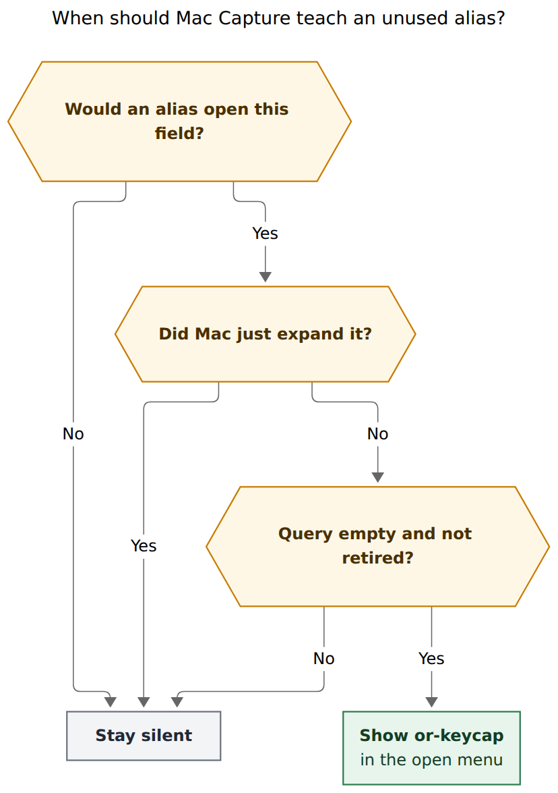
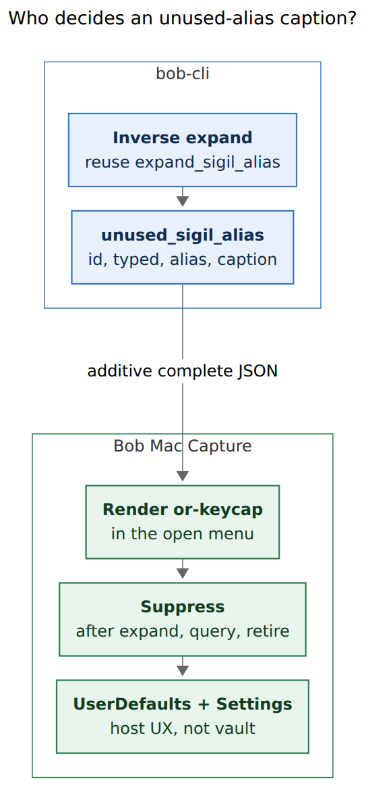

# Unused-alias hints in Bob Mac Capture

> **Research query:** How should Bob Mac Capture show a little hint when the user
> types a character they could have entered with a capture alias (for example
> typing `@` to pick an area or project note, teaching the `.` alias)? Lead the
> design so it is intuitive, reliable, and beautiful. Critique the plan, call out
> justified requirement adjustments, and end with a recommended solution.

## Bottom line

- **Build a quiet unused-alias caption, not a toast.** The idea is good. A
  naive "whenever they type `@`" hint is not. Aliases are context-sensitive
  typing assists that exist only in Bob Mac Capture; the vault language stays
  `@`, `#`, `^`, `+`. Teach the home-row key only where it would actually have
  opened the same field.
- **bob decides eligibility by inverting `expand_sigil_alias`.** An additive
  `unused_sigil_alias` object on `bob capture-complete` (schema_version 1)
  names `id`, `typed`, `alias`, `caption`, and `voiceover`. The app never
  reimplements the alias table. An older bob omits the field and nothing
  appears.
- **The caption lives in the menu that just opened**, in the same visual
  language as picker keycaps and `operatorContinuationHint`. Copy is
  retrospective (`next time · . after a word`), because the alias is not a
  live key in that menu. Return, Tab, and filter keys stay untouched.
- **The user's `@` example is the highest-value case and the easiest to get
  wrong.** `.` aliases `@` only after body text plus a space or tab. A leading
  `@` on an empty draft, the most common routing gesture, has no `.` alias.
  Teaching `.` there would be a lie.
- **Ship the six completion-opening aliases first.** Defer close-slot `x`/`s`
  and the past-segment `-` until the close card has a caption slot. Retire
  each alias after one successful expansion, with a Settings toggle defaulting
  on.

## Is this a good idea?

**Yes, with a much tighter scope than "hint whenever they type the hard key."**

Capture aliases exist because the canonical sigils are awkward to type:
`@`, `^`, `#`, `:`, `+`, `~`, `!`, and `*` all need Shift or a stretch, while
`.`, `;`, `/`, `,`, `=`, `x`, and `s` sit on the home row. The glossary
already describes them as a keystroke substitution that bob decides and the
app applies natively, so Undo restores the typed key
(`glossary:capture-alias`, `decisions:mac-capture-is-a-thin-client`). The
Mac already confirms a successful expansion in the footer (`Typed @ for .`).
What it never does is teach the mapping when the user pays the Shift cost.

That is a real gap. Bryan can know the grammar from `docs/capture.md` and
still forget that `Buy milk .` opens the same route list as `Buy milk @`.
Teaching at the moment of using the expensive key is the right time: the
menu they wanted is on screen, the mapping is one substitution, and the
draft still contains the canonical sigil so paste, CLI, and the vault stay
honest.

The plan as stated has four flaws. Each one would make the feature feel
cheap or untrustworthy.

1. **Most `@` keystrokes have no `.` alias.** `.` becomes `@` only after
   body text and a space or tab, and it stays literal at a line or
   bullet-body start, after a checkbox, glued to a word, inside backticks,
   and inside a wikilink (`docs/capture.md`, `expand_dot_route_alias` in
   `src/native/capture_language/rewrite.rs`). Opening Capture and typing
   `@` to file into `cash` is the everyday gesture. Hinting `.` there
   teaches a key that would type a literal dot.
2. **`.` is two aliases.** After `@route` it becomes `^`; after a word it
   becomes `@`. A generic "use `.` instead of `@`" caption, shown while a
   route list is open, collides with the later `^` mapping. Copy has to be
   context-specific (`after a word` versus `after the route`).
3. **A live keycap would be read as a key that works now.** Picker footers
   already document live keys (`↑↓`, `↩`, `esc`, and
   `operatorContinuationHint` such as `Type a number or + to adjust`).
   Pressing `.` in an open route list inserts `.` into the query. The
   caption has to say *next time*, not sit in the live-key row.
4. **Toasts and status-line nags fight the panel's existing voice.** Refs
   glass toasts confirm completed actions (copy, link to Today, close tab)
   for 2.2 s. The capture footer is a shared status line that already
   carries rewrite summaries, picker needs, grammar gates, and "Bob did
   not answer". Grossman, Dragicevic, and Balakrishnan (CHI 2007) found
   flashing visual hotkey feedback weak and negatively perceived; audio
   and making the slow path costly worked, which we should not copy into a
   capture panel. VS Code's own notification guidelines say to send
   notifications only when necessary and to include "Do not show again".
   Similar-tasks research in this sidecar already chose a settled,
   zero-pixels-unless-earned band over a live list. A shortcut toast after
   every `@` would train the user to ignore it in a week.

A different approach I would take instead of a generic "you typed `@`"
nudge: **put a retrospective or-keycap in the chrome of the menu bob just
opened, only when inverting the existing alias expander would have
produced this draft.** That is closer to a menu accelerator (always
visible, in the control, not a post-hoc nag) than to a coachmark.

For a single expert user this is still worth doing. The aliases are
Mac-only typing sugar. Bryan will keep typing `@` from the grammar and
from CLI muscle memory. A quiet caption on the spaced-`@` list is the
smallest thing that makes the shortcut discoverable without pretending
`.` is the capture language.

## Requirement adjustments

These change the request as stated. Each one is required for the feature
to stay true.

1. **Teach only where the alias would have fired.** The original example
   ("press `@` to select an area/project note, teach `.`") is true for
   `Buy milk @` and false for a leading `@`. Eligibility is the inverse of
   `expand_sigil_alias`, not "this character has an alias somewhere".
2. **Teach the full completion-opening table, with `.`/`@` as the
   flagship, not the only row.** Once the protocol exists, `#` → `/`,
   `^` → `.` after a route, `:` → `;`, `+` → `,`, and spaced `~` → `=`
   are the same feature. Shipping only `@` would leave the protocol
   looking like a special case.
3. **Do not teach close-slot `x`/`s` or past-segment `-` in v1.**
   `capture-complete` returns empty on close suffixes. Those aliases also
   hold later edits and Return until bob answers. Wrong copy next to a
   close card is costlier than a missing hint.
4. **Do not rewrite the draft to the alias character.** The vault and
   `bob capture` keep canonical sigils. The hint teaches a keystroke, not
   a new grammar. Paste of `Buy milk .` stays a dot.
5. **Do not put the alias in the live key-hint row.** Retrospective copy
   only (`next time · . after a word`).
6. **Do not add a new subprocess.** Piggyback on `capture-complete`, which
   already runs when the menu opens. A dedicated `capture-alias-hint`
   command would violate the "no extra spawn on the keystroke path"
   lesson from similar-tasks.
7. **Retire after demonstrated competence.** One successful
   `expand_sigil_alias` for that `id` stops the caption. A Settings
   toggle, default on, matches "Show similar tasks while capturing".
   Counts live in UserDefaults (host UX), not the vault-synced theme or
   relation journals.
8. **A `?` cheat sheet is a different feature.** Aliases are
   position-dependent; a static legend would have to reprint the whole
   `docs/capture.md` "Sigil alias" section. In-context captions are the
   thing that makes the mapping true. A later empty-draft keys chip can
   complement this. It does not replace it.

## Recommended solution

Name it an **unused-alias caption**. Not a coachmark, toast, ghost
character, or status-line nag.

### Visual design

The panel already has the parts. Reuse them.

- Keycap: same recipe as `SimilarTasksKeycap` and picker hints —
  caption monospaced, 6 pt horizontal padding, 2 pt vertical, 4 pt
  corner radius, 0.5 pt 12% primary stroke, 60% background fill.
- Type: `next time` and the where-clause in `.caption` / `.secondary`;
  the alias itself in the keycap. One line. Never wrap. Never cause
  the auxiliary region to scroll. If the header is too narrow, drop
  the where-clause, then the whole caption, before dropping live keys.
- Placement, in this order of preference:
  1. **Inline completion** (the `@` route list, `#` type menu, `/` hash
     menus, spaced `~` when it stays inline): a 22 pt header row matching
     `CaptureTaskTypeMenuView`'s header — empty or existing title on the
     left, caption on the right. Route completion currently has no
     header except File-under; this is the one new strip of chrome, and
     only while the caption is eligible.
  2. **Elevated picker** (Block ID, Parent Task, Task Link, Move,
     relation): the existing list-footer slot that already shows
     `operatorContinuationHint` when the filter is empty
     (`CapturePickerView.listFooter`). Same type, same empty-filter
     gate.
  3. **Task type / drawer menus:** trailing slot of the existing header
     caption, beside the swatch. Do not add a second header.
- Motion: appear in the same frame as the menu. Instant. Reduce Motion
  unchanged because there is nothing to ease. Height is not animated
  (idle-agenda and similar-tasks already forbid height animation).
- Colour: secondary label, no accent, no orange. Orange is for
  warnings (unconfigured types, similar-tasks "Possible duplicate").
  This is not a warning.
- VoiceOver: one announcement per open, never on each keystroke, never
  moving focus. "Next time, type period after a word instead of at
  sign." If the last rewrite at this caret was `expand_sigil_alias`,
  skip the announcement — the footer already said `Typed @ for .`.
- Dark / light / Increase Contrast: inherit the keycap stroke from
  primary at 12% / 28%, matching picker chips.

A spaced-`@` route list should read like this, not like a toast over
the editor:

```
┌─────────────────────────────────────────────┐
│                          next time  [.]  after a word
│ cash                                  area  │
│ job                                   area  │
│ sase                               project  │
└─────────────────────────────────────────────┘
```

The `[.]` is a keycap. The sentence is one caption. The list is the
same five-row viewport it is today. When the user types `c`, the query
is nonempty and the header disappears in the next complete response.

### When it fires



**Figure 1.** Teach only when an alias would have opened this field, Mac
did not just expand it, the query is still empty, and the alias has not
retired. Rendered size 551 × 784 px; fit 100%. Mermaid CLI 12.0.0.

bob's test is the inverse of today's expander:

1. `capture-complete` has a field at the cursor.
2. Take each alias that can produce the character before the cursor
   (`@` ← `.`, `^` ← `.`, `:` ← `;`, `#` ← `/` then `\`, `+` ← `,`,
   `~` ← `=`).
3. Substitute that alias into a hypothetical draft and run
   `expand_sigil_alias`.
4. If the rewrite's text equals the real draft and the edit is that
   one-byte swap, emit `unused_sigil_alias`.

That single reuse is the reliability story. Line-start `@` fails step 4
because `dot_route_alias_position_ok` requires a preceding space or tab
and a nonempty trimmed prefix (`rewrite.rs`). `#` at a line start fails
because `/` and `\` never alias there (blank-draft `\` → `/` is
app-local Go To, not a capture alias). `/` inside `=/`, `[[folder/`,
`@@` routes, section names, and Pomodoro names stays literal; the
inverse will not claim them.

Mac then filters what bob returned:

- Last rewrite at this caret was `expand_sigil_alias` for this `id` →
  hide. Otherwise complete would double-teach: footer `Typed @ for .`
  plus an unused-alias caption on the `@` that rewrite just wrote.
- Completion `query` nonempty, or picker filter nonempty → hide. They
  are matching a row. The caption had its moment on the empty open.
- Settings off, or this `id` retired → hide.
- Template drafts and `#"…"` exact-name literals already skip rewrite;
  complete should omit the object there too.

Paste never fires: aliases exist only while typing, and complete on a
pasted `@` with a nonempty query will usually have a fragment.

### Protocol



**Figure 2.** bob owns eligibility and copy by inverting
`expand_sigil_alias`. Mac Capture owns pixels, suppression, and
retirement. Rendered size 361 × 776 px; fit 100%. Mermaid CLI 12.0.0.

Additive object on `capture-complete`, omitted when absent, decoded
with `decodeIfPresent`. `schema_version` stays 1. No grammar bump.

```json
"unused_sigil_alias": {
  "id": "route_dot",
  "typed": "@",
  "alias": ".",
  "caption": "next time · . after a word",
  "voiceover": "Next time, type period after a word instead of at sign"
}
```

Stable `id` values, because `.` is two aliases and `#` has two keys:

| id | typed | alias | caption | v1 |
| --- | --- | --- | --- | --- |
| `route_dot` | `@` | `.` | `next time · . after a word` | yes |
| `caret_dot` | `^` | `.` | `next time · . after the route` | yes |
| `colon_semi` | `:` | `;` | `next time · ; after the route` | yes |
| `hash_slash` | `#` | `/` | `next time · /` | yes |
| `plus_comma` | `+` | `,` | `next time · ,` | yes |
| `tilde_equals` | `~` | `=` | `next time · = after a word` | yes |
| `hash_backslash` | `#` | `\` | `next time · \` | no; only if `/` would stay literal and `\` would alias |
| `close_bang` | `!` | `x` | `next time · x` | no; close card, complete is empty |
| `close_star` | `*` | `s` | `next time · s` | no |
| `past_dash` | `~` | `-` | `next time · -` | no; `x=` segment only |

When both `/` and `\` would alias `#`, prefer `/`. Caption strings are
bob-authored so the app never knows "after a word" versus "after the
route".

Do not add this to `capture-rewrite`. Rewrite runs when they typed the
alias. Complete runs when they typed the canonical sigil. That split
already matches the two directions.

cli_rules.md: no new subcommand under `bob capture`; `capture-*`
siblings stay frozen names that grow additively. A new field on
`capture-complete` is the allowed shape. Help text for
`capture-complete` mentions the object in one sentence; `just docs-gen`
owns the page.

Compatibility: older bob, no field, no caption. Older app, field
ignored. Same additive contract as `picker`, `action_continuation_aliases`,
and `initial_selection`.

### Suppression and retirement

Follow the picker first-use pattern already in
`CapturePickerUsageDidInsert` / `pickerUsedDefaultsKey`, not a new
journal.

- Key: `org.bobs.bob-mac-capture.unused-alias.<id>.retired`
- Write `true` when a rewrite of rule `expand_sigil_alias` lands whose
  typed/alias pair matches that `id`.
- Settings › Capture: **Show alias hints while capturing**, default on,
  same sentence shape as similar-tasks. Off hides every caption and
  stops announcements. Does not disable aliases.
- No "don't show again" button on the caption. Retirement after one
  successful alias use is the don't-show-again. A three-show counter
  without a successful alias is optional; I would skip it in v1.
  Counting impressions trains the feature to vanish before the mapping
  is learned. Grossman 2007's successful techniques increased
  *exposure* to the mapping, they did not hide it after N views.
- Never vault-sync these bits. Theme and relation prefs are
  last-writer-wins journals because they change the product. This is
  chrome.

### Phases

**Phase 1 — bob-cli.** Inverse helper next to `expand_sigil_alias`,
golden table of (draft, cursor, expected `id` or omit), JSON field on
complete, docs-gen, protocol row in Mac `docs/protocol.md`. The table
must include: leading `@`; `Buy milk @`; `@errands^`; `@errands:`;
`Buy milk #`; `=/` (omit); blank-draft `#` if any; `Fix it ~`; `@cash+`;
template drafts (omit).

**Phase 2 — Mac Capture.** Decode, header/footer caption, Settings
toggle, retire-on-expand, VoiceOver once, render fixtures at 760 and
620 in light and dark (same pattern as `SimilarTasksBandDesignTests`).
`just portable-check` here; typecheck-tests on the Mac; watch the
exact-SHA macOS CI run.

**Phase 3 — close card, only if phase 2 feels invisible.** `close_bang`
/ `close_star` on `capture-parse` or the close-card preview object.
Same caption recipe on the complete/park chip. Do not invent it up
front.

bob-cli first, Mac second, additive JSON. That is the thin-client
landing rule (`decisions:mac-capture-is-a-thin-client`).

### Tests that make it reliable

bob:

- Inverse golden table above, including every documented "stays
  literal" case from `docs/capture.md` "Sigil alias".
- Feeding a rewrite's own output back in is a no-op today; unused-alias
  on that output must still report the mapping (the draft is canonical)
  so Mac can suppress it, not bob.
- `#` prefers `/` when both keys would alias.
- Empty complete success (no field) omits the object.

Mac:

- Caption present for `Buy milk @`, absent for `@`, absent after
  `expand_sigil_alias` of `.` → `@`, absent once `c` is typed.
- Caption is not in `keyHintItems`. Pressing `.` while it is visible
  still inserts `.` into the query.
- Settings off: no chrome, no announcement.
- Retired `route_dot`: no chrome after a successful `.` → `@` rewrite.
- Old-bob fixture without the field: panel unchanged.
- Accessibility: announcement fires once per open, not on filter
  keystrokes; focus stays in the editor.

## Alternatives considered

| Approach | Why it loses |
| --- | --- |
| Footer status `or . after a word` | The footer already announces `Typed @ for .`, picker needs, and grammar gates. Route completion usually has a selected row, so the completion footer is hidden. Status would flash and lose to the next analysis. |
| Refs-style glass toast | Toasts confirm completed work (copy, close tab, link to Today). Teaching a keystroke is not an outcome. 2.2 s over the editor is the Grossman "strong visual feedback" users disliked. |
| Ghost `.` in the editor | Fights parse spans, caret, and the manila project-note chip. Looks like inserted text. Undo story is a mess. |
| Live keychip in `↑↓ ↩ esc` | Users will press it now. `.` after `@route` later means `^`. Continuation aliases (`,` in Parent Task, `.` in Move) are a different table (`action_continuation_aliases`). |
| Mac-local alias map | Violates the thin-client decision. The expander already encodes every exception. A second table will drift. |
| New `bob capture-alias-hint` | Extra spawn on a path that already calls complete. cli_rules.md also wants additive growth of existing `capture-*` commands. |
| Disable `@` until they use `.` | Grossman "disabled menu" doubled hotkey use in a lab. Hostile in a personal capture panel. The canonical sigil is the language. |
| Empty-draft cheat sheet only | Useful later. It cannot say when `.` is `@` and when `.` is `^` without restating the expander. In-context is the feature. |
| Always-on caption even after they know | Fine for menu accelerators that are live. This caption is not live. Once they have expanded `.` → `@` once, it has done its job. |

## Evidence

**Product contract**

- Aliases are Mac typing assists; `bob capture` and `capture-parse` keep
  literal text. Undo restores the typed key. Older bob leaves aliases
  literal (`glossary:capture-alias`; `docs/capture.md` "Sigil alias";
  `finish_sigil_alias` summary `Typed {sigil} for {alias}`).
- `.` → `@` requires `dot_route_alias_position_ok`: preceding space or
  tab, nonempty body prefix, no unmatched backtick, and not after a
  checkbox (`rewrite.rs`). `.` after `@route` is `expand_dot_block_id_alias`
  and becomes `^` first.
- Mac is a thin client: it may filter what bob returned, it never
  decides syntax (`decisions:mac-capture-is-a-thin-client`). Filtering
  "hide this caption after we just expanded it" is presentation.
- Similar-tasks: settled heads-up, bob-owned bars, zero pixels unless
  earned, Return never intercepted
  (`decisions:similar-tasks-are-a-settled-heads-up`).
- Existing teaching surfaces to extend, not replace: rewrite footer
  summaries; `operatorContinuationHint` on empty picker filter;
  first-use `teachingLine` in the picker detail strip
  (`Then type #name, = to start, or =x to close`); unselected completion
  footer `⇥ take the first · type a letter · ⏎ capture as typed`.

**HCI**

- Tovi Grossman, Pierre Dragicevic, Ravin Balakrishnan, "Strategies for
  accelerating on-line learning of hotkeys", CHI 2007. Visual flashing
  of the hotkey after a menu click did not beat the control and was
  negatively perceived. Audio feedback and increasing the cost of the
  slow path more than doubled hotkey use. We should take the "put the
  mapping in the control" half and reject both audio and disabling
  `@`.
- VS Code UX guidelines for notifications: respect attention, one at a
  time, include "Do not show again", do not send repeated promotional
  nags ([code.visualstudio.com/api/ux-guidelines/notifications](https://code.visualstudio.com/api/ux-guidelines/notifications)).
- Apple's own shortcut teaching is the menu accelerator always shown
  on the item, plus a one-time system dialog about holding Command to
  see shortcuts. Persistent in-control beats post-hoc HUD.

**Panel geometry**

- Compact bar, content-owned height, footer always visible, auxiliary
  region scrolls when the budget binds (`docs/capture-panel.md`).
- Route completion is an inline `CompletionList` (regularMaterial, 8 pt
  corner, 5 visible rows), not the elevated picker card. The `@` hint
  cannot assume picker chrome.
- Task type menus already have a 22 pt header and 28 pt footer. Hash
  hints belong there.
- Picker height is fixed at open so filtering never resizes the panel.
  A list-footer caption on empty filter is height-neutral if it uses
  the existing warning/hint slot.

## Implementation sketch

bob-cli, in `rewrite.rs` next to `expand_sigil_alias`:

```text
unused_sigil_alias(text, cursor) -> Option<UnusedSigilAlias>
  typed = text[cursor-1 .. cursor]
  for alias in aliases_producing(typed)   # "@" => ["."], "#" => ["/", "\\"]
      hypo = text with that byte swapped to alias
      if expand_sigil_alias(hypo, cursor) rewrites hypo back to text
          return id/typed/alias/caption/voiceover
  None
```

`capture_complete` includes the object only when `context` is some and
the helper returns some. No vault I/O; rewrite is already lexical.

Mac Capture:

- `CaptureCompletionResponse.unusedSigilAlias: UnusedSigilAlias?`
- `CaptureUnusedAliasCaption` view: `next time` + keycap + where-clause
  parsed from bob's caption after the `·`.
- Completion header / picker listFooter / type-menu headerCaption as
  specified above.
- On native rewrite apply, if `rule == expand_sigil_alias`, set the
  retired defaults key for that pair.
- Settings key `unusedAliasHintsEnabled`, default true.

Docs: `docs/capture.md` one short paragraph under Sigil alias; Mac
`docs/capture-panel.md` and `docs/keyboard.md` describe the caption as
chrome, not as a new key; `docs/protocol.md` compatibility row;
`docs/settings.md` one toggle. Decision record after it ships, not
before: this research is the design, not the accepted record.

## Risks

- **False teaching at line-start `@`.** Highest severity. The inverse
  test exists specifically to prevent it. Golden that case first.
- **`.` ambiguity.** `route_dot` versus `caret_dot` must never share
  copy. If bob emits the wrong `id`, the caption lies.
- **Caption read as a live key.** "next time" is load-bearing. User
  testing is "do they press `.` while the list is open?" If yes, the
  prefix failed; switch to `shortcut` plus a smaller keycap, still
  outside the live-key row.
- **Double-teach with `Typed @ for .`.** Mac-side suppress after
  expansion is load-bearing. bob will still report the object on the
  post-rewrite complete call, because the draft is canonical.
- **22 pt header on route completion.** Grows the panel by one caption
  row on the empty `@` open. Acceptable. Do not animate it. Drop the
  caption before folding the list.
- **Meaning-changing aliases in a later phase.** `x`/`s` hold Return.
  A late caption must never look like it changed the held key.
- **Teaching people that `.` is the language.** The draft stays `@`.
  Docs stay canonical. The caption says "next time" in the Mac panel
  only. CLI users never see it.

## Recommended solution

Ship an **unused-alias caption** owned by bob and painted by Mac
Capture.

bob inverts `expand_sigil_alias` and, on `capture-complete`, may attach
one additive `unused_sigil_alias` object. Mac draws `next time` plus a
picker-style keycap in the menu that just opened, only while the query
is empty, only when it did not just expand that alias, and only until
that alias has been used once. Settings can hide the chrome. The
canonical sigil stays in the draft.

Start with the six completion-opening mappings, flagship
`Buy milk @` → teach `. after a word`. Never teach `.` for a leading
`@`. Do not toast. Do not ghost-type. Do not put `.` in the live key
row. Do not spawn a new command.

That is the smallest design that is intuitive (the mapping appears on
the menu you opened), reliable (one expander, inverted, golden-tested),
and beautiful (one secondary caption, existing keycaps, zero motion,
gone when you start typing).
