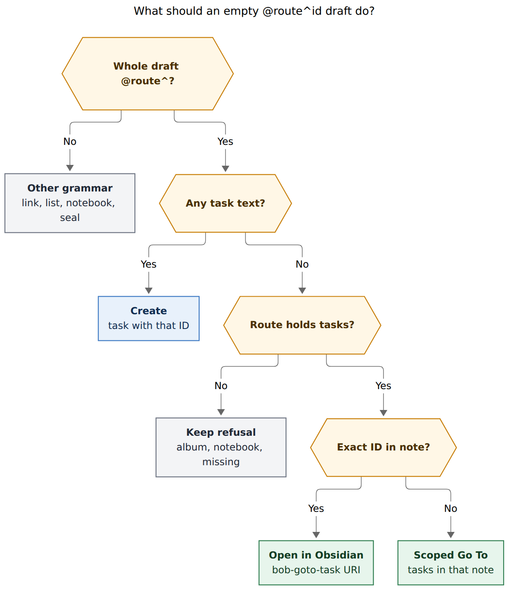
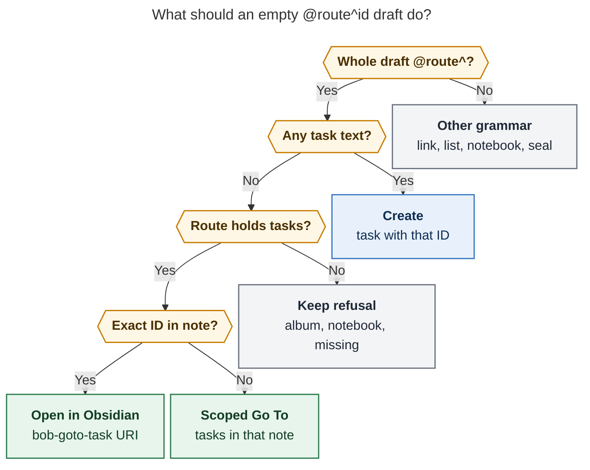
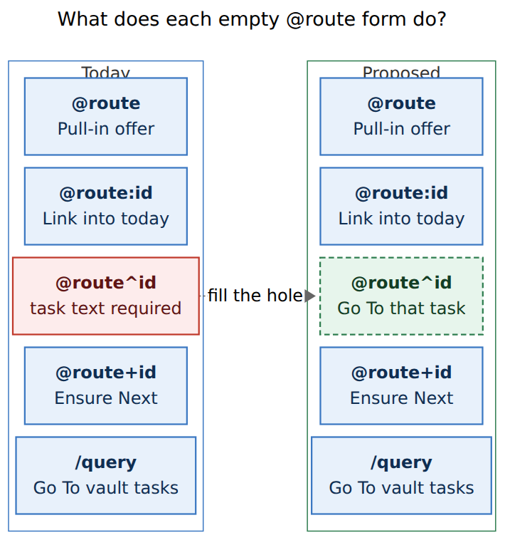
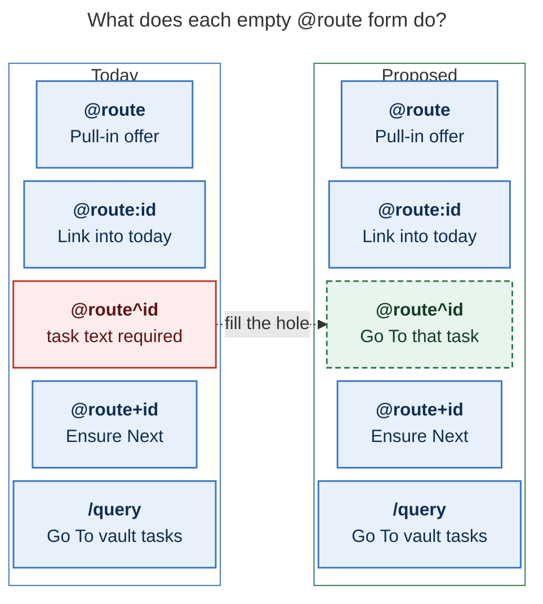

# `@foo^bar` in Capture: scoped Go To, with an exact-address fast path

> **Research query:** How should captures of the form `@foo^bar` complement `/`
> search, so that submitting `@bob^intention-rollovers` jumps to the `^bar` task
> in `foo.md` the way picking a row from the Go To picker does? Lead the design
> so it is intuitive, reliable, and beautiful. Critique the plan, call out
> justified requirement adjustments, and end with a recommended solution.


*Live failure, 2026-11-25. Parse treats the draft as a complete new task with
block ID `intention-rollovers`; `bob capture --dry-run` then dies because the
body is empty. The Open chip sits in the footer with nothing to open.*

## Bottom line

**Build it. It is a good idea, and the request already names the right
address.** `@foo^bar` should be the *known-note* complement of `/`: `/` searches
every linkable task, `@foo^` searches the tasks in `foo.md`, and a fully spelled
`@foo^bar` whose `^bar` exists in that note opens immediately.

The screenshot is a grammar hole, not a missing hotkey. Every other empty
`@route` family already means something (`@route` pull-in, `@route:id` link,
`@route+id` Ensure Next). Empty `@route^id` is the leftover: parse reports a
complete `task`, the panel enables Capture, and execution says `task text is
required`. Filling that hole with Go To is the dual of `@route:id` (empty body
operates on the existing task) and the dual of `/` (vault-wide search versus a
note address).

**Recommended shape:**

1. **bob-cli** claims a whole-draft empty `@route^query` token. Incomplete
   queries (`@foo^`, `@foo^int`) need `task_goto` with `picker.scope: "note"`.
   An exact existing ID is a complete `task_goto` with a landing payload.
   `bob capture` writes nothing. Dry-run succeeds for the exact form so the
   preview can show the destination. The create path `Buy milk @foo^new-id`
   stays exactly as it is.
2. **Bob Mac Capture** reuses the Go To card. Scoped rows filter to that note.
   An exact unique landing skips the extra pick: the preview becomes a
   destination card, the primary button reads **Open**, and Return / Capture /
   Control-Return dispatch `obsidian://bob-goto-task`.
3. **bob-plugins** needs no work. The URI, re-find order, leaf reuse, and Vim
   jump already exist from `/`.

This is a two-repo change, smaller than `/` was, on rails that already land a
caret on a task line.

## Is this a good idea

**Yes.** Three reasons, each already sitting in the product:

- **The user typed an address, and Bob already has addresses.** A task's
  identity in the vault is `^id` on a note. `@bob^intention-rollovers` reads as
  "the `^intention-rollovers` task in `bob.md`". `/intention-rollovers` is the
  search when the note is unknown. Both belong.
- **The empty-body dual is already the house rule for `:`.**
  `docs/reference/capture-syntax.md` defines `@route:block-id` with no other
  text as *link the existing task*. `@route:block-id` with text *creates* a
  Next task and links it. Empty `@route^id` should be the read-only sibling of
  that empty colon form. A glued `.` already toggles complete `@route:id` ↔
  `@route^id`; after this change that toggle is link ↔ Go To, which is the
  meaning the keys already suggest (`:` writes a Task Link, `^` names the
  block).
- **The transport and the picker card already exist.**
  `research:202610/slash_task_goto_in_obsidian/slash_task_goto_in_obsidian.md`
  built `task_goto` and `obsidian://bob-goto-task`.
  `research:202611/note_goto_double_slash/note_goto_double_slash.md` added
  scoped Go To for notes. This feature is "the same card, one note, caret
  address."

The honest costs, each with a bound:

1. **`@route^` with an empty body stops being a new-ID prompt.** Today
   `capture-parse -- '@bob^'` needs `block_id` and completion returns empty
   `candidates` with `block_id.intent: "new"`. After the change, an empty body
   opens existing tasks. Creating with an explicit ID still works: type the
   text first (`Fix flicker @bob^new-id`) or add text after a novel ID. That
   is the same rule `:` already uses.
2. **A forgotten body on an existing ID will jump instead of error.** Today
   that submit fails. Creating with the same ID also fails (`block ID
   ^intention-rollovers already exists in /home/bryan/bob/bob.md`, live
   dry-run 2026-11-25). Jumping to the task that already owns the ID is the
   useful outcome of that keystroke.
3. **The panel becomes a navigator for one more complete draft.** `/` and `//`
   already do this as pickers. The new complete form is a draft that looks
   like a capture and behaves like a Go To accept. The preview copy
   ("nothing is written") and the relabelled **Open** button have to make
   that obvious.

**Would I take a different approach?** I would not invent a new sigil, and I
would not implement this as a Mac-only special case of the current error
string. I *would* widen the request from "exact `@foo^bar` submit" to "scoped
Go To, with an exact-address fast path." The screenshot is the fast path. The
feature people will use every day is `@bob.` (the existing `.` → `^` alias)
opening the tasks in `bob.md`.

## What exists today

Every fact below was checked on 2026-11-25 against installed `bob 0.6.0`
(grammar 29), the bob-cli tree at grammar 30, `docs/capture.md`, and the live
vault `~/bob`.

| Fact | Evidence |
| --- | --- |
| `@bob^intention-rollovers` parse is a **complete** `task`: `ok: true`, `mode: "task"`, `needs: []`, `route: "bob"`, `block_id: "intention-rollovers"`, body `""`, no diagnostics. | `bob capture-parse -f json -- '@bob^intention-rollovers'` |
| The same draft's dry-run **fails**: `task text is required; pass TEXT or pipe it on stdin`. That is the screenshot. | `bob capture --dry-run --format json -- '@bob^intention-rollovers'` |
| `@bob^` (no ID) is incomplete needing `block_id`, with an `interactive_placeholder` on the caret. | `bob capture-parse -f json -- '@bob^'` |
| Completion at that caret is `task_block_id`, `candidates: []`, `block_id.intent: "new"`. Existing IDs are a **denylist** in `block_id.used`, never goto rows. | `bob capture-complete -c 5 -f json -- '@bob^'`; `docs/capture.md` ("never offers existing task block IDs for that side") |
| `bob.md` currently lists **98** used IDs, **96** of them tasks, including `intention-rollovers` and the in-progress `capture-hat-jumps` ("Allow `@foo^bar` syntax to jump…"). Status mix: 50 Blocked, 20 Done, 8 Canceled, 7 In Progress, 6 Todo, 5 Next. | `block_id.used` on the same complete call; `~/bob/bob.md` lines 69 and 82 |
| The screenshot task lives at line 82: `- [*] #task Add support for "intention rollovers" … ^intention-rollovers`. | `~/bob/bob.md:82` |
| Empty `@bob:intention-rollovers` is already a **complete write**: `mode: "pomodoro_link"`, dry-run `ok: true`, `open_notes` lands on `bob.md` line 82 (`ref 82:68984d78`, `block_id: intention-rollovers`) plus today's daily note. | `bob capture-parse` / `bob capture --dry-run --format json -- '@bob:intention-rollovers'` |
| Creating with that same ID fails on duplicate, so the empty caret form cannot become a create-by-accident. | `bob capture --dry-run -- 'hello @bob^intention-rollovers'` → `block ID ^intention-rollovers already exists` |
| `/intention-rollovers` parse is `incomplete` needing `task_goto`, and `bob capture` refuses with a teaching error. The Mac skips the doomed dry-run and opens the vault-wide Go To picker. | `docs/capture.md` "Going to a task with '/'"; `task_goto.rs` T3 copy |
| `obsidian://bob-goto-task?path&line&ref&block` re-finds by planned line digest, then `^block`, then unique digest, centres the line, records `<C-o>`. It writes nothing. | `docs/reference/plugins/goto-task-uri.md` |
| The Mac Go To picker accept dispatches that URI, hides, and discards the draft. Control-C on a Go To draft does not stash. | `docs/reference/mac-capture/task-pickers.md` |
| The footer **⌃↩ Open** chip captures and then opens `open_notes`. It is disabled until Capture is enabled, and a failed preview leaves it with nothing to open. | `docs/reference/mac-capture/capture-panel.md` "Open chip"; the screenshot |
| `.` right after `@route` rewrites to `^` (`block_id_after_route`). A trailing `.` toggles complete `@route:id` ↔ `@route^id`. | `glossary:capture-alias`; `docs/capture.md` rewrite; `docs/reference/mac-capture/typing-tips.md` |
| `@route` alone is pull-in, `@route^id@` is a project-note seal, notebook `@nb^id` writes a named note, `@eat/` is a record route. | `docs/capture.md` rows 112, 119, 126, 175; `decisions:notebook-routes-write-notes` |
| Grammar revision in tree is **30**; this feature needs **31**. `schema_version` stays 1. | `src/native/capture_language/mod.rs` `GRAMMAR_REVISION` |
| Thin client: the app never decides syntax. New behaviour lands in bob-cli and `docs/capture.md` first. | `decisions:mac-capture-is-a-thin-client` |
| No new subcommand under `bob capture` (TEXT would swallow it). | `cli_rules.md` |

The parse/execute split is the reliability bug. Incomplete `/` never looks
capturable. Complete empty `@bob^intention-rollovers` looks capturable, so the
panel runs dry-run and paints the error in red twice (live preview plus the
failed-preview banner).

## Requirement adjustments

Each change to the request is called out with its reason.

| # | As requested | Adjusted to | Why |
| --- | --- | --- | --- |
| **R1** | Submitting `@foo^bar` jumps to `^bar` in `foo.md` | Claim only a **whole-draft, single-line, single-token** empty-body `@route^query`. Mixed bulk (`@foo^bar` plus `Buy milk`) keeps today's create/error rules. | Go To leaves the app and discards the draft, the same reason `/` is whole-draft (`research:202610/slash_task_goto_in_obsidian`). |
| **R2** | The form is `@foo^bar` | Empty body is the claim. **`Buy milk @foo^bar` still creates** an ordinary task with that block ID. | That create is documented and tested. Empty vs nonempty is the same dual `@route:id` already uses. |
| **R3** | Jump, "just as if `/` search then select" | **Outcome** matches `/` accept (URI, hide, discard, no writes). **Query** is scoped to that note. `@foo^` and `@foo^int` open a scoped Go To picker; a unique **exact** ID is a complete landing. | `/` is the finder when the note is unknown. `@foo^` is the finder when it is known. The screenshot is the exact-address fast path of that picker. |
| **R4** | (implicit: Capture button) | Exact unique landing: preview is a destination card, primary button reads **Open**, Return / Capture / Control-Return / the Open chip all dispatch `bob-goto-task`. Incomplete queries keep the picker, and Capture of an unresolved query stays a teaching refusal. | The screenshot's blue **Capture** is the button Bryan pressed. Relabelling it Open is how the panel tells the truth. |
| **R5** | (implicit: open tasks) | Exact address resolves **open or closed** rows in that note. The scoped picker defaults to open tasks and uses Command-X for completed rows **in that note**. Missing-from-note IDs stay a miss (`use / to search`). | An address should find a done row still sitting in `foo.md`. `block_id.used` already includes Done/Canceled (20 + 8 in `bob.md` today). Vault-wide archive search remains `/` ⌘X. |
| **R6** | (unspecified miss) | Unknown ID: scoped picker with zero rows and copy `No task ^nope in bob.md · add task text to create it`. Exact-existing duplicate create keeps the current duplicate-ID error. | `task text is required` is the wrong lesson. The ID was the point. |
| **R7** | (unspecified other routes) | **Task-bearing notes only** (inbox, area, non-terminal project), the same catalog `/` and `:` use. Notebook `@nb^id`, album `@eat^`, record `@eat/^stem`, and sealed `@route^id@` keep their current meanings. | `^` is already overloaded. Stealing notebook named-notes or the project-note seal would be a real contract break. |
| **R8** | (unspecified prefix match) | **Exact ID** (case-preserving, the authored block ID) is the fast path. Prefixes such as `@bob^intention` stay in the picker even when one row would match. | Unique prefixes rot when a second `intention-*` task appears. `/`'s filter already handles "close enough." |
| **R9** | (unspecified CLI) | `bob capture` of an exact landing **succeeds, writes nothing**, `kind: "task_goto"`, one `open_notes` entry, human line `→  bob.md  ^intention-rollovers`. Incomplete queries refuse with a teaching error, like `/`. | A fully specified address is a resolver, not an unfinished picker. Dry-run success also lets the existing Open-chip preview pipeline light up. |
| **R10** | (unspecified compatibility) | Grammar **31**. Additive JSON: `picker.scope: "note"` on incomplete `task_goto`; complete items gain mode `task_goto` and a `task_goto` landing object. Old Mac plus new bob: exact form dry-run succeeds so **Open** works; Capture hides without jumping until the app ships. New Mac plus old bob: same screenshot as today. | Thin client, `decodeIfPresent`, no junk inbox task. |

## Recommended solution



*A whole-draft empty `@route^` token is Go To. Exact IDs open the task.
Anything else opens a picker scoped to that note. Task text still creates.
Rendered size: 829.3 × 962 px; fit scale: 78.7%. Mermaid CLI 12.0.0.*





*Today every empty `@route` family has a meaning except caret, which errors.
The proposal fills that hole with Go To, beside `/` vault search and `:`
linking. Rendered size: 472.5 × 506 px; fit scale: 100%. Mermaid CLI 12.0.0.*



### Claim

Add a predicate beside `task_goto_query_token`, shared by execution, editor
parse, and completion:

- the draft is exactly one item, one physical line, one whitespace-delimited
  token (surrounding whitespace ignored, same as `/`);
- the token matches `@<route>^<query>` with a resolvable route grammar
  (`body @bob^id` mid-text stays literal, as today);
- the item body is empty after markers: no task text, no `#type`, no `%c`,
  no `s:<N>`, no `$<N>`, no child bullets, no seal `@`;
- the route is a task-bearing capture target.

`@bob^intention-rollovers extra` has body `extra` and stays create.
`@bob^intention-rollovers@` stays `project_note`.
`x @bob^intention-rollovers` stays a close (the `x` claims the item).

### Parse

| Draft | Mode | Needs | What the panel does |
| --- | --- | --- | --- |
| `@bob^` | `incomplete` | `task_goto` | Scoped picker, empty filter |
| `@bob^intention` | `incomplete` | `task_goto` | Scoped picker, query `intention` |
| `@bob^intention-rollovers` (exact unique in `bob.md`) | `task_goto` | `[]` | Destination card, Open |
| `@bob^nope` (well-formed ID, missing) | `incomplete` | `task_goto` | Scoped picker, zero rows, create teaching |
| `Fix @bob^new-id` | `task` (unchanged) | `[]` or `block_id` | Create |

Incomplete items: one `interactive_placeholder` over the `^query` (route span
kept), plus a `picker` descriptor

```json
{
  "kind": "task_goto",
  "scope": "note",
  "scope_token": "@bob^",
  "route": "bob",
  "marker_range": {"start": 0, "end": 5},
  "trigger_removal_range": {"start": 0, "end": 5}
}
```

Complete exact items: `needs: []`, and an additive `task_goto` landing object
with the same fields a Go To row already carries (`note_path`, `target`,
`line`, `ref`, `block_id`, `text`, `status_symbol`, `status_name`, `section`).
The Mac can dispatch without a second complete call.

Skip the doomed dry-run while `needs` contains `task_goto`, as today's `/`
path does. For the complete form, dry-run is allowed to succeed (next
section) so a destination preview can reuse `open_notes`.

### Complete

Reuse context `task_goto`. When `picker.scope` is `note`:

- rows are the `/` catalog **restricted to that note** (document order on an
  empty query, same ranker on a nonempty query);
- ID-less rows are included and open by line, same as `/` (navigation never
  mints an ID);
- each row keeps `replacement: ""`;
- `-C` / Command-X lists completed rows **in that note**, newest close first;
- the caption data the app already shows as `Go To · Tasks` becomes
  `Go To · bob.md` from `scope_token` / `route`.

`block_id.used` is the denylist for **create**. Do not promote it to the
picker. Emit real `task_goto` candidates so `ref`, `target`, and ID-less rows
stay in contract. `used` can still feed the create-side collision list when
body text is present.

With body text, `@bob^` stays `task_block_id`, empty `candidates`, intent
`new`. That split — empty body goto, nonempty body create — is the whole
design.

### Execute

- Incomplete `@route^query`: refuse before other item parsers. Teaching
  error: `` `@bob^int` opens Go To in bob.md; pick a task to open it in Obsidian — it never captures ``.
- Complete exact `@route^id`: succeed, write nothing, `kind: "task_goto"`.
  Human: `→  bob.md  ^intention-rollovers`. JSON: `ok: true`,
  `open_notes: [{path, relative_path, role: "note", label, line, ref, block_id}]`
  with **no day-file entry** (nothing in today changed). Include the same
  landing fields on the item.
- Create with text and a live ID: keep `block ID ^id already exists`.
- Route missing, album, notebook: keep those refusals.

Real capture and dry-run of the exact form are identical. There is nothing to
commit.

### Bob Mac Capture

One card, one new scope, no new chrome.

**Incomplete (`needs: ["task_goto"]`, `scope: "note"`).** Auto-open the Go To
card. Caption `Go To · bob.md`. Scope capsule `@bob^`. Detail strip `↩ Opens
bob.md at ^id` / `at line N`. Keys match `/`: Return / Tab / click /
Command-Return / Control-Return go; Command-X toggles completed-in-note;
Escape clears then chip; Backspace on an empty filter removes `^query` and
leaves `@bob`; Control-C discards without stashing. Accept dispatches
`obsidian://bob-goto-task` with `path`, `line`, `ref`, and `block` when
present. Hide, discard the draft, never call `bob capture`.

Old Mac that opens `task_goto` as vault-wide `/` will show too many rows for
`@bob^` until it honours `scope`. Document the upgrade hint. Do not invent a
second need name; the card already exists.

**Complete exact (`mode: "task_goto"`, `needs: []`).** Do not open a one-row
picker. Show a destination card in the preview slot:

```
Go To  bob.md
[*]  Add support for "intention rollovers"
     ^intention-rollovers  ·  Next
↩ Opens bob.md at ^intention-rollovers — nothing is written
```

Relabel the primary button **Open**. Return, Capture, Control-Return, and the
Open chip all dispatch the same URI. On success, hide and discard (no
"Captured →" summary, no stash). Dispatch failure keeps the panel with
`Couldn't open Obsidian`, same as `/`.

**`. ` after `@bob`. ** The existing rewrite `@bob.` → `@bob^` now opens the
scoped picker when the body is empty. That is the beautiful everyday path:
home-row `.`, browse this note, Return, land. The `block_id_after_route` typing
tip ("next time · . after a route") stays true.

**Glued `.` toggle.** Empty `@bob:intention-rollovers` ↔ `@bob^intention-rollovers`
becomes link ↔ Go To. Preview has to switch from a write plan to a destination
card in one edit. With text, the toggle stays create-and-link ↔ create-with-ID.

### Docs and tests

- `docs/capture.md` table row and a subsection "Going to a task with
  `@route^id`", next to the `/` and `:` sections.
- `docs/reference/capture-syntax.md` empty-body caret dual, beside
  `#link-existing`.
- `capture-parse` / `capture-complete` / `capture` help (alphabetised
  options, `cli_rules.md`).
- Mac `task-pickers.md`, `keyboard.md`, `protocol.md` capability row
  (`picker.scope: "note"` on `task_goto`; complete `task_goto` landing).
- Goldens:
  - `@bob^`, `@bob^int`, `@bob^intention-rollovers` (fixture with that ID);
  - `Fix @bob^new-id` still creates;
  - `hello @bob^existing` still duplicate-ID;
  - `@bob^id@` still project note;
  - `@bob^id` plus a second item stays prose/create;
  - `/intention-rollovers` unchanged;
  - candidate JSON shape and `picker.scope`;
  - dry-run of the exact form writes no files and lists one `open_notes`
    entry.

Mark the grammar bump in the usual place (`GRAMMAR_REVISION` 31). This is
additive for successful captures (the empty form currently errors), so the
release train does not need `!` unless product later treats parse `mode`
changes as breaks.

### Rollout

1. bob-cli claim, parse, complete, execute, docs, goldens. Install `bob` on
   the Mac.
2. Bob Mac Capture scoped picker + complete landing + Open relabel. macOS CI
   on the exact SHA.
3. No plugin change. Manual check: warm Obsidian, cold Obsidian, note already
   open in a split, folded heading, closed task in `bob.md`, miss ID, create
   with text.

Effort: about two days (bob-cli ~1, Mac ~1 plus CI), in the same band as `//`.

## Beautiful specifics

These are the details that make the feature feel designed rather than bolted
on.

- **One eye line.** The destination card sits where the idle agenda and the
  picker sit. The editor never moves. Failed-preview red is gone for this
  draft.
- **The button tells the truth.** A goto draft's primary action is Open. The
  screenshot already has an Open chip; the chip and the primary button become
  the same action, so there is one way to be right.
- **`@bob.` is the gesture.** Shift-`^` is the expensive key; `.` after a
  route is already the alias. Empty-body `@bob.` should feel as obvious as
  empty-draft `\` opening `/`.
- **Link and jump sit on one toggle.** People who arrive via `@bob:id` and
  tap `.` should see the preview flip from "Linked under …" to "Opens bob.md
  at ^id" without retyping the ID.
- **Misses teach create, creates refuse duplicates.** The empty form never
  files a junk task named after a block ID. The nonempty form never silently
  overwrites.
- **Copy is quiet.** Detail strip and destination card both say
  `nothing is written`. `/` already uses that voice.

## Alternatives considered

| Approach | Why it loses |
| --- | --- |
| Teach people to use `/intention-rollovers` only | Vault-wide search is noisy (`bob.md` alone is 96 identified tasks). Bryan already knew the note; he typed `@bob^`. |
| New sigil (`@foo/bar`, `?foo^bar`, ⌘O) | `@eat/` is the record route. `^` is the identity sigil. `/` is already Go To. |
| Make empty `@foo:bar` the jump | Empty colon **links** today, a write Bryan uses. Live dry-run of `@bob:intention-rollovers` is a real ledger edit. |
| Mac-only: if dry-run says missing text and the draft looks like `@route^id`, dispatch a URI | Violates the thin-client record. CLI, parse, and every other client keep the screenshot error. Line/ref/block would be guessed in Swift. |
| Always open a picker, even for an exact ID | The screenshot is Bryan pressing Capture on a fully spelled address. A second Return is friction the dual with `:` does not charge (empty `@route:id` captures immediately). |
| Succeed through `open_notes` only, reuse Control-Return | `open_notes` after a link also opens today. A goto must not touch the day file. `/` already standardised on `bob-goto-task` for single-task landing and re-find. Use that URI. Dry-run `open_notes` is a preview convenience, not the accept transport. |
| `@foo` empty opens the note | `@foo` is pull-in. `//foo` is note Go To. Leave them. |
| Prefix-unique auto-jump (`@bob^intention` → `intention-rollovers`) | Unstable once a second `intention-*` ID exists. The picker is the right place for close-enough. |
| Scoped picker built from `block_id.used` | `used` is a create denylist: no ID-less rows, no `ref`/`target`, includes Done mixed into "new ID" collisions. Emit `task_goto` candidates. |

## Risks and acceptance checks

- **Create-ID flow.** `Fix flicker @bob^` must still need `block_id` with empty
  candidates. Goldens for body-present vs body-absent at the same caret.
- **Seal and notebook.** `@bob^id@` and notebook `@nb^id` must not enter the
  goto claim. One fixture each.
- **Old Mac vault-wide picker.** Incomplete `@bob^` reported as `task_goto`
  without `scope` handling will list the whole vault. Ship the app change in
  the same train as bob, and keep `scope` additive so an old app still
  *jumps*, just from a wider list.
- **Capture vs Open on old Mac.** Exact form dry-run success enables the Open
  chip. Capture on an old app will hide without jumping. Acceptable for one
  train; the relabel is the Mac half.
- **No writes.** Accepting an identified row, an ID-less scoped row, and the
  exact fast path leaves `git status` clean on the vault. Duplicate-create
  still refuses before any write.
- **Landing quality.** Same list as `/`: Obsidian warm and cold, note already
  open, folded heading, Reading view, `<C-o>` back, Unicode paths, a closed
  row in `bob.md`, a miss.
- **Toggle flicker.** Flipping `.` on `@bob:id` must not flash the red
  missing-text error in between. Parse of both complete forms has `needs: []`.
- **Stash.** Control-C on a goto draft discards, matching `/`. A leftover
  `@bob^id` must never restore as a canceled create.

## Open questions for Bryan

1. **Primary button copy.** Relabel to **Open** on a complete goto draft
   (recommended), or keep **Capture** and have it jump? Relabel is the
   honest one; the screenshot already shows both buttons.
2. **Command-X in the scoped picker.** Completed rows in that note
   (recommended), or vault-wide completed like `/`? In-note matches the
   address. `/` remains the vault search.
3. **Should `@bob.` with an empty body auto-open the picker the way `/`
   does?** Strong yes; it is the home-row path. Confirming because today
   that alias opens a new-ID prompt.

## Follow-ups not in v1

- **⌥↩ Go To** on `:` / `!` / `&` / `+` rows, as the `/` research already
  reserved. One URI, many pickers.
- **Notebook `@nb^id` empty** jumps to the named note bullet. Different
  catalog, different URI (`bob-open-notes` without a line, or a future
  heading lander).
- **Option-Return on the scoped picker** to insert `@route:id` (link)
  instead of jumping. Probably more confusing than useful; the `.` toggle
  already switches the draft.
- **Decision record** after shipping, through `/sase_memory_write`:
  *Empty `@route^id` is Go To; nonempty `@route^id` still creates; `/` stays
  vault-wide; navigation never writes.*
- **CLI URI line** on JSON (`uri: "obsidian://bob-goto-task?…"`) so Terminal
  `open` can consume it. Nice, not required for the panel.

## Sources

- Live probes, 2026-11-25, installed `bob 0.6.0` (grammar 29) against
  `~/bob`: `capture-parse` / `capture-complete` / `capture --dry-run` for
  `@bob^intention-rollovers`, `@bob^`, `@bob:intention-rollovers`,
  `hello @bob^intention-rollovers`, `/intention-rollovers`.
- Vault: `~/bob/bob.md` (`^intention-rollovers` line 82, `^capture-hat-jumps`
  line 69), screenshot `~/tmp/screenshots/20261125_135534.png`.
- bob-cli: `docs/capture.md`, `docs/reference/capture-syntax.md`,
  `src/native/capture_language/{mod,tokens,item,editor_parse,line}.rs`,
  `src/native/capture_complete/cli.rs`, `tests/cli/capture/task_goto.rs`,
  `src/native/capture/tests/grammar.rs` (`"@cash^id"` → missing text).
- Mac: `docs/reference/mac-capture/{task-pickers,capture-panel,keyboard,protocol,typing-tips}.md`.
- Plugin: `docs/reference/plugins/goto-task-uri.md`.
- Memory: `decisions:mac-capture-is-a-thin-client`,
  `decisions:capture-sigils-say-where-what-how`,
  `decisions:notebook-routes-write-notes`,
  `glossary:capture`, `glossary:capture-alias`, `glossary:capture-panel`,
  `cli_rules.md`.
- Prior research: `research:202610/slash_task_goto_in_obsidian/slash_task_goto_in_obsidian.md`,
  `research:202611/note_goto_double_slash/note_goto_double_slash.md`,
  `research:202611/capture_alias_typing_tips/capture_alias_typing_tips.md`.
- Figures rendered with `@mermaid-js/mermaid-cli@12.0.0`, PDF-mirroring
  config, DejaVu Sans.
