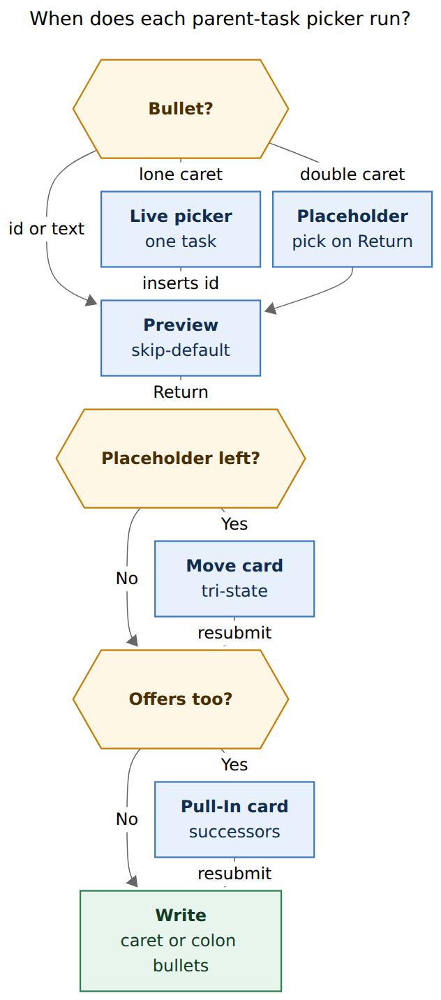
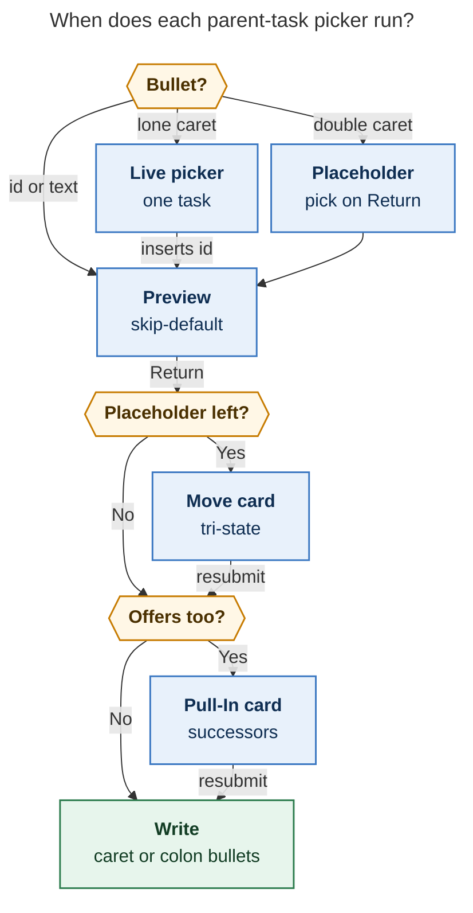
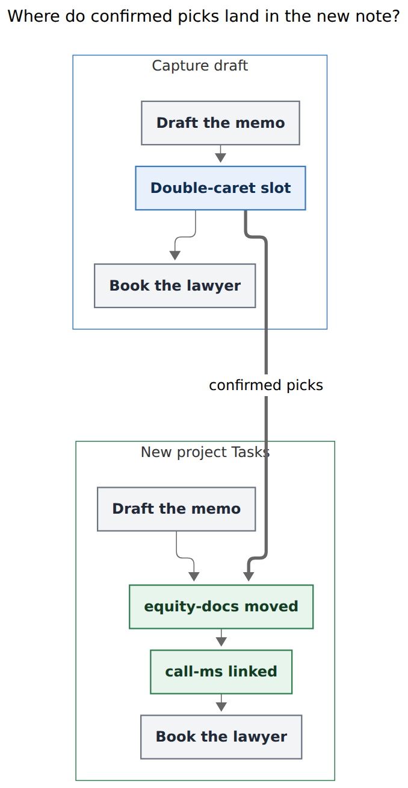
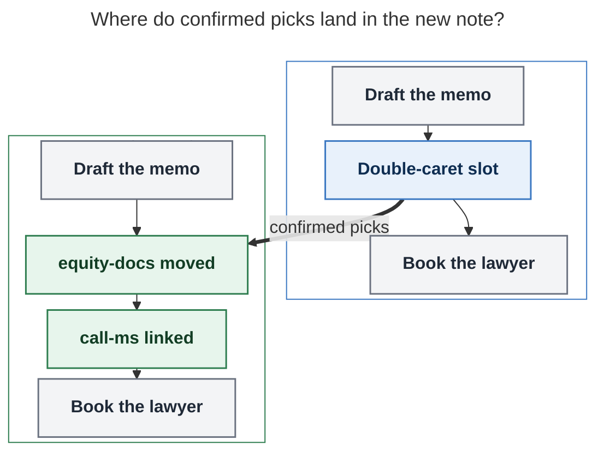
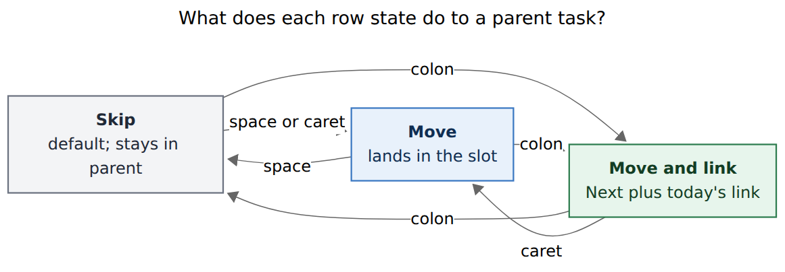
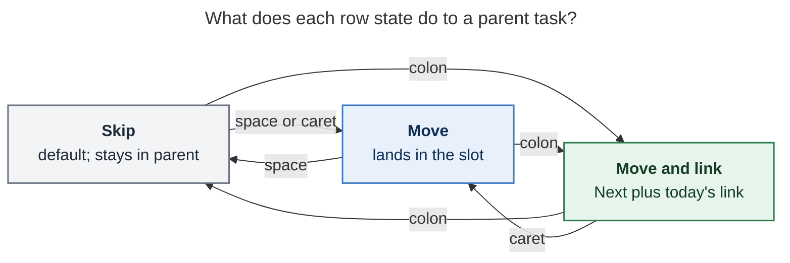

# Double-caret batch move choice for project-note capture

> **Research query:** When a sealed `@foo^bar@` / `@foo:bar@` item already
> moves parent tasks with `- ^id` / `- :id` (epic `bob-cli-gl`), how should a
> new `^^` bullet — whose only contents are `^^` — prompt after submit for
> one or more parent tasks, apply the picks as if those move bullets had been
> typed, and support `^`, `:`, and skip (the default), taking inspiration from
> the successor Pull-In card? Is this a good idea, would a different approach
> be better, which requirement adjustments are justified, and what is the
> recommended solution?

Researcher: **grk**. Independent of the other swarm reports.

Figures rendered with Mermaid CLI **12.0.0** (PDF-mirroring config, DejaVu
Sans, `useMaxWidth: false`). Measured fit against a 652.8 × 892.8 px text box:

| Figure | Size | Fit |
| --- | --- | --- |
| Picker timing | 420.7 × 956 px | 93.4% |
| Row states | 773.4 × 270 px | 84.4% |
| Slot expansion | 451.6 × 872 px | 100.0% |

## Bottom line

**Build it, with one important timing adjustment.** A first-level bullet whose
body is exactly `^^` inside a sealed project-note item should be a **batch
move placeholder**: it names the slot, it does not name a task, and it waits
for a Pull-In-shaped card that speaks `^` / `:` / skip. Skip is the default.
Confirmed picks execute through the existing `bob-cli-gl` move engine, in
parent-document order, as if `- ^id` / `- :id` bullets had been typed at that
slot.

This is a good idea because it fills a real gap the live picker leaves open:
scanning a parent and mixing move-only with move-and-link in one glance. It
is a bad idea if `^^` opens another live picker while typing, or if it reuses
`--pull-in`. Those two collisions are the whole design.

The requirement I would change: **the card should run after Return and before
any vault write**, using the successor refusal protocol, rather than after a
successful capture. That is what “prompt after they submit” already means on
the Pull-In card. The vault stays untouched until the choice is answered.

Recommended spelling, protocol, and card are in
[Recommended solution](#recommended-solution).

## What already exists (verified)

- **F1.** Epic `bob-cli-gl` (plan `plan:202611/capture_move_bullets.md`,
  research `research:202611/parent_task_move_bullets/parent_task_move_bullets.md`)
  shipped move bullets. In a sealed `@<route>^<id>@` / `@<route>:<id>@` item,
  a first-level bullet whose body is only `^<id>` moves that open top-level
  parent task into that `## Tasks` slot; `:<id>` also makes it Next and
  links it. Landed 2026-11-04.
- **F2.** A lone `- ^` / `- :` is incomplete (`needs: ["project_task_move"]`).
  Bob Mac Capture opens the live move picker the moment the sigil is typed.
  Return inserts the ID (the sigil survives); Shift-Return inserts Bob’s
  `continuation` (`"\n- ^"` / `"\n- :"`) and reopens. ID-less rows go through
  Add block ID. Escape leaves the lone sigil. Contract:
  `docs/capture.md` “Moving parent tasks in”; Mac:
  `docs/task-pickers.md`, `project_task_move` spans.
- **F3.** The shared lexer `capture_language/move_bullet.rs` claims a
  first-level body that starts with `^` or `:`. A following word must start
  with an ASCII alphanumeric or the line is **not** a move bullet (`return
  None`). A body of `^^` therefore falls through to the new-task path today.
- **F4.** On a parent line, `^^` is already a caret lookalike and stays
  ordinary prose (`CaretTokenShape::Prose`, `editor_spans.rs`). Wikilink
  `[[^^block` is vault-wide block search. Plugin `^^` completes a
  `[[note#` marker (`block-id-prompt`). Those languages do not claim a
  first-level capture bullet whose body is only `^^`.
- **F5.** Consequently `- ^^` in a sealed project-note item currently
  **succeeds** as a new task titled `^^`. Giving that body a new meaning is
  a grammar break. `GRAMMAR_REVISION` is **10**.
- **F6.** Successor offers (`docs/task-dependencies.md` §12;
  `decisions:unblocked-tasks-are-offered`) are the post-Return choice
  protocol: `bob capture` never prompts; Mac sends hidden
  `--require-pull-in-choice`; bob refuses write-free with
  `code: pull_in_choice_required` plus numbered keyed offers; the Mac
  Pull-In card collects marks; a second submit sends `-p/--pull-in`.
  Nothing is pre-checked. Return applies marked rows, **or the highlighted
  row when none are marked**. Shift-Return is Skip. Escape returns to the
  draft. Capability-gated so an old bob never files the flag as task text
  (`BobProcessClient.swift`).
- **F7.** Inbox-route choice stacks behind pull-in: IR7 says the pull-in
  refusal wins. Mac handles `pull_in_choice_required` before
  `inbox_route_choice_required` (`CapturePanelModel.swift`).
- **F8.** `@<route>:<id>@` creates the project and then offers its open
  tasks as successors (`docs/capture.md` “Offer a new project's tasks”).
  Explicit `- :id` / `- :<id>` move bullets already count as linked and
  drop out of that offer set (MV5).
- **F9.** The accepted move-bullet research **rejected** a submit-time
  “Bring tasks from `foo.md`?” checklist, because the choice lived outside
  the draft, the preview could not show it, and it could not say “between
  these two new tasks.” That rejection assumed **no placeholder**. A `^^`
  bullet is a placeholder, so the objection is reopenable.
- **F10.** Root area/project notes (the earlier census): 226 identified
  plus 265 ID-less open top-level tasks excluding `^prj` (54% ID-less).
  Shift-Return chaining is fine for two or three moves and tedious for a
  scan of a dozen.
- **F11.** Thin client (`decisions:mac-capture-is-a-thin-client`): bob
  owns grammar, eligibility, copy, replacements, and writes. The Mac
  presents. JSON grows additively (`decodeIfPresent`). Mac grammar gate
  still accepts `grammar >= 5`.
- **F12.** CLI rules: every public long option needs a short alias;
  options stay alphabetical; never add a subcommand under `bob capture`;
  `capture-*` names stay frozen siblings. `-m` is unused on `bob capture`.
- **F13.** Capture batch writes are atomic; move bullets already replace
  the parent last so a crash duplicates rather than loses a task
  (`docs/capture.md` MV13). `--move-from` must reuse that path, not invent
  a second writer.

## Is this a good idea?

**Yes, as a second front door beside `- ^` / `- :`, not as a replacement.**

The live picker is the precise tool: you already know the task, you type
`^` or `:`, you pick one, Shift-Return chains. `^^` is the survey tool: you
have decided to split `cash` into `cash_goog_exit`, you want to *look* at
the parent, and you want some rows to move, some to move-and-link, and most
to stay. That is a different job. The successor card is the right visual
family for it because it is already a multi-select, skip-heavy, post-Return
choice over a list bob authored.

Three reasons it is worth doing now, while move bullets are still warm:

1. **Ternary state is new capability.** The live picker is opened *as* `^`
   or *as* `:`. Mixing both means typing both sigils. A scan card can put
   skip / move / move-and-link on one row.
2. **CLI has no live picker.** Terminal capture today requires you to know
   IDs. A numbered `--move-from` list is the CLI equivalent of the card.
3. **Position stays in the draft.** Unlike the rejected “bring tasks?”
   overlay, `^^` sits between authored bullets, so “between the memo and
   the lawyer” is still a property of the draft.

What the request gets wrong, in order:

1. **“After they submit” must not mean “after the vault mutates.”**
   Successor offers taught this: the Mac presses Return, bob refuses
   write-free, the card runs, a second submit writes. If `^^` wrote the
   project first and moved afterwards, you would get two commits, a
   preview that lied, and a crash window. Use the refusal protocol.
2. **Do not open a picker on the second caret while typing.** Typing `- ^`
   already opens the live move picker (F2). A live `^^` picker would fight
   it. `^^` should be a *complete* placeholder: the live picker dismisses,
   a ghost title says “pick on Return,” and the card waits.
3. **Do not reuse `--pull-in` or the Pull-In highlight-as-pick rule.**
   Pull-in links recovered successors of a gesture that already happened.
   `^^` *moves* parent tasks into a project that does not exist yet.
   Pull-In Return with no marks still picks the highlighted row (F6). For
   `^^`, skip is the default, so Return with no marks must mean none.
4. **Do not treat `^^` as “move all.”** That would violate skip-default
   and would dump a large parent into the new note in one keystroke.

**Would I take a different approach?** I would still add `^^`. I would
**not** splice the expanded `- ^id` / `- :id` lines back into the visible
draft before write in v1 (the Mac would be rewriting grammar). Bob should
expand server-side from `--move-from` against the placeholder slot. The
card *is* the preview of the picks; the dry-run preview of the first Return
shows the skip-default project plus “will ask.” That is honest, because
skip is the default.

A later polish can splice Bob-authored bullets into the draft so ghost
titles appear on the explicit IDs; it is not required for v1 correctness.

## Requirement adjustments called out

- **A1. “after they submit the capture”**
  - *Adjusted to:* After Return, **before any write**, via a write-free
    `move_choice_required` refusal, then a resubmit with `--move-from`.
  - *Why:* Matches Pull-In / inbox-route (F6, F7). Keeps the batch atomic
    (F13). The user-visible moment is still “I pressed Return.”

- **A2. “prompt the user to select one or more tasks”**
  - *Adjusted to:* One card over every `^^` slot in the draft, grouped by
    destination. Zero picks is valid and is the default. “One or more” is
    the *capacity*, not a minimum.
  - *Why:* The request also says skip is the default.

- **A3. “added as `^foo` / `:foo` bullets as if the syntax was used directly”**
  - *Adjusted to:* **Execution semantics**, not draft rewriting. Bob
    plans the confirmed keys as `MoveBullet { sigil, id, slot }` at the
    placeholder’s index, then runs the existing move / link / stamp /
    parent-last path. The user’s draft still contains `^^` on the wire;
    `--move-from` is the answer.
  - *Why:* Thin client (F11). The Mac must not invent `- ^id` strings.

- **A4. Take inspiration from the successor prompt, including `:` and `^`**
  - *Adjusted to:* Same *card chrome* (filter, pinned section headers,
    44 pt two-line rows, fixed-height list, footer keycaps, Escape back
    to draft, capability gate). Different *row model*: tri-state skip /
    `^` / `:`, and Return-with-no-marks = none.
  - *Why:* Highlight-as-pick would silently move the focused row and
    violate skip-default.

- **A5. (unstated) live picker coexistence**
  - *Adjusted to:* Exact body `^^` is a complete token (`needs: []`).
    Typing the second caret dismisses `project_task_move`. Backspacing to
    one caret reopens it.
  - *Why:* F2. Without this, `^^` is untypeable.

- **A6. (unstated) mixing with explicit move bullets**
  - *Adjusted to:* Allowed. The card lists remaining movable parent
    roots. Rows already claimed by `- ^id` / `- :id` in the same item are
    muted (“already moving on line 3”). Duplicate IDs across the expanded
    set keep today’s `move_bullet_duplicate` / `move_task_id_collision`.
  - *Why:* Precise plus survey in one draft is the natural split.

- **A7. (unstated) CLI**
  - *Adjusted to:* Public `-m, --move-from PICKS` (`none`, `all`,
    `all:`, or a comma list of `N` / `:N` / `^N` / keys). Real capture
    with an unanswered `^^` always refuses write-free. Dry-run succeeds
    and advertises `move_choice.supported`. No hidden require flag.
  - *Why:* `^^` is an explicit ask, unlike optional successor extras.
    `-m` is free on `bob capture` (F12).

- **A8. (unstated) grammar**
  - *Adjusted to:* Bump `GRAMMAR_REVISION` 10 → 11 in a `feat(capture)!:`
    commit. `- \^^` stays a task titled `^^`.
  - *Why:* F3–F5. Today’s successful capture of a `^^` task changes
    meaning.

- **A9. (unstated) ID-less rows**
  - *Adjusted to:* Mint on confirm, same as a picked successor offer.
    Show “adds ^id” in the row meta. Do not open Add block ID inside the
    card.
  - *Why:* Stacking the Add block ID modal on a post-Return card is a
    worse interaction than successor’s already-shipped mint.

- **A10. (unstated) stacking with Pull-In**
  - *Adjusted to:* `move_choice_required` wins over
    `pull_in_choice_required`, which still wins over inbox-route (IR7).
    After `--move-from` is applied, a colon-sealed project may open
    Pull-In for remaining unlinked new-note tasks.
  - *Why:* Offers depend on what got moved (F8, MV5).

- **A11. (unstated) empty remainder**
  - *Adjusted to:* If every movable parent root is already an explicit
    move bullet, drop the placeholder with a preview warning and do not
    open the card.
  - *Why:* Nothing to ask.

- **A12. Discoverability**
  - *Adjusted to:* Extend today’s `move_hint` to mention both forms:
    `'- ^' moves one of cash.md's 12 open tasks; '- ^^' asks on Return`.
  - *Why:* MV17 already reports the hint when there are no move bullets.

## Recommended solution

### 1. The experience

You are splitting `cash` into a project for leaving Google:

```text
Finish the Google exit packet @cash^goog-exit@#admin
- Draft the resignation memo :draft-memo
- ^^
- Book the lawyer
```

While the caret sits on `- ^^`, the live move picker is **closed**. A ghost
title after the placeholder reads `pick from cash.md`. The preview card
shows the skip-default project (memo + lawyer only) and a quiet band:

```text
 ↪ Asks to move from cash.md · 12 open · skip is the default
```

Return does not write. The Move card opens:

```text
┌ Move into cash_goog_exit.md ──────── from cash.md · 12 open · skip default ┐
│ ⌕                                                                          │
├─ Tasks ───────────────────────────────────────────────────────────────────┤
│  ○  Collect the equity paperwork        [WORK 13:30]   ^equity-docs        │
│  :  Call Morgan Stanley about the 401k                 ^call-ms   Next·ADMIN│
│  ○  Renew the passport                  [Nov 6]        ⊕ ^renew-the-passport│
├─ Admin ───────────────────────────────────────────────────────────────────┤
│  ○  Pay the credit card                                ^pay-cc             │
│  ░  Draft-memo already on line 3                                           │
├───────────────────────────────────────────────────────────────────────────┤
│ space Move   : Link   ^ Move   ⌘A Move all   ⇧↩ None   ↩ Move 1            │
└────────────────────────────────────────────────────────────────────────────┘
```

Space on a row cycles skip ↔ move (`^`). `:` cycles skip ↔ move-and-link.
`^` forces move. Nothing starts marked. The right-hand capsule lights up
only for a marked row: empty for skip, route-accent “moves in” for `^`,
explicit-toggle yellow/green “Next · ADMIN” for `:`. Return with no marks
is **Continue** (same as `--move-from none`). Return with marks writes once.

The new note’s `## Tasks` order is:

1. Draft the resignation memo (authored, already Next + linked)
2. Collect the equity paperwork (moved, keep status)
3. Call Morgan Stanley… (moved, Next, linked under ADMIN)
4. Book the lawyer (authored Ready)

That is exactly the order `bob-cli-gl` would have produced for the
expanded draft:

```text
Finish the Google exit packet @cash^goog-exit@#admin
- Draft the resignation memo :draft-memo
- ^equity-docs
- :call-ms
- Book the lawyer
```



*A lone caret or colon opens the live picker while typing. A double-caret
placeholder waits for Return. Return opens the move-choice card before any
write; a colon-sealed project may then open Pull-In.*

Rendered size: 420.7 × 956 px; fit 93.4%.





*Selected parent tasks replace the double-caret bullet in parent-document
order, keeping authored tasks above and below the slot.*

Rendered size: 451.6 × 872 px; fit 100.0%.



### 2. Grammar

Scope is the same as move bullets: first-level `-` / `*` / `+` of a sealed
project-note item, claimed from the raw line before
`strip_trailing_task_id`. Extend `scan_move_bullet`:

| First-level body | Meaning |
| --- | --- |
| `^<id>` / `:<id>` | unchanged move / move-and-link |
| lone `^` / lone `:` | unchanged unfinished live picker |
| **`^^`** | **batch placeholder** (this feature) |
| `^^^`, `^^ id`, `^^s:2` | teaching error |
| `:^`, `^:`, `::` | unchanged (not claimed) |
| `- \^^` | literal task titled `^^` |

One placeholder per item. A second `^^` is `move_batch_duplicate`. Nested
bullets under it reuse `move_bullet_nested`. Checkboxes, markers, and
cross-note shapes reuse the existing codes.

`capture-parse` (grammar 11):

- Span `project_task_move_batch_marker` covers both carets (route accent,
  the same colour as `project_task_move_marker`).
- Mode stays `project_note` (or `pomodoro_project_note` when a `:` pick
  or an explicit `- :id` is also present). `needs` is empty: it is
  complete.
- `sub_bullet_moves` gains an entry `{sigil: "^", block_id: null,
  batch: true, range}` so clients can tell a placeholder from an
  unfinished lone `^` without inspecting characters.
- Human parse: `move batch ^^`.

A `#pomodoro` name on the item treats a placeholder as *not* a `:` link
for the unused-name rule, unless the eventual `--move-from` includes a
`:` pick or the item already has an explicit `- :id`.

### 3. Protocol (bob owns it)

**Dry-run** of a draft that still contains `^^`:

- Plan the project as if `--move-from none` (placeholder dropped, no
  moves from it).
- Advertise additive `move_choice: {supported: true, offer_count, slots,
  copy}` and a flat `move_offers[]` array.
- Each slot: `{item, parent, parent_route, destination, pomodoro_name,
  open_count, draft_range}`.
- Each offer: successor-like key, number, parent section, status, text,
  `requires_block_id`, suggested id, `already_moved_on` (nullable line),
  `selectable`, `muted_reason`, Bob-authored `consequence_move` and
  `consequence_link`.
- Keys: identified `<destination>|<parent_path>#^<id>`; ID-less
  `<destination>|<parent_path>@<8 hex of SHA-256 of clean description>`
  with `~k` on collisions, matching §12.2 KEYS plus destination so two
  `^^` slots that share a parent stay distinct.
- Order: slot draft order, then parent document order, including `#hide`
  and ID-less, excluding `^prj` and closed / nested.

**Real capture** with an unanswered `^^` and at least one selectable
offer: exit 1, `ok: false`, `code: move_choice_required`, same payload,
notes byte-identical. Teaching error:

```text
this capture has a ^^ move placeholder; pass --move-from
```

**`--move-from` / `-m`** (public, alphabetical, between `--inbox-route`
and `--no-clip`):

| Value | Meaning |
| --- | --- |
| `none` | drop every placeholder, write the skip-default project |
| `all` | every selectable offer as `^` |
| `all:` | every selectable offer as `:` |
| `1,3:,5` | numbers; a leading or trailing `:` means link |
| `^key,:key2` | keys; default sigil is `^` |

Unknown / stale / out-of-range picks are a teaching error and write
nothing, listing current offers (same shape as stale `--pull-in`).
`--move-from` on a draft with no placeholder is a teaching error.
`--move-from` on dry-run is planned and reported (`choice: "explicit"`).

Mac capability gate: send `--move-from` only after a preview whose
`move_choice.supported` was true, copied from the pull-in gate so an old
bob never files the flag as task text.

**Write path:** substitute each placeholder with the confirmed
`MoveBullet`s in parent-document order, then call the existing
`plan_project_note_item` move pipeline (eligibility, collisions, slot
placement, batch_move, freshness stamp, `:` link + dependency drop,
parent-last replace, `moved_tasks` / `move_summary` reporting). From
here the feature has no second writer.

### 4. The card (Mac presents it)

Clone `CapturePullInChoiceCard` into `CaptureMoveChoiceCard`. Do not
teach the Pull-In card a third checkbox state; the row model is
different and the two cards can appear in one Return.



*Skip is the default and leaves the task in the parent. Space marks a
move. Colon marks a move that also becomes Next and links. Both keys
toggle back to skip.*

Rendered size: 773.4 × 270 px; fit 84.4%.



**Chrome to reuse from Pull-In:** filter bar, context line, pinned
section headers (parent `##` headings; when several `^^` slots exist, a
destination group wraps them), 44 pt two-line rows, 2–6 visible rows,
fixed height at open, Escape back to the draft, stale-draft identity
checks, VoiceOver labels authored by bob.

**Chrome to change:**

| Pull-In | Move-choice |
| --- | --- |
| Binary checkbox | Tri-state glyph: hollow `○` / `^` chip (route accent) / `:` chip (explicit-toggle yellow) |
| Highlight counts as a pick | Highlight never counts; skip is the default |
| Return disabled at 0 marks (highlight usually saves it) | Return at 0 marks is **Continue** |
| Footer Skip ⇧↩ / Pull In N ↩ | Footer **None** ⇧↩ / **Continue** or **Move N** ↩ |
| Space toggles a mark | Space toggles skip ↔ `^`; `:` toggles skip ↔ `:`; `^` forces move |
| ⌘A marks all (pull in) | ⌘A marks all as `^` (move-only; linking all is the aggressive act) |
| Destination capsule turns green when effective | Capsule empty / “moves in” / “Next · ADMIN” |

Bob authors every string: title `Move into cash_goog_exit.md`, suffix
`from cash.md · 12 open · skip is the default`, per-row consequences,
muted reasons. The Mac colours spans and chips by kind and never
inspects the characters `^` / `:`.

When the item is colon-sealed, the context line adds `You'll choose
today's links next` so two cards in a row are not a surprise.

### 5. Refusal stacking

On a real submit, first refusal that applies wins, notes unchanged:

1. `pomodoro_override_refused` (already first)
2. **`move_choice_required`** (new)
3. `pull_in_choice_required`
4. `inbox_route_choice_required`

After the user answers `--move-from`, the resubmit may still refuse for
pull-in (colon seal, remaining unlinked tasks) and then inbox-route.
IRA13 already applies pull-in picks and a route in one batch; a
`--move-from` plus `--pull-in` plus `--inbox-route` resubmit is the same
pattern.

### 6. Surfaces

- **Bob Mac Capture:** first. Decode `move_choice` additively. On
  `move_choice_required`, open the card. Older bob: no field, `- ^^`
  stays a task, behaviour unchanged.
- **CLI:** dry-run lists numbered offers; real capture refuses until
  `-m`. Human hint: `-m 1,3: · -m none`.
- **Obsidian:** no capture panel. Plugin `^^` stays the wikilink
  picker. Out of scope.
- **Docs:** `docs/capture.md` table row + a short subsection under
  “Moving parent tasks in”; `capture-parse` / `capture` help;
  compatibility row; MV/MC-style **MB** vectors below. No glossary
  strand. Optional decision record (see [Memory](#memory)).

### 7. Phasing

bob-cli first, Mac second (F11).

1. **contract** — docs, copy table, MB vectors, grammar-bump decision.
2. **cli-grammar** — lexer `BatchPlaceholder`, parse spans, grammar 11.
3. **cli-protocol** — dry-run payload, `move_choice_required`,
   `--move-from` parser, expansion into existing move bullets,
   stacking vs pull-in, tests.
4. **mac-card** — decode, card, keys, capability gate, fixtures.
5. **mac-preview** — ghost title, asks-to-move band, hint copy,
   notification `Created cash_goog_exit · moved 2 of 12 from cash`.

## Conformance vectors (MB)

| ID | Draft / state | Expected |
| --- | --- | --- |
| MB1 | `@cash^x@` + `- ^^`; 3 movable roots; `--move-from none` | Project created; parent unchanged; placeholder dropped |
| MB2 | Same; `-m 1,3:` | Slot expands to `^id1` then `:id3` in parent document order; id2 stays; stamps, repairs, parent-last writes match MV1/MV4 |
| MB3 | `- New` / `- ^^` / `- Other` + `-m all` | `## Tasks` is New, then every moved root, then Other |
| MB4 | Mix `- ^a` and `- ^^`; a is already moved | Card mutes a; `-m` cannot pick a (`already_moved`) |
| MB5 | Two `^^` in one item | `move_batch_duplicate`; nothing written |
| MB6 | `- ^^ extra`, `- ^^^`, `- [x] ^^` | Matching teaching errors |
| MB7 | `- ^^` in a non-project item or nested | Unchanged: a task titled `^^` / existing nested meaning |
| MB8 | `- \^^` in a project-note item | Task titled `^^` |
| MB9 | Dry-run with `^^`, no `-m` | `ok: true`, skip-default plan, `move_choice.supported`, numbered offers |
| MB10 | Real capture with `^^`, no `-m` | `move_choice_required`; vault byte-identical |
| MB11 | `-m` with no placeholder | Teaching error |
| MB12 | Stale `-m 9` | Teaching error listing current offers; nothing written |
| MB13 | `@cash:x@` + `- ^^` + `-m 1` then offers remain | After move-choice is answered, `pull_in_choice_required` may still fire; moved `: ` equivalent rows are not offered (MV5) |
| MB14 | Require move-choice and inbox-route | Move-choice refusal wins |
| MB15 | ID-less pick | Mints an id, reports it, stamps, moves |
| MB16 | Parent missing / zero movable roots | Preview warning; real capture drops the placeholder (nothing to ask) |
| MB17 | Typing `- ^` then a second `^` | `needs` loses `project_task_move`; batch span appears; live picker dismisses |
| MB18 | `#admin` item, only `^` picks from `-m` | Unused-name rule still refuses unless a `:` pick or authored `:id` exists |
| MB19 | `s:3` birth-blocked project + Ready `-m 1` | `move_task_blocked_birth` as MV9 |
| MB20 | Mac old bob, new app | No `move_choice.supported`; `--move-from` not sent; `- ^^` files as a task |

## Alternatives considered

- **Live multi-select on the second caret.** Fights the `- ^` picker
  (F2). Rejected for v1. The complete-placeholder rule is what makes
  `^^` typeable.
- **Splice expanded bullets into the draft before write.** Beautiful
  ghost titles, but the Mac would be writing grammar. Thin-client
  violation unless bob authors a full replacement string and the Mac
  applies it as a draft edit *before* Return. Worth a later phase, not
  v1.
- **Reuse `--pull-in` with a sigil prefix.** One flag, two meanings, and
  a colon-sealed `^^` draft would overload the same pick list. Rejected.
- **Space cycles skip → `^` → `:` → skip.** One key, easy to overshoot.
  Two keys that *are* the grammar (`space`/`^` and `:`) teach the same
  rule as the live picker.
- **Per-row Skip \| Move \| Link segmented control.** Explicit, heavy,
  mouse-first. Rejected for a keyboard capture panel.
- **`- ::` as a link-only placeholder.** Extra spelling. One `^^` with
  per-row `:` is enough.
- **Auto-select everything matching a filter.** Violates skip-default
  and “nothing is pre-checked.”
- **Write the project, then prompt.** Two commits, lying preview, crash
  window. Rejected (A1).
- **Obsidian “project from selected tasks.”** Still a good later front
  door when you are looking at the parent. It should compose a draft
  that contains explicit `- ^id` / `- :id` (or `^^`) and call
  `bob capture`, keeping one writer.

## Memory

I would add a short decision record:

> A first-level `^^` in a sealed project-note item is a batch move
> placeholder. Bob answers it after Return with `--move-from`; skip is
> the default; confirmed picks execute as move bullets. It is not a
> successor offer and it does not reuse `--pull-in`.

The previous epic declined a decision for `- ^id` itself. This feature
introduces a new *choice protocol* next to pull-in, which is the kind of
thing later agents will otherwise overload. Glossary: leave
`glossary:project-note` alone; the capture contract owns the spelling.

## Critique of the plan in general

The instinct is right: `bob-cli-gl` made one-at-a-time moves beautiful
and left scanning ugly. Borrowing the successor card is right. Putting
the choice in the draft as `^^` is right, and it is exactly what the
earlier research lacked when it rejected a submit-time checklist.

The plan is dangerous only where it is underspecified:

- After-submit vs after-Return-before-write.
- Fight with the live `- ^` picker.
- Binary Pull-In selection vs ternary skip / `^` / `:`.
- Highlight-as-pick vs skip-default.
- `--pull-in` reuse.
- Draft rewriting vs server-side expansion.

Those are the adjustments above. With them, I would implement this
ahead of almost any other capture grammar increment: the engine, the
card chrome, the write order, and the thin-client gate are all already
paid for.

## Open questions for the implementing plan

These are small enough to be reviewer decisions, not research blockers:

1. **Grammar bump vs keep.** I recommend bump (A8). Additive `feat`
   would leave `- ^^` meaning two things depending on client age.
2. **Decision record yes/no.** I recommend yes, narrowly on the choice
   protocol.
3. **⌘A = move-all as `^`, never as `:`.** Linking all of a large parent
   into today is the one-key disaster. Confirm in the plan.
4. **Continue vs None labels.** I recommend Return-at-0 = Continue
   (same write as `-m none`) and keep ⇧↩ as the explicit None synonym
   for Pull-In muscle memory.

## Sources

- Epic `bob-cli-gl` and plan `plan:202611/capture_move_bullets.md`
- Research `research:202611/parent_task_move_bullets/parent_task_move_bullets.md`
  (accepted move-bullet design; submit-time checklist rejected there)
- `docs/capture.md` “Moving parent tasks in”, offer subsection, IR7,
  CLI options, JSON `code` list
- `docs/task-dependencies.md` §12 and §12.14 (successor offers, CLI
  selection, highlight/marks rule)
- `src/native/capture_language/move_bullet.rs` (current `^^` fallthrough)
- `src/native/capture_language/mod.rs` (`GRAMMAR_REVISION = 10`)
- `src/native/capture_language/tests/editor_spans.rs` (`^^` lookalike)
- `src/native/capture/cli.rs` (flag alphabet, unused `-m`)
- `src/native/capture/output.rs` (`pull_in_choice_required`)
- Bob Mac Capture `CapturePullInChoiceView.swift`,
  `CapturePullInChoice.swift` (`effectiveSelectionKeys` highlight rule),
  `CapturePanelModel.swift` (refusal dispatch),
  `BobProcessClient.swift` (capability gate),
  `docs/task-pickers.md` (live move picker)
- `decisions:unblocked-tasks-are-offered`,
  `decisions:mac-capture-is-a-thin-client`,
  `decisions:capture-bullets-mirror-the-task-block`
- Plugin `block-id-prompt` `^^` (wikilink language; out of scope)
- CLI rules reference memory (`cli_rules.md`)
