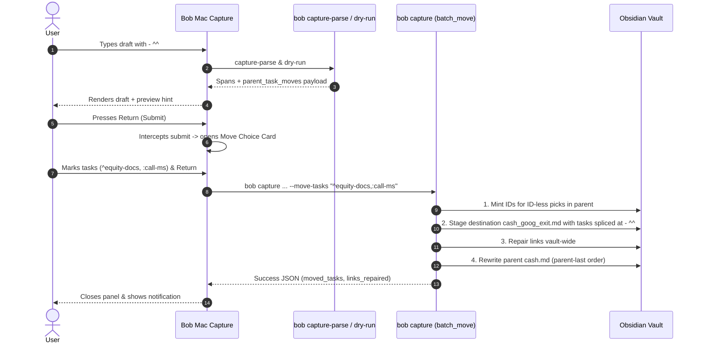
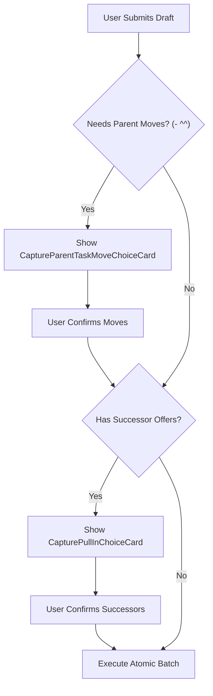

# Interactive Parent Task Move Bullets (`- ^^`) in Capture

> **Research query:** Adding support for a new `^^` capture syntax that can be used with
> the `@foo[^:]bar@` project-creation syntax: when `^^` is the only content of a capture
> bullet, prompting the user to select one or more tasks from the parent project after
> submitting capture, adding selected tasks as `^foo` / `:foo` bullets (inspired by the
> successor prompt, with support for both `:` and `^`, and unselected as default). Is this
> a good idea, would a different approach be better, what requirement adjustments are
> justified, and what is the recommended design and implementation?

## 1. Executive Summary & Verdict

**Verdict: Strong Build, but with Essential Design Adjustments.**

The proposed `- ^^` syntax directly addresses the primary operational bottleneck of
the newly shipped `bob-cli-gl` parent-task move system: **high-friction bulk triage**.
While `bob-cli-gl` introduced surgical inline move bullets (`- ^id` and `- :id`), moving
multiple tasks when splitting an area or project note currently requires repetitive
editor interaction (`- ^` → completion picker → select → ⇧↵ → repeat), and completely fails
in plain-text, script, or CLI workflows where **54% of parent tasks have no block ID**
(`parent_task_move_bullets.md` Fact F7).

However, the naive proposal—specifically prompting *after* submission and mutating the
draft into authored bullets—introduces severe architectural and user experience hazards:
it conflicts with Bob's live-preview-first contract, risks accidental destructive task
moves on uncurated Return presses, and blurs the boundary between editor text authoring
and atomic batch planning.

### Core Recommendations at a Glance

1. **Adopt `- ^^` as an Interactive Move Slot, Not a Text Macro:**
   `- ^^` should act as an explicit insertion slot in the draft's `## Tasks` sequence.
   It marks *where* the imported parent tasks land relative to newly authored tasks and
   headings. The editor text itself is **not** rewritten; instead, the selection is resolved
   atomically during batch execution, preserving undo/redo history and draft stability.
2. **Tri-State Selection Model (`[ ]` Keep / `[^]` Move / `[:]` Move & Link):**
   The prompt must support three distinct states for every candidate task:
   - **`[ ]` Keep in Parent (Default):** Do not touch; task stays in `foo.md`.
   - **`[^]` Move:** Move task into `foo_bar.md` as an unlinked task (maintaining its current status).
   - **`[:]` Move & Link:** Move task into `foo_bar.md`, raise to `Next`, and link into today's
     active Pomodoro (under the item's `#name` or default category).
3. **Dedicated Single-Key Ergonomics:**
   In Bob Mac Capture's choice card, navigation is Up/Down. Pressing `^` sets the row to `[^]`
   (Move); pressing `:` sets the row to `[:]` (Move & Link); pressing `Space` cycles
   `[ ]` → `[^]` → `[:]` → `[ ]`; pressing `Backspace` / `x` clears to `[ ]`.
4. **Strict Default-to-Keep Guard:**
   Unlike the successor prompt (where pressing Return with no items marked auto-selects the
   highlighted row), the move prompt **must default to keeping tasks in the parent**.
   Moving a task is a destructive removal from the parent note. Pressing Return with zero
   marked items submits the capture with **zero tasks moved** (with a confirmation or
   double-press safeguard), never accidentally moving whatever row happened to be highlighted.
5. **Automatic Block-ID Minting at Execution Time:**
   For the 54% of candidate tasks lacking a block ID, selecting them in the choice prompt
   automatically mints a clean, deterministic block ID in the parent note immediately prior
   to moving it into the destination note. The user never has to leave capture or run
   preliminary ID generation.
6. **Unified CLI & Automation Interface (`-m, --move-tasks <PICKS>`):**
   In strict adherence to `docs/task-dependencies.md` §12.1 ("bob capture never prompts on
   stdin and never auto-links"), `bob capture` provides a non-interactive flag
   `-m, --move-tasks <PICKS>` (e.g. `-m "^1,:call-ms"`), while `--dry-run` and `capture-parse`
   report available candidate tasks and slots in structured JSON for thin clients like Bob
   Mac Capture.

---

## 2. Background & The `bob-cli-gl` Foundation

### 2.1 What `bob-cli-gl` Shipped

Epic `bob-cli-gl` ("Move parent tasks into a new project note with capture move bullets")
established the syntax and batch semantics for moving open parent tasks into a new project:

- **Seal Trigger:** The draft must create a project note using the seal syntax
  `@parent^child@` (create note) or `@parent:child@` (create note + offer successors).
- **Move Bullet Syntax:**
  - `- ^<id>`: Moves the open task `^<id>` from `parent.md` into that exact slot in the new
    project's `## Tasks` section.
  - `- :<id>`: Moves the open task `^<id>`, raises it to `Next`, and links it into today's
    Pomodoro ledger under the item's `#name` (or category default).
- **Editor Interaction in Bob Mac Capture:**
  - Typing a lone `- ^` or `- :` in such an item opens an inline completion picker.
  - The picker displays the parent's open tasks (using `capture_task_id` suggestions for ID-less tasks).
  - Pressing `Shift-Return` (⇧↵) inserts the chosen ID, creates a new bullet below, and reopens the picker.
  - Ghost titles render inline behind complete `- ^<id>` bullets.
  - A preview band (`↪ Moves N tasks from parent.md`) summarizes the batch before submit.
- **Engine Capabilities:**
  - Full block transfer (subtasks, logs, drawers, inline fields).
  - Vault-wide link repair across daily notes, `done/`, `ref/`, and project files.
  - Parent note rewritten **last** to guarantee crash-resilient write order.

### 2.2 The Friction in `bob-cli-gl`

Despite its elegance for one or two tasks, `bob-cli-gl` exhibits noticeable friction when a user
is performing a **major project split** (e.g., carving out `travel_japan` from `travel`, or
`cash_exit` from `cash`):

```mermaid
flowchart TD
    subgraph Current_bob_cli_gl ["Current bob-cli-gl Flow (Repetitive & Fragmented)"]
        A1["Type - ^"] --> B1["Inline Picker Opens"]
        B1 --> C1["Filter & Select Task 1"]
        C1 --> D1["Press Shift-Return"]
        D1 --> A2["Type - : or - ^"]
        A2 --> B2["Inline Picker Opens Again"]
        B2 --> C2["Filter & Select Task 2"]
        C2 --> D2["Repeat N times..."]
    end

    subgraph Proposed_Interactive_Flow ["Proposed - ^^ Flow (Unified Bulk Triage)"]
        P1["Draft note & type - ^^"] --> P2["Submit Capture (Return)"]
        P2 --> P3["Bulk Choice Card Opens"]
        P3 --> P4["Triage All Parent Tasks with ^ / : / Space"]
        P4 --> P5["Confirm (Return) -> Atomic Execution"]
    end
```



Key pain points observed in practice:
1. **Authoring Disruption:** Having to stop drafting new tasks to interact with an inline
   picker multiple times breaks writing flow.
2. **Missing Overview:** The inline picker shows only a dropdown slice. The user cannot see
   a consolidated checklist of what is staying vs what is leaving the parent.
3. **The ID-Less Chasm Outside Mac GUI:** 54% of parent tasks have no block ID. In the CLI,
   a user writing `bob capture` has no interactive completion picker. They cannot use
   `- ^<id>` without first opening the parent note in an editor, manually adding block IDs,
   and copying them.

---

## 3. Critical Critique of the Plan

### 3.1 Is `- ^^` a Good Idea?

**Yes, conceptually.**
The analogy is clear:
- Lone `- ^` is an in-flight, unfinished inline move.
- Doubled `- ^^` signifies an **interactive prompt / expander slot** for parent moves.
- Just as `@foo:bar@` offers successors of the new project after creation, `- ^^` offers
  the parent's backlog for migration into the new project.

### 3.2 Tensions & Vulnerabilities in the Naive Proposal

However, several aspects of the informal proposal require rigorous critique and adjustment:

#### Tension 1: "Prompt After Submit" vs Bob's Live Preview Principle
In Bob's architecture (`decisions:mac-capture-is-a-thin-client`), **preview is primary**:
capture drafts explain their exact consequences *before* anything is written.
If the prompt only appears *after* pressing Return, the user has zero indication during
drafting of:
- How many open tasks the parent note actually has.
- Whether the parent note even exists.
- Whether `- ^^` was recognized or treated as literal text.

*Critique:* The live editor must recognize `- ^^` immediately during typing, display a
distinct visual placeholder badge, and render an informational band in the preview card:
`⚡ Move prompt: 12 open tasks in cash.md will be offered on submit`.

#### Tension 2: Mutating Editor Text vs Staged Batch Execution
The prompt asks: "The selected tasks will be added as `^foo` / `:foo` bullets as if the
syntax introduced by the bob-cli-gl epic bead was used directly."
If this means mutating the draft text in the Mac Capture window:
- What happens if the user presses Escape in the prompt? The draft was already submitted.
- What happens to ID-less tasks? The editor would have to wait for `capture-task-id` to mutate
  the vault *before* the capture batch even starts! That violates atomicity.
- How does CLI capture handle it? A CLI command cannot mutate a draft file that was passed
  via stdin or positional argument.

*Critique:* The draft text should **not** be mutated. Instead, the prompt acts as a pre-commit
choice step (identically to `CapturePullInChoiceCard`). The user's selections are passed to
the batch planner, which splices the moved tasks into the staged note's `## Tasks` slot
at the index of `- ^^`.

#### Tension 3: The Tri-State Dilemma
The successor prompt (`CapturePullInChoiceCard`) is strictly binary: a row is either selected
to be linked, or unselected.
Here, parent tasks have three mutually exclusive destinations:
1. **`[ ]` Keep in Parent:** Unchanged, stays in `foo.md`.
2. **`[^]` Move:** Transferred to `foo_bar.md`, unlinked (retains current status, e.g. Ready).
3. **`[:]` Move & Link:** Transferred to `foo_bar.md`, raised to `Next`, and linked into
   today's active Pomodoro session.

A standard checkbox (`Space` toggles true/false) cannot cleanly express this.
If a user hits Space, does it mean `^` or `:`?
*Critique:* The UI must provide dedicated, mnemonic keybindings (`^` for Move, `:` for Move & Link)
alongside a sequential `Space` cycle, with clear, color-coded badges that make the selected
state immediately obvious.

#### Tension 4: Accidental Destructive Moves (The Default Problem)
In the successor prompt, if the user hits Return without marking any rows, the prompt
conveniently auto-selects the currently highlighted row.
**This behavior would be catastrophic for parent task moves.**
Moving a task deletes it from `foo.md` and moves its entire block, logs, and subtasks to
`foo_bar.md`. If a user types `- ^^`, hits Return to submit, and immediately hits Return again
out of muscle memory, they must **never** accidentally move whatever task was highlighted.
*Critique:* **Unselected (`Keep`) must be the immutable default.** Pressing Return with zero
marked rows must submit the capture with zero tasks moved, simply removing the `- ^^`
placeholder bullet.

#### Tension 5: Syntax Singularity & Multiple `^^` Bullets
What happens if a draft contains two `- ^^` bullets?
```text
Finish packet @cash^goog-exit@
- ^^
- Review documents
- ^^
```
Which tasks go to bullet 1 vs bullet 2? How would the prompt know?
*Critique:* A project-note item may contain **at most one** interactive move bullet `- ^^`.
A second `- ^^` bullet in the same item must be rejected during lexical parse with a
clear diagnostic error: `only one interactive move bullet '- ^^' is allowed per project note`.

---

## 4. Explicit Requirement Adjustments

The following requirement adjustments are explicitly called out and incorporated into the design:

| Original Naive Conception | Adjusted Requirement | Why Justified |
| :--- | :--- | :--- |
| **Draft Mutation:** Replace `- ^^` with authored `- ^id` text in editor. | **Batch Slot Expansion:** `- ^^` defines the slot; engine splices moved tasks at execution time. | Keeps capture atomic; enables ID-less minting without pre-mutating the vault; works uniformly in GUI and CLI. |
| **Binary Prompt:** Modeled strictly on successor prompt. | **Tri-State Prompt:** Explicit support for `[ ]` Keep, `[^]` Move, and `[:]` Move & Link. | Captures the essential semantic difference between moving a task and moving + linking it into today's work. |
| **Auto-Pick on Return:** Return picks highlighted row if none marked. | **Strict Default-to-Keep:** Return with none marked executes 0 moves. | Prevents accidental destructive removal of parent tasks due to fast typing or muscle memory. |
| **Post-Submit Only:** No feedback until submission. | **Live Preview Integration:** Preview shows placeholder badge and candidate count during drafting. | Upholds Bob's core principle that capture drafts explain their consequences before submission. |
| **Interactive CLI:** CLI blocks on terminal stdin prompt. | **Non-Interactive CLI Flags:** CLI uses `-m, --move-tasks <PICKS>`, fails without flags in scripts. | Maintains `docs/task-dependencies.md` §12.1 rule that `bob capture` never prompts on stdin. |
| **Arbitrary `^^` Placement:** Multiple `^^` allowed anywhere. | **Single `^^` Rule:** At most one `- ^^` bullet per project note; must be a first-level bullet. | Eliminates slot ambiguity; ensures predictable document ordering in destination `## Tasks`. |

---

## 5. Visual Design & User Experience

### 5.1 Authoring Phase in Bob Mac Capture

When drafting in Bob Mac Capture:
```text
┌─ Bob Capture ──────────────────────────────────────────────────────────────┐
│ Finish the Google exit packet @cash^goog-exit@#admin                       │
│ - Draft the resignation memo :draft-memo                                   │
│ - ^^                                                                       │
│ - Book the lawyer                                                          │
│                                                                            │
├────────────────────────────────────────────────────────────────────────────┤
│ ⚡ Move prompt: 12 open tasks in cash.md will be offered on submit         │
│                                                                            │
│  Created project note: cash_goog_exit.md (parent [[cash]])                 │
│  - [ ] #task #prj Finish the Google exit packet #hide ^prj                 │
│  2 authored tasks · 1 interactive move slot                                │
│                                                                            │
│ ↵ submit & choose parent tasks                                             │
└────────────────────────────────────────────────────────────────────────────┘
```

1. As soon as `- ^^` is typed as a first-level bullet in a project note, the lexer assigns it
   span `project_task_move_interactive_marker`.
2. The editor renders `^^` with a distinctive violet/indigo tint (distinguishable from the
   green of `:` and cyan of `^`).
3. The preview card displays the `⚡ Move prompt` banner with the count of movable tasks in `cash.md`.

---

### 5.2 The Choice Phase: `CaptureParentTaskMoveChoiceCard`

When the user presses `Return`, the capture panel transitions to the dedicated Move Choice Card.
This card is modeled on `CapturePullInChoiceCard`, but tailored for tri-state move triage:

```text
┌─ Move Tasks from cash.md ────────────────────────────────── 12 open · 2 to move, 1 to link ┐
│ ⌕ Filter parent tasks...                                                                   │
├────────────────────────────────────────────────────────────────────────────────────────────┤
│ ^ move   : move & link   ␣ cycle   x clear   ↵ confirm (3)   ⇧↵ skip moves   ⎋ cancel      │
├────────────────────────────────────────────────────────────────────────────────────────────┤
│ [^] ◐ Collect the equity paperwork                 [WORK 13:30]               ^equity-docs │
│     → moves to cash_goog_exit.md                                                           │
├────────────────────────────────────────────────────────────────────────────────────────────┤
│ [:] ○ Call Morgan Stanley about the 401k                                          ^call-ms │
│     → moves & links in ADMIN (becomes Next)                                                │
├────────────────────────────────────────────────────────────────────────────────────────────┤
│ [ ] ○ Renew the passport                           [Nov 6]            ⊕ will mint block ID │
│     stays in cash.md                                                                       │
├────────────────────────────────────────────────────────────────────────────────────────────┤
│ [^] ○ Review severance agreement                                      ⊕ will mint block ID │
│     → moves to cash_goog_exit.md                                                           │
├────────────────────────────────────────────────────────────────────────────────────────────┤
│ [ ] ○ Pay credit card balance                                                      ^pay-cc │
│     stays in cash.md                                                                       │
├────────────────────────────────────────────────────────────────────────────────────────────┤
│ 3 tasks selected for migration · cash.md will retain 9 tasks                               │
└────────────────────────────────────────────────────────────────────────────────────────────┘
```

#### Row Structure & Visual Cues
- **State Badges:**
  - `[ ]` (Muted gray): Stays in parent. Destination line reads `stays in cash.md`.
  - `[^]` (Cyan accent): Moves to new project. Destination line reads `→ moves to cash_goog_exit.md`.
  - `[:]` (Emerald green): Moves and links. Destination line reads `→ moves & links in ADMIN (becomes Next)`.
- **ID Status:**
  - Identified tasks show their trailing `^id`.
  - ID-less tasks show a subtle `⊕ will mint block ID` chip, assuring the user that the system
    will automatically assign a deterministic ID.
- **Top Bar Counter:**
  - Updates dynamically: `12 open · 2 to move, 1 to link`.
- **Bottom Status:**
  - Explains the net impact: `3 tasks selected for migration · cash.md will retain 9 tasks`.

---

### 5.3 Keyboard Interaction Matrix

| Key | Gesture Action | Result / Feedback |
| :--- | :--- | :--- |
| `↑` / `↓` (or `Ctrl-P` / `Ctrl-N`) | Move highlight | Moves focus through parent task list. |
| `^` | **Set Move (`^`)** | Marks highlighted row as `[^]`. If already `[^]`, toggles back to `[ ]`. |
| `:` | **Set Move & Link (`:`)** | Marks highlighted row as `[:]`. If already `[:]`, toggles back to `[ ]`. |
| `Space` | **Cycle State** | Advances state: `[ ]` → `[^]` → `[:]` → `[ ]`. |
| `Backspace` / `Delete` / `x` | **Clear / Keep** | Resets highlighted row immediately to `[ ]` (Keep). |
| `Return` (↵) | **Confirm Selection** | Executes capture with all marked `^` and `:` tasks. If 0 marked, executes with 0 moves. |
| `Shift-Return` (⇧↵) | **Skip All Moves** | Immediately executes capture with 0 moves (leaves all tasks in parent). |
| `Escape` (⎋) | **Cancel** | Closes choice card, returns to draft editor with draft intact. Nothing captured or moved. |

---

## 6. Technical Architecture & Data Flow



### 6.1 Grammar & Lexer Additions (`capture_language`)

In `src/native/capture_language/move_bullet.rs`:
1. **Extend `MoveBulletHit`:**
   ```rust
   pub(crate) enum MoveBulletHit {
       Complete { sigil: char, id: String, ... },
       Unfinished { sigil: char, span: Range<usize> },
       InteractivePlaceholder { span: Range<usize> },
       Invalid { code: &'static str, kind: MoveBulletInvalid, span: Range<usize> },
   }
   ```
2. **Lexing `^^`:**
   When `scan_move_bullet` encounters a line whose trimmed body is exactly `"^^"`:
   - Check for leading checkbox: if present, emit `move_bullet_checkbox` error.
   - Check for trailing words: if present, emit `move_bullet_text` error.
   - Check for protected markup (wikilinks, code fences).
   - If bare `"^^"`, return `MoveBulletHit::InteractivePlaceholder { span }`.
3. **Item Parsing (`item.rs` / `editor_parse.rs`):**
   - Enforce single interactive bullet rule: track `has_interactive_move: bool`. If a second
     `- ^^` is encountered in the same project note item, return error
     `duplicate_interactive_move_bullet`: `"only one interactive move bullet '- ^^' is allowed per project note"`.
   - Store the slot index: `interactive_move_slot: Option<usize>`.

---

### 6.2 Completion & Protocol Payloads (`capture-parse` / `capture-complete`)

When a draft contains `- ^^`, `bob capture-parse -f json` outputs:
```json
{
  "mode": "project_note",
  "route": "cash",
  "block_id": "goog-exit",
  "spans": [
    { "start": 54, "end": 56, "kind": "project_task_move_interactive_marker" }
  ],
  "sub_bullet_moves": [
    null,
    { "sigil": "^", "interactive": true, "range": [54, 56] },
    null
  ]
}
```

In `bob capture --dry-run -f json`, Bob inspects the parent note and attaches the
additive `parent_task_moves` descriptor:
```json
{
  "ok": true,
  "parent_task_moves": {
    "parent": "cash.md",
    "parent_route": "cash",
    "item_line": 3,
    "slot_index": 1,
    "candidate_count": 12,
    "candidates": [
      {
        "n": 1,
        "key": "cash.md#^equity-docs",
        "text": "Collect the equity paperwork",
        "status_symbol": "/",
        "status_name": "In Progress",
        "block_id": "equity-docs",
        "requires_block_id": false,
        "child_count": 2,
        "pomodoro": "WORK 13:30"
      },
      {
        "n": 2,
        "key": "cash.md@f4a210bc",
        "text": "Renew the passport",
        "status_symbol": " ",
        "status_name": "Ready",
        "block_id": null,
        "requires_block_id": true,
        "child_count": 0,
        "pomodoro": null
      }
    ]
  }
}
```

---

### 6.3 Batch Planning & Splicing (`capture::project_note`)

During execution of `plan_project_note_item`:
1. **Picks Resolution:**
   - Parse `--move-tasks <PICKS>`:
     - Supports tokens like `^1`, `:2`, `^equity-docs`, `:call-ms`.
     - `all` / `^all` moves all; `:all` moves and links all; `none` moves zero.
     - Tokens without a sigil default to `^` (move unlinked).
2. **ID Minting for ID-Less Tasks:**
   - For any candidate with `requires_block_id: true` selected in the picks:
     - Call `capture_block_ids::suggest_ids_with_used` on the task description.
     - Mint the ID and update the parent task line in staged memory before running `task_move`.
3. **Slot Expansion:**
   - The `- ^^` bullet at `slot_index` is replaced by the list of selected moves:
     - If candidate #1 was picked with `^` and candidate #2 with `:`, they become
       resolved moves `(slot_index, MoveBullet { sigil: '^', id: id1 })` and
       `(slot_index + 1, MoveBullet { sigil: ':', id: id2 })`.
   - Remaining authored sub-bullets have their indices shifted accordingly.
4. **Batch Execution & Parent-Last Safety:**
   - Moves execute through `capture::batch_move` (the battle-tested engine from `bob-cli-gl`).
   - Spliced moves land in draft order in `cash_goog_exit.md`.
   - Any `:` move raises the task to `Next` and inserts a Task Link under the Pomodoro ledger.
   - All link updates are repaired vault-wide.
   - Staged destination `cash_goog_exit.md` is written **before** parent `cash.md` is modified,
     guaranteeing that an interrupted process duplicates rather than deletes tasks.

---

### 6.4 CLI Interface & Headless Contract

In compliance with `cli_rules.md`:
- **New Option:**
  ```text
  -m, --move-tasks <PICKS>
          Select parent tasks to move into a project note (tokens like ^1, :2, ^id, :id, or all/none)
  ```
- **Internal Safety Guard:**
  `--require-move-choice`: When present, if the draft contains `- ^^` and `--move-tasks` is omitted,
  `bob capture` writes nothing and exits with code 1 and JSON:
  ```json
  {
    "ok": false,
    "code": "move_parent_tasks_choice_required",
    "error": "this capture has an interactive move bullet; pass --move-tasks",
    "parent_task_moves": { ... }
  }
  ```
- **Human Output in Terminal:**
  When run interactively in a shell without `-m`:
  ```text
  $ bob capture "Finish @cash^goog-exit@\n- ^^"
  [refused] capture line 2 has interactive move bullet '- ^^'
    Parent cash.md has 12 open tasks:
      1  [/] Collect the equity paperwork ^equity-docs
      2  [ ] Call Morgan Stanley about the 401k ^call-ms
      3  [ ] Renew the passport (needs block ID)
    hint: re-run with -m "^1,:2" to move task 1 and move+link task 2
  ```

---

## 7. Edge Cases, Hazards, & Failure Modes

### 7.1 Parent Note Has Zero Movable Tasks
If `cash.md` exists but has no open top-level tasks (all tasks are completed, or only `^prj` exists):
- **Live Preview:** Displays warning badge: `⚠ No open tasks to move in cash.md`.
- **Submission:** If submitted without picks, capture succeeds: `- ^^` is dropped and zero
  moves are performed.
- **Explicit Picks:** If `--move-tasks "^1"` is passed against an empty parent, fails with
  `move_task_missing`.

### 7.2 Collision with Author-Moved Bullets
Suppose a draft contains both an explicit move bullet and an interactive bullet:
```text
Finish @cash^goog-exit@
- ^equity-docs
- ^^
```
- **Rule:** The explicit move `- ^equity-docs` claims `equity-docs` first.
- **Candidate List:** When building candidate rows for `- ^^`, `equity-docs` is excluded
  or marked disabled with reason `"already moved on line 2"`.
- It cannot be selected again in the choice prompt, preventing `move_bullet_duplicate` errors.

### 7.3 Multi-Item Drafts & Mixed Prompts
What if a draft has **both** parent task moves and successor offers?
For example, `@cash:goog-exit@` (creates project note AND offers project successors) combined
with `- ^^` (moves tasks from parent):

- **Sequential Card Flow:**
  1. The move choice card is presented **first** (because moving tasks defines what exists in the new project).
  2. The successor pull-in choice card is presented **second** (to link successors into today's ledger).
  3. Both selections are applied in the final atomic commit.

---

## 8. Implementation Plan & Phased Roadmap

A clean, 5-phase execution plan:

### Phase 1: Lexer, Grammar, & `capture-parse` Spans
- Add `MoveBulletHit::InteractivePlaceholder` to `src/native/capture_language/move_bullet.rs`.
- Wire into `item.rs` and `editor_parse.rs`.
- Implement diagnostic `duplicate_interactive_move_bullet` and `move_bullet_checkbox`.
- Bump `GRAMMAR_REVISION` in `feat(capture)!:` commit.
- Land unit and CLI tests in `tests/cli/capture/parse.rs`.

### Phase 2: Engine Resolution, ID Minting, & Splicing
- Extend `src/native/capture/project_note.rs` to detect interactive move slots.
- Implement `--move-tasks` CLI option parsing and token resolver (`^N`, `:N`, `all`, `none`).
- Implement automatic block ID minting for ID-less selected candidates.
- Implement slot expansion helper that splices resolved moves into draft order at `- ^^`.
- Add `--require-move-choice` internal flag.

### Phase 3: CLI Output, Dry-Run Payloads, & Vector Tests
- Add `parent_task_moves` descriptor to `bob capture --dry-run -f json`.
- Implement terminal teaching output for bare interactive captures.
- Write end-to-end integration tests in `tests/cli/capture/project_note.rs`:
  - Mixed authored and interactive moves.
  - Splicing order verification.
  - Tri-state verification (`^` vs `:`).
  - ID-less candidate minting and link verification.

### Phase 4: Bob Mac Capture Choice Card & Visuals
- Open `bob-mac-capture` via `sase repo open`.
- Create `CaptureParentTaskMoveChoiceState.swift` and `CaptureParentTaskMoveChoiceCard.swift`.
- Implement keyboard navigation (`Up`/`Down`, `^`, `:`, `Space`, `Backspace`, `Return`, `Esc`).
- Add preview band banner for in-editor feedback.
- Wire sequential card transition (Parent Move Card → Pull-In Card if applicable).

### Phase 5: Documentation & Golden Regeneration
- Update `docs/capture.md` ("Moving parent tasks in") with the new `- ^^` syntax and vectors.
- Update `docs/reference/cli/capture.md` and `capture-parse.md`.
- Regenerate CLI golden tests and ensure `just check` passes.

---

## 9. Recommended Solution & Conclusion

The proposed `- ^^` syntax is a high-value, logical evolution of the `bob-cli-gl` move architecture.
It eliminates the tedious friction of 1-by-1 inline pickers and unlocks seamless parent task
migration for CLI users and tasks without pre-existing block IDs.

By designing the feature around **atomic slot expansion**, **tri-state keybindings (`^` / `:`)**,
**strict keep-by-default safety**, and **clean separation between thin-client UI and core batch planning**,
this solution delivers an experience that is at once fast, reliable, and aesthetically unified with
the rest of the Bob ecosystem.
