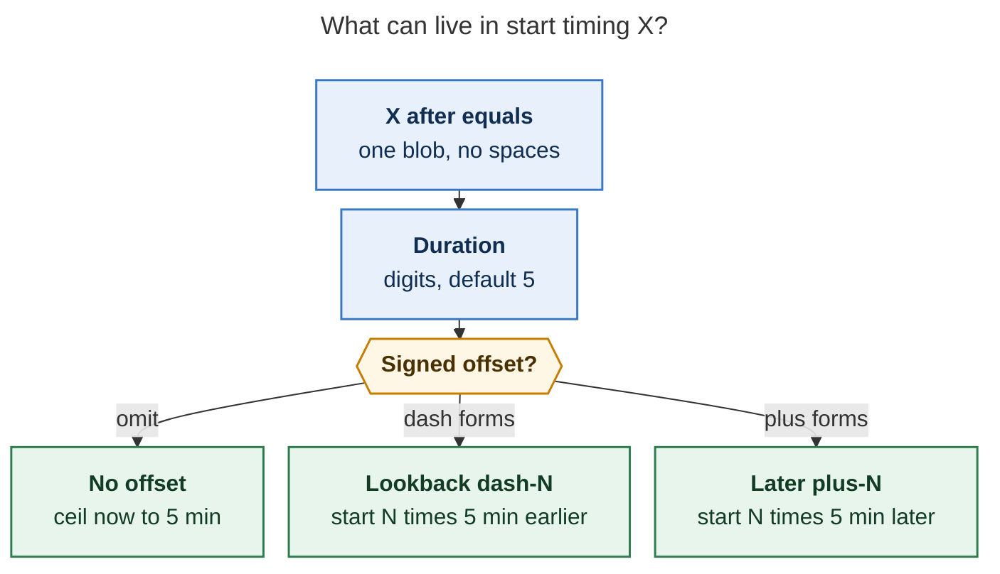
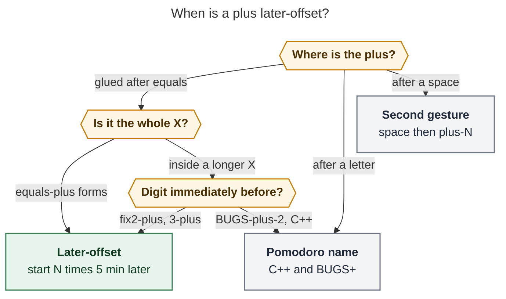
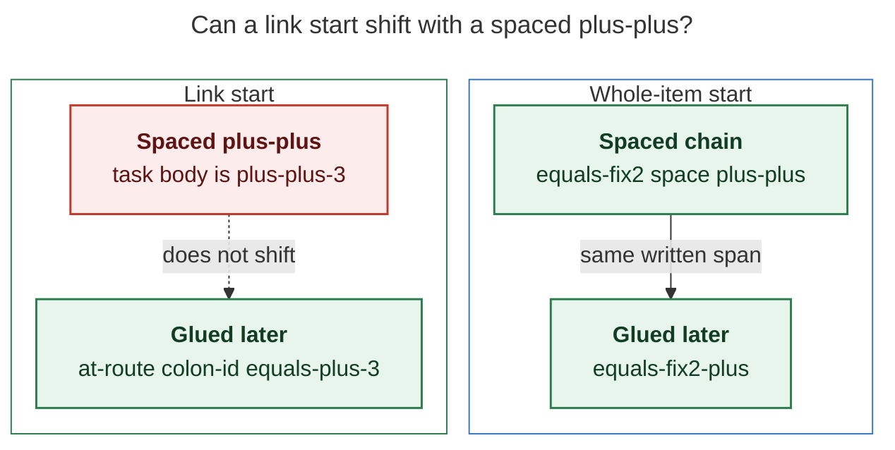

# Glue `+N` onto start timing so a Pomodoro can begin later

> **Research query:** Add `+<N>` at the end of `<X>` in `=<X>`,
> `@file:id=<X>`, and possibly `x=<X>`, so the started Pomodoro begins
> `<N>` five-minute units later (`=fix2+` ≡ `=fix2 ++`,
> `@foo:bar=+3` ≡ `@foo:bar= ++3`). Critique the plan, adjust
> requirements where justified, and recommend a design that is
> intuitive, reliable, and beautiful.

Researcher: **grk**. Independent of the other swarm reports.

Figures rendered with Mermaid CLI **12.0.0** (PDF-mirroring config, DejaVu
Sans, `useMaxWidth: false`). Measured fit against a 652.8 × 892.8 px text
box:

| Figure | Size | Fit |
| --- | --- | --- |
| Plus classification | 746.849 × 736 px | 87.4% |
| Timing anatomy | 736.812 × 564 px | 88.6% |
| Link vs chain | 678.438 × 361 px | 96.2% |

## Bottom line

**Build it, as the missing plus-form of `se<X>`, not as a new sigil.**
Lookback already lives in start timing (`=-2`, `=3-`, `=fix2-`). Later is
the same field with the opposite sign. Bake it into the start write so a
link can start later in one token.

Ship it as grammar **17** with these changes to the request:

1. **Call it later-offset, the plus-form of `se<X>`.** It is the dual of
   today's dash lookback, not a third session operator. `=fix2+` is one
   start whose clock matches `=fix2 ++`; it is not a hidden shift item.
2. **Do not put this on `x=`.** Past recording already uses `+` as the
   end-edge of a place suffix (`x=~1+`). `E` is blocks, name, and place,
   not `se<X>`. Packed `x=` looks backward from `T`; a later start fights
   that model.
3. **Digit-adjacent peel, so `+` in names survives.** `=c++`, `=bugs+`,
   and `@note:id#bob+sase` stay names. Trailing `+N` is later-offset only
   when the plus sits on a duration digit (`=fix2+`, `=3+`) or is the
   whole `<X>` (`=+`, `=+3`, `@foo:bar=+3`).
4. **`=bugs+2` stays BUGS+ for 10 minutes.** The live lexer already
   treats trailing digits after a plus-name as duration. Do not steal
   that spelling for later-offset.
5. **Dash and plus are mutually exclusive.** Refuse `=3-1+2`. One signed
   offset per `<X>`.
6. **Reject typed `+0`.** `++0` already fails; `=+0` / `=3+0` should too.
7. **JSON stays schema 1:** additive `later_units`, omitted when zero.
   Keep `offset_units` as unsigned lookback.
8. **Lockstep the Obsidian `se<X>` snippet** in bob-ledger-tools. Capture
   docs already require `<X>` to mirror that snippet.

Recommended grammar, peel rule, JSON, and rollout are in
[Recommended solution](#recommended-solution).

## Is this a good idea?

**Yes.** The hole is real, and the dual is already sitting in the grammar.

Today you can start earlier in one token (`=-`, `=3-`, `=fix2-`) because
`-` is timing charset and never a Pomodoro-name byte. You cannot start
later in one token. The workarounds are:

| Intent | Today | Why it is the wrong shape |
| --- | --- | --- |
| Start FIX 10 minutes, 5 minutes later | `=fix2 ++` | Two items, two writes; works only as a whole-item chain |
| Start a linked task 15 minutes later | `@foo:bar=` then a second item `++3` | Two blank-line items; same-line `@foo:bar= ++3` is a task whose body is `++3` |
| Dual of `=-2` | none | `=+2` is ordinary task prose |

`bob capture-parse` on this workspace's grammar 16 confirms each row:
`=fix2 ++` is a start-then-shift chain; `@foo:bar= ++3` reports
`mode: pomodoro_task` with `body: "++3"`; `=+3` reports `mode: task`
with no `pomodoro_start`; `@foo:bar=+3` is a claimed invalid start
("must mirror se<X>").

The user's equivalence is the right *clock* story and the wrong *spelling*
story for links. Gluing plus onto `<X>` is how a link start, which cannot
chain with session operators, gets the same clock as a whole-item
`= ++N`.

**Would I take a different approach?** I would not invent `++` glued onto
the name (`=fix2++`): that collides with `=c++` and copies the shift
operator into timing. I would not add a `bob pomodoro start --later`
flag: capture is where this work happens, and `cli_rules.md` forbids
subcommands under `bob capture`. I would not teach people to type two
items when one signed offset already exists on the other side of zero.

The beautiful move is the one the dash already taught: glued sign is
WHEN; spaced sign is a second gesture. Docs already use that mnemonic
for `= -2` versus `=-2`. Later is the same sentence with plus.

## Requirement adjustments

Each of these is a justified change to the request. The rest of the
report assumes them.

### A1. Do not extend `x=<X>`

**Adjustment.** Later-offset is a start-timing feature. It does not belong
on past recording.

`x=E[s][!][=X]` is a different language. Everything before the second `=`
is time (block count, name, place); everything after it is tasks.
Place already owns `+`: `~n+` pins the end of segment `n`
(`docs/capture.md` "Placing it on today's timeline";
`PastEdge::End` in `capture_language/model.rs`).

Live parse:

- `x=~1+` is a valid past with `segment: {raw: "~1+", kind: index, edge: end}`
- `x=3+` is claimed invalid (`is not a past Pomodoro`)
- `x=fix+` is a valid past named `FIX+`

Putting `+N` on `E` would steal the end-edge marker, break plus-names on
past rows, and describe a later start on a gesture that packs *backward*
from `T = ceil5(now)`. If a past window should sit later in the day, the
place suffix already says which slice to kiss.

### A2. Digit-adjacent peel; do not steal plus-names

**Adjustment.** `+<N>` at the end of `<X>` is later-offset only when the
plus is in the timing channel. After a letter it stays name charset.

`+` is a Pomodoro-name byte (`is_pomodoro_selector_byte` in
`capture_language/tokens.rs`). Tests and the live lexer depend on that:

| Token today | Meaning |
| --- | --- |
| `=c++` | start named `C++` |
| `=bugs+` | start named `BUGS+` |
| `=bugs+2` | start `BUGS+` for 10 minutes |
| `@sase:deep-fix#bugs+` | link under `BUGS+` |
| `=fix2+` | start named `FIX2+` (the one silent break) |

`docs/capture.md` says `=bugs+2` starts a Pomodoro named `BUGS+2`. The
live lexer is more precise: name `bugs+`, trailing duration `2`. Keep
that reading. Trailing digits after a plus-name are duration, just as
`=fix3` is FIX for 15 minutes.

The one breaking named start the user asked for is exactly
`.+\d\+$`: `=fix2+` today names `FIX2+`; after this change it is FIX for
10 minutes starting one unit later. That is a narrow, intended break.
`=c++` does not match (the last plus sits on a plus, not a digit).

Leading plus after `=` is a free spelling today (`=+` / `=+3` /
`=+bugs` are prose). Taking it as later-offset is the dual of `=-` /
`=-2` / `=-bugs`, which already parse as lookback plus optional name.

### A3. One signed offset, never both

**Adjustment.** `<X>` may have a dash-form *or* a plus-form, not both.
Refuse `=3-1+2` and `=3-+` with a teaching error.

Netting two offsets (`-1+2` = later 1) is clever and ugly. The dash
already means lookback; the plus means later. Two signs in one blob
teach the wrong lesson.

### A4. Typed zero later is an error

**Adjustment.** `=+0` and `=3+0` fail the way `++0` fails. Bare `=+`
(omitted N) remains one unit.

`=-0` today parses as lookback 0; leave that grandfathered. Do not
invent a plus zero that writes the unshifted span.

### A5. JSON field is `later_units`, not a signed `offset_units`

**Adjustment.** Keep `offset_units` as unsigned lookback. Add
`later_units`, omitted when zero. `schema_version` stays 1. Grammar
becomes 17.

A signed `offset_units` would silently invert the meaning of every
existing reader. Additive later is the contract style this JSON already
uses for `drop`, `pomodoro_shift.later`, and the rest of grammar 8–16.

### A6. Mirror the snippet in the same train

**Adjustment.** bob-ledger-tools `LEDGER_TRIGGER_RE` is
`/^se(\d*)(?:-(\d*))?$/` (`plugins/bob-ledger-tools/src/010-load-and-constants.js`).
Capture docs say `<X>` *is* that suffix. Ship `se+`, `se+3`, `se3+`,
`se3+2` in the same release as `=+`, `=+3`, `=3+`, `=3+2`. Mac Capture
stays a thin client (`decisions:mac-capture-is-a-thin-client`).

## Current grammar, in the way of the design

### `se<X>` is duration then optional lookback

`PomodoroStartSpec` (`capture_language/model.rs`):

- `raw`: the typed `<X>`
- `duration_units`: 5-minute duration, default 5 (25 minutes)
- `offset_units`: 5-minute lookback, default 0; a bare `-` is 1

`parse_pomodoro_start_suffix` (`tokens.rs`) and `start_timing_len`
(`item.rs`) implement `[0-9]*(-[0-9]*)?`. Docs give the clock:

```text
start = ceil((nowMinutes - 5*offsetUnits)/5)*5
end   = start + 5*durationUnits
```

Rust `start_block_minute` (`capture/meet_event_run.rs`) and JS
`computeRange` (`bob-ledger-tools/src/030-snippets.js`) both subtract
offset minutes before rounding up to 5.

Live examples of the dash dual the plus should match:

| Token | `raw` | duration | offset | later (proposed) |
| --- | --- | --- | --- | --- |
| `=` | `""` | 5 | 0 | 0 |
| `=-` | `-` | 5 | 1 | 0 |
| `=-2` | `-2` | 5 | 2 | 0 |
| `=3-` | `3-` | 3 | 1 | 0 |
| `=2-1` | `2-1` | 2 | 1 | 0 |
| `=fix2-` | `2-` | 2 | 1 | 0 |
| `=-fix` | `-` | 5 | 1 | 0 |
| `=fix2+` today | `""` | 5 | 0 | n/a (name `FIX2+`) |
| `=3+` today | claimed extra `+` | — | — | invalid |
| `=+3` today | prose | — | — | task |

### Named starts already put timing on either side of a bare name

`=3bugs` and `=bugs3` are the same start. Hash names take timing only
before `#` (`=3#deep-work`). Drop always comes last (`=fix2~1`,
`=3bugs~2`). Link starts share that suffix lexer and refuse drop
(`parse_link_start_suffix` in `tokens.rs`).

`+` in a bare name is why `bare_start_name_len("bob+decks2")` is 9
(`bob+decks` plus trailing duration `2`) and why `=c++` is a named
start in `editor_modes.rs`. Dash is excluded from bare names, which is
why `=fix-` is already lookback 1 on FIX rather than a name `FIX-`.

### Session chains make the user's whole-item example already true

`=fix2 ++` parses as two items: start FIX duration 2, then shift later
1. `= ++3` starts 25 minutes then shifts 15 minutes later. Spacing is
already significant (`docs/capture.md`): `= -2` starts then shortens;
`=-2` is one start with lookback.

Task and link forms never chain. That is why the link example cannot be
a spaced `++` on the same line.

### Grammar 16, schema 1, Mac paints spans it does not parse

`GRAMMAR_REVISION = 16` (`capture_language/mod.rs`).
`pomodoro_start` JSON already carries `raw`, `duration_units`,
`offset_units`. Unknown span kinds decode as neutral text in Mac
Capture; additive fields are ignored until the app learns them
(`docs/reference/mac-capture/protocol.md`). No Mac parser change is
required for the plus bytes to highlight: they sit inside the existing
`pomodoro_start` span.

## Clock math: later-offset is start-then-shift

When later is a multiple of 5 minutes — and it always is —
`ceil((now + 5N)/5)*5` equals `ceil(now/5)*5 + 5N`. The plus-form of
`se<X>` writes the same span as computing the unshifted start and then
running today's `++N`.

Worked at local 09:02 (unshifted ceil = 09:05):

| Token | Start | End | Same as |
| --- | --- | --- | --- |
| `=` | 0905 | 0930 | — |
| `=-` | 0900 | 0925 | `=` then `--` |
| `=+` | 0910 | 0935 | `=` then `++` |
| `=3` | 0905 | 0920 | — |
| `=3+` | 0910 | 0925 | `=3` then `++` |
| `=fix2` | 0905 | 0915 | — |
| `=fix2+` | 0910 | 0920 | `=fix2 ++` |
| `=fix2+3` | 0920 | 0930 | `=fix2 ++3` |
| `=+3` | 0920 | 0945 | `= ++3` |

At 09:00 exact, `=` writes 0900–0925 and `=+` writes 0905–0930. Duration
is preserved; only the window slides. That is `++`, not `+` (resize
moves the end only).

Glued later is still *better* than a chain on a restart: one write, one
override warning, one `pomodoro_start` object. A chain `=3 ++` restarts
then shifts, two staged edits.

MEET calendar following (`spec.raw.is_empty()` in
`meet_event_run.rs`) stays empty-`=` only. `=+` has raw `+`, so it takes
the explicit span, the same way `=-` already does. Do not special-case
meetings.

## Critique of the plan

The request is right about the clock and incomplete about the charset.

**What already works in the proposal**

- Default N = 1 matches `+`, `++`, `-`, `--`, and dash-form `=-`.
- Putting later at the end of `<X>` matches dash-form `=3-` / `=fix2-`.
- Whole-item `=fix2+` ≡ `=fix2 ++` is true of the written span.
- Link-suffix `@foo:bar=+3` is a free spelling (today a shape error).

**What the request underspecifies**

- `+` is name charset. Without a peel rule, `=c++` becomes "C, later 1,
  leftover plus" or "C+, later 1". Either reading is a regression.
- `@foo:bar= ++3` is *not* a shift. It is a new task named `++3` that
  also starts. Teaching that equivalence without the two-item draft
  (`@foo:bar=` blank line `++3`) would ship a footgun.
- `x=<X>` is not `se<X>`. The second `=` is close outcomes. `~n+`
  already means end-edge.
- Combining plus with dash, plus-zero, MEET empty-raw, drop lists,
  hash-name trailing plus, completion's `trailing_glued_timing`, fit
  tokens (`se3-2` today), and the snippet regex are all silent.

**The docs/lexer mismatch on `=bugs+2`**

The examples table says that token starts a Pomodoro named `BUGS+2` so
the reader sees it is not a chain. Grammar 16 actually starts `BUGS+`
for 10 minutes. Implementation should follow the lexer, and the docs
row should be corrected to that reading when later-offset lands. Do
not "fix" it by making `=bugs+2` mean BUGS with later 2.

## Alternatives considered

| Approach | Why it loses |
| --- | --- |
| Teach `=fix2 ++` and stop | Link starts cannot chain; `=+` remains the unfilled dual of `=-` |
| Glue `++` (`=fix2++`) | Collides with `C++`; copies the shift operator into timing |
| Signed `offset_units` | Breaks every schema-1 reader that treats the field as lookback |
| Allow `-` and `+` together | Two signs, one blob; teaching error is cheaper |
| Trailing plus after a letter (`=fix+` ≡ `=+fix`) | Steals `FIX+`, `BUGS+`, `C++` |
| New CLI flag / `bob pomodoro` subcommand | The gesture is capture; `bob capture` cannot grow subcommands |
| Absolute clocks (`=0910`) | Heavier, and later-offset is "N units from now," not a wall clock |
| Mac-side rewrite of `=fix2+` to `=fix2 ++` | Mac is a thin client; link starts still cannot chain on one line |

## Recommended solution

### Grammar of `<X>`

Replace `[0-9]*(-[0-9]*)?` with:

```text
[0-9]*(-[0-9]*|\+[0-9]*)?
```

Duration digits, then **exactly one** signed offset. Omitted duration is
5. Omitted offset digits are 1. No dash, no plus, no offset.

```text
<X> ::= [duration] [offset]
duration ::= [0-9]+          # omitted → 5
offset   ::= '-' [0-9]*      # lookback; omitted digits → 1
           | '+' [0-9]*      # later;    omitted digits → 1
```

**Reader question:** What can live in start timing X?

**Caption:** `<X>` is an optional duration in 5-minute units, then
exactly one signed offset: dash looks back, plus looks ahead; omitted
digits mean one unit.



Rendered size: 736.812 × 564 px; fit scale: 88.6%.



Worked spellings after the change:

| Token | Name | Duration | Later | Lookback |
| --- | --- | --- | --- | --- |
| `=+` | — | 5 | 1 | 0 |
| `=+3` | — | 5 | 3 | 0 |
| `=3+` | — | 3 | 1 | 0 |
| `=2+1` | — | 2 | 1 | 0 |
| `=fix2+` | FIX | 2 | 1 | 0 |
| `=3+fix` / `=+3fix` / `=+fix` | FIX | 3 / 5 / 5 | 1 / 3 / 1 | 0 |
| `=2+#deep-work` | DEEP WORK | 2 | 1 | 0 |
| `@foo:bar=+3` | (link) | 5 | 3 | 0 |
| `=fix2+~1` | FIX | 2 | 1 | 0, drop 1 |
| `=c++` | C++ | 5 | 0 | 0 |
| `=bugs+` | BUGS+ | 5 | 0 | 0 |
| `=bugs+2` | BUGS+ | 2 | 0 | 0 |
| `=fix2-` | FIX | 2 | 0 | 1 |

Hash names still cannot carry *trailing* timing. Later on a hashed name
goes before `#` (`=+3#deep-work`). `=#c++` stays the retired "write
`=c++`" teaching error. `=#bugs+` remains name `bugs+`.

Drop still comes last. Link starts still refuse drop.

### Peel rule

**Reader question:** When is a plus later-offset?

**Caption:** A plus is later-offset when it is the whole `<X>` or sits
on a duration digit; after a letter it stays in the Pomodoro name, so
`=c++` and `=bugs+` keep working.



Rendered size: 746.849 × 736 px; fit scale: 87.4%.



Lexer, in the two functions that already own this split:

1. **`start_timing_len`** — after the duration digits, consume *either*
   `-` plus digits *or* `+` plus digits, never both. A leading `+` with
   no duration (`=+3`) is a plus-form with default duration.
2. **`bare_start_name_len`** — take selector bytes except dash, as
   today. Then, if the candidate ends in a plus-form whose plus sits on
   a digit, strip that plus-form, then strip trailing duration digits.
   `trailing_glued_timing` becomes `start_timing_len` on the remainder.

That is the whole charset policy. Teach `=+fix` (or `=fix ++`) for
"FIX, default 25 minutes, later 1". Do not make `=fix+` mean that;
`=fix+` stays FIX+.

### Why links must glue

**Reader question:** Can a link start shift with a spaced plus-plus?

**Caption:** A whole-item start can chain into a shift. Extra text after
a link start becomes the task body, so a link that should start later
has to glue plus onto `<X>`.



Rendered size: 678.438 × 361 px; fit scale: 96.2%.



The two-item draft `@foo:bar=` / `++3` still works and should keep
working. Glued `@foo:bar=+3` is the one-token form the request wanted
that draft to mean.

### Clock, JSON, and preview

```text
signed   = later_units - offset_units          # parser guarantees one is 0
start    = ceil((nowMinutes + 5*signed)/5)*5
end      = start + 5*duration_units
```

Reuse `start_block_minute`; add later minutes instead of introducing a
second rounding path.

`PomodoroStartSpec` / parse JSON / capture JSON:

```json
{
  "raw": "2+",
  "duration_units": 2,
  "offset_units": 0,
  "later_units": 1
}
```

Omit `later_units` when zero so older inputs stay byte-identical at
schema 1. Human output already names the written `HHMM-HHMM`; it does
not need a new phrase. Fit tokens that today emit `se3-2` / `=3-2`
gain `se3+2` / `=3+2` (`event_conflict.rs` `start_fit_token`).

`capture-parse` / `capture-complete`: `grammar: 17`. Cursor inside
`<X>` including the plus remains an empty success, as today for dash
timing. `trailing_glued_timing("fix2+")` becomes `"2+"`, so accepting
FIX on `=fi|2+` yields `=fix2+`.

### Teaching copy

Keep the spacing mnemonic and add the plus twin:

- `= -2` starts then shortens; `=-2` is one start with lookback.
- `= +2` starts then extends; `=+2` is one start 10 minutes later.
- `=fix2 ++` starts then shifts; `=fix2+` is one start 5 minutes later.
- `@foo:bar= ++3` is a task named `++3`; write `@foo:bar=+3` to start
  later, or a two-item draft to start then shift.
- `=fix+` starts FIX+; write `=+fix` or `=fix ++` to start FIX later.
- `=3-1+2` is not a start: write `=3+1` or `=3-1`.
- `=+0` is not a start: a later offset of 0 does nothing; write `=`.

Shape error (`POMODORO_START_SHAPE_ERROR`) should name the new forms:
empty, digits, `-`, `-digits`, `digits-`, `+`, `+digits`, `digits+`,
with optional digits on either side of the sign.

### Surfaces to touch (same train)

| Surface | Change |
| --- | --- |
| `start_timing_len`, `parse_pomodoro_start_suffix` | XOR plus-form; `later_units`; reject `+0` and both signs |
| `bare_start_name_len`, `trailing_glued_timing` | Digit-adjacent plus peel |
| `start_block_minute`, `compute_pomodoro_start_range` | `now + 5*later - 5*lookback` |
| Parse/capture JSON, `PomodoroStartSummary` | Additive `later_units` |
| `GRAMMAR_REVISION` | 16 → 17 |
| Editor spans, completion, rewrite | No new span kind; keep trailing `2+` on accept |
| `docs/capture.md`, CLI help, compatibility | `se<X>` table, examples, grammar 17 |
| bob-ledger-tools `LEDGER_TRIGGER_RE`, `computeRange` | `se(\d*)(?:-(\d*)\|\+(\d*))?` |
| Fit tokens | `=3+2` / `se3+2` |
| Tests | Cases below |
| Decision record | Plus-form of `se<X>`; digit-adjacent peel; not on `x=` |
| Mac Capture | None required; optional later in preview copy later |

No new CLI flag. No `bob capture` subcommand. No Mac grammar.

### Tests that lock the beauty

Parse / editor / CLI, at least:

- Unnamed: `=+`, `=+3`, `=3+`, `=2+1`, `=3+~2`
- Named: `=fix2+`, `=3+fix`, `=+fix`, `=2+#deep-work`, `=fix2+~1`
- Links: `@foo:bar=+3`, `@foo:bar=+`, `^foo:bar=3+`, `@sase:deep-fix#bugs=`
  unchanged
- Preserved names: `=c++`, `=bugs+`, `=bugs+2`, `=bob+sase`,
  `@sase:deep-fix#c++`, `x=fix+`
- Refusals: `=+0`, `=3+0`, `=3-1+2`, `=3-+`, `x=3+` (still not a past)
- Equivalence: `=fix2+` writes the same span as `=fix2 ++` at a fixed
  `BOB_NOW`; `@foo:bar=+3` writes the same span as the two-item draft
  `@foo:bar=` / `++3`
- Prose: `= +2` remains start-then-extend; `Plan =+3` remains a task
- Snippet: `se+`, `se3+`, `se+2`, `se3+2` match capture bytes
- Completion: `=fi|2+` accepts as `=fix2+`

### Rollout

This is a capture-language break for the narrow class `=name<digits>+`
and a new meaning for tokens that are invalid or prose today (`=3+`,
`=+3`, `@id=+3`). Mark the CLI/docs commit with `!` in the train
subject if the project treats grammar bumps that way; keep
`schema_version: 1`. File a decision record: later is the plus-form of
`se<X>`, digit-adjacent peel protects plus-names, past recording is out.

## Sources

- `docs/capture.md` — `se<X>` table, start/shift operators, spacing
  mnemonic, `=bugs+2` row, place suffix `~n+`, grammar 16
- `src/native/capture_language/tokens.rs` —
  `parse_pomodoro_start_suffix`, `is_pomodoro_selector_byte`
- `src/native/capture_language/item.rs` — `session_equals_token`,
  `start_timing_len`
- `src/native/capture_language/bare_name.rs` — `bare_start_name_len`,
  `trailing_glued_timing`, `=c++` / `bob+decks2` tests
- `src/native/capture_language/model.rs` — `PomodoroStartSpec`,
  `PomodoroShiftSpec`, `PastEdge`
- `src/native/capture/meet_event_run.rs` — `start_block_minute`
- `src/native/capture/pomodoro_adjust.rs` — `++N` / `--N` shift
- `src/native/capture/event_conflict.rs` — `start_fit_token`
- `src/native/capture_language/mod.rs` — `GRAMMAR_REVISION = 16`
- `sase/repos/linked/bob-plugins/plugins/bob-ledger-tools/src/010-load-and-constants.js`
  — `LEDGER_TRIGGER_RE`
- `sase/repos/linked/bob-plugins/plugins/bob-ledger-tools/src/030-snippets.js`
  — `computeRange`
- `docs/reference/mac-capture/protocol.md` — thin client, additive JSON
- `sase/memory/cli_rules.md`, `sase/memory/docs.md`,
  `decisions:mac-capture-is-a-thin-client`
- Live `bob capture-parse` on grammar 16 for every token quoted above
