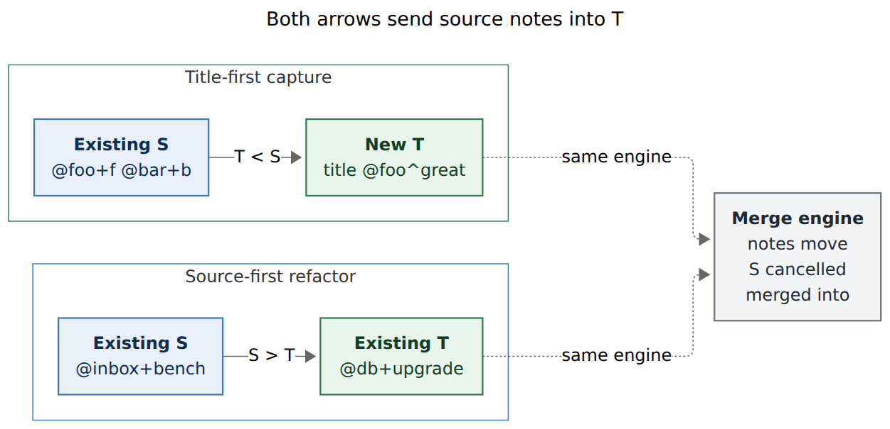
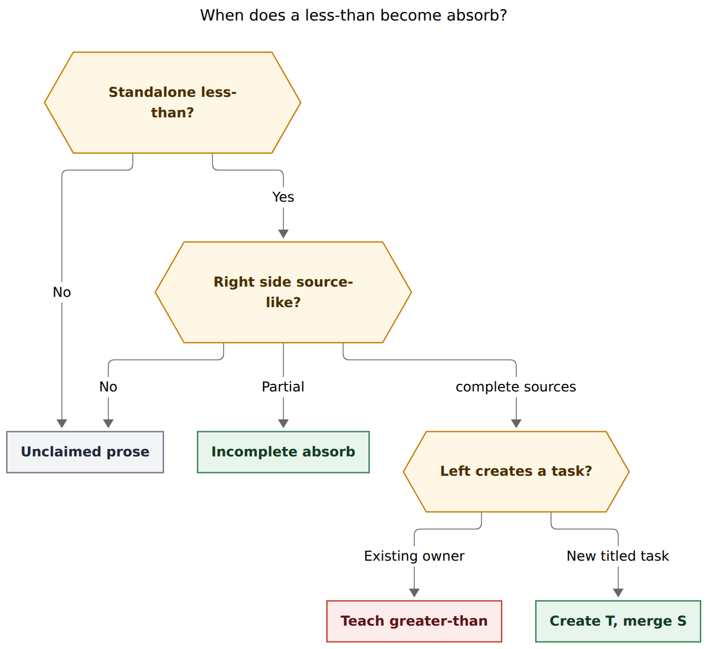

# Capture `<` should absorb existing tasks into a newly created one

> **Research query:** What is the best way to add a new `< @foo+f` capture syntax that complements existing `> @foo+f`, is valid only when creating a new task, merges one or more targeted tasks into that new task with the `merged into` relation, supports several sources, and previews excellently (and concisely) in Bob Mac Capture? Critique the plan, adjust requirements where justified, and end with a recommended solution that is intuitive, reliable, and beautiful.

## Bottom line

**Build it.** The need is real, the engine already exists, and `<` is the right sigil.

`>` is a source-first refactoring: existing tasks flow into an existing destination. Capture itself is title-first: you name the work you want, then say where it lives. Umbrella-merge is the missing title-first twin. Today that twin is only the verbose relation gesture `New umbrella ~~old:id|"merged into"`, which already runs the merge engine (see `tests/cli/capture/relations_merge.rs`) and then hides the merge behind a 🪢 row. Mac Capture does not even decode `merge_effect`. The new syntax is justified by ergonomics and preview, not by a missing write path.

Do **not** implement `<` as a reversed whole-line transfer (`sources` on the left, destination on the right, nothing else on the line). The user's own example is a create-task item with a trailing absorb run:

```text
Some great new task! @foo^great < @foo+f @bar+b
```

That is the design. Keep the item a new task. After the new `^great` row is staged, fold each named source into it through `plan_task_merge` with `MergeGesture::Explicit` and the first configured merge label (fallback `merged into`). Reuse every merge refusal, write order, offer, and `merges[]` record `>` already uses.



*Both arrows send source notes into T. `S > T` is a source-first refactor of existing tasks; `T < S` is a title-first capture that creates T and then runs the same merge engine.*

## Critique of the request

The request is a good idea. I would still take this approach, with the adjustments below. Three things in the prompt are easy to implement in a way that fights the rest of capture, and those are the ones to change.

**The complement is semantic, not lexical.** `>` is a whole-item form: one or more `@route+id` sources, a standalone `>`, one destination, and nothing else (`docs/capture.md`, "Moving and merging tasks with `>`"). A mechanical reverse (`@foo+f @bar+b < @foo^great`, or `< @foo+f` with no title) cannot carry a new task's title, type, schedule, child notes, or Pomodoro link. Capture titles live on the left. `<` therefore has to be a **trailing modifier on a create-task item**, in the family of `&`, `*`, and `~~`, not a second transfer line.

**"Using the merged into relation label" must mean the merge engine.** A LINKS-only write would leave two live tasks and a chip. That is not a merge, and it would surprise anyone who has used `>` or `bob task merge`. The label is provenance: S retires as a cancelled tombstone with `🪢 LINKS: merged into [[T]]`, T gains `[[S]] (merged into)` on LINKED FROM, notes move, dependents re-point, today's live links prune, and T may be offered in S's vacated slot (`docs/task-merge.md` §1–§3). Say that in the contract. The relation is the receipt, not the operation.

**The existing `~~` path is not a substitute.** ML3/ML6 already specify `Umbrella ~~old:id|"merged into"` as "create the umbrella and fold the picked task into it", and the CLI test `from_relation_merges_a_picked_task_into_a_new_capture_task` proves it. What it does not give: a memorable sigil, several sources without repeating `|"merged into"`, a ⤵ preview, or a Mac card that shows notes moving and sources cancelling. Keep `~~` as the labelled, one-edge form. Give `<` the beautiful spelling.

The rest of the request is right: new-task only, several sources, `@route+id` selectors, requested `^id` on the new task, and a concise Mac preview.

## Requirement adjustments

These are the changes I would make to the prompt. Each is a tightening, not a new product.

1. **`<` is a trailing absorb run on a create-task item.** New-task markers (`@route`, `@route^id`, `@route:id` Pomodoro-link, `#type`, `s:`, `$`, `%c`, `&`, `*`, inert `~`, child bullets) stay **left** of `<`. Right of `<` is only a source run. Glued arrows and extra text on the right refuse, matching `>`'s spacing and extra-text discipline.

2. **Eligible kinds are the ones that actually create a task row:** `task`, `task` with a requested block id (`@route^id`), and `pomodoro_task`. List bullets under an `@route` header count, because each bullet is its own create-task item. **Out of v1:** project-note seals (`@route^id@`), sub-bullets (`text @route+id`), Ensure Next / toggle, session operators, bare URLs, note-pull, and existing-owner relationship items.

3. **Children are allowed.** `>` forbids child bullets (`transfer_children`) because the line is only a transfer. `<` is creating T, so authored bullets are T's own notes and land first; merged source groups append after them, in typed order, at T's plain-child anchor (MG20).

4. **Gesture is Explicit, not Label.** Closed, recurring, `^prj`, and open-subtask sources refuse, as `>` does. A closed source must not silently become a relation-only write the way a merge-label commit does (`already_closed`). Teaching copy points at `~` / the Links stage for "just link it".

5. **No drawer or section destination in v1.** T is empty at birth. `@foo^great#drawer` on a new task is a type/drawer confusion (`#` after `^id` types the new task; glued `#drawer` is an existing-task form). Landing in a drawer is a follow-up, the same way merge-label commits land at the plain-child anchor today (ML4).

6. **Existing-owner left-hand sides refuse and teach `>`.** `@foo+f < @bar+b` is the existing-to-existing merge, already spelled `@bar+b > @foo+f`. Do not grow a second spelling.

7. **Keep `kind` as the new-task kind.** Do not reclassify the item as `task_merge`. Mac Capture's transfer card *replaces* the item preview (`CapturePanelView.previewItem`); that would hide the new title, type, schedule, child notes, similar-tasks band, and inbox route. Emit additive `merges[]` / `merge_offers` on the task item, and paint a compact Fold-in band on the existing card.

8. **Grammar 14, `schema_version` stays 1.** A line that used to capture the literal title `… < @foo+f` will now merge. That is the same class of claim change grammar 10 made for `>`. Mac's gate is `grammar >= 5`, so 14 stays compatible; the app still grows additively with `decodeIfPresent`.

9. **Similar-tasks "fold in" is a follow-up, not v1.** The band's actions are a closed set (`relate`, `note`, `needs`, `blocks`, `open`, `discard`) owned by `decisions:similar-tasks-are-a-settled-heads-up`. Splicing ` < @route+id` onto a duplicate capture is the most useful new action in that strip, and it should reopen that decision in its own phase.

10. **Quote CLI drafts.** `<` is a shell redirect, twin of `>`. Add `shell_ate_absorb_arrow` beside `shell_ate_transfer_arrow`. The Mac panel is unaffected.

## What already exists

The write path is not new. These are the pieces `<` should compose, not reimplement.

| Piece | Where it lives | What `<` reuses |
| --- | --- | --- |
| Merge engine | `plan_task_merge`, `docs/task-merge.md` | Notes move, S cancelled, dependents, offers, MG refusals |
| `>` transfer | `capture_language/transfer.rs`, `capture/transfer.rs` | `@route+id` sources, spacing, duplicate/overlap checks, Explicit gesture |
| Merge labels | `relations.merge_labels`, `docs/task-relations.md` §21 | Written label; first configured, fallback `merged into` |
| `~~` into a new task | `capture/relations_merge.rs`, CLI test above | Proof that T can be minted, then used as a merge target in the same item |
| `merges[]` JSON | `RelationMergeOutput` flattened onto the capture item | Mac already decodes this shape for `>` |
| Transfer preview card | `CaptureTransferPresentation`, purple merge tint | Band styling, source rows, consequences, "new" capsule (`target.created`) |
| Source picker | `> +` vault merge-target assist; `&` / `*` / `+` parent pickers | After `<`, pick **sources** (mergeable, not the destination) |
| Thin client | `decisions:mac-capture-is-a-thin-client` | bob owns grammar, spans, preview facts, writes; Mac paints |

The important gap is the **gesture and the preview**, not the vault mutation.

Human output for a `~~` merge on a new task today prints a 🪢 relation line (`human_relation_line` ignores `merge_effect`). `print_human_transfer_merges` runs only when `kind == "task_merge"`. Mac has **no** `merge_effect` decoder. That is why umbrella-merge feels unfinished even though the engine works.

## Recommended grammar

### Form

```text
<new-task capture> < @route+id [@route+id ...]
```

Worked example, matching the request:

```text
Some great new task! @foo^great < @foo+f @bar+b
```

| Part | Meaning |
| --- | --- |
| `Some great new task!` | New task title |
| `@foo^great` | Route `foo.md`, requested block id `great` (existing `^` form) |
| `<` | Absorb: the following existing tasks merge **into this new task** |
| `@foo+f` | Source: existing `^f` in `foo.md` |
| `@bar+b` | Source: existing `^b` in `bar.md` |

Unix-redirect intuition, which is why the sigil is beautiful:

- `S > T` — send S into T (output redirect, source-first)
- `T < S` — T takes S in (input redirect, destination-first)

Both mean "S merges into T". The difference is which side you are authoring. Capture authors T.

### Claim rule

Scan the parent line **before target-run fan-out**, at the same pipeline point as `scan_transfer_line` (`draft.rs` `parse_transfer_claim`). Trailing `@foo+f @bar+b` would otherwise look like a grammar-9 target run.



*A standalone `<` becomes absorb only when the right-hand side looks like merge sources and the left-hand side would create a new titled task. Comparisons, HTML, and autolinks stay prose. An existing owner on the left is a teaching error that points at `>`.*

**Claim when all of these hold:**

- A whitespace-delimited `<` token (not glued, not inside `[[wikilink]]` or `` `code` ``, not escaped as `\<`).
- The tokens after it are source-like: complete `@route+id`, incomplete `@route+` / `@route+id#` (refused as `transfer_source_suffix` once complete-with-suffix), a vault picker `+` / `+query`, or nothing yet (incomplete).
- The tokens before it parse as a create-task item with nonempty title text.

**Unclaim (leave the `<` in the title) when:**

- There is no standalone `<`.
- The next token is not source-like: `3 < 5`, `Buy <3 widgets`, `a < b`, `<=`, `<<`, `<https://…>`, `<div>`, `Score was 3 <`.
- The `<` sits in protected markup.

**Refuse (claimed, teaching error) when:**

| Code | When | Copy (canonical) |
| --- | --- | --- |
| `absorb_existing_owner` | Left side is an existing-task owner (`@route+id`, toggle, sub-bullet) | `to merge into an existing task, write @bar+b > @foo+f` |
| `absorb_needs_text` | No title, only markers | `a < absorb needs a new task title on the left` |
| `absorb_not_a_new_task` | Project note, session operator, URL, note-pull | ` < folds existing tasks into a new task` |
| `absorb_arrow_spacing` | `@foo^great<@foo+f`, `<@foo+f` | `put spaces around <: title < @foo+f` |
| `absorb_extra_text` | Anything after the source run that is not a source | `after < name only @route+id sources; put #type s: $ & * on the left` |
| `absorb_source_suffix` | `@foo+f#drawer` as a source | `sources are whole tasks; drop #drawer from @foo+f` |
| `absorb_source_marker` | `@foo:f`, `@foo^f`, `^foo:f` as a source | `sources use @route+id, as > does` |
| `absorb_conflicts_with_transfer` | `>` and `<` on one item | `one absorb or one transfer, not both` |
| `absorb_conflicts_with_merge_label` | `~` / `~~` with a merge label on the same item | ` < already merges; drop the merge-label ~` |
| `list_bullet_marker` | `<` on a list **header** line | same family as `>` (list *bullets* remain valid) |

Reuse the merge engine's source refusals as-is: `merge_source_closed`, `merge_source_recurring`, `merge_source_project`, `merge_source_open_subtasks`, `merge_target_is_source`, `duplicate_capture_target`, `transfer_overlapping_sources`.

`\<` at the arrow position escapes to a literal `<` in the title, twin of `\>`.

### Several sources

One `MergeRequest.sources` vector, typed order, one plan, one commit. Duplicates and alias collisions refuse. This is `>`'s rule, not one merge per `~~`.

### Completion

| Typed | Context | Rows |
| --- | --- | --- |
| `title <` or `title < ` | incomplete `absorb_source` | Vault-wide mergeable tasks (open, identified, not `^prj`, not recurring, no open nested tasks), excluding none yet |
| `title < +` / `title < +query` | same picker `>` already uses, **source** role | Same catalog; accepting inserts `@route+id` |
| `title < @foo+` | route-scoped task completion | Mergeable ids in `foo.md` |
| `title < @foo+f @` | next source | Same again; already-typed sources excluded |

Do not invent an `absorb_pending` forms card. `>` needs one because the right-hand side can be a note, task, drawer, or section. `<` sources are only `@route+id`; the task picker is the UI.

### Composability

Allowed on the left, because they describe the **new** task: `#type`, `s:<N>`, `$<N>`, `%c`, `&`, `*`, inert `~` / `~~` (non-merge labels), child bullets, Pomodoro-link `@route:id`.

Refused on the same item: `>`, merge-label `~`/`~~`, `!`, source `#drawer`, a second `<`.

A Pomodoro-linked new task (`Fix flaky retries @sase:great < @sase+old`) is allowed. T already has a live link, so MG10 suppresses the hand-off offer and the prune of S's links still lands.

## Semantics

After the new task is staged (id minted, row written into the in-memory snapshot):

1. `MergeRequest { sources, target: MergeContainer::Task(T), label: first merge_labels or "merged into", gesture: Explicit, selection }`
2. `plan_task_merge` against that snapshot
3. `stage_merge_plan` (already used by both `>` and `~~`)
4. Offers join the draft's `pull_in`; `-p` is unchanged

Write order stays destination-first: T's note, dependents, repairs, daily note, sources last (`docs/task-merge.md` §7). A crash after T leaves a visible new task and intact sources, never a silent loss.

T's status, schedule, priority, type, and freshness come from the create-task markers. They are not copied from S. S's title becomes a plain child bullet under T with no back-link (merge §2: a ring would draw ⊘ beside live work). Provenance is T's _merged from_ chip.

Idempotency: a re-run with the same requested `^great` hits the existing duplicate-id guard on create, so it never reaches "merge again". That is the correct failure; do not special-case it into `unchanged`.

`bob task reconcile` after a successful absorb is a no-op (MG17).

## Preview: concise, useful, purple

### What not to do

Do not switch `kind` to `task_merge`. `CaptureTransferPresentation.init` only matches that kind (or `task_move`), and `previewItem` then **replaces** the whole item with the transfer card. The new task would shrink to a destination row. Similar-tasks would not fire (`task` / `pomodoro_task` only). Inbox route, type pills, child notes, and the create-task status line would disappear.

Do not ship a 🪢-only row. That is today's `~~` preview, and it conceals cancellation and note movement.

### What to do

Keep `kind: "task"` (or `pomodoro_task`). Flatten the same `merges[]` / `merge_offers` the transfer path already emits. Mac paints a **Fold-in band** on the standard new-task card.

Bob-authored copy, Mac-owned pixels:

```text
Would capture  foo.md
  - [ ] #task Some great new task! [created::2026-11-05] ^great
  ⤵ would merge 2 tasks into “Some great new task!” · foo.md
    ⊘ Fragmented approach   foo.md:12 · Next → Cancelled · 2 notes
    ⊘ Other take            bar.md:4  · Ready → Cancelled · title only
    ⛓ Cut over prod now waits on “Some great new task!”
```

Mac card (one item, purple hairline, no second card):

```text
┌ Some great new task!                    foo.md ^great  new ┐
│  Ready · #fix                                              │
│                                                            │
│  ⤵ Fold in 2 tasks                                         │
│  ⊘ Fragmented approach  foo.md:12  Next → Cancelled  2 notes│
│  ⊘ Other take           bar.md:4   Ready → Cancelled  title │
│  ⛓ Cut over prod now waits on this task                    │
└────────────────────────────────────────────────────────────┘
Footer:  Capture & merge 2
Status:  Would capture “Some great new task!” and merge 2 tasks into it · foo.md
```

Reuse the transfer card's source-row grammar (title, status transition, locator, moved-note count) and consequence rows (`dependent`, `prerequisite_left`, `successor_orphaned`, `link_pruned`). Do not invent a second sentence builder in Swift.

**Editor color.** New span kinds, additive:

- `absorb_arrow` → same category as merge `transfer_arrow` in `task_merge` mode (today `.section`, the purple merge tint)
- `absorb_source` → `.route` (same as `transfer_source`)

Do not reuse `transfer_arrow` while `mode` stays `task`; that mapping currently falls through to `.interactivePlaceholder` and the arrow would not go purple.

**Landing cards.** `task_blocks` currently stamps merge source/target roles only when `kind == "task_merge"`. Stamp them whenever `merges[]` is nonempty, so the new task wears **Merge target** and each source wears muted **Merged** with folded moved lines — the same landing language `docs/reference/mac-capture/capture-transfers.md` already specifies.

**Footer and Return.** Single-item absorb: **Capture & merge N** (ML7 already coined this for merge-label commits; the string never shipped in Swift). Bulk drafts keep **Capture**. VoiceOver reads the new-task summary plus the Fold-in band as one element.

**Incomplete `title <`.** Standard new-task card, plus a one-line "Fold in…" placeholder and the source picker. No four-form pending card.

**Bonus, same Mac phase:** if `merges[]` is present on any `task` / `pomodoro_task` item, show the band. `New umbrella ~~old:id|"merged into"` then inherits the preview for free. That is additive and does not change `~~` grammar.

**Similar-tasks.** Still fires. A later phase can add a `fold` action whose splice is ` < @route+id`. v1 does not.

## JSON and parse contract

`capture-parse` / `capture-complete`: `grammar: 14`. `schema_version: 1`.

Additive on a complete absorb item:

```json
{
  "mode": "task",
  "absorb": {
    "arrow": { "start": 40, "end": 41 },
    "sources": [
      { "start": 42, "end": 48, "marker": "@foo+f", "route": "foo", "block_id": "f" },
      { "start": 49, "end": 55, "marker": "@bar+b", "route": "bar", "block_id": "b" }
    ]
  },
  "spans": [
    { "start": 40, "end": 41, "kind": "absorb_arrow" },
    { "start": 42, "end": 48, "kind": "absorb_source" }
  ]
}
```

Incomplete: `needs: ["absorb_source"]` or `["block_id"]` as appropriate. Execution refuses unfinished pickers, same as `&` / `+` / `> +`.

`bob capture --dry-run -f json`: ordinary new-task fields plus flattened `merges[]`, `merge_offers`, `repaired_files[]`. Human output prints the create-task block, then the ⤵ merge block (`print_human_transfer_merges` should run whenever `merges[]` is nonempty, not only when `kind == "task_merge"`). That one output change also fixes `~~` merge-label CLI preview.

No new `bob capture` subcommand (`cli_rules.md`: never nest under `bob capture`).

## Implementation sketch

Bob-cli first, Mac second, same as every capture feature since the thin-client decision.

### bob-cli

1. **Language.** New `capture_language/absorb.rs`, sibling of `transfer.rs`. Pure scan: `Unclaimed` / `Escaped` / `Incomplete` / `Valid` / `Invalid`. Claim in `draft.rs` and `editor_parse.rs` before target-run fan-out. Attach `parsed.absorb` on `CaptureKind::Task` / `TaskWithBlockId` / Pomodoro-linked create; do not add a new kind.
2. **Planner.** After the new row is staged and its id is known, call the same `plan_transfer_merge` helper `>` uses (or extract a `plan_explicit_merge(sources, MergeContainer::Task(T))`). `stage_merge_plan` already exists.
3. **Output.** Flatten `merges[]`; print ⤵ rows for any item that has them; task-block tracker stamps merge roles off `merges[]`.
4. **Completion.** `TransferCompletionRole` grows a source-side absorb role, or a thin `AbsorbCompletionRole` that reuses `filter_source_tasks` / `mergeable_source_ids` (drop the "movable" half; absorb sources must be mergeable).
5. **Shell guard.** Basename-starts-with-`@` stdin file after an unquoted `<` → `shell_ate_absorb_arrow`.
6. **Docs.** `docs/capture.md` (grammar table + a sibling section under the `>` heading), `docs/task-merge.md` (gesture list), `docs/task-relations.md` ML6 equivalence, `docs/reference/compatibility.md` grammar 14, `docs/reference/cli/capture.md`, `docs/reference/json-outputs.md`, `docs/reference/capture-syntax.md`. `just docs-gen` / `just docs-check`.
7. **Tests.** Language vectors for claim/unclaim/refuse; CLI create+merge fixtures covering two sources, requested id, Pomodoro-link, child bullets then source groups, MG refusals, quoting; parse goldens at grammar 14; a property that `title < @a+x @b+y` matches `title ~~a:x|"merged into" ~~b:y|"merged into"` on postimages.

### Bob Mac Capture

1. Decode `absorb` on parse (ignore if missing).
2. Color `absorb_arrow` / `absorb_source`.
3. `CaptureAbsorbBandPresentation` from `merges[]` when `kind` is a create-task kind. Render inside `standardPreviewItem`, under the task line, above clip/similar-tasks.
4. Footer **Capture & merge N**; status line names both verbs.
5. Landing roles from `merges[]` even when `kind != task_merge`.
6. Completion: `absorb_source` need opens the existing vault task picker; insert `@route+id`.
7. Capability: grammar 14 is already `>= 5`. Old Mac + new bob still submits (bob does the work; the band is missing). New Mac + old bob: no `absorb` key, `<` stays in the title, preview matches old bob. Teach "update bob" only if parse `grammar` is 14-capable copy you choose to add; it is not required for safety.

### Out of v1

- Similar-tasks `fold` action (reopens that decision).
- Absorb into a drawer of the new task.
- Reverse-arrow alias for existing-to-existing (`@t+id < @s+id`).
- Project-note `^prj` as T.
- A new Obsidian keymap; capture is the gesture. Links-stage merge labels stay as they are.

A later plan that ships this should add a decision record (new strand under `decisions`, not an in-place edit). That is a plan memory decision, not this report.

## Alternatives I considered and rejected

| Alternative | Why it loses |
| --- | --- |
| Reverse whole-line transfer (`@a+x @b+y < New title`) | Title-last is anti-capture; cannot carry `#type`, children, or a Pomodoro link |
| Extend `>` so the right-hand side may be a new title | Same title-last problem; `>`'s "nothing else on the line" rule is load-bearing |
| Sugar only: treat `~~` without a label as `merged into` | Silent effect on a general relation sigil; several sources still repeat `~~`; preview stays 🪢 |
| `<<` | Heredoc noise, worse to type, no Unix dual with `>` |
| Keyword `fold` / `into` | Breaks the sigil language (`@` where, `#` what, `%` how, `>`/`<` outline shape) |
| Relation-only LINKS write | Two live tasks; contradicts `>` and `bob task merge` |
| Reclassify as `kind: task_merge` | Destroys the new-task preview |
| Auto-copy S's title when T's title is empty | Silent authorship; `absorb_needs_text` is clearer |
| Allow `<` on existing owners as an alias of `>` | Two spellings for one refactor; the teaching error is the feature |
| v1 similar-tasks fold | Closed action set; ship the sigil first so the splice has somewhere to land |

## Risks

- **False claims.** `Buy eggs < @store+list` as a literal title becomes a merge. Rare, and the same class of break as grammar 10. Escape is `\<`. Grammar 14 documents it.
- **Picker flicker.** `New task <` opens the source picker; typing ` 3` unclaims. Same family as `&` vs `&5m`. Accept it.
- **Shell.** Unquoted CLI `<` reads a file. Quote, and guard the `@`-basename stdout case.
- **Two-host preview lag.** Old Mac will submit a correct merge with a poorer preview until the Mac phase lands. That is the standing capture cost (`decisions:mac-capture-is-a-thin-client`).
- **Similar-tasks default.** A Same-title ↩ still discards the new draft. Until a fold action exists, the user must type `<` by hand. Call that out in the similar-tasks follow-up, not as a v1 defect.

## Recommended solution

Ship **absorb**: a trailing, source-run `<` on a create-task capture item.

```text
Some great new task! @foo^great < @foo+f @bar+b
```

means: create `foo.md#^great` with that title, then merge `foo.md#^f` and `bar.md#^b` into it through the existing merge engine, writing `merged into` provenance, in one all-or-nothing capture.

Keep `>` for existing-to-existing (and moves). Keep `~~|"merged into"` for labelled, one-edge umbrella merges. Give `<` the title-first spelling, the multi-source run, the ⤵ Fold-in band, and the **Capture & merge** footer.

That is the intuitive dual, the reliable composition of code Bob already has, and the beautiful preview the `~~` path never grew.
