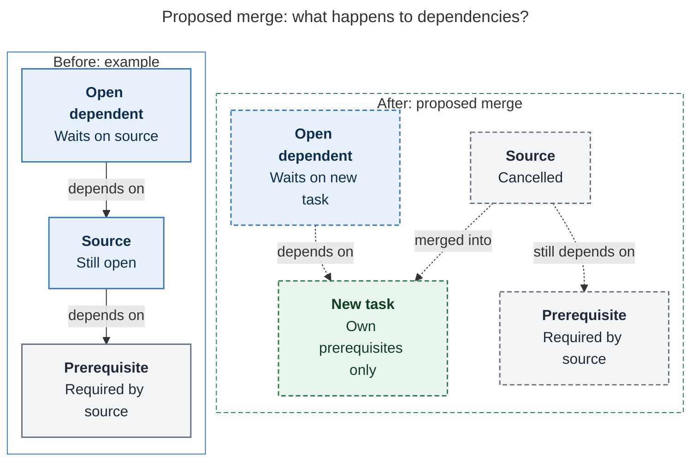

# Diagram proposals: Capture `<`: merge existing tasks into the task you are creating

Proposals for the swarm linker, not a report. Each diagram restates only what the source
report says.

```yaml
source: research:202611/capture_merge_in_arrow/capture_merge_in_arrow__final.md
producer: research.3f.image
check: "mmdc 12.0.0 with the PDF-mirroring config rendered 1 of 1 Mermaid diagrams; pinned CLI with Puppeteer no-sandbox flag"
```

## dependency-directions

```yaml
anchor: |-
  A source's prerequisites are *not* inherited. They stay on the
question: |-
  Which dependencies follow the new task, and which stay on the cancelled source?
illustrates: |-
  Open dependents re-point to T while source prerequisites stay on the tombstone, so the new task inherits none of them.
caption: "Dependents follow the new task; the cancelled source keeps its prerequisites, which the new task does not inherit."
review: "773.491x577 px, fit 84.4%; question, source-trace, labels, arrowheads, reading order, and visual checks passed; 1 revision across 2 look rounds"
```

This illustrative case has one open dependent and one source prerequisite. Arrows show
labelled task relations, not execution order. Both incoming relations to the new task
coexist; dashed edges and outlines mark the proposed result.


