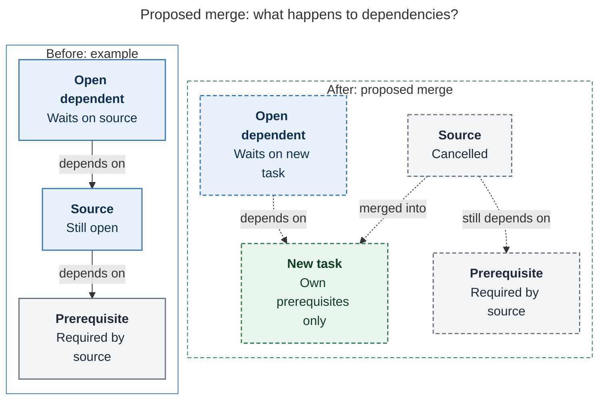
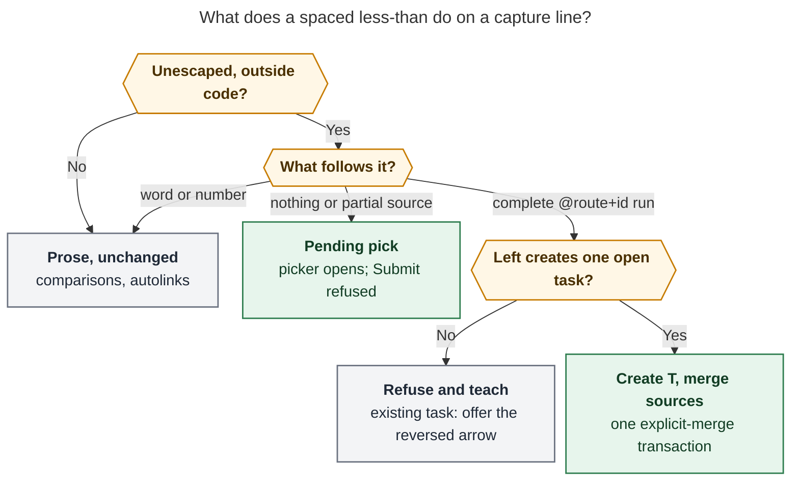

# Capture `<`: merge existing tasks into the task you are creating

> **Research query:** How should Bob capture add a `< @foo+f` syntax that complements the
> existing `> @foo+f`, is valid only where a capture creates a new task, merges one or
> more named tasks into the newly created task with the existing "merged into" relation
> label, and gets an excellent, useful, but concise preview in Bob Mac Capture? Is this a
> good idea, would a different approach be better, which requirement adjustments are
> justified, and what is the recommended solution for an intuitive, reliable, and
> beautiful design?


## Bottom line

**Build it.** It is [a good idea](#is-this-a-good-idea), `<` is the right spelling, and
the hard parts already exist. All five researchers agree on that. The one thing to get
right is what `<` *means*:

> `T < S₁ S₂` = create **T** exactly as the left side says, then run the existing
> **explicit** task merge of `S₁ S₂` into T, all in one capture transaction.

That is a real merge, not just a link. Each source's notes move under T. The source is
cancelled with `🪢 LINKS: merged into [[T]]`, and T gets the inverse "merged into" entry
on its LINKED FROM line. Open dependents re-point to T, and today's Pomodoro links to the
sources are pruned, with T offered in their place. The result matches, byte for byte,
the [two-item draft](#three-spellings-of-nearly-the-same-outcome-already-exist) that
already works today (`T @foo^great` ⏎⏎ `@foo+f @bar+b > @foo+great`). The only
difference is that you do not have to invent T's ID and type it twice.

Five design decisions carry most of the quality:

1. **`<` is a [terminal clause](#grammar) on a new-task line.** Everything about T
   (title, `@route`, `^id`/`:id`, `#type`, `s:`, `$`, `&`, `*`, child bullets) goes
   *before* `<`. Only `@route+id` sources go after it. Prose comparisons
   (`latency < 50ms`) stay prose.
2. **It uses the [explicit merge path](#semantics-in-one-transaction)
   (`MergeGesture::Explicit`), never the `~~` label path.** It works without
   `merge_labels` config, and it refuses closed sources instead of writing a link-only
   relation.
3. **The capture item stays a new-task item (`kind: task`).** The Mac shows the ordinary
   new-task card with a compact purple
   [**Merging in** band](#the-bob-mac-capture-preview) inside it. It must *not* become
   the transfer card, because
   [I verified](#facts-i-verified-in-source-to-settle-the-disagreements) that the
   transfer card replaces the whole new-task card, including the Similar-tasks band.
4. **It is a [grammar break](#less-than-is-not-free-syntax-today), so it ships as one.**
   Today the user's exact example silently files the note
   `Some great new task! @foo^great <` under *both* `^f` and `^b`. Ship bob first with a
   grammar bump and a `!` commit. Then the Mac raises its
   [minimum grammar](#compatibility-and-rollout).
5. **[Misuse teaches](#codes-and-copy).** `@foo+t < @bar+b` (an existing task on the
   left) is refused with a Bob-authored one-key rewrite to `@bar+b > @foo+t`. `\<`
   escapes.

## What exists today

### The merge engine already does the work

`docs/task-merge.md` and `plan_task_merge` (`src/native/task_merge/`) define the
operation, and the explicit `>` transfer and `bob task merge` both use it:

- **Notes.** Each source's description becomes a plain title bullet under the target,
  with its authored notes cut beneath it. Several sources land as separate groups in
  typed order after the target's existing children (MG20).
- **Sources.** Each source is cancelled, keeps its ID and history, and records the merge
  label.
- **Dependents.** Open dependents re-point to T, with cycle refusal.
- **Prerequisites.** A source's prerequisites are *not* inherited. They stay on the
  tombstone and are reported.
- **Today's links.** Live Task Links under today's open Pomodoros are pruned. T is
  offered once at the earliest vacated slot (MG12), unless T already has a live link
  (MG10).
- **Refusals.** Closed, recurring, `^prj`, and open-subtask sources, overlaps, and
  dependency cycles refuse the whole operation.
- **Guarantees.** Writes go destination first. A dry run equals the real run, and
  `bob task reconcile` afterwards is a no-op.

[The dependency-directions diagram](#figure-dependency-directions) sets the before and
after side by side: open dependents re-point to T, while each source's prerequisites
stay on its tombstone and T inherits none.

<div id="figure-dependency-directions">



_Dependents follow the new task; the cancelled source keeps its prerequisites, which the new task does not inherit._

</div>

### Three spellings of nearly the same outcome already exist

| Today's spelling | Works? | Why it is not enough |
| --- | --- | --- |
| `T ~~foo:f\|"merged into" ~~bar:b\|"merged into"` | Yes, but only because Bryan's config sets `merge_labels: [merged into]` | It depends on config, repeats the label per source, and uses a second source spelling (`note:id`). It runs `MergeGesture::Label` (`src/native/capture/relations_merge.rs:134`), so a closed source becomes a link-only `already_closed`. The preview reads as a relation, not a merge. |
| Two-item draft `T @foo^great` ⏎⏎ `@foo+f @bar+b > @foo+great` | Yes, atomically, with the proper `⤵` output | You must mint T's ID yourself and type it twice. |
| `bob task merge` | Yes | Not part of capture; there is no draft preview. |

So `<` is justified by **ergonomics and preview**, not by a missing write path.
cdx's fixture probe confirmed the `~~` caveats: with `merge_labels: []` the draft only
adds a relation, and with a closed source it returns `already_closed` and moves 0 notes.

### Less-than is not free syntax today

**`<` is not free syntax today.** cdx and cld probed independently and got the same
result with the installed parser:

| Draft | What happens today |
| --- | --- |
| `Some great new task! @foo^great < @foo+f @bar+b` | **Two sub-bullets**: the literal note `Some great new task! @foo^great <` is filed under `^f` *and* under `^b` (a trailing target run fans out) |
| `Ship it @foo:great < @foo+f` | A sub-bullet `Ship it @foo:great <` under `^f` |
| `Remind me < @work` | Task `Remind me <` in `work.md` |
| `Latency < 200ms check`, `a<@foo+f` | Plain task text |

The first two rows are plausible-looking wrong writes. That is why the rollout must gate
old `bob` binaries (see [Compatibility and rollout](#compatibility-and-rollout)).

### Facts I verified in source to settle the disagreements

**bob-cli:**

- `GRAMMAR_REVISION` is 13 (`src/native/capture_language/mod.rs:46`).
- The explicit transfer merge reads the first configured merge label and uses
  `MergeGesture::Explicit` (`src/native/capture/transfer.rs:737–741`). The relation-merge
  path uses `MergeGesture::Label` (`relations_merge.rs:134`).
- Human merge output (`print_human_transfer_merges`) runs only when
  `kind == "task_merge"` (`src/native/capture/output.rs:3637`). That is why a `~~` merge
  into a new task prints only a 🪢 relation line.
- `MergeRecord.target.created` is documented as "true when the merge created the drawer
  or section" (`docs/task-merge.md:209–211`). A capture-born task target is not covered
  today.
- The `>` source picker keeps tasks that are **movable OR mergeable** and drops every
  ID-less row (`src/native/capture_complete/transfer_assist.rs:67–107`). Other task
  pickers (`task_parent`, `+query`) already return ID-less rows with `requires_block_id`
  for the client's **Add block ID** flow (`bob capture-task-id`), and they return
  `continuation: " +"` for multi-pick (`capture_complete/cli.rs:170–190`).
- The shell guard (`src/native/capture/shell_guard.rs`) checks only stdout. Capture
  ignores stdin whenever draft arguments are present (`capture/cli.rs:1111–1130`).

**bob-mac-capture:**

- `CaptureTransferPresentation.init` returns nil unless `kind` is `task_move` or
  `task_merge` (`Sources/CaptureCore/CaptureTransferPresentation.swift:365–369`).
- When that presentation exists, `previewItem` renders the transfer card **instead of**
  the standard new-task preview (`Sources/BobMacCapture/CapturePanelView.swift:4008`).
  The Similar-tasks band is rendered inside `standardPreviewItem` (line 6386), and it is
  gated on parse `mode ∈ {task, pomodoro_task, …}`
  (`Sources/CaptureCore/SimilarTasksBandPolicy.swift:112`).
- `target.created == true` already draws a dashed "new" capsule on the transfer card's
  destination row.
- The grammar gate's minimum is 5 (`Sources/CaptureCore/CaptureGrammarGate.swift:6`).
- The Mac does not decode `merge_effect` anywhere.
- h4's `tombstones = cards` landing design shipped. Merge-source cards fold each run of
  removed lines (`CaptureTaskBlockPresentation.swift:258`).

## Is this a good idea

### Yes

- **It is a real, frequent move.** "These three inbox scraps are really one task" is
  the most common inbox-triage consolidation. You usually notice the umbrella *while
  typing it*. `>` covers "fold into a task that exists", but nothing first-class covers
  "fold into the task I am naming right now".
- **Capture is title-first.** Only a new-task line can carry T's title, type, schedule,
  priority, dependencies, and authored notes. A `>` line carries nothing but sources and
  one destination (`transfer_extra_text`). That rules out "extend `>` with a creatable
  destination".
- **`<` is the honest mirror of `>`.** In both, the arrow points from the tasks that
  disappear toward the task that grows: `S > T` is source-first, and `T < S` is
  target-first. Both sides share one source grammar (`@route+id`), one set of source
  errors, and one engine.
- **The engine work is done.** This is a parser clause, a context gate, a few additive
  JSON facts, and one Mac band.

### What it costs, and the containment

| Cost or risk | Containment |
| --- | --- |
| Merging is destructive: sources are cancelled and notes move | Claim `<` only in the narrow shape shown in [Grammar](#grammar). A preview always comes before submit, and the dry run equals the commit. Engine refusals still apply. Writes go destination first, so a crash mid-write leaves a visible duplicate, never a loss. The vault is in git. |
| Grammar break ([today's parse](#less-than-is-not-free-syntax-today)) | Grammar bump, `\<` escape, `feat(capture)!:` on the release train, bob ships first, then the Mac raises its minimum grammar ([Compatibility and rollout](#compatibility-and-rollout)). |
| One more punctuation operator | One clause, one position (terminal), the same source spelling as `>`, and teaching refusals. |
| Overlap with `~~\|"merged into"` | Document `<` as **the** capture spelling of merge-in. `~~` stays as the general relation path. Both render through the same new band ([The Bob Mac Capture preview](#the-bob-mac-capture-preview)), which fixes `~~`'s missing preview for free. |
| The new task silently loses source state (lane, prerequisites, schedule) | Keep the engine's rule that T owns its fields, and make each loss **visible**: status transitions, the link-leaves row, and a prerequisite-left warning. |
| Shell: unquoted `<` is an input redirect | Quote drafts in docs. In practice the shell fails before `bob` runs when no file named `@foo+f` exists ([Compatibility and rollout](#compatibility-and-rollout)). |

### Alternatives considered

| Alternative | Verdict |
| --- | --- |
| Do nothing; teach `~~src\|"merged into"` | **Rejected.** It is config-dependent, label-repeating, has relation-flavoured output, and turns closed sources into link-only writes. |
| `@a+x @b+y > New title @foo^great` (creatable `>` destination) | **Rejected.** The title comes last, which is anti-capture, and it breaks `>`'s load-bearing "nothing else on the line" rule. |
| Keyword (`merge:@foo+f`, `fold`) | **Rejected.** It is verbose and breaks the sigil language. |
| Glued per-source sigil (`New <foo:f <bar:b`) | **Rejected.** `<word` looks like HTML and autolinks, and it loses the mirror with `>`. |
| `<` on existing-task lines as an alias of `>` | **Rejected.** That would give two spellings for one operation. The refusal with a rewrite *is* the feature. |
| Reclassify the item as `kind: task_merge` (cdx, mus) | **Rejected.** It would replace the new-task card on the Mac ([verified facts](#facts-i-verified-in-source-to-settle-the-disagreements)). |
| Lower `<` into `~~` relations and `plan_relation_merges` (gem) | **Rejected.** It inherits Label gesture, config gating, and `already_closed`. |
| Mac-only "merge into new" button | **Rejected.** It violates `decisions:mac-capture-is-a-thin-client`. |
| **`T < @a+x @b+y` terminal clause** | **Adopted**, with the adjustments in [Requirement adjustments](#requirement-adjustments). |

### Where the five reports disagreed and how I resolved it

| Question | Positions | Resolution |
| --- | --- | --- |
| Result `kind` and Mac card | cdx: emit `task_merge` so old Macs render the merge card. mus: `mode: task_merge` with "zero Mac changes". cld: keep the kind but widen `CaptureTransferPresentation` to accept `task`. grk, gem: keep the kind and add a band in the new-task card | **Keep `kind: task` / `pomodoro_task` and add a band inside `standardPreviewItem`.** Any route through `CaptureTransferPresentation` (including cld's widening) replaces the whole new-task card. That drops the title header, type, schedule, Pomodoro-start row, and the Similar-tasks band (verified; see [the verified facts](#facts-i-verified-in-source-to-settle-the-disagreements)). |
| Merge path | gem: `~~` relation path. The other four: explicit | **Explicit**, verified ([verified facts](#facts-i-verified-in-source-to-settle-the-disagreements)). |
| Children on the `<` line | mus: refuse in v1. The other four: allow | **Allow.** They are T's own notes and land first; merged groups follow (MG20). |
| Tokens after the sources | gem: accept tolerantly. The other four: refuse | **Refuse**, with a Bob-authored rewrite that moves them before `<`. |
| Mac minimum grammar | grk: unnecessary. cdx, cld: raise it | **Raise it.** An old `bob` turns the draft into wrong sub-bullets ([today's parse](#less-than-is-not-free-syntax-today)), so this is a safety requirement. |
| `MergeRecord.target.created` | cdx: do not overload it; add a new field. cld, mus: set it true | **Generalize the documented meaning** to "the target container is new in this capture" (drawer, section, *or* a task born in this capture). The Mac's only use is the `new` capsule, and `kind: task` keeps it unambiguous. This is a one-sentence contract amendment, not a new field. |
| `:id` on T (Pomodoro-linked newborn) | cld: T takes the slot the sources vacated (a new rule). grk: allow; MG10 suppresses the offer. mus: allow, with type placement | **Allow `:id` with ordinary composition in v1.** cld's slot rule is attractive but is a new placement rule that needs its own decision record, so it is deferred ([Open questions for Bryan](#open-questions-for-bryan)). |
| Session start or close on T (`:id=`, `=x`) | cld: allow `:id=`, refuse `=x`. cdx: refuse both in v1 | **Refuse both in v1.** Born-closed T contradicts the merge. Start-plus-prune in the same daily note is an untested composition; lift it later if wanted. |
| ID-less sources | cld: pickable via Add block ID. The others are silent | **Adopt in v1.** Plain inbox captures have no block ID, and they are exactly what `<` consolidates. The machinery exists. |
| Re-submit | mus: "idempotent re-runs". The others: refusal | **Refusal.** Creating T is not idempotent. With an explicit `^great` the duplicate-ID check fails. With an auto-ID the sources are closed and refuse, with copy that names where they went. |

## Requirement adjustments

**Explicitly called out.** Each item is marked **Clarified** (pins down something open),
**Adjusted** (changes the request), **Added** (goes beyond it), or **Deferred**.

- **R1. Clarified: "merge" means the full engine merge, not just a label write.** The
  "merged into" relation is the *receipt*. Notes move, sources cancel, dependents
  re-point, and today's links prune and offer T. A link-only write would leave two live
  tasks, which contradicts `>` and `bob task merge`.
- **R2. Adjusted: the label is the first configured merge label, falling back to
  `merged into`, exactly as `>` does.** For Bryan's config this *is* `merged into`.
  Empty `merge_labels` must not disable `<`.
- **R3. Clarified: `<` is a terminal clause.** The line is
  `<new-task part> < <source> [<source> …]`. All of T's markers go before `<`. The left
  side parses exactly as it would without the clause, so no existing new-task behavior
  changes. Authored child lines are T's notes.
- **R4. Adjusted: "a context that would create a new task" means exactly one ordinary
  task that is still open when the capture commits.** This is a planner fact, not a
  string heuristic. See the context table in
  [Where the merge-in arrow is valid](#where-the-merge-in-arrow-is-valid).
- **R5. Adjusted: explicit-merge semantics.** Closed, recurring, `^prj`, and
  open-subtask sources refuse the *whole* draft. No source is silently skipped,
  deduplicated, or turned into a link-only write.
- **R6. Added: T gets an ID automatically.** If no `^id`/`:id` is typed, mint one with
  the existing block-ID minting. The ID is shown in the preview, and a dry run persists
  nothing.
- **R7. Added: all or nothing.** A bad second source, or a later failing item in a bulk
  draft, leaves **no new T and no retired source**. This is the existing guarantee for
  validation, planning, and guarded writes. It is not a claim of filesystem-wide crash
  atomicity.
- **R8. Added: teaching refusals.** An existing task on the left is refused, with a
  structured rewrite to the `>` form. Modifiers that name a source (`&foo:f`, `*foo:f`,
  `~foo:f`) are refused. A merge-label `~~` on a `<` item is refused with a rewrite that
  moves that task after `<`, so one item never mixes two merge paths.
- **R9. Added: ID-less sources are pickable** through the existing Add block ID flow.
  I recommend the same change for `>` sources in the same phase.
- **R10. Added: Similar tasks must not suggest the tasks you are already merging.**
  `capture-related` excludes every task named in the item's `<` clause.
- **R11. Kept: no metadata inheritance.** T's status, type, priority, schedule, and
  prerequisites come only from the left side. Lost prerequisites are *warned*, not
  copied: copying them would make the newborn Blocked.
- **R12. Kept: today's plan is never changed silently.** The Pull-In offer stays
  explicit and is never pre-selected (`decisions:unblocked-tasks-are-offered` spirit).
- **R13. Rejected: inferring T's route from the sources.** That would add a hidden
  second "where" (`decisions:capture-sigils-say-where-what-how`). T routes like any new
  task, and the preview shows its note.
- **R14. Deferred:** `:id` taking the sources' vacated Pomodoro slot, session
  start/close on T, project-note (`^prj`) targets, merging into a drawer of the new
  task, and a `<` action in the Similar-tasks band
  ([Implementation plan](#implementation-plan), phase 5).

## Recommended design

### Grammar

```text
<ordinary-new-task-capture> < <source> [<source> …]      source := @route+block-id
```

```text
Some great new task! @foo^great < @foo+f @bar+b
Consolidate login flakiness #fix s:1 < @inbox+a @inbox+b
A better combined outcome @dev < @dev+old
- my new acceptance criteria
```

**Claim rule.** One span-aware scanner (`capture_language/merge_in.rs`) runs on parent
lines and task-list bullet lines, **before target-run fan-out**, at the same point as
`scan_transfer_line`. It shares the source-token, duplicate, and protected-markup
helpers factored out of `transfer.rs`, and both `draft.rs` and `editor_parse.rs` call
it, so highlighting can never disagree with execution. It never runs on authored child
lines.



*Figure 1. Bob claims a whitespace-delimited `<` only when a complete `@route+id` run
follows it and the left side creates exactly one open task. Prose stays prose, partial
input waits for a pick, and every other claimed line refuses with a teaching fix.*

| Draft (standalone `<` = whitespace on both sides) | Result |
| --- | --- |
| `New outcome @foo^great < @foo+f @bar+b` | **Valid**: create one task, merge two sources in typed order |
| `New outcome < @foo+f` | **Valid**: T routes normally (inbox), and its ID is minted |
| `New outcome @foo^great <` | **Pending** `merge_in_source`: calm hint "type + to pick tasks to merge in". Submit refused: "pick tasks to merge in after <, or write \\< to keep it" |
| `New outcome < +fla` / `< @foo+` / `< @foo+f @bar+` | **Pending**: vault picker / note-scoped picker; resolved sources stay visible |
| `New outcome < @foo` | **Incomplete**: a note is never a source; a task ID is needed |
| `New outcome < @foo:f`, `< @foo^f`, `< @foo+f#d`, `< @foo+f!` | **Invalid**: reused `transfer_source_marker` / `transfer_source_suffix` ("sources use @route+id, as > does") |
| `New outcome < @foo+f @foo+f` | **Invalid**: `duplicate_capture_target` on the second occurrence |
| `New outcome < @foo+f s:3` / a second `<` | **Invalid** `merge_in_extra_text` with a rewrite that moves `s:3` before `<` |
| `text<@a+x`, `text <@a+x`, `text< @a+x` | **Invalid** `merge_in_arrow_spacing`: "put spaces around <: New task < @a+x" |
| `@foo+t < @bar+b` | **Invalid** `merge_in_needs_new_task` with rewrite → `@bar+b > @foo+t` |
| `< @a+x` (nothing before the arrow) | **Invalid** `merge_in_needs_new_task`: "name the new task before <" |
| `Latency < 50ms @foo`, `a < b`, `<=`, `<<`, `<https://…>`, `` `a < @b+x` `` | **Unclaimed**: unchanged |
| `Escaped \< @foo+f @work` | **Escaped**: literal `<`. The escape suppresses the *whole* clause, so the `@` tokens cannot fan out afterwards (test this explicitly) |

### Where the merge-in arrow is valid

Where `<` is valid:

| Item | `<` |
| --- | --- |
| Plain text, `@route text`, `@@`-inherited route, `@route^id text`, `%t` template row (as expanded) | ✅ |
| `@route:id text` (Next + Pomodoro link) | ✅ ordinary type placement; MG10 suppresses the offer (deferred slot rule: [open question 1](#open-questions-for-bryan)) |
| First-level bullets under a `@route` task-list header (each creates one task) | ✅ per bullet |
| Item with authored child bullets or drawers | ✅ authored notes first, merged groups after |
| `:id=` (start) or `=x` (born closed) | ❌ `merge_in_needs_new_task`: "the new task must stay open to take in other tasks; start or close it in a later item" |
| Project-note creation `@r^id@` / `@r:id@` and its bullets | ❌ `merge_in_needs_new_task`: "a new project keeps tasks as tasks: list them as `- ^id` bullets to move them in" |
| Existing-task lines (`@foo+t`, toggles `!`, `@foo:t` alias, target runs, sub-bullets) | ❌ with the `>` rewrite when one exists |
| Note bullets, section bullets, URLs/refs, Pomodoro operators, `>` lines | ❌ "this line creates no task" |

### Semantics in one transaction

```text
1. parse     left slice → ordinary new-task item; clause → ordered sources
2. validate  the left creates exactly one open task; source spellings, duplicates and aliases,
             conflicts with &/*/~/~~ naming a source
3. stage T   creation, minted ID, children, metadata, :id link     (nothing on disk yet)
4. merge     load_staged_snapshot (includes T) → one MergeRequest {
               sources: [S₁…Sₙ] in typed order,
               target: MergeContainer::Task(T) at its plain-child anchor,
               label: first merge_labels entry or "merged into",
               gesture: Explicit }
             → plan_task_merge once → stage_merge_plan          (shared with > and ~~)
5. report    merges[], merge_offers, repaired_files[], task_blocks (T: created, merge_target;
             S: merge_source), draft-level pull_in
6. commit    the existing aggregate capture path, only if the whole draft succeeds
```

Lift the shared part of `capture/transfer.rs` and `capture/relations_merge.rs` into one
`plan_explicit_merge(sources, MergeContainer::Task(T))` helper. Do **not** spawn one
`bob task merge` per source. Do not commit T first and merge afterwards. Either approach
breaks atomicity and the single preview.

Notes on the resulting vault state:

- **Fields:** T owns its fields, and nothing is inherited.
- **Ordering:** T's authored children come first, then one group per source in typed
  order.
- **Same note:** T and a source in the same note produce one staged postimage.
- **Bulk drafts:** later items see the merged snapshot. A later item that names an
  already-absorbed source refuses before any write.
- **Core property:** `T @n^t < @a+x @b+y` produces the same vault bytes as the two-item
  draft `T @n^t` ⏎⏎ `@a+x @b+y > @n+t`.

### Codes and copy

Bob authors every string.

| Code | When | Copy |
| --- | --- | --- |
| `merge_in_needs_new_task` | The left names an existing task, creates no task, is empty, or starts/closes a session | "< merges into the task this line creates; ^t already exists. Write @bar+b > @foo+t" (+ structured `rewrite {range, replacement}`) / "this line creates no task" / "name the new task before <" |
| `merge_in_extra_text` | Tokens after the sources, or a second `<` | "everything about the new task goes before <; only @note+id tasks follow it" (+ `rewrite`) |
| `merge_in_arrow_spacing` | A glued arrow next to a complete source | "put spaces around <: New task < @a+x" |
| `merge_in_incomplete` | Submit with a terminal `<` or an unresolved picker | "pick tasks to merge in after <, or write \\< to keep it" |
| `merge_in_source_also_marked` | `&`/`*`/`~`/`~~` names a source, or a merge-label `~~` appears on the item | "“S” merges into the new task; it can't also be its {prerequisite \| dependent \| relation}" |
| *reused* | `transfer_source_suffix`, `transfer_source_marker`, `duplicate_capture_target`, `transfer_destination_is_source`, `merge_source_closed`, `merge_source_recurring`, `merge_source_project`, `merge_source_open_subtasks`, `merge_dependency_cycle` | unchanged, with one improvement: when a closed source's LINKS line already names its merge target, `merge_source_closed` says so ("“Fix the flaky login test” is already merged into “Some great new task!” (foo.md)"), so an accidental double submit explains itself |

Each refusal carries the item number, the offending source, and its UTF-8 byte span.

### Editor contracts

**`capture-parse`** keeps the item's own `mode` (`task` / `pomodoro_task`). This is
required for highlighting and for the Similar-tasks gate. It adds one additive object
and new span kinds:

```json
"merge_in": {
  "arrow":   {"start": 32, "end": 33},
  "sources": [
    {"start": 34, "end": 40, "marker": "@foo+f", "route": "foo", "block_id": "f"},
    {"start": 41, "end": 47, "marker": "@bar+b", "route": "bar", "block_id": "b"}
  ]
}
```

- **Span kinds:** `merge_in_arrow` (merge purple, like `transfer_arrow` in `task_merge`
  mode) and `merge_in_source` (route family). Do not reuse `transfer_*`: the Mac keys
  transfer-only picker logic on those kinds.
- **Need:** `merge_in_source`.
- **Versions:** `grammar` goes to 14 (or the next free revision after rebase), and
  `schema_version` stays 1.

**`capture-complete`:**

- **Pickers:** after `<`, a bare `+`/`+query` opens the vault-wide `task_parent` picker
  in a new **merge-in source** role. `< @route+` uses the note-scoped task context with
  the same narrowing.
- **Eligible rows:** **mergeable only** (open, not `^prj`, not recurring, no open
  subtasks). Drop the "movable" half that `>` uses. Exclude T and already-typed sources
  and their aliases.
- **ID-less rows:** keep them with `requires_block_id` (R9).
- **Multi-pick:** return `continuation: " +"` so a comma opens the picker for the next
  source (`New task < +fla⏎,+time⏎`).
- **Row text:** each row shows title, note, and status, plus Bob's consequence hint
  (`⤵ merge in · 2 notes`).

**`capture-rewrite`:** in a `<` source slot, typing `+` right after `@route:id` or
`@route^id` toggles to `@route+id`, exactly as on a `>` line.

**`capture-related`:** exclude every task named in the item's `<` clause (R10).

### The Bob Mac Capture preview

There are three design principles:

- **The card reads like what you typed.** You typed the new task first, so the new task
  stays the card's subject and header, unchanged. The merge is a band *inside* that
  card.
- **Reuse, don't fork.** The band reuses `CaptureTransferCardView`'s source-row,
  status-transition, consequence-row, and Pull-In subviews and its purple merge tint.
  Landing cards reuse h4's `Merge target` / `Merged` capsules and tombstone folds.
- **Concise by default, complete on demand.** Show one row per source and only the
  consequences that change meaning. Exact bytes are one disclosure away.

**State 1: arrow typed, nothing picked.** (`Some great new task! @foo^great <`)

```text
  Some great new task! @foo^great <▏                     “<” in merge purple
  ○ Some great new task!                 foo.md · ^great  new
    ⤵ Merge tasks into this one — type + to pick           (calm hint, no error red)
```

**State 2: picker open.** (`… < +fla`)

```text
  ⤵ Merge into “Some great new task!”                    ↩ pick · , pick another
  ● Fix the flaky login test      Next · BUILD   foo.md   ⤵ merge in · 2 notes
  ○ Flaky auth e2e on Safari      Ready          inbox    Add block ID
```

**State 3: complete.** (`Some great new task! @foo^great #fix < @foo+f @bar+b`).
The mockups are schematics: the source titles, statuses, and counts are illustrative,
not facts about the vault.

```text
┌──────────────────────────────────────────────────────────────────────────┐
│ ○ Some great new task!                         foo.md · ^great   ┆new┆   │  standard new-task header
│   Ready · #fix                                                           │  (type, schedule, route as today)
│ ┃ ⤵ Merging in 2 tasks                                                    │  ← the new band
│ ┃ ⊘ Fix the flaky login test         foo.md:1   Next → Cancelled  2 notes│
│ ┃ ⊘ Login test timeout is too short  bar.md:4   Ready → Cancelled  1 note│
│ ┃   ⛓ “Waits on f” now waits on this task                                 │
│ ┃   ◌ “Fix the flaky login test” leaves BUILD                             │
│ ┃   ⚠ “Login test timeout…” waited on “Upgrade CI runners”; this task won't │
│ ┃   [Pull in] Link this task under BUILD in place of “Fix the flaky login test” │
│   Similar tasks (only when a non-source match clears the bar)            │
└──────────────────────────────────────────────────────────────────────────┘
  foo.md · ^great   [New] [Merge target]
    - [ ] #task Some great new task! [type:: FIX] … ^great
      - 🪢 LINKED FROM: [[#^f]] (merged into) • [[bar#^b]] (merged into)
      ⤵ Fix the flaky login test · 2 notes ▸
      ⤵ Login test timeout is too short · 1 note ▸
  foo.md:1  [Merged]   - [-] Fix the flaky login test …  🪢 LINKS: merged into [[#^great]]  ⤵ 2 lines moved
  bar.md:4  [Merged]   - [-] Login test timeout …        🪢 LINKS: merged into [[foo#^great]]  ⤵ 1 line moved
                                                           Capture & merge 2   ⌘↩
```

Band details:

- **Trigger:** a new `CaptureMergeInPresentation` (in `CaptureCore`) is built from
  `merges[]` when `kind ∈ {task, pomodoro_task}`. It renders in `standardPreviewItem`
  under the header and above the Similar-tasks band. Because it keys on `merges[]`,
  `T ~~old:a|"merged into"` gets the same band for free. That fixes today's 🪢-only
  preview without touching `~~` grammar.
- **Source rows:** a title first, with note:line as secondary disambiguation, a visible
  `Next → Cancelled` text transition (not just tint), and the moved-note count
  ("title only" when it is 0).
- **Long lists:** for 1–3 sources show every row. For more, show three plus a
  keyboard-accessible "Show all N", and keep the full list in the accessibility
  summary. Never hide a blocking error, the aggregate cancellation count, or a
  meaning-changing warning.
- **Consequences:** Bob-authored, deduplicated by task identity, so a dependent of two
  sources appears once. The engine's `prerequisites_left` becomes the ⚠ row.
- **Offer:** the Pull-In offer stays explicit and is never pre-selected. If T is born
  Blocked (`s:N`, `&`), there is no offer, and the band says the source's link leaves.
- **T's landing card:** this is the exact bytes Bob will write. A created block is all
  `added` rows, so today's quiet-run folds never trigger. To stay concise, add an
  additive per-line `origin` key (`"foo.md#^f"`) so each merged group folds to one row,
  mirroring the tombstone fold.
- **Tombstone cards:** they follow h4's shipped `tombstones = cards` decision unchanged,
  so `<` and `>` look the same (see [open question 4](#open-questions-for-bryan)).
- **Pending and failure:**
  - A pending pick never flashes red.
  - A source that resolves but cannot merge shows Bob's reason inline ("Has 2 open
    subtasks; merge or close them first"), and Submit stays unavailable.
  - A stale response is never shown as current. Responses stay tied to the draft
    revision, as today.
- **Refusal state:** shows Bob's copy plus a **Use `>` instead** button that applies the
  structured `rewrite`. It is an explicit draft edit; Return never changes.

Copy:

| Surface | Text |
| --- | --- |
| Footer / Return | `Capture & merge 2` (ML7's `Capture & merge {N} task(s)` contract, first shipped here). Bulk drafts keep `Capture`. |
| Status line | `Would create “Some great new task!” and merge 2 tasks into it · foo.md` |
| Notification | `Created “Some great new task!” · merged 2 tasks`; body: one line per source, `Fix the flaky login test · Next → Cancelled · 2 notes` |
| VoiceOver | "New task Some great new task!, foo.md, new. Merging in 2 tasks: Fix the flaky login test, Next to Cancelled, 2 notes; …" Settled changes are announced without moving focus, and never on every keystroke. |

### CLI output and JSON

```text
✓ captured  foo.md
  - [ ] #task Some great new task! [type:: FIX] [created::2026-11-05] ^great
⤵ merged 2 tasks into new “Some great new task!” · foo.md
  ⊘ Fix the flaky login test         foo.md:1 · Next → Cancelled · 2 notes moved
  ⛓ “Waits on f” now waits on “Some great new task!”
  ◌ BUILD link removed · offer 1: link “Some great new task!” under BUILD (-p 1)
  ⊘ Login test timeout is too short  bar.md:4 · Ready → Cancelled · 1 note moved
```

- **Human output:** `print_human_transfer_merges` runs whenever `merges[]` is non-empty,
  not only for `kind == "task_merge"`. That also fixes the `~~` output.
- **JSON:** the item keeps its kind and gains the existing flattened `merges[]` (with
  `target.created: true`, per
  [the resolved disagreements](#where-the-five-reports-disagreed-and-how-i-resolved-it)),
  `merge_offers`, and `repaired_files[]`. It joins the top-level `pull_in`.
- **Task blocks:** stamp merge roles from `merges[]`, not from `kind`.
- **Versions:** every change is additive, and `schema_version` stays 1.
- **Related copy defects:** cld filed the ones it found on the way as bead `bob-cli-hi`:
  "1 notes" pluralization, an offer title that counts records instead of link-losing
  sources, and an unnamed `-p 1`. Fix them in the same window, because `<` makes them
  more visible.

### Compatibility and rollout

| App / bob | Behavior |
| --- | --- |
| New app / new bob | Full band, pickers, rewrite buttons, and the composite commit |
| New app / old bob | **Blocked.** `CaptureGrammarGate.minimumRevision` is raised to the new revision, and the existing "update bob" copy shows. A `<` draft must never reach an old parser, which would file sub-bullets under the sources |
| Old app / new bob | Works correctly (bob does the merge). The preview shows the standard new-task card plus `Merge target` / `Merged` landing cards from `task_blocks`, so consequences stay visible but without the band. This is a short window |
| CLI | No skew (the grammar is in the binary). The changelog line for the `feat(capture)!:` commit says plainly that `X < @a+x` used to file a note |

Ship order: bob first, then the Mac app with the gate bump. Raising the gate
temporarily blocks *all* Mac capture until bob is upgraded. That is an explicit,
accepted rollout cost, and it is safer than a second Swift parser (which the thin-client
decision forbids anyway).

Shell: unquoted `bob capture X < @foo+f` makes the shell open a file named `@foo+f`.
Usually no such file exists, so the shell errors before `bob` runs. Document quoting,
and prefer stdin for multi-line drafts. An optional, cheap mirror of
`shell_ate_transfer_arrow` (refuse when stdin is a regular file whose basename starts
with `@` *and* arguments are present) catches the rare case where the file exists.
Low priority.

Retries: never auto-replay a lost submit response. Keep the draft and show the actual
outcome.

## Verification

Acceptance vectors MI1–MI16:

| ID | Covers |
| --- | --- |
| MI1 | `T @n^t < @a+x`: T created; x's title bullet and notes land under T; x is `[-]` with `merged into [[n#^t]]`; T has LINKED FROM |
| MI2 | Several sources keep typed order after T's authored children and drawers (MG20) |
| MI3 | **Equivalence property:** `<` item ≡ two-item `>` draft, byte for byte |
| MI4 | Same-note T and source stage one write; same-note descendant-anchor collisions |
| MI5 | Dependents re-point to T; a cycle through T's own `&` refuses; shared dependents counted once |
| MI6 | Closed, recurring, `^prj`, open-subtask, duplicate, alias, overlapping, and missing sources refuse; vault byte-identical |
| MI7 | [Where-valid table](#where-the-merge-in-arrow-is-valid) contexts: each ❌ refuses with its code; `@n+t < @a+x` carries the `>` rewrite |
| MI8 | Lexical: prose `<`, `<=`, `<<`, autolinks, code, glued, `\<` (whole-clause escape), terminal `<`, `< +q`, `< @r`, extra text, second `<`, Unicode/multi-line spans |
| MI9 | Offers: plain T offered at the earliest vacated slot; `:id` T gets no offer (MG10); `s:N`/`&` T gets no offer while the prune lands |
| MI10 | `merge_labels: []` still merges and writes `merged into` |
| MI11 | Re-submit: explicit-ID collision refuses; auto-ID retry refuses with "already merged into …"; zero writes |
| MI12 | Atomicity: a bad second source or later bulk item leaves no T and no retired source; injected guarded-write failure rolls back |
| MI13 | Task-list header + `- T < @a+x` bullets work per bullet |
| MI14 | `&`/`*`/`~`/merge-label `~~` naming a source refuses (`merge_in_source_also_marked`) |
| MI15 | ID-less T mints an ID; dry run persists nothing; preview and record show it |
| MI16 | Dry run ≡ commit under a fixed clock and snapshot; `bob task reconcile` is a no-op afterwards |

**Mac:**

- Fixtures: one, two, and five sources; long or duplicate titles; no notes; a warning;
  zero, one, or many dependents; a Blocked T; a pending second source; stale responses;
  mixed bulk drafts.
- Rendering: light and dark themes, narrow width, keyboard disclosure, and VoiceOver.
- Similar tasks: the band excludes the sources.
- Grammar gate: the old-grammar gate blocks submission.
- CI: watch the exact-SHA macOS CI run to green.

## Implementation plan

Each phase ships independently, and `schema_version` stays 1 throughout.

1. **Contract and docs.**
   - `docs/capture.md`: add a section "Merging tasks into a new task with `<`" right
     after the `>` section, plus marker-table rows.
   - `docs/task-merge.md`: list `<` among the gestures, add the MI vectors, and amend
     `target.created`.
   - `docs/task-relations.md` ML6: add the equivalence note.
   - `docs/reference/compatibility.md`: add the grammar revision.
   - CLI reference and JSON-output pages.
   - Run `just docs-check`.
2. **bob grammar.**
   - `capture_language/merge_in.rs`, with the source helpers shared with `transfer.rs`.
   - `ParsedCaptureText.merge_in`.
   - Wire `draft.rs` and `editor_parse.rs` (spans, need, `merge_in` object).
   - The context gate on the resolved kind.
   - `capture-complete`'s merge-in source role (mergeable-only, ID-less rows,
     continuation).
   - The `capture-rewrite` toggle.
   - Grammar bump; `feat(capture)!:`.
3. **bob execution.**
   - `capture/merge_in.rs`: stage T, then call the lifted explicit-merge helper.
   - Teaching refusals with `rewrite` payloads.
   - `target.created` for capture-born targets.
   - Merge printing and task-block roles keyed on `merges[]`.
   - `capture-related` source exclusion.
   - The copy fixes from `bob-cli-hi`.
   - MI1–MI16.
4. **Mac.**
   - Decode `merge_in` and the new span kinds.
   - The `merge_in_source` hint.
   - The `< +` / `< @r+` pickers, including the Add block ID splice.
   - `CaptureMergeInPresentation` and the band inside `standardPreviewItem`.
   - `origin` group folds on T's landing card.
   - The **Use `>`** rewrite button.
   - Footer, status, notification, and VoiceOver copy.
   - Raise the `CaptureGrammarGate` minimum.
   - Watch the macOS CI run to green.
5. **Later, after a new decision record:**
   - A `<` "merge in" action in the Similar-tasks band (splice ` < @route+id`), which
     amends `decisions:similar-tasks-are-a-settled-heads-up`'s closed key list. It turns
     "you already have this" into a one-key consolidation, and it is the feature's best
     follow-up.
   - The `:id` slot rule.
   - Session start on T.
   - The **Add** fix-it on the prerequisite warning (`&ci:runners` inserted before `<`).

After acceptance, record a new decision ("Capture `<` merges existing tasks into the new
task", covering R1–R5, R8, R13, and the `kind: task` band choice). Adding a sigil is
named as a reopen trigger in `decisions:capture-sigils-say-where-what-how`. Also extend
the Task Merge glossary strand. All memory edits go through `/sase_memory_write`.

## Open questions for Bryan

None of these block v1.

1. **`:id` + `<`: should T take the Pomodoro slot the sources vacated?** cld proposes
   that the merge offer's slot win over type placement when the item links T with `:id`
   and no `#pomodoro` is typed. I lean yes, but it is a new placement rule. v1 ships
   ordinary composition and says in the band that the source's link leaves.
2. **Session start with `<`** ("I'm starting the umbrella now"). It is refused in v1.
   Lift it when you want it.
3. **Trailing `#type` after the sources.** v1 refuses it with a one-key "move before
   `<`" fix-it. If you often type `#type` last out of habit, accepting a trailing type
   edge is a small, safe relaxation.
4. **Tombstone cards at 3+ sources.** v1 keeps h4's `tombstones = cards` for parity
   with `>`. If a five-source preview feels long, the reopen is h4's
   `tombstones = rows_only` branch for *both* arrows, which needs a new decision rather
   than a `<`-only exception.

## Recommended solution

Ship `<` as the **capture spelling of "merge these existing tasks into the task I'm
creating."** Define it as an exact desugaring onto the existing explicit `>` merge:

- **Grammar.** A whitespace-delimited, unescaped `<` followed by one or more complete
  `@route+id` sources ends the item's parent line. It is claimed before target-run
  fan-out by one scanner shared with the editor. Prose comparisons are untouched, and
  `\<` escapes the whole clause.
  - It is valid only when the left side creates exactly one task that is still open at
    commit.
  - Existing-task lines get a one-key **Use `>`** rewrite.
  - Every other misuse gets a teaching refusal.
  - The grammar revision is bumped (14), and `schema_version` stays 1.
- **Semantics.** Create T exactly as the left side says, minting its ID if needed.
  Then run `plan_task_merge` once with `MergeGesture::Explicit` and the first configured
  merge label (fallback `merged into`), in one all-or-nothing capture transaction:
  - Sources retire as `merged into` tombstones, and their notes land under T after T's
    own notes, in typed order.
  - Dependents re-point to T.
  - Today's lost links offer T in their place, explicitly.
  - T owns its fields; [nothing is inherited](#figure-dependency-directions), and lost
    prerequisites are warned about.
  - The result is byte-identical to the two-item `>` draft that works today.
- **Preview.** Keep the item a new-task item. The Mac shows the ordinary new-task card,
  with title, type, schedule, route, and the `new` capsule. Inside it sits one compact,
  purple **⤵ Merging in N tasks** band:
  - one row per source, with a visible `Next → Cancelled` transition, its locator, and
    a note count;
  - only the consequences that change meaning;
  - an explicit Pull-In offer.

  T's exact landing block sits below, with each merged group folded to one row, and
  h4's compact tombstone cards follow. The footer reads **Capture & merge N**. The same
  band lights up for `~~|"merged into"`, and Similar tasks keeps working but stops
  suggesting the tasks you are already merging.
- **Pickers.** After `<`, `+query` opens a merge-only vault picker with comma
  multi-pick. ID-less inbox tasks are pickable through Add block ID.
- **Reliability.**
  - All merge-engine guarantees are inherited: refusals, destination-first writes,
    dry-run parity, rollback, and a reconcile no-op.
  - New guarantees: the equivalence property test, config independence, and
    refuse-not-duplicate on re-submit.
  - Rollout is bob first, then the Mac with a raised minimum grammar, so a stale `bob`
    can never turn a merge into stray notes.
- **Next.** Add a `<` action to the Similar-tasks band so "you already have this task"
  becomes a one-key consolidation.

The justified departures from the request are:

- a strict explicit merge rather than a label write;
- the configured-label rule;
- a precise "one open new task" context;
- a terminal clause;
- automatic IDs;
- pickable ID-less sources;
- no metadata inheritance;
- a conservative version gate.

Together they make `<` predictable to type, safe to submit, and calm to read.

## Provenance

> **Research query.** Add a `< @foo+f` capture syntax that complements the existing
> `> @foo+f`. It is valid only where a capture creates a new task, and it merges each
> named task into the new task with the existing "merged into" relation label. Several
> tasks may follow the `<`. For example, `Some great new task! @foo^great < @foo+f @bar+b`
> merges `bar#^b` and `foo#^f` into the new `foo#^great`. The Bob Mac Capture preview must
> be excellent, useful, and concise. Lead the design, critique the plan, call out any
> requirement adjustments, and end with a recommended solution that is intuitive,
> reliable, and beautiful.
>
> **Consolidated report.** Lead researcher, 2026-11-05. This report merges five
> independent reports (cdx, cld, grk, mus, gem; they sit beside this file) with my own
> source verification. I checked the points where the reports disagreed against bob-cli
> `df9178df` (master; capture, merge, and transfer code unchanged since `58e98558`, which
> the researchers read) and bob-mac-capture `9714a56` (master). Two of the reports
> (cdx, cld) probed runtime behavior with the installed `bob 0.4.0`, which reports grammar
> 12; the source reports grammar 13. I ran no new vault probes and changed no product
> code.

- **Researcher reports (moved beside this file):**
  - `capture_merge_in_arrow__cdx.md`
  - `capture_merge_in_arrow__cld.md`
  - `capture_merge_in_arrow__grk.md` (with its figures `figure-arrow-dual.*` and
    `figure-claim-rule.*`)
  - `capture_merge_in_arrow__mus.md`
  - `capture_merge_in_arrow__gem.md`
- **The cld report was registered twice** under the same canonical label and source
  path (two snapshots). I read it through the canonical research label, which resolves
  to the single file in the research repo.
- **Figure 1 source:** `figure-merge-in-claim.mmd`. Rendered with mermaid-cli 12.0.0
  under the PDF configuration: 856.7 × 832 px, fit scale 76.2%.
