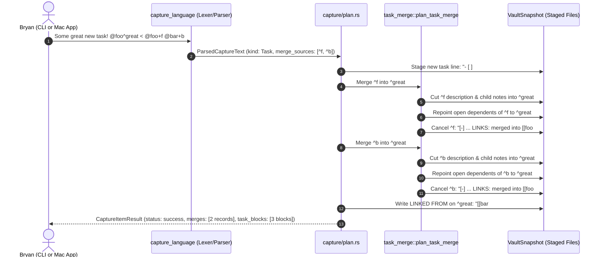

# Research & Design: Inward Capture Merge Syntax (`< @foo+f`)

> **Researcher:** `gem` (5-researcher independent swarm)  
> **Topic:** Design, critique, and implementation plan for the `< @foo+f` capture syntax complementing `> @foo+f`  
> **Repository Scope:** `bob-cli` (grammar, planner, merge engine) and `bob-mac-capture` (UI preview, spans, completion)  
> **Date:** November 2026  

---

## Executive Summary

This report investigates the proposal to add an inward task-merge capture syntax (`< @foo+f`) that complements the existing outward transfer/merge capture syntax (`> @foo+f`). 

### Core Findings
1. **Strong Conceptual & Workflow Justification**: Today, capturing an "umbrella" or synthesis task that absorbs prior tasks is high-friction: users must either capture the new task first and run a separate `>` transfer line, or write unwieldy reverse relation directives (`Umbrella ~~foo:f|"merged into"`). The inward arrow `<` directly fills this gap with an intuitive spatial metaphor: while `Sources > Target` sends tasks outward into an existing container, `Target < Sources` draws existing tasks inward into a newly authored task container.
2. **Reuses Established Merge Infrastructure**: Under the hood, Bob already possesses an industrial-grade, fully transactional task-merge engine (`src/native/task_merge/` and `src/native/capture/relations_merge.rs`). Merging existing tasks into a newly created task behaves identically to executing reverse relations with the configured merge label (`merged into`). The work is primarily lexical scanning, AST modeling, auto-minting target block IDs, and frontend presentation.
3. **Critical Syntax & Lexical Guardrails**: Because `<` is used in prose comparisons (`count < 10`), HTML/XML tags (`<template>`), autolinks (`<https://...>`), and shell redirection (bash/zsh `< file`), the grammar must enforce:
   - Strict standalone whitespace (` < `).
   - An immediate run of valid task locators (`@route+block_id`).
   - Strict refusal in non-new-task capture contexts (such as child bullets `@foo+f < @bar+b` or status toggles).
   - Documentation and CLI teaching messages regarding terminal shell quoting.
4. **Beautiful & Concise Mac Preview**: `bob-mac-capture` already has the capability to render purple **Merge target** and muted **Merged** landing blocks (`TaskBlockView`). By enriching the item-level preview with a dedicated, purple-accented "Absorbing N tasks" band and providing calm completion guidance during incomplete typing (`< `), the feature delivers a first-class, elegant desktop experience.

---

## 1. Context & The Capture Mental Model

### 1.1 Existing Symmetries in Bob Capture Grammar

Bob's capture language uses directional sigils and spatial flows to represent relationships between tasks:

| Syntax Pattern | Semantics | Context | Target State | Source State |
| :--- | :--- | :--- | :--- | :--- |
| `@a+x @b+y > @c` | Move tasks | Dedicated line | Bare note `@c` | Relocated |
| `@a+x @b+y > @c+id` | Merge into existing task | Dedicated line | Existing task `^id` | Cancelled (`merged into`) |
| `@a+x > @c+id#drawer` | Merge into task drawer | Dedicated line | Drawer in `^id` | Cancelled (`merged into`) |
| `@a+x > @c#section` | Merge into note section | Dedicated line | Heading in `@c` | Cancelled (logged) |
| `&note:id` | Captured task depends on prerequisite | Task item | New or existing | Prerequisite untouched |
| `*note:id` | Named task depends on captured task | Task item | Named open task | Blocked by captured task |
| `~note:id[\|label]` | This task links to target | Task item | Target task | Forward relation |
| `~~note:id[\|label]` | Target links to this task | Task item | Target task | Reverse relation |
| **New: `< @foo+f @bar+b`** | **Absorb/merge existing tasks into new task** | **New task creation** | **New task being created** | **Cancelled (`merged into`)** |

### 1.2 The Missing Inward Flow

In existing capture syntax, `>` requires that **all sources precede the arrow** and that the destination be an **existing note, task, drawer, or section**:
```text
@inbox+bench @work+pgdump > @db+upgrade
```
Here, `@db+upgrade` must already exist. 

However, during active knowledge work, Bryan frequently synthesizes several fragmented inbox captures into a **brand-new umbrella task**:
```text
Consolidate replication benchmarks @db^bench < @inbox+tps @inbox+lag @inbox+failover
```
Without `<`:
- Bryan would need to capture `Consolidate replication benchmarks @db^bench` first.
- Then capture `@inbox+tps @inbox+lag @inbox+failover > @db+bench`.
- Or type `Consolidate replication benchmarks @db^bench ~~inbox:tps|"merged into" ~~inbox:lag|"merged into" ~~inbox:failover|"merged into"`.

The inward arrow `<` provides direct visual and semantic symmetry:
```
Outward Transfer (Existing -> Existing):
[Source Tasks]  ──────>  [Existing Container]

Inward Merge (Existing -> New):
[New Task Container]  <──────  [Source Tasks]
```

```mermaid
flowchart LR
    subgraph Outward["Outward Transfer (Existing > Existing)"]
        direction LR
        S1["@inbox+tps"] --> Arr1[">"]
        S2["@inbox+lag"] --> Arr1
        Arr1 --> DestExisting["@db+upgrade (Existing Task)"]
    end

    subgraph Inward["Inward Merge (New Task < Existing)"]
        direction LR
        DestNew["Consolidate benchmarks @db^bench (New Task)"] <-- Arr2["<"]
        Arr2 <-- Src1["@inbox+tps"]
        Arr2 <-- Src2["@inbox+lag"]
    end
```

---

## 2. Grammar, Lexing, and Disambiguation

### 2.1 Lexical Anatomy of the `<` Clause

The `<` syntax operates as an **inward merge clause** attached to an authored new task item.

```text
Some great new task! @foo^great < @foo+f @bar+b
└──────────────────┘ └─────────┘ │ └───────────┘
   Task Title & Prose   Route/ID  │  Source Tasks Run
                                 └─ Inward Merge Arrow (spaced)
```

#### Lexical Rules
1. **Standalone Token with Whitespace**: The arrow MUST be surrounded by whitespace (` < `). Glued forms like `<@foo+f` or `text<text` are rejected or treated as prose.
2. **Source Locator Shape**: Every token following `<` in the merge clause must be a valid task locator: `@<route>+<block-id>`.
   - Must start with `@`.
   - Must contain a `+` task separator.
   - The `<route>` must be an unquoted or quoted valid note identifier.
   - The `<block-id>` must satisfy `is_block_id(id)`.
   - Must NOT contain a drawer `#drawer` or toggle `!`. Sources are always whole tasks.
3. **Plurality**: Multiple sources are separated by single spaces: `< @route1+id1 @route2+id2 @route3+id3`.
4. **Order of Sources**: Sources are merged in the exact left-to-right order typed.
5. **Deduplication**: Duplicate sources on the same line (e.g. `< @foo+f @foo+f`) are refused with `duplicate_capture_target`, matching transfer syntax.
6. **Self-Merge Guard**: If the authored new task explicitly defines a block ID matching a source (e.g. `New task @foo^great < @foo+great`), it is refused with `transfer_destination_is_source`.

### 2.2 Disambiguation from Prose and Markup

A common risk with `<` is collisions with everyday typing. The table below outlines how Bob disambiguates `<` across different contexts:

| Input Text | Classification | Lexical Reasoning |
| :--- | :--- | :--- |
| `Fix bug when count < 10 @dev` | **Ordinary Task** | `10` does not begin with `@` or match `@route+id`. Stays body prose. |
| `Read chapter <3 @books` | **Ordinary Task** | `<3` has no trailing space; not a standalone `<` token. |
| `Implement <template> element @web` | **Ordinary Task** | Enclosed in `<...>`; no standalone `<` followed by `@route+id`. |
| `Email Alice <alice@example.com> @work`| **Ordinary Task** | Valid email enclosed in angle brackets. |
| `Review docs at <https://bob.local> @dev` | **Ordinary Task** | Markdown autolink in protected markup range. |
| `Check `a < @b+x` in code @dev` | **Ordinary Task** | Code span is protected by `is_protected_markup_range`. |
| `Escaped literal \< @foo+f @work` | **Ordinary Task** | Backslash escape consumes `\` and leaves `< @foo+f` as literal text. |
| `Some great new task! @foo^great < @foo+f` | **Inward Merge** | Standalone `< ` followed by valid `@route+id` in a new task. |

> [!IMPORTANT]
> The scanner claims a `<` merge directive **only** when a standalone `<` token is followed by one or more valid source-like tokens (`@route+id` or an incomplete `@route+` prefix during editing). If what follows `<` is not source-like, the entire line remains ordinary prose.

### 2.3 Shell Quoting in the CLI

In interactive shells (Bash, Zsh), `<` is the standard input redirection operator:
```bash
# Shell attempts to open @bar+b as stdin!
bob capture Some task @foo < @bar+b
```
If `@bar+b` does not exist on disk, the shell halts before `bob` even executes:
```text
bash: @bar+b: No such file or directory
```
This is identical to the behavior of `>`:
```bash
# Shell redirects stdout to a file named @c!
bob capture @a+x > @c
```
In `bob-cli`, `docs/task-merge.md` and `docs/reference/capture-syntax.md` explicitly document that drafts containing `>`, `*`, `&`, `|`, and `^` must be quoted:
```bash
bob capture 'Some great new task! @foo^great < @foo+f @bar+b'
```

> [!NOTE]
> In `bob-mac-capture` (the macOS menu-bar app), text is entered into a native macOS `NSTextView` with zero shell involvement. The quoting concern applies strictly to the terminal CLI.

---

## 3. Scope & Context Rules: "Only When Creating a New Task"

The prompt specifies:
> *"This syntax should only be valid in a context that would create a new task."*

### 3.1 What Constitutes a "New Task Context"?

In Bob's capture language model (`src/native/capture_language/model.rs`), an item creates a new task if its primary action allocates a new task entry in a note:

| Capture Kind / Context | Creates New Task? | `<` Allowed? | Explanation |
| :--- | :---: | :---: | :--- |
| `CaptureKind::Task` | **Yes** | **Yes** | Standard new task in routed note or default inbox (`New task @foo < @bar+b`). |
| `CaptureKind::TaskWithBlockId` | **Yes** | **Yes** | New task with authored block ID (`New task @foo^great < @bar+b`). |
| `CaptureKind::Pomodoro` | **Yes** | **Yes** | New task linked into today's Pomodoro (`New task @foo:great < @bar+b`). |
| Routed new task with schedule/priority | **Yes** | **Yes** | `New task @foo $1 s:2 #feature < @bar+b`. |
| Project-note task bullet | **Yes** | **Yes** | `- Child task :child < @bar+b` inside `@route^proj@` (see §3.3). |
| `CaptureKind::SubBullet` | **No** | **No** | `@foo+f < @bar+b` captures a Markdown bullet under `^f`. Not a task. |
| `CaptureKind::TaskToggle` | **No** | **No** | `@foo+f! < @bar+b` toggles task status. |
| `CaptureKind::PomodoroLink` | **No** | **No** | Solo `@foo:f` links an existing task. |
| `CaptureKind::TaskComplete` | **No** | **No** | `!foo:f < @bar+b` completes an existing task. |
| `CaptureKind::Transfer` | **No** | **No** | `@a+x > @b < @c` is an illegal mixed transfer. |
| `CaptureKind::Bullet` | **No** | **No** | `@foo#Heading - bullet < @bar+b` is a non-task note. |
| Pomodoro session commands | **No** | **No** | `x`, `x=`, `=`, `+2`, `--1`, `=/`, `=*` manipulate session timing. |

### 3.2 The Non-New-Task Refusal Policy

When a user accidentally types `< @route+id` in a context that does not create a new task (such as on a sub-bullet line `@parent+p < @source+s`), Bob has two design choices:
1. **Silent Fallback to Prose**: Treat `< @source+s` as literal note text.
2. **Strict Teaching Refusal**: Abort with a structured refusal code.

#### Why Strict Refusal is Imperative
If Bob silently fell back to prose for `@parent+p < @source+s`, it would append `- < @source+s` as a Markdown bullet under `^p`. The user would believe `@source+s` was merged and cancelled, but in reality `@source+s` would remain active and unlinked, while garbage text was filed.

Bob MUST strictly refuse:
- **Refusal Code**: `merge_requires_new_task`
- **Error Message**: `“<” merge syntax is only valid when creating a new task; to merge into an existing task, use transfer syntax (@source+id > @target+id)`

### 3.3 Position of Modifiers Relative to `<`

When creating a new task, users often attach additional modifiers:
- Route: `@foo`
- Block ID: `^great`
- Schedule: `s:2`
- Priority: `$1`
- Type: `#feature`
- Pomodoro Session Name: `#BUGS`

#### Recommended Syntax Ordering
The new task's own attributes belong to the new task (before `<`). The `<` introduces the inward merge tail:
```text
Clean syntax:
[Task Prose] [@route^id] [$priority] [s:schedule] [#type] < [@sources...]

Example:
Reorganize schema @db^schema $1 s:2 #infra < @db+old1 @db+old2
```
If a user places trailing task attributes after the sources run:
```text
Reorganize schema @db^schema < @db+old1 @db+old2 $1 s:2
```
The parser should tolerantly attribute `$1` and `s:2` to the new task (since cancelled sources cannot receive priorities or schedules), while issuing an editor warning or auto-formatting rewrite suggesting placement before `<`.

---

## 4. Execution Engine & Transaction Lifecycle

### 4.1 Automatic Block ID Minting

In the prompt's example:
```text
Some great new task! @foo^great < @foo+f @bar+b
```
The user supplied `^great` explicitly.

However, many task captures do not author an explicit `^block-id`:
```text
Some great new task! @foo < @foo+f @bar+b
```
When `^f` and `^b` merge into this new task, their tombstones must record:
```markdown
- [-] #task Old task [cancelled:: 2026-11-05] ^f
	- 🪢 **LINKS:** merged into [[foo#^target-id]]
```
And the target task in `foo.md` must record:
```markdown
- [ ] #task Some great new task! ^target-id
	- 🪢 **LINKED FROM:** [[bar#^b]] (merged into) • [[foo#^f]] (merged into)
```

> [!IMPORTANT]
> **Adjustment to Requirements**: If the user omits an explicit `^block-id` on a new task that uses `<` merge syntax, Bob MUST automatically mint a block ID (using the existing `mint_block_id(&description, &used)` helper) and stamp it onto the new task. The merge must never fail simply because the user did not invent a block ID.

### 4.2 Lifecycle Flow of the Merge

Under the hood, `< @foo+f @bar+b` desugars into Bob's transactional `task_merge` engine:



### 4.3 Handling Authed Child Bullets

What happens if the capture draft also contains authored child bullets?
```markdown
Consolidate benchmarks @db^bench < @inbox+tps @inbox+lag
  - Need to verify replica lag under 15k TPS
  - Ping DB team after migration
```
Bob's merge planner preserves clear hierarchical structure:
1. The new task `- [ ] #task Consolidate benchmarks ^bench` is created.
2. The user's authored capture bullets are placed directly beneath it:
   ```markdown
   - [ ] #task Consolidate benchmarks ^bench
   	- 🪢 **LINKED FROM:** [[inbox#^lag]] (merged into) • [[inbox#^tps]] (merged into)
   	- Need to verify replica lag under 15k TPS
   	- Ping DB team after migration
   ```
3. The absorbed tasks are appended beneath the authored notes as titled group bullets:
   ```markdown
   	- Benchmark TPS
   		- Historical notes from TPS task...
   	- Measure replica lag
   		- Historical notes from lag task...
   ```
This ensures authored notes remain prominent at the top of the new task, while merged historical context sits cleanly below.

---

## 5. `bob-mac-capture` UI & Preview Design

The user prompt emphasizes:
> *"Make sure this syntax supports an excellent and useful (but concise) preview in the bob-mac-capture app. I want you to lead the design on this one. Make sure you design this feature so it is intuitive, reliable, and (last but not least) beautiful!"*

### 5.1 Editor Syntax Highlighting & Token Styling

In `bob-mac-capture`, editor spans are fed directly from `bob capture-parse --format json`:

1. **`<` Arrow Token**:
   - Styled with `SpanKind::TransferArrow` or `SpanKind::MergeInArrow`.
   - Category: `.section` (purple tint—Bob's universal color for merges and section targets).
2. **`@route+id` Source Tokens**:
   - `@route` receives route accent color.
   - `+id` receives block-ID accent color.
3. **Incomplete State (`< `)**:
   - When the user types `New task @foo < `, `capture-parse` emits `need: "merge_source"`.
   - The Mac app renders a subtle inline hint: `Pick a task to merge (@route+id)` in muted text, with no red error callout.

### 5.2 Autocomplete & Chooser Integration

`bob capture-complete` powers keyboard-driven completion as the user types:

```text
Typing: "New task @foo < @"
Options popup:
  @inbox       (Inbox)
  @mac_inbox   (Mac Inbox)
  @work        (Work Area)
  @db          (Database Area)

Typing: "New task @foo < @inbox+"
Options popup:
  tps          "Benchmark TPS at 10k" · Ready
  lag          "Check replica lag" · Blocked
  failover     "Measure failover duration" · Ready
```
Pressing `Tab` or `Return` completes the token to `@inbox+tps`. Typing a space allows adding another source (`@inbox+lag`).

### 5.3 The Item Preview Card (Upper Card)

When `bob capture --dry-run` runs, `CapturePanelView.swift` renders the preview. For a new task with merged sources, we design a dedicated **Inward Merge / Absorb Banner**:

```
┌──────────────────────────────────────────────────────────────────────────────┐
│  New Task → foo.md                              [ 2 tasks merged · purple ]  │
│  ○ Some great new task!                                             ^great   │
├──────────────────────────────────────────────────────────────────────────────┤
│  📥 Absorbing 2 tasks:                                                       │
│     ⊘ ^f · Benchmark logical replication (foo.md:5)    · 3 notes move        │
│     ⊘ ^b · Logical dump script (bar.md:12)             · 1 note move         │
│                                                                              │
│  ↳ 1 open dependent repointed to ^great                                      │
└──────────────────────────────────────────────────────────────────────────────┘
```

#### Why This Design Shines:
- **Visual Hierarchy**: The new task headline is clear and bold.
- **Color Coding**: The purple pill `2 tasks merged` immediately telegraphs the merge action.
- **Concise Summaries**: The `📥 Absorbing` band shows exact source locators, original note titles, and note movement counts without cluttering the card.
- **Consequence Callout**: If dependents are repointed, a quiet sub-row (`↳ 1 open dependent repointed`) confirms graph integrity.

### 5.4 Landing Blocks (Lower Cards)

Beneath the item card, Bob's existing `TaskBlockView` displays the exact pre-commit file diffs:
1. **Target Block (`foo.md`)**:
   - Marked with purple **Merge target** capsule.
   - Shows `- [ ] #task Some great new task! ^great`.
   - Shows added `LINKED FROM:` line.
   - Shows folded or expanded moved bullets.
2. **Source Blocks (`foo.md` and `bar.md`)**:
   - Marked with muted **Merged** capsule.
   - Shows `- [-] #task ... [cancelled:: 2026-11-05]`.
   - Shows added `LINKS: merged into [[foo#^great]]`.
   - Collapses removed notes into `⤵ 3 lines moved to target`.

### 5.5 Status Line and Action Button

- **Footer Status**:
  `Would create “Some great new task!” and merge 2 tasks into it · foo.md`
- **Return Action**:
  The primary action button reads **Capture & Merge** tinted in purple.
- **VoiceOver**:
  Reads: *"Capture new task: Some great new task in foo.md, absorbing 2 tasks: Benchmark logical replication and Logical dump script."*

---

## 6. Critique of the Plan & Alternative Approaches

### 6.1 Critique: Is this a good idea?

#### The Case For (Strong Endorsement)
1. **Solves a Real Daily GTD Need**: Inbox processing frequently involves taking 2–4 quick notes or bug reports and creating a single actionable task. Having this in single-gesture capture saves significant context switching.
2. **Symmetric Grammar**: `A > B` (outward transfer) and `B < A` (inward absorption) form a complete, elegant mental model.
3. **Transactional Safety**: By reusing `task_merge`, all changes across multiple files are staged and validated atomically. If one source fails, nothing is written.

#### Potential Drawbacks & Risks
1. **Shell Interception in Terminal**: As noted, bash/zsh intercepts unquoted `<`. If users forget to quote in the CLI, the shell fails before `bob` can give an informative message.
   - *Mitigation*: Emphasize in CLI help that capture strings with `<` must be quoted, exactly like `>` and `*`.
2. **Typing Ambiguity**: If `<` were allowed without strict whitespace, prose like `<template>` or `if a<b` would trigger false positives.
   - *Mitigation*: Strict requirement for whitespace around `<` plus immediate `@route+id` validation.

### 6.2 Comparison Against Alternative Approaches

Could we achieve this goal through other grammar designs? Let's analyze three credible alternatives:

#### Alternative 1: Extend `>` to Allow New Tasks
```text
@foo+f @bar+b > Some great new task! @foo^great
```
- **Evaluation**: 
  - *Pros*: Uses the familiar `>` arrow.
  - *Cons*: Highly awkward! In capture grammar, task text always begins on the left. Putting sources first means the user must decide which tasks to merge *before* authoring the new task title. It also breaks the rule that the first token of a task item is its description or note route.
  - *Verdict*: **Rejected**.

#### Alternative 2: Keyword / Sigil Modifier (e.g. `merge:` or `absorb:`)
```text
Some great new task! @foo^great merge:@foo+f merge:@bar+b
```
- **Evaluation**:
  - *Pros*: Avoids shell `<` redirection entirely.
  - *Cons*: Extremely verbose. Breaks Bob's concise sigil aesthetic (`&`, `*`, `~`, `>`).
  - *Verdict*: **Rejected**.

#### Alternative 3: Reuse Reverse Relations `~~`
```text
Some great new task! @foo^great ~~foo:f|"merged into" ~~bar:b|"merged into"
```
- **Evaluation**:
  - *Pros*: Already works today in Bob's relation engine!
  - *Cons*: Far too verbose for rapid daily capture. Requires memorizing the exact phrase `"merged into"`, quoting it, and writing `~~` repeatedly.
  - *Verdict*: **Rejected as primary syntax**; but serves as the ideal underlying implementation target.

#### Summary Comparison Table

| Approach | Brevity | Spatial Intuition | Shell Safe? | Consistency with Bob Grammar | Overall Score |
| :--- | :---: | :---: | :---: | :---: | :---: |
| **Proposed `< @foo+f @bar+b`** | **High** | **Excellent (Inward Flow)** | Needs quotes in CLI | **High (mirrors `>`)** | **9.5 / 10** |
| Alt 1: Sources first `> New task` | Medium | Poor | Needs quotes in CLI | Poor | 4.0 / 10 |
| Alt 2: Keyword `merge:@foo+f` | Low | Neutral | Yes | Poor | 5.5 / 10 |
| Alt 3: Existing `~~foo:f\|"merged into"` | Very Low | Poor | Needs quotes | Moderate | 5.0 / 10 |

---

## 7. Recommended Implementation Architecture

### 7.1 Architecture Layers in `bob-cli`

```
┌────────────────────────────────────────────────────────────────────────┐
│ 1. LEXICAL SCANNER (src/native/capture_language/item.rs & transfer.rs) │
│    - Detect standalone ' < ' in parent line                            │
│    - Scan subsequent '@route+id' tokens into Vec<TransferSource>       │
│    - Validate context: refuse if item is not a new task                │
└──────────────────────────────────┬─────────────────────────────────────┘
                                   │
                                   ▼
┌────────────────────────────────────────────────────────────────────────┐
│ 2. MODEL & AST (src/native/capture_language/model.rs)                  │
│    - Add `merge_sources: Vec<TransferSource>` to `ParsedCaptureText`   │
│    - Add `SpanKind::MergeInArrow` and `SpanKind::MergeInSource`        │
│    - Add `Need::MergeSource` for incomplete '< ' editing state         │
└──────────────────────────────────┬─────────────────────────────────────┘
                                   │
                                   ▼
┌────────────────────────────────────────────────────────────────────────┐
│ 3. PLANNING & DESUGARING (src/native/capture/plan.rs)                  │
│    - Auto-mint new task block ID if omitted                            │
│    - Lower `merge_sources` into `ParsedRelation` with                  │
│      `direction: RelationDirection::From` and label "merged into"      │
│    - Pass directly to `relations_merge::plan_relation_merges`          │
└──────────────────────────────────┬─────────────────────────────────────┘
                                   │
                                   ▼
┌────────────────────────────────────────────────────────────────────────┐
│ 4. EXECUTION (src/native/task_merge/plan.rs)                           │
│    - Existing atomic multi-file task merge engine                      │
│    - Cut notes, repoint dependents, cancel sources, link courtesy refs │
└────────────────────────────────────────────────────────────────────────┘
```

### 7.2 Detailed Step-by-Step Changes

#### Step 1: Lexical Scanner (`src/native/capture_language/item.rs` & `transfer.rs`)
- In `item.rs`, after extracting leading/trailing markers, inspect parent line tokens for a standalone `<` token outside protected markup.
- If found:
  - Check whether the line represents a new task context (`CaptureKind::Task`, `TaskWithBlockId`, or `Pomodoro`). If not, return `CaptureItemParseError::coded("merge_requires_new_task", ...)`.
  - Parse subsequent tokens using `transfer::parse_complete_source`.
  - Collect parsed sources into `merge_sources: Vec<TransferSource>`.
  - Strip the `<` and source tokens from the task title/body text.

#### Step 2: Editor Parsing & Completion (`editor_parse.rs` & `completion.rs`)
- Add `SpanKind::MergeInArrow` (or tag `TransferArrow` with direction `in`).
- If `<` is typed without sources, return `Need::MergeSource`.
- In `completion.rs`, when the cursor is in the `<` clause:
  - After `< ` or `< @`: suggest note routes.
  - After `< @route+`: suggest open tasks in `@route`.

#### Step 3: Planner Integration (`src/native/capture/plan.rs`)
- In `plan_capture_item`:
  - If `!parsed.merge_sources.is_empty()`:
    - Ensure the target task has a block ID (mint one if missing via `mint_block_id`).
    - Convert each `TransferSource` into a `ParsedRelation` with `direction: RelationDirection::From`, `note: source.route`, `block_id: source.block_id`, and `label: Some("merged into".to_string())`.
    - Append to `parsed.relations`.
- Existing `plan_relation_merges` executes the entire merge transaction without requiring any new execution logic!

#### Step 4: `bob-mac-capture` Presentation
- In `CaptureRelationshipPresentation.swift`:
  - Detect when `capture.kind == "task"` (or `pomodoro_task`) and `!capture.merges.isEmpty`.
  - Expose an `absorbedSources` list on `CaptureRelationshipPresentation`.
- In `CapturePanelView.swift`:
  - Render the purple-accented "Absorbing N tasks" band inside `standardPreviewItem`.
  - Update footer status to: `Would create “<title>” and merge N tasks into it`.
- In `CompletionRowContent.swift`:
  - Colorize `merge_in_arrow` with the `.section` (purple) semantic category.

---

## 8. Summary of Adjustments & Final Recommendation

### Checklist of Explicit Adjustments to Requirements

1. **Automatic Block ID Minting**: When `<` is used, if the new task does not provide an explicit `^id` (e.g. `New task @foo < @bar+b`), Bob must automatically mint one from the title so the `merged into` backlink resolves.
2. **Strict Whitespace Delimitation**: `<` must be flanked by whitespace (` < `) to prevent interference with autolinks, HTML tags, comparisons, or math.
3. **Explicit Non-New-Task Refusal**: In non-new-task contexts (sub-bullets, toggles, completions), `< @route+id` must be actively refused with `merge_requires_new_task` rather than silently treated as prose.
4. **CLI Quoting Requirement**: Terminal documentation must clearly state that drafts containing `<` must be quoted (`bob capture '...'`) to avoid shell stdin redirection.
5. **Plural Syntax**: Specify sources as a clean, space-separated sequence `< @foo+f @bar+b` rather than repeating `<`.

### Final Verdict
The proposed `< @foo+f` capture syntax is an **outstanding design improvement** for Bob. It is intuitive, geometrically symmetric to `> @dest`, reuses proven backend merge architecture with zero risk of transaction corruption, and enables a gorgeous, high-utility preview in the Mac Capture app. It should be implemented following the architecture and phased plan outlined above.
