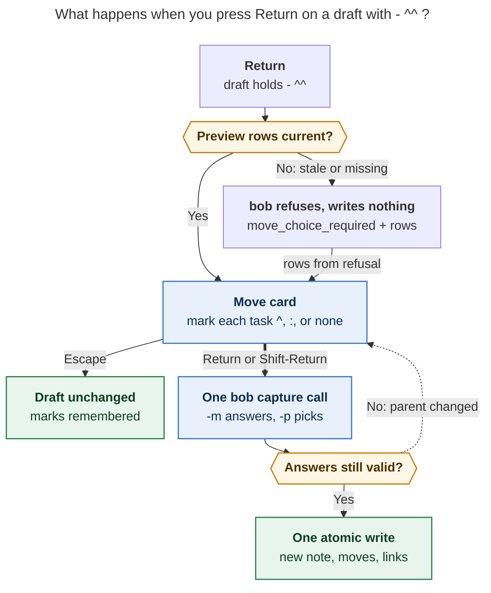

# `- ^^`: choose parent tasks to move in when you submit

**Researcher:** cld · **Date:** 2026-11-04 · **Scope:** bob-cli (grammar, `capture`,
`capture-parse`, `capture-complete`), Bob Mac Capture (choice card), contract docs.

**Question.** How should a first-level `- ^^` bullet under `@foo^bar@` / `@foo:bar@`
work? On submit it should ask which of `foo.md`'s tasks to bring into the new project,
with a three-way choice per task: not moved (the default), `^` (move), or `:` (move and
link). Is this a good idea, and what would I change?

---

## 0. TL;DR

- **Yes, build it, with adjustments.** The bob-cli-gl move bullets work well for one or
  two tasks. They don't scale to the real use case, which is carving a project out of a
  big area. 18 of the 115 area/project notes at the vault root have ≥10 open top-level
  tasks, 6 have ≥20, and the largest has 77. Picking those one ⇧↵ at a time in a search
  picker is the wrong tool. A checklist over the parent is the right one.
- **`- ^^` is a slot marker plus a deferred question.** The bullet's position fixes
  *where* the moved tasks land. The answer, given at submit, fixes *which* tasks land and
  *how* (`^` or `:`). This avoids the reason bob-cli-gl rejected a submit-time card: the
  order lives in the draft, and the card is itself a per-row preview written by Bob.
- **Reuse the protocol Bob already has for choices.** Today's Pull-In and inbox-route
  cards work like this: the preview reports the rows, Return opens an in-panel card, the
  answers ride one atomic `bob capture` call, and a stale answer gets a write-free
  refusal. `- ^^` adds one more card of the same kind, `move_choice`, ahead of Pull-In.
  It also adds one CLI flag, **`-m, --move-in`**, written in sigil form
  (`-m 1,3,:2`, `-m none`).
- **Picks behave like `- ^id` / `- :id` bullets typed at the `^^` slot, but nothing is
  inserted into the draft.** Bob expands them inside the same batch, in the parent's
  document order. This keeps the write atomic, and it lets ID-less tasks move without
  first writing IDs into the vault.
- **The card is the syntax.** Each row has a small state well that shows nothing, `^`,
  or `:`, drawn in the same colours the editor uses for move spans. Typing `^` or `:`
  sets the row and steps down, and Space cycles the state in place. A live counter,
  Bob's per-state consequence line, a "lands after …" slot line, and a projected TODAY
  badge mean nothing is a surprise.

---

## 1. What exists today (grounding)

| Fact | Evidence |
| --- | --- |
| `- ^id` / `- :id` move a parent root into a sealed project note at that slot. `:` also makes it Next and links it. A lone `- ^` / `- :` opens a type-time **Move picker** with a ⇧↵ "move & add another" chain. | `docs/capture.md` §Moving parent tasks in; plan `202611/capture_move_bullets.md` (bob-cli-gl, closed 2026-11-04) |
| bob-cli-gl explicitly **rejected** "a submit-time 'bring tasks from foo.md?' card" because "the choice would live outside the draft, so the preview could not show it or its order." | plan §2.3 |
| **`- ^^` currently has a meaning: it creates a task literally titled `^^`.** On current master (grammar 10), `capture-parse` reports `mode: project_note`, `sub_bullets: ["^^"]`, and no move. With `#admin`, it also raises `unused_project_note_pomodoro`. The lexer bails because the second `^` is not alphanumeric. | probe of a freshly built `bob capture-parse`; `capture_language/move_bullet.rs` `scan_move_bullet` |
| Choice-card protocol. The dry-run preview carries the rows. Return opens a Mac card. The answers go back on a single `bob capture`. Hidden `--require-pull-in-choice` / `--require-inbox-route-choice` flags produce write-free refusals (`pull_in_choice_required`, `inbox_route_choice_required`) that carry the rows. Stale answers fail with exit 2 (`inbox_route_stale`). The pull-in refusal runs before the inbox-route refusal. | `docs/task-dependencies.md` §12.14; `docs/capture.md` §Routing inbox tasks out; Mac `CapturePanelModel.submit` |
| Pull-In card keys: nothing starts marked; Space marks; ⌘A marks all; Return applies the marked rows, or the highlighted row when none are marked; ⇧↩ skips; ⎋ returns to the unchanged draft; ⌃↩ confirms and opens notes. | Mac `docs/keyboard.md`, `CapturePullInChoiceView.swift` |
| Obsidian's successor picker uses **Tab = "toggle and move"**, Ctrl+A to mark a group, and a 350 ms Enter guard. | `bob-plugins/.../206-successor-picker-modal.js` |
| Mac pickers have their own filter bar. Relation pickers treat a typed `~` as a live **direction flip** (`~` ↔ `~~`), so sigil keystrokes acting as commands inside a card already have precedent. | Mac `docs/pickers.md`, `docs/keyboard.md` |
| The move engine can already move an **ID-less** task by exact line (`MoveSelector::Line`). Only inbox routing uses it today. | `src/native/task_move/plan.rs:94` |
| `bob capture-task-id` writes the ID into the note **immediately**, outside any capture batch. The current `- ^` picker uses it for ID-less rows. | `docs/capture.md` §`bob capture-task-id` |
| `bob-cli-go.10` (capture `>` transfers) is in flight. It touches `editor_parse.rs`, `draft.rs`, and `batch_move`, and it bumped the grammar to 10. | bead `bob-cli-go`, plan `202611/capture_transfer.md`, commit `706eab67` |

---

## 2. Critique: is this a good idea?

### 2.1 Why it is worth doing

1. **It fits the real job.** The usual reason to write `@cash^goog-exit@` is to pull a
   cluster of `cash.md`'s tasks into a new project. That is a *triage* task: read the
   parent top to bottom and tick what belongs. A search picker suits recall ("I know
   it's `^call-ms`"). A checklist suits recognition. The vault numbers (§0) show the
   triage case is common exactly in the notes people split.
2. **It settles each task's plan lane at the same moment.** Deciding `^` vs `:` per row
   while the whole parent is in view is better than deciding it per bullet while you
   type.
3. **The draft stays readable.** One `- ^^` line replaces eight `- ^opaque-id` lines
   that would need ghost titles to be legible.
4. **It is cheap to build safely.** The execution path (moves, links, offers, write
   order, refusals) and the choice protocol both already exist. The new code is mostly
   one lexer arm, one report object, one flag, and one card.

### 2.2 What it costs

1. **It reopens a choice bob-cli-gl rejected.** The rejection was about an *implicit*
   card that asked on every project creation, without position or order. `- ^^` is
   explicit, opt-in, and positioned. The card *is* the preview, since each row shows
   Bob's consequence for its current state. I think the original reasoning does not
   apply here, but the plan should say so explicitly.
2. **Return becomes two steps** for these drafts. That is acceptable because Pull-In
   already does it and the card opens from preview data, so there is no wait. It must
   never become *three* steps (see §4.1).
3. **There are two ways to move tasks:** `- ^` (type-time, one at a time) and `- ^^`
   (submit-time, many). This is justified by scale, but only if each surface points to
   the other (§5.5).
4. **It changes the grammar.** `- ^^` stops being a literal task, so the grammar
   revision must be bumped. Nobody wants a task called `^^`, but precedent (lone `- ^`)
   says to bump.
5. **The picks live outside the draft.** If the write fails, or the user presses ⎋ and
   comes back, the marks must survive. Otherwise the card feels fragile (§5.6).
6. **The CLI needs an answer flag.** `bob capture` never prompts, so without `-m` the
   feature would exist only on the Mac.

### 2.3 Alternatives I considered

| Option | Shape | Verdict |
| --- | --- | --- |
| **A. Multi-select inside the type-time `- ^` picker** | Space marks rows; Return writes N `- ^id` / `- :id` lines into the draft | **Rejected as the main path.** ID-less rows would need N Add-block-ID prompts, or vault writes before the capture (`capture-task-id` writes immediately). The draft balloons, and it interrupts writing. |
| **B. `^^` expands at type time** | Typing `^^` opens a bulk card; accepting rewrites the bullet into N lines | **Rejected.** Same ID problem as A, plus new grammar that exists only to be erased. |
| **C. Always ask on submit when the parent has tasks** | No sigil | **Rejected** (bob-cli-gl was right): it asks implicitly, has no slot, and nags. |
| **D. `- ^^` slot plus a submit-time tri-state card** (Bryan's idea) | Bob expands the picks at the slot inside the batch | **Recommended**, with the §3 adjustments. |
| **E. D plus "Write into draft"** | A card action that turns the marks into explicit `- ^id` lines for reordering | **Follow-up.** Useful for reordering, but it brings back A's ID problem. Revisit only if people ask to reorder. |

---

## 3. Requirement adjustments (explicitly called out)

Each item changes or adds to the request. ✱ marks items that change Bryan's wording,
not just fill a gap.

1. ✱ **The equivalence is in the vault result, not in the draft text.** Picks write the
   same vault result as `- ^id` / `- :id` bullets typed at the `^^` slot. The draft
   itself is never rewritten. *Why:* a literal rewrite would need ID-less tasks to get
   IDs written into the vault before the capture, would make the user preview and
   submit again, and would make stash and undo confusing.
2. **Moved tasks land at the `^^` slot in the parent's document order**, not in the
   order they were marked. `-m 3,1` is the same as `-m 1,3`. *Why:* it is predictable,
   matches the card's row order, and can be tested.
3. ✱ **ID-less tasks never trigger an ID prompt.** A `^` pick moves the task by exact
   line and leaves it without an ID. A `:` pick needs an ID for its Task Link, so Bob
   mints its first suggestion inside the batch, avoiding collisions, the same way
   Pull-In picks mint IDs. The row shows `⊕ ^book-the-lawyer` only while it is marked
   `:`. *Why:* asking N times would ruin bulk selection, and minting inside the batch
   keeps the write atomic. This departs from bob-cli-gl's "IDs required" rule, which
   was a constraint of typed syntax, not of the vault.
4. **At most one `- ^^` per draft in v1.** A second one is a teaching error. *Why:* two
   `^^` items under the same parent would need choices that exclude each other across
   groups. A `^^` whose parent is created by an earlier `^^` in the same draft would
   create circular staging. A "split card" that assigns each task to one of several new
   projects is a good follow-up, not v1.
5. ✱ **The CLI gets a real answer flag, and an unanswered real run refuses.**
   `-m, --move-in <PICKS>`. A dry run shows numbered rows. A real run without `-m`
   fails with `move_choice_required` and writes nothing. *Why:* `^^` is a request the
   user made, so silently moving nothing would be a lie. This differs from Pull-In,
   where offers come from Bob and declining is the safe default.
6. ✱ **Under `@foo:bar@`, show one card with two groups:** "Move from cash.md"
   (three-way) and "New in cash_goog_exit.md" (Pull-In offers for the authored tasks,
   on or off). *Why:* the rule is one gesture, one picker. A `:` mark already covers
   "link this moved task", so a second card would ask the same thing twice.
7. **`- ::` is reserved** and gets a teaching error that points to `- ^^`. It is not an
   alias. *Why:* a mirror spelling is the obvious thing to try, and a precise message
   beats a task titled `::`.
8. **Return with nothing marked moves the highlighted row as `^`.** This follows the
   Pull-In convention, and the primary button always spells out what will happen
   (`Move “Collect the equity…”`). ⇧↵ means "move nothing and capture". *Why:* every
   Mac choice card should follow the same rule. The dynamic label removes the surprise.
   (Open question Q2.)
9. **Discoverability:** in the `- ^` Move picker, typing `^` into the empty filter turns
   the bullet into `- ^^`. Bob authors the replacement, following the `~`↔`~~` flip
   precedent. The picker footer shows `^ again · choose several on ↩`.
10. **Bump the grammar revision** (`feat(capture)!:`), counting from whatever the
    constant is once bob-cli-go.10 lands (it will probably be 11).
11. **Marks persist** across ⎋, failed writes, and stale reopens for the same draft
    text and parent, keyed by row key.

---

## 4. Recommended design

### 4.1 The experience

The draft, while you write it in Bob Mac Capture:

```text
Finish the Google exit packet @cash^goog-exit@#admin
- Draft the resignation memo :draft-memo
- ^^   choose from cash.md's 12 open tasks on ↩
- Book the lawyer
- FUTURE WORK
  - Revisit the severance terms
```

The `^^` uses the route accent colour from the move spans. The dimmed text after it is a
**ghost hint**. The editor draws it from the preview (`move_choice.open_count`), and it
is never part of the draft. The preview card shows `↪ Choose what moves in from cash.md`,
and the footer hint reads `↩ choose what moves in`.

You press **Return**. The card opens instantly from the preview's rows, with no bob call
and nothing marked:

```text
┌ ↪ Move into cash_goog_exit.md ─────────────────────── from cash.md · 12 open ┐
│ ⌕ Filter tasks                                            nothing marked yet │
│   lands after “Draft the resignation memo”, in cash.md order                 │
├─ Tasks ──────────────────────────────────────────────────────────────────────┤
│ ▸ ( ) ◐ Collect the equity paperwork      WORK 13:30          ^equity-docs   │
│   ( ) ○ Call Morgan Stanley about the 401k                     ^call-ms       │
│   ( ) ○ Renew the passport                Nov 6                              │
│   ( ) ○ Ask Dana about the severance math                                    │
├─ Admin ──────────────────────────────────────────────────────────────────────┤
│   ( ) ○ Pay the credit card                                    ^pay-cc        │
│   (:) ○ Draft the memo        moving on line 2 · locked        ^draft-memo   │
├──────────────────────────────────────────────────────────────────────────────┤
│ Collect the equity paperwork — ^ moves in · its WORK link follows            │
│ ^ move  : link  space cycle  ⌘A all  ⎋ back      ⇧↵ none   ↵ Move “Collect…” │
└──────────────────────────────────────────────────────────────────────────────┘
```

You press `^`, then `:`, skip a row with `↓`, then press `:` again. Each sigil key sets
the row and moves the highlight down, so you sweep the list one key per row:

```text
│ ▸ (^) ◐ Collect the equity paperwork      WORK 13:30          ^equity-docs   │
│   (:) ○ Call Morgan Stanley about the 401k  → ADMIN           ^call-ms       │
│   ( ) ○ Renew the passport                Nov 6                              │
│   (:) ○ Ask Dana about the severance math  → ADMIN    ⊕ ^ask-dana-about-the │
…
│ Ask Dana about the severance math — : moves in · becomes Next · links under  │
│ ADMIN · adds ^ask-dana-about-the-severance-math                              │
│ ^ move  : link  space cycle  ⌘A all  ⎋ back   ⇧↵ none   ↵ Move 3 · link 2  ▣ 9/10 │
```

`▣ 9/10` is the existing projected TODAY badge. It rises with each `:` mark, so you see
the plan budget before you commit. **Return** sends one `bob capture -m <keys>` call. If
the batch causes successor or inbox choices, those cards follow, as they do today. Then
it writes, and the notification reads:

```text
Created cash_goog_exit · moved 3 tasks from cash (2 linked under ADMIN)
```

Here is the same flow from a terminal:

```text
$ bob capture --dry-run "$(cat draft.txt)"
[dry-run] ok would capture  cash_goog_exit.md
  parent  [[cash]]
  - [ ] #task #prj Finish the Google exit packet #hide ^prj
  2 tasks · - ^^ asks which of cash.md's 12 open tasks to move
  Move into cash_goog_exit.md · lands after "Draft the resignation memo"
  move 1  [/] Collect the equity paperwork  cash.md:7 ^equity-docs · WORK link follows
  move 2  [ ] Call Morgan Stanley about the 401k  cash.md:12 ^call-ms
  move 3  [ ] Renew the passport  cash.md:15 · : adds ^renew-the-passport
  …
  not movable  Draft the memo · moving on line 2
  choose with -m 1,3 (move) · -m :2 (move & link) · -m none

$ bob capture "$(cat draft.txt)"
error: `- ^^` on line 3 asks which of cash.md's 12 open tasks to move; answer with -m 1,3 (move), -m :2 (move & link), or -m none
$ bob capture -m 1,:2,:4 "$(cat draft.txt)"
✓ created  cash_goog_exit.md · 5 tasks · 3 moved from cash.md
  moved  [/] Collect the equity paperwork  cash.md:7 → ^equity-docs · WORK link follows
  moved  [ ] → [*] Call Morgan Stanley about the 401k  cash.md:12 → ^call-ms · becomes Next · links under ADMIN
  moved  [ ] → [*] Ask Dana about the severance math  cash.md:16 → ^ask-dana-about-the-severance-math · added ID · becomes Next · links under ADMIN
  repaired  3 links in 2 notes
```



*Figure 1. Return opens the Move card from the preview's rows, or from a write-free
refusal when those rows are stale. Escape returns to the unchanged draft. Confirming
sends one `bob capture` call that either writes everything atomically or, if the parent
changed, reopens the card with fresh rows and keeps the marks. (Rendered with
mermaid-cli 12.0.0: 622 × 1114 px, 80% PDF fit.)*

### 4.2 Grammar and lexing

This uses the same scope as move bullets: a first-level `-`/`*`/`+` bullet in an item
sealed with `@<route>^<id>@` or `@<route>:<id>@`. Extend the shared lexer
`capture_language/move_bullet.rs` with a new arm, `MoveBulletHit::Choice { span }`,
which both `item.rs` and `editor_parse.rs` call. As today, it claims the line from its
raw shape, before `strip_trailing_task_id` runs.

| First-level body (trimmed) | Meaning | Code |
| --- | --- | --- |
| `^^` | **Move choice:** ask on submit, landing at this slot | — |
| `^^ <anything>` | Teaching error | `move_choice_text` |
| `[x] ^^` (any checkbox) | Teaching error | `move_bullet_checkbox` (reused) |
| `^^` with nested bullets under it | Teaching error | `move_choice_nested` |
| second `^^` anywhere in the draft | Teaching error | `move_choice_duplicate` |
| `::` | Teaching error (reserved) | `move_choice_colon` |
| `\^^`, `` `^^` ``, nested `  - ^^`, non-project items, `@file` lists | Unchanged | — |

Rules:

- Seen from `#name`, the choice may produce `:` links. A `- ^^` therefore satisfies the
  unused-`#pomodoro` rule, just as a pending lone `- :` does. Today, `- ^^` with
  `#admin` wrongly raises `unused_project_note_pomodoro`.
- A `- ^^` counts as a move bullet when deciding whether to show `move_hint`.
- If the seal names no parent (`@^x@`), parsing reports `choose the parent note first`.
  This reuses the MC5 copy.

### 4.3 `capture-parse`

- The item stays **complete** (`project_note`) and adds no `needs`, because the question
  comes at submit, not while typing. The Mac therefore keeps previewing live.
- New span: `project_task_move_choice_marker`, covering both `^`s.
- `sub_bullet_moves` gets an additive entry `{sigil: "^^", block_id: null, range,
  choice: true}`. Check that the Mac decoder tolerates a two-character `sigil`. If it
  does not, use a separate `sub_bullet_move_choices` array.
- Human output: `move choice ^^ (asks on submit)`.

### 4.4 `capture-complete`: the type-through from `- ^`

The `project_task_move` picker descriptor gains Bob-authored
`choice_flip: {trigger: "^", replacement_range, replacement: "^^", hint: "^ again ·
choose several on ↩"}`. This is offered only when `scope_token` is `^` and the query is
empty. The Mac follows the `~` flip precedent: typing the trigger into an empty filter
splices the replacement and closes the picker, and the status text reads
`Choose tasks from cash.md when you press Return`. The Mac contains no grammar for this.
There is no `capture-complete` context *on* `^^` itself.

### 4.5 `bob capture`: the report, the answer, and the execution

**The report.** Every capture JSON carries `move_choice: {supported: true}`, as it does
for `inbox_route`, so clients can detect support. When the draft has a `- ^^`, the
object is filled in:

```json
"move_choice": {
  "supported": true,
  "item": 1, "item_line": 3, "draft_range": [97, 99],
  "parent": "cash.md", "parent_route": "cash", "destination": "cash_goog_exit.md",
  "open_count": 12, "pomodoro_name": "ADMIN",
  "answered": false, "moved_count": 0, "linked_count": 0,
  "budget": { "links": 8, "max": 10 },
  "copy": {
    "title": "Move into cash_goog_exit.md", "subtitle": "from cash.md · 12 open",
    "slot": "lands after “Draft the resignation memo”, in cash.md order",
    "ghost": "choose from cash.md's 12 open tasks on ↩",
    "prompt": "Choose tasks to move from cash.md"
  },
  "rows": [{
    "key": "cash.md#^call-ms", "n": 2,
    "line": 12, "block_id": "call-ms", "text": "Call Morgan Stanley about the 401k",
    "status_symbol": " ", "status_name": "Ready", "section": "Tasks",
    "child_count": 0, "scheduled": null, "hidden": false, "pomodoro": null,
    "choices": [
      { "sigil": "^", "consequence": "Moves in", "status_symbol": " " },
      { "sigil": ":", "consequence": "Moves in · becomes Next · links under ADMIN",
        "status_symbol": "*", "adds_block_id": null }
    ],
    "locked": null, "disabled_reason": null, "answer": null
  }]
}
```

- **Rows** come from the shared movable-root eligibility API (`task_move::movable_roots`).
  They include ID-less and `#hide` rows (muted). Each row reuses the `project_task_move`
  row builder: the same `section`, `pomodoro` chip, and consequence copy. Order follows
  the document. Keys use the inbox-route and offer format (`path#^id`, or `path@<sha8>`
  plus `~N`), computed from the **staged parent before any pick**.
- `choices` lists only the states that row allows, each with Bob's consequence. An empty
  list means the row is disabled, and `disabled_reason` explains why. Examples:
  `2 tasks end ^call-ms in cash.md`, or `project starts Nov 6 — only Blocked tasks can
  move in`. Under a Blocked-at-birth `s:<N>`, `:` is left out and the `^` consequence
  says so. The Mac only ever cycles through `choices`.
- `locked` marks a row that an explicit `- ^a` / `- :a` elsewhere in the draft already
  moves, in the form `{sigil, item_line}`. The card shows that state and you can't
  change it.
- The report reads only the parent and today's daily note, as the `@route+` rows do,
  with no vault scan. Drafts without `^^` pay nothing extra.

**The answer: `-m, --move-in <PICKS>`.** The flag is repeatable and accepts
comma-separated lists. It follows the same pattern as `--pull-in`, and it borrows the
"Moving parent tasks in" heading from the docs.

| Pick | Meaning |
| --- | --- |
| `3` or `^3` | Move row 3 |
| `:3` | Move row 3, then link it |
| `cash.md#^call-ms`, `:cash.md@1a2b3c4d` | The same, by key (the Mac always sends keys) |
| `all` / `:all` | Every enabled row as `^` / as `:` (`:all` skips rows without a `:` choice) |
| `none` | Move nothing; the `^^` contributes nothing |

Bare numbers mean `^`. This is deliberate: in zsh with `EXTENDED_GLOB`, an unquoted `^1`
is a glob pattern. The help text should show `-m 1,3,:2`.

**Refusals.** All of them write nothing. They run in this order: move choice, then
pull-in, then inbox route.

| Code | Exit | When | Message (copy) |
| --- | --- | --- | --- |
| `move_choice_required` | 1 | Real run, `^^` present, no `-m` | ``- ^^` on line 3 asks which of cash.md's 12 open tasks to move; answer with -m 1,3 (move), -m :2 (move & link), or -m none`` (+ `move_choice` payload) |
| `move_choice_stale` | 2 | Unknown number or key (the parent changed) | `cash.md changed since the preview; -m 7 is no longer one of its open tasks` (+ current rows) |
| `move_choice_refused` | 1 | Pick of a locked or disabled row, or a `:` the row doesn't allow | `` `^draft-memo` already moves on line 2 `` / Bob's `disabled_reason` |
| `move_choice_conflict` | 2 | `^3` and `:3` together | `-m gives row 3 two answers (^ and :); pick one` |
| `move_choice_unasked` | 2 | `-m` but no `^^` | `` -m answers a `- ^^` bullet, and this draft has none `` |
| `move_choice_empty` | 1 | Parent has no movable roots (any `-m`) | `` `- ^^` has nothing to choose: cash.md has no open tasks to move; delete the bullet `` |

A dry run never refuses `move_choice_required`. It reports `answered: false` and prints
the `choose with -m …` hint. This matches how a dry run reports unpicked offers.
`move_choice_empty` also shows as a live preview diagnostic, so the user sees it before
pressing Return.

**Execution**, in `plan_project_note_item`:

1. Resolve the answers against the rows that came from the staged parent. Reject stale,
   conflicting, and refused picks as described above.
2. **Expand** the answered rows, in document order, into the same `MoveBullet` list that
   authored `- ^id` / `- :id` bullets produce, at the `^^` slot. Use these selectors:
   - `Block(id)` when the row has an ID;
   - `Line(n)` for an ID-less `^` pick (inbox routing already uses this);
   - for an ID-less `:` pick, first **mint** the first suggestion into the staged
     parent, then use `Block(id)`. The minted ID must not collide with the parent, the
     new note's authored IDs, `prj`, other mints, or the IDs of moved descendants.
3. From this point the existing bob-cli-gl pipeline runs unchanged:
   - slot rendering;
   - one `batch_move` call with `rename_collisions: false`;
   - `stamp_fresh`;
   - the `:` link step, which includes the link guard, the
     `capture-link-drops-blocking-deps` drop, Ready → Next, and Task Link placement under
     `#name` or the task's type;
   - offers under `:` seals;
   - destination-before-source write order;
   - rollback.

   The equivalence vector MQ6 pins this down.
4. **Report.** Each `project_note.moved_tasks[]` entry gains `via: "choice"`, and its
   `draft_range` is the `^^` range. The Mac must not draw per-task ghosts on a shared
   range. `move_choice` flips to `answered: true` and gains `moved_count` and
   `linked_count`, and each row's `answer` is filled in.

### 4.6 Bob Mac Capture: the Move card

The card is built on the Pull-In card's shell: elevated panel, filter bar, pinned
section headers, detail strip, and hint chips. A new `CaptureMoveChoiceView` and a
`CaptureMoveChoiceState` would follow the inbox-route state's draft and identity checks.

**Row anatomy.** Each row shows, from left to right:

- **State well.** An 18 pt rounded square with the sigil in bold monospace, drawn as
  follows:
  - **empty:** a hairline ring;
  - **`^`:** route accent, the same colour as `project_task_move_marker`;
  - **`:`:** explicit-toggle yellow, the same colour as `project_task_move_link_marker`;
  - **locked:** the sigil with a small lock.
- The status glyph from the existing palette.
- The title, with fuzzy-match highlights.
- Chips:
  - the Pomodoro chip;
  - the schedule chip;
  - `→ ADMIN`, shown only while the row is marked `:`;
  - the `^id` in block-ID indigo, or `⊕ ^suggestion` in muted indigo, shown only while
    the row is marked `:`.
- Disabled rows are dimmed and show Bob's reason inline. `#hide` rows are muted.

**Header and footer.**

- The title, subtitle, and slot line all come from Bob's `copy`.
- The live counter reads `nothing marked yet`, `3 moving`, or `3 moving · 2 linking`.
- The detail strip shows `<title> — <consequence for the row's current state>`. For an
  unmarked row, it previews the `^` consequence.
- The primary button reads `Move 3`, `Move 3 · link 2`, or `Move “<title>”` when nothing
  is marked.
- The projected TODAY badge appears as in Pull-In.

**Keys.** These follow the Pull-In card, plus sigils that set a state and advance:

| Key | Action |
| --- | --- |
| `^` / `:` | Set the highlighted row to that state, or clear it if it already has it, then move down. Skips any state the row's `choices` don't include. |
| Space | Cycle the row in place: none → `^` → `:` → none (allowed states only) |
| ↑ ↓ ⌃P ⌃N | Move the highlight |
| ⌘A | Mark every visible, enabled, unmarked row as `^`; a second ⌘A clears them. Respects the filter, so you can type "tax" and press ⌘A. |
| ↵ | Apply the marks, or move the highlighted row as `^` when nothing is marked |
| ⇧↵ | Move nothing and capture (`-m none`) |
| ⌃↵ | Apply, capture, and open Bob's reported notes |
| ⎋ | Return to the unchanged draft; marks are kept |

Other printable keys go to the filter. Like Pull-In, Space marks instead of typing a
space, so multi-word filtering is lost. That is acceptable for fuzzy title matching.
There is also an Obsidian-style Enter guard: ignore ↵ within about 350 ms of the card
opening, and ignore auto-repeat.

**Flow.** `submit()` checks the latest preview's `move_choice` *before* the Pull-In
branch. If rows are present and unanswered, it opens the card. On confirm, it calls
`bob capture -m <keys…>` together with the existing `--require-pull-in-choice` and
`--require-inbox-route-choice` guards. A `move_choice_required` or `move_choice_stale`
refusal reopens the card from the refusal's rows. Marks whose keys still exist are kept,
and the strip reads `cash.md changed · 1 marked task is gone`.

**`@foo:bar@`.** The card adds a second section, `New in cash_goog_exit.md`, holding the
preview's project-created offers. These are on/off only: Space or `:` marks them. On
confirm, the Mac sends `-m …` together with `-p <offer keys | none>`. Moved `^` rows
still become Bob offers, but they stay unpicked, which is correct because the user chose
`^` rather than `:`. If Bob still returns `pull_in_choice_required`, for example
because a later item adds offers, the existing Pull-In card follows. Escape from that
card returns to the Move card.

**Polish:**

- the editor ghost hint after `^^`, which hides on any keystroke until the next preview;
- the footer verb `Choose & Capture`;
- VoiceOver reads each row as `Collect the equity paperwork, In Progress, moves in`, and
  each well as "Not moving", "Moves in", or "Moves in and links";
- notification copy as in §4.1.

**Compatibility.**

- **Old Mac with a new bob.** The Mac ignores `move_choice` and submits without `-m`,
  so bob refuses `move_choice_required` and shows its message. Nothing is written, so
  the failure is safe.
- **New Mac with an old bob.** An old bob would capture a task titled `^^`. Reuse the
  `~` relation-gate pattern: if the draft contains `- ^^` and the preview lacks
  `move_choice.supported`, show the calm warning `This bob predates - ^^; it would
  capture a task named ^^ · update bob`, and require a second ⌘↩ to submit.

### 4.7 Conformance vectors (MQ)

| ID | Draft / state | Expected |
| --- | --- | --- |
| MQ1 | `@cash^x@#admin` + `- ^^` | `capture-parse`: `project_note`, `project_task_move_choice_marker`, no `needs`, no `unused_project_note_pomodoro` |
| MQ2 | `- ^^ x`, `- [x] ^^`, `- ^^` + nested, two `^^`, `- ::` | `move_choice_text`, `move_bullet_checkbox`, `move_choice_nested`, `move_choice_duplicate`, `move_choice_colon` (parse and capture, byte-identical) |
| MQ3 | `\^^`, nested `  - ^^`, `- ^^` in a non-project item or `@file` list | Unchanged from today (literal text) |
| MQ4 | Dry run, unanswered | `move_choice` rows in document order with keys, `choices`, and consequences; `answered: false`; human `choose with -m` hint; nothing written |
| MQ5 | Real run, unanswered | `move_choice_required`, exit 1, vault byte-identical |
| MQ6 | `-m 1,:2` | Vault **byte-identical** to authoring `- ^a` then `- :b` at the `^^` slot (the core equivalence) |
| MQ7 | `-m 3,1` vs `-m 1,3` | Identical result; slot order follows document order |
| MQ8 | ID-less row: `-m 4` / `-m :4`; the suggestion collides | Moves by line with no ID / mints the suggestion / mints the next free suffix |
| MQ9 | Parent edited between preview and submit | `move_choice_stale` exit 2 with current rows; nothing written |
| MQ10 | Pick of a locked, ambiguous, or blocked-birth row; `:` on a row whose choices lack `:` | `move_choice_refused` |
| MQ11 | `-m 1,:1`; `-m` with no `^^` | `move_choice_conflict` / `move_choice_unasked`, exit 2 |
| MQ12 | `-m none` | Note created; nothing moves; the placeholder task appears only if there is no other task |
| MQ13 | Parent with zero movable roots | Preview diagnostic; real run `move_choice_empty` |
| MQ14 | `@cash:x@` + `- New` + `^^`; `-m 1 -p <New key>` | Row 1 moves and is offered unpicked; New is linked; `-m :1` counts row 1 as planned |
| MQ15 | `s:3` + `^^` | Only `[?]` rows are enabled; `:` is absent from their `choices` |
| MQ16 | `^^` + explicit `- :a` | Row `a` is `locked: {sigil: ":", item_line}` |
| MQ17 | `capture-complete` at `- ^` (empty query) | Descriptor `choice_flip {trigger: "^", replacement: "^^"}`; absent for `- :` and for non-empty queries |
| MQ18 | Write order and an injected failure | Same as MV13: destination before source; full rollback |
| MM1 | Mac | Sigil-advance keys, Space cycle, ⌘A on filtered rows, ↵-with-none label, ⇧↵ none, ⎋ keeps marks, stale reopen keeps surviving marks, merged `:` seal section, old-bob warning, Enter guard |

### 4.8 Phases

These stack on bob-cli-go.10. Rebase onto it and compute the grammar bump from the
current constant.

1. **`contract`** (small). Add a `docs/capture.md` subsection, "Choosing parent tasks
   when you submit (`- ^^`)", inside "Moving parent tasks in". Include the copy tables,
   the MQ vectors, the `-m` reference, json-outputs, the compatibility row, and an
   updated `move_hint` copy (`Type - ^ to move a task, or - ^^ to choose several (12
   open in cash.md)`).
2. **`cli-grammar`** (medium). Lexer arm, error constructors, spans, the `#name` rule,
   the `sub_bullet_moves` entry, the `choice_flip` descriptor, and the grammar bump
   (`feat(capture)!:`). Add an interim refusal for `^^` at execution until phase 3.
3. **`cli-choice`** (large). The `move_choice` report, `-m/--move-in` parsing and
   validation, the refusal codes and their order, expansion into slot moves (`Line`
   selectors and minting), output, help and `just docs-gen`, and MQ1–MQ18 as
   `tests/cli/capture/` tests. Record the warm dry-run time of the §4.1 draft on a
   vault copy.
4. **`mac-card`** (large; can be split into card and flow). The Move card, the flow
   ahead of Pull-In, the merged `:` seal section, marks memory, `choice_flip` handling,
   ghost hint, span colour, notification, old-bob gate, real-bob fixtures, and docs
   (`task-pickers.md`, `keyboard.md`, `capture-previews.md`, `protocol.md`). Follow the
   bob-mac-capture rule: compile on the Mac scratch copy and never land Swift that
   hasn't been compiled.

---

## 5. Risks and mitigations

1. **A wrong move removes a task from the parent.** The card states each row's
   consequence and the notification counts the moves. Recovery is `bob task move` back
   or vault git. *Possible follow-up:* an "Undo move-in" toast action that reverses
   the batch through the engine.
2. **Very large parents (77 tasks).** The card uses sections, the filter, ⌘A on the
   filtered rows, and the sweep keys. There is no row cap, as in Pull-In.
3. **Overlap with bob-cli-go transfers (`@a+x @a+y > @db`).** They don't overlap. A
   transfer moves known IDs into an *existing* note. `- ^^` chooses tasks to bring into
   a note the same item *creates*. Both use `batch_move`, so there is still one engine.
4. **Two ways to move (`- ^` vs `- ^^`).** Each one teaches the other: the `^ again`
   flip in the `- ^` picker, and the `move_hint` mentions both.
5. **Picks live outside the draft.** Marks are remembered in memory for the same draft
   and parent. A stashed draft does *not* keep its marks, and the docs should say so
   plainly.

---

## 6. Open questions for Bryan

- **Q1.** Is one `- ^^` per draft acceptable for v1, with a later "split card" that
  assigns tasks to several new projects?
- **Q2.** Should Return with nothing marked move the highlighted row (consistent with
  Pull-In), or do nothing until something is marked (more cautious for moves)? I
  recommend consistency plus the dynamic button label.
- **Q3.** Under `@foo:bar@`, one merged card (my recommendation) or the existing
  sequential Move → Pull-In cards (simpler to build)?
- **Q4.** Should this get a decision record, such as "`- ^^` asks at submit; nothing
  moves unanswered; picks land at the slot in parent order"? bob-cli-gl declined one,
  but this is a policy (unanswered means refuse) that future work could erode.

---

## 7. Recommendation

**Build `- ^^` as a slot-anchored move choice that Bob asks about at submit time.** It
should be answered on a three-way Bob Mac Capture card, and it should run, inside the
same atomic batch, the same code path as the move bullets it stands for.

Concretely:

- **Grammar.** `- ^^` is the whole body of a first-level bullet in a sealed project-note
  item. Bump the grammar revision. Teaching errors cover `^^ text`, a checkbox, nested
  bullets, a duplicate, and `- ::`.
- **Bob.**
  - Reports a `move_choice` object: rows from the shared eligibility API, Bob-authored
    per-state `choices`, stable pre-pick keys, and slot and ghost copy.
  - Accepts `-m, --move-in` (`1,3,:2`, keys, `all`, `:all`, `none`).
  - Refuses an unanswered real run with `move_choice_required`, ahead of pull-in and
    inbox-route choices.
  - Expands the picks at the `^^` slot in parent document order, using the bob-cli-gl
    pipeline unchanged. ID-less `^` picks move by line, and ID-less `:` picks get a
    minted ID.
- **Mac.**
  - **Card.** Opens instantly from the preview. The state well shows the sigil itself
    in the editor's move colours. `^` / `:` set a state and advance, and Space cycles.
    The counter, consequence strip, slot line, TODAY badge, and dynamic primary button
    are live.
  - **Pull-In.** Under `:` seals, the card absorbs the Pull-In choice into a second
    section.
  - **Reliability.** Marks are remembered across ⎋ and stale reopens. An older bob gets
    a calm warning before it would capture a literal `^^`.
- **Discoverability.** Typing `^` again in the `- ^` picker turns the bullet into
  `- ^^`.

This keeps what bob-cli-gl got right: the draft decides placement, Bob decides and
explains, the Mac presents, and every write is atomic. It also gives the common
"carve a project out of a big area" job a fast and good-looking tool.
