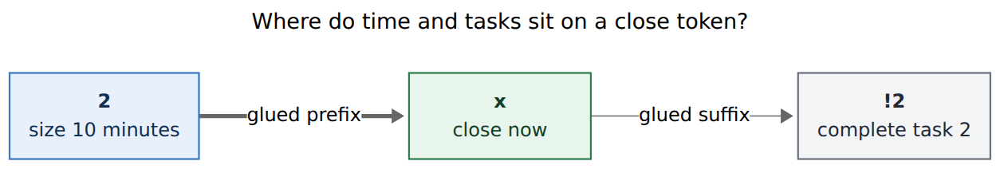
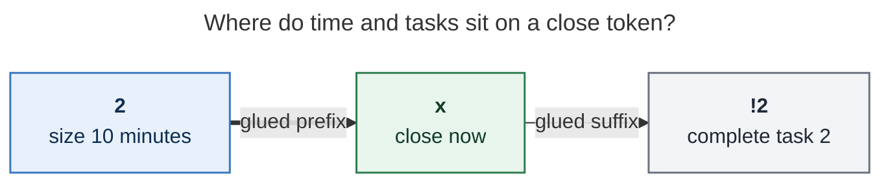
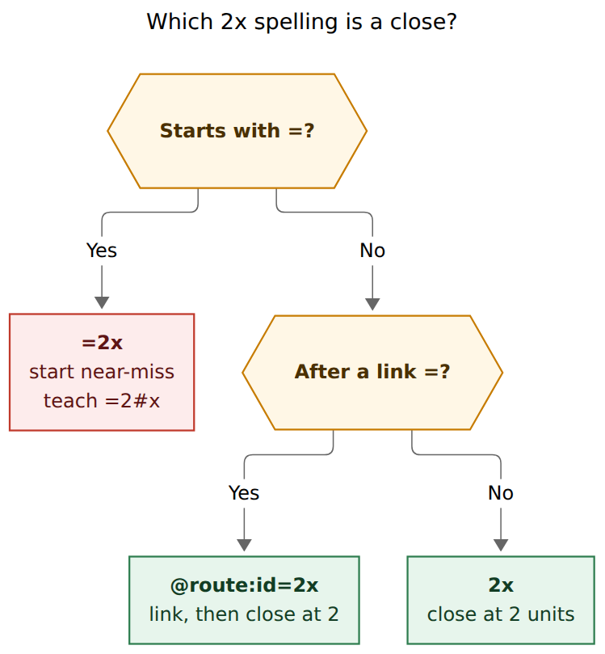
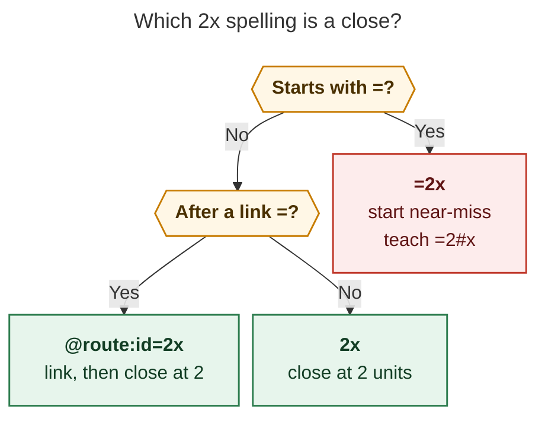
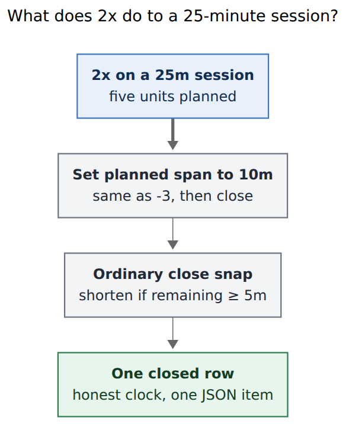
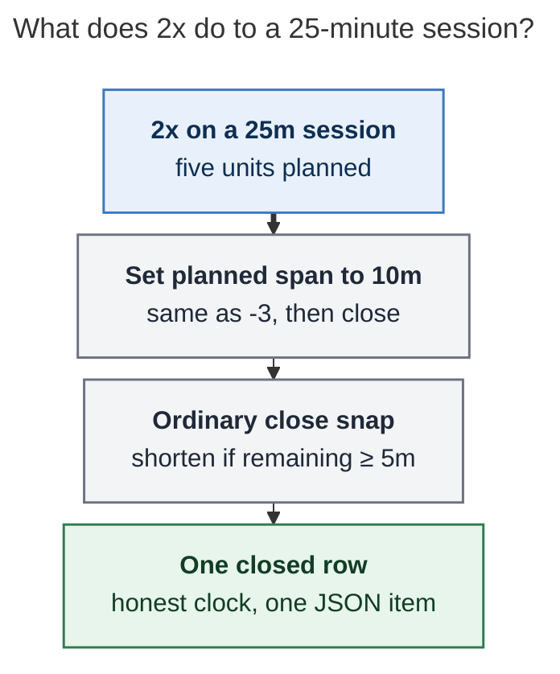

# Close-as-size: a glued `<N>x` prefix for Pomodoro closes

**Author:** researcher grk (5-researcher swarm)  
**Date:** 2026-11-08  
**bob-cli SHA:** `59ba11a6`  
**Target repos:** `bob-cli`, `bob-mac-capture`  
**Decisions in force:** `mac-capture-is-a-thin-client`, `bob-cli-releases-ride-a-daily-train`

---

## Verdict

Do it. A glued positive integer in front of lowercase `x` is the missing
member of Bob's 5-minute-unit family, and it is the only adjacent slot
`x` still has free. Keep the user's example as the teaching case, and
implement it as *set planned duration to `N × 5` minutes, then run the
ordinary close*.

On a 25-minute session, `2x!2` writes the same ledger as `-3 x!2`. The
general rule is the absolute size, so the sugar still works when the
running row is 30 minutes or 15 minutes and you no longer have to count
off units from whatever is on the clock.

Bare `x` stays the honest "stop now" gesture. `Nx` is for the moment you
already know the size you meant.

---

## What exists today

Session time already speaks one language: a positive integer is a count
of 5-minute blocks.

| Token | Meaning of `N` | Source |
| --- | --- | --- |
| `=3` | start a 15-minute session | `docs/capture.md` Starting the next Pomodoro; `se<X>` |
| `+2` / `-3` | grow or shrink the running planned span | `docs/capture.md` Adjusting the current Pomodoro |
| `++2` / `--2` | slide both ends, duration unchanged | Shifting the current Pomodoro |
| `x=2` | record a *past* 10-minute session | Recording a past Pomodoro |
| `x2` | close, keep **task 2** in progress | `x[<N>][*<P>][!<M>][~<K>][@<N>]` |
| `x!2` | close, complete task 2 | same close selection lexer |

The close itself already shortens an early stop. `close_timing` in
`src/native/capture_pomodoro_close/ledger.rs` takes remaining minutes
until the planned end; when remaining is at least 5, it subtracts
`floor(remaining / 5) × 5` and rewrites the range. When remaining is
under 5 (on time, or over), it leaves the planned duration alone. Bob
never lengthens a session *during that snap*. Growing the planned span
is what `+N` is for, including the chain `+2 x`.

Whole-item close claiming is strict. `classify_whole_item_close` in
`src/native/capture_language/close_selection.rs` accepts a token only
when it *starts* with lowercase `x`, and the bytes after `x` are empty
or a selection sigil (`digit`, `,`, `!`, `~`, `*`, `@`). `2x` is
ordinary task prose today. `=3x` is already a claimed start near-miss
("close-shaped name"; teach `=3#x`). `x=3x` is the same near-miss on
past tokens. `@route:id=x` is the link-then-close suffix.

Same-line chains already compose resize with close: `+2 x` and `-2 x`
are two session tokens, two JSON items, one atomic batch
(`docs/capture.md` Chaining session operators on one line). Human
output for that chain is "adjust then close".

Mac Capture is a thin client. It highlights `pomodoro_close` plus the
four list spans, and it draws the close card from `bob capture --dry-run`
JSON. It must not grow a local `Nx` parser.

---

## Is this a good idea?

Yes. The arithmetic the prefix removes is real, and it is the wrong
kind of arithmetic for a close.

To type `-3 x!2` on a 25-minute session you have to:

1. Read the planned length (25).
2. Divide by 5 (5 units).
3. Subtract the size you wanted (5 − 2 = 3).
4. Remember the sign.

Step 3 is pure tax. You already think in *sizes* when you start
(`=2`, `=3`, `=5`) and when you record the past (`x=2`, `x=3`). Closing
as a size should use that same number. The running example in the
request is the proof: `2x!2` is the size you meant, `-3 x!2` is the
delta you should never have to form.

The prefix is also the only beautiful place left. After `x`, digits
already name Task Links (`x2`, `x!2`, `x1!2`, `x@2`). Stealing that
slot would smash the close-selection lexer. Before `x`, a digit run is
free. Time in front, tasks behind, `x` in the middle:

**Reader question:** Where do time and tasks sit on a close token?

**Caption:** Duration units glue in front of lowercase `x`; task
outcomes glue after it. `2x!2` is "make this a 10-minute session, then
complete task 2."



Rendered size: 836 × 142 px; fit scale: 78.1%. Mermaid CLI 12.0.0.



The cost is real and bounded. Any draft whose first token is
`<digits>x` plus a legal close selection becomes a close instead of a
task. `2x speed` and `2x4 lumber` would close (with a Work Log), the
way `x speed` already closes. The capital-`X` escape already exists
(`2X speed`, `2X4 lumber`). Live preview makes the flip obvious. That
is the same deal Bob already made for bare `x`.

I would still ship it. The family gets a close-as-size sibling, the
lexer change is local, and the thin-client path stays additive.

---

## Requirement adjustments

These change the request. Each is called out so the lead can accept or
reject it.

1. **Absolute size, 25-minute example as the special case.**  
   The request says `2x!2` ≡ `-3 x!2` *assuming a 25-minute pomodoro*.
   Encode the general rule as *set planned duration to `N × 5` minutes,
   then run `close_timing`*. On a 25-minute row that is `-3` then `x`.
   On a 30-minute row (`=6`) it is `-4` then `x`. On a 15-minute row it
   is `+` nothing / `-1` then `x`. Do not hard-code a delta of 3.

2. **Keep the ordinary close snap.**  
   "Resized to before being closed" means the planned span changes
   first; the snap still runs. Closing `2x` four minutes in on a
   session you just resized to 10 minutes records 5 minutes, because
   remaining is 6 ≥ 5. That matches `-3 x` on a 25-minute row at the
   same clock. If the pain is "always stamp exactly `N × 5` even when I
   close early", that is a different operator and it would over-record
   unworked time. Do not take that fork.

3. **`N ≥ 1`. Leading zeros allowed.**  
   Refuse `0x` with a teaching error (`write x` to snap, including to
   0m when the session has only just started). Past recording already
   refuses `x=0`. Starts already accept `=0` and `=03`; accept `02x` as
   2 so one duration language does not grow a second leading-zero
   rule. Overflow fails the way `=N` and `+N` fail.

4. **`N` may be larger than the current planned span.**  
   `6x` on a 25-minute session is `+1` then `x`. That is how you admit
   a short overrun you actually worked. Fire the same
   `pomodoro_runs_past_event` warning `+N` already fires. The close
   snap still will not grow the *closed* span past now when remaining
   ≥ 5.

5. **Glued only.**  
   `2x` is the token. `2 x` stays a non-chain line (`2` is not a
   session operator). Do not invent a spaced form.

6. **Link suffix is in scope.**  
   `@route:id=2x!2` and `^route:id=2x` put the same prefix immediately
   before `x` after the suffix `=`. Those spellings are start
   near-misses today; they become the natural "link, then close as
   size" form. Whole-item `=2x` stays the start near-miss that teaches
   `=2#x`. `=` still means start.

7. **One capture item, not a parse-time desugar into `+/-K` plus `x`.**  
   Effect matches the chain; JSON, spans, Work Log, and the close card
   stay one close. `2x wired the lexer` is one token plus a log, like
   `x wired the lexer`.

8. **`2x0` never resets.**  
   Note-free `x0` is the dedicated reset. A duration prefix is a close.
   Reset eligibility must see the prefix and stay on the close path.

---

## Recommended design

### Grammar

```text
<N>x[<K>][*<P>][!<M>][~<K>][@<K>] [work-log…]
```

- `<N>` is a glued ASCII digit run immediately before lowercase `x`.
- The rest is today's close selection, Work Log, children, and
  same-line session chain.
- Whole-item only at an item start or as a chain token, the way `x`
  already is. `Plan 2x` stays prose.

Classifier (extend `classify_whole_item_close`): strip a leading
`[0-9]+`, require lowercase `x`, then apply the existing after-`x`
rule. `0x` is *claimed* and invalid (teaching), so it never becomes a
task. `2xx`, `2x-ray`, `2x.`, and `2X` stay prose, matching `xx`,
`x-ray`, `x.`, and `X`.

`session_equals_token` and `is_session_chain_token` treat a claimed
`<N>x…` as `EqualsToken::Close`, so `2x =`, `2x =bugs`, and
`-2 2x` chain. `is_close_hash_token` grows the same prefix:
`2x#bugs` teaches `2x =bugs`.

**Reader question:** Which `2x` spelling is a close?

**Caption:** Whole-item `=2x` stays a start near-miss. A link suffix
`=2x` closes at two units. Bare `2x` is the new close.



Rendered size: 498 × 540 px; fit scale: 100%. Mermaid CLI 12.0.0.



### Semantics

**Reader question:** What does `2x` do to a 25-minute session?

**Caption:** Bob sets the planned span to 10 minutes, then the ordinary
close snap still runs. The user typed one token, so the result is one
closed row and one JSON item.



Rendered size: 389 × 478 px; fit scale: 100%. Mermaid CLI 12.0.0.



Worked clock (session started 12:00, planned 25m unless noted):

| Now | Draft | Planned after prefix | Closed duration |
| --- | --- | --- | --- |
| 12:12 | `2x` | 10m (12:00–12:10) | 10m (past the new end, remaining < 5) |
| 12:04 | `2x` | 10m (12:00–12:10) | 5m (snap; remaining 6 ≥ 5) |
| 12:12 | `-3 x` | 10m | 10m (same as `2x` here) |
| 12:04 | `-3 x` | 10m | 5m (same as `2x` here) |
| 12:12 | `5x` | 25m | 15m (no-op resize, then ordinary `x`) |
| 12:27 | `x` | 25m | 25m (overrun, snap refuses to grow) |
| 12:27 | `6x` | 30m | 30m (admit the extra unit, remaining < 5) |
| 12:00 | `2x` on a 30m `=6` | 10m | 0m or 5m depending on remaining; delta is 20m, not 15m |

MEET that has not started still closes at 0m after the prefix; teach
"drop the size, write `x`" if we want a sharper error, but matching
today's unstarted close is enough for v1.

### Parse JSON and spans (additive)

`PomodoroCloseSpec` gains:

```json
"duration_units": 2
```

Omitted when the prefix is absent, so today's `{"raw": "x"}` is
byte-identical. `raw` stays the whole token (`2x!2`, or `=2x!2` on a
link suffix).

New span kind `pomodoro_close_duration` covers the digit run. Existing
`pomodoro_close` still covers the one-byte `x`. List spans are
unchanged. For `2x!2`:

| Range | Kind |
| --- | --- |
| `[0, 1)` | `pomodoro_close_duration` |
| `[1, 2)` | `pomodoro_close` |
| `[2, 4)` | `pomodoro_close_complete` |

Older Mac builds ignore the unknown span and still see a close. Color
the duration digits with the start-timing tint so `=2` and `2x` rhyme.

Capture JSON (unversioned, additive) on the close object:

- `duration_units` (typed `N`)
- `requested_minutes` (`N × 5`)
- `previous_duration_minutes` (planned length before the prefix)
- the existing close timing fields, which already describe the snap

Do not emit a sibling `pomodoro_adjust` item. Human output, one line:

```text
✓ closed WORK 1200-1210 (10m, −15m from 25m) · 2026/20261108.md line 8
```

Dry-run: `would close`. The close card's timing chip shows
`25m → 10m` and keeps today's early / on-time / over colors against
the *final* closed span. If the snap cut below `N × 5`, a dim caption
says `snapped to 5m`. If the prefix grew the planned span, the chip
goes through the longer range first so the growth is visible before
submit.

### Execution

Reuse the adjust writer's range rewrite (start fixed, `new_end =
(start + N×5) mod 1440`, same clock key, clamp is unnecessary because
`N ≥ 1`). Stage that edit on the running row, then call `close_timing`
on the staged range. One batch, one rollback. Event warnings run on
the post-prefix planned span, matching `+N` then `x`.

`is_reset_spec` / `is_reset_selection` must treat a present
`duration_units` as "not a reset". `2x0` is an explicit keep-none
close at size 2.

Forced `--route` / `--section` / `--task` / `--clip` / `%` / `s:` /
`$` stay illegal on closes.

### Completion, rewrite, docs

- `capture-complete` offers nothing on a claimed `<N>x…` token, as it
  already does for `x…`. Digits with no `x` yet stay a task.
- No new `capture-rewrite` rule. This is parse, not a typing alias.
- Contract pages: `docs/capture.md` grammar table, Closing the running
  Pomodoro, chain list of eight operators (this becomes a close shape,
  not a ninth family), `docs/reference/capture-syntax.md` token index
  (`<N>x` under Closing), CLI help on `bob capture`, Mac protocol
  additive span + `duration_units`. `just docs-check`.
- Changelog `!`: drafts that used to be tasks starting `<digits>x`
  become closes. JSON and spans stay additive.

### Tests (minimum)

Parser / editor (next to `tests/bare_close.rs` and
`close_selection.rs`):

- `2x`, `2x!2`, `02x`, `12x`, `2x@2`, `2x wired`, `2x =`
- `0x` invalid close, `2X` / `2xx` / `2x-ray` / `Plan 2x` / `2 x` prose
- `=2x` still `invalid_pomodoro_start` teaching `=2#x`
- `@r:id=2x!2` and `^r:id=2x` link-close with `duration_units: 2`
- `2x#bugs` teaching `2x =bugs`
- `2x0` is close, not reset
- dangling `2x~` incomplete `pomodoro_close_task`

Execution (next to `tests/cli/capture/pomodoro_whole_item.rs` and
close timing tests):

- 25m at +12m: `2x!2` byte-identical to `-3 x!2` (the request)
- 25m at +4m: both snap to 5m
- 30m row: `2x` sets 10m; `-3 x` sets 15m (documents the adjustment)
- `5x` equals `x` on a 25m row
- overrun `6x` keeps 30m; bare `x` keeps 25m
- grow-then-snap still warns on event overlap
- unstarted MEET + `2x` still 0m

Mac: a protocol fixture where an unknown `pomodoro_close_duration`
span leaves the close card up, and a current-app fixture that tints
the digits.

---

## Alternatives and why they lose

| Approach | What it gets right | Why it loses |
| --- | --- | --- |
| Status quo `-N x` | Already works, two well-tested operators | The arithmetic the request wants to delete |
| Steal `x2` for duration | Digits already sit after `x` | `x2` is keep-task-2; the selection lexer is load-bearing |
| `x=2` on a *running* close | Past recording already uses `N` as blocks | `x=` means "records what already happened"; do not dual-use it |
| Revive `=2x` as a close | Currently an error, so no prose regression | `=x` was retired on purpose; `=` starts |
| `x:2` / `x/2` / `x#2` / `x%2` | Avoids the keep-list | `:`, `/`, `#`, `%` are pickers, types, and directives |
| Minutes not units (`10x` = 10m) | Matches how people say "ten minutes" | Breaks the `=2` / `x=2` / `+2` language; `2x` would be 2 minutes |
| Parse-desugar to `+/-K` plus `x` | Reuses adjust JSON | Two items, two cards, Work Log owner gets messy; the user typed one token |
| Pin exact `N × 5` and skip the snap | Closed row always shows 10m | Over-records when you close early; disagrees with the `-3 x` example |
| Shrink-only (`N` > current is an error) | Closer to "I finished early" | Forbids the useful overrun admit `6x`; `+K x` already grows |
| Spaced `2 x` | Looks like English | `2` would have to become a session token; too much claiming |

A sibling research thread on `xx` → `x!` and `xs` → `x*` (close letter
aliases) composes cleanly if it lands: `2xx` is prose under this
classifier until rewrite turns it into `2x!`. Keep rewrite-then-parse
order. Never rewrite a leading size digit.

---

## Implementation map

All grammar authority stays in bob-cli.

| Layer | File | Change |
| --- | --- | --- |
| Lexer | `src/native/capture_language/close_selection.rs` | Prefix strip in `classify_whole_item_close`; link suffix `=Nx…` |
| Chain | `src/native/capture_language/item.rs` | `session_equals_token`, `is_session_chain_token`, `is_close_hash_token` |
| Spec | `src/native/capture_language/model.rs` | Additive `duration_units: Option<u64>` on `PomodoroCloseSpec` |
| Spans | `src/native/capture_language/editor_model.rs` | `SpanKind::PomodoroCloseDuration` |
| Editor | `editor_pomodoro.rs`, `capture_parse.rs` | Span emission; format `2x (10m)` in human parse |
| Close | `src/native/capture_pomodoro_close/` | Resize-then-`close_timing`; reset guard |
| Adjust reuse | `src/native/capture/pomodoro_adjust.rs` | Shared "set duration to minutes" helper |
| CLI help | `src/native/capture/cli.rs` | One paragraph in the `x` block |
| Mac | `bob-mac-capture` span palette + close-card chip | Render only; no local parse |
| Docs | `docs/capture.md`, `docs/reference/capture-syntax.md`, Mac protocol | Behavior contract |

Release: mark the capture-grammar claim with `!` on the train that
ships it. No `bob capture` subcommand is added (`cli_rules.md`).

Glossary Capture (`=` / `+N` / `++N` / `x`) should name `Nx` when this
ships; that is a memory edit for the implementation plan, not for this
research note.

---

## Risks

- **Preview jump.** Typing `2` is a task; adding `x` flips the card to
  Close. Same class as typing `x` onto an empty draft. Acceptable.
- **`2x4 lumber` as a close.** Capital-`X` escape plus preview. Document
  it next to `X *job:cleanup`.
- **Confusing `2x` with `x2`.** The close card already numbers tasks;
  put "10m" on the timing chip and "task 2" on the row badge so the two
  twos cannot collapse. Teaching line: `2x size · x2 keep task 2`.
- **Unstarted MEET.** Prefix is ignored in effect (0m). Optional
  follow-up: refuse with a rewrite to `x`.
- **Non-grid running durations.** Absolute set to `N × 5` is then
  *better* than a unit delta. Do not desugar through `-K` at execution
  time; compute `new_duration = N * 5`.

---

## Recommended solution

Ship glued `<N>x…` as an additive close shape:

- **Syntax:** `<N>x` plus today's selection and Work Log; `@route:id=Nx…`
  on links; whole-item `=Nx` remains `=N#x`.
- **Meaning:** set planned duration to `N × 5` minutes, then the
  ordinary close. On a 25-minute pomodoro, `2x!2` is `-3 x!2`.
- **Shape:** one item, additive `duration_units`, new duration span,
  one close card that shows `25m → 10m`.
- **Guards:** `N ≥ 1`, `0x` teaches `x`, `2x0` is not a reset, overflow
  matches start/adjust, event warning on growth, capital `X` escapes
  prose.

That is the intuitive reading (size, like `=N`), the reliable reading
(same snap and same 25-minute example as `-N x`), and the beautiful
reading (time before `x`, tasks after `x`, one family of 5-minute
units from start through close through past).
