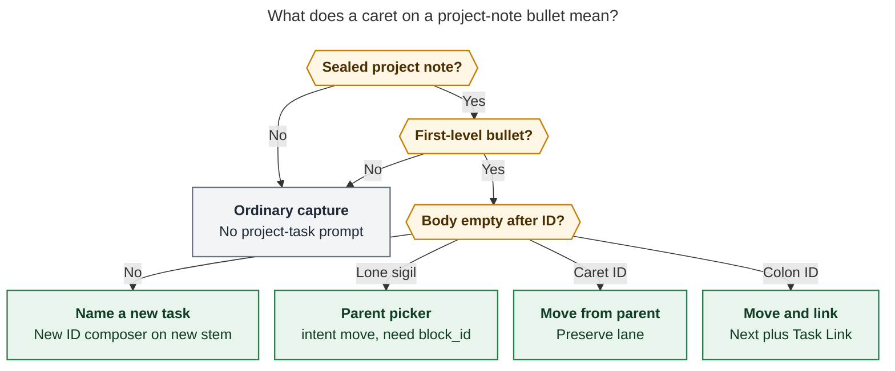
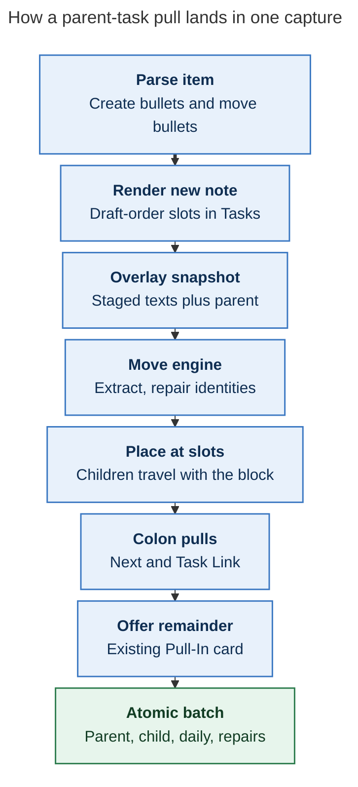

# Bare `^id` bullets should move parent tasks into a new project note

Researcher: `grk`. Independent report. Do not treat this as the swarm synthesis.

- **Question:** When `@foo[:^]bar@` capture creates a new project note, how should child tasks be pulled in from the parent (`foo.md`)? The prompt proposes a first-level bullet whose only text is `^some-id`, moving that task from the parent into the new note, with `^` after `- ` opening good completion in Bob Mac Capture. Lead the design so it is intuitive, reliable, and beautiful. Critique the plan, adjust requirements where justified, and recommend a solution.
- **Evidence:** bob-cli `docs/capture.md` (project-note family, offer form, inbox-route, `project_task_block_id`); `docs/task-move.md`; `docs/projects.md`; `docs/task-dependencies.md` §13; `docs/reference/capture-syntax.md`; `src/native/capture/project_note.rs`; `src/native/capture_language/project_tasks.rs` (`ProjectTaskPass`, empty-body error); `src/native/capture_language/completion.rs`; `src/native/capture_complete/cli.rs`; `src/native/task_move/plan.rs`; `src/native/capture/inbox_route.rs`; bob-mac-capture `docs/task-pickers.md`, `docs/protocol.md`, `docs/keyboard.md`, `docs/capture-previews.md`, `docs/capture-lists.md`; `Sources/CaptureCore/{BlockIDRules,BlockIDPickerIndex,CapturePickerPresentation,CaptureModels,CaptureProjectNotePresentation,CaptureGrammarGate}.swift`; decisions `mac-capture-is-a-thin-client`, `capture-bullets-mirror-the-task-block`, `unblocked-tasks-are-offered`, `projects-block-from-prj-line`; glossary Capture, Project Note, Project Task, Task Link, Successor Offer, Leaf Project.
- **Date of evidence:** bob-cli and bob-mac-capture trees in this workspace on 2026-11-03.

## Verdict

Do it. The empty-body `^id` bullet is the right spelling, and it is already almost a hole in the grammar.

Carve a project from an area (or from a parent project) at the same moment the note is born. Today's capture can author *new* tasks into `foo_bar.md` and can *offer* those new rows into today's Pomodoro. It cannot relocate work that already lives in `foo.md`. The workaround is create-then-`Ctrl+Shift+M`, which splits one thought across two gestures and two commits. A bare `^id` bullet in the same draft is the missing sentence: *this existing work belongs in the new project*.

Ship it as a **residence move**, sibling to today's *name* and *link* bullets, with Bob owning grammar and the Mac rendering a parent-scoped picker on the same `^` keystroke it already intercepts.

Recommended shape:

1. A first-level bullet whose remaining body is only `^id` **moves** that open resident from the parent note into the new project, preserving status, children, and identity.
2. The colon twin ` :id` **moves and links** (Next, Task Link), matching today's authored ` :id` create bullets.
3. Text plus `^id` / ` :id` keeps today's meaning: **name a new task**.
4. `bob capture-complete` sends `project_task_block_id` with new intent `move` and parent-task candidates. The Mac Block ID picker already auto-opens on that `^`; it learns a Move chrome.
5. The write reuses the `bob task move` engine inside the capture batch (the inbox-route precedent), with **draft-order placement** and capture's all-or-nothing staging.

## Critique of the request

The benefit is real. GTD's "this cluster of next actions is actually a project" is a capture-moment job. Bob already has the note-creation half (`@cash^goog-exit@` writes `cash_goog_exit.md`, `parent: "[[cash]]"`, `^prj` from the parent line). It is missing the filing half.

The prompt's spelling is also right, for a reason the prompt does not state: **empty-body ` :id` / ` ^id` already fails**. `ProjectTaskPass::check_child` rejects it with `capture line N names a task but has no task text` (`empty_project_task_body_error`). Tests lock that in (`src/native/capture_language/tests/grammar.rs`). Claiming that error form is additive: no successful draft changes meaning.

Three places still need a tighter product call than the prompt gives.

**"Somewhere in this capture" is too wide.** A bulk draft can mix a project-note item with inbox tasks, list headers, and session operators. A `- ^` under a different item must stay ordinary. The pull bullet is a first-level child of the *same* sealed `@route^id@` / `@route:id@` item. `@@route` declarations and later items do not leak a parent catalog.

**Offers and moves answer different questions.** `@route:id@` already *offers* the new note's open tasks as successor pull-ins (`docs/capture.md` § Offer a new project's tasks; `decisions:unblocked-tasks-are-offered`). Those offers decide what is linked under today. A bare `^id` decides where the checkbox lives. Mixing them into one picker would make "Pull-In" mean two verbs. Keep them stacked: bullets file residence; the existing Pull-In card still chooses Today.

**Pressing `^` already opens the wrong picker.** On a project-note bullet, a trailing ` ^` is `project_task_block_id` with `intent: "new"`, empty `candidates`, and `route` equal to the *new* stem (`cash_goog_exit`). Mac opens the New ID composer ("Suggest an ID for cash_goog_exit.md", caption **Task ID**). That is correct for `- Draft the memo ^`. It is the opposite of what `- ^` should feel like. "Good completion" means the same keystroke, a different intent, and parent-note candidates. It is a bob-cli contract change first; the Mac half is caption, detail strip, and Shift-Return chaining.

`Ctrl+Alt+Shift+N` (create-project-note-from-task) remains a different gesture: it *converts* one existing task into the new `^prj`. Capture `@foo^bar@` *authors* a new `^prj` from the parent line and can scoop *sibling* residents. Point people at the hotkey when the source task *is* the project; use bare `^id` when the source tasks are *work toward* the project.

## Requirement adjustments

These change the request. Each is a product call.

| ID | Adjustment | Why it is justified |
| --- | --- | --- |
| **ADJ-1** | Pull bullets are **item-local**. They attach only to a sealed project-note item in the same capture item. | Bulk capture judges each item alone. A draft-wide "any `@foo^bar@` unlocks `^` everywhere" would steal `- ^` from lists, notes, and later items. |
| **ADJ-2** | Give empty-body ` :id` the **move-and-link** twin. `^` moves and preserves lane; `:` moves, sets Next (or `[?]` under a resolved `s:<N>`), and writes the Task Link. | Project-note bullets already pair the sigils that way for *creates*. One catalog, two outcomes, no new character. |
| **ADJ-3** | Keep context `project_task_block_id`. Add `intent: "move"` and parent-task `candidates`. Do not invent a new complete context. | Unknown intents already decode to `link` on the Mac (`CaptureBlockIDIntent`). Old apps auto-open the existing Block ID picker and browse the candidates. A brand-new context would sit in the inline list until the app is updated. |
| **ADJ-4** | **Do not stamp `[fresh::]`** on a moved open task. | Inbox-route stamps because the person confirmed the work while changing its lane. This gesture files. `bob task move` already preserves freshness. Organizing eight tasks out of `cash.md` must not clear NEW/ROTTEN. |
| **ADJ-5** | The parent note **is written**, and only by removing moved blocks plus the move engine's identity repair. `bob projects sync` still owns the Sub-projects line. | Today's invariant "the parent note itself is never modified" is about that generated line. Pulls have to edit the parent; they must not start rewriting Sub-projects in capture. |
| **ADJ-6** | Place moved blocks at the **pull bullet's slot** in `## Tasks`, mixed with authored creates, in draft order. | Default `task move` appends after intake. Capture bullets already *are* the note (`decisions:capture-bullets-mirror-the-task-block`). Append would scramble the blueprint. |
| **ADJ-7** | v1 offers **identified** top-level open `#task` residents of the parent. `^prj`, closed, nested, and non-task lines stay out. ID-less rows wait for v1.1 (Add block ID, then move). | `^some-id` is the spelling. Nested tasks already travel with a moved parent. Minting IDs mid-picker is a second prompt on a cold path. |
| **ADJ-8** | Nested authored bullets under a pull **append as extra children** of the moved task (drawers included). An authored checkbox or `s:`/`$`/`%` on the pull line is refused. | The draft still reads like the block. Status and schedule already live on the moved line; rewriting them here fights preservation. |
| **ADJ-9** | Mac **Shift-Return** accepts the row, inserts `^id`, appends `\n- ^`, and reopens the picker. | Same chain as the `!` complete picker. Filing three siblings should not require re-arming `^` by hand. |
| **ADJ-10** | Successor offers stay **Today-only**. A `:`-form project still offers leftover open rows; explicit ` :id` pulls count as `already_planned`. | Two verbs, two surfaces. The Pull-In card already exists. |
| **ADJ-11** | Into a blocked new `^prj` (future `s:<N>`), a Ready pull lands `[?]` + `#prj_is_blocked` + unlinked, matching new-task capture into a blocked project. | CLI `task move` refuses Ready→blocked. Capture and `Ctrl+Shift+M` already convert. The new note should feel like one writer. |
| **ADJ-12** | `@file` **list** bullets keep the empty-body error. | Lists have no parent-vs-child split. Stealing `- ^id` there would mean "move from nowhere." |
| **ADJ-13** | Completion requires a **sealed** `@route^id@` / `@route:id@` (optional `#pomodoro`). `@route^id` without the seal stays "new task in the parent." | The seal is what makes the item a project note. Opening a move picker on an unsealed `^` would fight `@cash^goog-exit` create-ID completion. |
| **ADJ-14** | No post-submit "pull from parent?" card when the draft has zero pull bullets. | Silence is the default. The bullets *are* the gesture. An extra modal after `@cash^goog-exit@` would nag every empty project. |

## What already exists

### Project-note capture

```text
@cash^goog-exit@          create cash_goog_exit.md, link nothing
@cash:goog-exit@          same note, then offer its open tasks
- Draft the memo :draft-memo     NEW task, Next, Task Link
- Collect paperwork ^paperwork   NEW task, Ready, named ID
```

Filename is `<route>_<id with '-' → '_'>.md` at the vault root. Parent must be an area or non-terminal project. Parent is read for that check and **not written**. `bob projects sync` owns `- 🧩 **Sub-projects:**`. Authored first-level bullets become `## Tasks` rows or `## Title Case` sections. A task ID is the last word of a first-level bullet, sigil `:` or `^`, charset `A-Za-z0-9-`, `prj` reserved. Empty remaining body is an error. Daily note is read only when a ` :` task (or an eligible offer) needs a Pomodoro.

The Obsidian twin, **Create project note from task** (`Ctrl+Alt+Shift+N`), converts the source line into `^prj` and carries its Depends-On line and schedule. Capture authors a *new* `^prj` from the parent-line body. CLI notes are otherwise indistinguishable (including `template: "[[new_project]]"`).

### The empty-body hole

Evaluation order in `ProjectTaskPass` (shape → reserved → placement → **empty body** → checkbox → duplicate) makes `- ^equity-docs` a deterministic error today. Lone `- ^` is `Unfinished`: `capture-parse` reports `incomplete` + `needs: ["block_id"]` + an `interactive_placeholder` over the sigil, and the Mac skips the doomed dry-run.

That split is the UX hinge. The picker already opens on the keystroke. The commit currently cannot succeed without task text. Filling the hole is the feature.

### Completion and the Mac picker

`project_task_block_id` covers a cursor inside a trailing ` :` / ` ^` on a project-note (or list) bullet. Today:

- `candidates` is always `[]`
- `intent` is always `new`
- `route` / `relative_target` are the *new* stem (`cash_goog_exit` / `cash_goog_exit.md`)
- `body` is the owning bullet without ID or checkbox
- `used` is `prj` plus other IDs in the item
- `splice` writes the accepted ID onto the owner line

The Mac Block ID picker auto-opens when the edit writes the `:` / `^` separator immediately before Bob's ID part — including a paste or a fast `^equ` burst. Project-task sessions use scope `.projectTask`, caption **Linked task** / **Task ID**, no `@route` in the scope token (` :` / ` ^`). New ID mode is `intent == .new || .projectNote`. Unknown intents decode to `.link`, which is browse-existing-tasks.

So: send `intent: "move"` plus parent candidates, point `relative_target` at `cash.md`, and an *old* Mac already opens a task list on `- ^`. A *new* Mac paints Move chrome. Thin-client is preserved (`BlockIDRules.swift`: Bob is the only grammar authority).

Whole-item `^` remains the Active Task picker (`^route:block-id`). A column-zero `- ^` is a bullet, not that picker. Cached route completion already does not intercept `^`.

### The move engine, already inside capture

`bob task move` selects open `#task` blocks by `-b ID` / `-m TEXT`, preserves status and children, suffixes colliding dest IDs, repairs vault-wide links and `[id::]` / `[dependsOn::]`, and reports `needs_reconcile`. It refuses `^prj`, closed (CLI), nested, and Ready-into-blocked-project.

Capture **inbox routing** already calls `plan_task_move` on a vault snapshot overlaid with staged texts, inside the same all-or-nothing batch (`docs/capture.md` Routing inbox tasks out; `src/native/capture/inbox_route.rs`). It is allowed to move closed tasks and to select by exact line. That is the write precedent. Pulls should ride the same overlay, with two differences: ADJ-4 (no freshness stamp) and ADJ-6 (slot placement).

### Offers, lists, similar-tasks

`@cash:goog-exit@` offers Ready/Next/Pending rows from the rendered `## Tasks`, never `^prj`, never the placeholder, folding `#hide` and `already_planned`. Picks are exactly authored ` :id` bullets. Creation never stamps.

`@file` + bullets is a **list**: each first-level bullet is its own item in that file. Those bullets also open `project_task_block_id` (New ID). Leave them alone (ADJ-12).

The similar-tasks band is a settled heads-up for *duplicate titles* on new tasks. It is the wrong surface for an explicit move.



*A sealed `@route^id@` / `@route:id@` item is the gate; empty remaining body is the move; the sigil chooses preserve-lane versus Next-and-link.*

## Alternatives considered

| Approach | What it gets right | Why it loses |
| --- | --- | --- |
| **A. Bare `^id` / ` :id` bullets (recommended)** | Draft reads like the note. CLI and Mac share one spelling. Claims an error form. Reuses the Block ID auto-open. | Overloads `^` (new vs existing) across empty vs nonempty body. Parent writes for the first time in this family. |
| **B. Post-submit parent multi-select** | Discoverable. No grammar change. | The draft no longer *is* the blueprint. CLI needs `--pull-from-parent` flags. Nags empty projects. Fights `unblocked-tasks-are-offered` (offers are Today, not residence). |
| **C. New sigil (`<id`, `<<`, `@id`)** | Avoids overloading `^`. | Vault tasks already end in `^id`. `- ^equity-docs` looks like the line it becomes. `@id` collides with routes. A new character needs a new Mac auto-open rule. |
| **D. Similar-tasks "file into this project"** | Reuses an existing rail. | That rail is duplicate-advisory and Return-neutral. A move is an explicit write. Wrong affordance. |
| **E. Tell people to `Ctrl+Shift+M` after create** | Zero new grammar. Move engine already polished. | Two gestures, two commits, lost draft order, easy to forget. The whole point of sealed `@…@` was one capture for the new note. |
| **F. `Ctrl+Alt+Shift+N` only** | Perfect when *this task is the project*. | Wrong when the `^prj` body is new and the work is *siblings* in the parent. |
| **G. New complete context `project_task_move`** | Clean JSON. | Old Mac: unknown context → generic inline rows, **no auto-open**. The prompt's "pressing `^` triggers good completion" fails until the app ships. Intent-on-existing-context degrades to a Link picker. |

## Recommended solution

### 1. Grammar

On a **sealed** project-note item only:

| Bullet | Meaning |
| --- | --- |
| `- <text> ^<id>` | Unchanged: create Ready (checkbox preserved) named `<id>` |
| `- <text> :<id>` | Unchanged: create Next (or `[?]` if the project is scheduled) and link |
| `- ^<id>` | **New:** move parent resident `^<id>` into this note, preserve status |
| `- :<id>` | **New:** move that resident, Next, Task Link |
| `- ^` / `- :` | Unfinished: `needs: ["block_id"]`, parent-move picker |

`@cash^goog-exit@` and `@cash:goog-exit@` both accept pull bullets. The colon on the *parent line* still means "offer today's links"; the colon on an *empty child* means "this one is linked."

Refuse with teaching copy (parse or plan, as noted):

- Empty-body ID on a **list** bullet — keep today's empty-body error.
- Nested `^id` / ` :id` — keep misplaced-ID.
- `^prj`, closed, nested-in-parent, missing, or non-task — plan-time teaching error naming `bob capture-tasks -r <parent>.md`.
- Duplicate ID in the item (create and pull share the namespace, as `:` / `^` already do).
- Checkbox, `s:`, `$`, `%`, `#type`, extra prose on a pull line — `\`^id\` moves the task as it is; drop the extra markers\``.
- Unsealed `@route^id` — still a new task in the parent; no move picker.

Nested notes under a pull are extra children, appended after the moved block's existing children, same two-level authored grammar.

`#pomodoro` on a create-form item still requires at least one ` :` task; a ` :id` *pull* counts, a ` ^id` pull does not.

### 2. Completion (`bob capture-complete`)

When the cursor is in a trailing ` :` / ` ^` token on a first-level bullet of a sealed project-note item **and** `block_id.body` is empty:

```json
{
  "context": "project_task_block_id",
  "query": "equ",
  "replacement": {"start": 42, "end": 45},
  "candidates": [
    {
      "replacement": "equity-docs",
      "ref": "cash.md:18",
      "route": "cash",
      "block_id": "equity-docs",
      "status_symbol": " ",
      "status_name": "Ready",
      "text": "Collect the equity paperwork",
      "section": "Tasks",
      "line": 18,
      "depth": 0,
      "child_count": 0
    }
  ],
  "block_id": {
    "route": "cash_goog_exit",
    "relative_target": "cash.md",
    "note_exists": true,
    "marker": "^",
    "marker_range": [41, 45],
    "intent": "move",
    "body": "",
    "allowed_character": "[A-Za-z0-9-]",
    "allowed_description": "letters, digits, or '-'",
    "suggestions": [],
    "used": [{"id": "prj", "line": 1, "task": true, "text": "Finish the exit packet"}],
    "owner_line": 2,
    "splice": {"range": [42, 45], "before": "", "after": ""}
  }
}
```

Contract details:

- **`intent: "move"`** is additive. Older Mac: unknown → `link` → browse `candidates`. Newer Mac: Move chrome.
- **`relative_target`** is the *parent* file (`cash.md`) so the filter placeholder reads "Filter cash.md tasks".
- **`route`** stays the *destination* stem (`cash_goog_exit`) so used-ID uniqueness and splice still name the new note.
- **`candidates[].replacement`** is the bare ID. Accept fills Bob's ID span after the typed sigil. The person never types `@cash:` here.
- Catalog: top-level open `#task` residents of the parent (Ready, Blocked, Next, In Progress) that already have a block ID, document order on an empty query, prefix-then-substring ranking on a query, spaces as AND on the Mac (local fuzzy, same as every other picker).
- Already pulled in this item, or colliding with an authored create ID: `disabled_reason`, no insertable replacement.
- `#hide` rows stay visible (filing can include them). Fold groups are a Mac presentation choice; Bob can send `hidden: true`.
- Parent reads see earlier batch items, matching `validate_project_note_parent`.
- Nonempty `body` keeps today's `intent: "new"`, empty candidates, dest-stem `relative_target`.

No new `capture-*` sibling. CLI rules: the protocol grows additively; `-h` for `capture-complete` lists `move` under the `block_id.intent` wording.

### 3. Mac presentation

Bob Mac Capture stays a renderer.

**Picker (new Mac).** Same Block ID card, `scope: .projectTask`, `intent == .move` (treat as browse mode: `isNewIDMode == false`).

| Surface | Caret ` ^` | Colon ` :` |
| --- | --- | --- |
| Caption | **Move** | **Move & link** |
| Scope token | ` ^` | ` :` |
| Placeholder | Filter cash.md tasks to move | Filter cash.md tasks to move and link |
| Detail | `↩ moves Collect paperwork into cash_goog_exit.md` | `↩ moves and links Collect paperwork into ADMIN` |
| Chip | Browse cash.md tasks to move | same |
| Teaching | none (project-task sessions already teach nothing) | none |

Auto-open, Escape-to-chip, Backspace-on-empty-deletes-sigil, type-through of illegal characters, and VoiceOver follow the existing Block ID session. Illegal character at end of a Move field commits the ID (if valid) and continues in the editor — same type-through as New ID, so `#admin` after a pull still works on the parent line, not the bullet.

**Shift-Return (ADJ-9):** insert Bob's replacement, append `\n- ` plus the same sigil, caret after it, reopen. Command-Return inserts and captures; Control-Return inserts, captures, and opens.

**Old Mac:** Link-mode Block ID picker over parent candidates, caption still **Task ID** / **Linked task**. Accept still inserts the ID. Live preview after insert is the authority. Good enough; ship bob-cli first.

**Preview.** Additive `project_note.moves[]`. `CaptureProjectNotePresentation` grows a manila-tinted **Moves N tasks from cash.md** band *above* the Linked / Offers bands: status glyph, title, `cash.md → cash_goog_exit.md`, `^id`. VoiceOver: "Moves 2 tasks from cash.md, Collect the equity paperwork, Call the bank." DecodeIfPresent: older apps omit the band.

Skip dry-run while `needs` contains `block_id` (already true for lone `^`). Once the ID is complete, dry-run shows the move; an unknown ID is a teaching error, not a parse diagnostic, so typing `^e` is a failed preview rather than a red underline on an unfinished word.

### 4. Planner and writes



*Inbox-route already runs `plan_task_move` on staged snapshots; pulls add slot placement and skip the freshness stamp.*

Algorithm:

1. Validate parent (existing rule) and dest (must not exist).
2. Partition first-level bullets into creates, pulls, and sections/drawers.
3. Resolve each pull ID against the parent's current snapshot (plus earlier batch items). Fail the item with a teaching list on miss, `^prj`, closed, nested, or duplicate.
4. Render the new note with **slots** in draft order: create rows as today; pull slots as placeholders the engine fills. Drop the `(REPLACE WITH TASK DESCRIPTION)` placeholder when any create or pull exists.
5. Overlay a `VaultSnapshot` with staged dest text and current parent (inbox-route pattern). Build one `MoveRequest` with `MoveSelector::Block` per pull, `allow_closed: false`.
6. Run `plan_task_move` for extraction, dest ID collision suffixing (should not trigger on a new note), vault-wide link repair, dependency identity repair, and D8 type relocation. **Re-place** extracted blocks into the pull slots instead of appending to intake. Append any nested authored children after the moved children.
7. For ` :` pulls, apply the same Next + Task Link path as authored ` :` creates (including `project_schedule` link-guard when the new `^prj` is future-dated). For ` ^` pulls, keep status; if the new project is blocked, apply ADJ-11.
8. Rebuild offer rows from the post-move `## Tasks` (offer form only). Explicit ` :` creates and ` :` pulls are `already_planned`.
9. Stage dest, repaired notes, parent last (move engine's dest-then-repairs-then-source order, inside capture's all-or-nothing replace). Daily note joins the set when any link is written.

Human dry-run:

```text
[dry-run] ok would create  /…/cash_goog_exit.md
  under cash.md
  - [ ] #task #prj Finish the exit packet #hide ^prj
  - [*] #task Draft the memo … ^draft-memo
  - [ ] #task Collect the equity paperwork … ^equity-docs
  would move  Collect the equity paperwork  cash.md → cash_goog_exit.md
  would link   /…/day.md
  under ADMIN (created)
  - [[cash_goog_exit#^draft-memo]]
```

JSON (additive, omit when empty):

```json
"project_note": {
  "basename": "cash_goog_exit.md",
  "parent_route": "cash",
  "form": "offer",
  "moves": [
    {
      "source": "cash.md",
      "block_id": "equity-docs",
      "previous_block_id": "equity-docs",
      "text": "Collect the equity paperwork",
      "status_symbol": " ",
      "line": 14,
      "linked": false
    }
  ]
}
```

Also thread `repaired_files`, `renamed_block_ids`, and `needs_reconcile` onto the item or the batch the way inbox-route does, so a blocked-parent recovery is visible.

### 5. Docs, decision, grammar

- **Contract:** `docs/capture.md` project-note section; table rows for `- ^<id>` / `- :<id>` empty-body; replace "the parent note itself is never modified" with "the parent is rewritten only by pull bullets; Sub-projects stay `projects sync`."
- **Syntax index:** `docs/reference/capture-syntax.md`.
- **CLI help:** `capture`, `capture-complete`, `capture-parse` (additive `intent` wording). `just docs-gen` / `just docs-check`.
- **JSON:** `docs/reference/json-outputs.md` — `block_id.intent` includes `move`; `project_note.moves`.
- **Mac:** `docs/task-pickers.md` Block ID picker, `docs/protocol.md` capability paragraph, `docs/capture-previews.md`, `docs/keyboard.md` Shift-Return.
- **Decision record:** "Bare project-note `^id` bullets move parent residents." Claims ADJ-1–ADJ-14. Supersedes the parent-never-modified sentence in part. Does not touch `unblocked-tasks-are-offered`.
- **Grammar number:** keep `grammar: 6`. This claims an error form and adds JSON fields; it does not add a need or a marker family. Schema version stays 1. Mac grammar gate stays at 5; capability detection is the new intent plus nonempty candidates.

CLI rules: no `bob capture move` subcommand; free text would swallow it. No `bob task` verb for this; it is capture.

### 6. Phasing

| Phase | Repo | Scope |
| --- | --- | --- |
| **1** | bob-cli | Grammar, parse, complete (`intent: move` + candidates), planner (engine + slots), docs, goldens. CLI users can type `- ^equity-docs` without the Mac. |
| **2** | bob-mac-capture | Decode `move`, captions, detail, chip, Shift-Return chain, preview band. Compile on macOS CI; `just portable-check` on agent hosts. |
| **3** | both | v1.1 ID-less parent rows (Add block ID, then move). Optional `#type` on a pull line. Optional `#hide` grouping in the picker. |

Phase 1 without phase 2 is still a complete CLI feature; phase 2 without phase 1 cannot auto-open a useful catalog.

### 7. Risks

- **Parent writes in a family that promised none.** Mitigate with tests that Sub-projects is untouched and that a dry-run without pulls still leaves the parent byte-identical.
- **Move engine append vs slot placement.** The engine's dest insertion is the one piece *not* to take as-is. Extraction + repair + custom splice is the honest split; wrapping `plan_task_move` and then reordering `## Tasks` is a fallback if slot splicing fights indent/children.
- **Preview flicker while typing `^e`.** Unknown IDs fail dry-run. Keep parse silent; put the teaching sentence on the capture error; Mac already suppresses dry-run for lone `^`. Acceptable.
- **Blocked-project status conversion (ADJ-11) vs CLI move refusal.** Document the capture exception next to inbox-route's `allow_closed` exception.
- **Ready cap.** Soft-warn in preview when the dest Ready count would exceed `plan.max_ready_per_note`. Do not refuse.
- **Batch identity.** Two items pulling the same parent ID: first wins in source order; second is a teaching error against the staged parent.

### 8. Worked draft

Parent `cash.md` already has `^equity-docs` and `^call-ms`. Bryan types:

```text
Finish the Google exit packet @cash:goog-exit@#admin
- Draft the resignation memo :draft-memo
- ^equity-docs
- :call-ms
- Book the lawyer
```

Capture, in one transaction:

1. Creates `cash_goog_exit.md` with `^prj` "Finish the Google exit packet".
2. Creates **Draft the resignation memo** as Next, linked under ADMIN.
3. Moves **Collect the equity paperwork** from `cash.md` (Ready, children intact, links repaired).
4. Moves **Call Morgan Stanley…**, sets Next, links under ADMIN.
5. Creates **Book the lawyer** as Ready.
6. Offers **Collect the equity paperwork** and **Book the lawyer** on the Pull-In card (`call-ms` and `draft-memo` already planned).
7. Leaves `cash.md`'s Sub-projects line for `bob projects sync`.

Mac path: after `- `, `^` opens **Move** over `cash.md`; Shift-Return files the next sibling; `:` on a later bullet opens **Move & link**. Return on the draft captures; Return again on the offer card is the existing Today chooser.

That is the whole feature: the draft is the new note, `^` means "this line already exists in the parent," and Today is still an explicit second question.

## Is this a good idea?

Yes. It is the smallest grammar that matches how the vault already writes block IDs, it fills an error form, it reuses two mature engines (project-note render and task move), and it gives the Mac a picker it already knows how to open. The adjustments keep residence and Today apart, keep lists and unsealed `^` alone, and keep freshness honest.

I would take this approach over a post-submit parent card, a new sigil, or "just use `Ctrl+Shift+M`." I would not auto-pull every parent task, and I would not let the app infer move-vs-new from empty body on its own — Bob must send `intent: "move"`.
