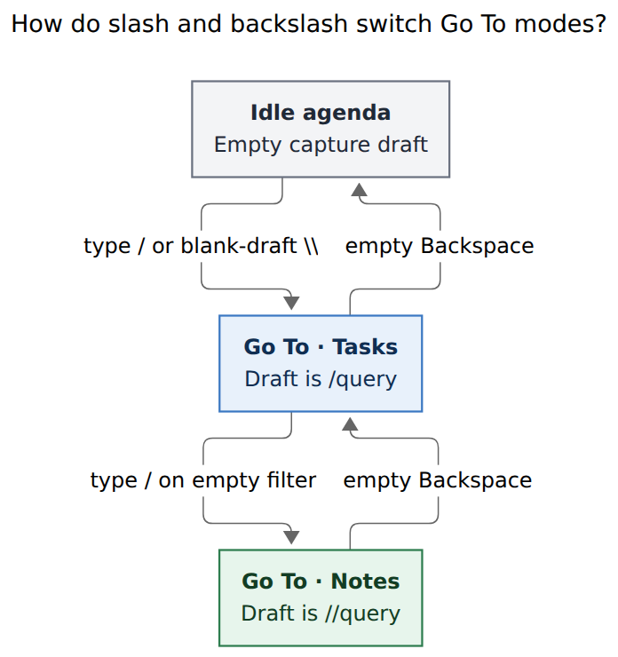
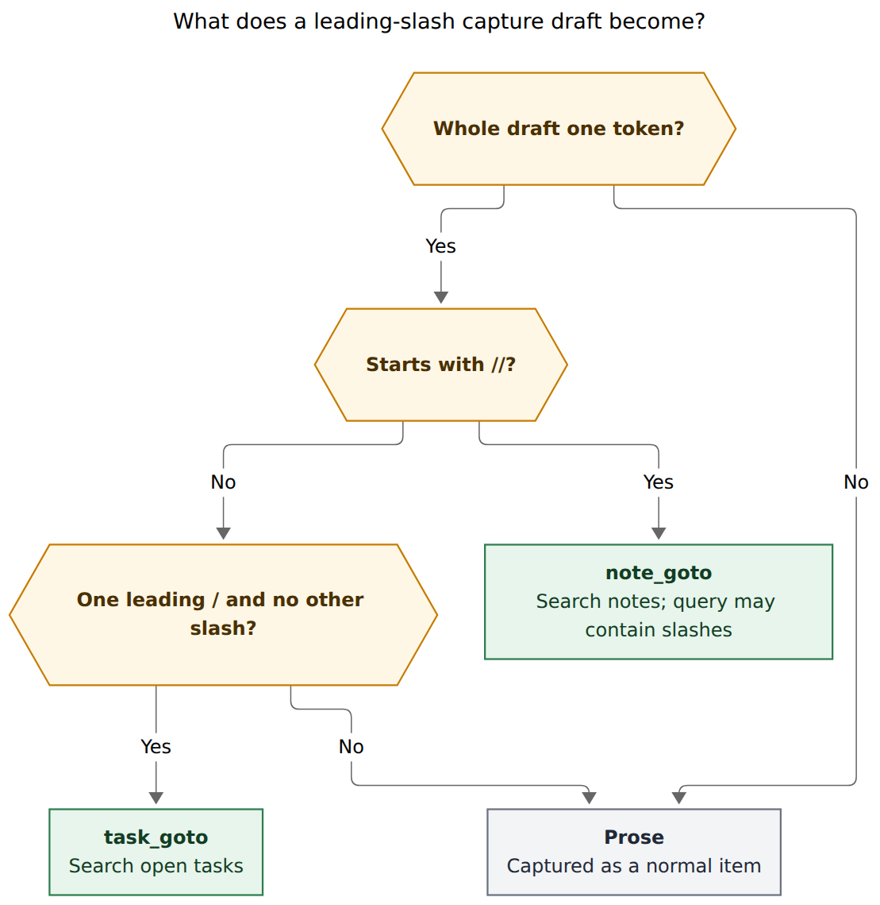
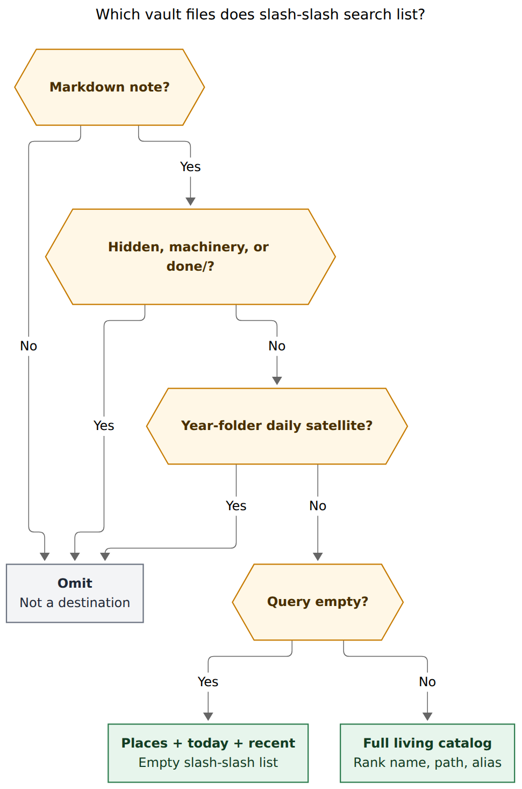

# `//` in Bob Mac Capture: search notes the way `/` searches tasks

> **Research query:** How should Bob Mac Capture treat a second `/` as a
> search over vault note files (with well-chosen exclusions), while a second
> `\` continues to type a literal backslash? Critique the request, adjust
> requirements that need adjusting, and recommend a design that is
> intuitive, reliable, and beautiful.

## Bottom line

**Build it.** Nested slash is the right gesture, and the thin-client split
already tells us where each piece lives. The request as written would still
ship two avoidable mistakes: treating *any* second slash as note search
(which breaks the `/Users/…` prose carve-out that `/` already depends on),
and listing *all* Markdown files (7,265 in `~/bob` today, most of them not
places you would jump to).

**Recommended shape, in one sentence:** a whole-draft `//query` token
opens a Go To Note picker that reuses wikilink ranking and
`obsidian://bob-open-notes`, with `/` remaining Go To Task, `\` remaining
the blank-draft alias plus the literal-backslash escape, and the catalog
cut down to living notes rather than vault debris.

This is a two-repo change (bob-cli, then Bob Mac Capture). The open-note
URI already exists in bob-navigation-hotkeys, so the plugin work that `/`
needed is already done.

## Is this a good idea?

Yes. Four independent facts make the nested slash earn its key:

1. **Capture is already the global finder.** The panel is one chord away
   from any macOS app. `/` already finds tasks better than Obsidian's Quick
   Switcher, which finds notes. The missing sibling is "open that note"
   from the same chord.
2. **The duality is already in the product.** `:` inserts a task link; `/`
   goes to the same catalog. `[[` inserts a note wikilink; `//` should go
   to the note. Similar-tasks rows already bind `/` to "open". Teaching one
   more slash is cheaper than inventing `?`, Command-O, or a Swift-only
   mode.
3. **`[[` is the wrong navigator.** Wikilink note completion is capped at
   20 rows, inserts `[[path]]` into the draft, and never opens Obsidian.
   That is correct for linking. It is the wrong accept action for "I want
   to look at `sase.md`."
4. **The chord already nests.** `Command-\` `Command-\` lands on today's
   Pomodoro. `Command-\` then `\` opens task Go To. `Command-\` then `\`
   then `/` becomes note Go To for free.

The costs, and how the recommendation limits each one:

- **`//` stops being capturable prose.** Today's grammar leaves `//`,
  `/Users/x`, and `/r/rust` as ordinary inbox tasks so pasted paths survive.
  Claiming every extra slash would file those paths as Go To Note queries
  and refuse capture. Claiming only a *leading consecutive* `//` keeps the
  path carve-out.
- **The catalog is huge.** A naive "every `.md` file" walk of `~/bob` sees
  7,265 notes. After dropping hidden and machinery directories you still
  have 5,727. Daily satellites alone are 1,836 files named
  `YYYY/YYYYMMDD_habit.md`, `_done.md`, `_poms.md`, and `_events.md`.
  Dumping that into an empty picker is neither reliable nor beautiful.
- **The panel becomes a navigator twice.** `/` already leaves the app
  without writing. `//` must do the same: no block-ID minting, no capture,
  no stash. Distinct captions (`Go To · Tasks` / `Go To · Notes`) keep the
  two accept actions obvious.
- **A Swift-only mode would violate the thin-client record.** Grammar,
  catalog, and ranking belong to bob. The app paints rows and dispatches
  the URI bob already knows how to open.

## What exists today

Each fact below is verified against bob-cli, Bob Mac Capture, and a
read-only walk of `~/bob` on 2026-11-15.

| Fact | Evidence |
| --- | --- |
| A whole-draft `/query` token is Go To Task. `capture-parse` needs `task_goto`. `bob capture` refuses with teaching error T3. Accepting opens `obsidian://bob-goto-task` and discards the draft. | `task_goto_query_token` in `src/native/capture_language/tokens.rs`; `docs/capture.md` "Go To"; Mac `docs/task-pickers.md` |
| The claim is one token that **starts with `/` and holds no second `/`**. `//`, `/Users/x`, and `/r/rust` stay prose. | `tokens.rs` counts `/` bytes `!= 1`; goldens in `capture_language/tests/goto.rs` |
| Blank-draft `\` becomes `/` and opens that picker. A second `\` typed immediately types a literal `\`. Other empty-filter `\` keypresses are consumed. | Mac `docs/keyboard.md` ("Going to a task from any app"); `docs/task-pickers.md` Go To keys |
| `/` at a line start does **not** alias to `#`. `Buy milk /` does. Fast same-key double-tap after an alias restores one literal. | `rewrite_draft_leaves_slash_hash_alias_literal` includes `"/"`; `expand_hash_alias` bails when the prefix to the slash is only whitespace |
| `[[query` already searches Markdown paths, stems, and frontmatter aliases, capped at 20, and inserts a wikilink. The index skips hidden directories plus `.git`, `.obsidian`, `_generated`, and `_templates`, and does not follow directory symlinks. | `docs/capture.md` wikilink completion; `ALWAYS_EXCLUDED_NOTE_DIRECTORY_NAMES` in `src/native.rs`; `RESULT_LIMIT = 20` in `capture_links.rs` |
| `@` lists capture **routes** (inbox, areas, non-terminal projects, notebooks, records), not arbitrary notes, and inserts a destination rather than opening one. | `bob capture-targets` |
| `obsidian://bob-open-notes` already opens one or more notes, reuses a leaf, and omits a caret change when no `line` is supplied. Mac Capture already builds this URL after capture. | `docs/reference/plugins/open-notes-uri.md`; `ObsidianOpenURL.openNotesURL` |
| Obsidian Quick Switcher, empty, shows recents; excluded files are only deprioritized; `Enter` on a miss can create a note. | [Quick switcher](https://help.obsidian.md/plugins/quick-switcher); [Excluded files](https://help.obsidian.md/settings) |
| Live vault, 2026-11-15 | See [the catalog numbers](#the-catalog-is-the-design) |

Shared always-excluded directory names, already used by wikilink, dependency,
and archive walkers:

```text
.bob  .git  .obsidian  _conflicts  _generated  _templates
```

plus every directory whose name starts with `.`.

## The catalog is the design

A read-only walk of `~/bob` on 2026-11-15:

| Bucket | Count | Role in `//` |
| --- | ---: | --- |
| All `.md` files | 7,265 | Far too many to list |
| Non-Markdown files | 10,082 | v1 omits (PDFs, images, attachments) |
| Hidden / always-excluded (`.obsidian`, `.bob`, `.git`, `_conflicts`, `_generated`, `_templates`, other dot dirs) | 1,538 | Omit |
| Extra `_`-prefixed dirs (`_meta/`, `_zorg_templates/`) | 14 | Omit as vault machinery |
| Daily satellites `YYYY/YYYYMMDD_*.md` | 1,836 | Omit (826 `_habit`, 818 `_done`, 188 `_poms`, 4 `_events`) |
| `done/` archives | 54 | Omit in v1 (the attic; `/` already has Command-X for closed tasks) |
| **Living catalog** | **3,824** | Query search |
| of which `type: [[ref]]` | 1,294 | Query yes; empty-query no (except Recent) |
| of which dated daily notes `YYYY/YYYYMMDD.md` | 1,191 | Query yes; empty-query today only |
| of which untyped / other | ~880 | Query yes |
| of which records | 183 | Query yes; empty-query no |
| of which period notes | 89 | Query yes |
| **Places** (area 19, project 100, notebook 39, album 6) | **164** | Empty-query backbone |
| Inbox files present | `mac_inbox.md`, `inbox.md`; `gmail_inbox.md` is an area | Pin on empty query |

The 1,836 satellites are the important exclusion. They sit next to real
daily notes, they match date queries, and none of them is the note you
mean when you think "today" or "last Tuesday". Jump to `2026/20261115.md`.
Leave `_habit` / `_poms` / daily `_done` / `_events` in the year folder.

Obsidian's own Quick Switcher does not create this problem because it
shows recents when empty and only *deprioritizes* excluded files. Bob
should be stricter: machinery and satellites are not destinations, so they
do not appear even when the query matches, unless a later Command-X attic
toggle is added.

## Requirement adjustments

Each change to the request is called out with its reason.

| # | As requested | Adjusted to | Why |
| --- | --- | --- | --- |
| **R1** | "A second `/`" anywhere | The whole draft is one token that **starts with `//`**. `/Users/x` and `/r/rust` stay prose. `//prj/sase` is note search with query `prj/sase`. | Today's `/` claim already treats any extra slash as prose so pasted paths survive. Consecutive leading slashes are the only extra slash that cannot be a Unix path. |
| **R2** | "All note files" | Living Markdown notes only. Omit hidden dirs, always-excluded dirs, other `_`-prefixed dirs, `done/`, directory symlinks, non-Markdown, and year-folder daily satellites `YYYY/YYYYMMDD_*.md`. | 1,836 satellites plus 1,538 machinery files would drown Places, refs, and dailies. |
| **R3** | (implicit empty list) | Empty `//` shows **Places + today + recent**, not 3,824 rows. Typing ranks the living catalog. | Matches Quick Switcher's empty-recents habit and the capture-targets "where I work" set (~164 notes). |
| **R4** | Second `\` types a raw `\` | Keep today's rule unchanged: blank-draft `\` opens `/`; a second `\` typed immediately inserts a literal `\`; that draft is `/\` and stays **task** Go To (one slash). **A real `/` is required to enter notes.** | Already implemented. Do not map the second `\` onto `/`. |
| **R5** | (unspecified accept) | Return / Tab / click / ⌘↩ / ⌃↩ open the note, hide the panel, and discard the draft. Nothing is captured, minted, or stashed. Failed dispatch keeps the picker open. | Same contract as `/`. Navigation never writes. |
| **R6** | (unspecified transport) | `obsidian://bob-open-notes?count=1&path1=<absolute>` with **no `line`**. An already-open note is reused and keeps its caret. | `bob-goto-task` is a task lander. `obsidian://open?path=` does not reuse leaves. The open-notes URI is already a Mac Capture dependency. |
| **R7** | (unspecified empty Backspace) | Empty-filter Backspace on `//` deletes one slash and returns to **task** Go To. Empty-filter Backspace on `/` returns to the idle agenda. | Nested slash is a mode switch, not a two-character trigger that snaps back to idle. |
| **R8** | (unspecified captions) | Rename today's capsule from `Go To` to **`Go To · Tasks`**. New capsule **`Go To · Notes`** with scope symbol `//`. | One Go To was unambiguous. Two are not. |
| **R9** | (no create-on-miss) | `//` never creates a note. A miss is an empty list plus the existing browse hint. | Quick Switcher's Shift-Enter create is a writer. This picker is a navigator, and capture already creates notes through `@` / `%n` / record routes. |
| **R10** | (implementation home) | bob-cli owns the token, catalog, ranking, and teaching error. The Mac app owns keys, pixels, and URI dispatch. No new plugin. | `decisions:mac-capture-is-a-thin-client`. Spawn, do not reimplement. |

## Recommended solution

### Gesture and grammar

The picker modes:



*A first `/`, or a blank-draft `\`, opens task search. A second consecutive
`/` opens note search. Empty-filter Backspace walks back. A second `\`
types a literal backslash and stays on tasks (not shown: it does not
change mode).*

Rendered size: 463.9 × 494 px; fit scale: 100%. Mermaid CLI 12.0.0.

The draft claim, shared by execution, editor parse, and completion the
way `task_goto_query_token` is shared today:



*Consecutive leading `//` is note search even when the query contains more
slashes. A single leading `/` with no other slash remains task search.
Everything else, including `/Users/x`, stays capturable prose.*

Rendered size: 738.2 × 760 px; fit scale: 88.4%.

| Draft | Reading |
| --- | --- |
| `/` | `task_goto`, query `""` |
| `/fix` | `task_goto`, query `fix` |
| `\` then `/` | draft `//` → `note_goto`, query `""` |
| `//` | `note_goto`, query `""` |
| `//sase` | `note_goto`, query `sase` |
| `//prj/sase` | `note_goto`, query `prj/sase` |
| `/\` | `task_goto`, query `\` (the literal-backslash escape) |
| `/Users/x`, `/r/rust` | Prose |
| `//` plus a child line, or a second item | Prose (whole-draft rule, same as `/`) |
| `Buy milk /` | Unchanged `#` alias, not Go To |

Add `note_goto_query_token` next to `task_goto_query_token`. Keep the
task predicate exactly as it is (exactly one `/`). The note predicate
matches when the whole draft is one token that starts with `//`. Query
bytes are everything after those two slashes, up to the cursor.
Replacement covers the whole token so refetching at `replacement.start`
returns the unfiltered empty-query list.

`bob capture` refuses a claimed `//` draft before any other item parser,
with a T3-family teaching error:

```text
`//sase` opens the Go To Note picker; pick a note to open it in Obsidian — it never captures
```

`capture-parse` reports mode `incomplete`, `needs: ["note_goto"]`, and one
`interactive_placeholder` span over the token. Place `note_goto` next to
`task_goto` in the needs order. Bump the capture-complete `grammar`
integer additively; keep `schema_version` 1 and decode new fields with
`decodeIfPresent`.

Do **not** add a `bob capture` subcommand (`cli_rules.md`: free-text TEXT
would swallow it). Grow `capture-parse` / `capture-complete` only.

The `#` alias must not steal the second slash. Today `expand_hash_alias`
already returns None when the completion context is not task / block-id /
pomodoro-block-id. Once `//` reports `note_goto`, that bail-out fires.
Add a golden: `rewrite_draft("//", Some(2))` is a no-op.

### Catalog, ranking, empty state



*Markdown only, after dropping machinery, `done/`, and daily satellites.
Empty query is Places plus today plus recent; a typed query ranks the
living catalog by name, path, and alias.*

Rendered size: 646.1 × 978 px; fit scale: 91.3%.

**Omit (never a row, even on a matching query):**

- Non-Markdown files.
- Directories named `.bob`, `.git`, `.obsidian`, `_conflicts`,
  `_generated`, `_templates`, plus any other name that starts with `.` or
  `_`.
- Directory symlinks (the existing walker already skips them because
  `DirEntry.file_type().is_dir()` is false).
- `done/` archives (first path component is exactly `done`).
- Year-folder daily satellites: path `^\d{4}/` and filename
  `^\d{8}_.+\.md$`. Bare `YYYY/YYYYMMDD.md` stays.

**Include in a typed query (the living catalog, 3,824 notes today):**

- Inbox files, areas, projects (terminal included), notebooks, albums,
  records, refs, period notes, mail notes, bank-month notes, dated daily
  notes, and untyped working notes (`math.md`, `lib/`, `lit/`, `prompts/`,
  `prj/`, …).
- Frontmatter aliases, matching the wikilink index.

**Empty `//` rows, in this order:**

1. **Today** — the current daily note, when it exists.
2. **Inbox** — `mac_inbox` first, then any other inbox file.
3. **Areas**, **Projects** (non-terminal, capture-targets order),
   **Notebooks**, **Albums**.
4. **Recent** — about 12 living-catalog notes by mtime, skipping anything
   already listed, skipping dated dailies older than today.

That empty list is about 180 rows, in the same neighborhood as today's
open-task picker, instead of 3,824.

**Ranking** reuses `capture_links::MatchKind`: exact alias / stem / path,
then prefix, word-boundary, acronym, substring, with spaces as AND terms
the way `:` already filters. Do not reuse the full wikilink `NoteIndex`
read (it parses every heading and block). Build a **light** index: path,
stem, aliases, `type:` kind, mtime. Warnings stay bounded the way
wikilink warnings already do.

**No Command-X in v1.** `/` uses Command-X to swap open tasks for closed
ones. Notes do not have that dual. A later attic toggle could reveal
`done/` and satellites; it is not required to make `//` useful.

### Picker (Mac)

Add `CapturePickerSource.noteGoto` on the shared card.

| Slot | Value |
| --- | --- |
| Scope symbol | `//` |
| Caption | `Go To · Notes` |
| Today's `/` caption | `Go To · Tasks` (rename) |
| Placeholder | `Search notes by name, path, or alias` |
| Status | `Pick a note to open — press Tab to browse` |
| Chip | `Go to a note` |
| Row symbol | `doc.text` (tasks keep `arrow.up.forward`) |
| Primary | Stem, with restrained emphasis on the match |
| Secondary | Vault-relative path, middle-truncated the way `@` paths already truncate |
| Capsule | Kind: Area, Project, Notebook, Album, Record, Ref, Day, Period, Inbox, Mail, Note |
| Alias badge | When `match_kind` is an alias hit |
| Detail strip | `↩ Opens sase.md` |
| Empty groups | Today, Inbox, Areas, Projects, Notebooks, Albums, Recent |
| Nonempty filter | One ranked list; kind capsules stay |

Keys, mirroring `/` except for the nested slash:

- Return, Tab, click, ⌘↩, ⌃↩: open, hide, discard.
- Shift-↩ and Option-↩: consumed.
- Escape: clear a nonempty filter, then cancel to the reopen chip.
- Empty-filter Backspace: `//` → `/` (task picker). Empty `/` → idle agenda.
- `\` on empty **task** filter right after `\` opened Go To: literal `\`.
- `\` on empty **note** filter: consumed (do not type a path separator via
  backslash; notes are entered with a real `/`).
- Control-C: discard, do not stash (same as `/`).
- Command-X: native cut, not a closed-task toggle.

When `capture-parse` reports `note_goto`, skip the doomed live dry-run
exactly as `task_goto` does.

Accept:

1. Stale-draft guard.
2. Build `obsidian://bob-open-notes?count=1&path1=<absolute target>`.
3. Hide the panel, clear the draft without stashing.
4. Dispatch with `NSWorkspace.OpenConfiguration(activates: true)`.
5. On failure, keep the picker and show "Couldn't open Obsidian".
6. Ignore a second accept while dispatch is in flight.

Do not send `line` / `ref` / `block`. Reusing an open leaf without yanking
the caret is the beautiful lander for "I want that note."

### Beauty, specifically

- **One extra pixel of structure, not a new widget.** Same card, same
  filter field, same motion as `/`. The capsule is what changes.
- **Kind color, not rainbow rows.** Paint the kind capsule with the
  existing semantic hues (area, project, notebook, ref, day). Leave the
  row fill alone in v1; area-hash theme hues on every row would fight the
  selection highlight.
- **Today sits on the eye line.** Empty `//` puts today's daily note in
  slot one, then inbox, then Places. That matches the idle agenda's
  "what am I doing?" question with "where do I work?"
- **Path as whisper, stem as voice.** `sase_onboard` is the title;
  `sase_onboard.md` or `prj/…` is the locator. Alias hits show a quiet
  `Alias` badge, copied from wikilink completion.
- **The chord is speakable.** "Command-backslash, backslash, slash" from
  Mail or Safari is a single family: Pomodoro, task, note.

### Rollout and compatibility

1. **bob-cli** grammar, light index, candidates, docs, goldens. Install
   `bob` on the Mac.
2. **Bob Mac Capture** source, gated by macOS CI. Watch the exact-SHA
   macOS run.

No plugin change. `bob-open-notes` already ships with bob-navigation-hotkeys
and is already a Capture dependency (Control-Return after capture).

Additive compatibility:

- **Old bob, new app:** `//sase` stays prose. The app must open the note
  picker only when bob reports `note_goto`. Until bob is upgraded the
  draft looks like an inbox task, which is today's behaviour.
- **New bob, old app:** parse needs `note_goto`. The old app does not
  open a picker; preview shows the teaching error; submit refuses. No
  junk `//sase` task is filed.
- **New app, old plugin without `bob-open-notes`:** dispatch fails, picker
  stays, "Couldn't open Obsidian." Same failure Control-Return already
  has. Do not silently fall back to `obsidian://open?path=` while
  Obsidian is warm: that replaces the active tab and fights leaf reuse.

Docs: a `/<query>` sibling row `//<query>` in `docs/capture.md`, the Mac
task-pickers Go To section, keyboard.md, capture-complete / capture-parse
help (`cli_rules.md`: alphabetized options, short aliases, excellent
`-h`). After shipping, a decisions strand **"Note Go To is leading
slash-slash"** through `/sase_memory_write`.

Rough effort: bob-cli about a day (predicate, light index, empty-query
grouping, goldens, docs); Mac app about a day plus the CI loop (new
source, caption rename, Backspace nesting, URI with no line). Smaller
than `/` was, because the URI and the card already exist.

## Alternatives considered

| Approach | Verdict |
| --- | --- |
| **Any second `/` claims notes** (the request literally) | Rejected. `/Users/x` and `/r/rust` become refusals. Path paste is the reason `/` already forbids a second slash. |
| **Swift-only mode that keeps sending `task_goto` or `wikilink_note`** | Rejected. Thin-client record: the app never decides syntax. `bob capture -- '//sase'` would still file an inbox task for every other client. |
| **Reuse `[[` and change Return to open** | Rejected. `[[` is an insert into a capture you still want to file. Opening would strand the rest of the draft. Cap of 20 is also wrong for a navigator. |
| **Reuse `@` route completion** | Rejected. Routes are capture destinations (~164 Places), not refs, dailies, or untyped notes. Accepting inserts `@sase`, it does not open. |
| **A new `?` / Command-O / Command-P sigil** | Rejected. `?` is unused but does not nest under `/`. Command-O fights macOS Open. Nested slash is already the search-to-open family. |
| **In-picker Tab to flip catalogs** | Rejected as the primary gesture. Tab already accepts. Discoverability loses to typing `/` again. |
| **Empty `//` lists all 3,824 living notes** | Rejected. The open-task picker is ~464 rows. 8× that, with 1,191 dailies and 1,294 refs, is a wall. Places + today + recent is the Quick Switcher-shaped empty state. |
| **Include daily satellites and `done/`** | Rejected for v1. Satellites win date queries they should not win. `done/` is `/`'s Command-X attic, not a note you jump to by name. |
| **`obsidian://bob-goto-task?line=1`** | Rejected. It is a task lander and would move the caret to line 1 of an already-open note. |
| **`obsidian://open?path=`** | Rejected as the primary transport. No leaf reuse. Fine as a documented last-resort only if `bob-open-notes` is missing, and only when Obsidian is not already frontmost with a layout to preserve. |
| **Create-on-miss, Quick Switcher style** | Rejected. Writers already have `@`, `%n`, and record routes. A navigator that also creates is two products. |

## Risks and Mac acceptance checks

- **Fast `//` on a blank draft.** Hash-alias double-tap drops a second
  `/` only when the first key rewrote to `#`. Blank-draft `/` is Go To,
  not that alias, so both slashes must remain. Test slow and fast (under
  350 ms) `//` from idle, and `\` then `/`.
- **Hash rewrite of `//` → `/#`.** Add the golden. If it ever fires, note
  search cannot be typed.
- **JSON size.** 3,824 light rows (path, stem, kind, aliases, match_kind)
  should stay well under a megabyte. If Mac typing hitch appears, split
  the empty Places payload from the first-character full catalog refetch.
  Do not cap typed results at 20.
- **Index cost.** Do not parse headings and blocks. Frontmatter only
  (aliases + `type:`) plus `metadata.mtime`. Wikilink's full `NoteIndex`
  is the wrong reuse.
- **Cold Obsidian.** Same family as `/`: if the URI launches Obsidian,
  wait for layout-ready. Do not also send `open?path=` as insurance.
- **Already-open note.** Confirm the caret does **not** jump to line 1.
- **No writes.** Accepting any row leaves the vault byte-identical.
- **Retained `/` draft.** Opening the panel with a leftover `/fix` must
  not treat a following `/` as note search unless the token is really
  `//…` (it will be `/fix/`, which is prose). Mode switch is empty-filter
  only.

## Open questions for Bryan

1. **Empty `//`:** Places + today + recent (recommended), or dump the
   living catalog the way `/` dumps every open task?
2. **`done/` in v1:** omit (recommended) or include in typed queries?
3. **Empty Backspace on `//`:** return to `/` tasks (recommended) or
   clear both slashes to idle?
4. **⌘↩:** open the same way as Return (recommended, matching `/`), or
   append a new tab through `bob-open-notes`?

## Follow-ups not in v1

- Command-X attic: include `done/` and daily satellites.
- `//note#Heading` landing, reusing wikilink heading ranking.
- Option-Return "Go To" on `[[`, `@`, and `:` rows, so a search started
  as a link can jump instead.
- PDF / image switcher behind a "Show attachments" toggle.
- Area-hue row accents once kind capsules feel too quiet.
- Decisions strand after shipping.

## About this report

- Independent swarm report (`__grk`), 2026-11-15.
- Vault walk: `~/bob` on this host, Markdown counts and frontmatter
  `type:` values as listed above.
- Code: bob-cli `task_goto_query_token`, `expand_hash_alias`,
  `ALWAYS_EXCLUDED_NOTE_DIRECTORY_NAMES`, `capture_links::{NoteIndex,
  MatchKind, RESULT_LIMIT}`, `capture-targets`; Bob Mac Capture
  `CapturePickerSource.taskGoto`, `ObsidianOpenURL`, keyboard / task-pickers
  docs.
- Memory: `decisions:mac-capture-is-a-thin-client`,
  `decisions:idle-capture-shows-ledger-agenda`,
  `decisions:capture-sigils-say-where-what-how`, `cli_rules.md`,
  `obsidian.md`.
- Prior unrelated research: `research:202610/slash_task_goto_in_obsidian/slash_task_goto_in_obsidian.md`
  (the `/` Go To design this nests under).
- Figures rendered with `@mermaid-js/mermaid-cli@12.0.0`, PDF-mirroring
  config, DejaVu Sans.
